# 9. 使用 Python 进行统计与概率分析

在上一章中，我们学习了如何通过解决一些案例研究来应用数据分析知识。现在，在本书的最后一部分，我们将学习统计学和概率论中的基本概念，并了解如何使用 Python 解决统计问题。我们涵盖的主题包括排列与组合、概率、概率规则与贝叶斯定理、概率分布、集中趋势度量、离散程度、偏度与峰度、抽样、中心极限定理以及假设检验。我们还将探讨置信水平、显著性水平、p 值、假设检验、参数检验（单样本和双样本 z 检验、单样本和双样本 t 检验、配对检验、方差分析）以及非参数检验（卡方检验）。

## 排列与组合

让我们看一些定义、公式和示例，这将有助于我们理解排列与组合的概念。

**组合**：选择一组对象的各种方式。

以下公式给出了从给定数量的对象中可以形成的组合数：

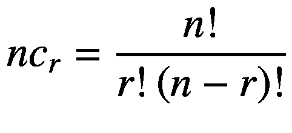

在上面的公式中，`n` 是集合中对象的总数，从中抽取一个较小的子集；`c` 是组合数；`r` 是子集中对象的数量。感叹号符号（`!`）表示一个数的阶乘。例如，`x!` 是从 1 到 `x`（含）的所有整数的乘积。（`x! = x*(x-1)*(x-2) … *1`）

现在让我们解决一个涉及组合的简单问题。

**问题**：从总共五种口味中，找出可以制作出包含三种口味的冰淇淋圣代的方法数。

**答案**：假设五种口味分别为 A、B、C、D 和 E。手动计算这个问题，可以得到以下组合：

*   A, B, C|B, C, D|A, C, D|A, B, D|C, D, E|B, D, E|A, B, E|A, D, E|A, C, E|B, C, E

如我们所见，共有十种组合。如果我们应用 `nc[r]` 公式，其中 `n` 为 5，`r` 为 3，我们会得到相同的答案（`5*C[3] = 10`）。

现在让我们看看什么是排列。

**排列**与组合类似，但在这里，对象排列的顺序很重要。

以下公式给出了排列数：

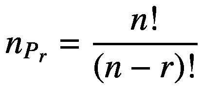

考虑相同的冰淇淋示例，让我们看看可以得到多少种排列，即从总共五种口味中选出并排列三种口味的方式数。

1.  ABC|CBA|BCA|ACB|CAB|BAC
2.  BCD|CDB|BDC|CBD|DBC|DCB
3.  ACD|ADC|DAC|DCA|CAD|CDA
4.  ABD|ADB|BAD|BDA|DAB|DBA
5.  CDE|CED|DCE|DEC|ECD|EDC
6.  BDE|BED|DBE|DEB|EBD|EDB
7.  ABE|AEB|BEA|BAE|EAB|EBA
8.  ADE|AED|DAE|DEA|EAD|EDA
9.  ACE|AEC|CAE|CEA|EAC|ECA
10. BCE|BEC|CBE|CEB|EBC|ECB

如我们所见，每种组合可以得到六种可能的排列。因此，排列总数为 10*6 = 60。公式 `nPr`（其中 `n=5` 且 `r=3`）也给出了相同的答案（60）。

另一种解决涉及排列问题的方法如下：

1.  首先，选择项目：从五种口味中选出三种，有 `5*C[3]` 种方式。
2.  然后，将这三个项目排列，有 `3!` 种方式。
3.  将步骤 1 和步骤 2 得到的结果相乘。排列总数 = `5*C[3] * 3! = 60`。

现在我们已经理解了排列与组合的概念，让我们看看概率的基本要素。

## 概率

下面给出了一些与概率相关的重要概念。

**随机试验**：任何能导致确定结果，并且可以在相同条件下重复任意次数的过程。

**结果**：单次试验的结果。

**样本空间**：包含试验所有可能结果的详尽列表。

**事件**：一个事件可以包含单个结果或结果的组合。事件是样本空间的一个子集。

**概率**：对事件发生可能性的定量度量。任何事件的概率总是在 0 和 1 之间。0 表示事件不可能发生，而 1 表示事件必然发生。

如果用字母 `X` 表示我们的事件，那么概率由符号 `P(X) = N(X)/N(S)` 给出，其中 `N(X)` = 事件 `x` 中的结果数，`N(S)` = 样本空间中的结果总数。

### 求解示例：概率

以下是一个简单的概率问题。

**问题**：在一次试验中，掷两次骰子。求两次掷出的数字之和为 10 的概率。

**解答**：

事件 A：第一次掷骰子。
事件 B：第二次掷骰子。

样本空间：一个骰子包含数字 1 到 6，它们出现的可能性相同。掷一次骰子，结果总数为 6。由于事件 A 和 B 是独立的，两个事件的结果总数为 6*6 = 36。

事件 X：两个数字之和为 10。导致此结果的可能结果包括 `{4,6}`、`{6,4}` 和 `{5,5}`；也就是说，有三种可能的结果使得和为 10。

`P(X)` = 得到和为 10 的概率 = 事件 X 中的结果数 / 总样本空间 = 3/36 = 0.0833

## 概率规则

让我们理解表 9-1 中解释的各种概率规则。

**表 9-1** 概率规则

| 规则 | 描述 | 公式 | 维恩图 |
| --- | --- | --- | --- |
| **加法规则** | 加法规则用于确定两个事件中任一事件发生的概率。 | `P(A U B) = P(A) + P(B) - P(A ∩ B)` | 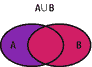 |
| **加法特殊规则** | 此规则适用于互斥事件。互斥事件是指不能同时发生的事件。对于互斥事件，任一事件发生的概率就是每个事件概率之和。 | `P(A U B) = P(A) + P(B)` |  |


### 乘法规则

乘法规则是一个通用规则，用于计算两个事件同时发生的概率。

`P(A ∩ B) = P(A) * P(B/A)`

`P(B/A)` 是事件 B 在事件 A 已经发生的条件下发生的**条件概率**。


### 乘法特殊规则

该规则适用于独立事件。对于独立事件，事件同时发生的概率就是各事件概率的乘积。

`P(A ∩ B) = P(A) * P(B)`

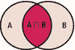

请注意，表 9-1 中列出的公式提供了两个事件的规则，但这些规则可以扩展到任意数量的事件。

### 条件概率

条件概率涉及在考虑了另一个已经发生的事件的概率之后，计算某个事件的概率。请参考图 9-1，该图说明了条件概率的原理。

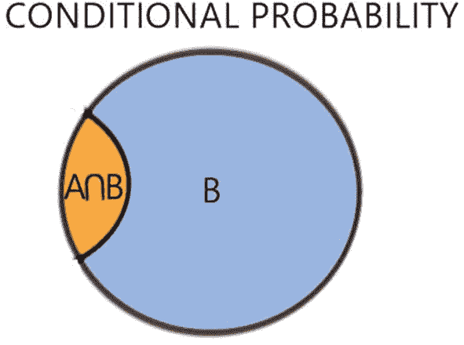

**图 9-1** 条件概率

图 9-1 显示，如果事件“A”依赖于事件“B”，那么样本空间就是事件“B”本身。例如，设 A 为顾客从在线零售商处购买产品的事件。设该事件的概率为 0.5，换句话说，`P(A) = 0.5`。现在，设 B 为顾客打算购买的产品收到了差评的事件。由于这个差评，顾客购买该产品的概率现在可能比以前更低。假设现在他们购买该产品的机会只有 30%。换句话说，`P(A/B)` = 顾客在收到差评的情况下购买产品的概率 = 0.3。条件概率的公式为 `P(A/B) = P(A ∩ B) / P(B)`。

### 贝叶斯定理

贝叶斯定理是一种用于计算事件在给定与该事件相关的一些证据下的条件概率的定理。贝叶斯定理建立了事件概率与关于该事件相关条件的先验知识之间的数学关系。随着与事件相关的证据不断积累，可以更准确地确定该事件的概率。

涉及贝叶斯定理的问题不同于传统的概率问题，在传统概率问题中，我们通常计算未来可能发生的事件的概率。例如，在一个简单的条件概率问题中，我们可能会被要求计算一个人肥胖的情况下患糖尿病的概率。在贝叶斯定理中，我们反向计算，计算一个人患有糖尿病的情况下肥胖的概率。也就是说，如果一个人检测出糖尿病阳性，贝叶斯定理检验他肥胖的假设。贝叶斯定理的公式如下：

`P(A/B) = `

`P(A/B)`，也称为后验概率，是我们想要计算的值，即在给定手头数据的情况下假设为真的概率。

`P(B/A)` 是在给定假设的情况下获得证据的概率。

`P(A)` 是**先验概率**，即在我们拥有任何相关数据之前假设为真的概率。

`P(B)` 是证据发生的一般概率，不依赖于任何假设，也称为**归一化常数**。

#### 贝叶斯定理的应用

以下是贝叶斯定理可以应用的一些领域：

- 医学诊断
- 金融与风险评估
- 电子邮件垃圾邮件分类
- 执法与犯罪侦查
- 赌博

现在，让我们通过几个例子来理解贝叶斯定理在其中一些领域的实际应用。

#### 贝叶斯定理在医学诊断中的应用

贝叶斯定理在医学诊断领域有应用，可以通过以下假设示例来理解。

**问题**：考虑一个人检测出某种疾病阳性的场景。已知该疾病在任何特定时间影响约 1.2% 的人口。已知该诊断测试对于患有该疾病的人准确率为 85%。对于未患该疾病的人，测试准确率为 97%。这个人检测出阳性，那么他患有该疾病的概率是多少？

**解答**：

评估医学测试的准确性是贝叶斯定理的应用之一。

让我们首先定义事件：

- `A`：此人患有该疾病，也称为假设。
- `~A`：此人未患该疾病。
- `B`：此人检测出该疾病阳性，也称为证据。
- `P(A/B)`：此人检测出阳性后患有该疾病的概率，也称为**后验概率**（这是我们需要计算的）。
- `P(B/A)`：此人患有该疾病的情况下检测出阳性的概率。该值为 0.85（如问题所述，该测试对患有该疾病的人有 85% 的准确率）。
- `P(A)`：**先验概率**，即在没有任何证据（如医学测试）的情况下此人患有该疾病的概率。该值为 0.012（如问题所述，该疾病影响 1.2% 的人口）。
- `P(B)`：此人检测出该疾病阳性的概率。该概率可以通过以下方式计算。

此人检测出该疾病阳性有两种可能的方式：

- 他们患有该疾病并且检测出阳性（真阳性）——发生这种情况的概率可以计算如下：
  `P(B/A) * P(A) = 0.85 * 0.012 = 0.0102`

- 他们没有患病，但测试不准确，检测出阳性（假阳性）——发生这种情况的概率可以计算如下：
  `P(B/~A) * P(~A) = (1 - 0.97) * (1 - 0.012) = 0.02964`

  这里，`P(B/~A)` 指的是未患病的人测试结果为阳性的概率，即测试对未患病的人不准确的概率。

  由于该测试对未患该疾病的人有 97% 的准确率，因此它在 3% 的情况下不准确。换句话说，`P(B/~A) = 1 - 0.97`。

  类似地，`P(~A)` 指的是此人未患该疾病的概率。由于我们已知该疾病的发病率为 1.2%，因此 `P(~A) = 1 - 0.012`。

`P(B)`，即贝叶斯定理公式中的分母，是上述两个概率的并集 = `(P(B/A) * P(A)) + (P(B/~A) * P(~A)) = 0.0102 + 0.02964 = 0.03984`

我们现在可以通过将分子和分母的值代入贝叶斯定理公式来计算最终答案。

`P(A/B) = P(B/A) * P(A) / P(B) = 0.85 * 0.012 / 0.03984 = 0.256`

使用贝叶斯定理，我们现在可以得出结论，即使医学检测结果呈阳性，此人患有该疾病的概率也只有 25.6%。


#### 贝叶斯定理的另一个应用：电子邮件垃圾邮件分类

让我们看看贝叶斯定理在电子邮件垃圾邮件分类领域的另一个应用。在垃圾邮件过滤器出现之前，没有办法将未经请求的邮件与合法邮件分开。人们不得不手动筛选邮件以识别垃圾邮件。如今，电子邮件垃圾邮件过滤器已经自动化了这一任务，并且在识别垃圾邮件以及只将正常邮件保留在收件箱中方面非常高效。贝叶斯方法是许多垃圾邮件过滤器背后的原理。考虑以下示例：

**问题**：一封邮件包含单词“offer”时，它是垃圾邮件的概率是多少？可用数据表明，50% 的电子邮件是垃圾邮件。9% 的垃圾邮件包含单词“offer”，而 0.4% 的正常邮件包含单词“offer”。

**答案**：
定义事件和概率如下：
- `A`：邮件是“垃圾邮件”
- `~A`：邮件是“正常邮件”
- `B`：邮件包含单词“offer”
- `P(A) = 0.5`（假设 50% 的电子邮件是垃圾邮件）
- `P(B/A)` = 垃圾邮件包含单词“offer”的概率 = `0.09`（9%）
- `P(B/~A)` = 正常邮件包含单词“offer”的概率 = `0.004`（0.4%）

应用贝叶斯定理：
`P(A/B) = (0.09 * 0.5) / ((0.09 * 0.5) + (0.004 * 0.5)) = 0.957`

换句话说，一封邮件在包含单词“offer”的情况下是垃圾邮件的概率为 0.957。

## SciPy 库

`SciPy`是一个用于数学和科学计算的库，包含适用于广泛领域的多种函数和算法，包括图像处理、信号处理、聚类、微积分、矩阵和统计学。这些领域中的每一个在`SciPy`中都有一个单独的子模块。我们在本章中使用`scipy.stats`子模块，并应用该子模块中的函数进行统计检验和不同类型的分布。该模块还包含用于距离计算、相关性和列联表的函数。

**进一步阅读**：
阅读更多关于`scipy.stats`模块及其函数的信息：
[`https://docs.scipy.org/doc/scipy/reference/stats.html`](https://docs.scipy.org/doc/scipy/reference/stats.html)

## 概率分布

为了理解概率分布，让我们首先了解随机变量的概念，它用于对概率分布进行建模。

**随机变量**：其值等于随机实验结果数值的变量。

随机变量有两种类型：

1.  **离散随机变量**可以取有限、可数的值。例如，用于调查和问卷以评估响应的李克特量表的随机变量可以取值 1、2、3、4 和 5。与离散随机变量相关的**概率质量函数**（`PMF`）是一个函数，它提供该变量恰好等于某个离散值的概率。

2.  **连续随机变量**可以取无限多个值。示例包括温度、身高和体重。对于连续变量，我们无法找到绝对概率。因此，我们使用**概率密度函数**（`PDF`）来处理连续变量（相当于离散变量的`PMF`）。`PDF`是连续随机变量的值落在某个值范围内的概率。

**累积分布函数**（`CDF`）给出随机变量小于或等于给定值的概率。它是`PDF`的积分，并给出由`PDF`定义的曲线下直到某一点的面积。

在下一节中，我们将介绍离散随机变量的两种概率分布：二项分布和泊松分布。

## 二项分布

在二项实验中，有多个独立的试验，每个试验只有**两种可能的结果**。这些结果是二项离散随机变量的两个值。二项分布的一个基本例子是反复抛硬币。每次抛掷只会产生两种结果：正面或反面。

以下是二项分布的特征：

1.  有`n`个相同的试验
2.  每个试验的结果只能是两种可能结果之一
3.  一个试验的结果不影响其他试验的结果
4.  每次试验的成功概率（`p`）和失败概率（`q`）相同
5.  随机变量表示这`n`次试验中成功的次数，最多可以等于`n`
6.  二项分布的均值和方差如下：
    - 均值 = `n * p`（试验次数 * 成功概率）
    - 方差 = `n * p * q`（试验次数 * 成功概率 * 失败概率）

在一次实验的`n`次尝试中获得`r`次成功的`PMF`由以下公式给出：
`P(X=r) = ^nC[r] p^r q^(n-r)`
其中`p`是成功概率，`q`是失败概率，`n`是试验次数。

### 二项分布的形状

二项分布类似于偏态分布，但随着`n`增加且`p`变小，它趋近于对称，看起来像正态曲线，如图 9-2 所示。

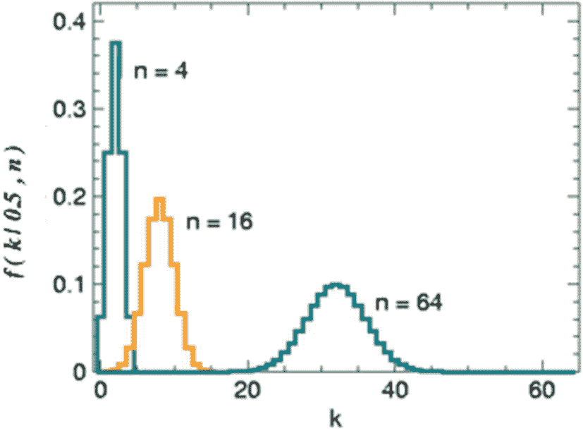

**图 9-2** 不同取值下的二项分布

**问题**：地铁公司对乘坐地铁列车的八位老年乘客进行调查，询问他们对地铁列车引入的新安全功能的满意度。每个响应只有两个值：是或否。假设根据历史调查，“是”响应的概率为 0.6，“否”响应的概率为 0.4。

计算以下概率：
1.  恰好有三人对地铁的新安全功能感到满意
2.  少于五人感到满意

**解决方案**：

1.  对于问题的第一部分：我们可以使用公式`^nC[r] p^r q^(n-r)`或使用`SciPy`函数（`stats.binom.pmf`）来解决，如下所示：

    代码：
    ```python
    import scipy.stats as stats
    n, r, p = 8, 3, 0.6
    stats.binom.pmf(r, n, p)
    ```

    输出：
    ```
    0.12386304000000009
    ```

    解释：首先，需要导入`scipy.stats`模块。然后我们定义三个变量——`n`（试验次数）、`r`（成功次数）和`p`（失败概率）。之后，调用二项分布的`PMF`（`stats.binom.pmf`），并按顺序传递三个参数——`r`、`n`和`p`。由于我们计算的是离散变量的概率，因此使用`pmf`函数。

2.  对于问题的第二部分：由于我们需要计算少于五人感到满意的概率，变量的限制值为 4。

    我们需要计算的概率由以下公式给出：
    `P(X <= 4) = P(X=0) + P(X=1) + P(X=2) + P(X=3) + P(X=4)`

    我们可以应用公式`^nC[r] p^r q^(n-r)`来计算`r = 0, 1, 2, 3, 4`的值，或者使用`SciPy`中的`stats.binom.cdf`函数来解决，如下所示：

    代码：
    ```python
    import scipy.stats as stats
    n, r, p = 8, 4, 0.6
    stats.binom.cdf(r, n, p)
    ```

    输出：
    ```
    0.40591359999999976
    ```

    解释：当我们计算`x`的多个值的概率时，我们使用`CDF`函数。

## 泊松分布

泊松分布是一种对在给定区间（通常是时间区间，但也可以是距离、面积或体积区间）内发生的事件数量进行建模的分布。需要知道事件的平均发生率。

泊松分布的`PMF`由以下公式给出：


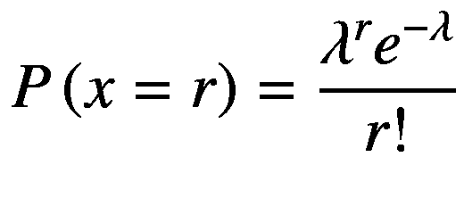

其中`P(x=r)`是事件发生`r`次的概率，`r`是事件发生的次数，`λ^r`代表该事件的平均/期望发生次数。

泊松分布可用于计算在给定时间段内发生的事件次数，例如：

- 每小时餐厅的到达人数
- 工厂一年内发生的工作相关事故数量
- 一周内呼叫中心的客户投诉数量

**泊松分布的性质**：

1. 均值=方差=`λ`。在泊松分布中，均值和方差具有相同的数值。
2. 事件是独立的、随机的，并且不能同时发生。
3. 当`n` > 20 且`p` < 0.1 时，泊松分布可以近似二项分布。这里，我们代入`λ = np`。
4. 当`n`值很大，`p`约为 0.5，且`np` > 0.5 时，正态分布可用于近似二项分布。

**泊松分布的形状**

泊松分布呈偏态，但随着均值（`λ`）的增加，它开始接近正态分布，如图 9-3 所示。

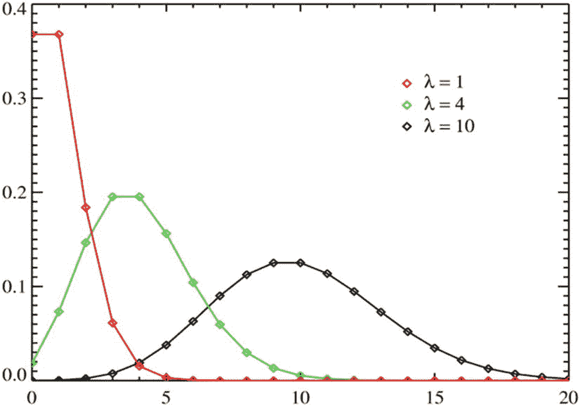

图 9-3 泊松分布

**泊松分布求解示例**：

在一个地铁站，平均有 2 台售票机处于故障状态。假设故障机器数量服从泊松分布，计算在某个时间点：

1. 恰好有三台机器故障的概率
2. 超过两台机器故障的概率

解：

1. 我们可以使用公式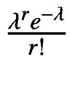或在 Python 中求解如下：

代码：

```
import scipy.stats as stats
λ=2
r=3
stats.poisson.pmf(r,λ)
```

输出：

```
0.18044704431548356
```

解释：首先，需要导入`scipy.stats`模块。然后我们定义两个变量——`λ`（平均值）和`r`（事件发生次数）。接着，调用泊松分布的 PMF 函数（`stats.poisson.pmf`），并按顺序传入两个参数`r`和`λ`。

2. 由于我们需要计算超过两台机器故障的概率，需要计算以下概率：

`P(x>2)`，或`(1-p(x=0)-p(x=1)-p(x=2))`。

这可以使用`stats.poisson.cdf`函数计算，其中`r=2`。

代码：

```
import scipy.stats as stats
λ=2
r=2
1-stats.poisson.cdf(r,λ)
```

输出：

```
0.3233235838169366
```

解释：我们采用与问题第一部分类似的方法，但使用 CDF 函数（`stats.poisson.cdf`）代替 PMF（`stats.poisson.pmf`）。

## 连续概率分布

有几种连续概率分布，包括正态分布、学生 t 分布、卡方分布和 ANOVA 分布。在下一节中，我们将探讨正态分布。

## 正态分布

正态分布是一条对称的钟形曲线，由其均值（`μ`）和标准差（`σ`）定义，如图 9-4 所示。

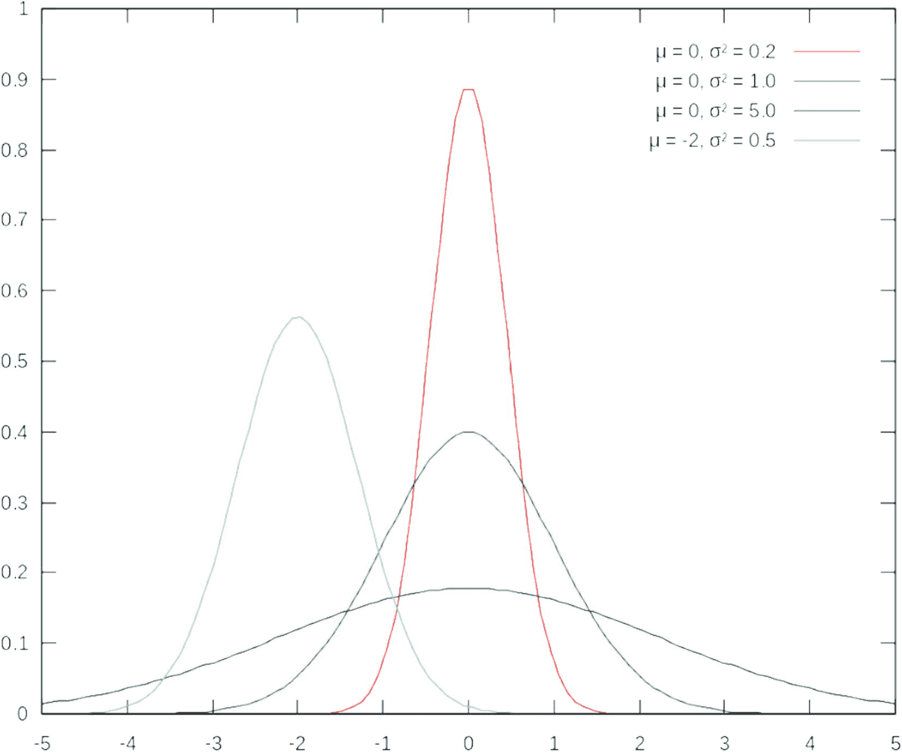

图 9-4 正态分布

图 9-4 中的所有四条曲线都是正态分布。均值用符号`μ`（mu）表示，标准差用符号`σ`（sigma）表示。

**正态分布的特征**

1. 中心值（`μ`）也是正态分布的众数和中位数。
2. 正态性检验：在正态分布中，第 75 百分位数值（Q3）与第 50 百分位数值（中位数或 Q2）之差等于中位数（Q2）与第 25 百分位数值之差。换句话说，

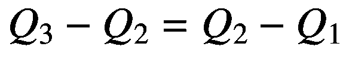

如果分布是偏态的，这个等式不成立。
在右偏分布中，`(Q3 - Q2) > (Q2 - Q1)`
在左偏分布中，`(Q2 - Q1) > (Q3 - Q2)`

## 标准正态分布

为了标准化单位并比较具有不同均值和方差的分布，我们使用标准正态分布。

**标准正态分布的性质**：

- 标准正态分布是均值为 0、标准差为 1 的正态分布。
- 任何正态分布都可以使用以下公式转换为标准正态分布：

`z = (x - μ) / σ`，其中`μ`和`σ`是原始正态分布的均值和方差。

- 在标准正态分布中，
  - 68.2%的值落在均值的一个标准差范围内
  - 95.4%的值落在均值的两个标准差范围内
  - 99.8%的值落在均值的三个标准差范围内

这种值的分布如图 9-5 所示。

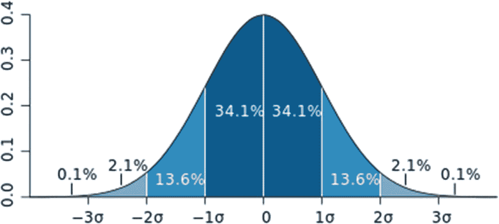

图 9-5 标准正态分布

- 标准正态分布曲线下任意两点之间的面积代表落在这两点之间的值的比例。例如，均值两侧的曲线下面积均为 0.5。换句话说，50%的值位于均值的两侧。

涉及正态分布的问题有两种类型：

1. 计算与变量值对应的概率/比例：使用公式`z = (x - μ) / σ`计算 z 值，然后将此 z 值作为参数传递给`stats.norm.cdf`函数。
2. 计算与给定概率对应的变量值：首先，通过将概率值作为参数传递给`stats.norm.ppf`函数获得 z 值。然后，通过将值代入以下公式获得与 z 值对应的变量（x）的值：`z = (x - μ) / σ`。

**标准正态分布求解示例**
问题：一家软件公司的 IT 团队正在检查一些笔记本电脑。该团队需要选择启动时间最快的顶级 1%的笔记本电脑。平均启动时间为 7 秒，标准差为 0.5 秒。入选所需的截止启动时间是多少？
解：

步骤 1：由于标准是快速启动时间，感兴趣的启动时间位于分布的下左端，如图 9-6 所示。

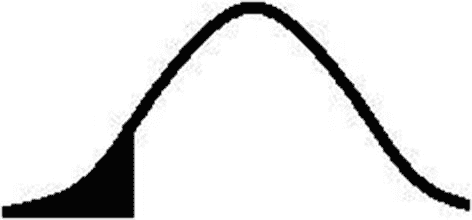

图 9-6 左尾检验（标准正态分布）

该尾部右侧的曲线面积为 0.99。我们使用`stats.norm.ppf`函数计算对应于概率值 0.99 的 z 值：

代码：

```
stats.norm.ppf(0.99)
```

输出：

```
2.3263478740408408
```


由于这是一个左尾检验，我们取 `z` 的值为 `–2.33`（该值为负，因为它位于均值的左侧）。我们也可以通过计算概率 `0.99` 对应的 `z 值`，并使用 `z 表` 来验证这一点。

**步骤 2：** 应用以下公式并计算 `x`：
`z = (x - μ) / σ`
其中 `z = -2.33`，`μ = 7`，`σ = 0.5`。我们需要计算 `x` 的值：

```
x = (-2.33 * 0.5) + 7
```

输出：`5.835`

**推断：** 所需的启动时间为 `5.835` 秒。

**示例 2（标准正态分布）：**

一家公司生产灯管，这些灯管的寿命（以小时计）服从均值为 `900`（小时）、标准差为 `150`（小时）的正态分布。请计算以下内容：

1.  在前 `750` 小时内失效的灯管比例。
2.  在 `800` 到 `1100` 小时之间失效的灯管比例。
3.  多少小时后，会有 `20%` 的灯管失效？

**示例 2 的解答（标准正态分布）：**

1.  计算 `X = 750` 对应的 `z 值`，并获取相应的概率：

```
x = 750
μ = 900
σ = 150
z = (x - μ) / σ
z
stats.norm.cdf(z)
```

输出：

```
0.15865525393145707
```

**推断：** 在前 `750` 小时内，有 `15.8%` 的灯管失效。

2.  分别计算 `x 值` 为 `800` 和 `1100` 对应的 `z 值`，然后减去这些 `z 值` 对应的概率。

```
x1 = 800
x2 = 1100
μ = 900
σ = 150
z1 = (x1 - μ) / σ
z2 = (x2 - μ) / σ
p2 = stats.norm.cdf(z2)
p1 = stats.norm.cdf(z1)
p2 - p1
```

输出：

```
0.6562962427272092
```

**推断：** 大约有 `65.6%` 的灯管，其寿命在 `800` 到 `1100` 小时之间，会失效。

3.  计算概率 `0.2` 对应的 `z 值`，并将 `z`、`μ` 和 `σ` 代入公式 `z = (x - μ) / σ` 中计算 `x`。

```
z = stats.norm.ppf(0.2)
μ = 900
σ = 150
x = μ + σ * z
x
```

输出：

```
773.7568149640629
```

**推断：** 在大约 `774` 小时的寿命后，`20%` 的灯管会失效。

## 集中趋势度量

集中趋势是衡量数据集中一组数值的中心值的一种度量。以下是一些集中趋势的度量：

*   **均值**：这是数据集中数值的平均值。
*   **中位数**：这是数据集中数值按大小排列时的中间数。
*   **众数**：在具有离散值的数据集中出现频率最高的值。
*   **百分位数**：百分位数是衡量低于特定值的数值所占百分比的度量。中位数对应第 50 个百分位数。
*   **四分位数**：四分位数是将有序数据集中的数值分成四个相等组的值。`Q1`（或第一个四分位数）对应第 25 个百分位数，`Q2` 对应中位数，`Q3` 对应第 75 个百分位数。

## 离散程度度量

离散程度度量给出了分布离散程度的定量度量。它们提供了分布中的数值是集中在中心值附近还是分散开来的概念。以下是常用的离散程度度量。

*   **极差**：极差是衡量数据集中最低值和最高值之间差异的度量。
*   **四分位距**：衡量第三个四分位数与第一个四分位数之间差异的度量。由于它关注位于中间的值，因此受极端值的影响较小。四分位距对于存在异常值的偏态分布是一个很好的度量。四分位距表示为 `IQR = Q3 - Q1`。
*   **方差**：这是衡量数据集中数值围绕均值分散程度的度量。方差的值是判断均值是否能代表数据集中数值的良好指标。方差小表明均值是集中趋势的合适度量。以下公式给出了方差：

`σ² = Σ(x - μ)² / N`

其中 `μ` 是均值，`N` 是数据集中的数值个数。

*   **标准差**：该度量通过取方差的平方根来计算。由于方差取的是差值的平方，因此其单位与数据的单位不同；所以取方差的平方根使其与数据的单位相同。例如，在一个关于平均降雨量（以厘米为单位）的数据集中，方差给出的值是 `cm²`，这难以解释，而标准差（以 `cm` 为单位）则能给出平均降雨量偏差的概念。

## 形状度量

**偏度**：这衡量的是分布的不对称程度，如图 9-7 所示。

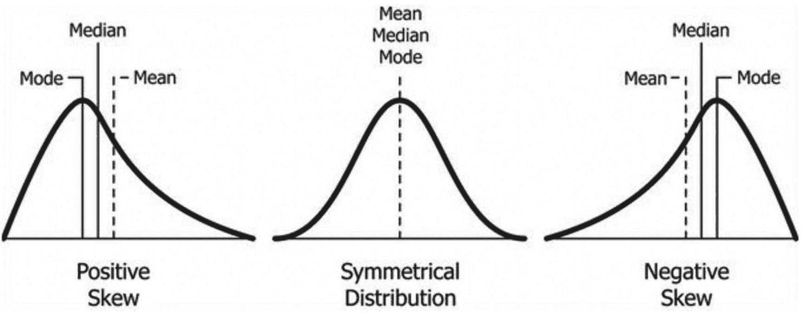

**图 9-7** 具有不同偏度的分布

从图 9-7 中我们可以观察到：
*   在正偏态分布中，`均值 > 中位数`。
*   在负偏态分布中，`均值 < 中位数`。
*   在完全对称的分布中，`均值 = 中位数 = 众数`。

**峰度**：峰度是衡量给定数据分布是弯曲、尖峰还是平坦的度量。

常峰态分布具有钟形曲线。尖峰态分布是具有明显峰值的分布。平峰态分布，顾名思义，具有平坦的曲线。这些分布如图 9-8 所示。

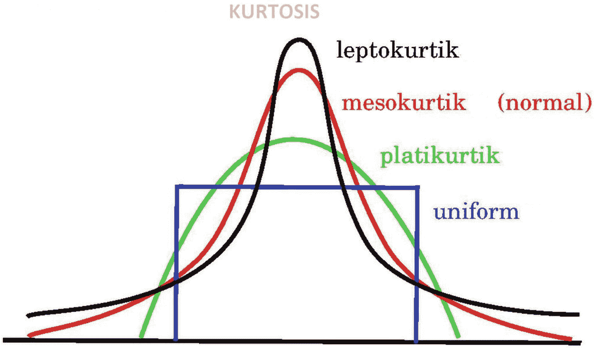

**图 9-8** 峰度的表示

**已解答示例：**
某小学 3-7 岁儿童的体重（公斤）如下：`19, 23, 19, 18, 25, 16, 17, 19, 15, 23, 21, 23, 21, 11, 6`。让我们计算集中趋势、离散程度、偏度和峰度的度量。

创建一个 Pandas Series 对象：

```
import pandas as pd
a = pd.Series([19, 23, 19, 18, 25, 16, 17, 19, 15, 23, 21, 23, 21, 11, 6])
```

Pandas 的 `describe` 方法可以用于 Series 对象或 DataFrame 对象，是一种在一行代码中获取大多数集中趋势度量的便捷方式。均值为 `18.4` 公斤，第一个四分位数（`Q1` 或第 25 个百分位数）为 `16.5` 公斤，中位数（第 50 个百分位数）为 `19` 公斤，第三个四分位数（第 75 个百分位数）为 `22` 公斤。

```
a.describe()
```

输出：

```
count    15.000000
mean     18.400000
std       4.997142
min       6.000000
25%      16.500000
50%      19.000000
75%      22.000000
max      25.000000
dtype: float64
```

使用 `mode` 方法获取众数：

```
a.mode()
```

输出：

```
0    19
1    23
dtype: int64
```

值 `19` 和 `23` 是出现频率最高的值。

**获取离散程度度量**
可以使用 `max` 和 `min` 函数计算极差，并取这两个值之间的差值：

```
range_a = max(a) - min(a)
range_a
```

输出：

```
19
```

分别使用 `std` 和 `var` 方法获取标准差和方差：

```
a.std()
```

输出：

```
4.99714204034952
```

```
a.var()
```

输出：

```
24.97142857142857
```

**获取偏度和峰度度量**，方法是使用 `scipy.stats` 模块中的 `skew` 和 `kurtosis` 函数：

```
from scipy.stats import skew, kurtosis
stats.kurtosis(a)
```

输出：

```
0.6995494033062934
```


峰度值为正表示分布呈尖峰态。

偏度：

```
stats.skew(a)
```

输出：

```
-1.038344732097918
```

偏度值为负表示分布呈左偏态，此时均值小于中位数。

注意事项：

1. 均值容易受异常值（极端值）影响。当数据集中存在异常值时，使用中位数更为合适。
2. 标准差和方差与均值密切相关。因此，如果存在异常值，标准差和方差也可能不是具有代表性的度量指标。
3. 众数通常用于离散数据，因为连续数据可能存在多个众数值。

## 抽样

当我们试图了解某个总体的情况时，收集总体中每个个体的数据并不现实。更可行的方法是抽取样本，并基于样本数据对总体参数进行估计。样本的特征应与总体的特征保持一致。以下是主要的样本收集方法。

### 概率抽样

概率抽样涉及从总体中随机选择个体。进行概率抽样主要有四种方法：

1. **简单随机抽样**：个体被随机选择，没有任何偏好。总体中的每个个体被选中的概率相等。
2. **分层随机抽样**：将总体划分为互斥（不重叠）的组，然后从每个组中随机选择个体。例如：如果你正在调查以评估学校中学科偏好，你可以将学生分为男生组和女生组，并从每组中随机选择个体。这种方法的优点在于它代表了总体中的所有类别或组。
3. **系统随机抽样**：按固定间隔选择个体。例如：要从 500 人的总体中抽取 100 人的样本，首先用 500 除以 100，得到 5。然后，每隔 5 人选取一人作为样本。这种方法更容易执行，但可能无法代表总体中的所有个体。
4. **整群抽样**：在此方法中，将总体划分为覆盖整个总体的不重叠的群组。从这些群组中，随机选择几个。要么选择所选群组中的所有成员（单阶段），要么从所选群组的成员中随机选择一个子集（两阶段）。这种方法的优点在于执行起来更便宜、更方便。

### 非概率抽样

当由于缺乏现成数据而无法使用概率抽样方法收集样本时，我们使用非概率抽样技术。在非概率抽样中，我们不知道个体被选入研究的概率。

它分为以下几种类型：

1. **便利抽样**：在此方法中，选择容易接触或可用的个体。例如，研究人员可以从其工作场所或工作的大学中选择研究对象。这种方法易于实施，但可能无法代表总体。
2. **目的性抽样**：根据抽样的目的选择个体。例如，如果正在进行一项调查以评估间歇性禁食的效果，则需要考虑能够进行这种禁食的人群的年龄段，调查可能只包括 25-50 岁的人。目的性抽样进一步分为：
   - **配额抽样**：以这样一种方式设定配额，即在选择样本时考虑总体的重要特征。如果总体中有 60%的白人、20%的西班牙裔和 20%的亚裔，那么你选择的样本应具有相同的百分比。
   - **滚雪球抽样**：在这种方法中，研究人员识别出他们认识的、符合研究标准的人。然后这个人会介绍给其他人，样本群体因此通过口口相传而扩大。这种技术可用于缺乏可见性的群体，例如，对患有某种未被充分报道的疾病的人群进行调查。

## 中心极限定理

中心极限定理指出，如果我们从总体中选择样本，这些样本均值的分布呈正态分布，其均值为 *μ*，标准差为 `σ_x̄`。

即使总体分布本身不是正态分布，样本均值的分布也近似于正态分布。随着样本量的增加，样本均值的分布越来越接近正态分布，如图 9-9 所示。

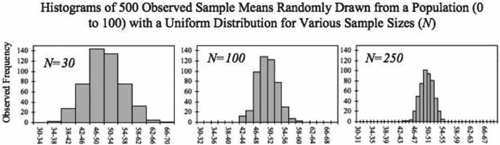

**图 9-9** 样本均值的分布。随着样本量的增加，样本均值的分布趋近于正态分布。

样本均值被用作总体均值的估计值，但这个抽样分布的标准差（`σ_x̄`）与总体标准差 *σ* 并不相同。样本标准差与总体标准差的关系如下：

`σ_x̄ = σ / √n`

`其中 σ 是总体标准差，n 是样本量`

`σ_x̄` 被称为标准误差（样本均值分布的标准误差）。随着样本量（*n* 增加），标准误差趋近于 0，样本均值（`x̄`）趋近于总体均值（*μ*）。

## 估计与置信区间

- **点估计**：从样本中提取的单个统计量，用于估计未知的总体参数。样本均值被用作总体均值的点估计。
- **区间估计**：总体参数所在的一个宽泛的值域范围。它表明了估计总体参数时的误差。
- **置信区间**：总体均值所在的范围区间。对于从总体（标准差为 *σ*，均值为 *μ*）中抽取的、样本量为 *n*、均值为 `x̄` 的随机样本，总体均值的置信区间由以下公式给出：
  - `x̄ - (zσ / √n) ≤ μ ≤ x̄ + (zσ / √n)`：当总体标准差 *σ* 已知时
  - `x̄ - (zs / √n) ≤ μ ≤ x̄ + (zs / √n)`：当总体标准差未知时（此方程中的 *s* 是样本标准差）


### 已解决的示例：置信区间

**问题：** 从某个学生群体中抽取了一个样本（包含十名受试者）。这些学生的平均绩点呈正态分布。总体标准差未知。根据以下样本值，计算总体均值（全体学生的平均绩点）的 95%置信区间：3.1、2.9、3.2、3.4、3.7、3.9、3.9、2.8、3.4、3.6。

**解决方案：** 以下代码计算总体均值的 95%置信区间：

```
import numpy as np
import scipy.stats as stats
grades = np.array([3.1,2.9,3.2,3.4,3.7,3.9,3.9,2.8,3.4,3.6])
stats.t.interval(0.95, len(grades)-1, loc=np.mean(grades), scale=stats.sem(grades))
```

**输出：**

```
(3.1110006165952773, 3.668999383404722)
```

**解释：** 学生群体的平均绩点落在 3.11 到 3.67 之间的概率为 95%。

**对前述代码的解释：** 我们首先为样本观测值定义一个 NumPy 数组，然后调用`stats.t.interval`函数。我们向该函数传递以下参数：置信区间的值（0.05）、自由度（观测总数减 1）、样本均值以及标准误差（由`stats.sem`函数计算）。该函数返回两个值——置信下限（LCI）和置信上限（UCI）。请注意，使用`stats.t.interval`函数是因为总体标准差未知。如果已知，我们会使用`stats.norm.interval`函数。

## 抽样中的误差类型

如果我们抽取一个样本，并基于该样本对整个总体进行推断，误差就不可避免地会产生。这些误差大致可分为以下几类：

- **抽样误差：** 样本对总体的估计值与实际总体估计值之间的差异
- **覆盖误差：** 当总体未被充分代表，且某些群体被排除时发生
- **无应答误差：** 当我们未能纳入符合研究标准但未回答调查问题的无应答受试者时发生
- **测量误差：** 由于测量方法或工具存在缺陷，未能测量到正确的参数

现在我们进入假设检验的概念。

## 假设检验

假设是对未知变量或参数给出估计的陈述。如果我们试图从该总体中抽取的样本中找出某城市人口的平均年龄，并且发现该样本中人口的平均年龄为 34 岁，那么我们的假设陈述可以如下：“该城市人口的平均年龄为 34 岁。”

### 假设检验中的基本概念

在假设检验中，我们构建两个陈述，称为原假设和备择假设。

- **原假设：** 用术语`H[0]`表示，这是需要检验的假设。它基于现状没有改变的原则。如果样本均值为 70，而历史总体均值为 90，则原假设会表述为总体均值等于 90。
- **备择假设：** 用术语`H[1]`表示，如果原假设不成立，人们会相信这个假设。备择假设（使用前面的例子）会表述为均值大于、小于或不等于 90。

我们要么拒绝原假设，要么无法拒绝原假设。请注意，拒绝原假设并不意味着备择假设为真。假设检验的结果仅对总体具有提示性或指示性，并不能最终证明或反驳任何假设。

### 假设检验中使用的关键术语

让我们看看假设检验中一些常用的术语：

**第一类错误**，或**显著性水平**，用符号`α`表示，是当原假设为真时拒绝它的错误。它也可以定义为总体参数落在其置信区间之外的概率。如果置信区间为 95%，则显著性水平为 0.05，即总体参数有 5%的概率不落在根据样本计算出的置信区间内。

第一类错误的示例：X 先生出现皮疹，去看医生做水痘检测。设原假设为他没有患此病。医生基于一些有缺陷的检测错误地诊断为水痘，但实际情况是 X 先生并未患此病。这是当原假设为真时拒绝它的典型例子，也就是第一类错误。

**第二类错误**，用符号`β`表示，是当原假设为假时未能拒绝它的错误。在前面的水痘例子中，如果 X 先生患有水痘，但医生未能诊断出来，那么医生就犯了第二类错误。

**单样本检验：** 当只考虑一个总体，并抽取一个样本来查看从样本计算出的值与总体参数之间是否存在差异时使用的检验。

**双样本检验：** 当从两个不同总体中抽取样本时使用的检验。它有助于根据样本参数评估总体参数是否不同。

**临界检验统计量：** 用于决定是否拒绝原假设的样本检验统计量的极限值。在图 9-10 中，`z=1.96`和`z=-1.96`是临界值。大于 1.96 和小于-1.96 的 Z 值会导致拒绝原假设。

**拒绝域：** 原假设被拒绝的数值范围。接受域是对应于原假设成立的界限区域。

拒绝域和接受域如图 9-10 所示。

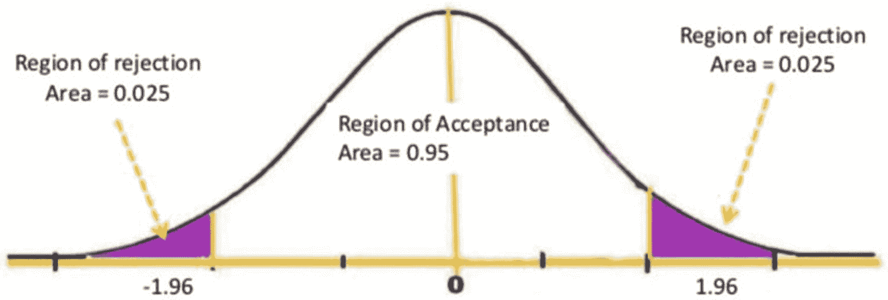

**图 9-10** 接受域与拒绝域


**双尾检验**：拒绝域位于分布的两侧尾部。

双尾检验示例：从一个 50 人的班级中抽取 10 名学生作为样本，检验班级平均分相对于历史平均值是否有变化。这是一个需要进行双尾检验的案例，因为我们只是检验平均值是否有变化，并不知道这种变化是正向还是负向。

**单尾检验**：拒绝域位于右侧尾部（上尾）或左侧尾部（下尾），但不会同时位于两侧尾部。

上尾检验示例：为了提高一个 50 人班级的成绩，开设了课后辅导班。这些特殊课程被认为提高了成绩。为了检验这一假设，我们从总体中抽取一个样本进行单尾检验（上尾），因为我们检验的是平均分是否有所提高。拒绝域将位于右侧尾部。

下尾检验示例：由于政治动荡，学生缺勤率有所上升。据信这些事件可能对学生的成绩产生负面影响。为了检验这一假设，我们从总体中抽取一个样本进行单尾检验（下尾），因为我们检验的是平均分是否有所降低。拒绝域位于左侧尾部。

`p 值`（用字母`p`表示）是在假设原假设为真的情况下，观察到检验统计量的值至少与观测值一样极端的概率。`p 值`常用于假设检验中，以决定是否拒绝原假设。`p 值`通常与显著性水平 0.05 进行比较。

如果`p < 0.05`，则意味着样本数据是随机的且不代表总体的概率非常低。在这种情况下，我们拒绝原假设。

如果`p > 0.05`，则样本不代表总体的可能性更大。在这种情况下，我们无法拒绝原假设。

### 假设检验涉及的步骤

1.  陈述原假设和备择假设
2.  确定显著性水平并获取检验统计量的临界值
3.  选择合适的检验：

    根据以下参数选择检验：
    *   样本数量
    *   总体是否服从正态分布
    *   被检验的统计量
    *   样本量
    *   总体标准差是否已知

4.  获取相关的检验统计量（`z`统计量 / `t`统计量 / `卡方`统计量 / `f`统计量）或`p 值`
5.  将临界检验统计量与计算出的检验统计量进行比较，或将`p 值`与 0.05 进行比较

    根据检验统计量或`p 值`决定是否拒绝原假设：
    *   使用检验统计量：
        *   计算出的检验统计量 > 临界检验统计量（上尾检验）
        *   计算出的检验统计量 < 临界检验统计量（下尾检验）
    或者
    *   使用`p 值`（`p`），如果`p < 0.05`

6.  基于上述比较得出结论

## 单样本`z`检验

当我们想要验证总体均值是否与其历史值或假设值存在差异时，使用此检验。

### 单样本`z`检验的标准：

*   抽取样本的总体服从正态分布
*   样本量大于 30
*   抽取单个样本
*   我们检验的是总体均值
*   总体标准差已知

### 计算检验统计量的公式：

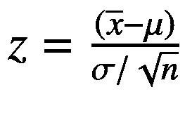，其中  是样本均值，`μ` 是总体均值，`σ` 是总体标准差，`n` 是样本量。

### 求解示例：单样本`z`检验

**问题：** 一家当地意大利餐厅的平均配送时间为 45 分钟，标准差为 5 分钟。该餐厅收到了一些顾客投诉，决定分析最近 40 份订单。这 40 份订单的平均配送时间为 48 分钟。在 5%的显著性水平下进行适当的检验，以判断配送时间是否有所增加。

**答案：**

1.  **陈述假设：**
    设`μ`为该餐厅的平均配送时间（总体均值）。
    原假设：`H0: μ = 45`
    备择假设：`H1: μ > 45`

2.  **确定显著性水平：** `α = 0.05`

3.  **选择合适的假设检验：**
    *   样本数量：1
    *   样本量：`n = 40`（大样本）
    *   检验内容：样本均值（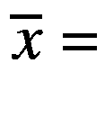48）与总体均值（`μ = 45`）之间是否存在差异
    *   总体标准差（`σ = 5`）已知

    根据上述数据，我们选择单样本`z`检验。

4.  **借助以下公式获取检验统计量和`p 值`：**

    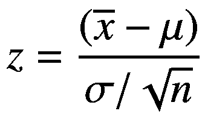

    代入数值 48，`μ = 45`，`σ = 5`，`n = 40`：

    ```
    z = 3.7947
    ```

    使用`stats.norm.cdf`函数计算与此`z`值对应的`p 值`：

    **代码：**
    ```
    import scipy.stats as stats
    stats.norm.cdf(z)
    ```

    **输出：**
    ```
    0.999
    ```

5.  **将`p 值`与显著性水平（0.05）进行比较：**
    由于计算出的`p 值` > `α`，我们无法拒绝原假设。

6.  **结论：**
    在 0.05 的显著性水平下，样本的平均配送时间与历史总体平均值之间没有显著差异。

## 双样本`z`检验

双样本`z`检验与单样本`z`检验类似，区别仅在于：

*   考虑两个组/总体，我们从每个总体中各抽取一个样本
*   两个总体分布都是正态的
*   两个总体的标准差均已知
*   计算检验统计量的公式：![$$ :z=\frac{\left({\overline{x}}_1-{\overline{x}}_2\right)}{\sqrt{\left[\frac{\sigma_1²}{n_1}+\frac{\sigma_2²}{n_2}\right]}} $$](images/498042_1_En_9_Chapter/498042_1_En_9_Chapter_TeX_IEq19.png)

### 求解示例：双样本`z`检验

某组织在两个生产单元 A 和 B 制造 LED 灯泡。质量控制团队认为 A 单元的生产质量优于 B 单元。质量通过灯泡的工作时长来衡量。团队从两个单元抽取样本进行检验。A 单元和 B 单元 LED 灯泡的平均寿命分别为 1001.3 和 810.47。样本量分别为 40 和 44。总体方差已知：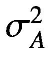 = 48127，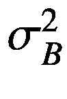 = 59173。在 5%的显著性水平下进行适当的检验，以验证质量控制团队的说法。

**解答：**

1.  **陈述假设：**
    设 A 单元和 B 单元 LED 灯泡的平均寿命分别为`μA`和`μB`。
    原假设：`H0: μA ≤ μB`
    备择假设：`H1: μA > μB`

    这是一个单尾（上尾）检验。


### 2. 设定显著性水平：`α=0.05`

### 3. 选择合适的假设检验：

- **样本数量**：2 个样本（从两个不同总体中抽取样本）
- **样本容量**：大样本（`n[A] = 40`，且 `n[B] = 44`）
- **检验目标**：比较 A 单元与 B 单元 LED 灯泡的平均寿命
- **总体特征**：总体分布未知，但总体方差已知

因此，我们进行双样本 `z` 检验。

### 4. 计算检验统计量与 p 值

使用以下公式：

```
z = (x̄₁ - x̄₂) / sqrt(σ₁²/n₁ + σ₂²/n₂)
```

将数值 `x̄₁ = 1001.3`，`x̄₂ = 810.47`，`n₁ = 40`，`n₂ = 44`，以及方差（sigma）值 `48127` 和 `59173` 代入上述公式计算 `z`：

**代码：**

```python
z = (1001.34 - 810.47) / ((48127/40) + (59173/44))**0.5
```

**输出：**

```
3.781260568723408
```

使用 `stats.norm.cdf` 函数计算与此 `z` 值对应的 p 值：

**代码：**

```python
import scipy.stats as stats
p = 1 - stats.norm.cdf(z)
p
```

**输出：**

```
7.801812433294586e-05
```

**解释**：由于这是上尾检验，我们需要计算右尾的面积/比例。因此，我们用 1 减去计算出的面积（`stats.norm.cdf`）。

### 5. 比较计算出的 p 值与显著性水平：

由于计算出的 p 值（`0.000078`）< `α`（`0.05`），我们拒绝原假设。

### 6. 推断：

在 5%的显著性水平下，A 单元生产的 LED 灯泡寿命显著长于 B 单元。

---

## 比例假设检验

比例检验用于名义数据，适用于比较百分比或比例。例如，一项针对某组织内部门收集的调查报告可能声称该组织内 85%的人对其政策感到满意。而历史满意度为 82%。这里，我们是将样本中获取的百分比或比例与总体的百分比/比例进行比较。以下是比例抽样分布的一些特征：

- 从样本中获取的比例的抽样分布近似正态分布
- 该抽样分布的均值（`p̄`）= 总体比例（`p`）
- 计算检验统计量：以下公式给出 `z` 值

```
z = (p̄ - p) / sqrt(p(1-p)/n)
```

其中 `p̄` 是样本比例，`p` 是总体比例，`n` 是样本容量。

### 示例：单样本比例 z 检验

这里，我们通过一个示例来理解单样本比例 `z` 检验。

**问题**：已知某移动服务中心总客户的 40%对其提供的服务感到满意。该中心的客户服务部门决定进行一项调查，以评估当前的客户满意度。它调查了 100 名客户，发现其中只有 30 名客户对其服务感到满意。在 5%的显著性水平下进行假设检验，以确定满意客户的百分比是否已从初始满意度水平（40%）下降。

**解答**：

#### 1. 陈述原假设与备择假设

设平均客户满意度为 `p`。

- `H₀`：`p = 0.4`
- `H₁`：`p < 0.4`

`<` 符号表明这是一个单尾检验（下尾检验）。

#### 2. 设定显著性水平：`α = 0.05`

#### 3. 选择合适的检验：


我们选择单样本比例 z 检验，因为：

- 样本量较大（100）
- 仅抽取一个样本
- 我们正在检验总体比例是否发生变化

4. 获取相关的检验统计量和 p 值

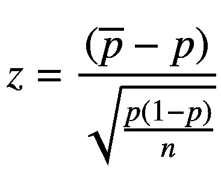

其中 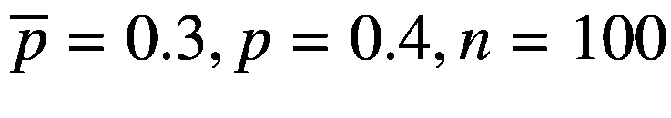

计算 `z` 和 `p`：

代码：

```
import scipy.stats as stats
z=(0.3-0.4)/((0.4)*(1-0.4)/100)**0.5
p=stats.norm.cdf(z)
p
```

输出：

```
0.02061341666858179
```

5. 决定是否拒绝原假设

`p` 值（0.02）< 0.05 → 我们拒绝原假设

6. 推断：在 5% 的显著性水平下，对服务中心服务满意的客户百分比已下降

## 双样本总体比例 z 检验

在此，我们比较来自两个独立样本（分别属于两个不同总体）的比例。以下公式给出了临界检验统计量的计算公式：

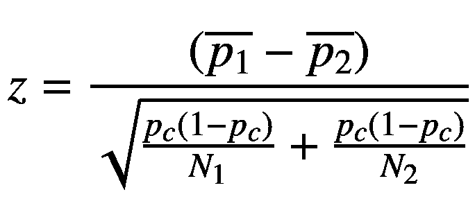

在上述公式中，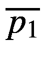 是第一个样本的比例，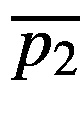 是第二个样本的比例。`N[1]` 是第一个样本的样本量，`N[2]` 是第二个样本的样本量。`p[c]` 是合并方差。

 = 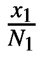；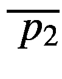 = 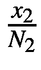；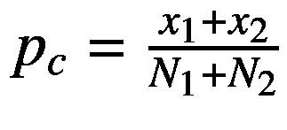

在上述公式中，`x[1]` 是第一个样本中的成功次数，`x[2]` 是第二个样本中的成功次数。

让我们通过一个例子来理解双样本比例检验。

**问题**：一家网约车公司正在调查其司机的投诉，即部分乘客（携带儿童出行）未遵守儿童安全指南（例如，未携带儿童座椅或未使用安全带）。该公司在两个主要城市进行了调查。调查独立进行，每个城市抽取一个样本。从收集的数据来看，B 市的乘客似乎比 A 市的乘客更不遵守规定。执法部门想知道，两个城市中遵守儿童安全指南的乘客比例是否存在差异。两个城市的数据如下表所示：

| **A 市** | **B 市** |
| --- | --- |
| 总调查人数 | 200 | 230 |
| 合规人数 | 110 | 106 |

在 5% 的显著性水平下，进行适当的检验以验证该假设。

**解决方案**：

1.  **陈述假设**：

    令 `p[A]` 为 A 市遵守规范的居民比例，`p[B]` 为 B 市遵守标准的居民比例。

    原假设：`H[0]`：`p[A]` = `p[B]`

    备择假设：`H[1]`：`p[A]` != `p[B]`

    这将是一个双尾检验，因为拒绝域可能位于两侧。

2.  **选择合适的假设检验**：

    - 样本数量：2（从两个不同城市抽取样本）
    - 样本量：大（`N[1]` = 200 且 `N[2]` = 230）


## 假设检验与 t 分布

### 假设检验步骤

- **测试内容**：检验两个城市中遵守儿童安全指南的乘客比例是否存在差异。
- **总体特征**：总体分布未知，总体方差未知。由于样本量较大，我们选择双样本比例 z 检验。
- **设定显著性水平**：`α = 0.05`
- **计算检验统计量与 p 值**：

使用以下公式：


使用 `stats.norm.cdf` 函数计算该 z 值对应的 p 值：

代码：

```
x1,n1,x2,n2=110,200,106,230
p1=x1/n1
p2=x2/n2
pc=(x1+x2)/(n1+n2)
z=(p1-p2)/(((pc*(1-pc)/n1)+(pc*(1-pc)/n2))**0.5)
p=2*(1-stats.norm.cdf(z))
p
```

输出：

```
0.06521749465064053
```

- **比较 p 值与显著性水平**：

由于计算出的 p 值（0.065）> `α`（0.05），我们无法拒绝原假设。

- **推断**：在 5% 的显著性水平下，这两个城市中遵守儿童安全规范的乘客比例没有显著差异。

### t 分布

在某些情况下，总体标准差未知且样本量较小。此时，我们使用 t 分布。该分布也称为 Student's t 分布。这里的“Student”并非字面意义上的学生。威廉·西利·戈塞特（William Sealy Gosset）于 1908 年首次发表该分布时，使用了笔名“Student”，因此该分布被广泛称为 Student's t 分布。

以下是 t 分布的主要特征：

- t 分布在形状上类似于正态分布，但略为扁平。
- 样本量较小，通常小于 30。
- t 分布使用了自由度的概念。自由度是统计检验中可以独立估计的观测值数量。让我们通过以下示例来理解自由度的概念：

假设我们有三个数字：`a`、`b` 和 `c`。我们不知道它们的值，但知道这三个数字的均值是 5。根据这个均值，我们可以计算出这三个数字的总和为 15（均值 * 数值个数，即 `5 * 3`）。

我们能否为这三个未知数任意赋值？不能；只有其中两个数字可以独立赋值。假设我们随机将 `a` 赋值为 4，`b` 赋值为 5。那么，由于总和必须为 15，`c` 只能是 6。因此，即使我们有三个数字，也只有两个可以自由变化。

- 随着样本量减小，自由度也会减少，换句话说，从样本参数预测总体参数的确定性会降低。

t 分布中的自由度（`df`）是样本数（`n`）减 1，即 `df = n - 1`。

单样本 t 检验中临界检验统计量的公式如下：

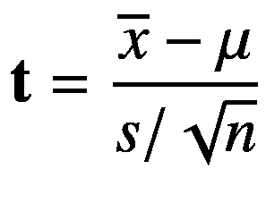

其中，`x̄` 是样本均值，`μ` 是总体均值，`s` 是样本标准差，`n` 是样本量。

### 单样本 t 检验

单样本 t 检验类似于单样本 z 检验，但存在以下差异：

1.  样本量较小（< 30）。
2.  总体标准差未知；我们使用样本标准差（`s`）来计算标准误差。
3.  这里的临界统计量是 t 统计量，由以下公式给出：

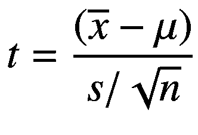

### 双样本 t 检验

当我们从两个总体中抽取样本，且两个样本量均小于 30，并且两个总体标准差均未知时，使用双样本 t 检验。

公式：

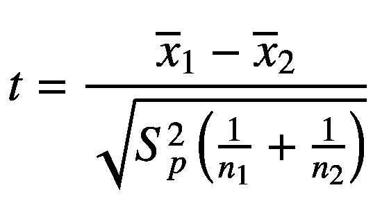

其中，`x̄₁` 和 `x̄₂` 是样本均值。
自由度：`df = n₁ + n₂ − 2`
合并方差：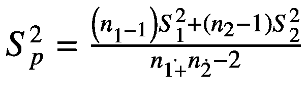

### 配对样本双样本 t 检验

该检验用于比较相互依赖的样本的总体均值，即使用同一测试组对样本值进行两次测量。

配对双样本 t 检验的检验统计量临界值由以下公式给出：

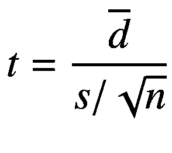

其中，`d̄` 是两个样本元素之间差值的平均值。两个样本具有相同的大小 `n`。

`S` = 两个样本元素之间差值的标准差 =

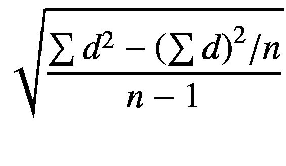

### 使用 Scipy 函数进行 t 检验的示例

Scipy 库提供了多种用于 t 检验的函数。在以下示例中，我们将介绍用于单样本 t 检验、双样本 t 检验和配对 t 检验的函数。

#### 1. 使用 Scipy 进行单样本 t 检验

**问题**：一家备考辅导机构有 200 名学生，学生在模拟测试中的平均分数为 80。该机构抽取了 9 名学生作为样本并记录他们的分数，结果显示平均分数似乎有所提高。这十名学生的分数如下：80, 87, 80, 75, 79, 78, 89, 84, 88。

在 5% 的显著性水平下进行假设检验，以验证平均分数是否有显著提高。

**解决方案**：

由于样本量较小且总体标准差未知，我们使用单样本 t 检验。让我们制定原假设和备择假设。

`H₀`：`μ = 80`
`H₁`：`μ > 80`

首先，使用样本观测值创建一个 NumPy 数组：

代码：

```
a=np.array([80,87,80,75,79,78,89,84,88])
```

现在，调用 `stats.ttest_1samp` 函数，并传入该数组和总体均值。该函数返回 t 统计量和 p 值。

代码：

```
stats.ttest_1samp(a,80)
```

输出：

```
Ttest_1sampResult(statistic=1.348399724926488,  pvalue=0.21445866072113726)
```

**决策**：由于 p 值大于 0.05，我们无法拒绝原假设。因此，我们不能断定学生的平均分数发生了变化。

#### 2. 双样本 t 检验（独立样本）

**问题**：一家辅导机构在两个不同的城市设有中心。它从每个中心抽取了 10 名学生作为样本，并记录他们的分数，如下所示：

中心 A：80, 87, 80, 75, 79, 78, 89, 84, 88
中心 B：81, 74, 70, 73, 76, 73, 81, 82, 84

在 5% 的显著性水平下进行假设检验，验证这两个中心学生的平均分数是否存在显著差异。

**解决方案**：


由于我们从两个独立组中抽取样本，因此使用双样本 t 检验。样本量较小，且总体标准差未知。设每个中心学生的平均得分为 *μ*[1] 和 *μ*[2]。原假设和备择假设如下：

*H*[0]:*μ*[1] = *μ*[2]

*H*[1]:*μ*[1] != *μ*[2]

为每个样本创建 NumPy 数组：

```
a=np.array([80,87,80,75,79,78,89,84,88])
b=np.array([81,74,70,73,76,73,81,82,84])
```

调用 `stats.ttest_ind` 函数执行双样本 t 检验，并将这些数组作为参数传入：

```
stats.ttest_ind(a,b)
```

输出：

```
Ttest_indResult(statistic=2.1892354788555664, pvalue=0.04374951024120649)
```

推断：由于 p 值小于 0.05，我们可以得出结论，该辅导机构两个中心学生的平均得分存在显著差异。

## 配对样本 t 检验

**问题**：该辅导机构正在实施一项特殊计划以提高学生成绩。比较同一组学生在特殊计划实施前后的成绩。在 5% 的显著性水平下进行假设检验，以验证该计划是否提高了成绩。

**解决方案**：

```
a=np.array([80,87,80,75,79,78,89,84,88])
b=np.array([81,89,83,81,79,82,90,82,90])
```

调用 `stats.ttest_rel` 函数执行双样本 t 检验，并将这些数组作为参数传入：

```
stats.ttest_rel(a,b)
```

输出：

```
Ttest_relResult(statistic=-2.4473735525455615, pvalue=0.040100656419513776)
```

我们可以得出结论，在 5% 的显著性水平下，由于 p 值小于 0.05，特殊计划实施后平均成绩有所提高。

## 方差分析

方差分析是一种用于比较两个以上总体均值的方法。到目前为止，我们只考虑了单个总体或最多两个总体。方差分析中使用的统计分布是 F 分布，其特点如下：

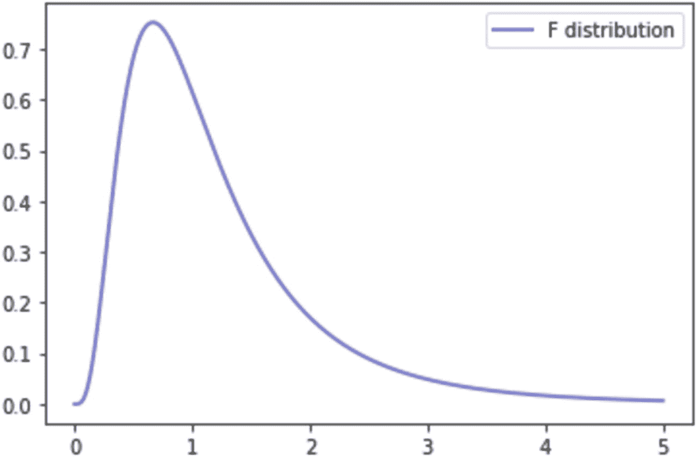

图 9-11 F 分布的形状

1.  F 分布是单尾（向右）的，且仅包含正值，如图 9-11 所示。
2.  F 统计量是方差分析中的关键统计量，它是样本均值间的变异与样本内变异的比值。公式如下。

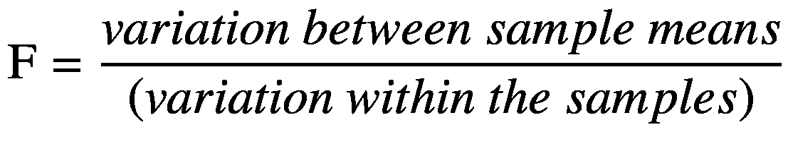

3.  不同的总体被称为处理组。
4.  F 统计量的值较高意味着样本间的变异相对于样本内的变异较大。换句话说，从中抽取样本的总体或处理组彼此之间确实存在差异。
5.  当样本内变异较大时，处理组之间更可能出现随机变异。

### 方差分析示例

**问题**：几位农业研究科学家种植了一种名为“AB 棉”的新棉花品种。他们对该品种的三个独立地块分别使用了三种不同的肥料——A、B 和 C。研究人员想知道产量是否因肥料类型而异。每英亩产量（以蒲式耳计）如下表所示。在 5% 的显著性水平下进行方差分析检验，以判断研究人员是否能得出结论认为产量存在差异。

**肥料 A** | **肥料 B** | **肥料 C**
--- | --- | ---
40 | 45 | 55
30 | 35 | 40
35 | 55 | 30
45 | 25 | 20

**解决方案**：

1.  陈述原假设和备择假设：
    设三个总体的平均产量分别为 *μ*[1]、*μ*[2] 和 *μ*[3]。
    原假设：*H*[0] : *μ*[1] = *μ*[2] = *μ*[3]
    备择假设：*H*[1] : *μ*[1] != *μ*[2] != *μ*[3]

2.  选择合适的检验：
    我们选择方差分析检验，因为我们要比较三个总体的平均值。

3.  设定显著性水平：*α*=0.05

4.  计算临界检验统计量/p 值：
    `f_oneway` 函数给出方差分析检验的检验统计量或 p 值。该函数的参数包括三个列表，分别包含每个组的样本值。

    ```
    import scipy.stats as stats
    a=[40,30,35,45]
    b=[45,35,55,25]
    c=[55,40,30,20]
    stats.f_oneway(a,b,c)
    ```

    输出：

    ```
    F_onewayResult(statistic=0.10144927536231883, pvalue=0.9045455407589628)
    ```

5.  由于计算出的 p 值 (0.904) > 0.05，我们无法拒绝原假设。

6.  推断：在 5% 的显著性水平下，三个处理组之间没有显著差异。

## 卡方关联性检验

卡方检验是一种用于检验两个变量之间关联性的非参数检验。非参数检验不对从中抽取样本的总体分布做任何假设。参数检验（包括 z 检验、t 检验、方差分析）则对从中抽取样本的总体分布/形状做出假设，通常假设总体服从正态分布。以下是卡方检验的一些特点。

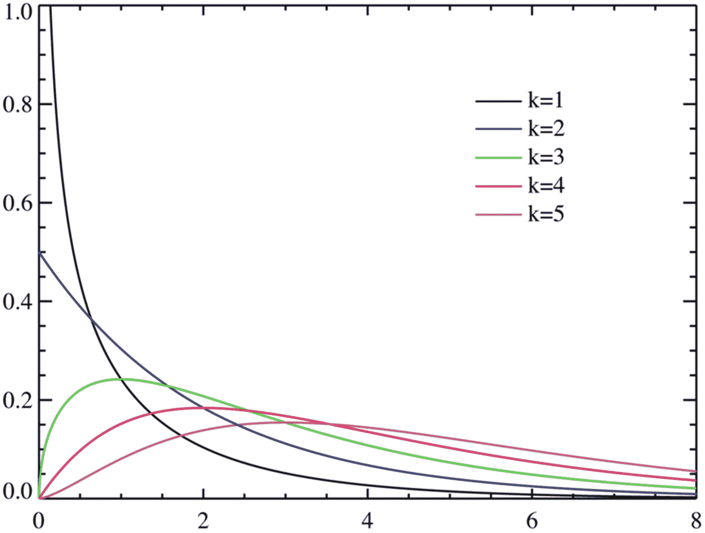

图 9-12 不同自由度下的卡方分布

*   卡方关联性检验用于检验一个分类变量的发生频率是否与另一个分类变量的发生频率显著相关。
*   卡方检验统计量由下式给出：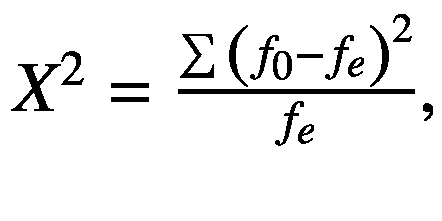，其中 *f*[0] 表示观测频数，*f*[*e*] 表示期望频数，*X* 是检验统计量。使用卡方关联性检验，我们可以评估频数之间的差异是否具有统计学意义。
*   列联表是一个将变量频数列于不同列下的表格。卡方检验中自由度的计算公式为：*df=(r-1)*(c-1)*，其中 *df* 是自由度数量，*r* 是列联表中的行数，*c* 是列联表中的列数。
*   卡方检验将一组变量的观测值与其期望值进行比较。它判断观测值与期望值之间的差异是源于随机偶然因素（如抽样误差），还是这些差异具有统计学意义。如果观测值与期望值之间只有微小差异，则可能源于抽样误差。如果两者之间存在显著差异，则可能表明变量之间存在关联性。


### 卡方分布与假设检验

### 卡方分布

图 9-12 展示了不同 *k* 值（自由度）下卡方分布的形态。卡方分布的形态随自由度（图 9-12 中以 *k* 表示）变化。当自由度较小时，其形态类似于 F 分布，且仅有一个（右侧）尾部。随着自由度增加，其形态逐渐趋近于正态曲线。此外，自由度的增加表明观测值与期望值之间的差异可能具有实际意义，而不仅仅是抽样误差所致。

### 示例解析：卡方检验

**问题：** 某职业咨询服务机构引导学生了解自身优势与劣势，以便做出合适的职业选择。他们希望评估学生性别与其所选职业之间是否存在关联。下表展示了男女人数及其选择的职业（以 `I001`、`I002` 等职业代码表示）。

| 职业 | 男性 | 女性 | 总计 |
|------|------|------|------|
| I001 | 41   | 79   | 120  |
| I002 | 32   | 28   | 60   |
| I003 | 58   | 78   | 130  |
| I004 | 59   | 31   | 90   |

**解答：**

1.  **陈述假设：**
    -   原假设：*H*[0]：性别与职业偏好无关
    -   备择假设：*H*[1]：性别与职业偏好相关

2.  **选择合适的假设检验：**
    -   变量数量：两个分类变量（性别和职业）
    -   检验目标：检验职业与性别之间的关联性
    -   基于上述特征，我们进行卡方关联性检验。

3.  **设定显著性水平：** *α* = 0.05

4.  **计算检验统计量与 p 值。** `chi2_contingency` 函数用于计算检验统计量和 p 值。该函数返回检验统计量、p 值、自由度以及期望频数（以数组形式）。该函数的参数是以数组形式呈现的列联表观测值，每个数组代表列联表中的一行。

**代码：**

```python
import scipy.stats as stats
observations = np.array([[41,79],[32,28],[52,78],[59,31]])
chi2stat, pval, dof, expvalue = stats.chi2_contingency(observations)
print(chi2stat, pval, dof, expvalue)
```

**输出：**

```
23.803453211665776 2.7454871071500803e-05 3 [[55.2 64.8]
[27.6 32.4]
[59.8 70.2]
[41.4 48.6]]
```

上述输出中高亮显示的值即为本次检验的 p 值。

5.  **比较 p 值与显著性水平：** 由于计算出的 p 值 (0.000027) < *α* (0.05)，我们拒绝原假设。

6.  **推断：** 在 5% 的显著性水平下，学生性别与职业选择之间存在显著关联。

## 使用 p 值的注意事项

假设检验的效力通过其得出统计显著结果的能力来衡量，通常以小于 0.05 的 p 值表示。医学和社会科学领域的许多研究试验和实验结果都通过 p 值来呈现。然而，p 值难以解释，并且依赖于样本量以及我们所测量偏差的大小。统计显著的结果并不能最终否定原假设或证明备择假设。置信区间通常比 p 值更受青睐，因为它们更易于解释。

## 总结

1.  组合是指选取物品的方式数，而排列是指对物品进行排序的方式数。

2.  概率是事件发生的可能性。当一件事发生的概率不影响另一件事时，这两个事件是独立的。独立事件遵循乘法的特殊规则，即 `P(A ∩ B) = P(A) * P(B)`。互斥事件是指不能同时发生的事件，此类事件遵循加法的特殊规则，即 `P(A ∪ B) = P(A) + P(B)`。

3.  贝叶斯定理用于计算事件的后验概率，换句话说，即在给定某些相关证据的情况下，某个假设为真的概率。

4.  随机变量取与实验结果相关的值。随机变量有两种类型：离散型（仅取有限个值）和连续型（可取任意多个值）。

5.  离散变量可用于二项分布（单次实验重复多次，每次试验有两种可能结果）或泊松分布（在给定平均发生率的情况下，对某一区间内发生的事件次数进行建模）。

6.  正态分布是一条对称的钟形曲线，使用连续随机变量，其大部分值集中在均值附近。标准正态分布的均值为 0，标准差为 1。标准正态分布使用的公式如下：

    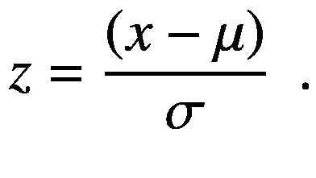

7.  连续分布具有多种集中趋势度量（均值、中位数、众数）、离散程度度量（极差、方差、标准差）和形态度量（偏度衡量不对称性，峰度衡量分布的陡峭程度）。

8.  当收集大型总体中所有受试者的数据不切实际时，会使用样本。收集样本的主要方法有概率抽样（从大型总体中随机选择受试者）和非概率抽样（当数据不易获得时，根据可用性或可及性抽取样本）。

9.  假设检验用于基于样本对总体进行推断，但它并不能最终确定关于总体的任何结论，仅具有提示性。基于样本对总体进行的两种估计是点估计（使用单个值）和区间估计（使用一个值域）。置信区间是总体均值所在的值域，是区间估计的一个例子。

10. 原假设表示没有发生变化，而当我们有理由拒绝原假设时则使用备择假设。当原假设为真时被错误地拒绝，则发生第一类错误。相反，当原假设为假时我们未能拒绝它，则发生第二类错误。

11. 可以使用检验统计量（每个假设检验的检验统计量不同）或 p 值来决定是否拒绝原假设。p 值衡量观测数据纯粹由偶然因素发生的可能性。

12. 当我们检验总体参数是否不等于某个特定值时，使用双尾检验。相反，当总体参数大于或小于某个特定值时，使用单尾检验。当从总体中抽取单个样本时，使用单样本检验；而双样本检验则比较从不同总体中抽取的样本。

13. 假设检验可以是参数检验（假设从中抽取样本的总体服从正态分布）或非参数检验（不对总体分布做出此类假设）。


