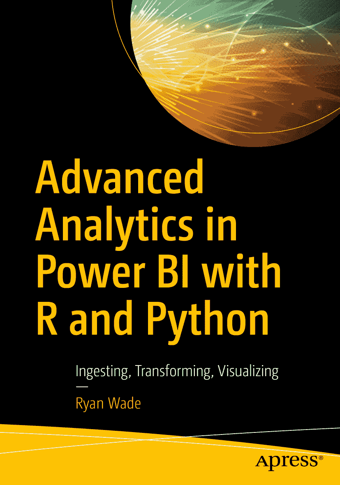

ISBN 978-1-4842-5828-6 e-ISBN 978-1-4842-5829-3 [`doi.org/10.1007/978-1-4842-5829-3`](https://doi.org/10.1007/978-1-4842-5829-3) © Ryan Wade 2020 本作品受版权保护。出版商保留所有权利，涉及材料的全部或部分内容，特别是翻译、重印、重用插图、朗诵、广播、微缩胶片复制或任何其他物理形式的复制权，以及信息存储与检索、电子改编、计算机软件，或目前已知或未来开发的类似或不同方法的传输权。本出版物中使用通用描述性名称、注册商标、商标、服务标志等，即使未作明确声明，也不意味着这些名称不受相关保护性法律和法规的约束，因此可自由用于一般用途。出版商、作者和编辑假定本书中的建议和信息在出版之日是真实准确的。出版商、作者或编辑均不对本材料中包含的内容或可能存在的任何错误或遗漏提供明示或暗示的担保。出版商对已出版地图中的管辖权主张和机构归属保持中立。本书通过 Springer Science+Business Media New York 在全球图书贸易中发行，地址：233 Spring Street, 6th Floor, New York, NY 10013。电话：1-800-SPRINGER，传真：(201) 348-4505，电子邮件：orders-ny@springer-sbm.com，或访问 www.springeronline.com。Apress Media, LLC 是一家加利福尼亚有限责任公司，其唯一成员（所有者）是 Springer Science + Business Media Finance Inc (SSBM Finance Inc)。SSBM Finance Inc 是一家特拉华州公司。

*我要感谢我在 BlueGranite 的同事们。能成为一群非常聪明且才华横溢的人组成的团队的一员，是我的荣幸。铁磨铁，方成利器。我要感谢我成长的那个社区——印第安纳州密歇根城的西区。在那里成长的经历是无价的。我要感谢 Patrick Leblanc、Mico Yuk、Terry Morris、Brandeis Marshall 博士和 Sydeaka Watson 博士。你们每个人都拥有我非常钦佩的品质，你们通过自己的榜样作用，在远方指导着我。*

*我要感谢我从少年联赛到大学的所有队友。体育运动是我人生中最好的老师之一，能与你们一起经历这个过程是我的荣幸。我敬仰并尊重你们中的许多人。我要感谢我以前的教练，尤其是我的高中和大学教练。你们给我设置的艰难挑战，培养了我的坚韧，这在我生活的其他方面也帮助了我。正因如此，我将永远感激你们。*

*我要感谢我的大家庭。养育一个孩子需要整个村庄的力量，我受益于许多家庭成员的支持，对此我心怀感激。我要感谢我的门徒，小 Tim Adams 和 Camille Little。你们两人都兼具极高的智慧和非常讨人喜欢的个性，这种组合实属罕见。用不了多久，角色就会互换，你们将成为导师，而我将成为学生！我要感谢我在密歇根城的兄弟们，以及我在路易斯维尔打橄榄球时结识的兄弟们。我与你们一起经历了血、汗和泪。我们一起走出家门，共同成长为男子汉。无论如何，我们永远是兄弟！我要感谢我的堂表亲们。我们像兄弟姐妹一样一起长大，共享许多美好的回忆。你们中的一些人在我需要的时候支持了我。这一点我永远不会忘记。我要感谢我的兄弟姐妹：Paulette（安息）、Stephanie、Tina 和 Luke，以及我的侄子 Junebug，他像我的兄弟一样被抚养长大。当我们彼此需要时，我们总是互相支持。让我们保持这样。我要感谢我的父母，Luther 和 Ernestine Wade。感谢你们对我以及我的兄弟姐妹们的爱、支持和牺牲。对此我深表感激！用爸爸的话说，“我爱你，永远都爱。”*

*最后但同样重要的是，我要感谢上帝。感谢您赐予我所有的才能。我将通过充分利用这些才能来造福我的社区，以此表达我的感激之情。*

