# 1. 图形语法

数据可视化一直是统计学中非常重要的一部分。它为统计学家提供了一种以简洁且相对易于理解的方式与他人分享发现的方法。鉴于 R 是一种由统计学家为统计学家构建的编程语言，R 社区做出了相当大的努力，以确保 R 用户能够有效地创建可视化，帮助他们讲述数据故事。

可以说，最流行的 R 数据可视化包是`ggplot2`包。这个包由 Hadley Wickham¹ 创建，基于`图层化图形语法`的概念。`图层化图形语法`按以下方式定义了一个图形：
-   一个默认数据集和一组从变量到美学的映射
-   一个或多个图层，每个图层由一个几何对象、一个统计变换、一个位置调整以及可选的数据集和美学映射组成
-   每个美学映射对应一个标度
-   一个坐标系
-   分面规范

上述定义是作者对`图层化图形语法`的简洁而透彻的解释。您将学习如何使用上述概念，在 Power BI 中利用`ggplot2`包构建精美的可视化。

尽管 Power BI 允许您使用 Python 和 R 中的多个库和包来创建视觉对象，但本书将特别关注`ggplot2`包以及一些辅助包。与 R 和 Python 中的其他选项相比，`ggplot2`包自成一类。`ggplot2`所基于的`图层化图形语法`缩短了将数据可视化构思转化为代码所需的时间。该包功能丰富，因此您大部分的数据可视化需求都可以通过`ggplot2`及其辅助包来满足。

## 在 Power BI 中构建 R 自定义视觉对象的步骤

本节概述了您在 Power BI 中创建 R 视觉对象时将使用的工作流程。无论您创建的是哪种类型的 R 视觉对象，这些步骤都是一致的。步骤如下。

### 步骤 1：配置 Power BI

您已在本书的引言中获得了有关如何在 Power BI 中配置 R 的信息。请务必按照这些说明中概述的步骤进行操作，以确保 Power BI 已配置为可以使用 R。

### 步骤 2：将“R 自定义视觉对象”图标拖到 Power BI 画布上

现在，您将可以访问一个`R 自定义视觉对象`图标。要将 R 可视化添加到 Power BI，您首先需要将 R 视觉对象图标从`可视化窗格`拖到`报表画布`上。R 视觉对象的图标是一个大写字母`R`，在图 1-1 的图像中已突出显示。

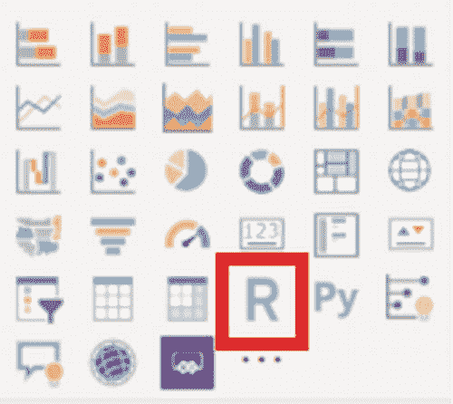

图 1-1 用于在 Power BI 中创建 R 视觉对象的 R 图标

R 视觉对象是 Power BI 中可用的默认视觉对象之一。您可以像处理任何其他 Power BI 视觉对象一样调整其大小和位置。

### 步骤 3：定义数据集

与其他可视化对象一样，你需要定义该可视化所基于的数据集。你可以通过从数据模型添加字段以及可选的度量值到`值`窗格来构建数据集。生成的数据集将在 R 中作为一个称为`数据框`的对象暴露出来。你可以将数据框视为一个`Excel 表格`，但它拥有更多便于数据分析的功能。

在创建 R 可视化对象时，你需要了解的数据框特性之一是，数据框中的行必须是唯一的。因此，当在 R 中创建数据框时，R 会采取措施确保行是唯一的。你需要确保传递给 R 的数据集具有唯一的行。

### 步骤 4：在默认的 R IDE 中开发可视化对象

现在你已经定义了数据集，就可以在你偏好的 IDE 中使用该数据集来开发所需的 R 可视化对象。你在 Power BI 中配置 R 时所做的其中一件事就是指定了你偏好的 R IDE。该功能使你能够在功能丰富的 IDE（如`R Studio`）中开发创建 R 可视化对象的代码，而不是在 Power BI 的 R 脚本编辑器中进行开发。

R 可视化对象的代码位于`R 脚本编辑器`中。当你在报表画布上选择 R 可视化对象的图标时，Power BI 会显示该编辑器。R 脚本编辑器如图 1-2 所示。

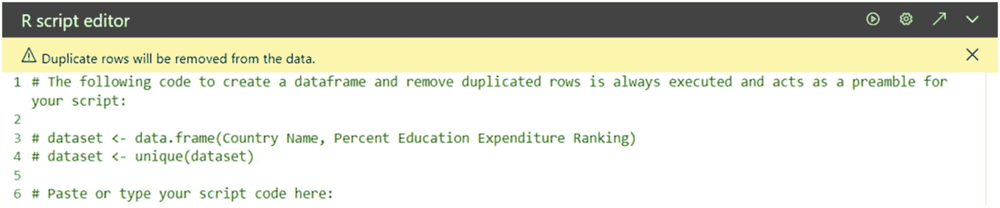

图 1-2 Power BI 中的 R 脚本编辑器

如你所见，这并不是开发 R 代码的理想场所。这里没有智能感知，没有控制台，而且可用于开发代码的空间也很有限。幸运的是，Power BI 允许你将为自定义 R 可视化对象定义的数据集移植到你选择的 R IDE 中。R 的推荐 IDE 是`R Studio`，如果你按照本书引言中的说明操作，这里将使用它。

要将可视化对象的数据集移植到`R Studio`中供 R 使用，请在报表画布中选择该 R 可视化对象，然后点击指向右上方 45 度角的箭头。该操作将启动`R Studio`，并创建一个 R 脚本的开头部分，其中包含基于传递给 Power BI 中可视化对象的数据生成名为`dataset`的数据框的代码。该操作还会包含脚本中与该可视化对象相关的任何 R 代码。微软没有试图重新发明轮子，而是决定让你能够在像`R Studio`这样的 IDE 中进行开发。因此，我强烈建议你在`R Studio`中完成所有代码开发，而不是使用 Power BI 中那个狭小的 R 编辑器。

### 步骤 5：使用以下模板开发你的可视化对象

在 Power BI 中开发 R 可视化对象时，R 脚本应使用清单 1-1 中的以下模板：

```
if () {
#
} else {
plot.new()
title(main = "")
}
```

此模板用于测试数据集，以确保其满足所需 R 可视化对象的要求。如果满足，它将开始创建可视化；否则，它将生成一个带有消息的空白图表。使用以下代码创建带有预定义消息的空白图表：

```
plot.new()
title(main = "  ")
```

第一行创建一个新的空白图表，第二行为图表添加一个标题，其中包含你想要显示给报表用户的消息。

### 步骤 6：使脚本功能完善

一旦 R 脚本功能完善，将完整的脚本复制到 R 编辑器中。包含除创建名为`dataset`的数据框那一行之外的所有代码。`dataset`数据框是在 Power BI 中自动生成的。请注意，Power BI 中生成的 R 可视化对象与其他可视化对象一样，完全响应外部筛选器和切片器。你将在下一章中看到几个示例。然而，你失去的一个功能是双向筛选。外部可视化对象会传播到 Power BI 中的 R 可视化对象，但你无法直接从 R 可视化对象筛选其他 Power BI 图表项。

## 使用 ggplot2 创建 R 可视化对象的推荐步骤

上一节说明了在定义 R 可视化对象的整体 R 脚本时应使用的总体模板。它包含了测试数据集的代码以及错误处理的代码。在本节中，我们将专门关注在测试数据集之后用于 R 可视化对象的推荐模板。具体来说，我们讨论的是在以下清单中`#<"Code for R Visual">`位置放置的代码。

```
if () {
#
} else {
plot.new()
title(main = "")
}
清单 1-1 Power BI 的 R 可视化对象模板
```

将通过开发图 1-3 中所示的图表来描述开发该模板的步骤。

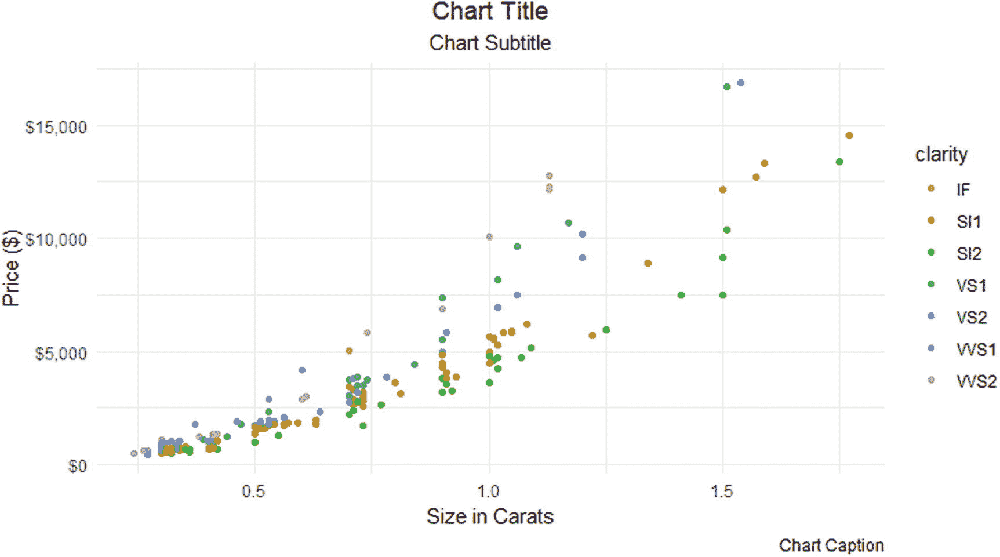

图 1-3 用于描述在 Power BI 中开发 R 可视化对象时应使用的模板的可视化对象

上述 R 可视化对象使用钻石数据集绘制了颜色为`D`的钻石样本，以显示钻石价格与克拉大小的关系。这是一个很好的示例，因为它提供了一种相对简单的方法来说明开发 R 可视化对象时模板中的每个步骤。让我们从步骤 1 开始。

### 步骤 1：加载脚本所需的包

对于此示例，你将使用清单 1-2 中的以下代码来加载脚本所需的两个包。

```
library(tidyverse)
library(scales)
清单 1-2 导入语句
```

你使用了来自`tidyverse`元包的`ggplot2`和`dplyr`。

`tidyverse`元包是一组协同工作的包的集合，旨在使在 R 中进行数据科学工作更加容易。`tidyverse`元包使你能够通过加载`tidyverse`一次调用来导入核心包，而不必单独加载每个核心包。

`ggplot2`将用于创建可视化，`dplyr`将用于执行一些数据整理任务。`scales`包将用于帮助处理一些数字格式化任务。

### 步骤 2：对数据集进行必要的调整

通常，在将数据框传递给`ggplot2`之前，需要对其进行调整。此示例中用于调整数据框的代码在清单 1-3 中。

```
plot.data %>%
  filter(color == "D") %>%
  sample_n(200)
清单 1-3 可视化对象的数据准备
```

传递给 R 的数据集包含可视化对象不需要的记录。因此，你需要使用`dplyr`包来移除不需要的数据。你想要创建一个基于颜色类型`D`的可视化。要获得具有所需颜色类型的数据框，你需要筛选原始的`diamonds`数据框，仅包含那些颜色。你在上面的第三行中执行了此操作。

该筛选操作只保留了颜色为`D`的钻石。结果数据框中的总记录数为 6775 条，这对于散点图可视化来说数量较多。在散点图中绘制过多的观测值可能会导致称为过度绘制的问题。为了尽量减少过度绘制，你可以对数据进行随机抽样，并绘制抽样后的数据。抽样数据将具有与原始数据相似的分布，这将使其绘制效果相似，但能最大限度地减少数据重叠。上述代码通过`dplyr`中的`sample_n()`函数进行了内联抽样。结果是一个包含 200 条记录的随机样本，其绘制效果要好得多。

### 步骤 3：使用 `ggplot()` 函数启动可视化创建

你通过`ggplot()`函数在`ggplot2`中启动图表的创建。当你调用`ggplot()`函数时，需要向其传递参数，这些参数将应用于图表的所有图层。在本示例中，你将`plot.data`数据框设置为`data`参数，并将`carat`字段和`price`字段分别设置为`aes()`函数中的`x`和`y`参数，如代码清单 1-4 所示。

```
ggplot(data = plot.data, aes(x = carat, y = price))
代码清单 1-4 启动 ggplot() 函数
```

了解`aes()`函数是什么以及如何使用它非常重要。`aes()`函数描述了如何将数据映射到视觉属性。常用的美学属性包括：
-   你所绘制的几何形状的`x`坐标和`y`坐标
-   你所绘制的几何形状的颜色
-   你所绘制的几何形状的大小
-   你所绘制的几何形状的填充色

上述`aes()`函数用于描述如何映射将要绘制的几何形状的`x`和`y`坐标。`aes()`函数可以在`ggplot()`函数中定义，也可以在下一步将要学习的`geom`函数中定义。如果在`ggplot()`函数中定义，则它将应用于图表的所有图层；但如果在`geom`函数中定义，则它仅在该函数定义的图层中可用。你将在下一章中看到这两种情况的示例。

### 步骤 4：添加所需的几何对象

你可以使用代码清单 1-5 中的代码来实现。

```
ggplot(plot.data, aes(x = carat, y = price)) +
  geom_point()
代码清单 1-5 添加几何对象
```

当你在上一步中启动`ggplot()`函数时，可视化图形没有任何图层，因此没有内容可以显示。用于向`ggplot`可视化图形添加图层的机制是`geoms`。在`ggplot`中用于创建散点图的几何对象是`geom_point()`。在上述代码中，`geom_point()`继承了其前面的`ggplot()`函数，因此你应该注意到，无需显式定义数据源以及定义`x`和`y`坐标所需的美学属性。生成的图表如图 1-4 所示。

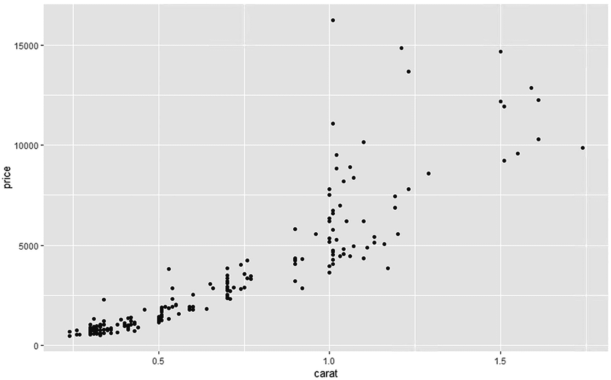

图 1-4 基础散点图

你希望添加一个额外的细节图层。你想识别散点图中每个点的`clarity`（净度）。为此，你可以在`geom_point()`几何对象中将`color`的美学属性设置为`clarity`，如代码清单 1-6 所示。

```
ggplot(plot.data, aes(x = carat, y = price)) +
  geom_point(aes(color = clarity))
代码清单 1-6 为颜色添加美学属性
```

你在`geom_point()`几何对象中设置此美学属性，是因为该美学属性仅在该图层中需要。

请务必记住，当你在`ggplot()`函数中设置数据源或美学属性时，它们将应用于可视化图形的所有图层；但当你将它们设置在单个几何对象中时，它们仅在与该几何对象关联的图层中可用。

识别出每个点净度的代码输出结果如图 1-5 所示。

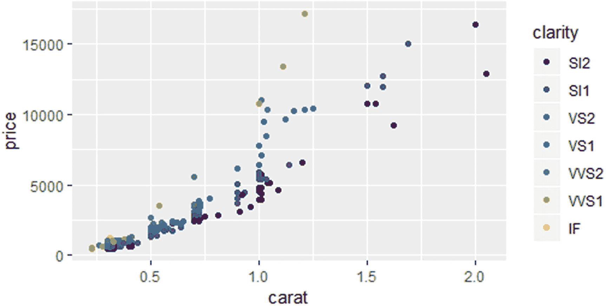

图 1-5 基础散点图

### 步骤 5：定义标题、副标题和说明文字

以下是可用于向可视化图形添加标题的代码，见代码清单 1-7。

```
ggplot(plot.data, aes(x = carat, y = price)) +
  geom_point(aes(color = clarity))+
  labs(
    title = "图表标题",
    subtitle = "图表副标题",
    caption = "图表说明"
  )
代码清单 1-7 添加标题和说明文字
```

`ggplot2`通过`labs()`函数可以轻松地向图表添加标题、副标题和说明文字。`labs()`函数名是 labels（标签）的缩写。可视化图形的标题可以基于静态字符串或动态生成的字符串。你将在下一章中看到基于动态生成字符串的标题示例。图 1-6 显示了添加标题后图表的外观。

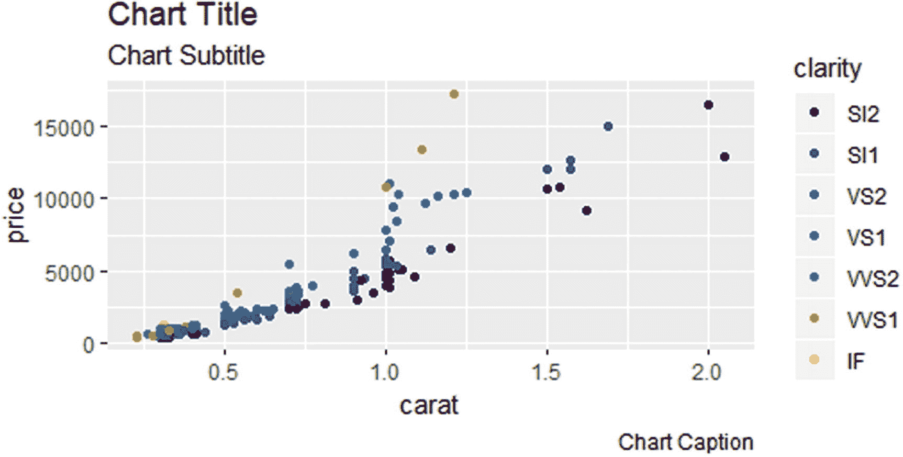

图 1-6 添加了标题的图表

### 步骤 6：修改 x 轴和 y 轴的标签与格式

`ggplot2`提供的`x`和`y`坐标的默认标签通常足够使用，无需更改。但如果你对默认值不满意，可以使用`scale`函数轻松更改。

让我们花点时间看看你到目前为止构建的`ggplot2`代码，见代码清单 1-8。

```
library(tidyverse)
library(scales)
plot.data <- plot.data %>%
  filter(color == "D") %>%
  sample_n(200)
ggplot(plot.data, aes(carat, price)) +
  geom_point(aes(color = clarity)) +
  labs(
    title = "图表标题",
    subtitle = "图表副标题",
    caption = "图表说明"
  )
代码清单 1-8 修改 x 轴和 y 轴的代码
```

上述代码生成了图 1-6 中的图表。该图表包含一些你想要覆盖的默认设置。你想要更改的默认设置包括：
-   x 轴名称
-   y 轴名称
-   y 轴上数字的格式

你可以使用`scale_x_continuous()`和`scale_y_continuous()`函数来更改这些默认设置，如代码清单 1-9 所示。

```
library(tidyverse)
library(scales)
plot.data <- plot.data %>%
  filter(color == "D") %>%
  sample_n(200)
ggplot(plot.data, aes(x = carat, y = price)) +
  geom_point(aes(color = clarity)) +
  labs(
    title = "图表标题",
    subtitle = "图表副标题",
    caption = "图表说明"
  ) +
  scale_x_continuous(name = "克拉大小") +
  scale_y_continuous(
    name = "价格（美元）",
    labels = dollar_format()
  )
代码清单 1-9 修改 x 轴和 y 轴的代码
```

执行上述代码后得到的结果如图 1-7 所示。

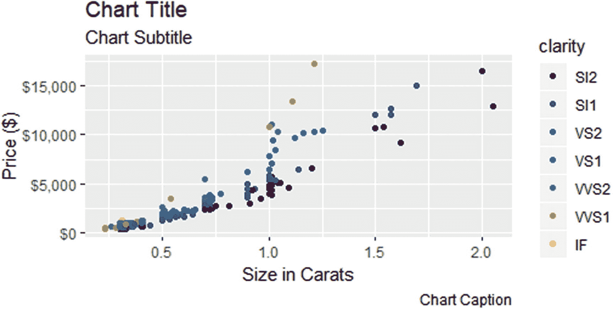

图 1-7 覆盖部分图表默认设置

如你所见，`scale_x_continuous()`和`scale_y_continuous()`函数使得进行所需的更改相对容易。

请注意，你向可视化图形添加比例尺的方式与添加图层的方式相同。需要特别注意的是，比例尺函数用于覆盖默认的比例尺，但它们不会向图表添加图层。

由于`x`轴和`y`轴都基于连续数据，因此使用了`x`和`y`轴的连续版本的比例尺。对于`x`轴，你只想更改名称，可以看到使用`name`参数可以轻松实现。对于`y`轴，你不仅要更改名称，还要更改轴上数字的格式。名称更改通过`name`参数完成。格式设置通过`labels`参数完成。`scales`包中的`dollar_format()`函数用于将数字格式化为美元格式。`dollar_format()`函数继承了脚本第一行中定义的`ggplot()`函数的`y`值，因此无需在函数中显式定义。

### 第 7 步：按需应用主题

`ggplot2` 内置了预定义的主题，用于格式化图表中非数据相关的方面。非数据方面包括诸如标题在图表上的位置、图表的背景颜色以及标题中使用的字体大小等属性。为你的可视化图表应用一个预定义主题非常简单。添加主题的方式与添加图层和修改标度相同。你只需输入 `+` 号，后跟代表你想要添加的主题的函数，如代码清单 1-10 中最后两行所示。

```R
ggplot(plot.data, aes(x = carat, y = price)) +
geom_point(aes(color = clarity)) +
labs(
title = "Chart Title",
subtitle = "Chart Subtitle",
caption = "Chart Caption"
) +
scale_x_continuous(name = "Size in Carats") +
scale_y_continuous(
name = "Price ($)",
labels = dollar_format()
) +
theme_minimal()
```
**Listing 1-10**  
应用 `theme_minimal()` 主题

生成的可视化图表如图 1-8 所示。

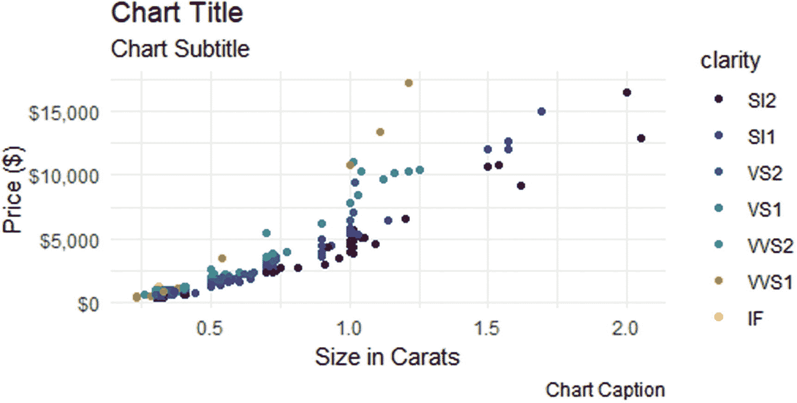
**图 1-8**
基于 R 脚本的主题默认设置

你在上面的可视化图表中使用了 `theme_minimal()` 主题。在数据分析中，一个良好的实践是仅在绝对必要时才向可视化图表添加元素。图表中的空白区域被认为是有益的。`theme_minimal()` 主题正是基于这一原则。`ggplot2` 中可用的主题列表将在后续的“`ggplot2` 内置主题”一节中介绍。

### 第 8 步：使用 `theme()` 函数更改任何特定的非数据元素

如果你对应用于可视化图表的主题效果不完全满意，可以使用 `theme()` 函数进一步调整结果。代码清单 1-11 中的代码使用 `theme()` 函数来格式化标题。

```R
ggplot(plot.data, aes(carat, price)) +
geom_point(aes(color = clarity)) +
labs(
title = "Chart Title",
subtitle = "Chart Subtitle",
caption = "Chart Caption"
) +
scale_x_continuous(name = "Size in Carats") +
scale_y_continuous(
name = "Price ($)",
labels = dollar_format()
) +
theme_minimal() +
theme(
plot.title = element_text(hjust = 0.5),
plot.subtitle = element_text(hjust = 0.5),
plot.caption = element_text(hjust = 1)
)
```
**Listing 1-11**  
使用 `theme()` 函数更改非数据元素

该代码生成图 1-9 中的可视化图表。

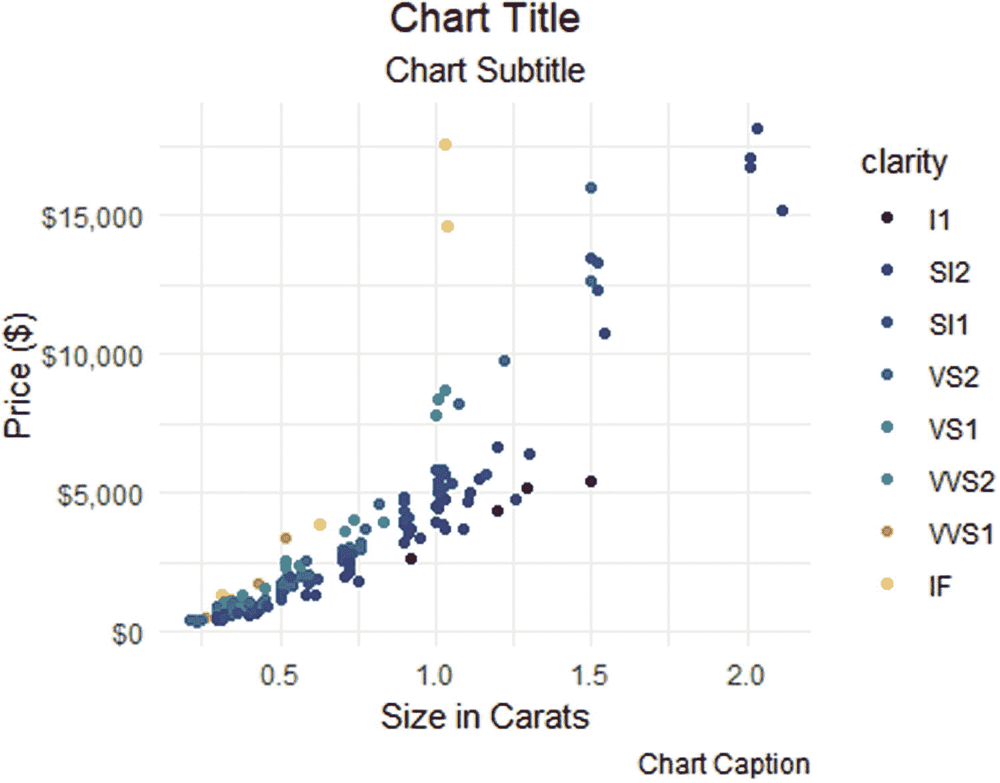
**图 1-9**
使用 `theme()` 函数重新定位标题

`theme()` 函数允许你访问超过 80 个可修改的图表元素。其中大部分元素都关联一个用于进行修改的元素函数。

在上面的代码中，我们修改了图表标题、图表副标题和图表说明文字的位置。正如你在代码中所见，与图表标题关联的元素是 `plot.title`，与图表副标题关联的元素是 `plot.subtitle`，与图表说明文字关联的元素是 `plot.caption`。这三个元素都使用 `element_text()` 函数进行修改。图表标题和副标题通过 `element_text()` 函数中的 `hjust` 参数实现居中。`hjust` 参数表示文本的水平位置，它接受一个介于 0 和 1 之间的值。如果将 `hjust` 设置为 0，文本将左对齐；设置为 0.5，文本将居中对齐；设置为 1，文本将右对齐。

代码清单 1-12 展示了元素函数及其可用选项。

```R
element_blank()
element_rect(fill = NULL, colour = NULL, size = NULL, linetype = NULL, color = NULL, inherit.blank = FALSE)
element_line(colour = NULL, size = NULL, linetype = NULL,
lineend = NULL, color = NULL, arrow = NULL, inherit.blank = FALSE)
element_text(family = NULL, face = NULL, colour = NULL, size = NULL, hjust = NULL, vjust = NULL, angle = NULL, lineheight = NULL, color = NULL, margin = NULL, debug = NULL, inherit.blank = FALSE)
```
**Listing 1-12**  
元素函数及其可用选项

此 URL [`https://bit.ly/34EaWtr`](https://bit.ly/34EaWtr) 包含了关于 `theme()` 函数的完整文档。

### 额外步骤：为散点图中的点指定特定颜色

有时你可能希望散点图中所有点的颜色相同。让我们看看如果尝试将颜色美学映射设置为特定颜色而不是数据框中的字段会发生什么。代码清单 1-13 中的脚本在 `aes()` 函数中将颜色设置为 `"blue"`。

```R
library(tidyverse)
library(scales)
plot.data <- diamonds %>%
filter(color == "D") %>%
sample_n(200)
ggplot(plot.data, aes(carat, price)) +
geom_point(aes(color = "blue")) +
labs(
title = "Chart Title",
subtitle = "Chart Subtitle",
caption = "Chart Caption"
) +
scale_x_continuous(name = "Size in Carats") +
scale_y_continuous(
name = "Price ($)",
labels = dollar_format()
) +
theme_minimal() +
theme(
plot.title = element_text(hjust = 0.5),
plot.subtitle = element_text(hjust = 0.5),
plot.caption = element_text(hjust = 1)
)
```
**Listing 1-13**  
通过 `aes()` 函数设置颜色

它生成图 1-10 中的图表。

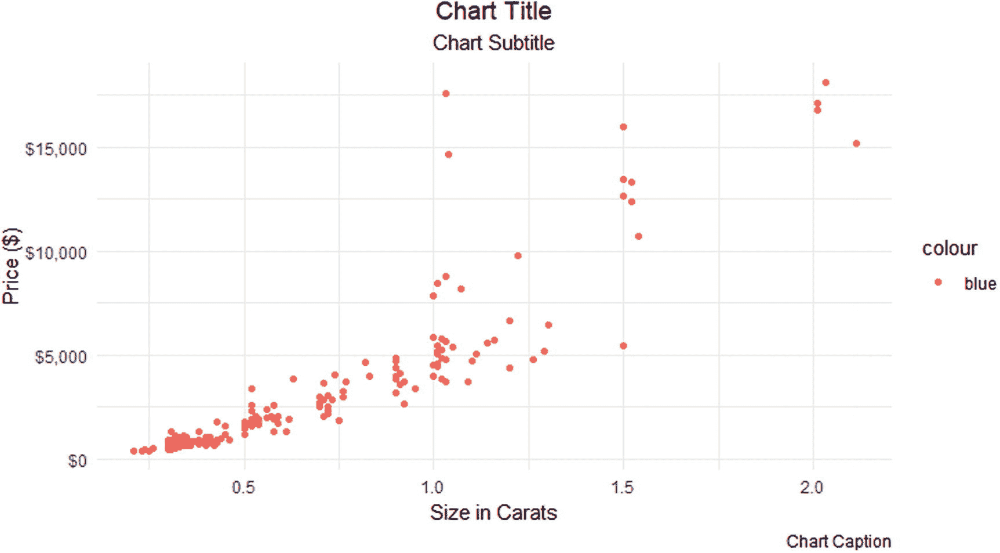
**图 1-10**
使用 `aes()` 函数设置颜色

请注意，你并没有得到预期的结果。你得到的不是点颜色为蓝色的散点图，而是点颜色看起来是红色的散点图。这是因为 `aes()` 函数对颜色进行了缩放。如果你希望颜色是特定的，则需要在 `aes()` 函数外部定义颜色，如代码清单 1-14 中第 10 行的代码所示。

```R
library(tidyverse)
library(scales)
plot.data <- diamonds %>%
filter(color == "D") %>%
sample_n(200)
ggplot(plot.data, aes(carat, price)) +
geom_point(color = "blue") +
labs(
title = "Chart Title",
subtitle = "Chart Subtitle",
caption = "Chart Caption"
) +
scale_x_continuous(name = "Size in Carats") +
scale_y_continuous(
name = "Price ($)",
labels = dollar_format()
) +
theme_minimal() +
theme(
plot.title = element_text(hjust = 0.5),
plot.subtitle = element_text(hjust = 0.5),
plot.caption = element_text(hjust = 1)
)
```
**Listing 1-14**  
在 `aes()` 函数外部设置颜色

它生成图 1-11 中的图表，得到了期望的结果。

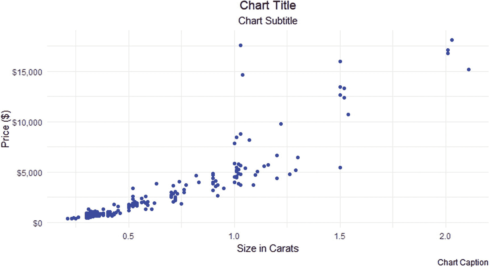
**图 1-11**
在 `aes()` 函数外部指定颜色

# 拥有“整洁”数据的重要性

对于 DAX 开发者来说，你们都知道将 BI 数据模型格式化为良好的星型模式结构的重要性。这样做可以大大简化 DAX 度量的开发。在结构良好的星型模式数据模型中易于开发的度量，在未按该格式构建的 BI 数据模型中可能会变得不必要的复杂。

在 R 语言中构建可视化或进行数据分析时，也存在类似的现象。当你将数据格式化为 Hadley Wickham 所说的整洁格式时，数据分析任务和数据可视化会变得容易得多。

整洁格式的数据集是指每条记录代表一个单独的观测值，每一列代表一个单独的变量。这类似于数据库中的第三范式。

如果出于某种原因，你传递给 Power BI 中 R 可视化组件的数据不是整洁格式，请不要惊慌。幸运的是，你可以在 R 可视化脚本中使用诸如`dplyr`和`tidyr`之类的包，它们能帮助你塑造数据，使其成为所需的格式。

整洁数据的概念在数据分析和数据可视化中非常重要。其重要性并不仅限于 R 语言。全面覆盖该主题超出了本书的范围。幸运的是，Hadley Wickham 撰写了一篇优秀的白皮书，你可以阅读它以了解更多信息。以下是该论文的 URL：`https://vita.had.co.nz/papers/tidy-data.pdf`。

## 常用的几何对象

如前所述，`ggplot2`基于图层的图形语法。通过使用`geom`函数，可以向`ggplot2`可视化中添加图层。`ggplot2`的这一特性使你能够用最少的、相对容易编写的代码创建出漂亮的可视化效果。与其他编程语言创建数据可视化相比，它使得用代码表达你的想法变得容易得多。`ggplot2`中有许多可用的几何对象，但这里以项目符号列表的形式列出了一些常用的几何对象，并附有说明它们的代码片段：

*   `geom_bar()`

`geom_bar()`几何对象用于创建通常所说的柱状图和水平条形图。本节给出了一个示例，说明如何使用`geom_bar()`几何对象，通过清单 1-15 中的代码创建柱状图。

```
library(tidyverse)
plot.data <-
  as.data.frame(Titanic) %>%
  group_by(Class) %>%
  summarize(`Total Freq` = sum(Freq))
ggplot(plot.data, aes(x = Class, y = `Total Freq`)) +
  geom_bar(stat = "identity") +
  labs(title = "geom_bar") +
  theme_minimal()
清单 1-15
geom_bar() 示例
```

上述代码生成的可视化效果见图 1-12。

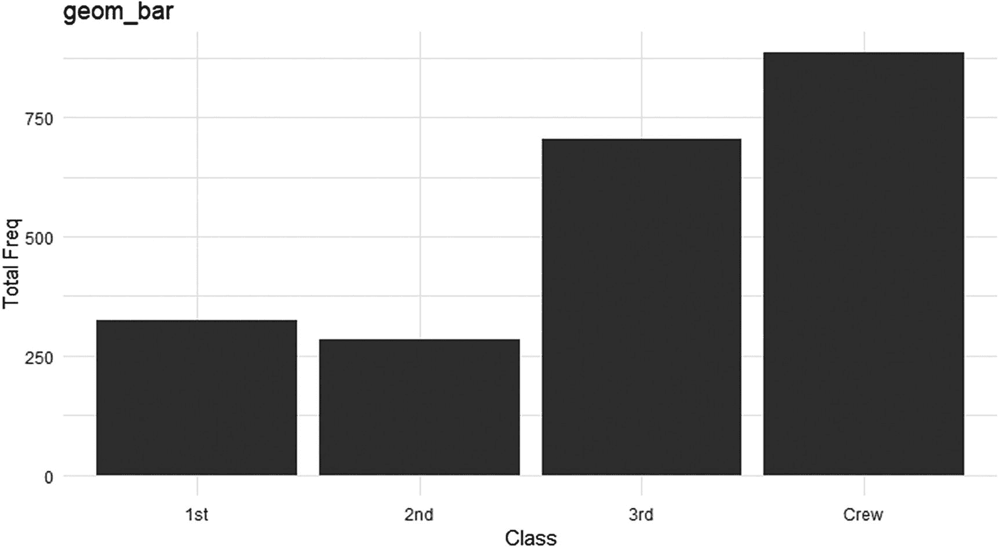

图 1-12

`geom_bar()` 几何对象

上述脚本中的第一行代码加载了`tidyverse`包。接下来的代码块创建了`geom_bar()`可视化所需的数据集。该部分中用于处理数据的技术将在本书后续部分介绍。

再下一个代码块是实际创建可视化的代码。前两行就是创建柱状图所需的全部代码。最后两行用于更改图表的外观。它们为图表添加了标题并更改了图表的主题。

请注意，`geom_bar()`只需要定义一个参数，即`stat`参数。其他必需的参数（数据集、x 坐标和 y 坐标）继承自`ggplot()`函数。将`stat`参数设置为“identity”告诉`ggplot2`，你希望柱子的高度基于分配给`aes()`函数中 y 美学的列的值。默认值是使用计数。你将在未来的示例中了解更多关于`stat`参数的信息。

*   `geom_histogram()`

`geom_histogram()`用于创建直方图。直方图用于显示数据的分布情况。我们将用于说明此几何对象的代码见清单 1-16。

```
library(tidyverse)
set.seed(50)
probs <- c(0.0033, 0.0033, 0.0033, 0.0033, 0.0033, 0.0033, 0.0033, 0.0033, 0.0033, 0.0033, 0.0033, 0.0033, 0.0033, 0.0033, 0.0033, 0.01, 0.01, 0.01, 0.01, 0.01, 0.01, 0.01, 0.01, 0.01, 0.01, 0.015, 0.015, 0.015, 0.015, 0.015, 0.015, 0.015, 0.015, 0.015, 0.015, 0.0133, 0.0133, 0.0133, 0.0133, 0.0133, 0.0133, 0.0133, 0.0133, 0.0133, 0.0133, 0.0133, 0.0133, 0.0133, 0.0133, 0.0133, 0.0133, 0.0133, 0.0133, 0.0133, 0.0133, 0.0133, 0.0133, 0.0133, 0.0133, 0.0133, 0.0133, 0.0133, 0.0133, 0.0133, 0.017, 0.015, 0.015, 0.015, 0.015, 0.015, 0.015, 0.015, 0.015, 0.015, 0.01, 0.01, 0.01, 0.01, 0.01, 0.01, 0.01, 0.01, 0.01, 0.01, 0.0033, 0.0033, 0.0033, 0.0033, 0.0033, 0.0033, 0.0033, 0.0033, 0.0033, 0.0033, 0.0033, 0.0033, 0.0033, 0.0033, 0.0033)
weights <- 265:364
names <- c("Liam  Galles", "Noah  Raymond", "William  Hammontree", "James  Zaremba", "Oliver  Zurcher", "Benjamin  Hilker", "Elijah  Loken", "Lucas  Lewter", "Mason  Straus", "Logan  Work", "Alexander  Jarret", "Ethan  Wey", "Jacob  Adolphsen", "Michael  Solt", "Daniel  Welcome", "Henry  Portman", "Jackson  Tichenor", "Sebastian  Free", "Aiden  Papp", "Matthew  Lenzi", "Samuel  Rinaldo", "David  Goines", "Joseph  Asuncion", "Carter  Philhower", "Owen  Freeborn", "Wyatt  Ice",
"John  Mcguckin", "Jack  Soden", "Luke  Humfeld", "Jayden  Natera", "Dylan  Galles", "Grayson  Raymond", "Levi  Hammontree", "Isaac  Zaremba", "Gabriel  Zurcher", "Julian  Hilker", "Mateo  Loken", "Anthony  Lewter", "Jaxon  Straus", "Lincoln  Work", "Joshua  Jarret", "Christopher  Wey", "Andrew  Adolphsen", "Theodore  Solt", "Caleb  Welcome", "Ryan  Portman", "Asher  Tichenor", "Nathan  Free", "Thomas  Papp", "Leo  Lenzi", "Isaiah  Rinaldo", "Charles  Goines", "Josiah  Asuncion", "Hudson  Philhower", "Christian  Freeborn", "Hunter  Ice", "Connor  Mcguckin", "Eli  Soden", "Ezra  Humfeld", "Aaron  Natera", "Landon  Galles", "Adrian  Raymond", "Jonathan  Hammontree", "Nolan  Zaremba", "Jeremiah  Zurcher", "Easton  Hilker", "Elias  Loken", "Colton  Lewter", "Cameron  Straus", "Carson  Work", "Robert  Jarret", "Angel  Wey", "Maverick  Adolphsen", "Nicholas  Solt", "Dominic  Welcome", "Jaxson  Portman", "Greyson  Tichenor", "Adam  Free", "Ian  Papp", "Austin  Lenzi", "Santiago  Rinaldo", "Jordan  Goines", "Cooper  Asuncion", "Brayden  Philhower", "Roman  Freeborn", "Evan  Ice", "Ezekiel  Mcguckin", "Xavier  Soden", "Jose  Humfeld", "Jace  Natera", "Jameson  Adolphsen", "Leonardo  Solt", "Bryson  Welcome", "Axel  Portman", "Everett  Tichenor", "Parker  Free", "Kayden  Papp", "Miles  Lenzi", "Sawyer  Rinaldo", "Jason  Goines")
linemen_weights <- sample(weights, 100, replace = TRUE,
prob= probs)
plot.data <- data.frame(names, linemen_weights)
ggplot(plot.data, aes(linemen_weights)) +
  geom_histogram(binwidth = 20) +
  labs(title = "geom_histogram") +
  theme_minimal()
清单 1-16
geom_histogram() 示例
```

上述代码生成的可视化效果见图 1-13，如下所示。

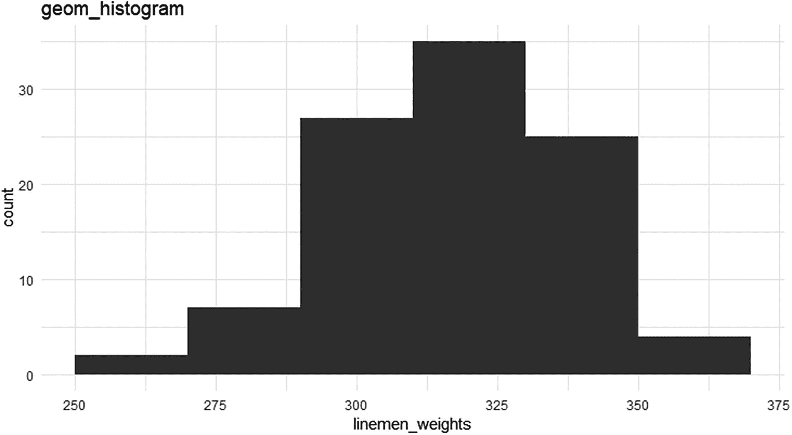

图 1-13

`geom_histogram()` 几何对象

与前面的示例一样，代码的第一部分构建了可视化将使用的数据集，以便你可以在自己的环境中重现相同的可视化效果。它生成一个虚构的大学级别美式橄榄球进攻锋线球员数据集。我们将只关注生成可视化的最后四行代码。

# 直方图与几何对象

你可能已经猜到，直方图可视化的基础是使用`geom_histogram()`几何对象。请注意，它使用了一个参数，即`binwidth`，因为其他必需的参数是从`ggplot()`函数继承而来的。该参数允许你定义分箱的宽度。建议你尝试调整这个参数，因为默认设置通常不会创建最佳数量的分箱。请注意，直方图的基础仅由以下两行代码创建，如下所示：

```
ggplot(plot.data, aes(linemen_weights)) +
geom_histogram(binwidth = 20)
```

此后的代码用于美化功能。

## `geom_line()`

`geom_line()`几何对象用于创建折线图。折线图非常适合展示随时间变化的趋势。以下清单 1-17 中的代码将用于生成折线图示例。

```
library(tidyverse)
library(lubridate)
players <- c("Kobe Bryant", "Pau Gasol", "Lamar Odom", "Andrew Bynum", "Derek Fisher")
plot.data <- lakers %>%
  filter(
    result == "made" & team == "LAL" & player %in% players
  ) %>%
  mutate(date = ymd(date)) %>%
  group_by(player, date) %>%
  summarize(points = sum(points))
ggplot(plot.data, aes(x=date, y=points, color=player)) +
  geom_line() +
  labs(title = "geom_line") +
  theme_minimal()
Listing 1-17
geom_line() example
```

上述代码的输出如图 1-14 所示。

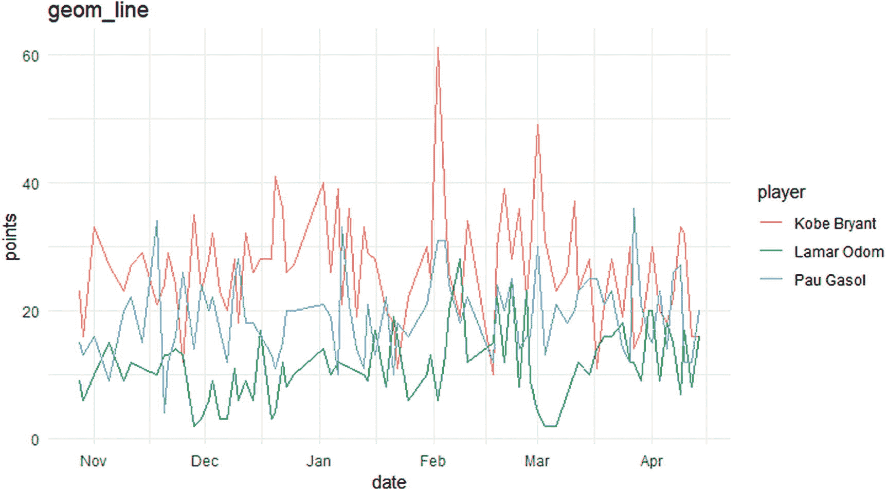

Figure 1-14

`geom_line()`几何对象

与之前的示例一样，代码的第一部分构建数据集，并为你提供在环境中重新创建可视化所需的一切。此可视化使用了`lubridate`包附带的`lakers`数据集。`lakers`数据集包含 2008 赛季的逐回合比赛信息。

请注意，颜色美学映射是如何用于创建多条线的。`ggplot2`会根据颜色美学映射中指定的字段中的每个唯一项创建一条线。就像之前的示例一样，只需要两行代码即可创建可视化基础：一行是初始化`ggplot()`函数，另一行是定义几何对象图层。

## `geom_point()`和`geom_smooth()`

此示例说明了如何在`ggplot2`中创建具有多个图层的图表。该示例展示了如何向散点图添加回归线。`ggplot2`允许你用不同类型的趋势线覆盖散点图。它不限于线性回归线。`ggplot2`还允许你按自己选择的置信水平向线条添加置信区间。在撰写本文时，这些功能在原生 Power BI 中尚不可用。

以下清单 1-18 中的代码用于说明如何创建散点图并用回归线覆盖它。

```
library(tidyverse)
set.seed(1)
plot.data <- diamonds %>%
  filter(color == "D") %>%
  sample_n(200)
ggplot(plot.data, aes(x=carat, y=price)) +
  geom_point() +
  geom_smooth(method = "lm") +
  labs(title = "geom_point & geom_smooth") +
  theme_minimal()
Listing 1-18
geom_point() and geom_smooth() example
```

图 1-15 显示了代码生成的结果。

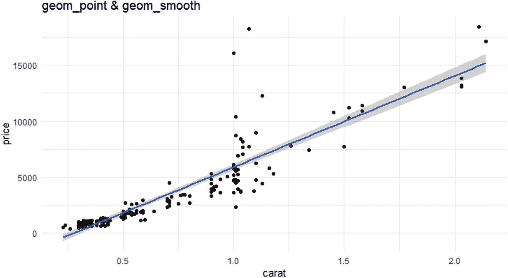

Figure 1-15

`geom_point()`和`geom_smooth()`几何对象

上述图表基于多个图层：`geom_point()`和`geom_smooth()`。`geom_point()`几何对象用于创建散点图，而`geom_smooth()`几何对象用于添加带有置信区间的回归线。置信区间的默认值为 95%。你可以通过修改`se`参数来更改它。将`method`参数设置为`lm`会使`geom_smooth()`几何对象生成回归线。

# 使用标度控制美学映射

你之前了解到，数据到美学映射的描述是使用`aes()`函数完成的。然而，底层过程是由标度函数控制的。在本节中，你将了解这是如何发生的。

首先介绍标度的背景。图表中的每个美学映射（x 坐标、y 坐标、颜色等）都需要一个标度。它决定了数据在可视化中的“缩放”方式。你不需要显式定义它们。如果你不定义它们，`ggplot2`将使用默认值。让我们以清单 1-19 中的代码片段为例。

```
ggplot(plot.data, aes(x = carat, y = price)) +
  geom_point(aes(color = clarity))
```

Listing 1-19: ggplot2 code minus the underlying helper code

在此示例中，没有显式定义任何标度。上述代码会被`ggplot2`转换为以下清单 1-20 中的代码。

```
ggplot(plot.data, aes(x = carat, y = price)) +
  geom_point(aes(color = clarity)) +
  scale_x_continuous() +
  scale_y_continuous() +
  scale_color_discrete()
```

Listing 1-20: ggplot2 code with helper code that defines the scales

`ggplot2`为这三个标度中的每一个都使用了默认值。

敏锐的读者可能已经注意到标度命名约定中的模式。标度函数使用三部分命名约定。标度函数以单词“scale”开头，后跟它所属的美学映射名称，最后以标度类型结尾。这三部分用下划线分隔。

因此，如果你使用刚刚概述的命名约定查看上述脚本中的前两个标度，你会注意到它们分别用于 x 和 y 美学映射。它们都使用`continuous`标度类型，因为映射到 x 和 y 美学映射的数据是连续数字。最后一个标度用于`color`美学映射。映射到此美学映射的数据是`clarity`字段。该字段包含一系列离散值，这就是标度类型为`discrete`的原因。

如果你对`ggplot2`生成的结果满意，则无需定义标度。你可以使用默认值。但如果你想覆盖`ggplot2`生成的结果，则需要使用适当的标度来实现。

回想一下清单 1-9 中生成图 1-8 的以下代码：

```
library(tidyverse)
library(scales)
plot.data <- diamonds %>%
  filter(color == "D") %>%
  sample_n(200)
ggplot(plot.data, aes(x = carat, y = price)) +
  geom_point(aes(color = clarity)) +
  labs(
    title = "Chart Title",
    subtitle = "Chart Subtitle",
    caption = "Chart Caption"
  ) +
  scale_x_continuous(name = "Size in Carats") +
  scale_y_continuous(
    name = "Price ($)",
    labels = dollar_format()
  )
```

请注意，使用`scale_x_continuous()`更改了 x 美学映射的名称，并使用`scale_y_continuous()`更改了 y 美学映射的标签格式和名称。你将在下一章中看到更多使用标度修改美学映射的示例。

# ggplot2 内置主题

`ggplot2` 自带一系列主题，可轻松更改图表中非数据元素的显示效果。以下是该软件包作者 Hadley Wickham 描述的可用的主题列表：^(²)

* `theme_bw()`：`theme_gray()` 的变体，使用白色背景和细灰色网格线
* `theme_linedraw()`：一种仅在白色背景上使用各种宽度的黑色线条的主题，类似于线条画
* `theme_light()`：与 `theme_linedraw()` 类似，但使用浅灰色线条和坐标轴，以便将更多注意力引向数据
* `theme_dark()`：`theme_light()` 的深色版本，线条粗细相似，但背景为深色。有助于突出细彩色线条
* `theme_minimal()`：一种极简主题，无背景注释
* `theme_classic()`：经典外观主题，带有 x 轴和 y 轴线条，无网格线
* `theme_void()`：完全空白的主题

## 在 Power BI 服务中使用 R 可视化效果

当您将 R 可视化效果部署到 Power BI 服务时，必须确保使用的是该服务中可用的软件包版本。以下 URL 包含服务器上可用软件包及其版本的列表：[`https://docs.microsoft.com/en-us/power-bi/connect-data/service-r-packages-support`](https://docs.microsoft.com/en-us/power-bi/connect-data/service-r-packages-support)。

## ggplot2 的辅助包

`ggplot2` 是一个功能丰富的软件包，包含处理大多数数据可视化需求所需的工具。但有时您需要执行一些操作，例如在创建可视化之前整理 Power BI 传递给 R 的数据集，以基础 R 或 `ggplot2` 中不可用的方式格式化数据，或使用不属于 `ggplot2` 包的主题。

幸运的是，在开发 R 可视化效果时，您并不局限于 `ggplot2` 包。以下是一些在 Power BI 中与 `ggplot2` 完美互补的软件包。此列表并非详尽无遗：

* `tidyverse`：一个元包，包含一系列共享相同框架的流行 R 包。它包括 `ggplot` 和 `dplyr` 等包。`tidyverse` 包集合有助于在 R 中进行数据科学。有关 `tidyverse` 的更多信息，请访问此 URL：[`www.tidyverse.org/`](http://www.tidyverse.org/)。
* `ggthemes`：`ggplot2` 的辅助包，包含额外的比例尺、几何对象和主题。其中两个值得注意的主题是 `theme_few()` 和 `theme_tufte()`。这两个主题基于两位非常流行的数据可视化专家 Stephen Few 和 Edward Tufte 的最佳实践。有关 `ggthemes` 包的更多信息，请访问此 URL：[`https://cran.r-project.org/web/packages/ggthemes/ggthemes.pdf`](https://cran.r-project.org/web/packages/ggthemes/ggthemes.pdf)。
* `scales`：`scales` 包提供了 `ggplot2` 的内部缩放基础设施，以及许多用于数据转换和数据格式化的函数。您可以在以下 URL 找到有关 `scales` 包的更多信息：[`https://cran.r-project.org/web/packages/scales/scales.pdf`](https://cran.r-project.org/web/packages/scales/scales.pdf)。
* `ggrepel`：`ggrepel` 包提供了重新定位标签以最小化标签重叠的 `几何对象`。当您想要向散点图添加标签时，此包非常有用。您可以在以下 URL 找到有关 `ggrepel` 包的更多信息：[`https://cran.r-project.org/web/packages/ggthemes/ggthemes.pdf`](https://cran.r-project.org/web/packages/ggthemes/ggthemes.pdf)。

## 总结

在本章中，您了解了

* 向 Power BI 添加 R 可视化效果时使用的框架
* `ggplot2` 所基于的`图形分层语法`
* 如何使用几何对象向可视化效果添加图层
* 如何使用比例尺函数修改图表美学
* 如何使用完整主题和 `theme()` 函数修改图表的非数据元素

本章的目标是向您介绍一些关于 `ggplot2` 的重要概念，以便您更容易理解如何构建将在下一章学习的更高级图形。既然您已经了解了如何使用 `ggplot2` 在 Power BI 中创建 R 可视化效果的基础知识，那么让我们更进一步，开发能够帮助您在 Power BI 中讲述精彩数据故事的 R 可视化效果！

脚注 1 2

