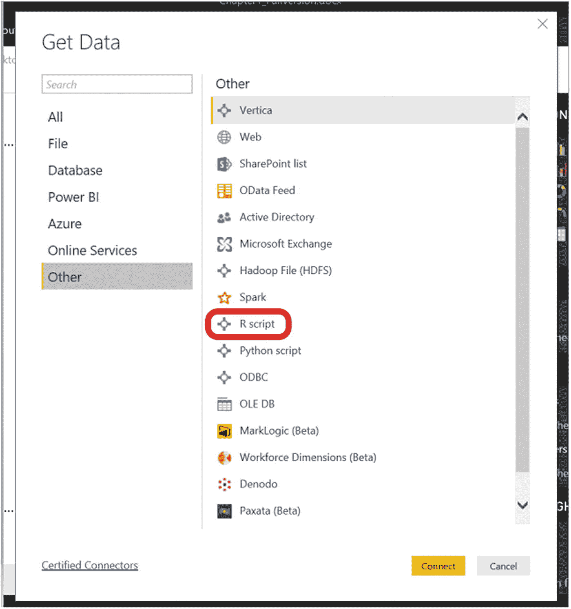
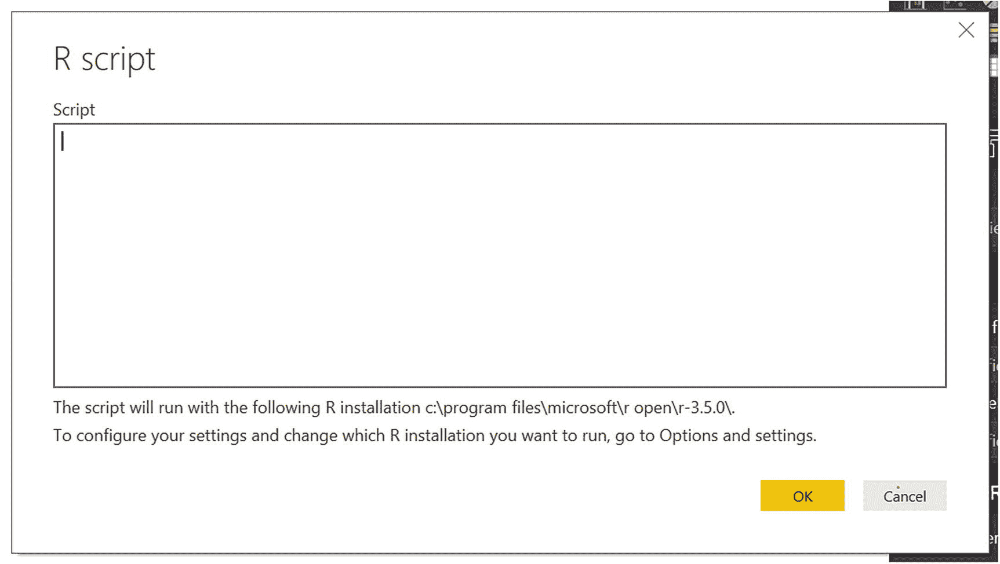
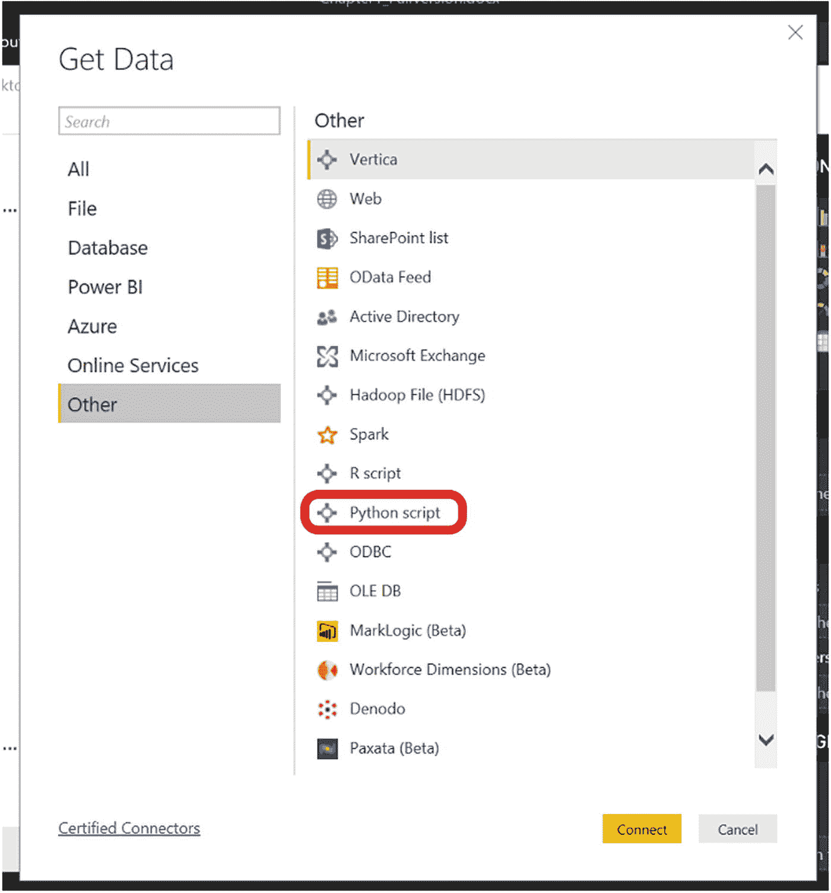
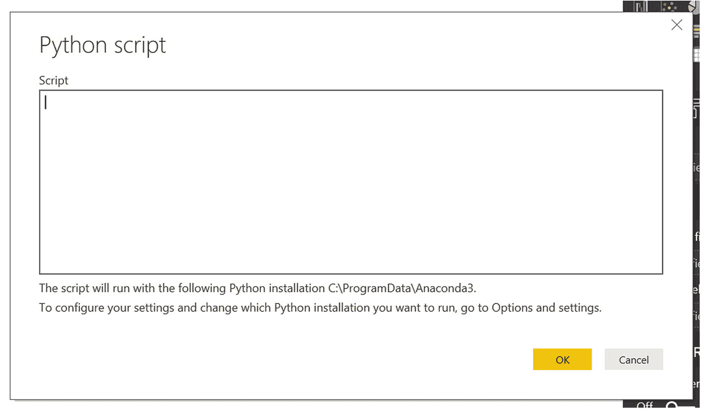

# 3. 读取 CSV 文件

Power BI 是一款出色的数据可视化工具，已被公认为该领域的顶级工具之一。然而，在创建 Power BI 闻名遐迩的卓越可视化之前，你首先需要将数据导入 Power BI 数据模型。

Power BI 自带一个名为 Power Query 的工具，它能处理你在将数据导入 Power BI 数据模型时遇到的大多数情况。Power Query 的图形用户界面直观易用，但在某些高级场景下，Power Query 会显得力不从心。

幸运的是，随着 Power BI 中 R 和 Python 的加入，许多“难以完成”的任务变得相对容易处理。在本章中，你将学习如何使用 R 和 Python 动态选择文件夹中要合并的文件，并根据需要高级字符串匹配技术的字符串模式来筛选行。让我们从动态合并文件开始。

## 动态合并文件

在将数据导入 Power BI 数据模型之前，将文件夹中的多个文件合并成一个数据集是一项常见任务，但在 Power Query 中使用复杂的筛选逻辑动态选择这些文件可能颇具挑战性。本节将展示如何通过使用 R 和 Python 来简化此任务。

如果你要合并特定文件夹中所有结构相同的文件，在 Power Query 中合并文件是直接了当的。如果你使用简单的选择规则来挑选要合并的文件，将文件夹中的文件合并成一个数据集也并非难事。但是，当你需要应用涉及复杂逻辑的选择规则时，在 Power Query 中完成该任务即使不是不可能，也会非常困难。而使用 R 和 Python 则能让任务变得更容易执行，即使选择标准很复杂。

### 示例场景

场景如下：假设现在是 2014 年 2 月 5 日，你是一家大型小部件销售公司的财务分析师。你有一个文件夹，里面存放着从 2010 年 12 月 1 日到 2014 年 1 月 1 日的月度销售报告。每个月的报告都相当大，由于 Power BI 的限制，你无法加载所有历史报告。你需要将加载范围限制在滚动 24 个月内。

以下是一些额外的技术细节：
- 报告为`csv`文件类型。
- 文件名的命名规则为`YYYY-MM-DD.csv`。
- 所有报告具有相同的结构布局。

在 Power Query 中创建一个能够动态选择滚动 24 个月内文件的工作流将非常困难。该任务需要高级 Power Query 技能和使用自定义 M 代码。执行此任务所需的底层 M 代码会很复杂，并且不如使用 R 或 Python 编写的代码直观。让我们首先使用 R 执行此任务，然后使用 Python 执行相同的任务。这样，你就能看到使用这两种语言编写的代码是多么直观和简洁。

### 使用 R 选择滚动 24 个月的数据

R 用户自 20 世纪 90 年代初就开始进行*数据整理*。数据整理是将原始数据转换为适合分析的数据集的过程。将相似文件合并成一个数据集是一项常见的数据整理任务。多年来，R 社区开发了许多包，使得此类任务变得更加容易。你将在本例中看到这一点。让我们逐步了解在 R 中执行所述任务所需的步骤。

#### 步骤 1：加载脚本所需的 R 包

在本例中，你将使用`tidyverse`中的四个包。这些包是`readr`、`lubridate`、`purrr`和`stringr`。`readr`包提供了便于将平面文件读入 R 的功能，`lubridate`包提供了简化 R 中日期处理的函数，`purrr`包以一致的方式在 R 中实现函数式编程技术，而`stringr`包则提供了一些方便的字符串操作函数。

`readr`和`purrr`包包含在`tidyverse`加载中，因此你无需显式加载它们。但是，你需要加载`lubridate`和`stringr`，因为它们不属于`tidyverse`加载中包含的核心包。以下是加载这些包所需的代码：

```
library(tidyverse)
library(lubridate)
library(stringr)
```

你可能会想，如果一个脚本需要使用四个 R 包，这实际上会让情况变得更复杂，因为在 Power Query 中你不需要加载额外的包。Power Query 中所需的一切都已内置。请跟随我的思路，你会发现能够访问 R 中大量的包是一个巨大的优势。通过利用 R 包，你将能够用非常少的代码执行一些复杂的任务。

#### 步骤 2：将工作目录更改为包含销售数据集的文件夹

R 中的*工作目录*是脚本和数据所在的根目录。建议使用工作目录，因为它能让你将所有任务所需的项目集中存放在一个中心位置。它还能让你利用*相对文件路径引用*。*相对文件路径引用*使你能够引用相对于工作目录的文件，而无需提供完整的文件路径。本示例的工作目录应设置为名为`R_Code`的文件夹，该文件夹是仓库中`Chapter03`部分的一个子文件夹。`R_Code`文件夹包含在本书的代码下载中。因此，如果你将配套代码保存到了`Documents`文件夹，那么你可以使用类似于以下代码的代码来设置工作目录：

```
setwd("C:/Users//Documents/AdvancedAnalyticsPowerBI/Chapter03/R_Code")
```

`setwd()`函数会根据你传递给它的文件路径，将工作目录设置到一个新位置。

如果你想将工作目录设置到相对于当前工作目录的位置，可以通过以句点（“ . ”）开头文件路径字符串来实现。我们用一个例子来说明。下面的代码假设你的工作目录是`Documents`文件夹，并且你想使用正斜杠将其更改为`R_Code`文件夹：

```
setwd("./AdvancedAnalyticsPowerBI/R_Code ")
```

上述代码通过使用句点，告诉 R 从`Documents`文件夹（即你的工作目录）开始。从那里，你可以使用“/”后跟文件夹名称，遍历到你想要设置为新工作目录的文件夹。你也可以使用“\”，但如果这样做，你需要使用两个反斜杠，因为“\”是一个需要被*转义*的特殊字符。

当你确实想使用一个同时也是特殊字符的字符时，你需要通过使用“\”对其进行转义，来告诉 R 和 Python 你想使用它的字面版本。一些需要转义的常用特殊字符包括“*”和“.”。

#### 步骤 3：将文件名读入一个字符向量

如果你想选择应包含在滚动 24 个月内的文件，你需要能够分析文件名以确定它们是否应被包含在内。为此，你可以使用`list.files()`函数。`list.files()`函数会获取传递给它的文件路径中的所有文件名，并将其放入一个*字符向量*中，如下列代码所示：

```
monthly_reports <- list.files("./Data/SalesData/")
```

*字符向量*是一个数据向量，其元素属于*字符*数据类型。R 中的*字符*数据类型类似于 DAX 中的*字符串*数据类型和 M 中的*文本*数据类型。

在上述代码中，R 首先获取指定目录中的所有文件名，并将它们放入一个*字符向量*中。然后，它将生成的字符向量赋值给一个名为`monthly_reports`的变量。

`<-`是一个赋值运算符，用于将值赋给 R 变量。

以下是存储在`monthly_reports`变量中的信息打印输出：

```
> monthly_reports
[1] "2010-12-01.csv" "2011-01-01.csv" "2011-02-01.csv"
[4] "2011-03-01.csv" "2011-04-01.csv" "2011-05-01.csv"
[7] "2011-06-01.csv" "2011-07-01.csv" "2011-08-01.csv"
[10] "2011-09-01.csv" "2011-10-01.csv" "2011-11-01.csv"
[13] "2011-12-01.csv" "2012-01-01.csv" "2012-02-01.csv"
[16] "2012-03-01.csv" "2012-04-01.csv" "2012-05-01.csv"
[19] "2012-06-01.csv" "2012-07-01.csv" "2012-08-01.csv"
[22] "2012-09-01.csv" "2012-10-01.csv" "2012-11-01.csv"
[25] "2012-12-01.csv" "2013-01-01.csv" "2013-02-01.csv"
[28] "2013-03-01.csv" "2013-04-01.csv" "2013-05-01.csv"
[31] "2013-06-01.csv" "2013-07-01.csv" "2013-08-01.csv"
[34] "2013-09-01.csv" "2013-10-01.csv" "2013-11-01.csv"
[37] "2013-12-01.csv" "2014-01-01.csv"
```

#### 步骤 4：创建一个日期向量

现在创建一个向量，其中包含每个文件名的日期表示形式。为了能够确定滚动 24 个月，你需要将文件名转换为日期格式。这可以通过两个步骤完成。第一步，移除`.csv`，这样你就得到一个可以解析为日期的字符串。为此，你可以使用`stringr`包中的`str_replace()`函数，并将输出赋值给一个名为`date_format`的字符向量。代码如下：

```
date_format <- stringr::str_replace(monthly_reports, ".csv","")
```

`str_replace()`函数需要三个参数：你想要更改的字符串、你想要替换的字符串中的模式，以及你想要用作替换的字符串。以下是之前创建的`date_format`变量中存储内容的打印输出：

```
> date_format
[1] "2010-12-01" "2011-01-01" "2011-02-01" "2011-03-01"
[5] "2011-04-01" "2011-05-01" "2011-06-01" "2011-07-01"
[9] "2011-08-01" "2011-09-01" "2011-10-01" "2011-11-01"
[13] "2011-12-01" "2012-01-01" "2012-02-01" "2012-03-01"
[17] "2012-04-01" "2012-05-01" "2012-06-01" "2012-07-01"
[21] "2012-08-01" "2012-09-01" "2012-10-01" "2012-11-01"
[25] "2012-12-01" "2013-01-01" "2013-02-01" "2013-03-01"
[29] "2013-04-01" "2013-05-01" "2013-06-01" "2013-07-01"
[33] "2013-08-01" "2013-09-01" "2013-10-01" "2013-11-01"
[37] "2013-12-01" "2014-01-01"
```

请注意，`str_replace()`函数前面的`stringr::`并非必需。它只是为了明确该函数来自哪个包。

接下来你需要做的是将字符串解析为日期。你可以使用`lubridate`包中的`ymd()`函数来实现。以下是执行此操作所需的代码：

```
date_format <- lubridate::ymd(date_format)
```

`ymd()`函数是一个非常巧妙的函数！它可以将年-月-日格式的字符串解析为日期，并且非常宽容。它能很好地解析那些其他编程语言（如 Power Query 中的 M）难以解析的日期字符串。你将生成的日期向量赋值给`date_format`变量。以下是`date_format`变量中存储内容的显示：

```
> date_format
[1] "2010-12-01" "2011-01-01" "2011-02-01" "2011-03-01"
[5] "2011-04-01" "2011-05-01" "2011-06-01" "2011-07-01"
[9] "2011-08-01" "2011-09-01" "2011-10-01" "2011-11-01"
[13] "2011-12-01" "2012-01-01" "2012-02-01" "2012-03-01"
[17] "2012-04-01" "2012-05-01" "2012-06-01" "2012-07-01"
[21] "2012-08-01" "2012-09-01" "2012-10-01" "2012-11-01"
[25] "2012-12-01" "2013-01-01" "2013-02-01" "2013-03-01"
[29] "2013-04-01" "2013-05-01" "2013-06-01" "2013-07-01"
[33] "2013-08-01" "2013-09-01" "2013-10-01" "2013-11-01"
[37] "2013-12-01" "2014-01-01"
```

输出看起来与应用`ymd()`函数之前相同，但实际上并非如此。你可以使用`str()`函数来检查它，从而证明这一点。`str()`函数用于显示 R 对象的结构。如果你将`date_format`变量传递给`str()`函数，你将得到以下结果，证明它是一个*日期*数据类型：

```
> str(date_format)
Date[1:38], format: "2010-12-01" "2011-01-01" "2011-02-01"
```

建议你在 *R 控制台* 中进行测试，而不是在 R Studio 的 R 脚本*编辑器*中进行，以防止将不应存在的代码添加到你的脚本中。

#### 步骤 5：使用两个向量创建数据框

你希望将信息放入数据框中，因为将数据置于数据框内能极大简化分析过程。R 语言的数据框是一种二维表格对象，由可包含不同数据类型的变量（列）构成。它在某些方面类似于 *Microsoft Excel* 表格和 SQL Server 表格，但它是专门为数据分析而设计的。将`monthly_reports`变量和`date_format`变量转换为数据框所需的代码如下所示：

```
df <- tibbles::data_frame(monthly_reports, date_format)
```

你使用`tibble`包中的`data_frame()`函数，而不是基础 R 中的`data.frame()`函数，因为`data.frame()`存在一些不良副作用。`data_frame()`函数创建的对象类型称为`tibble`，可以将其视为数据框的现代版本。我发现使用 tibble 更加理想。

我喜欢`tibbles`的一个特性是它们在屏幕上的打印方式。当你打印一个`tibble`时，只会输出前 10 行，并且只显示适合屏幕宽度的列。当你打印一个常规数据框时，R 会显示更多信息，如果你处理的是大数据集，这可能会成为一个问题。你还可以从 tibble 中获取每列的数据类型，这是非常有价值的信息。以下是我打印`df`数据框时的输出结果：

```
> df
# A tibble: 38 x 2
   monthly_reports date_format
   <chr>           <date>
 1 2010-12-01.csv  2010-12-01
 2 2011-01-01.csv  2011-01-01
 3 2011-02-01.csv  2011-02-01
 4 2011-03-01.csv  2011-03-01
 5 2011-04-01.csv  2011-04-01
 6 2011-05-01.csv  2011-05-01
 7 2011-06-01.csv  2011-06-01
 8 2011-07-01.csv  2011-07-01
 9 2011-08-01.csv  2011-08-01
10 2011-09-01.csv  2011-09-01
# ... with 28 more rows
```

#### 步骤 6：获取所需日期范围的上限和下限

你需要一个滚动 24 个月的窗口。因此，你需要计算定义该窗口所需的日期范围的上限和下限。你可以使用以下代码来实现：

```
max_month <- max(df$date_format)
min_month <- max_month %m+% lubridate::months(-23)
```

你使用`max()`函数作用于`df`数据框中的`date_format`列来获取最大月份，并将结果赋值给`max_month`变量。接着，你获取`max_month`变量并从中减去 23 个月以得到最小月份，这是通过调用`lubridate`包中的`%m+%`运算符实现的。该运算符专门用于添加月份。在此示例中，你添加的是 -23 个月。结果值被赋值给`min_month`变量。

### 步骤 7：对数据框进行子集筛选，仅包含所需月份

在此步骤中，你应用一个筛选条件，返回包含你想要合并的文件的向量。你通过应用一个筛选条件来实现，该条件仅返回月份大于或等于最小月份的文件。代码如下：

```
reports_to_read <- df[df$date_format >= min_month, ]$monthly_reports
```

在 R 中，你可以使用上述方法对数据框中的列进行筛选。方括号内的代码 `df$date_format >= min_month` 返回一个称为 `Boolean` 向量的 R 对象。在该表达式中，`date_format` 列中的每个元素都与 `min_month` 变量进行比较，当列中的元素大于或等于 `min_month` 时返回 `True`，否则返回 `False`。只有计算结果为 `True` 的行才会被保留。

你只需要 `reports_to_read` 列。你通过使用 `df$monthly_reports` 语法在 `df` 数据框中对该列进行子集筛选。如果你想返回数据框中的所有列，你可以使用以下代码实现：

```
reports_to_read <- df[df$date_format >= min_month, ]
```

这是一种依赖于基础 R 功能的子集筛选方法，在简单情况下效果很好。你将在本书后面学习更直观的方法，这些方法可用于更复杂的子集筛选场景。`reports_to_read` 变量的内容如下所示：

```
> reports_to_read
[1] "2013-01-01.csv" "2013-02-01.csv" "2013-03-01.csv"
[4] "2013-04-01.csv" "2013-05-01.csv" "2013-06-01.csv"
[7] "2013-07-01.csv" "2013-08-01.csv" "2013-09-01.csv"
[10] "2013-10-01.csv" "2013-11-01.csv" "2013-12-01.csv"
[13] "2014-01-01.csv"
```

### 步骤 8：创建一个基于所有文件并集的数据框

现在，你已将想要合并成一个数据框的文件列表保存在 `reports_to_read` 变量中。是时候实际进行合并了。你可以使用 R 中 `purrr` 包的 `map_df()` 函数，仅用一行代码就能轻松合并这些文件。代码如下：

```
df_output <- purrr::map_df(reports_to_read, read_csv)
```

这行代码使用 `map_df()` 函数将 `reports_to_read` 变量中的每个元素映射到 `readr` 包中的 `read_csv()` 函数。函数名中的 `_df` 部分告诉你，该函数的结果将是一个包含所有文件数据的 R 数据框。以下是结果数据框的输出示例：

```
> df_output
# A tibble: 54,771 x 9
Category OrderDate           DueDate

1 Bikes    2013-01-01 05:00:00 2013-01-13 05:00:00
2 Accesso~ 2013-01-01 05:00:00 2013-01-13 05:00:00
3 Accesso~ 2013-01-01 05:00:00 2013-01-13 05:00:00
4 Bikes    2013-01-01 05:00:00 2013-01-13 05:00:00
5 Bikes    2013-01-01 05:00:00 2013-01-13 05:00:00
6 Accesso~ 2013-01-01 05:00:00 2013-01-13 05:00:00
7 Accesso~ 2013-01-01 05:00:00 2013-01-13 05:00:00
8 Bikes    2013-01-01 05:00:00 2013-01-13 05:00:00
9 Accesso~ 2013-01-01 05:00:00 2013-01-13 05:00:00
10 Accesso~ 2013-01-01 05:00:00 2013-01-13 05:00:00
# ... with 54,761 more rows, and 6 more variables:
#   ShipDate , OrderQuantity , UnitPrice ,
#   SalesAmount , TaxAmt , `Order Month` 
```

请注意信息打印得多么整洁。`tibble` 包只打印了适合屏幕显示的信息，并提供了未显示列（变量）的相关信息。

### 步骤 9：将代码合并到一个脚本中并粘贴到 Power BI 的 R 编辑器中

现在，是时候将前面步骤中的所有代码片段整合起来，创建一个完整的脚本，以便你可以在 Power BI 中执行它。该脚本如代码清单 3-1 所示，你现在可以将其粘贴到 Power BI 的 R 编辑器中。

```
library(tidyverse)
library(lubridate)
library(stringr)
setwd("./Data/SalesData")
monthly_reports <- list.files(pattern = "*.csv")
date_format <- lubridate::ymd(gsub(".csv", "", monthly_reports))
df <- tibble::data_frame(monthly_reports, date_format)
max_month <- max(df$date_format)
min_month <- max_month %m+% lubridate::months(-23)
reports_to_read <- df[df$date_format >= min_month, ]$monthly_reports
df_output <- purrr::map_df(reports_to_read, read_csv)
```
代码清单 3-1 合并文件所需的完整 R 脚本

复制 R 脚本中的代码，并打开此解决方案的 pbix 文件。接下来，点击 `获取数据` ➤ `更多` ➤ `其他` 以打开连接器选项菜单。然后点击该菜单右侧的 `R 脚本`，如图 3-1 所示。



图 3-1 进入 R 脚本编辑器

点击 `R 脚本` 后，Power BI 中的 R 编辑器将会出现，如图 3-2 所示。



图 3-2 R 脚本编辑器

现在，将代码清单 [1-1](https://doi.org/10.1007/978-1-4842-5829-3_1Listing#1) 中的 R 脚本粘贴到编辑器中，然后点击 `确定`。现在，你就可以像处理导入 Power BI 的任何其他数据集一样处理生成的数据集了。你可以使用 Power Query 对其进行进一步转换，或者直接将其加载到 Power BI 数据模型中。

### 使用 Python 选取滚动 24 个月的数据

与 R 语言一样，Python 自 20 世纪 90 年代初就已存在。它也拥有许多工具和库，使得在滚动时间段内合并文件的任务相对容易。以下是使用 Python 选取滚动 24 个月内文件的步骤。

#### 步骤 1：创建 Python 脚本并加载必要的库

你需要做的第一件事是加载脚本中将要使用的库和函数。你可以使用以下代码来完成：

```
import os
import pandas as pd
from dateutil.relativedelta import relativedelta
```

这段代码加载了两个库（`os` 和 `pandas`）以及一个函数（`relativedelta`）。`os` 库用于与文件系统交互，`pandas` 库用于简化数据分析，而来自 `dateutil` 库的 `relativedelta()` 函数则用于辅助日期操作。

#### 步骤 2：将工作目录更改为 Python_Code 文件夹

你使用 `os` 库中的 `chdir()` 函数，方式与你之前在 R 中使用 `setwd()` 函数相同。要设置工作目录，你需要向该函数提供一个文件路径，遵循我们在 R 中使用的相同规则。假设你将配套代码保存到了 `Documents` 文件夹，以下代码会将工作目录设置为 `Python_Code` 文件夹：

```
os.chdir("C:/Users//Documents/AdvancedAnalyticsPowerBI/Python_Code")
```

现在，你的脚本可以使用相对文件路径来访问 `SalesData` 文件夹中的内容了。

#### 步骤 3：将文件名读取到 Python 列表中

现在，你将 `SalesData` 文件夹中的文件名读取到一个列表中。如果你想选择应包含在滚动 24 个月内的文件，你需要能够分析文件名以确定哪些文件应被包含。为此，你将使用 `os` 库中的 `os.listdir()` 函数，将 `SalesData` 文件夹中所有文件的名称获取到一个 Python 列表中。以下是执行此任务所需的代码：

```
monthly_reports = os.listdir("./Data/SalesData/")
```

以下代码告诉 Python 将 `SalesData` 文件夹中的所有文件名读取到一个 Python 列表中，并将该列表赋值给一个名为 `monthly_reports` 的变量。以下是 `monthly_reports` 变量中包含内容的打印输出：

```
>>> monthly_reports
['2010-12-01.csv', '2011-01-01.csv', '2011-02-01.csv',
'2011-03-01.csv', '2011-04-01.csv', '2011-05-01.csv',
'2011-06-01.csv', '2011-07-01.csv', '2011-08-01.csv',
'2011-09-01.csv', '2011-10-01.csv', '2011-11-01.csv',
'2011-12-01.csv', '2012-01-01.csv', '2012-02-01.csv',
'2012-03-01.csv', '2012-04-01.csv', '2012-05-01.csv',
'2012-06-01.csv', '2012-07-01.csv', '2012-08-01.csv',
'2012-09-01.csv', '2012-10-01.csv', '2012-11-01.csv',
'2012-12-01.csv', '2013-01-01.csv', '2013-02-01.csv',
'2013-03-01.csv', '2013-04-01.csv', '2013-05-01.csv',
'2013-06-01.csv', '2013-07-01.csv', '2013-08-01.csv',
'2013-09-01.csv', '2013-10-01.csv', '2013-11-01.csv',
'2013-12-01.csv', '2014-01-01.csv']
```

#### 步骤 4：创建一个 pandas 数据框，用于保存待合并文件的信息

`pandas` 数据框是一种类似于 R 语言数据框的数据结构。你将利用 pandas 数据框来完成此任务。手动创建 pandas 数据框最简单的方法之一是将 Python 字典转换为数据框。你可以将字典视为一种包含一个或多个键/值对的 Python 数据结构。

你将创建一个包含一个键/值对的字典，命名为 `d`，它将基于 `monthly_reports` 变量。你将使用的代码如下：

```
d = {'monthly_reports': monthly_reports}
```

接下来，你使用以下代码将字典转换为 pandas 数据框：

```
df = pd.DataFrame(d)
```

上述代码接收字典 `d`，并使用它创建一个单列数据框。字典 `d` 中的键用作列名，字典 `d` 中的值包含将填充行的项目。

#### 步骤 5：创建一个新列，从 monthly_reports 列中提取日期信息

现在你需要一个仅包含日期信息的新列。你使用以下代码创建该新列：

```
df["date_format"] =pd.to_datetime(
df.monthly_reports.str.replace(".csv","")
)
```

这段代码首先从 `monthly_reports` 列的文件名中去除字符串 `.csv`。这样做之后，你会得到一个有效的日期，但它是字符串格式。为了获得日期格式的值，你使用 `pandas` 库中的 `to_datetime()` 函数将字符串解析为日期格式。

#### 步骤 6：获取日期范围的上限和下限

现在，你可以获取所需日期范围的上限和下限了。你的目标是滚动 24 个月的范围。你可以使用以下代码生成所需的月份范围：

```
min_month = df.date_format.max() - relativedelta(months=23)
```

计算 `min_month` 的逻辑是，首先通过获取 `date_format` 列的最大值来找到文件夹中文件的最大月份。请注意，你是通过使用点符号访问 `date_format` 列的 `max()` 方法来完成的。

pandas 数据框中的每一列都是 `series` 对象类型。`series` 对象类型包含内置方法，你可以根据 `series` 的数据类型来使用这些方法。对于 `datetime` 数据类型的 `series` 对象，可用的方法之一是 `max()` 方法。

现在你已经有了报告文件的最大日期，你可以计算比最大日期早 24 个月的日期。你通过使用 `dateutil` 库中的 `relativedelta()` 函数并传递 `months=23` 作为参数来实现这一点。使用 `relativedelta()` 函数的结果是，将从 `date_format` 列的最大日期中减去 23 个月。

#### 步骤 7：对数据框进行子集化

现在你已经知道了日期范围，你可以对 `df` 数据框进行子集化，使其仅包含代表该范围内数据的行。你使用以下代码来实现：

```
reports_to_read = df[df["date_format"]>=min_month]
```

方括号中的代码基于 `date_format` 列中的给定日期是否大于 `min_month` 变量，创建了一个布尔值序列。Python 使用 `True` 值对 `df` 数据框进行子集化，并将结果赋值给 `reports_to_read` 变量。以下是 `reports_to_read` 变量内容的打印输出：

```
>>> reports_to_read
monthly_reports date_format
14  2012-02-01.csv  2012-02-01
15  2012-03-01.csv  2012-03-01
16  2012-04-01.csv  2012-04-01
17  2012-05-01.csv  2012-05-01
18  2012-06-01.csv  2012-06-01
19  2012-07-01.csv  2012-07-01
20  2012-08-01.csv  2012-08-01
21  2012-09-01.csv  2012-09-01
22  2012-10-01.csv  2012-10-01
23  2012-11-01.csv  2012-11-01
24  2012-12-01.csv  2012-12-01
25  2013-01-01.csv  2013-01-01
26  2013-02-01.csv  2013-02-01
27  2013-03-01.csv  2013-03-01
28  2013-04-01.csv  2013-04-01
29  2013-05-01.csv  2013-05-01
30  2013-06-01.csv  2013-06-01
31  2013-07-01.csv  2013-07-01
32  2013-08-01.csv  2013-08-01
33  2013-09-01.csv  2013-09-01
34  2013-10-01.csv  2013-10-01
35  2013-11-01.csv  2013-11-01
36  2013-12-01.csv  2013-12-01
37  2014-01-01.csv  2014-01-01
```

### 步骤 8：将文件合并为一个数据框

你需要创建一个基于滚动 24 个月时间段内所有文件并集的数据框。可以通过以下代码实现：

```
df_output = pd.concat(
map(
pd.read_csv,
"./Data/SalesData/"+reports_to_read["monthly_reports"]))
```

这段代码使用了 `map()` 函数，其用法与你之前在 R 语言中使用的 `purrr` 包中的 `map_df()` 函数类似。上述代码中的 `map` 函数将 pandas 中的 `read_csv()` 函数映射到 `monthly_reports` 序列的每个元素上，从而生成一个数据框列表。接着，使用 `pandas` 中的 `concat()` 函数将该数据框列表合并为一个数据框。

# 第 9 步：将代码添加到 Power BI

此任务的完整代码如代码清单 3-2 所示。

```python
import os
import pandas as pd
from dateutil.relativedelta import relativedelta
os.chdir("")
monthly_reports = os.listdir("./Data/SalesData")
d = {'monthly_reports': monthly_reports}
df = pd.DataFrame(d)
df["date_format"] = pd.to_datetime(
df.monthly_reports.str.replace(".csv",""))
min_month = df.date_format.max() - relativedelta(months=23)
reports_to_read = df[df["date_format"]>=min_month]
df_output = pd.concat(
map(
pd.read_csv,
"./Data/SalesData/"+reports_to_read["monthly_reports"]))
```

**代码清单 3-2** 合并文件所需的完整 Python 脚本

复制 Python 脚本中的代码，然后打开本例的`pbix`文件。接下来，依次点击 *获取数据* ➤ *更多* ➤ *其他*，并在右侧选择 *Python 脚本*。图 3-3 展示了找到 Python 脚本编辑器的界面。



**图 3-3** 查找 Python 脚本编辑器的位置

执行该操作后，Power BI 的 Python 编辑器将如图 3-4 所示。



**图 3-4** Python 脚本编辑器

将你的 Python 脚本粘贴到该编辑器中，然后点击 *确定*。现在，你可以像处理导入 Power BI 的任何其他数据集一样处理生成的数据集。你可以使用 Power Query 对其进行进一步转换，也可以直接将其加载到数据模型中。

在本节中，我们学习了如何利用 R 和 Python 中文件名包含的信息，确定滚动 24 个月时间段内的文件。完成此任务所需的代码比实现相同功能的 M 代码更直接、更直观。

你可能永远不需要执行这个确切的任务，但你可以根据需求修改本节所学的内容。我希望你打开思路，探索 R 和 Python 在 Power BI 中提供的各种可能性。你刚刚了解到，使用 R 和 Python 与文件系统中的文件交互是多么简单。随着本书的深入，你还会学到 R 和 Python 中其他强大的功能。接下来，你将学习如何利用 R 和 Python 中的正则表达式来过滤`csv`文件中的行。

## 基于正则表达式过滤行

在大多数情况下，Power BI 可以让你轻松删除不希望加载到数据模型中的记录。但在某些情况下，使用 Power BI 原生工具无法实现过滤数据所需的逻辑。一个例子是，需要根据只能通过*正则表达式*匹配的字符串模式来过滤数据集中的记录。你无法在 Power Query 中使用*正则表达式*，但在 R 和 Python 中都可以。

在接下来的场景中，假设你是一个政治竞选活动的首席分析师。你有一个包含潜在选民名单的文件，需要为一次电子邮件活动进行分析。你只想在基于 Power BI 的分析中包含那些拥有格式正确电子邮件地址的选民。你将使用*正则表达式*来检测数据集中的电子邮件地址格式是否正确。因此，在分析中，电子邮件地址为`johndoe@email`的记录将被丢弃，而电子邮件地址为`janedoe@email.com`的记录将被保留。清洗后的结果将是一个仅包含格式正确电子邮件地址的数据集，该数据集将被加载到 Power BI 数据模型中。

### 通过 R 语言利用正则表达式

在撰写本书时，此任务无法使用 Power Query 完成，因为 Power Query 中不提供*正则表达式*。但在 R 语言中情况并非如此，因为*正则表达式*在该编程语言中是“一等公民”。用 R 语言完成此任务所需的代码简洁直观。以下是具体步骤。

#### 步骤 1：加载所需包

你需要做的第一件事是加载所需的包，以便在 R 中执行任务。所需的两个包是`tidyverse`和`stringr`。使用以下代码导入所需包：

```r
library(tidyverse)
library(stringr)
```

请注意，`stringr`是`tidyverse`的一部分，但它不属于加载`tidyverse`元包时加载的核心包，因此你需要显式加载它。

#### 步骤 2：将包含潜在选民的文件加载到 R 中

使用以下代码完成此任务：

```r
setwd("path to where the R_Code folder is located")
goodemails_raw <- read_csv("./Data/EmailAddresses.csv")
```

这段代码很直接。首先，使用`setwd()`函数将工作目录设置为`R_Code`文件夹。接着，使用*相对文件路径引用*导航到`EmailAddresses.csv`文件。

#### 步骤 3：定义正则表达式

使用以下代码定义所需的正则表达式：

```r
email_pattern <- "^([a-zA-Z][\\w\\_]{4,20})\\@([a-zA-Z0-9.-]+)\\.([a-zA-Z]{2,3})$"
```

上述正则表达式将用于匹配格式良好的电子邮件地址的模式。请注意，上述正则表达式代表一行代码，但由于页面宽度限制，它占据了两行。不要为正则表达式的复杂性感到惊慌。你通常可以通过必应搜索找到给定任务所需的正则表达式。记住，*“优秀的程序员写优秀的代码；伟大的程序员窃取优秀的代码”*（佚名）。不过，我不会将通过互联网搜索找到的正则表达式称为“窃取”，因为许多开发者的利他天性使他们愿意与社区分享知识。

#### 步骤 4：从数据集中移除无效的电子邮件地址

你将使用以下代码完成此操作：

```r
goodemails <- goodemails_raw %>%
  filter(str_detect(Email, email_pattern) == TRUE)
```

该代码使用`dplyr`包中的`filter()`函数来过滤`goodemails_raw`数据框。过滤操作通过`stringr`包中的`str_detect()`函数完成。`str_detect()`函数使你能够测试字符串是否匹配正则表达式模式。如果匹配传递给它的正则表达式模式，则返回`TRUE`；否则返回`FALSE`。`filter()`函数将仅保留`str_detect()`函数评估为`TRUE`的行。

#### 步骤 5：将上述代码合并为一个脚本并粘贴到 Power BI 的 R 编辑器中

完整脚本见代码清单 3-3。

```r
library(tidyverse)
library(stringr)
setwd("")
goodemails_raw <- read_csv("./Data/EmailAddresses.csv")
email_pattern <- "^([a-zA-Z][\\w\\_]{4,20})\\@([a-zA-Z0-9.-]+)\\.([a-zA-Z]{2,3})$"
goodemails <- goodemails_raw %>%
  filter(str_detect(Email, email_pattern) == TRUE)
```

代码清单 3-3
用于清理无效电子邮件的完整 R 脚本

复制 R 脚本中的代码，然后打开此解决方案的`pbix`文件。接下来，点击 *获取数据* ➤ *更多* ➤ *其他*，然后在右侧选择 *R 脚本*。将代码粘贴到 Power BI 的 *R 编辑器* 中后，点击 *确定*。生成的数据集将被添加到 Power BI 数据模型中。

### 通过 Python 利用正则表达式

在本练习中，你将使用 Python 在 Power BI 中利用*正则表达式*。与 R 一样，完成此任务所需的 Python 代码简洁直观。以下是具体步骤。

#### 步骤 1：加载所需库

你需要做的第一件事是加载任务所需的库。我们需要的两个库是`os`和`pandas`。使用以下代码加载库：

```python
import os
import pandas as pd
```

#### 步骤 2：将包含潜在选民的文件加载到 Python 中，并将内容分配给 Pandas 数据框

使用以下代码完成此任务：

```python
os.chdir("")
goodemails_raw = pd.read_csv("")
```

首先，将工作目录更改为`Python_Code`文件夹，然后将`EmailAddresses.csv`文件的内容读入 pandas 数据框，并将结果分配给`goodemails_raw`变量。

#### 步骤 3：定义匹配格式良好的电子邮件地址模式的正则表达式

使用以下代码完成此操作：

```python
email_pattern <- "^([a-zA-Z][\\w\\_]{4,20})\\@([a-zA-Z0-9.-]+)\\.([a-zA-Z]{2,3})$"
```

上述正则表达式用于测试电子邮件地址。代码被分成两行，但实际上只代表一行代码。由于本书的宽度限制，它被分成两行。请注意，你在 R 中使用的相同正则表达式在 Python 中同样有效。不要为正则表达式的复杂性感到惊慌。你通常可以通过必应搜索找到给定任务所需的正则表达式。

#### 步骤 4：从数据集中移除无效的电子邮件地址

你将使用以下代码移除包含无效电子邮件地址的行：

```python
goodemails = goodemails_raw[
goodemails_raw["Email"].str.match(email_pattern)]
```

该代码的工作原理是：首先使用位于开闭括号之间的`goodemails["Email"].str.match(email_pattern)`代码创建一个布尔型 pandas 序列。然后使用该布尔序列过滤数据框，仅保留代码评估为`True`的行。

#### 步骤 5：将上述代码合并为一个脚本并粘贴到 Power BI 的 Python 编辑器中

完整脚本见代码清单 3-4。

```python
import os
import pandas as pd
os.chdir("C:/Users/ryanwade44/Downloads/Advanced Analytics in Power BI with R and Python/Chapterx03/R_Code")
goodemails_raw = pd.read_csv("./Data/EmailAddresses.csv")
email_pattern = "^([a-zA-Z][\\w\\_]{4,20})\\@([a-zA-Z0-9.-]+)\\.([a-zA-Z]{2,3})$"
goodemails = goodemails_raw[
goodemails_raw["Email"].str.match(email_pattern)]
```

代码清单 3-4
完整的 Python 脚本

现在，复制代码清单 3-4 中的代码，并打开此解决方案的`pbix`文件。接下来，点击 *获取数据* ➤ *更多* ➤ *其他*，然后在右侧选择 *Python 脚本*。之后，将代码粘贴到 *Python 编辑器* 中，然后点击 *确定*，这会将数据集添加到 Power BI 数据模型中。

如本例所示，正则表达式在字符串模式匹配方面极其有用。它们是所有数据分析师工具箱中非常有价值的工具。它们在 Power Query 中不可用，但幸运的是，它们在 Python 和 R 中可用。这只是一个例子，说明正则表达式如何帮助你完成使用 Power Query 字符串函数无法实现的模式匹配任务。请继续阅读，你将在本书后面看到更多关于如何使用*正则表达式*的示例。接下来，我们将学习如何将 MS Excel 文件读取到 Power BI 数据模型中。

