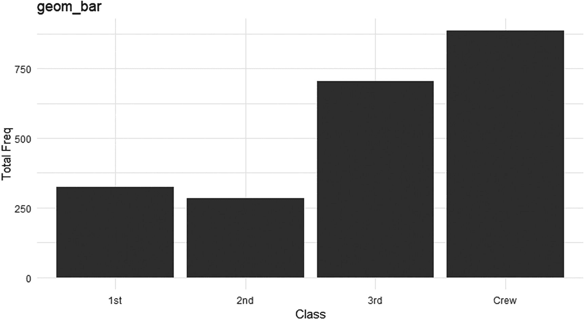
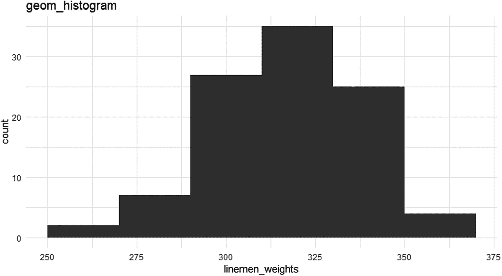

# 拥有“整洁”数据的重要性

对于 DAX 开发者来说，你们都知道将 BI 数据模型格式化为良好的星型模式结构的重要性。这样做可以大大简化 DAX 度量的开发。在结构良好的星型模式数据模型中易于开发的度量，在未按该格式构建的 BI 数据模型中可能会变得不必要的复杂。

在 R 语言中构建可视化或进行数据分析时，也存在类似的现象。当你将数据格式化为 Hadley Wickham 所说的整洁格式时，数据分析任务和数据可视化会变得容易得多。

整洁格式的数据集是指每条记录代表一个单独的观测值，每一列代表一个单独的变量。这类似于数据库中的第三范式。

如果出于某种原因，你传递给 Power BI 中 R 可视化组件的数据不是整洁格式，请不要惊慌。幸运的是，你可以在 R 可视化脚本中使用诸如`dplyr`和`tidyr`之类的包，它们能帮助你塑造数据，使其成为所需的格式。

整洁数据的概念在数据分析和数据可视化中非常重要。其重要性并不仅限于 R 语言。全面覆盖该主题超出了本书的范围。幸运的是，Hadley Wickham 撰写了一篇优秀的白皮书，你可以阅读它以了解更多信息。以下是该论文的 URL：[`https://vita.had.co.nz/papers/tidy-data.pdf`](https://vita.had.co.nz/papers/tidy-data.pdf)。

## 常用的几何对象

如前所述，`ggplot2`基于图层的图形语法。通过使用`geom`函数，可以向`ggplot2`可视化中添加图层。`ggplot2`的这一特性使你能够用最少的、相对容易编写的代码创建出漂亮的可视化效果。与其他编程语言创建数据可视化相比，它使得用代码表达你的想法变得容易得多。`ggplot2`中有许多可用的几何对象，但这里以项目符号列表的形式列出了一些常用的几何对象，并附有说明它们的代码片段：

*   **`geom_bar()`**

`geom_bar()`几何对象用于创建通常所说的柱状图和水平条形图。本节给出了一个示例，说明如何使用`geom_bar()`几何对象，通过清单 1-15 中的代码创建柱状图。

```
library(tidyverse)
plot.data <-
  as.data.frame(Titanic) %>%
  group_by(Class) %>%
  summarize(`Total Freq` = sum(Freq))
ggplot(plot.data, aes(x = Class, y = `Total Freq`)) +
  geom_bar(stat = "identity") +
  labs(title = "geom_bar") +
  theme_minimal()
清单 1-15
geom_bar() 示例
```

上述代码生成的可视化效果见图 1-12。



图 1-12

`geom_bar()` 几何对象

上述脚本中的第一行代码加载了`tidyverse`包。接下来的代码块创建了`geom_bar()`可视化所需的数据集。该部分中用于处理数据的技术将在本书后续部分介绍。

再下一个代码块是实际创建可视化的代码。前两行就是创建柱状图所需的全部代码。最后两行用于更改图表的外观。它们为图表添加了标题并更改了图表的主题。

请注意，`geom_bar()`只需要定义一个参数，即`stat`参数。其他必需的参数（数据集、x 坐标和 y 坐标）继承自`ggplot()`函数。将`stat`参数设置为“identity”告诉`ggplot2`，你希望柱子的高度基于分配给`aes()`函数中 y 美学的列的值。默认值是使用计数。你将在未来的示例中了解更多关于`stat`参数的信息。

*   **`geom_histogram()`**

`geom_histogram()`用于创建直方图。直方图用于显示数据的分布情况。我们将用于说明此几何对象的代码见清单 1-16。

```
library(tidyverse)
set.seed(50)
probs <- c(0.0033, 0.0033, 0.0033, 0.0033, 0.0033, 0.0033, 0.0033, 0.0033, 0.0033, 0.0033, 0.0033, 0.0033, 0.0033, 0.0033, 0.0033, 0.01, 0.01, 0.01, 0.01, 0.01, 0.01, 0.01, 0.01, 0.01, 0.01, 0.015, 0.015, 0.015, 0.015, 0.015, 0.015, 0.015, 0.015, 0.015, 0.015, 0.0133, 0.0133, 0.0133, 0.0133, 0.0133, 0.0133, 0.0133, 0.0133, 0.0133, 0.0133, 0.0133, 0.0133, 0.0133, 0.0133, 0.0133, 0.0133, 0.0133, 0.0133, 0.0133, 0.0133, 0.0133, 0.0133, 0.0133, 0.0133, 0.0133, 0.0133, 0.0133, 0.0133, 0.0133, 0.0133, 0.017, 0.015, 0.015, 0.015, 0.015, 0.015, 0.015, 0.015, 0.015, 0.015, 0.01, 0.01, 0.01, 0.01, 0.01, 0.01, 0.01, 0.01, 0.01, 0.01, 0.0033, 0.0033, 0.0033, 0.0033, 0.0033, 0.0033, 0.0033, 0.0033, 0.0033, 0.0033, 0.0033, 0.0033, 0.0033, 0.0033, 0.0033)
weights <- 265:364
names <- c("Liam  Galles", "Noah  Raymond", "William  Hammontree", "James  Zaremba", "Oliver  Zurcher", "Benjamin  Hilker", "Elijah  Loken", "Lucas  Lewter", "Mason  Straus", "Logan  Work", "Alexander  Jarret", "Ethan  Wey", "Jacob  Adolphsen", "Michael  Solt", "Daniel  Welcome", "Henry  Portman", "Jackson  Tichenor", "Sebastian  Free", "Aiden  Papp", "Matthew  Lenzi", "Samuel  Rinaldo", "David  Goines", "Joseph  Asuncion", "Carter  Philhower", "Owen  Freeborn", "Wyatt  Ice",
"John  Mcguckin", "Jack  Soden", "Luke  Humfeld", "Jayden  Natera", "Dylan  Galles", "Grayson  Raymond", "Levi  Hammontree", "Isaac  Zaremba", "Gabriel  Zurcher", "Julian  Hilker", "Mateo  Loken", "Anthony  Lewter", "Jaxon  Straus", "Lincoln  Work", "Joshua  Jarret", "Christopher  Wey", "Andrew  Adolphsen", "Theodore  Solt", "Caleb  Welcome", "Ryan  Portman", "Asher  Tichenor", "Nathan  Free", "Thomas  Papp", "Leo  Lenzi", "Isaiah  Rinaldo", "Charles  Goines", "Josiah  Asuncion", "Hudson  Philhower", "Christian  Freeborn", "Hunter  Ice", "Connor  Mcguckin", "Eli  Soden", "Ezra  Humfeld", "Aaron  Natera", "Landon  Galles", "Adrian  Raymond", "Jonathan  Hammontree", "Nolan  Zaremba", "Jeremiah  Zurcher", "Easton  Hilker", "Elias  Loken", "Colton  Lewter", "Cameron  Straus", "Carson  Work", "Robert  Jarret", "Angel  Wey", "Maverick  Adolphsen", "Nicholas  Solt", "Dominic  Welcome", "Jaxson  Portman", "Greyson  Tichenor", "Adam  Free", "Ian  Papp", "Austin  Lenzi", "Santiago  Rinaldo", "Jordan  Goines", "Cooper  Asuncion", "Brayden  Philhower", "Roman  Freeborn", "Evan  Ice", "Ezekiel  Mcguckin", "Xavier  Soden", "Jose  Humfeld", "Jace  Natera", "Jameson  Adolphsen", "Leonardo  Solt", "Bryson  Welcome", "Axel  Portman", "Everett  Tichenor", "Parker  Free", "Kayden  Papp", "Miles  Lenzi", "Sawyer  Rinaldo", "Jason  Goines")
linemen_weights <- sample(weights, 100, replace = TRUE,
prob= probs)
plot.data <- data.frame(names, linemen_weights)
ggplot(plot.data, aes(linemen_weights)) +
  geom_histogram(binwidth = 20) +
  labs(title = "geom_histogram") +
  theme_minimal()
清单 1-16
geom_histogram() 示例
```

上述代码生成的可视化效果见图 1-13，如下所示。



图 1-13

`geom_histogram()` 几何对象

与前面的示例一样，代码的第一部分构建了可视化将使用的数据集，以便你可以在自己的环境中重现相同的可视化效果。它生成一个虚构的大学级别美式橄榄球进攻锋线球员数据集。我们将只关注生成可视化的最后四行代码。


