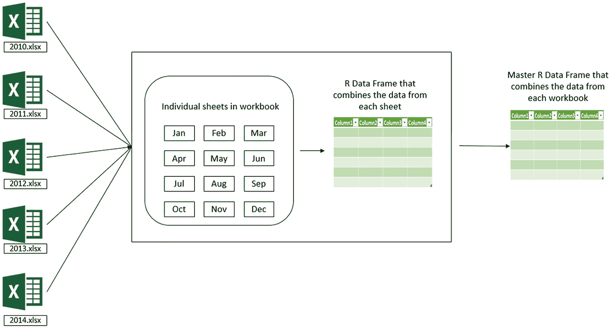
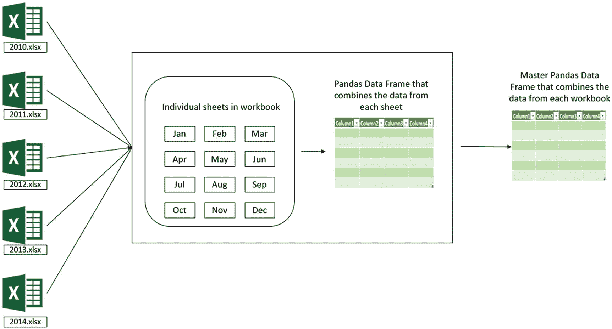

# 4. 读取 Excel 文件

Power BI 内置了可让您将 Microsoft Excel 文件读取到 Power BI 数据模型中的工具。对于简单的工作流程，这些内置功能直观且易于使用，但当工作流程变得复杂时，事情可能会变得不必要的困难。许多使用原生 Power BI 工具难以完成的工作流程，使用 R 或 Python 则相对容易。我们将通过一个示例来说明。

场景如下：

-   假设现在是 2014 年 2 月 2 日，您是 Contoso International 的首席财务官。
-   您通过 IT 部门提供的 MS Excel 工作簿按年接收销售数据，并将数据保存在名为 `ExcelFiles` 的文件夹中。
-   每个工作簿按年份拆分，工作簿中的每个月都有对应的工作表。
-   `ExcelFiles` 文件夹总共包含五个工作簿。2010 日历年的工作簿仅包含该年 12 月的销售数据，2011–2013 日历年的工作簿包含全年的数据，而 2014 日历年的工作簿仅包含该年 1 月的数据。
-   每个月初，工作簿中会添加一个新工作表，其中包含上个月的销售数据。
-   每年 2 月初，您会收到一个当前年份的新工作簿，其更新方式与之前的工作簿相同。

您需要合并这些文件，以便执行所需的财务分析。您曾尝试使用 Power Query 自动执行此操作，但未能成功，因为它需要难以理解的高级 Power Query 技术，因此您决定尝试使用 R 和 Python 开发解决方案。您的朋友 Tyrone 精通 R 和 Python，他能够帮助您。他为您提供了如何使用 R 和 Python 完成此任务的步骤。我们将先介绍 R 示例。

## 使用 R 读取 Excel 文件

在此示例中，您将创建一个工作流程，该流程：

1.  循环遍历 `ExcelFiles` 文件夹中的每个工作簿
2.  将工作簿中每个工作表的数据合并到一个数据框中
3.  将步骤 2 中创建的数据框追加到主数据框中，该主数据框将在工作流程完成后存储来自所有工作簿的数据

图 4-1 中的图像直观地展示了这些步骤。



图 4-1：在 R 数据框中合并总销售额的工作流程

现在，让我们来看看将上述工作流程转换为 R 代码所需的步骤。

### 步骤 1：导入 tidyverse 和 readxl 包

此工作流程使用的包是 `tidyverse` 和 `readxl`。您已经熟悉 `tidyverse`。`readxl` 包类似于 `readr` 包，但专门设计用于处理 Microsoft Excel 工作簿。以下是加载这些包所需的代码：

```
library(tidyverse)
library(readxl)
```

### 步骤 2：创建 combine_sheets 函数的框架

在此步骤中，您将创建一个函数的开头，该函数将读取指定工作簿的工作表中包含的数据，并将它们合并到一个数据框中。您要操作的 Excel 工作簿的文件路径将传递给该函数。以下是该函数的框架：

```
combine_sheets
return()
}
```

### 步骤 3：从指定的 Excel 工作簿中获取需要合并的工作表名称

现在，您需要开始定义函数的主体。您的函数需要识别工作簿中需要合并的工作表。它将使用以下代码来实现：

```
df %>%
  excel_sheets()
```

上述代码使用包含在 `excel_file_path` 变量中的 Excel 工作簿的文件路径启动一个工作流程。该路径下的工作簿包含您要合并的工作表。`excel_file_path` 变量通过管道（`%>%`）运算符传递给 `readxl` 包中的 `excel_sheets()` 函数。`excel_sheets()` 函数返回一个字符向量，其中包含位于 `excel_file_path` 变量指定路径下的工作簿中所有工作表的名称。此函数严重依赖 `%>%` 运算符。如果您需要解释其含义及使用方法，请参考本书的引言。

### 步骤 4：将步骤 3 中构建的字符向量转换为命名字符向量

您将步骤 3 中创建的字符向量转换为`命名字符向量`。`命名字符向量`的 name 属性将用于标识此示例中生成的结果数据框的行来自哪个工作表。`命名字符向量`使用以下代码创建：

```
df %>%
  excel_sheets() %>%
  set_names() %>%
```

上述代码获取由 `excel_sheets()` 函数创建的字符向量，并将其传递给 `purrr` 包中的 `set_names()` 函数。此函数将字符向量中每个元素的名称设置为其自身。通过检查应用 `set_names()` 函数前后的 `df` 变量，您可以更好地理解此函数。以下是应用 `set_names()` 之前 `df` 变量的内容：

```
> df
[1] "Jan" "Feb" "Mar" "Apr" "May" "Jun" "Jul" "Aug" "Sep" "Oct" "Nov" "Dec"
```

以下是应用 `set_names()` 函数之后 `df` 变量的内容：

```
> df
Jan   Feb   Mar   Apr   May   Jun   Jul   Aug   Sep   Oct   Nov   Dec
"Jan" "Feb" "Mar" "Apr" "May" "Jun" "Jul" "Aug" "Sep" "Oct" "Nov" "Dec"
```

请注意，字符向量中的每个元素都被赋予了与其值相等的名称。您将在下一步中利用此属性。

您不限于将字符向量命名为其自身。您可以传递一个长度相同的字符向量，其中包含您想要使用的名称，或者，在名称已存在且您希望根据某些规则修改它的情况下，传递一个函数。

### 步骤 5：使用 `mapr_df` 函数将多个工作表合并为一个数据框

在此步骤中，你只需在工作流中添加一行代码，但这行代码包含了许多需要拆解的内容。添加额外代码后的工作流如下所示：

```
df %
  excel_sheets() %>%
  set_names() %>%
  map_dfr(.f = ~read_excel(path = excel_file_path, sheet = ..1)
          ,.id = "sheet"
  )
```

我们来解释一下最后一行代码的作用：

-   上一步创建的命名字符向量作为第一个参数传递给 `map_dfr()` 函数。
-   `.f` 参数用于告诉 `map_dfr()` 你想要应用于所传递的命名字符向量的函数。此处的函数是 `read_excel()`。你通过一个`公式`来描述如何使用 `read_excel()` 函数。该`公式`以 `~` 开头，后跟 `read_excel()` 函数及其参数。它使用的参数是 `path` 和 `sheet`。包含要合并的工作表的工作簿文件路径被赋值给 `path` 参数，而命名字符向量中的值被赋值给 `sheet` 参数。赋值给该参数的值是 `..1`。这种方法用于根据位置获取我们想要使用的参数。命名字符向量通过 `set_names()` 作为第一个参数传递给 `map_dfr()` 函数，这就是我们使用 `..1` 的原因。如果它在第 *n* 个位置，那么我们会将值设置为 `..n`。
-   `map_dfr()` 函数将为工作簿中每个工作表创建的数据框合并，并折叠成一个数据框。你可以向生成的数据框中添加一个字段，以便确定记录来自哪个工作表。你可以使用 `.id` 参数来实现这一点。如果使用此选项，则会添加一个列，该列使用`命名字符向量`中的名称来填充。如果你没有使用命名字符向量，则会使用字符向量中工作表名称的位置。你赋予此参数的值将用作列名。

### 步骤 6：返回数据框

你希望函数返回创建的数据框。为此，你使用 `return` 语句和你创建的 `df` 数据框。完成此操作后，函数的完整定义如下所示：

```
combine_sheets <- function(excel_file_path) {
  df %
    excel_sheets() %>%
    set_names() %>%
    map_df(.f = ~read_excel(path = excel_file_path, sheet = ..1)
           ,.id = "sheet"
    )
  return(df)
}
```

### 步骤 7：将工作目录设置为 Excel 文件所在的位置

现在你已经定义了函数，困难的部分已经完成。你需要编写代码，利用自定义的 `combine_sheets()` 函数来合并 `ExcelFiles` 文件夹中工作簿的数据。你需要做的第一件事是设置工作目录，以便 Power BI 知道要使用哪个文件夹。你可以使用以下代码来实现：

```
setwd("")
```

### 步骤 8：将文件名赋值给 `excel_file_paths` 变量

你使用 `list.files()` 函数获取当前目录中的文件名，并使用以下代码将其赋值给名为 `excel_file_paths` 的变量：

```
excel_file_paths <- list.files(".")
```

传递给 `list.files()` 函数的 `"."` 告诉它你想要返回当前工作目录中的所有文件。你可以通过 `"./<嵌套文件夹名称>"` 的方式指定一个嵌套文件夹。`list.files()` 函数也接受一个包含一个或多个要检查的路径的完整路径名的字符向量。

### 步骤 9：使用 `map_dfr` 函数将 `combine_sheets` 函数应用于工作目录中的每个文件

现在你到了将所有工作簿中的数据合并到一个数据框的步骤。所需的代码如下：

```
combine_workbooks <- map_dfr(excel_file_paths, combine_sheets)
```

`map_dfr()` 函数将自定义函数 `combine_sheets()` 应用于 `excel_file_paths` 字符向量中包含的 Excel 文件名。这样做的结果是一个数据框列表。`map_dfr()` 函数将该数据框列表折叠成一个数据框，并将该数据框命名为 `combine_workbooks`。

### 步骤 10：复制 R 脚本并通过 Power BI 中的“获取数据”将其粘贴到 R 编辑器中

前面步骤生成的脚本如下：

```
library(tidyverse)
library(readxl)
combine_sheets <- function(excel_file_path) {
  df %
    excel_sheets() %>%
    set_names() %>%
    map_dfr(.f = ~read_excel(path = excel_file_path, sheet = ..1)
            ,.id = "sheet"
    )
  return(df)
}
setwd("")
excel_file_paths <- list.files(".")
combine_workbooks <- map_dfr(excel_file_paths, combine_sheets)
```

将代码粘贴到 Power BI 的 R 编辑器后，生成的数据集将像导入 Power BI 的任何其他数据集一样向你公开。

## 使用 Python 读取 Excel 文件

现在你将使用 Python 执行相同的任务。工作流将类似，但执行方式会略有不同。图 4-2 中的图像直观地描述了将在 Python 中使用的工作流。



图 4-2 在 Pandas 数据框中合并总销售额的工作流

### 步骤 1：导入 `os` 和 `pandas` 库

此工作流使用的库是 `os` 和 `pandas`。`os` 库用于与文件系统交互，`pandas` 用于将 Excel 中的数据读取到 Python 中。

### 步骤 2：创建 `combine_sheets` 函数的框架

你需要创建一个自定义函数，用于读取 Excel 工作簿中工作表的内容，并将它们合并到一个数据框中。你需要向该函数传递包含要合并的工作表的 Excel 工作簿的文件路径。以下是用于执行此任务的自定义函数的框架：

```
def combine_sheets(excel_file_path):

    return
```

### 步骤 3：基于 `excel_file_path` 变量中指定路径的工作簿创建一个 Excel 对象

你已经定义了函数的框架；现在让我们开始编写将放入函数主体中的代码。你首先使用以下代码创建一个 Excel 对象：

```
xlsx_file = pd.ExcelFile(excel_file_path)
```

该代码使用 `pandas` 中的 `ExcelFile` 类来创建对象。它只需要 Excel 工作簿的文件路径。

### 步骤 4：创建 `excel_file_path` 变量指定的工作簿中的工作表名称列表

该函数需要知道要合并哪些工作表。你可以使用在`步骤 3` 中创建的 `xlsx_file` 对象的 `sheet_names` 属性来获取该信息。你可以使用以下代码来实现：

```
ws = xlsx_file.sheet_names
```

该代码从 `xlsx_file` 的 `sheet_names` 属性中获取工作表名称，并将它们存储在 `ws` 变量中。

### 步骤 5：使用 `pandas` 的 `read_excel` 方法将每个工作表中的数据读取到一个数据框中

你可以通过以下代码行完成`步骤 5`：

```
df = pd.concat(pd.read_excel(xlsx_file, sheet_name=ws))
```

这段代码中发生了两个主要任务，因此将其拆解为多个步骤会更易于理解。首先，`pandas` 使用 `pd.read_excel(xlsx_file, sheet_name=ws)` 从工作簿的工作表中读取数据，并将它们放入单独的数据框中。第一个参数未命名，但它是 `io` 参数。在此处，你需要指定要读取的 MS Excel 文件。第二个参数是 `sheet_name` 参数，用于告诉 `read_excel()` 方法要从指定工作簿中读取哪些工作表。`ws` 变量用于向 `read_excel()` 提供该信息。其次，`pandas` 通过 `concat()` 方法（来自 `pandas`）将使用 `read_excel()` 方法创建的各个数据框合并为一个数据框。最终的数据框被赋值给名为 `df` 的变量。

### 步骤 6：将 `df` 中保存的数据框作为 `combine_sheets` 函数的输出返回

这通过 `return` 语句完成，如下所示：

```
return df
```

### 步骤 7：将工作目录设置为包含要合并的 Excel 数据的位置

现在，你已经完整定义了 `combine_sheets()` 自定义函数。接下来，你需要编写代码，使用该函数将 `ExcelFiles` 文件夹中工作簿的工作表合并到一个数据框中。首先，你需要将工作目录设置为包含 Excel 工作簿的位置。你可以使用以下代码完成此操作：

```
os.chdir("")
```

### 步骤 8：获取当前工作目录中的文件名列表，并将其赋值给 `excel_file_paths` 变量

你的脚本需要知道要合并的 MS Excel 工作簿的名称。你可以使用 `listdir()` 函数获取工作簿的名称，如下列代码所示：

```
excel_file_paths = os.listdir(".")
```

该代码假设当前文件夹中只包含你想要合并的 Excel 文件。在运行脚本之前，需要验证这一点。

### 步骤 9：创建一个空数据框并将其命名为 `combined_workbooks`

在此步骤中，你创建一个名为 `combined_workbooks` 的空数据框，它将作为主数据框，存储来自所有工作簿的数据。创建空数据框所需的代码如下：

```
combined_workbooks = pd.DataFrame()
```

使用 `combined_sheets` 函数为每个工作簿创建的数据框将被追加到此数据框中。

### 步骤 10：创建 `for` 循环的框架

Python 中的 `for` 循环使你能够遍历一个序列。在本例中，要遍历的序列是 `excel_file_paths` 列表。脚本使用以下代码遍历 `excel_file_paths` 列表：

```
for excel_file_path in excel_file_paths:
```

你将在 Python 中大量使用 `for` 循环，因此让我们花些时间来解释其结构。`for` 循环可以使用以下模板来描述：

```
for <variable> in <sequence>:
```

保存当前迭代值的变量可以任意命名。通常，该名称是序列对象名称的单数形式。序列对象是你正在迭代的对象。在此脚本中，它是 `excel_file_paths` 列表。让我们逐步解释其运作方式。

如果你打印出 `excel_file_paths` 的内容，你会看到以下数据：

`['2010.xlsx', '2011.xlsx', '2012.xlsx', '2013.xlsx', '2014.xlsx']`

你可以看到 `excel_file_paths` 是一个包含五个元素的列表。脚本中的 `for` 循环遍历此列表，并在第一次迭代后将值 `'2010.xlsx'` 赋值给 `excel_file_path` 变量，第二次迭代后将值 `'2011.xlsx'` 赋值给 `excel_file_path` 变量，并继续对列表中的每个元素执行此操作，直到遍历完所有元素。

### 步骤 11：使用 `combine_sheets` 函数将每个工作表中的所有数据合并到一个数据框中

以下代码获取 `excel_file_path` 变量中的文件路径，并将其传递给 `combine_function()`：

```
combined_workbook = combine_sheets(excel_file_path)
```

`combine_sheets()` 自定义函数将位于传递的文件路径中的工作簿中的工作表合并，并将它们放入一个数据框中。该数据框存储在 `combined_workbook` 变量中。

### 步骤 12：将 `combined_workbook` 数据框追加到 `combined_workbooks` 数据框

执行此任务所需的代码如下：

```
combined_workbooks = combined_workbooks.append(combined_workbook,
ignore_index=True)
```

该代码使用 `combined_workbooks` 数据框的 `append` 方法将 `combine_workbook` 数据框追加到其中。`ignore_index` 参数设置为 `True`，因为你希望忽略 `combined_workbook` 数据框中的索引，并使用 `combined_workbooks` 中的索引。

### 步骤 13：复制 Python 脚本并通过 Power BI 中的 `GetData` 将其粘贴到 Python 编辑器中

以下是完整的脚本：

```
import os
import pandas as pd
def combine_sheets(excel_file_path):
xlsx_file = pd.ExcelFile(excel_file_path)
ws = xlsx_file.sheet_names
df = pd.concat(pd.read_excel(xlsx_file, sheet_name=ws))
return df
os.chdir("<full path to SalesData_WorkbookFormat")
excel_file_paths = os.listdir(".")
combined_workbooks = pd.DataFrame()
for excel_file_path in excel_file_paths:
combined_workbook = combine_sheets(excel_file_path)
combined_workbooks = combined_workbooks.append(
combined_workbook, ignore_index=True)
```

如果你复制该脚本并通过 `GetData` 将其粘贴到 Power BI 的 Python 编辑器中，你将获得一个可以添加到 Power BI 数据模型的数据集。

在本章中，你实现了一个使用 Power Query 和 M 语言很难完成的工作流。完成该工作流所需的 R 和 Python 代码比执行相同任务所需的 M 代码更简洁且更易于理解。你还学习了如何使用 R 和 Python 将函数中重复多次的逻辑抽象出来，以提高代码效率和可读性。在下一章中，你将学习如何通过 R 和 Python 在 Power BI 中与 `SQL Server` 进行交互。

