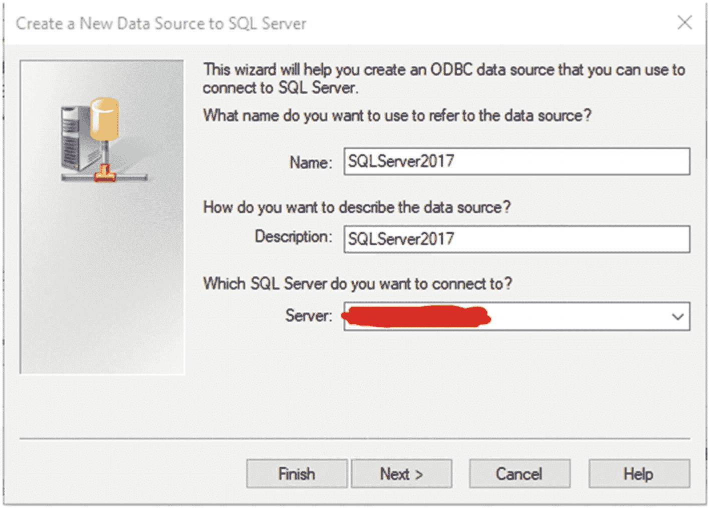
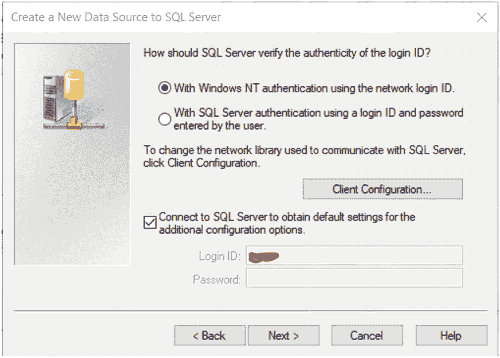
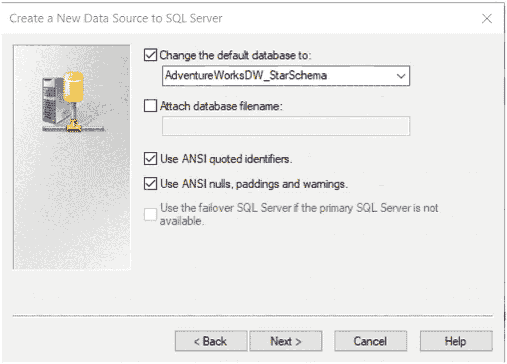
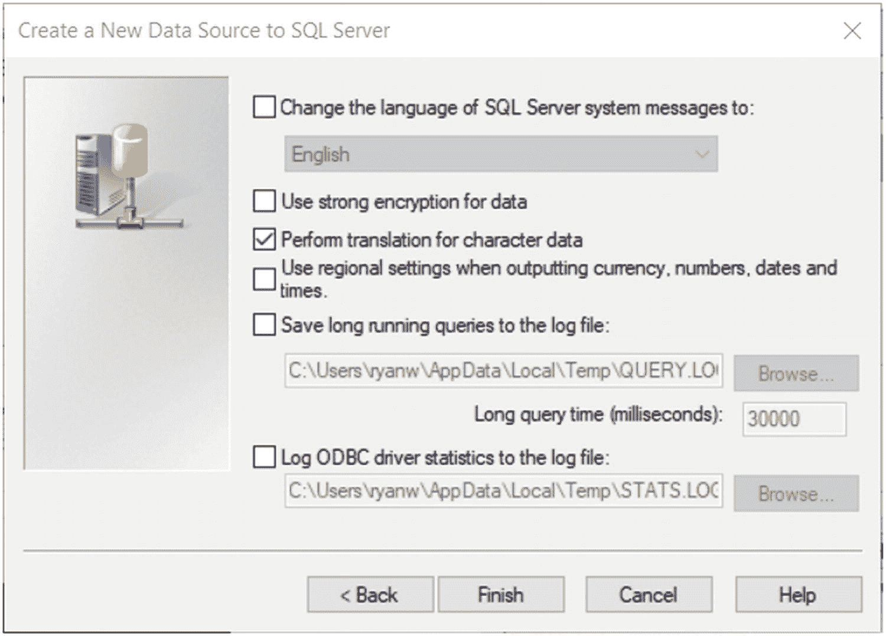
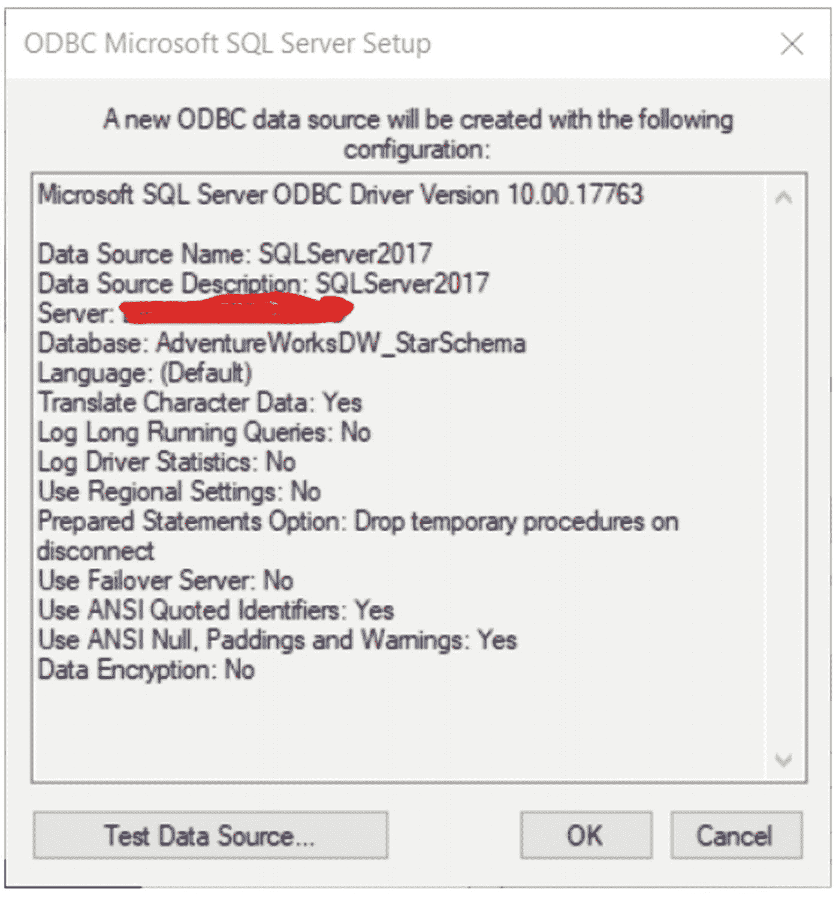

# 5. 读取 SQL Server 数据

Power BI 的内置 ETL 工具 Power Query 能够将存储在各种格式中的数据读取到内存中，在内存中对数据进行转换，并将转换后的数据加载到 Power BI 数据模型中。它在处理这些类型的任务方面表现出色，因为它可以处理大多数 ETL 情况。

然而，如果你想记录有关 Power BI 数据加载的信息，Power BI 就力不从心了。Power Query 旨在读取数据，而不是写入数据。幸运的是，R 和 Python 的情况并非如此。R 和 Python 分别拥有使数据记录相对容易的包和库。R 和 Python 都可以写入从平面文件到数据库的多种数据源。在此示例中，你将使用 R 和 Python 将有关数据加载的信息记录到 SQL Server 数据库中。

# 将 AdventureWorksDW_StarSchema 数据库添加到您的 SQL Server 实例中

本章的示例需要将 `AdventureWorksDW_StarSchema` 数据库作为数据源。该数据库是微软开发的 `AdventureWorksDW` 数据库的一个子集。请执行以下步骤，将该数据库还原到您的 SQL Server 实例中：

1.  前往本书的代码仓库，然后导航至第 5 章的 `Data` 文件夹。您会在此位置找到 `AdventureWorksDW_StarSchema.bak` 文件的压缩版本。解压 `AdventureWorksDW_StarSchema.zip` 文件，以获取 `AdventureWorksDW_StarSchema.bak` 文件。
2.  将 `AdventureWorksDW_StarSchema.bak` 文件复制到 SQL Server 的 `Backup` 文件夹中。在 `数据科学虚拟机 (DSVM)` 中，该文件夹的位置是 `C:\Program Files\Microsoft SQL Server\MSSQL15.MSSQLSERVER\MSSQL\Backup`。
3.  打开 `SQL Server Management Studio` (SSMS)，右键点击 `Databases` 文件夹，然后选择 `Restore Databases…`。
4.  此时会弹出 `Restore Database` 表单。请确保您位于 `General` 页面选项卡上。在 `Source` 部分，选中 `Device` 单选按钮。
5.  点击省略号按钮（即带有三个点的按钮），然后点击 `Add` 按钮。接下来，浏览到 `AdventureWorksDW_StarSchema.bak` 文件所在的位置。
6.  选择 `AdventureWorksDW_StarSchema.bak` 文件，然后点击 `OK` 按钮关闭 `Locate Backup File` 表单。
7.  点击 `OK` 关闭 `Select backup devices` 表单。
8.  点击 `OK` 关闭 `Restore Database` 表单。执行此操作将添加该数据库。

## 使用 R 语言将 SQL Server 数据读取到 Power BI 中

场景如下：您是 `Clothing R Us` 公司的一名分析师。该公司的 IT 部门规模较小，数据库管理员 Vihaan 同时兼任系统工程师。公司没有专门的商业智能人员。您向首席财务官 Adaugo 阐述了商业智能的优势，以及它如何能帮助公司基于自身经验做出明智的决策。她同意让 Vihaan 围绕互联网销售构建一个小型数据集市。该数据集市包含一个事实表和四个维度表。所有维度表都是类型 1 维度，并且每次加载数据仓库都是“先清空再填充”。Vihaan 开发了一个 ETL 流程，但该 ETL 流程没有包含任何日志记录来监控加载到数据集市中的数据量。这个概念验证 (POC) 的成功对您至关重要，因此您主动承担起开发一个日志系统的任务，将其作为一种完整性检查手段，以确保加载到 Power BI 中的数据是合理的。

在类型 1 缓慢变化维度 (SCD) 中，新信息会覆盖原始信息，因此不会保留历史记录。在类型 2 SCD 中，会向表中添加一条新记录来表示新信息。原始记录和新记录都将存在。

您知道 Power Query 旨在将数据读取到 Power BI 中，但它并非为写入数据而设计。您的同事 Sarah 告诉您，使用 R 或 Python 可以相对容易地将数据写回数据库。您向她分享了需要记录哪些信息，她为您提供了 R 和 Python 两种语言的说明。以下是 R 语言的说明。

### 步骤 1：为 SQL Server 数据库创建一个 DSN

您需要向 SQL Server 提供身份验证信息，以便能够连接到数据库。有多种方法可以实现这一点，但您将使用的是 DSN（数据源名称）方法。在 Windows 10 中，DSN 的创建和配置相对容易。具体步骤如下：

1.  转到位于任务栏左侧、`Windows` 图标旁边的 `Cortana 搜索栏`，然后输入 `管理工具`。
2.  您将看到一个管理工具快捷方式的列表。搜索 `ODBC 数据源 (64 位)` 并双击它。
3.  此时应弹出一个包含多个选项卡的 `ODBC 数据源管理器 (64 位)` 对话框。点击 `系统 DSN` 选项卡。使用此选项卡可以确保您计算机上的所有用户都能访问此 DSN。如果您只希望当前用户有权访问该 DSN，则可以停留在 `用户 DSN` 选项卡上。
4.  点击 `添加` 按钮。
5.  您将看到一个可供选择的驱动程序列表，其中包含 SQL Server。选择 `SQL Server`，然后点击 `完成` 按钮。
6.  接下来，将弹出 `创建到 SQL Server 的新数据源` 对话框。这是您配置 DSN 的地方。`名称` 是 R 语言用来引用此 DSN 的名称，`描述` 可以是您用来描述此 DSN 的任何内容，`服务器` 是托管您要连接的数据库的 SQL Server 的名称。
    将 `名称` 设置为 `SQLServer2019`，将 `描述` 也设置为 `SQLServer2019`。如果您使用的不是 SQL Server 2019，请使用一个能标识您所用 SQL Server 版本的名称。下图显示了一个使用 SQL Server 2017 的示例。接下来，您需要检索要使用的 SQL Server 实例的名称。要获取服务器名称，请打开 `SQL Server Management Studio` 并连接到该 SQL Server 实例。`服务器名称` 组合框中显示的名称，就是您需要在 `创建到 SQL Server 的新数据源` 表单的 `服务器` 组合框中使用的名称。复制该服务器名称并粘贴到 `服务器` 组合框中。填写完表单后，它应该看起来像图 5-1 所示。如果一切看起来正确，请点击 `下一步`。
    
    图 5-1 创建到 SQL Server 的新数据源
7.  您将看到如图 5-2 所示的弹出表单。请确保您的配置与此相同，然后点击 `下一步`。
    
    图 5-2 创建到 SQL Server 的新数据源
8.  接下来，您将看到如图 5-3 所示的弹出表单。请确保您勾选了 `更改默认数据库为:` 复选框，并将数据库更改为 `AdventureWorksDW_StarSchema`，然后点击 `下一步`。
    
    图 5-3 创建到 SQL Server 的新数据源
9.  您接下来会看到的弹出表单如图 5-4 所示。请确保您的配置与此相同，然后点击 `完成`。
    
    图 5-4 创建到 SQL Server 的新数据源
10. 点击 `完成` 后，将出现如图 5-5 所示的弹出框。您可以通过点击 `测试数据源` 按钮来测试连接，以确保能够使用刚刚配置的 `DSN` 名称成功连接到数据库。
    
    图 5-5 关于 DSN 的信息

### 步骤 2：在 SQL Server 中创建日志表

数据库中应该已经存在一个名为 `dbo.LoadHistoryLog` 的日志表。如果您需要重新创建它，可以在 `SQL Server Management Studio` (SSMS) 中执行以下代码：

```sql
USE AdventureWorksDW_StarSchema
CREATE TABLE dbo.[LoadHistoryLog] (
DATESTAMP DATETIME,
TABLENAME VARCHAR(25),
NUM_RECORDS INT
)
```

要在 SSMS 中执行代码，请复制上述代码，然后点击菜单栏中的 `新建查询` 按钮。此时应出现一个编辑器。将代码粘贴到编辑器中，然后点击菜单栏中的 `执行` 按钮来执行代码。

### 步骤 3：开始开发用于加载 `DimDate` 的 R 脚本

返回 `R Studio` 开始开发 R 脚本。此脚本中将使用的包是 `RODBC` 和 `lubridate`。`RODBC` 包用于与 SQL Server 交互，而 `lubridate` 包则用于简化一些与日期相关的任务。以下是加载这些包所需的代码：

```r
library(RODBC)
library(lubridate)
```

### 步骤 4：创建一个变量来保存要导入的表的名称

将要读入 Power BI 数据模型的表名称会在脚本中的多个地方使用。使用变量而不是在整个脚本中硬编码该值，可以使脚本更易于维护和重用：

```r
table_name <- "DimDate"
```

### 步骤 5：创建一个变量来保存用于返回表的 SQL 语句

以下代码用于创建 SQL 语句，该语句将用于从 `DimDate` 表中读取数据到 Power BI：

```r
sql <- paste0(
"SELECT * FROM dbo.",
table_name)
```

上述代码使用了 `paste0()` 函数来将 `"SELECT * FROM dbo."` 与 `table_name` 变量拼接起来。`paste0()` 函数与 `paste()` 函数类似。两者的区别在于，你可以在 `paste()` 函数中指定分隔符，而 `paste0()` 函数则默认在拼接字符串时不使用分隔符。

### 步骤 6：创建与 SQL Server 的连接

使用以下代码创建与数据库的连接：

```r
conn <- odbcConnect(dsn = "SQLServer2017")
```

如你所见，使用 DSN 可以非常轻松地连接到数据库。你使用 `RODBC` 包中的 `odbcConnect` 函数来建立连接，唯一需要的参数是 `dsn` 参数。将该参数设置为你在步骤 1 中配置的 `DSN` 名称。

### 步骤 7：从 SQL Server 检索数据并将其存储在数据框中

`RODBC` 包中的 `sqlQuery()` 函数使你能够使用 `conn` 连接向数据库提交查询，并将结果存储在一个数据框中。执行此操作的代码如下：

```r
df_read <- sqlQuery(channel = conn, query = sql)
```

查询结果存储在 `df_read` 数据框中。这些数据将被提供给 Power BI。

### 步骤 8：获取当前时间

现在你需要开始计算要记录的关于加载过程的信息。你想要记录的信息包括：加载发生的时间、加载的表名称以及加载的记录数量。
要获取加载时间，请使用 `lubridate` 包中的 `now()` 函数，并将其赋值给 `datestamp` 变量，代码如下：

```r
datestamp <- now()
```

### 步骤 9：获取已读取的记录数量

你想要记录从 `DimDate` 表加载的记录数量。使用基础 R 中的 `nrow()` 函数来获取该信息。使用以下代码将 `DimDate` 中的记录数量存储到 `num_records` 变量中：

```r
num_records <- nrow(df_read)
```

### 步骤 10：创建一个包含要记录信息的单行 R 数据框

你已经计算出了要记录的信息；现在需要将其塑形，以便能够将信息插入到日志表中。数据需要被塑形为一个数据框。首先，使用你创建的、包含要记录信息的变量来创建一个*命名列表*。
*命名列表* 就是一个为列表中每个元素都指定了名称的列表。将信息放入命名列表可以方便地将其转换为数据框。本步骤中的代码描述了如何构建这样一个列表。
你使用的代码如下：

```r
list_insert = list("DATESTAMP" = datestamp,
"TABLENAME" = table_name,
"NUM_RECORDS" = num_records
)
```

上述代码构建了一个*命名列表*，其中包含了 `datestamp`、`table_name` 和 `num_records` 这些标量，并分别将它们命名为 `DATESTAMP`、`TABLENAME` 和 `NUM_RECORDS`。
标量是长度为 1 的向量。
接下来，使用以下代码将命名列表转换为数据框：

```r
df_insert = as_data_frame(list_insert)
```

上述代码使用 `as_data_frame()` 函数将命名列表转换为数据框，并将结果赋值给 `df_insert` 数据框。命名列表中的名称被用作列标题。

### 步骤 11：将在步骤 10 中收集的信息插入到历史日志表中

现在，要记录的数据已经在一个数据框中，你可以使用 `RODBC` 包中的 `sqlSave()` 函数将其插入到 `LoadHistoryLog` 表中。操作代码如下：

```r
sqlSave(
channel = conn,
dat = df_insert,
tablename = "LoadHistoryLog",
append = TRUE,
rownames=FALSE
)
```

`sqlSave()` 函数中的 `channel` 参数使用了我们之前创建的连接。它将 `df_insert` 数据框插入到 `LoadHistoryLog` 表中。将 `append` 参数设置为 `TRUE` 非常重要，这样 `sqlSave()` 就知道要将数据插入到一个已存在的表中。如果设置为 `FALSE`，它会尝试创建一个已存在的表，从而导致错误。同样，将 `rownames` 设置为 `FALSE` 也很重要，因为如果不这样做，将会创建一个包含数据框行名的列，而这些信息是不需要的。

### 步骤 12：关闭连接

接下来，你需要使用 `RODBC` 包中的 `odbcClose()` 函数来关闭连接。操作代码如下：

```r
odbcClose(conn)
```

### 步骤 13：将脚本复制到 Power BI

以下是完整的脚本：

```r
library(tidyverse)
library(RODBC)
library(lubridate)
table_name <- "DimDate"
sql <- paste0(
"SELECT * FROM dbo.",
table_name)
conn <- odbcConnect(dsn = "SQLServer2017")
df_read <- sqlQuery(channel = conn, query = sql)
datestamp <- now()
num_records <- nrow(df_read)
list_insert <- list(
"DATESTAMP" = datestamp,
"TABLENAME" = table_name,
"NUM_RECORDS" = num_records)
df_insert <- as_data_frame(list_insert)
sqlSave(
channel = conn,
dat = df_insert,
tablename = "LoadHistoryLog",
append = TRUE,
rownames=FALSE)
odbcClose(conn)
```

与本书前面的示例一样，通过 `GetData` 将 R 代码复制到 Power BI 中。脚本中产生了两个数据框：`df_read` 和 `df_insert`，因此你需要告诉 Power BI 你想要加载哪一个到 Power BI 数据模型中。你想要加载 `df_read`，所以选中它，然后点击 `Edit` 按钮。现在你需要更改查询的名称。在 `PROPERTIES` 部分，将查询名称从 `df_read` 重命名为 `DimDate`。点击 `Close & Apply` 将数据加载到 Power BI 数据模型中。

### 步骤 14：基于 `ReadLog_DimDate.R` 脚本创建加载 `DimProduct` 的脚本

你需要为另外四个表重复上述步骤。通过复制 `ReadLog_DimDate.R` 脚本，然后对复制的脚本做一处小修改，即可轻松为每个表重复这些步骤。需要修改的是 `tablename` 变量设置的值。在此步骤中，你将针对 `DimProduct` 表执行此操作。创建 `ReadLog_DimDate.R` 脚本的副本，并将 `table_name` 变量的值从 `DimDate` 改为 `DimProduct`。接下来，执行步骤 13，但需将查询重命名为 `DimProduct`。修改后的代码如下所示：

```r
library(tidyverse)
library(RODBC)
library(lubridate)
table_name <- "DimProduct"
sql <- paste0(
"SELECT * FROM dbo.",
table_name)
conn <- odbcConnect(dsn = "SQLServer2017")
df_read <- sqlQuery(channel = conn, query = sql)
datestamp <- now()
num_records <- nrow(df_read)
list_insert <- list(
"DATESTAMP" = datestamp,
"TABLENAME" = table_name,
"NUM_RECORDS" = num_records)
df_insert <- as_data_frame(list_insert)
sqlSave(
channel = conn,
dat = df_insert,
tablename = "LoadHistoryLog",
append = TRUE,
rownames=FALSE)
odbcClose(conn)
```

### 步骤 15：基于 `ReadLog_DimDate.R` 脚本创建加载 `DimPromotion` 的脚本

创建 `ReadLog_DimDate.R` 脚本的副本，并将 `table_name` 变量的值从 `DimDate` 改为 `DimPromotion`。接下来，执行步骤 13，但需将查询从 `df_read` 重命名为 `DimPromotion`。修改后的代码如下所示：

```r
library(tidyverse)
library(RODBC)
library(lubridate)
table_name <- "DimPromotion"
sql <- paste0(
"SELECT * FROM dbo.",
table_name)
conn <- odbcConnect(dsn = "SQLServer2017")
df_read <- sqlQuery(channel = conn, query = sql)
datestamp <- now()
num_records <- nrow(df_read)
list_insert <- list(
"DATESTAMP" = datestamp,
"TABLENAME" = table_name,
"NUM_RECORDS" = num_records)
df_insert <- as_data_frame(list_insert)
sqlSave(
channel = conn,
dat = df_insert,
tablename = "LoadHistoryLog",
append = TRUE,
rownames=FALSE)
odbcClose(conn)
```

### 步骤 16：基于 `ReadLog_DimDate.R` 脚本创建加载 `DimSalesTerritory` 的脚本

创建 `ReadLog_DimDate.R` 脚本的副本，并将 `table_name` 变量的值从 `DimDate` 改为 `DimSalesTerritory`。接下来，执行步骤 13，但需将查询从 `df_read` 重命名为 `DimSalesTerritory`。修改后的代码如下所示：

```r
library(tidyverse)
library(RODBC)
library(lubridate)
table_name <- "DimSalesTerritory"
sql <- paste0(
"SELECT * FROM dbo.",
table_name)
conn <- odbcConnect(dsn = "SQLServer2017")
df_read <- sqlQuery(channel = conn, query = sql)
datestamp <- now()
num_records <- nrow(df_read)
list_insert <- list(
"DATESTAMP" = datestamp,
"TABLENAME" = table_name,
"NUM_RECORDS" = num_records)
df_insert <- as_data_frame(list_insert)
sqlSave(
channel = conn,
dat = df_insert,
tablename = "LoadHistoryLog",
append = TRUE,
rownames=FALSE)
odbcClose(conn)
```

### 步骤 17：基于 `ReadLog_DimDate.R` 脚本创建加载 `FactInternetSales` 的脚本

创建 `ReadLog_DimDate.R` 脚本的副本，并将 `table_name` 变量的值从 `DimDate` 改为 `FactInternetSales`。接下来，执行步骤 13，但需将查询从 `df_read` 重命名为 `FactInternetSales`。修改后的代码如下所示：

```r
library(tidyverse)
library(RODBC)
library(lubridate)
table_name <- "FactInternetSales"
sql <- paste0(
"SELECT * FROM dbo.",
table_name)
conn <- odbcConnect(dsn = "SQLServer2017")
df_read <- sqlQuery(channel = conn, query = sql)
datestamp <- now()
num_records <- nrow(df_read)
list_insert <- list(
"DATESTAMP" = datestamp,
"TABLENAME" = table_name,
"NUM_RECORDS" = num_records)
df_insert <- as_data_frame(list_insert)
sqlSave(
channel = conn,
dat = df_insert,
tablename = "LoadHistoryLog",
append = TRUE,
rownames=FALSE)
odbcClose(conn)
```

执行上述步骤不仅会将表加载到 Power BI 中，还会将每个表加载的记录数记录到日志表中。

## 使用 Python 读取 SQL Server 数据

在本节中，你将使用 Python 执行刚才在 R 中执行的相同任务。逻辑类似，但你可以用更少的步骤完成任务。让我们从步骤 1 开始。

### 步骤 1：为 SQL Server 数据库创建 DSN

如果你已经完成了 R 示例，那么你已经创建了 `DSN`，可以直接进入下一步。如果没有，则必须先完成 R 示例中的步骤 1，然后再继续下一步。`DSN` 独立于 R 和 Python，因此你可以对两者使用同一个。

### 步骤 2：在 SQL Server 中创建日志表

数据库中应已存在名为 `dbo.LoadHistoryLog` 的日志表。如果需要创建 `dbo.LoadHistoryLog` 表，请在 `SQL Server Management Studio (SSMS)` 中执行以下代码：

```sql
USE AdventureWorksDW_StarSchema
CREATE TABLE dbo.[LoadHistoryLog] (
DATESTAMP DATETIME,
TABLENAME VARCHAR(25),
NUM_RECORDS INT
)
```

要在 `SSMS` 中执行代码，你需要：

1. 复制上述代码。
2. 在 `SSMS` 中展开 `Database` 文件夹，然后选择 `AdventureWorksDW_StarSchema` 数据库。
3. 单击菜单栏中的 `New Query` 按钮。
4. 将剪贴板中复制的代码粘贴到编辑器中，然后单击菜单栏中的 `Execute` 按钮执行代码。

### 步骤 3：开始创建加载 `DimDate` 表的脚本

你将在本脚本中使用三个库。你将使用的库是 `pandas`、`sqlalchemy` 和 `datetime`。`Pandas` 将是主力包，因为它将用于读取要加载到 Power BI 数据模型中的数据，并将要记录的信息写回 SQL Server。`sqlalchemy` 库中的 `create_engine()` 函数用于创建到 SQL Server 数据库的连接对象，而 `datetime` 库中的 `datetime` 模块将用于其日期函数。以下代码用于加载前面提到的库、函数和模块：

```python
import pandas as pd
from sqlalchemy import create_engine
from datetime import datetime
```

### 步骤 4：创建一个变量，用于保存要读取到 Power BI 的表名

将要读取到 Power BI 数据模型中的表名将在脚本中的多个位置使用。使用变量而不是硬编码表名。这使得维护脚本并使其可重用于其他表变得更加容易。以下是用于创建保存表名的变量的代码：

```python
tablename = "DimDate"
```

### 步骤 5：使用 `sqlalchemy` 创建数据库连接

使用以下代码创建到 SQL Server 数据库的连接：

```python
con = create_engine("mssql+pyodbc://SQLServer2017")
```

与 R 示例一样，使用 DSN 可以非常轻松地连接到数据库。这里使用 `sqlalchemy` 库中的 `create_engine()` 函数来建立连接。在 `sqlalchemy` 中为 SQL Server 构建连接字符串的语法是 `"mssql+pyodbc://<DSN>"`，因此在这种情况下，它是 `"mssql+pyodbc://SQLServer2017"`。

### 步骤 6：读取 `DimDate` 表的内容并将其存储为 `df_read` 变量中的数据框

你将使用 pandas 的 `read_sql_table()` 方法读取 `DimDate` 表的内容，并将其存储在名为 `df_read` 的数据框中。`read_sql_table()` 方法使用两个参数：要读取的 SQL 表名和数据库连接。代码如下：

```python
df_read = pd.read_sql_table(tablename, conn)
```

### 步骤 7：获取当前日期和时间，并将信息存储到 `datestamp` 变量中

使用以下代码执行此任务：

```python
datestamp = datetime.now().strftime('%Y-%m-%d %H:%M:%S')
```

你使用 `datetime` 模块中的 `now()` 方法来获取加载的时间。不幸的是，`now` 函数返回的日期格式不能被 SQL Server 使用，因此需要重新格式化。该函数返回的日期格式为 `datetime.datetime(YYYY, M, D, H, M, SS, MS)`。例如，2019 年 1 月 1 日晚上 10:00 将返回为 `datetime.datetime(2019, 1, 1, 22, 0, 0, 0)`。你使用 `strftime()` 方法并应用以下格式字符串 `'%Y-%m-%d %H:%M:%S'` 来重新格式化该输出，使其变为 `YYYY-MM-DD HH:MM:SS` 格式。此操作将 `datetime.datetime(2019, 1, 1, 22, 0, 0, 0)` 重新格式化为 `'2019-04-14 22:05:24'`。现在，你拥有了一个 SQL Server 可用的 `datestamp` 格式。

### 步骤 8：计算 `DimDate` 表中的记录数

你需要记录从 `DimDate` 表加载的记录数。要获取该信息，请使用 pandas 中的 `shape` 方法，如下代码所示：

```python
num_records = df.shape[0]
```

`shape` 方法返回一个包含两个元素的元组。第一个元素包含数据框中的行数，第二个元素包含列数。你只需要行数，因此可以使用 `[0]` 对 `shape` 方法进行子集化以获取该信息。

`tuple` 是一种 Python 数据结构，表示一个不可变对象的序列。它们与列表类似，区别在于创建后不能更改。

### 步骤 9：创建一个包含你想要记录的信息的单记录 pandas 数据框

使用以下代码分两步完成此操作：

```python
dict_insert = {
"DATESTAMP":[datestamp],
"TABLENAME":[tablename],
"NUM_RECORDS":[num_records]}
df_insert = pd.DataFrame.from_dict(dict_insert)
```

代码的第一部分创建了一个 `键/值` 对的 `字典`。`键` 是一个硬编码的值，将成为列名。值是一个 `列表`，`列表` 中的元素将填充该列。在这种情况下，每个 `列表` 只包含一个元素。

代码的第二部分使用 pandas `DataFrame` 类的 `from_dict` 方法创建一个数据框。将 `dict_insert` 字典传递给它，结果就是 `df_insert` 数据框。

### 步骤 10：将你在步骤 9 中收集的信息插入到历史日志表中

要将数据从 `df_insert` 数据框插入到 `LoadHistoryLog` 表中，请使用 `df_insert` 数据框的 `to_sql` 方法，如下所示：

```python
df_insert.to_sql(
name='LoadHistoryLog',
con=conn,
index=False,
if_exists = 'append'
)
```

表的名称为 `LoadHistoryLog`，你之前创建的 `conn` 对象用于 `con` 参数，`index` 属性设置为 `False` 以防止 pandas 尝试在插入中包含索引值，`if_exists` 设置为 `append`，以便 pandas 知道如果表已存在，则将数据作为插入添加。

### 步骤 11：将脚本复制到 Power BI

以下是完整的脚本：

```python
import pandas as pd
from sqlalchemy import create_engine
from datetime import datetime
tablename = "DimDate"
conn = create_engine("mssql+pyodbc://SQLServer2017")
df_read = pd.read_sql_table(tablename, conn)
datestamp = datetime.now().strftime('%Y-%m-%d %H:%M:%S')
num_records = df_read.shape[0]
dict_insert = {
"DATESTAMP":[datestamp],
"TABLENAME":[tablename],
"NUM_RECORDS":[num_records]}
df_insert = pd.DataFrame.from_dict(dict_insert)
df_insert.to_sql(
name='LoadHistoryLog',
con=conn,
index=False,
if_exists = 'append'
)
```

与之前的示例一样，通过 `GetData` 将 Python 代码复制到 Power BI 中。脚本中产生了两个数据框 `df_read` 和 `df_insert`，因此你需要告诉 Power BI 你想要将哪一个加载到 Power BI 数据模型中。你想要加载 `df_read`，因此选择它，然后单击 `Edit` 按钮。接下来，在 `PROPERTIES` 部分将查询名称从 `df_read` 更改为 `DimDate`。单击 `Close & Apply` 将数据加载到 Power BI 数据模型中。

### 步骤 12：基于 `ReadLog_DimDate.py` 脚本创建一个加载 `DimProduct` 的脚本

你需要为另外四个表重复上述步骤。你可以通过复制 `ReadLog_DimDate.py` 脚本，然后对复制的脚本进行一处小修改，轻松地为每个表重复这些步骤。你需要做的修改是 `tablename` 变量设置的值。在此步骤中，你将针对 `DimProduct` 表执行此操作。创建 `ReadLog_DimDate.py` 脚本的副本，并将 `table_name` 变量的值从 `DimDate` 更改为 `DimProduct`。接下来，执行步骤 11，但将查询重命名为 `DimProduct`。以下是更改后的脚本：

```
import pandas as pd
from sqlalchemy import create_engine
from datetime import datetime
tablename = "DimProduct"
conn = create_engine("mssql+pyodbc://SQLServer2017")
df_read = pd.read_sql_table(tablename, conn)
datestamp = datetime.now().strftime('%Y-%m-%d %H:%M:%S')
num_records = df_read.shape[0]
dict_insert = {
"DATESTAMP":[datestamp],
"TABLENAME":[tablename],
"NUM_RECORDS":[num_records]}
df_insert = pd.DataFrame.from_dict(dict_insert)
df_insert.to_sql(
name='LoadHistoryLog',
con=conn,
index=False,
if_exists = 'append'
)
```

### 步骤 13：基于 `ReadLog_DimDate.py` 脚本创建一个加载 `DimPromotion` 的脚本

创建 `ReadLog_DimDate.py` 脚本的副本，并将 `table_name` 变量的值从 `DimDate` 更改为 `DimPromotion`。接下来，执行步骤 11，但将查询从 `df_read` 重命名为 `DimPromotion`。以下是更改后的脚本：

```
import pandas as pd
from sqlalchemy import create_engine
from datetime import datetime
tablename = "DimPromotion"
conn = create_engine("mssql+pyodbc://SQLServer2017")
df_read = pd.read_sql_table(tablename, conn)
datestamp = datetime.now().strftime('%Y-%m-%d %H:%M:%S')
num_records = df_read.shape[0]
dict_insert = {
"DATESTAMP":[datestamp],
"TABLENAME":[tablename],
"NUM_RECORDS":[num_records]}
df_insert = pd.DataFrame.from_dict(dict_insert)
df_insert.to_sql(
name='LoadHistoryLog',
con=conn,
index=False,
if_exists = 'append'
)
```

### 步骤 14：基于 `ReadLog_DimDate.py` 脚本创建一个加载 `DimSalesTerritory` 的脚本

创建 `ReadLog_DimDate.py` 脚本的副本，并将 `table_name` 变量的值从 `DimDate` 更改为 `DimSalesTerritory`。接下来，执行步骤 11，但将查询从 `df_read` 重命名为 `DimSalesTerritory`。以下是更改后的脚本：

```
import pandas as pd
from sqlalchemy import create_engine
from datetime import datetime
tablename = "DimSalesTerritory"
conn = create_engine("mssql+pyodbc://SQLServer2017")
df_read = pd.read_sql_table(tablename, conn)
datestamp = datetime.now().strftime('%Y-%m-%d %H:%M:%S')
num_records = df_read.shape[0]
dict_insert = {
"DATESTAMP":[datestamp],
"TABLENAME":[tablename],
"NUM_RECORDS":[num_records]}
df_insert = pd.DataFrame.from_dict(dict_insert)
df_insert.to_sql(
name='LoadHistoryLog',
con=conn,
index=False,
if_exists = 'append'
)
```

### 步骤 15：基于 `ReadLog_DimDate.py` 脚本创建加载 `FactInternetSales` 的脚本

复制 `ReadLog_DimDate.py` 脚本，并将 `table_name` 变量的值从 `DimDate` 改为 `FactInternetSales`。接着，执行步骤 11，但需将查询名称从 `df_read` 重命名为 `FactInternetSales`。修改后的脚本如下所示：

```python
import pandas as pd
from sqlalchemy import create_engine
from datetime import datetime
tablename = "FactInternetSales"
conn = create_engine("mssql+pyodbc://SQLServer2017")
df_read = pd.read_sql_table(tablename, conn)
datestamp = datetime.now().strftime('%Y-%m-%d %H:%M:%S')
num_records = df_read.shape[0]
dict_insert = {
"DATESTAMP":[datestamp],
"TABLENAME":[tablename],
"NUM_RECORDS":[num_records]}
df_insert = pd.DataFrame.from_dict(dict_insert)
df_insert.to_sql(
name='LoadHistoryLog',
con=conn,
index=False,
if_exists = 'append'
)
```

你完成了一项在 Power Query 中难以实现，但在 R 和 Python 中相对容易完成的任务。Power Query 可以处理从 SQL Server 表中读取数据，但无法记录加载信息。R 和 Python 分别拥有相应的包和库，你可以利用它们使这项任务变得相对简单。

