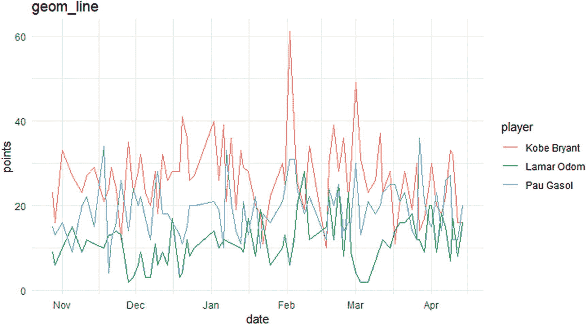
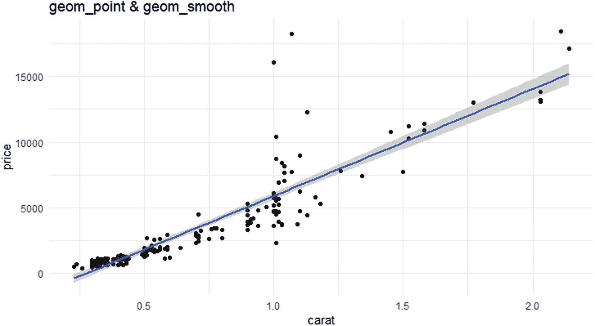

# 直方图与几何对象

你可能已经猜到，直方图可视化的基础是使用`geom_histogram()`几何对象。请注意，它使用了一个参数，即`binwidth`，因为其他必需的参数是从`ggplot()`函数继承而来的。该参数允许你定义分箱的宽度。建议你尝试调整这个参数，因为默认设置通常不会创建最佳数量的分箱。请注意，直方图的基础仅由以下两行代码创建，如下所示：

```
ggplot(plot.data, aes(linemen_weights)) +
geom_histogram(binwidth = 20)
```

此后的代码用于美化功能。

## `geom_line()`

`geom_line()`几何对象用于创建折线图。折线图非常适合展示随时间变化的趋势。以下清单 1-17 中的代码将用于生成折线图示例。

```
library(tidyverse)
library(lubridate)
players <- c("Kobe Bryant", "Pau Gasol", "Lamar Odom", "Andrew Bynum", "Derek Fisher")
plot.data <- lakers %>%
  filter(
    result == "made" & team == "LAL" & player %in% players
  ) %>%
  mutate(date = ymd(date)) %>%
  group_by(player, date) %>%
  summarize(points = sum(points))
ggplot(plot.data, aes(x=date, y=points, color=player)) +
  geom_line() +
  labs(title = "geom_line") +
  theme_minimal()
Listing 1-17
geom_line() example
```

上述代码的输出如图 1-14 所示。



Figure 1-14

`geom_line()`几何对象

与之前的示例一样，代码的第一部分构建数据集，并为你提供在环境中重新创建可视化所需的一切。此可视化使用了`lubridate`包附带的`lakers`数据集。`lakers`数据集包含 2008 赛季的逐回合比赛信息。

请注意，颜色美学映射是如何用于创建多条线的。`ggplot2`会根据颜色美学映射中指定的字段中的每个唯一项创建一条线。就像之前的示例一样，只需要两行代码即可创建可视化基础：一行是初始化`ggplot()`函数，另一行是定义几何对象图层。

## `geom_point()`和`geom_smooth()`

此示例说明了如何在`ggplot2`中创建具有多个图层的图表。该示例展示了如何向散点图添加回归线。`ggplot2`允许你用不同类型的趋势线覆盖散点图。它不限于线性回归线。`ggplot2`还允许你按自己选择的置信水平向线条添加置信区间。在撰写本文时，这些功能在原生 Power BI 中尚不可用。

以下清单 1-18 中的代码用于说明如何创建散点图并用回归线覆盖它。

```
library(tidyverse)
set.seed(1)
plot.data <- diamonds %>%
  filter(color == "D") %>%
  sample_n(200)
ggplot(plot.data, aes(x=carat, y=price)) +
  geom_point() +
  geom_smooth(method = "lm") +
  labs(title = "geom_point & geom_smooth") +
  theme_minimal()
Listing 1-18
geom_point() and geom_smooth() example
```

图 1-15 显示了代码生成的结果。



Figure 1-15

`geom_point()`和`geom_smooth()`几何对象

上述图表基于多个图层：`geom_point()`和`geom_smooth()`。`geom_point()`几何对象用于创建散点图，而`geom_smooth()`几何对象用于添加带有置信区间的回归线。置信区间的默认值为 95%。你可以通过修改`se`参数来更改它。将`method`参数设置为`lm`会使`geom_smooth()`几何对象生成回归线。