# 2. 在 Power BI 中使用 ggplot2 创建 R 自定义可视化效果

在上一章中，您了解了`ggplot2`包，并获得了在 Power BI 中创建可视化效果的基本模板。在本章中，您将获得一些示例，这些示例展示了当您利用`ggplot2`在 Power BI 中创建 R 自定义可视化效果时，可以多么富有表现力。本章包含创建以下图表的示例：

* 一个带有动态标题和注释的标注图
* 一个带有动态标题、显示五个数据维度的气泡图
* 一个详细的预测可视化，预测 Lamar Jackson 和 Deshaun Watson 的维基百科页面浏览量
* 一个折线图，显示按年份划分的 GDP，并根据该时间点的执政政党添加背景阴影
* 一个地图可视化，显示所选州，并根据该县所在的人口五分位数对该州的县进行着色
* 一个四象限图，比较洛杉矶湖人队篮球运动员在 2008-2009 赛季的总得分和篮板数
* 一个美国女性平均体重与身高的散点图，并叠加了回归线

您可以对这些示例进行微小修改以用于您的数据。您也可以发挥创意，从每个可视化效果中汲取一点灵感，创建满足您特定需求的自定义可视化效果。`ggplot2`包非常丰富，以至于很难限制您的创造力。让我们从创建一个标注图开始。

## 标注图

水平条形图是一种非常常见的可视化效果。它非常适合根据指标对分类数据进行排名。Power BI 中的默认可视化效果之一是条形图，但其本质相当基础。您可以进行一些基本的增强，例如通过高亮来强调某个条形，但如果不使用笨拙的技巧，就无法进一步添加诸如动态副标题、说明文字和动态注释等功能。幸运的是，这对于`ggplot2`来说不是限制！

在本节中，您将创建图 2-1 中列出的水平条形图。

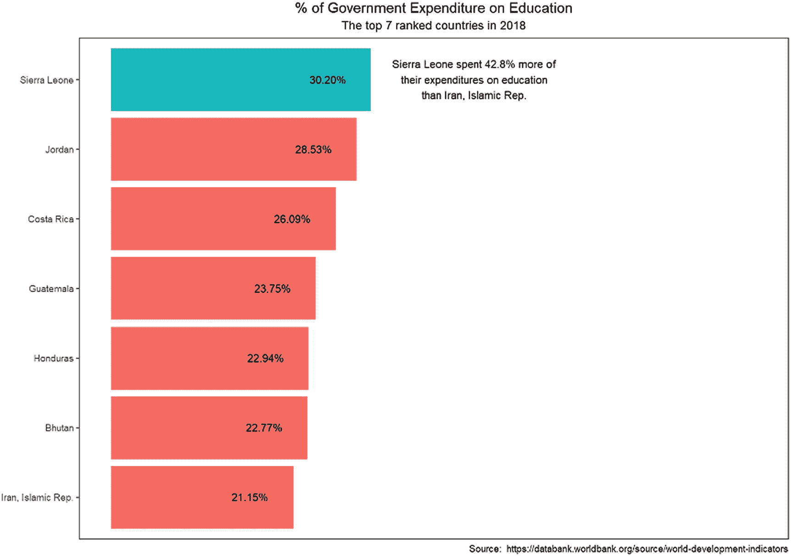

图 2-1

带有标注条和注释的水平条形图

上图根据政府教育支出占总支出的百分比对前 7 个国家进行排名。它包含一个动态注释，将排名第一的国家与排名第七的国家进行比较。最后，它包含一个说明文字，告诉您数据来源。让我们来看看开发此可视化效果所需的代码。

### 步骤 1：获取必要数据

本示例使用的数据集来自世界银行开放数据。该数据集代表了世界各国政府教育支出占总支出的百分比。执行以下步骤获取数据集：

| 列名 | 数据类型 |
| --- | --- |
| 国家 | 文本 |
| 国家代码 | 文本 |
| 年份 | 整数 |
| 总支出百分比 | 小数 |

1. 访问`data.worldbank.org`。
2. 在页面中上部的搜索栏中输入“Government expenditure on education, total (% of government expenditure)”。按下回车键后，将出现一个可能的选项列表，其中应有一个与您输入的内容完全一致。选择它，您将进入一个专门介绍该主题的页面。
3. 在页面右侧，您会看到一个下载区域，提供 csv、xml 或 Excel 格式的下载选项。点击 csv 选项。
4. 上一步操作将下载一个 zip 文件到您的计算机。截至撰写本文时，该 zip 文件包含三个文件：一个数据文件、一个包含国家信息的元数据文件，以及一个包含指标信息的元数据文件。本练习所需文件是数据文件。在撰写本文时，该文件名为`API_SE.XPD.TOTL.GB.ZS_DS2_en_csv_v2_715566.csv`。请注意，生成这些数据集的政府机构可能会在未事先通知的情况下更改其格式，因此未来格式可能会发生变化。
5. 现在，您需要将数据集导入 Power BI，并将其整理成可视化所需的形状。Power BI 中的`GetData`功能将用于执行此任务。要将内容加载到 Power BI，请转到主页选项卡，然后点击`GetData` ➤ `Text/CSV`，接着导航到数据文件所在的位置。请记住，本示例使用的数据文件名为`API_SE.XPD.TOTL.GB.ZS_DS2_en_csv_v2_715566.csv`，它是 zip 文件中三个文件中最大的一个。该文件也位于本章的代码仓库中。
6. 接下来，您需要使用`GetData (Power Query)`对数据进行必要的转换，使其达到可视化所需的形状。最终输出需要包含以下列及其关联的数据类型：

您将在本章的代码仓库中获得一个`pbix`文件，其中包含将数据整理成上述形状所需的 Power Query 步骤。您只需更改源文件即可。请注意，如果生成数据集的政府实体决定更改格式，这些步骤将来可能需要更改。

### 步骤 2：在“筛选器”窗格中基于年份创建切片器

将切片器图标拖到报表画布的右上角。切片器图标如图 2-2 所示。


图 2-2

切片器视觉对象图像

放置好切片器后，将`Year`字段从`ExpenditureOnEducationByCountryByYear`数据集拖到“字段”窗格，如图 2-3 所示。

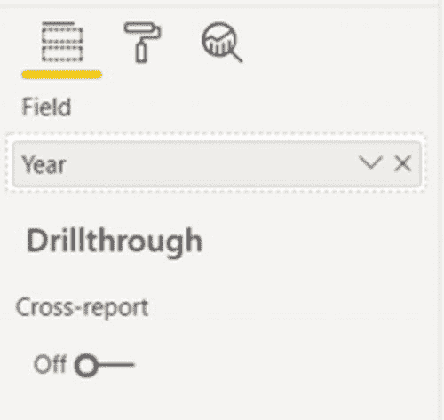

图 2-3

“字段”窗格图像

### 步骤 3：在 Power BI 中配置 R 视觉对象

转到可视化窗格，将一个 R 视觉对象拖到报表画布上。将视觉对象调整到所需大小。将`EducationExpenditures`表中的`Country`、`Total Expend %`和`Year`字段拖到“字段”窗格。如果“字段”窗格未显示，请在报表画布上选择 R 视觉对象，它应该会显示出来。

### 步骤 4：将数据导出到 R Studio 进行开发

选择 R 视觉对象以显示 R 脚本编辑器。您会在 R 视觉对象的底部看到它。如果它没有完全展开，请点击位于 R 脚本编辑器最右侧的向上箭头。展开后，您应该会看到以下代码（图 2-4）。

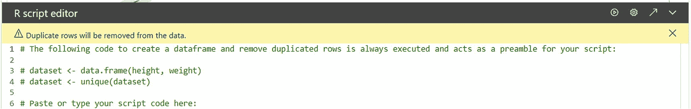

图 2-4

带有默认注释的 Power BI R 脚本编辑器

这些注释告诉您，R 获取了您通过“字段”窗格在 Power BI 中创建的数据集，并将其分配给了名为`dataset`的 R 对象，该对象是一个 data frame。data frame 是一个具有特殊属性的二维数据集。data frame 在上述代码的第 3 行创建。Power BI 只允许将具有唯一行的数据集传递给 R，并通过第 4 行中的`unique()`函数确保`dataset`数据框具有唯一行。

上述编辑器并非理想的开发环境。幸运的是，Microsoft 让您可以轻松地在更理想的环境（如 R Studio）中进行开发。要将开发工作转移到 R Studio，请点击 45° 箭头。该箭头在图 2-5 中突出显示。

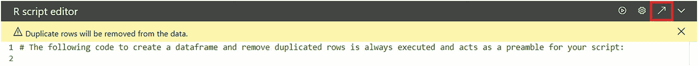

图 2-5

点击突出显示的箭头将启动您首选的 IDE，以获得更愉悦的开发环境

点击箭头将打开 R Studio，并将传递给 R 视觉对象的数据集保存到计算机上的临时位置。它还会生成代码，创建代表传递给 Power BI 中 R 视觉对象的数据框的`dataset`变量。最后，脚本中的任何 R 代码也将传递给 R Studio。清单 1-1 显示了将传递给 R Studio 的内容。

```
# 输入加载。请勿更改 #
`dataset` =
read.csv('',
check.names = FALSE,
encoding = "UTF-8",
blank.lines.skip = FALSE
);
# 原始脚本。请在此处更新您的脚本内容
# 完成后将以下部分复制回原始
# 编辑窗口。以下用于创建数据框和
# 删除重复行的代码始终会执行，并作为
# 脚本的前言：
# dataset <-
#   data.frame(
#     Country Name,
#     `Percent Education Expenditure Ranking`
#   )
# dataset <- unique(dataset)
# 在此粘贴或输入您的脚本代码：
清单 1-1
从 Power BI 传递给 R Studio 的代码
```

代码已重新格式化，以便在页面上更好地显示。第 2-7 行将显示在一行上，用于将保存到磁盘的数据集读取到 R 数据框中。该数据框将被命名为`dataset`。请注意，这与 Power BI 中使用的名称相同。这是有意为之。使用相同的名称使您能够在 R Studio 中开发的代码直接用于 Power BI，而无需进行任何重构。

### 步骤 5：加载所需的包

本示例中使用的三个包是`tidyverse`、`scales`和`ggthemes`。`tidyverse`中的`dplyr`包用于执行一些数据整理操作，`tidyverse`中的`ggplot2`用于创建可视化，`tidyverse`中的`forcats`用于定义一些排序规则，`scales`包中的一些函数用于数字格式化，而`ggthemes`包提供了`theme_few()`主题。以下是加载这些包的代码：

```
library(tidyverse)
library(scales)
library(ggthemes)
```

### 第 6 步：创建数据验证测试所需的变量

以下代码用于创建数据验证测试：

```
currentColumns <- sort(colnames(dataset))
requiredColumns <- c("Country", "Total Expend %", "Year")
columnTest <- isTRUE(all.equal(currentColumns, requiredColumns))
reportYear <- unique(dataset$Year)
```

你需要确保传递给 R 的数据满足可视化的要求。前面执行了两个测试来检查是否满足要求。首先，测试确保预期的列已传递给 R。其次，测试确保数据集仅代表一个年份。

基于列名的测试在前三行代码中完成。第一行代码创建了一个名为`currentColumns`的字符向量，其中包含`dataset`数据框中按字母顺序排序的列名。它使用`colnames()`函数从`dataset`数据框中获取列名。`sort()`函数用于将返回的列名按字母顺序排序。为了进行比较，需要按字母顺序排列。下一行代码创建了一个名为`requiredColumns`的字符向量，其中包含可视化所期望的列名。列名也必须按字母顺序提供。

为了测试它们是否相等，它们不仅需要包含相同的元素，而且元素的顺序也必须相同。为了测试相等性，使用了基础 R 中的`all.equal()`函数。如果两个字符向量相等，则返回`TRUE`；否则，返回关于它们为何不相等的信息。你需要返回一个 Boolean 值。你可以通过将`all.equal()`函数包装在`isTRUE()`函数中来确保返回布尔值。前面代码中的最后一行获取了`dataset`数据框中包含的唯一年份。该信息将在下一步中使用。

### 第 7 步：创建数据验证测试

以下是验证测试的框架：

```
if (length(reportYear) == 1 & columnTest) {

} else {
plot.new()
title("The data supplied did not meet the requirements of the
chart.")
}
```

如果`dataset`数据框仅包含一个年份，并且`columnTest`评估为`TRUE`，则执行创建可视化的代码。否则，显示一个空白图表，并显示消息“提供的数据不满足图表的要求”。

### 第 8 步：为自定义 R 可视化所需的数据集添加额外的列

现在你需要开始开发在满足要求时创建可视化的脚本。你需要使用额外的列来增强`dataset`数据框，以便创建所需的可视化。用于增强`dataset`数据框的代码如下所示：

```
plotdata <-
dataset %>%
mutate(
rank = dense_rank(desc(`Total Expend %`)),
callout = ifelse(rank == 1, TRUE, FALSE),
Country = fct_reorder(Country, rank, .desc = TRUE)
) %>%
filter(rank <= 7)
```

此代码将放在第 7 步所示模板中的`<code to produce visual>`位置。前面的代码使用`tidyverse`中的`dplyr`包来添加所需的列。第一行代码将后续代码的结果分配给一个名为`plotdata`的变量。第二行代码表示你从`dataset`数据框开始，并通过使用管道（`%>%`）运算符将其作为`mutate()`函数的第一个参数传递。

管道运算符`%>%`来自`magrittr`包，该包随`dplyr`预加载。它将表达式的结果或值传递给后续函数。它使涉及链式操作的代码更具可读性。

`mutate()`函数用于投影两个新列`rank`和`callout`，并更改`Country`列的默认排序顺序。rank 列使用`dplyr`中的`dense_rank()`窗口函数，根据`Total Expend %`按降序对每一行进行排名。

`callout`列用于标识排名第一的国家。它使用`ifelse()`函数，如果 rank 列等于 1，则返回`TRUE`，否则返回`FALSE`。`Country`列使用`forcats`中的`fct_reorder()`函数，根据`rank`列确定其排序顺序。之所以能够这样做，是因为`Country`列的数据类型是 factor。

factor 是 R 中用于分类数据的一种特殊数据类型。它有许多很好的属性，其中之一就是能够根据另一列对因子列进行排序。

`Country`字段将根据其排名进行排序。定义的排序顺序将用于可视化。

最后，使用`filter()`函数过滤`dataset`数据框。对`rank`列应用过滤器，以将`dataset`数据框限制为仅包含排名前 7 的国家。

### 步骤 9：创建用于图表动态部分的变量

R 语言中有一个 Power BI 不具备的功能，即能够动态地向图表添加注释。你不仅可以动态创建要在图表上显示的文本，还可以动态控制文本放置的位置。在此步骤中，你将创建用于生成动态注释的变量，并定义动态注释的位置。你还需要创建用于图表主标题、副标题和图表说明的变量。以下是相关代码：

```r
countryToAnnotate <- plotdata$`Country`[plotdata$rank == 1]
minExpenditure <- min(plotdata$`Total Expend %`)
maxExpenditure <- max(plotdata$`Total Expend %`)
minCountry <-
plotdata$`Country`[
which(plotdata$`Total Expend %` == minExpenditure)
]
minCountry <- paste(minCountry, collapse = " & ")
maxCountry <- plotdata$`Country`[
which(plotdata$`Total Expend %` == maxExpenditure)
]
maxCountry <- paste(maxCountry, collapse = " & ")
mainTitle <- "% of Government Expenditure on Education"
subTitle <-
paste(
"The top 7 ranked countries in",
reportYear,
sep = " "
)
caption <- "Source:  https://databank.worldbank.org/source/world-development-indicators"
label_val <-
str_wrap(
paste(
maxCountry,
"spent",
percent((maxExpenditure/minExpenditure-1)),
"more of their expenditures on education than",
minCountry,
sep = " "
),
width = 35
)
```

以下是每个变量的说明：

- `countryToAnnotate`：这是排名第一的国家。它将是你将要注释的国家。
- `minExpenditure`：此变量保存使用 `min()` 函数获取 `Total Expend %` 列最小值的结果。此信息稍后将用于识别支出最低的国家。
- `maxExpenditure`：此变量保存使用 `max()` 函数获取 `Total Expend %` 列最大值的结果。此信息稍后将用于识别支出最高的国家。
- `minCountry`：你在 `minExpenditure` 变量中确定了前 7 个国家中的最低支出百分比。现在你需要找出哪些国家与之相关。你通过将 `plotdata` 数据框中的 `Country` 列子集化，仅包含 `Total Expend %` 等于 `minExpenditure` 的国家来获取该信息。你使用 `which()` 函数来协助完成此任务。`which()` 函数返回 `TRUE` 索引，可用于告知 R 要返回的 `Country` 列的索引。`plotdata` 数据框可能包含并列情况，需要处理。这将在下一行完成。并列的国家使用 `paste()` 函数合并为一个标量字符向量。新合并的标量字符向量中的元素用 `&` 符号分隔。如果你在 Power BI 报表中选择日历年份 2005，可以看到并列情况的示例。
- `maxCountry`：`which()` 函数也用于帮助我们获取最高支出国家的名称。这里它被用来获取 `rank` 列等于 1 的索引。在此数据集中，第一名没有并列情况，因此你实际上不需要处理它们。
- `mainTitle`：此变量保存一个静态字符串的值，该字符串将用于图表标题。
- `subtitle`：此变量保存一个动态创建字符串的值，该字符串将根据报表用户选择的年份用于图表的副标题。
- `caption`：此变量存储源数据来源的网站 URL。
- `label_val`：此变量包含动态创建的图表注释的结果。该注释将政府教育支出占比最高的国家与排名第七的国家进行了比较。它使用 `paste()` 函数，通过组合 `maxCountry` 和 `minCountry` 变量以及百分比计算结果来动态构建注释。

该注释相对较长，如果显示为一行，将无法在视觉对象中容纳。通过使用 `stringr` 包中的 `str_wrap()` 函数解决了这个问题。该函数提供了丰富的格式化选项，其中之一是控制行最大宽度的能力。在此示例中，你将此参数设置为 35，以确保注释能够适应图表。

### 步骤 10：通过定义 `ggplot()` 函数开始构建图表

`ggplot()` 函数定义如下：

```r
p <-
ggplot(
data = plotdata,
aes(x = `Country`, y = `Total Expend %`, fill = callout,
label = percent(`Total Expend %`)
)
)
```

`x` 和 `y` 美学映射的目的不言自明。`fill` 美学映射告诉 `ggplot()` 你想要基于哪一列（变量）来设置条形图的颜色，而 `label` 美学映射则告诉 R 将使用哪一列来向图表添加标签。

### 步骤 11：向 R 视觉对象添加柱状图层

在此步骤中，你使用 `geom_col()` 几何对象向图表添加第一个图层，即柱状图。你可以选择使用此几何对象或 `geom_bar()` 几何对象。你选择了 `geom_col()`，因为 `stat` 参数的默认值是 `stat_identity`，因此将显示 `y` 美学映射的真实值，而不是 `y` 中元素数量的计数。如果我们使用 `geom_bar()`，则必须明确告诉 `ggplot()` 你想要将 `stat` 参数设置为 `stat_identity`：

```r
p <-
ggplot(
data = plotdata,
aes(x = `Country`, y = `Total Expend %`, fill = callout,
label = percent(`Total Expend %`)
)
) +
geom_col()
```

### 步骤 12：向 R 视觉对象添加文本图层

以下代码获取了截至步骤 11 构建的内容，并为图表添加了一个标签图层：

```r
p <-
ggplot(
data = plotdata,
aes(x = `Country`, y = `Total Expend %`, fill = callout,
label = percent(`Total Expend %`)
)
) +
geom_bar(stat="identity", aes(fill = callout)) +
geom_text(nudge_y = -0.05)
```

在此步骤中，你向图表添加了另一个图层。你使用 `geom_text()` 几何对象向图表添加标签。`geom_text()` 几何对象必需的参数是 `x`、`y` 和 `label`。这三个参数都继承自在 `ggplot()` 函数中定义的美学映射。`x` 和 `y` 参数用于定义标签的位置，`label` 参数用于定义显示的内容。在此示例中，你显示的是格式化为百分比的 `Total Expend %` 列。标签的自然位置部分位于图表柱状图的末端之外。你需要将它们完全包含在柱状图中，这样标签就不会与稍后添加的注释重叠。你通过 `nudge_y` 参数将标签从部分位于柱状图外部移动到完全位于柱状图内部。图 2-6 显示了未使用 `nudge_y` 参数时标签的显示效果。

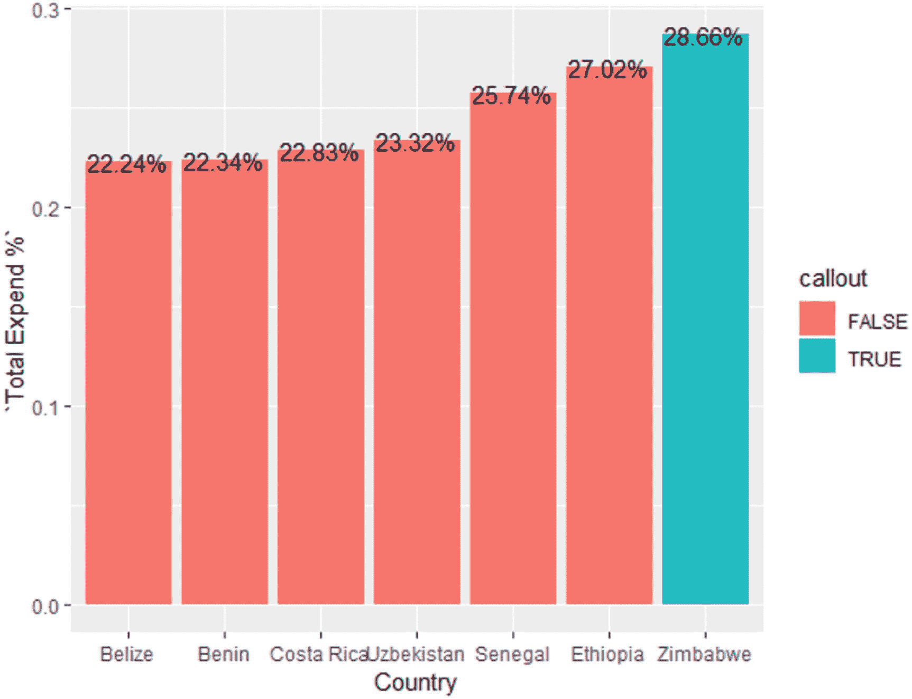

图 2-6 带有数据标签的标注柱状图

图 2-7 显示了将 `nudge_y` 设置为 –0.05 时标签的外观。

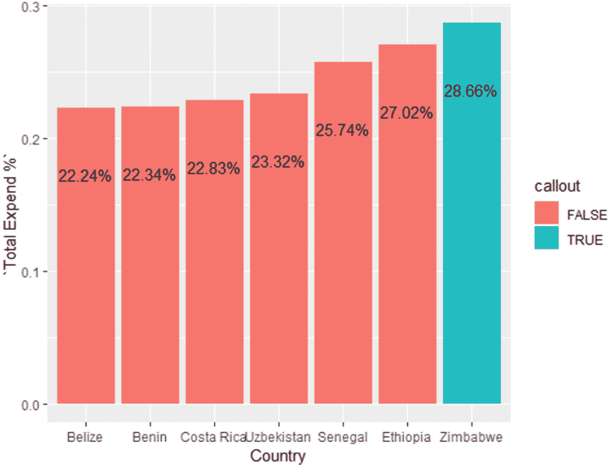

图 2-7 数据标签位于条形内部的标注柱状图

### 步骤 13：修改 y 轴

以下代码使用 `scale_y_continuous()` 标度对 `y` 轴进行修改：

```r
p <-
ggplot(
data = plotdata,
aes(x = `Country`, y = `Total Expend %`, fill = callout,
label = percent(`Total Expend %`)
)
) +
geom_bar(stat="identity", aes(fill = callout)) +
geom_text(nudge_y = -0.05) +
scale_y_continuous(
limits = c(0,0.75),
labels = NULL,
breaks = NULL
)
```

你明确将 `y` 轴的显示范围设置为 0 到 0.75。这样做是为了给报告用户提供一致的体验。默认情况下，与许多可视化工具一样，`ggplot2` 会根据数据自动调整标度。这可能会在视觉上错误地呈现数据在不同年份之间的重要差异。因此，你通过明确定义范围来防止重新缩放。`labels` 和 `breaks` 参数用于帮助报告用户解读图表中各列的值。由于你已经明确提供了这些值，因此不需要标签和刻度线。所以，通过将 `labels` 和 `breaks` 参数设置为 `NULL` 来移除它们。

### 步骤 14：将图表从垂直柱状图转换为水平条形图

此操作通过向脚本的下一行添加 `coord_flip()` 函数来完成，如下所示：

```r
p <-
ggplot(
data = plotdata,
aes(x = `Country`, y = `Total Expend %`, fill = callout,
label = percent(`Total Expend %`)
)
) +
geom_bar(stat="identity", aes(fill = callout)) +
geom_text(nudge_y = -0.05) +
scale_y_continuous(
limits = c(0,0.75),
labels = NULL,
breaks = NULL
) +
coord_flip()
```

`coord_flip()` 函数会使 `x` 轴变成 `y` 轴，`y` 轴变成 `x` 轴。结果是一个水平条形图，如图 2-8 所示。

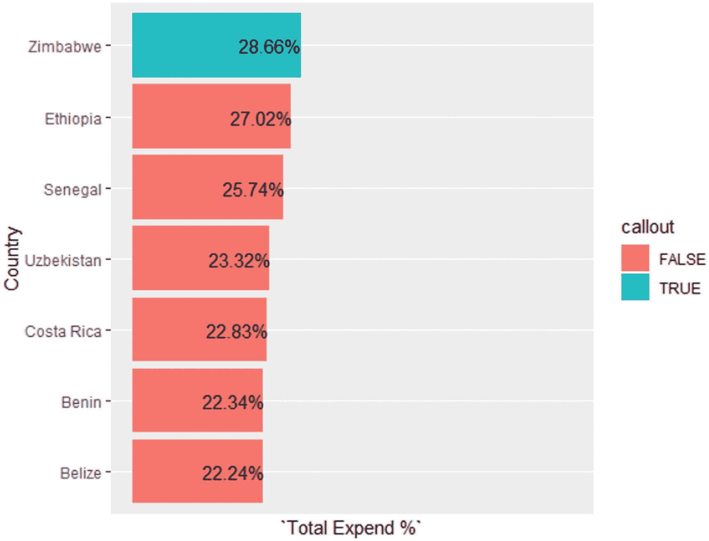

图 2-8 之前的柱状图转换为水平条形图

### 步骤 15：为 R 可视化添加动态注释

你使用 `annotate()` 函数为图表添加一个注释层，如下所示：

```r
p <-
ggplot(
data = plotdata,
aes(x = `Country`, y = `Total Expend %`, fill = callout,
label = percent(`Total Expend %`)
)
) +
geom_bar(stat="identity", aes(fill = callout)) +
geom_text(nudge_y = -0.05) +
scale_y_continuous(
limits = c(0,0.75),
labels = NULL,
breaks = NULL
) +
coord_flip() +
annotate(
"text",
label = label_val,
x = countryToAnnotate[1],
y = maxExpenditure + 0.12
)
```

你想向图表添加一个文本注释，因此第一个参数设置为 `"text"`。接下来，你将 `label_val` 变量赋值给 `label` 参数，因为该变量包含注释的文本。最后，你使用 `x` 和 `y` 参数定义注释的位置。你将 `x` 设置为你想要注释的国家名称。将 `x` 设置为国家名称，可以将注释对齐到该指定国家所在的 `x 轴` 位置。你将 `y` 轴上的位置设置为比该国家支出值高几个单位的位置，这样注释就不会覆盖该国家的柱形。请注意，因为你之前使用了 `coord_flip()` 函数，所以看起来你是在处理 `x 轴`，但实际上你是在处理 `y` 轴，反之亦然。添加注释层的结果如图 2-9 所示。

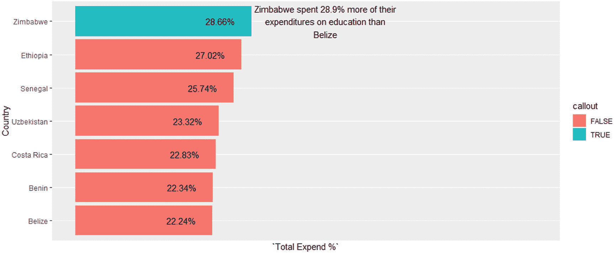

图 2-9 带有注释的水平条形图

### 步骤 16：为 R 可视化添加动态标题和说明文字

接下来，你使用 `labs()` 函数以及 `mainTitle`、`subTitle` 和 `caption` 变量，为图表添加`图表标题`、`副标题`和`说明文字`，如下列代码所示：

```r
p <-
ggplot(
data = plotdata,
aes(x = `Country`, y = `Total Expend %`, fill = callout,
label = percent(`Total Expend %`)
)
) +
geom_bar(stat="identity", aes(fill = callout)) +
geom_text(nudge_y = -0.05) +
scale_y_continuous(
limits = c(0,0.75),
labels = NULL,
breaks = NULL
) +
coord_flip() +
annotate(
"text",
label = label_val,
x = countryToAnnotate[1],
y = maxExpenditure + 0.12
) +
labs(
title = mainTitle,
subtitle = subTitle,
caption = caption
)
```

设置 `labs` 函数的作用不言自明，因此无需解释。

### 步骤 17：移除 x 轴和 y 轴的标签

由于你已向图表添加了标签，因此无需显式定义 `x` 和 `y` 轴。你通过将 `xlab()` 和 `ylab()` 函数中的 `label` 参数设置为 `NULL` 来移除 `x` 和 `y` 轴的标签，如下列代码的最后一行所示：

```r
p <-
ggplot(
data = plotdata,
aes(x = `Country`, y = `Total Expend %`, fill = callout,
label = percent(`Total Expend %`)
)
) +
geom_bar(stat="identity", aes(fill = callout)) +
geom_text(nudge_y = -0.05) +
scale_y_continuous(
limits = c(0,0.75),
labels = NULL,
breaks = NULL
) +
coord_flip() +
annotate(
"text",
label = label_val,
x = countryToAnnotate[1],
y = maxExpenditure + 0.12
) +
labs(
title = mainTitle,
subtitle = subTitle,
caption = caption
) +
xlab(label = NULL) +
ylab(label = NULL)
```

### 步骤 18：移除图例

如果你回头参考图 2-10，你会注意到一个关于 `callout` 的图例。`callout` 列与 `fill` 参数相关联，该参数用于确定柱形的颜色。你用它来将排名第一的国家与其他国家区分开来。不需要图例来解释颜色，因此将其移除。你通过将 `guides()` 函数中的 `fill` 参数设置为 `FALSE` 来实现。这样做会从图表中移除图例，因为该图例是针对 `fill` 标度的。用于执行此任务的代码位于以下脚本的最后一行：

```r
p <-
ggplot(
data = plotdata,
aes(x = `Country`, y = `Total Expend %`, fill = callout,
label = percent(`Total Expend %`)
)
) +
geom_bar(stat="identity", aes(fill = callout)) +
geom_text(nudge_y = -0.05) +
scale_y_continuous(
limits = c(0,0.75),
labels = NULL,
breaks = NULL
) +
coord_flip() +
annotate(
"text",
label = label_val,
x = countryToAnnotate[1],
y = maxExpenditure + 0.12
) +
labs(
title = mainTitle,
subtitle = subTitle,
caption = caption
) +
xlab(label = NULL) +
ylab(label = NULL) +
guides(fill=FALSE)
```

### 步骤 19：使用 `theme_few()` 更改可视化的外观和风格

接下来，你通过使用 `ggthemes` 包中的 `theme_few()` 主题，应用数据可视化专家 Stephen Few 的原则来更改图表的外观，如下列代码的最后一行所示：

```r
p <-
ggplot(
data = plotdata,
aes(x = `Country`, y = `Total Expend %`, fill = callout,
label = percent(`Total Expend %`)
)
) +
geom_bar(stat="identity", aes(fill = callout)) +
geom_text(nudge_y = -0.05) +
scale_y_continuous(
limits = c(0,0.75),
labels = NULL,
breaks = NULL
) +
coord_flip() +
annotate(
"text",
label = label_val,
x = countryToAnnotate[1],
y = maxExpenditure + 0.12
) +
labs(
title = mainTitle,
subtitle = subTitle,
caption = caption
) +
xlab(label = NULL) +
ylab(label = NULL) +
guides(fill=FALSE) +
theme_few()
```

### 步骤 20：标题居中对齐

以下代码的最后一行使用了 `theme()` 函数来处理此任务：

```r
p <-
ggplot(
data = plotdata,
aes(x = `Country`, y = `Total Expend %`, fill = callout,
label = percent(`Total Expend %`)
)
) +
geom_bar(stat="identity", aes(fill = callout)) +
geom_text(nudge_y = -0.05) +
scale_y_continuous(
limits = c(0,0.75),
labels = NULL,
breaks = NULL
) +
coord_flip() +
annotate(
"text",
label = label_val,
x = countryToAnnotate[1],
y = maxExpenditure + 0.12
) +
labs(
title = mainTitle,
subtitle = subTitle,
caption = caption
) +
xlab(label = NULL) +
ylab(label = NULL) +
guides(fill=FALSE) +
theme_few() +
theme(
plot.title = element_text(hjust = 0.5),
plot.subtitle = element_text(hjust = 0.5)
)
```

`theme()` 函数用于修改图表主题的各个组件。图表主题代表图表中非数据部分的组件。你可以在控制台中输入 `?theme()` 来访问 `theme()` 的帮助文件，查看哪些组件可供修改以及与之关联的元素函数。`element_text()` 函数是与 `plot.title` 和 `plot.subtitle` 组件关联的元素函数。将 `element_text()` 的 `hjust` 参数设置为 0.5 即可使文本居中对齐。

### 步骤 21：将代码添加到 Power BI

完整的 R 脚本见代码清单 2-2。复制代码并将其粘贴到 Power BI 中与此视觉对象关联的 R 脚本编辑器中。如果你正确遵循了步骤，则无需重构。

```r
library(tidyverse)
library(scales)
library(ggthemes)
currentColumns <-
  c("Country", "Year", "Total Expend %", "callout")
if (all(currentColumns %in% names(dataset))) {
  plotdata <- dataset %>%
    mutate(
      rank = dense_rank(desc(`Total Expend %`)),
      `Country` = fct_reorder(`Country`, rank, .desc = TRUE),
      callout = ifelse(rank == 1, TRUE, FALSE)
    ) %>%
    filter(rank <= 7)
  countryToAnnotate <- plotdata$`Country`[plotdata$rank == 1]
  minExpenditure <- min(plotdata$`Total Expend %`)
  maxExpenditure <- max(plotdata$`Total Expend %`)
  minCountry <-
    plotdata$`Country`[
      which(plotdata$`Total Expend %` == minExpenditure)]
  minCountry <- paste(minCountry, collapse = " & ")
  maxCountry <-
    plotdata$`Country`[
      which(plotdata$`Total Expend %` == maxExpenditure)]
  maxCountry <- paste(maxCountry, collapse = " & ")
  mainTitle = "% of Government Expenditure on Education"
  subTitle =
    paste(
      "The top 7 ranked countries in",
      reportYear,
      sep = " ")
  caption =
    "Source: https://databank.worldbank.org/source/world-development-indicators"
  label_val <-
    str_wrap(
      paste(maxCountry, "spent",
            percent((maxExpenditure/minExpenditure-1)),
            "more than", minCountry, sep = " "),
      width = 25
    )
  p <-
    ggplot(
      data = plotdata,
      aes(x = `Country`, y = `Total Expend %`, fill = callout,
          label = percent(`Total Expend %`))
    ) +
    geom_bar(stat="identity", aes(fill = callout)) +
    geom_text(nudge_y = -0.05) +
    scale_y_continuous(
      limits = c(0,0.75), labels = NULL, breaks = NULL) +
    coord_flip() +
    annotate(
      "text",
      label = label_val,
      x = countryToAnnotate[1],
      y = maxExpenditure + 0.1) +
    labs(
      title = mainTitle,
      subtitle = subTitle,
      caption = caption
    ) +
    xlab(label = NULL) +
    ylab(label = NULL) +
    guides(fill=FALSE) +
    theme_few() +
    theme(
      plot.title = element_text(hjust = 0.5),
      plot.subtitle = element_text(hjust = 0.5))
  p
} else {
  plot.new()
  title("The data supplied did not meet the requirements of the chart.")
}
```

代码清单 2-2 标注图 R 脚本

## 气泡图

`气泡图`是另一种流行的图表类型。你可以将其视为散点图，但增加了一个属性，即使用大小来表示另一个数据维度。因此，使用传统的`气泡图`，你最多可以展示五个维度的数据：

*   每个气泡的 `x` 和 `y` 代表两个维度。
*   `fill`（气泡内部的颜色）代表一个维度。
*   `size` 代表一个维度。
*   `labels` 代表一个维度。

使用 `ggplot2`，你可以将事情提升到一个新的水平。你可以为气泡添加边框颜色，从而在你的`气泡图`中展示六个维度的数据！在本示例中，你将使用一个虚构的职业橄榄球联盟的数据，该数据在六个维度上绘制跑卫的信息：`name`、`height`、`weight`、`total rushing yards`、`conference` 和 `division`。你将在本练习中创建的图表如图 2-11 所示。让我们逐步了解创建该图表的步骤。

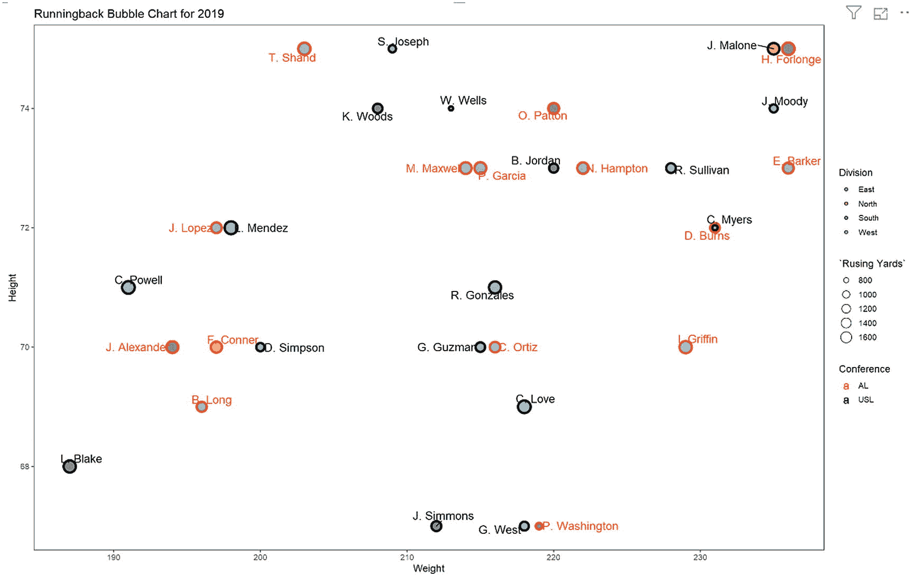

图 2-10 一个展示六个数据维度的气泡图

### 步骤 1：获取必要的数据

本示例中使用的数据集是一个虚构的职业橄榄球联盟的模拟数据集。该联盟有两个联盟：`AL（美国联盟）`和`USL（美国联盟）`。每个联盟包含四个分区：`North`、`South`、`East` 和 `West`。该数据集包含该虚构联盟中跑卫的姓名、身高、体重、冲球码数、联盟和分区信息。包含该数据集的文件名是 `FakeFootballLeagueData.csv`，可以在本章的代码仓库中找到。

### 步骤 2：将数据加载到 Power BI

使用 `GetData` 将数据加载到 Power BI 数据模型中。下表显示了每列应具有的数据类型：

| 列名 | 列数据类型 |
| --- | --- |
| ID | 整数 |
| Year | 整数 |
| Key | 整数 |
| FN | 文本 |
| LN | 文本 |
| Weight | 整数 |
| Height | 整数 |
| Rushing Yards | 整数 |
| Division | 文本 |
| Conference | 文本 |

将数据转换为上述格式所需的转换步骤包含在 `PBI_FakeFootballLeague.pbix` 文件中。

### 步骤 3：基于年份创建筛选切片器

首先将 `Year` 字段拖到报表画布上，然后在`可视化`窗格中选择`切片器`视觉对象，从而基于年份字段创建一个报表切片器。确保你拖动的 `Year` 字段在选中`切片器`视觉对象之前处于高亮状态，以便将其转换为切片器。切片器视觉对象是图像中包含筛选器图标的那个。

### 步骤 4：进行初始 R 视觉对象配置

转到可视化窗格，将一个 R 视觉对象拖到报表画布上。将视觉对象调整到所需大小。将 `FakeFootballLeague` 表中的 `ID`、`Year`、`FN`、`LN`、`Weight`、`Height`、`Rushing Yards`、`Division` 和 `Conference` 字段拖到`字段`窗格中。如果`字段`窗格未显示，请选中 R 视觉对象，它应该会出现。

### 步骤 5：将数据导出到 R Studio 进行开发

单击 `R 脚本编辑器`标题栏上的 45° 箭头。此操作会将传递给 R 的数据框以及 R 起始代码导出到 `R Studio`。如果需要更详细的说明，请参考“标注图”部分中的步骤 4。

### 步骤 6：加载所需的包

以下代码用于加载所需的包：

```r
library(tidyverse)
library(ggrepel)
library(ggthemes)
```

本脚本中使用了 `tidyverse` 中的 `dplyr` 和 `ggplot2` 包。`dplyr` 包用于将 Power BI 传递给 R 的数据整理成所需的形状，而 `ggplot2` 用于创建视觉对象。`ggrepel` 包用于在视觉格式中重新定位数据点的标签，`ggthemes` 包用于更改视觉对象非数据组件的显示。

### 步骤 7：创建数据验证测试所需的变量

```r
currentColumns <- sort(colnames(dataset))
requiredColumns <- c("Conference", "Division", "FN", "Height",
"ID", "LN", "Rusing Yards", "Weight",
"Year")
columnTest <- isTRUE(all.equal(currentColumns, requiredColumns))
reportYear <- unique(dataset$Year)
```

`currentColumns` 变量用于保存从 Power BI 传递给 R 的数据框的列名。这些名称按字母顺序排序，以便进行比较。`requiredColumns` 变量用于保存所需列的名称。它们也按字母顺序列出，以便进行比较。`columnTest` 变量保存比较测试的结果。它使用 `all.equal()` 函数来比较 `currentColumns` 变量和 `requiredColumns` 变量是否相等。如果这两个变量相等，则返回 `TRUE`；否则，返回关于两个变量之间哪些部分不相等的信息。你需要一个布尔响应，因此将 `all.equal()` 函数包裹在 `isTRUE()` 函数中，当 `all.equal()` 返回 `TRUE` 时，`isTRUE()` 将返回 `TRUE`；当 `all.equal()` 返回非 `TRUE` 值时，`isTRUE()` 将返回 `FALSE`。接下来，使用 `unique()` 函数从 `Year` 列中获取唯一元素列表。

### 步骤 8：创建数据验证测试

用于执行验证的模板如下：

```r
if(length(reportYear) == 1 & columnTest) {

} else{
plot.new()
title("The data supplied did not meet the requirements of the
chart.")
}
```

`if` 语句执行两个测试。首先，它测试 `reportYear` 向量的长度是否等于 1。其次，它测试 `columnTest` 变量是否评估为 `TRUE`。如果这两个条件都满足，则执行创建可视化的代码。否则，执行创建空白图表的代码，并附带一条消息，告知用户为何未返回预期的可视化结果。

### 步骤 9：为会议和会议分区定义颜色

`ggplot2` 的一个有用特性是，`ggplot2` 可以轻松自定义图表中想要使用的颜色。你可以使用 `ggplot2` 识别的颜色名称来定义图表，或者如果你知道颜色的十六进制表示，也可以使用它。在这里，你使用后者，通过命名字符向量来定义颜色。你使用命名字符向量来定义分区和会议的颜色。命名字符向量中元素的名称代表分区或会议，而命名字符向量中元素的值是代表你想要使用的颜色的十六进制数。以下是用于定义分区和会议颜色的代码：

```r
divisionColors <- c("East"="#56B4E9", "West"="#33FAFF",
"North"="#F0E442", "South"="#8B8D8D")
conferenceColors <- c("USL"="#000000", "AL"="#FC4E07")
```

这是一个网站的 URL，你可以用它来获取各种颜色的十六进制数：[`www.hexcolortool.com/#010328`](http://www.hexcolortool.com/%2523010328)。当你想要在原生 Power BI 可视化中使用某种颜色并需要其十六进制值时，也可以使用此网站。

### 步骤 10：动态定义图表标题

以下是创建图表标题的代码：

```r
chartTitle <- paste("Runningback Quad Chart for",
reportYear,
sep = " "
)
```

该代码将字符串“Runningback Quad Chart for”与报告用户选择的报告年份连接起来，以动态创建图表标题。

### 步骤 11：创建图表的数据集

传递给 Power BI 的数据集尚未完全准备好用于图表。你想为图表中每个跑卫的数据点添加一个标签。如果同时使用他们的名和姓，标签会太长，因此你需要一种方法来缩短它们。一个好方法是取名的首字母，并将其与姓连接起来。这在以下代码中实现：

```r
chartData %>%
mutate(Name = paste0(str_sub(FN,1,1),". ", LN))
```

上述代码从 `dataset` 数据框开始，然后向其投影一个名为 `Name` 的新列。它基于使用 `paste0` 函数连接三个字符串。第一个字符串使用 `stringr` 包中的 `str_sub()` 函数从 `FN` 列中提取第一个字符。第二个字符串是 `". "`，第三个字符串是 `LN`。因此，如果 `FN` 是 John，`LN` 是 Doe，结果将是 `J. Doe`。

### 步骤 12：通过定义 ggplot 函数开始创建图表

你正在创建的气泡图将有六个维度。这六个维度是：
*   图表的 x 坐标，表示跑卫的体重
*   y 坐标，表示跑卫的身高
*   气泡的大小，表示跑卫的总冲球码数
*   图表的填充（内部颜色），表示跑卫所在的分区
*   颜色（气泡边框），表示跑卫所在的会议
*   标签，表示跑卫的名字

你可以使用 `ggplot()` 函数中的 `aes()` 函数来设置这些维度，如下所示：

```
p <- ggplot(
chartData,
aes(
x = Weight, y = Height, size = `Rusing Yards`,
color = Conference, fill = Division, stroke = 2,
label = Name
)
)
```

### 步骤 13：使用 geom_point 几何对象为气泡图添加图层

在 `geom_point()` 几何对象中，你可以使用 26 种形状。图 2-11 是一个展示它们的可视化图。

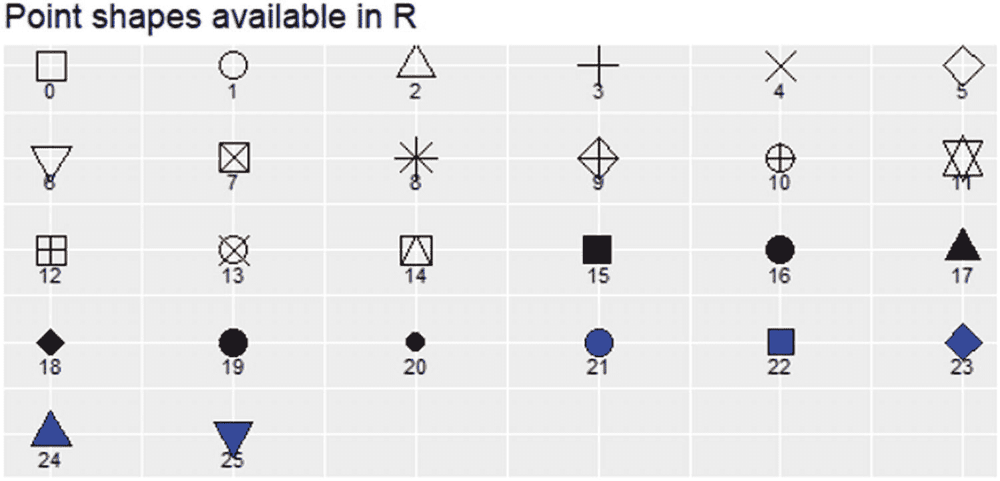

**图 2-11** 展示了 `geom_point()` 中可用的形状。该可视化图是使用 `ggplot` 包创建的。

有三种形状可用于创建气泡图。它们是形状 `1`、`16` 和 `21`。只有形状 `21` 允许你同时控制点的颜色（圆的边框）和填充（内部阴影）。形状 `1` 仅提供颜色，形状 `16` 仅提供填充。以下是使用形状 `21` 将 `geom_point()` 图层添加到可视化中的代码：

```
p <- ggplot(
chartData,
aes(
x = Weight, y = Height, size = `Rusing Yards`,
color = Conference, fill = Division, stroke = 2,
label = Name
)
) +
geom_point(shape = 21)
```

结果如图 2-12 所示。

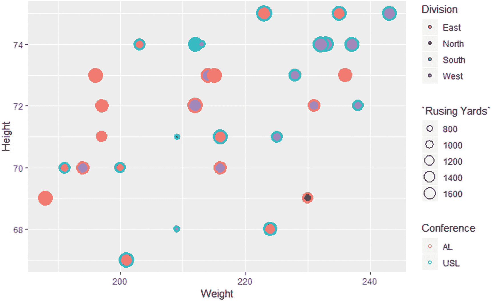

**图 2-12** 使用形状 `21` 的初始气泡图。

你已经构建了气泡图的基础。请注意，`geom_point()` 几何对象继承了 `ggplot()` 函数的美学映射，因此你无需显式定义它们。现在，你需要进行一些外观上的调整，以使图表在视觉上更具吸引力。

### 步骤 14：为气泡图添加标签

图表上散布着气泡，但你不知道每个气泡代表哪位运动员。你可以使用 `ggrepel` 包中的 `geom_text_repel()` 几何对象为可视化图表添加文本。`geom_text_repel()` 几何对象在添加标签时会尽量避免重叠。以下是添加了 `geom_text_repel()` 层的代码：

```
p <- ggplot(
chartData,
aes(
x = Weight, y = Height, size = `Rusing Yards`,
color = Conference, fill = Division, stroke = 2,
label = Name
)
) +
geom_point(shape = 21) +
geom_text_repel(size = 5)
```

添加 `geom_text_repel()` 层的结果如图 2-13 所示。

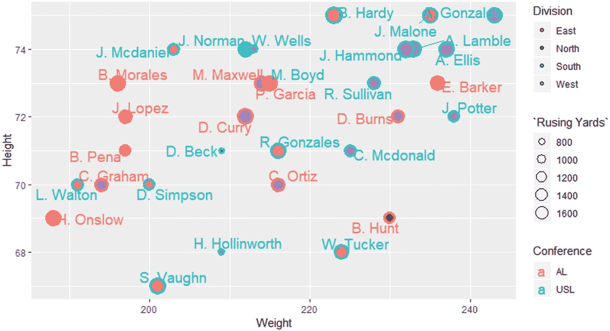

图 2-13 添加了标签的气泡图

请注意，我们能够通过 `size` 参数控制标签的文本大小。如果没有添加 `size` 参数，标签的字体大小会根据气泡的大小而变化。

### 步骤 15：更改气泡边框颜色和气泡填充颜色

接下来，你使用 `conferenceColors` 命名字符向量中的预定义颜色来更改气泡的颜色。具体做法是将 `conferenceColors` 设置为 `scale_color_manual()` 标度中 `values` 参数的值。你还需要使用 `divisionColors` 变量中的预定义颜色来设置 `fill`。具体做法是将 `divisionColors` 设置为 `scale_fill_manual()` 标度中 `values` 参数的值。包含这两个新标度的代码如下所示：

```
p <- ggplot(
chartData,
aes(
x = Weight, y = Height, size = `Rusing Yards`,
color = Conference, fill = Division, stroke = 2,
label = Name
)
) +
geom_point(shape = 21) +
geom_text_repel(size = 5) +
scale_color_manual(values = conferenceColors) +
scale_fill_manual(values = divisionColors)
```

生成的可视化图表如图 2-14 所示。

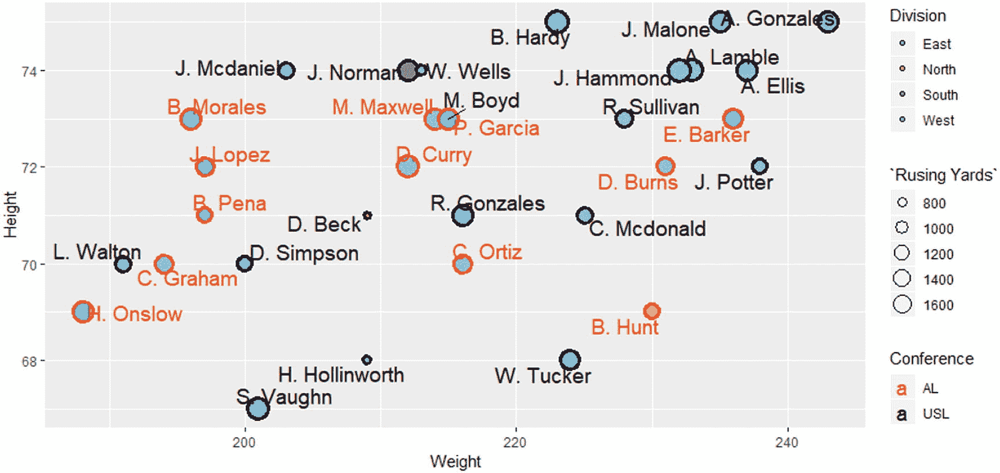

图 2-14 使用自定义颜色的气泡图

### 步骤 16：创建 ggtitle

你将 `chartTitle` 变量传递给 `ggtitle()` 函数，为图表添加标题，如下面代码的最后一行所示：

```
p <- ggplot(
chartData,
aes(
x = Weight, y = Height, size = `Rusing Yards`,
color = Conference, fill = Division, stroke = 2,
label = Name
)
) +
geom_point(shape = 21) +
geom_text_repel(size = 5) +
scale_color_manual(values = conferenceColors) +
scale_fill_manual(values = divisionColors) +
ggtitle(chartTitle)
```

### 步骤 17：设置主题

在下面的代码中，你将可视化图表的主题设置为 `ggthemes` 包中的 `theme_few()` 主题：

```
p <- ggplot(
chartData,
aes(
x = Weight, y = Height, size = `Rusing Yards`,
color = Conference, fill = Division, stroke = 2,
label = Name
)
) +
geom_point(shape = 21) +
geom_text_repel(size = 5) +
scale_color_manual(values = conferenceColors) +
scale_fill_manual(values = divisionColors) +
ggtitle(chartTitle) +
theme_few()
```

### 步骤 18：将代码添加到 Power BI

现在你有了一个能生成所需可视化图表的可用脚本。完整的脚本如下。将清单 2-3 中的脚本添加到 Power BI 中与该可视化图表关联的 `R 脚本编辑器` 中。该可视化图表将对报表中使用的 `Year` 筛选器做出响应。

```
library(tidyverse)
library(ggrepel)
library(ggthemes)
currentColumns <- c("FN", "LN", "Weight", "Height", "Rusing Yards", "Conference", "Division", "Year")
if (all(currentColumns %in% colnames(dataset))) {
chartData <- dataset %>%
filter(Year == reportYear) %>%
mutate(Name = paste0(substring(FN,1,1),". ", LN))
divisionColors <-
c("East"="#56B4E9", "West"="#009E73", "North"="#F0E442",
"South"="#0072B2")
conferenceColors <- c("USL"="#000000", "AL"="#FC4E07")
chartTitle <-
paste("Runningback Quad Chart for", reportYear, sep = " ")
p <- ggplot(
chartData,
aes(
x = Weight, y = Height, size = `Rusing Yards`,
color = Conference, fill = Division, stroke = 2,
label = Name
)
) +
geom_point(shape = 21) +
geom_text_repel(size = 5) +
scale_color_manual(values = conferenceColors) +
scale_fill_manual(values = divisionColors) +
ggtitle(chartTitle) +
theme_few()
p
} else{
plot.new()
title("The data supplied did not meet the requirements of the
chart.")
}
```

清单 2-3 气泡图 R 脚本

### 预测

预测业务结果是一种被公司使用多年的技术。许多商业智能工具都提供了预测可视化功能，你可以将其添加到仪表板中显示预测结果，但这些功能提供的信息量非常有限。它们之所以有限，是因为通常只显示预测结果，而忽略了影响预测的重要组件。这些组件包括 `趋势` 和 `季节性`。预测的 `趋势` 用于显示数据在长期内是下降还是上升。预测的 `季节性` 用于显示由发生时间引起的数据变化。幸运的是，Facebook 的数据科学团队为 R 语言开发了一个名为 `Prophet` 的包，它不仅使你能够创建强大的预测可视化图表，还能让你创建可视化图表，从而获得关于构成预测的不同组件的宝贵信息。

在本练习中，你将构建一个受 `Prophet` 文档中示例启发的可视化图表。`Prophet` 中的示例创建了一个预测佩顿·曼宁维基百科页面浏览量的可视化图表。佩顿是前 NFL 四分卫。你将在 `Prophet` 示例的基础上进行扩展，构建一个交互式可视化图表，使你能够在两位现役 NFL 四分卫拉马尔·杰克逊和德肖恩·沃森之间切换。该可视化图表不仅包含预测图表，还包含显示预测趋势的图表，以及显示周度和年度季节性的图表。该可视化图表的图像如图 2-15 所示。

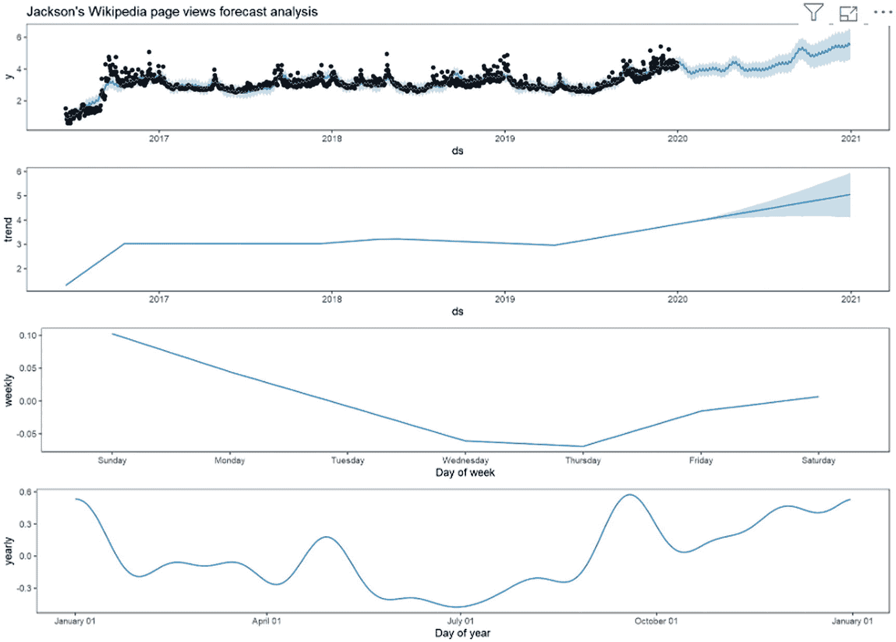

图 2-15 使用 Prophet 和 ggplot2 生成的预测可视化图表

让我们来看看创建这个自定义 R 可视化图表所需的步骤！

### 步骤 1：获取必要数据

你需要获取包含拉马尔·杰克逊和德肖恩·沃森每日维基百科浏览量的数据。以下是获取数据所需执行的步骤。请注意，你需要将这些步骤执行两次，一次针对拉马尔·杰克逊，一次针对德肖恩·沃森：
1.  访问 [`https://en.wikipedia.org/wiki/Wikipedia:Web_statistics_tool`](https://en.wikipedia.org/wiki/Wikipedia:Web_statistics_tool) 以打开 *维基百科网络统计工具*。
2.  点击 *当前工具* 部分中的 [toollabs:​pageviews](https://tools.wmflabs.org/pageviews) 链接。
3.  点击搜索栏上方的 *X 清除* 以清空页面名称，然后输入你想要测试的页面名称。第一次迭代使用 *Lamar Jackson*，第二次迭代使用 *Deshaun Watson*。
4.  点击 *日期* 文本框，然后选择自定义范围。
5.  选择一个至少包含 2 年时间跨度的数据范围。此要求是为了让 *Prophet* 包有足够的信息来检测年度季节性趋势。在本示例中，我选择 2018 年 1 月 1 日作为开始日期，2019 年 12 月 31 日作为结束日期。
6.  点击 *页面* 文本框下方 *下载* 按钮中的向下箭头，然后选择 *CSV* 选项。该操作将启动下载过程，并将查询结果以 *csv* 格式保存到你的计算机上。默认文件名不会提供关于查询主题的信息。请将文件重命名为能代表文件内容的名称。我为每个文件添加了主题的姓名首字母作为前缀。拉马尔·杰克逊使用 *lj*，德肖恩·沃森使用 *dw*。
7.  接下来，你需要将拉马尔·杰克逊和德肖恩·沃森的数据集加载到 Power BI 中，进行可视化所需的一些数据转换，然后将它们合并成一个数据集。这将使用 Power Query 来完成。最终的数据集需要包含以下字段及其对应的数据类型：

| 列名 | 数据类型 |
| --- | --- |
| 日期 | 文本 |
| 页面浏览量 | 整数 |
| 四分卫 | 文本 |
| 页面浏览量（Log10） | 小数 |

使用 Power Query 进行转换以获取上述格式数据的具体步骤，可在本章代码仓库中的 *pbix* 文件中找到。

### 步骤 2：基于四分卫创建切片器

将 *四分卫* 字段拖到报表画布的右上方。接下来，转到右上角的 *可视化* 窗格，将可视化效果更改为 *切片器* 可视化对象。*切片器* 可视化对象是 Power BI 中预装的，其图标包含一个筛选器图片。

### 步骤 3：配置 R 可视化对象

转到可视化窗格，将一个 R 可视化对象拖到报表画布上。将可视化对象调整到所需大小。将 *WikipediaPageViews* 表中的 *日期*、*页面浏览量*、*页面浏览量（Log10）* 和 *四分卫* 字段拖放到 *字段* 窗格中。如果字段窗格未显示，请选中 *R 可视化对象*，它应该就会出现。

### 步骤 4：将数据导出到 R Studio 进行开发

点击 *R 脚本编辑器* 标题栏上的 45° 箭头。此操作会将传递给 *R 可视化对象* 的数据框以及 R 起始代码导出到 *R Studio*。如果需要更详细的解释，请参考“*标注图*”部分中的步骤 4。

### 步骤 5：将所需包加载到脚本中

以下是加载脚本所需包的代码：

```
library(tidyverse)
library(prophet)
library(ggthemes)
library(gridExtra)
library(lubridate)
```

来自 `tidyverse` 的 `dplyr` 包用于执行一些数据整理任务，来自 `tidyverse` 的 `ggplot2` 包用于创建可视化，`prophet` 包用于执行预测并帮助创建可视化，`gridExtra` 包用于在单个可视化对象中实现多图表显示，`lubridate` 包用于执行一些日期操作任务。

### 步骤 6：创建数据验证测试所需的变量

用于创建验证变量的代码如下所示：

```
currentColumns <- sort(colnames(dataset))
requiredColumns <- c("Date", "Page Views", "Page Views (Log10)",
"Quarterback")
columnTest <- isTRUE(all.equal(currentColumns, requiredColumns))
qb <- unique(dataset$Quarterback)
```

`currentColumns` 字符向量变量用于保存从 Power BI 传递给 R 的数据框的列名。这些名称按字母顺序排序以便比较。`requiredColumns` 字符向量变量用于保存所需列的名称。它们也按字母顺序列出以便比较。`columnTest` 变量保存比较测试的结果。它使用 `all.equal()` 函数比较 `currentColumns` 变量和 `requiredColumns` 变量是否相等。如果这两个变量相等，则返回 `TRUE`；否则，返回关于两个变量之间哪些内容不相等的信息。你需要一个布尔响应，因此将 `all.equal()` 函数包裹在 `isTRUE()` 函数中，当 `all.equal()` 返回 `TRUE` 时，`isTRUE()` 将返回 `TRUE`，当 `all.equal()` 返回非 `TRUE` 值时，`isTRUE()` 将返回 `FALSE`。最后要做的是获取 *四分卫* 列中的所有唯一元素，并将结果赋值给 `qb` 变量。

### 步骤 7：创建数据验证测试

用于执行验证测试的模板如下：

```
if (length(qb) == 1 & columnTest) {

} else {
plot.new()
title("提供的数据不符合图表的要求。")
}
```

该可视化对象需要一个仅包含一名四分卫且具有所需列的数据集。第一个测试检查 `qb` 变量的长度是否为 1。如果等于 1，则表示数据集中只有一名四分卫，因此该测试通过。第二个测试检查从 Power BI 传递的数据框是否包含所需的列。如果 `columnTest` 变量等于 `TRUE`，则该测试通过。如果两个测试结果都为 `TRUE`，则 R 将尝试执行创建可视化对象的代码。否则，将执行创建空白图表的代码，并附带一条消息，说明为何未创建预期的可视化对象。

### 步骤 8：创建动态图表标题

以下代码创建一个变量，用于保存基于四分卫姓名动态创建的图表标题：

```r
chartTitle <-
paste0(qb, " 的维基百科页面浏览量预测分析")
```

它将四分卫的姓名与字符串“ 的维基百科页面浏览量预测分析”连接起来，中间不使用任何分隔符。`paste0()` 函数与 `paste()` 函数类似。它用于在不需要分隔符的情况下连接字符串。

### 步骤 9：创建生成预测所需的数据集

```r
dfPageViews %>%
transmute(
Quarterback,
ds = ymd(Date),
y = `Page Views (Log10)`
)
```

`prophet` 包只需要两个变量：`ds` 和 `y`。`ds` 变量用于日期。日期应该是连续的，并且至少跨越 2 年的时间段。`y` 变量代表你想要预测的结果，即 `页面浏览量` 的对数。

请注意，你使用的是页面浏览量的对数，而不是实际的页面浏览量。这是一种常见的技术，适用于像本示例中数据分散度较高的情况。使用页面浏览量的对数可以减少分散度，使数据更易于可视化。在构建数据科学模型时，使用对数变换也是特征工程中常用的一种技术。

### 步骤 10：生成预测

以下三行代码用于生成预测：

```r
m <- prophet(dfPageViews)
future <- make_future_dataframe(
m,
periods = 365,
freq = "day",
include_history = TRUE
)
forecast <- predict(m, future)
```

第一行基于 `dfPageViews` 数据框生成一个预测模型对象。第二行代码创建一个数据框，该数据框在 `dfPageViews` 数据框的日期末尾添加了 `periods` 参数中指定的周期数。周期的频率由 `freq` 参数定义，如果将 `include_history` 参数设置为 `TRUE`，则历史日期也会包含在数据框中。第三行通过 `predict()` 函数，使用第一行创建的模型和 `future` 数据框生成预测。

### 步骤 11：生成图表

在此步骤中，您将生成四个图表。这四个图表分别是：

- 预测图
- 显示基础数据趋势的图
- 显示周季节性的图
- 显示年季节性的图

用于创建这些图表的代码如下所示：

```r
p1 <- plot(m, forecast) + ggtitle(chartTitle) + theme_few()
p <- prophet_plot_components(m, forecast)
p2 <- p[[1]] + theme_few()
p3 <- p[[2]] + theme_few()
p4 <- p[[3]] + theme_few()
p5 <- grid.arrange(p1, p2, p3, p4, nrow =4)
p5
```

生成的视觉效果已在图 2-15 中展示。图 2-15 中的视觉效果非常有价值，因为您不仅拥有预测的视觉效果，还拥有影响预测的各个组件的视觉效果。您可以通过 `trend` 图查看数据的趋势，通过 `weekly` 图查看数据在一周内的典型变化，以及通过 `yearly` 图查看数据在一年内的典型变化。

您需要做的第一件事是分别定义每个图表。以下是每个图表如何单独定义的说明：

- `p1` 用于保存实际预测的视觉效果。它是使用 `Prophet` 包中的 `plot()` 函数构建的，该函数底层基于 `ggplot` 构建。因此，您可以对其应用 `theme_few()` 主题。
- `p` 用于保存由 `Prophet` 通过 `prophet_plot_components()` 函数生成的组件图表。此函数返回一个 `ggplot` 图表列表，代表预测的不同组件。在本例中，它是一个趋势图、一个周季节性图和一个年季节性图。
- `p2`、`p3` 和 `p4` 保存由 `p` 生成的三个单独的组件图表。如前所述，`p` 是一个 `ggplot` 图表列表。您需要将每个图表作为 `ggplot` 图表从 `p` 中提取出来。这可以通过使用双方括号 `[[` 来实现。当您在 R 中使用单方括号 `[` 从列表中提取对象时，返回的项目是一个包含一个元素的列表，而不是底层元素实际数据类型的单个对象。因此，在此示例中，`p[1]` 不会返回一个 `ggplot` 图表，而是返回一个包含一个项目的列表，该项目是一个 `ggplot` 图表。如果您想显式地以其真实数据类型返回该项目，则需要像前面代码中那样使用双方括号 `[[` 进行提取。请注意，由于每个图表都是作为 `ggplot` 图表提取的，因此您可以对它们每个应用 `theme_few()` 主题。

现在，您已将预测视觉效果保存为 `ggplot` 对象，并将每个预测组件的视觉效果保存为 `ggplot` 对象，您可以使用 `gridExtra` 包中的 `grid.arrange()` 函数将它们组合成一个视觉效果。这在前面的代码的第 6 行中完成。您希望图表彼此堆叠。通过将 `nrow` 参数设置为 4 来完成此任务。您可以使用此参数控制视觉效果在屏幕上的显示方式。例如，如果将该参数设置为 2，则会将图表组合成两行，每行两个图表。

### 步骤 12：将代码添加到 Power BI

用于创建预测视觉效果的完整脚本位于清单 [2-4 中。将其复制并粘贴到 Power BI 的 `R 脚本编辑器` 中。该视觉效果将对 Quarterback 切片器完全响应。

```r
library(tidyverse)
library(prophet)
library(ggthemes)
library(gridExtra)
library(lubridate)
library(rlang)
# 我需要加载 rlang。请查看此包。
currentColumns <- dfPageViews %>%
  mutate(Date = ymd(Date)) %>%
  rename(ds = Date, y = `Page Views (Log10)`)
m <- prophet(dfPageViews, yearly.seasonality=TRUE)
future <- make_future_dataframe(m, periods = 365)
forecast <- predict(m, future)
p1 <- plot(m, forecast) + ggtitle(chartTitle) + theme_few()
p <- prophet_plot_components(m, forecast)
p2 <- p[[1]] + theme_few()
p3 <- p[[2]] + theme_few()
p4 <- p[[3]] + theme_few()
p5 <- grid.arrange(p1, p2, p3, p4, nrow =4)
p5
} else {
plot.new()
title("提供的数据不符合图表要求。")
}
```

清单 2-4 生成预测图表的 R 脚本

## 带阴影的折线图

折线图可以说是数据可视化中最流行的图表之一。它非常适合绘制跨越一段时间的数据。由于其使用广泛，所有 BI 工具都原生支持它。

在本练习中，您将学习如何使用 R 在 Power BI 中创建折线图。此折线图将不是您典型的折线图。它将包含截至撰写本文时 Power BI 中尚不可用的增强功能。您将创建的 R 自定义视觉效果灵感来自 Hadley Wickham 在他的书 *Ggplot2: Elegant Graphics for Data Analysis*（第 2 版，第 44 页）中创建的视觉效果。他在书中创建的视觉效果使用背景阴影技术来识别图表中特定时间点在职的总统。您将在 Power BI 中创建一个交互式 R 自定义视觉效果，该视觉效果将执行类似的操作，但有所增强。您将创建的视觉效果如图 2-16 所示。

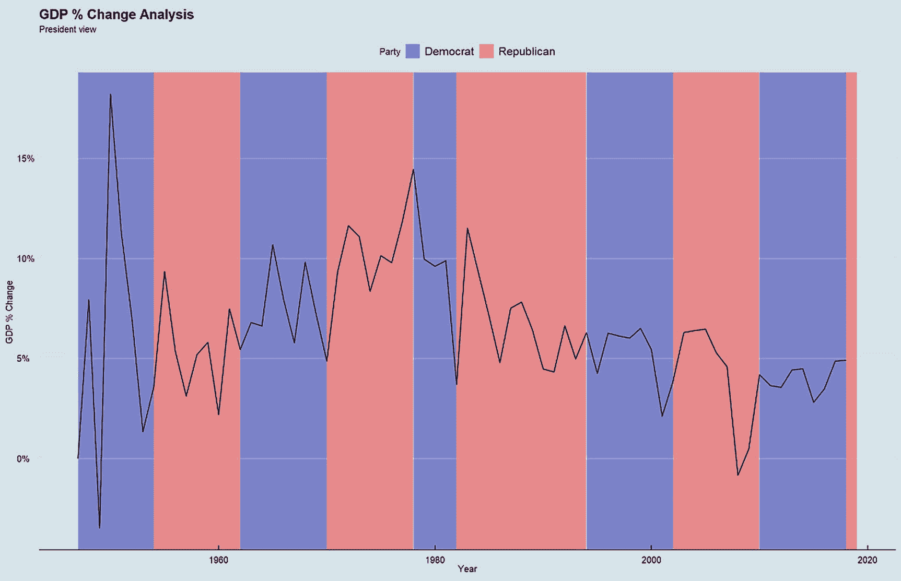

图 2-16 折线图显示 GDP 百分比变化，背景阴影基于阴影时间段内执政的政党

R 自定义视觉效果绘制了从 1947 日历年到 2018 日历年的 `GDP 百分比变化`。此图表的独特之处在于，背景阴影显示了给定时间点总统所属的政党。您利用 Power BI 的交互性进一步增强视觉效果。除了总统所属政党的视图外，您还让最终用户能够更改背景，以显示在给定时间点代表美国参议院多数席位的政党、代表美国众议院多数席位的政党以及总体多数党。除此之外，您还将让最终用户能够在显示 `实际 GDP` 和 `GDP 百分比变化` 之间切换。下图 2-17 显示了实际 GDP 的总体多数党视图。

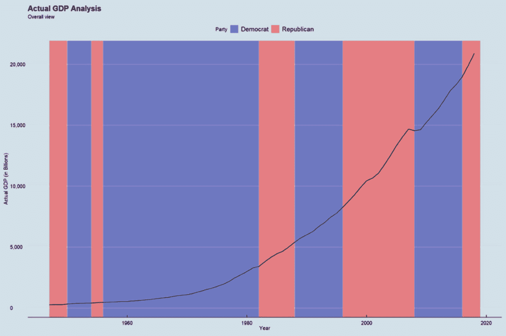

图 2-17 折线图显示实际 GDP，背景阴影基于阴影时间段内总体执政的政党

现在您已经看到了 R 自定义视觉效果，让我们来看看在 Power BI 中创建该视觉效果必须采取的步骤！

### 步骤 1：获取必要数据

1. 访问 [`https://fred.stlouisfed.org/series/GDP`](https://fred.stlouisfed.org/series/GDP)，该链接将跳转至圣路易斯联储官网中专门展示历史 GDP 信息的页面。点击 `EDIT GRAPH` 按钮，将 `Modify frequency` 组合框中的值更改为 `Annual`，并将 `Aggregation method` 更改为 `End of Period`。点击弹出表单右上角的 `X` 关闭表单。
2. 点击 `DOWNLOAD` 按钮，选择 `CSV` 格式。在撰写本文时，此操作会将一个名为 `GDP.csv` 的 `csv` 文件下载到我的电脑上。
3. 进入本示例的代码仓库，找到 `PoliticalInfoWithGDP.xlsx` 工作簿。该工作簿包含用于创建本示例中 `PoliticalInfoWithGDP` 数据集的数据集和 Power Query 查询。`PoliticalInfoWithGDP` 是本练习中将要生成的视觉对象的数据源。大部分工作已为您完成，但您可以检查工作簿，了解如何将以下数据集合并以生成 `PoliticalInfoWithGDP` 数据集。以下是在 `PoliticalInfoWithGDP.xlsx` 工作簿中使用 Power Query 开发的每个查询的描述：
    - `GDP`：此查询导入步骤 2 中下载的 GDP 数据，并在数据集中添加一个 `% GDP Change` 列。
    - `Presidents`：此查询构建了一个数据集，列出了分析期间内的所有美国总统，并附带一列显示其政治派别。
    - `Political Info`：此查询从以下 URL 的维基百科文章中获取信息：[`https://en.wikipedia.org/wiki/Party_divisions_of_United_States_Congresses`](https://en.wikipedia.org/wiki/Party_divisions_of_United_States_Congresses)。该 URL 的信息用于获取 `Senate` 和 `House of Representative` 的多数党以及当时的在任总统。使用 `Power Query` 重塑数据以用于可视化。您可以按照 `Power Query` 中的步骤查看具体操作。
        > `Power Query` 是一种内置于多种 Microsoft 技术（如 Microsoft Excel、Power BI、Power BI Dataflows 和 SQL Server Analysis Services）中的数据整理工具。它拥有图形用户界面，能大幅缩短执行简单数据整理所需的时间。我强烈推荐不熟悉 Microsoft 生态系统的 R 和 Python 开发者了解一下这个出色的工具！
    - `PoliticalInfoWithGDP`：合并上述数据集，并通过 `Power Query` 将结果整理成本示例可视化所需的形状。
4. 如前所述，`PoliticalInfoWithGDP` 数据集是用于可视化的数据集，并已通过上述 Power Query 构建完成。它已保存为名为 `PoliticalInfoWithGDP.csv` 的 `csv` 文件。您可以在本示例的代码仓库中找到该文件。

### 步骤 2：将数据加载到 Power BI

通过选择 `Home` ➤ `Get Data` ➤ `Text/CSV`，将 `PoliticalInfoWithGDP.csv` 加载到 Power BI，然后浏览到您保存文件的位置。点击 `Transform Data` 按钮进入 Power Query 编辑器。检查并确保字段具有以下数据类型：

| 列 | 数据类型 |
| --- | --- |
| Index | 整数 |
| Year | 整数 |
| GDP | 小数 |
| % GDP Change | 小数 |
| Senate Majority | 文本 |
| House Majority | 文本 |
| President's Majority | 文本 |
| Overall Majority | 文本 |

如果列不具备上述数据类型，请将其更改为相应的数据类型。更改数据类型最简单的方法是右键单击相关列，然后选择 `Change Type`。将出现可用数据类型列表。选择适用于该列的数据类型。确认数据类型正确后，点击 `Close & Apply` 将数据加载到 Power BI 数据模型中。

转到表格，确保 `Year` 和 `Index` 的默认行为设置为 `Do Not Summarize`。为此，请在 `Fields` 窗格中选择该字段，然后转到 `Modeling` ➤ `Default Summarization`（位于 `Properties` 部分），并选择 `Don't Summarize`。

### 步骤 3：创建报表切片器

报表有两个切片器。一个切片器用于让最终用户选择政治视图（`House`、`Senate`、`President` 或 `Overall`），另一个切片器用于选择用户想要显示的 GDP 统计指标（`Actual GDP` 或 `GDP % Change`）。此步骤的工作已在您可以在本示例代码仓库中找到的入门 `pbix` 模板中为您完成。

### 步骤 4：配置 R 视觉对象

转到 `Visualization pane`，将 `R visual` 拖到报表画布上。R 视觉对象图标位于 `Visualization` 窗格的右下部分。将视觉对象调整到所需大小。将 `Year`、`GetPoliticalLevel`、`GetPoliticalLevelName`、`GetGDPStat` 和 `GetGDPStatName` 添加到位于 `Visualization` 窗格下方的 `Fields` 窗格中。有时 Microsoft Power BI 会默认对数字字段应用聚合函数。检查它是否尝试对 `Year` 字段执行此操作。如果应用了聚合函数，请点击 `Fields` 窗格中该字段的下拉箭头，然后选择 `Don't Summarize` 将其移除。

### 步骤 5：将数据导出到 R Studio 进行开发

点击 `R script editor` 标题栏上的 45° 箭头。此操作会将传递给 R 的数据框和 R 入门代码导出到 `R Studio`。如果您需要更详细的说明，请参阅“标注图”部分中的步骤 4。

### 步骤 6：将所需包加载到脚本中

加载所需包所需的代码如下所示：

```r
library(tidyverse)
library(ggthemes)
library(scales)
```

来自 `tidyverse` 的 `dplyr` 包将用于执行一些数据整理任务，来自 `tidyverse` 的 `ggplot2` 包将用于创建可视化，来自 `ggthemes` 包的 `economist` 主题用于格式化图表的非数据部分，而 `scales` 包中的一些函数将用于数字格式化。

### 第 7 步：创建数据验证测试所需的变量

以下是验证测试的代码：

```
currentColumns <- sort(colnames(dataset))
requiredColumns <-
c("GetGDPStat", "GetGDPStatName", "GetPoliticalLevel",
"GetPoliticalLevelName", "Year")
columnTest <- isTRUE(all.equal(currentColumns, requiredColumns))
politicalLevelName <- unique(dataset$GetPoliticalLevelName)
gdpStatName <- unique(dataset$GetGDPStatName)
```

将执行以下三项测试：
-   一项测试，确保传递给可视化的数据集包含必要的字段
-   一项测试，确保数据集中仅包含一种政治观点
-   一项测试，确保数据集中仅包含一项 GDP 统计数据

我们来详细讲解第一个测试中使用的代码。代码如下：

```
currentColumns <- sort(colnames(dataset))
requiredColumns <-
c("GetGDPStat", "GetGDPStatName", "GetPoliticalLevel",
"GetPoliticalLevelName", "Year")
columnTest <- isTRUE(all.equal(currentColumns, requiredColumns))
```

第一行代码从传递给 R 的数据集中获取列名，并将其赋值给一个名为 `currentColumns` 的字符向量。`sort()` 函数用于按字母顺序对列名进行排序。下一行代码创建了一个包含所需字段的字符向量，并将其命名为 `requiredColumns`。请注意，这些名称是按字母顺序提供的。这样做是为了确保可以直接与 `currentColumns` 字符向量进行比较。第三行代码通过使用 `all.equal()` 函数比较 `currentColumns` 字符向量和 `requiredColumns` 字符向量来执行测试。当 `currentColumns` 等于 `requiredColumns` 时，返回 `TRUE`。否则，会返回试图解释它们为何不匹配的信息。你需要一个布尔响应，因此使用 `isTRUE()` 函数包裹 `all.equal()`。这样做后，当 `all.equal()` 返回 `TRUE` 时，将返回 `TRUE`；否则，将返回 `FALSE`。

接下来，使用以下代码创建两个字符向量，分别用于存储 `GetPoliticalLevelName` 字段和 `GetGDPStatName` 字段中的唯一元素：

```
politicalLevelName <- unique(dataset$GetPoliticalLevelName)
gdpStatName <- unique(dataset$GetGDPStatName)
```

理想情况下，两者都只包含一个元素，这将在下一步中进行测试。

### 第 8 步：创建数据验证测试

验证所使用的模板如下：

```
if(length(politicalLevelName) == 1 &
length(gdpStatName) == 1 & columnTest) {

} else {
plot.new()
title("提供的数据不符合图表要求。")
}
```

如果 `GetPoliticalLevelName` 字段中只有一个值，`GetGDPStatName` 字段中只有一个值，并且 `columnTest` 评估为 `TRUE`，则前面的 `if` 语句将执行构建可视化所需的代码。

### 第 9 步：基于 `dataset` 数据框创建一个新的数据框

最佳实践是不修改从 Power BI 传递给 R 的 `dataset` 数据框。为了避免修改该数据框，你需要基于 `dataset` 数据框创建一个新的数据框，然后修改这个新数据框。以下是用于创建新数据框的代码：

```
dfPI <- dataset
```

### 第 10 步：创建将用于图表动态部分的变量

以下是定义这些变量所需的代码：

```
politicalLevelName <- unique(dfPI$GetPoliticalLevelName)
gdpStatName <- unique(dfPI$GetGDPStatName)
yAxisName <-
paste(
gdpStatName,
ifelse(gdpStatName == "Actual GDP","(单位：十亿)",""),
sep = " "
)
chartTitle <- paste(gdpStatName, "分析", sep = " ")
chartSubtitle <- paste(politicalLevelName, "视图", sep = " ")
```

前面的代码动态生成了 `y` 轴的标签、图表标题和图表副标题。前两行获取 `政治级别` 和 `GDP 统计数据`，并将信息存储起来供后续使用。下一行代码（由于格式原因，在前面的代码片段中实际为六行）用于创建 `y` 轴的标签。它使用 `paste()` 函数将 `gdpStatName` 变量的值与字符串 `(单位：十亿)` 组合起来（如果所使用的 GDP 统计数据是 `实际 GDP`）。结果赋值给 `yAxisName` 变量。第四行代码通过使用空格分隔符连接 `gdpStatName` 变量的值和单词“分析”，动态构建主图表标题。最后一行代码通过使用空格分隔符连接 `politicalLevelName` 变量的值和单词“视图”，动态创建图表副标题。

### 步骤 11：创建背景阴影所需的数据集

在此步骤中，你将使用 `dfPI` 数据框中的数据，并将其转换为可视化背景阴影部分所需的数据集。首先，让我们快速查看一下图 2-18 中的数据框。

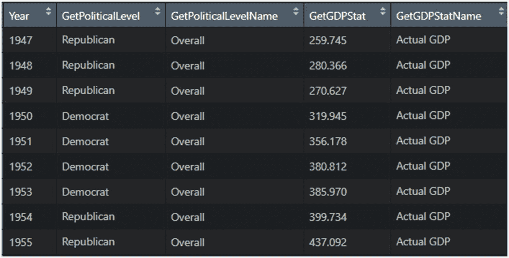

图 2-18 `dfPI` 数据框预览

你需要使用上述数据创建一个数据集，该数据集包含每个连续政党执政期的开始时间和结束时间。你需要获取上述数据框，并编写代码将其转换为图 2-19 中的数据框格式。


图 2-19 所需的数据框格式

为了实现这种转换，你需要能够唯一标识每个连续的政党执政期。目前，每个政党执政期没有唯一的标识符，因此你需要添加一个。一旦添加完成，你就可以使用传统的聚合方法来获取每个执政期的开始和结束年份。让我们先来了解一下添加唯一标识符（你将其命名为 `group_id`）所需的步骤。生成 `group_id` 信息的代码如下所示：

```
dfPI$GetPoliticalLevel <- as.character(dfPI$GetPoliticalLevel)
runs <- rle(dfPI$GetPoliticalLevel)
group_id <- rep(seq_along(runs$lengths), runs$lengths)
```

第 1 行首先进行的是数据类型转换。在 R 语言中，对于 R 4.0 之前的版本，包含字符串的数据框列的默认数据类型是 `factor`（因子）。

在撰写本书时，Power BI 服务尚未更新到 R 4.0 版本。如果你在练习时仍处于这种情况，那么你也需要进行转换。如果 Power BI 服务已更新到 R 4.0 或更高版本，则无需执行转换步骤。

由于 `GetPoliticalLevel` 列中的数据都是字符串，R 语言已将其转换为 `factor` 数据类型。为了执行此步骤所需的数据处理，你需要将 `GetPoliticalLevel` 转换为字符数据类型。该数据类型与 DAX 中的 `Text` 数据类型类似。这通过第一行代码完成。接下来，你要使用基础 R 中的 `rle()` 函数来定义 `GetPoliticalLevel` 列中的分组。`rle()` 函数中的 “rle” 代表游程编码。当你将 `GetPoliticalLevel` 列传递给 `rle()` 函数时，会得到如图 2-20 所示的输出结果。

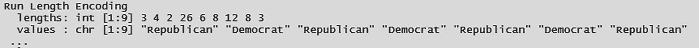

图 2-20 `rle()` 函数的输出结果

`rle()` 函数返回了一个包含两个向量的列表。第一个向量名为 `lengths`，在此示例中，它包含每个执政期的长度。第二个向量名为 `values`，在此示例中，它包含每个执政期执政的政党。`rle()` 函数返回的信息保存在 `runs` 变量中。

`runs` 变量中包含的信息用于通过以下代码创建 `group_id` 向量：

```
group_id <- rep(seq_along(runs$lengths), runs$lengths)
```

首先，使用 `seq_along()` 函数生成一个整数序列，该序列将代表 `group_id`。由于 `runs$length` 的长度为 9，因此将返回一个包含数字 1 到 9 的整数向量。该表达式作为第一个参数放入 `rep()` 函数中，而向量 `runs$length` 作为第二个参数放入。由于两个参数都包含长度相同的向量，`rep` 函数将取 `seq_along()` 函数生成的第一个元素（在本例中为数字 1），并按照第二个整数向量中表示的次数（在本例中为 3）重复它。因此，数字 1 将被重复三次。接下来，数字 2 将被重复四次，因为 `runs$lengths` 中第二个元素的值为 4。此逻辑对 `runs$lengths` 中的每个元素重复执行，最终输出结果如图 2-21 所示。

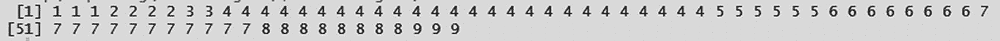

图 2-21 `group_id` 变量的输出结果

接下来，你使用以下代码创建用于可视化的数据集：

```
dfShadeInfo <- cbind(dfPI, group_id) %>%
  transmute(group_id, Year, Party = GetPoliticalLevel) %>%
  group_by(group_id, Party) %>%
  summarize(start = min(Year), end = max(Year)+0.99) %>%
  ungroup()
```

上述代码首先使用 `cbind()` 函数将 `group_id` 向量作为新列追加到 `dfPI` 数据框中，其中 `cbind()` 中的 `c` 代表列（column）。接下来，使用管道操作符 `%>%` 将生成的数据框作为第一个参数传递给下一行的 `transmute()` 函数。

`transmute()` 动词类似于 `dplyr` 中的 `mutate()` 动词，用于投影新列，但 `transmute()` 函数的不同之处在于，它创建的数据框仅基于函数中定义的列。

上述 `transmute()` 动词将生成一个包含三列的数据框，分别名为 `group_id`、`Year` 和 `Party`。图 2-22 展示了前九行的预览，以显示上述代码中使用 `transmute()` 动词的结果。

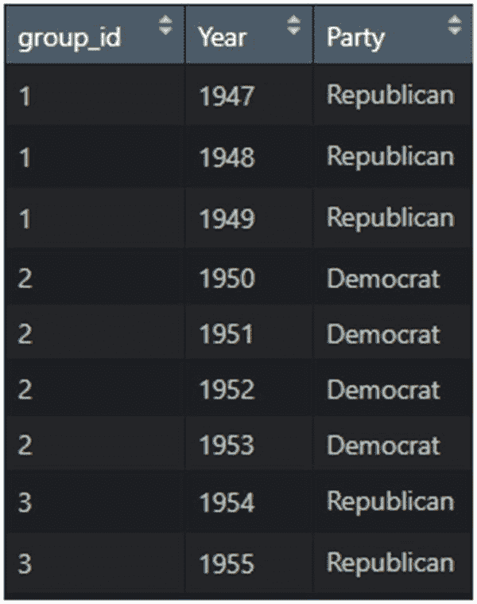

图 2-22 使用 `transmute()` 动词的结果

请注意，现在每个执政期都有了唯一的标识符！现在你可以使用传统的聚合函数来获取每个执政期的开始和结束时间。再次使用管道操作符将 `transmute()` 动词创建的数据框作为第一个参数传递给下一行的 `group_by()` 动词。`group_by()` 动词将根据 `group_id` 和 `Party` 列对传递给它的数据框进行分组。`group_by()` 的结果将作为第一个参数传递给下一行的 `summarize()` 动词。`summarize()` 动词允许你根据分组对数据集应用聚合函数。因此，你可以创建一个名为 `start` 的列，表示基于分组中最小年份的政党执政期开始时间；还可以创建一个名为 `end` 的列，表示基于分组中最大年份的政党执政期结束时间。将值 0.99 添加到 `end` 列，以最小化旧执政期结束与新执政期开始之间的间隙。

### 步骤 12：创建折线图所需的数据集

用于创建折线图数据集的代码如下：

```
dfLineChartInfo <- dfPI %>%
  transmute(Year, GetGDPStat)
```

目标是开发一个折线图，显示所选 GDP 统计量按年份的变化，其时间跨度覆盖整个数据集。为此，我们需要为数据集提供两列数据，即 `Year` 和 `GetGDPStat`。你可以通过使用 `transmute()` 函数从 `dfPI` 数据框中提取这些列来创建所需的数据集。

### 步骤 13：创建一个用于为阴影区域着色的命名字符向量

```
partyColors = c("Republican"="red", "Democrat"="blue",
"Tie" = "white")
```

共和党的颜色是红色，民主党的颜色是蓝色。你可以通过命名字符向量 `partyColors` 强制可视化工具为各党派使用这些颜色。`partyColors` 命名字符向量将在脚本后续部分被使用，以强制可视化工具在共和党执政期间将背景渲染为红色，在民主党执政期间将背景渲染为蓝色。

### 步骤 14：通过定义 ggplot 函数开始创建图表

前面的步骤专注于数据准备。这些数据准备步骤展示了 Power BI 中 R 可视化的一项优秀特性。如果传递给可视化工具的数据集格式不正确，你可以使用 R 来重塑数据集，使其达到所需格式。

在此步骤中，你将通过以下代码设置 `ggplot()` 函数来开始创建图表：

```
p <- ggplot()
```

你可能已经注意到，你是在不传递任何参数的情况下，通过 `ggplot()` 函数来初始化图表的。你这样做的原因是你的图表将包含两个图层，每个图层都有独立的数据源和美学映射，因此它们将在图层级别进行设置。

### 步骤 15：添加图层以创建背景阴影

这通过以下代码实现：

```
geom_rect(
data = dfShadeInfo,
aes(xmin = start, xmax = end, fill = Party),
ymin = -Inf, ymax = Inf, alpha = 0.4, color = NA
)
```

该图层的数据源是 `dfShadeInfo` 数据框。图 2-23 展示了当选择*总体*政治观点时的效果。

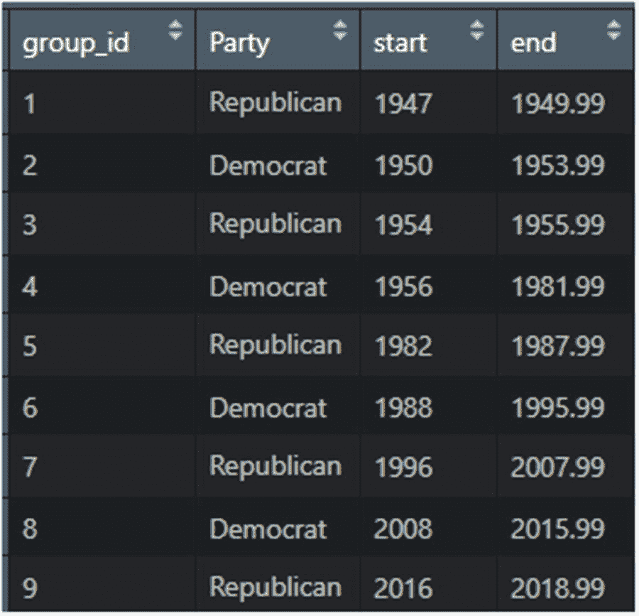

图 2-23 `dfShadeInfo` 数据框

上图显示了九个政治统治时期，因此 `geom_rect()` 函数将使用上述数据框，根据每个政治统治时期执政党的颜色来为背景着色。每个政治统治时期的起点和终点通过在 `aes()` 函数中将 `start` 列设置为 `xmin` 参数，并将 `end` 列设置为 `xmax` 参数来定义。上边界通过将 `ymax` 参数设置为 `Inf` 来定义，下边界通过将 `ymin` 设置为 `-Inf` 来定义。使用无穷大作为上下边界可确保阴影区域在垂直方向上填满。每个统治时期都会绘制阴影，最终结果如图 2-24 所示的带阴影背景。

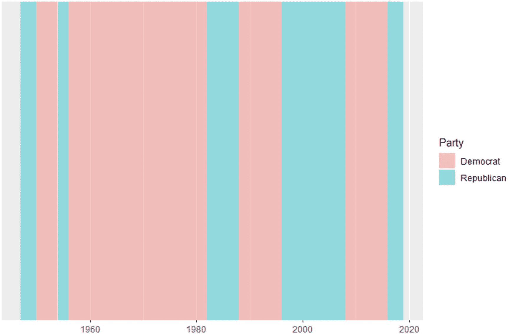

图 2-24 由 `geom_rect()` 几何对象生成的背景阴影

请注意，阴影区域与每个统治时期的时间段相对应。各党派使用的颜色将在脚本后续部分进行更改。

### 步骤 16：根据所选统计指标添加折线图

以下代码用于创建可视化的折线图层：

```
geom_line(data = dfLineChartInfo, aes(x = Year, y = GetGDPStat))
```

`geom_line()` 几何对象用于创建折线图。它所基于的数据框是 `dfLineChartInfo` 数据框，该数据框中用于 x 轴的列是 `Year` 列，用于 y 轴的列是 `GetGDPStat` 列。

### 步骤 17：使用基于党派的预定义颜色重新为背景着色

这通过以下代码完成：

```
scale_fill_manual(values=partyColors)
```

`scale_fill_manual()` 函数可用于覆盖 `ggplot2` 使用的默认颜色。之前，你在 `partyColors` 命名字符向量中定义了要为每个党派使用的颜色。通过将 `values` 参数设置为 `partyColors` 变量，`ggplot2` 将使用 `partyColors` 中指定的颜色为背景着色。

## 步骤 18：根据所选统计指标格式化 y 轴

接下来，你根据所选的 GDP 统计指标，使用以下代码格式化 y 轴：

```r
scale_y_continuous(labels=
ifelse(gdpStatName == "ActualGDP",
comma_format(),
percent_format()
)
) +
```

如果选择返回实际 GDP，则 y 轴将使用 `comma_format()` 进行格式化，因为 `ActualGDP` 需要格式化为数字。否则，y 轴将使用 `percent_format()` 格式化为百分比，因为图表将显示 GDP 的百分比变化。`comma_format()` 和 `percent_format()` 函数都来自 `scales` 包。

## 步骤 19：为 x 轴和 y 轴添加标签

以下代码为 y 轴添加动态创建的标签，为 x 轴添加固定标签：

```r
ylab(yAxisName) +
xlab("Year")
```

## 步骤 20：为自定义 R 可视化添加动态标题和说明文字

`ggtitle()` 函数用于通过以下代码动态创建图表标题和副标题：

```r
ggtitle(chartTitle, subtitle = chartSubtitle)
```

## 步骤 21：应用基于《经济学人》出版物的主题

由于你正在可视化经济数据，你将使用 `ggthemes` 包中的 `theme_economist()` 主题来格式化你的可视化。`theme_economist()` 主题使用了《经济学人》出版物所使用的格式化规则。你通过将这行代码添加到脚本中来将 `theme_economist()` 主题应用于你的可视化：

```r
theme_economist()
```

## 步骤 22：将代码添加到 Power BI

本练习中生成可视化的完整脚本列在代码清单 2-5 中。该脚本是功能完整的，因此你可以将其复制并粘贴到 Power BI 中。请确保将其粘贴到 Power BI `R 脚本编辑器` 中注释部分之后。

```r
library(tidyverse)
library(ggthemes)
library(scales)
currentColumns % 
transmute(group_id, Year, Party = GetPoliticalLevel) %>%
group_by(group_id, Party) %>%
summarize(start = min(Year), end = max(Year)+0.99) %>%
ungroup()
#创建折线图层的数据集
dfLineChartInfo % 
transmute(Year, GetGDPStat)
#定义阴影颜色
partyColors = c("Republican"="red", "Democrat"="blue", "Tie" = "white")
#创建可视化
p <- ggplot() +
geom_rect(
data = dfShadeInfo,
aes(xmin = start, xmax = end, fill = Party),
ymin = -Inf, ymax = Inf, alpha = 0.4, color = NA
) +
geom_line(data = dfLineChartInfo, aes(x = Year, y = GetGDPStat)) +
scale_fill_manual(values=partyColors) +
scale_y_continuous(
labels=ifelse(gdpStatName == "Actual GDP", comma_format(),percent_format())
) +
ylab(yAxisName) +
xlab("Year") +
ggtitle(chartTitle, subtitle = chartSubtitle) +
theme_economist()
p
} else {
plot.new()
title("提供的数据不符合图表的要求。")
}
```

代码清单 2-5：生成带阴影折线图的 R 脚本