# 地图

近年来，`空间分析`变得越来越重要。在商业领域，一种流行的空间分析形式是`基于地理的空间分析`。Power BI 提供了内置的地图功能，在大多数情况下都能很好地工作。但在这个示例中，我将展示如何使用 R 来构建自定义地图。您将绘制的可视化效果是一张`州热力图`，它根据该县所在的人口五分位数对州内的县进行着色。颜色越深，表示该县人口越多。图 2-25 是选择印第安纳州时您将创建的可视化效果示例。

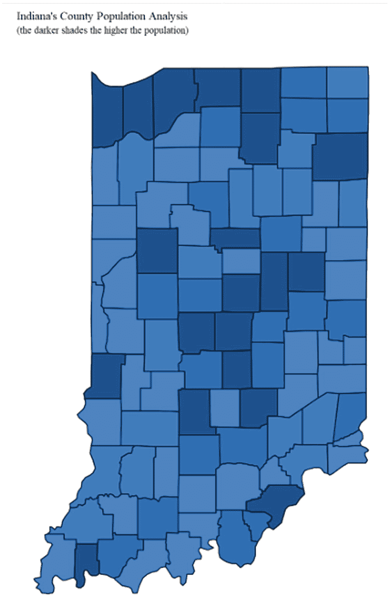

图 2-25 选择印第安纳州时使用 `ggplot2` 生成的地图可视化效果

该可视化效果是使用一个包含定义美国本土各县边界坐标的数据集创建的。当选择一个州时，`ggplot2` 会使用这些地理坐标来绘制地图。各县填充了不同深浅的蓝色，人口较多的县颜色较深，人口较少的县颜色较浅。您可以利用 Power BI 的交互功能轻松地在各州之间切换。如果将切片器从印第安纳州更改为肯塔基州，则会显示下图 2-26 中的可视化效果。

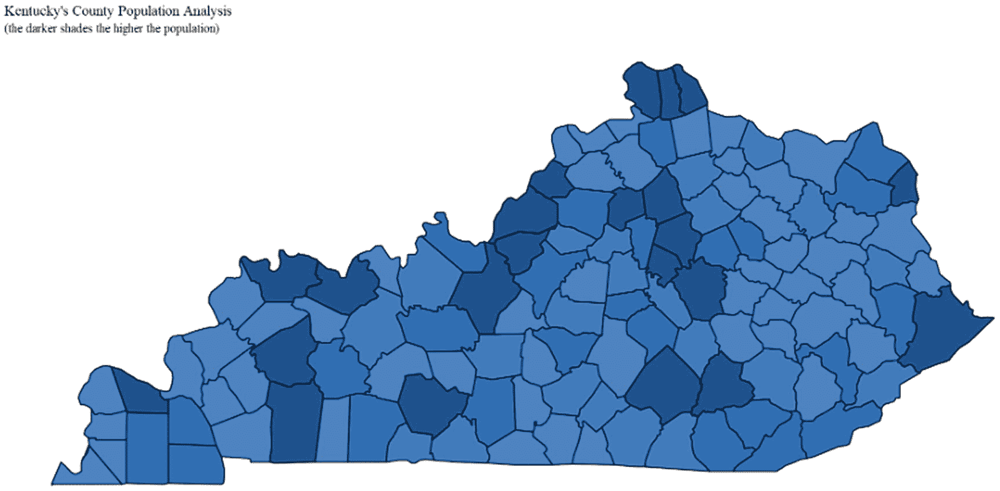

图 2-26 选择肯塔基州时使用 `ggplot2` 生成的地图可视化效果

这种可视化效果的一个出色特性是，它将地理范围限制在所选的地理区域。因此，它不会在其他地理区域上浪费宝贵的图表空间。许多地图可视化效果除了关注的地理区域外，通常还会包含其他地理区域。此外，由于它是使用 `ggplot2` 创建的，因此您可以添加其他动态功能，例如动态`图表标题`、动态`图表副标题`和动态`图表说明`。让我们来看看创建这个令人惊叹的可视化效果所需的步骤！

## 步骤 1：获取必要的数据

1. 获取一个数据集，其中列出各州的完整名称和缩写名称。所使用的数据集来自 [`https://en.wikipedia.org/wiki/List_of_U.S._state_abbreviations`](https://en.wikipedia.org/wiki/List_of_U.S._state_abbreviations)，可以在 *DataWrangling.xlsx* 工作簿的 *Abbreviations* 选项卡中找到。
2. 构建一个包含可视化效果所需的县信息的数据集。用于创建该数据集的信息来自 [`www.nrcs.usda.gov/wps/portal/nrcs/detail/national/home/?cid=nrcs143_013697`](http://www.nrcs.usda.gov/wps/portal/nrcs/detail/national/home/%253Fcid%253Dnrcs143_013697)，可以在 *DataWrangling.xlsx* 工作簿的 *County FIPS Codes* 选项卡中找到。
3. 从人口普查局获取一个按县列出人口的数据集。该数据集可以在 *DataWrangling.xlsx* 工作簿的 *PopulationInfo* 选项卡中找到，同时还有用于获取该数据集的 Python 脚本。
4. 创建一个包含缺失的 `FIPS 代码` 的数据集。一些缺失的 `FIPS 代码` 是由于映射问题造成的，另一些则是因为它们不在 `County FIPS Codes` 数据集中。该数据集将用于纠正此问题。它可以在 *DataWrangling.xlsx* 工作簿的 *TheMissingInfo* 工作表中找到。
5. 从 `ggplot2` 包中获取一个包含美国本土各县边界信息的数据集。该信息存储在 *DataWrangling.xlsx* 工作簿的 *Map Info* 选项卡中，以下是用于获取该数据集的代码：

    ```r
    library(tidyverse)
    us_counties ”
    write_csv(us_counties, path)
    ```

6. 使用 *Power Query* 将前面数据集中的信息合并成可视化所需的形式。该数据集可以在 *DataWrangling.xlsx* 工作簿的 *ChartData* 选项卡中找到。用于创建该数据集的查询也名为 *ChartData*，您可以查看该查询以了解创建数据集所用的步骤。这是 Power BI 将用于创建 R 可视化效果的数据集。
7. 将数据保存到工作簿的 *ChartData* 选项卡中。该数据也保存到了一个名为 `chartdata.csv` 的 `csv` 文件中。

与大多数可视化项目和一般的数据科学项目一样，项目中最耗时的部分通常是获取、清理和整理数据。在本练习中，我为您完成了这些艰巨的工作，以便您可以专注于数据可视化方面。您可以查看本练习的代码仓库中的材料，了解我整理数据所采取的步骤。对于有 R 和/或 Python 背景的人来说，这样做是熟悉 *Power Query* 的好方法。

## 步骤 2：将数据加载到 Power BI 中

您需要将 `chartdata.csv` 文件导入 Power BI，然后在将其加载到数据模型之前对数据集进行一些小的调整。您可以参考此示例的 `pbix` 文件来查看这些转换。

## 步骤 3：在筛选器窗格中基于州创建切片器

首先将 `State` 列拖到报表画布上，基于 `State` 列创建一个切片器。完成此操作后，您需要将可视化类型更改为`切片器`可视化，从而将该可视化效果更改为切片器。*切片器*是其图标中包含漏斗图像的可视化效果。

## 步骤 4：配置 R 可视化效果

转到可视化效果窗格，将一个 R 可视化效果拖到报表画布上。将可视化效果调整到所需大小。将 `chartdata` 表中的 `index`、`lat`、`long`、`County`、`Total Population` 和 `State` 字段拖放到*字段*窗格中。如果字段窗格未显示，请选择 R 可视化效果，它应该会出现。

## 步骤 5：将数据导出到 R Studio 进行开发

单击 *R 脚本编辑器* 标题栏上的 45° 箭头。此操作会将传递给 R 的数据框和 R 起始代码导出到 *R Studio*。如果您需要更详细的说明，请参考“标注图”部分中的步骤 4。

## 步骤 6：加载所需的包

此脚本将使用的包如下所示：

```r
library(tidyverse)
library(ggthemes)
```

来自 `tidyverse` 的 `dplyr` 包将用于一些数据整理，来自 `tidyverse` 的 `stringr` 包用于重新格式化一些标题，来自 `tidyverse` 的 `ggplot2` 包将用于创建地图可视化效果。来自 `ggthemes` 包的 `theme_map()` 主题将用于格式化地图可视化效果的非数据元素。

## 步骤 7：创建数据验证测试所需的变量

以下是创建验证测试变量的代码：

```r
currentColumns <- sort(colnames(dataset))
requiredColumns <- c("County", "Index", "lat", "long", "State", "Total Population")
columnTest <- isTRUE(all.equal(currentColumns, requiredColumns))
state <- str_to_title(unique(dataset$State))
```

第一行从传递给 R 的数据集中获取列名，并按字母顺序排序，然后将结果放入 `currentColumns` 字符向量变量中。第二行创建一个字符向量，其中包含可视化效果期望的列名（按字母顺序），并将其分配给名为 `requiredColumns` 的字符向量。第三行执行一个测试，将 `currentColumns` 字符向量中的列名与 `requiredColumns` 字符向量中的列名进行比较。如果它们匹配，则返回 `TRUE`；否则，返回 `FALSE`。第四行获取 `dataset` 数据框的 `State` 列中的所有唯一元素，并使用 `stringr` 包中的 `str_to_title()` 函数将州名转换为正确的名称格式。

## 步骤 8：创建数据验证测试

数据验证的框架如下：

```r
if (length(state) == 1 & columnTest) {

} else {
plot.new()
title("提供的数据不符合图表要求。")
}
```

可视化的源数据框只需包含一个州，并且需要包含所需的列。上述 `if` 语句用于测试数据框中是否只有一个州，以及数据框是否通过了列测试。如果两个条件都满足，则继续执行创建地图可视化的代码；否则，将生成一个空白可视化，并附带一条消息，告知您 R 没有足够的信息，无法创建可视化。

## 步骤 9：创建图表标题变量

以下是创建图表标题所需的代码：

```r
chartTitle <- paste0(state, "的县人口分析")
subTitle <- "(颜色越深，人口越多)"
```

主图表标题通过将所选州与字符串 `"的县人口分析"` 拼接而成，并赋值给 `chartTitle` 变量。字符串 `"(颜色越深，人口越多)"` 用作副标题，并赋值给 `subTitle` 变量。

## 步骤 10：向数据集添加五分位数列

如果您还记得，此可视化的目标是根据人口数量将每个州的县按五分位数分组。您可以使用 `dplyr` 中的 `ntile()` 函数将州内的县按五分位数分组，如下列代码所示：

```r
chartdata <- dataset %>%
mutate(quintile = factor(ntile(`总人口`, 5)))
```

该代码从 `dataset` 数据框开始，创建一个名为 `chartdata` 的新数据框，然后使用 `dplyr` 的管道操作符将其作为第一个参数传递给下一行的 `mutate()` 动词。`mutate()` 动词用于投影一个名为 `quintile` 的新列，该列将使用 `ntile()` 函数创建。`ntile()` 函数被包裹在 `factor` 函数中，以将五分位数转换为因子数据类型。此操作的效果类似于 Power BI 中的 *不汇总*。将五分位数转换为因子后，它们将被视为分类数据，而非数值数据。

## 步骤 11：定义用于地图着色的颜色

您将使用不同深浅的蓝色来为所选州的县着色。您将使用以下命名字符向量中列出的五种不同深浅的蓝色：

```r
quintileColors <-
c(
"1" = "dodgerblue",
"2" = "dodgerblue1",
"3" = "dodgerblue2",
"4" = "dodgerblue3",
"5" = "dodgerblue4"
)
```

为 `五分位数 1` 列出的 `dodgerblue` 是列表中最浅的蓝色，而为 `五分位数 5` 列出的 `dodgerblue4` 是最深的蓝色。这里，您使用颜色名称而非十六进制值来定义它们。请访问以下网站，了解 `ggplot2` 中可用的更多颜色：[`www.stat.columbia.edu/~tzheng/files/Rcolor.pdf`](http://www.stat.columbia.edu/%257Etzheng/files/Rcolor.pdf)。您将看到可用于引用特定颜色的可用名称。

## 步骤 12：定义 `ggplot()` 函数

首先，使用以下代码定义 `ggplot()` 函数：

```r
ggplot(chartdata, aes(long, lat, group = County,
fill = quintile))
```

您使用 `chartdata` 数据框作为图表的数据源。接下来，您配置 `aes()` 函数，将 `long` 列设置为 `x` 坐标，将 `lat` 列设置为 `y` 坐标，将 `County` 设置为 `group` 美学映射，将 `quintile` 设置为 `fill` 美学映射。这是我们第一次使用 `group` 美学映射，因为在此示例之前，我们一直使用的是*单个几何对象*，而 `geom_polygon()` 几何对象被称为*集合几何对象*。

*单个* 几何对象仅依赖于一行数据，但 *集合* 几何对象依赖于多行数据。此示例将使用 `geom_polygon()` 几何对象，它是一个 *集合* 几何对象，并将使用多行数据来定义将要创建的多边形可视化的边界。

此示例中的 `geom_polygon()` 使用数据集中每个 `group`（在此示例中为数据集中的 `County`）的纬度和经度点绘制多边形。`fill` 属性用于告诉 `ggplot2` 您希望如何为每个县的内部着色。在这里，您将根据每个县所在的五分位数为其内部着色。

您能够使用*笛卡尔坐标系*（在此示例中，是基于 x 轴和 y 轴的坐标系）来表示您的空间数据，因为您查看的是地球上一个相对较小的区域。尽管地球是球体形状，但当您查看一个相对较小的地理区域时，您可以使用与分析平面相同的技术来分析它，并获得相对较好的结果。

## 步骤 13：添加地图图层

以下是添加地图图层的代码：

```r
geom_polygon(show.legend = FALSE, color = "black")
```

您已经在 `ggplot()` 函数中定义了地图所需的美学映射。它们将延续到 `geom_polygon()` 几何对象，因为在 `ggplot()` 函数中定义的任何内容都可用于所有后续图层。此可视化中不需要图例，因此您将 `show.legend` 参数设置为 `FALSE`。您希望边框颜色为黑色。通过将 `color` 参数设置为 `black` 来使其变为黑色。

请注意，当您想要将图表属性设置为特定颜色时，需要在不使用 `aes()` 函数的情况下进行。原因已在第 1 章中详细解释。

## 步骤 14：格式化 x 轴和 y 轴

以下代码用于重新格式化 `x` 轴和 `y` 轴：

```r
scale_x_continuous(name = NULL, labels = NULL, breaks = NULL) +
scale_y_continuous(name = NULL, labels = NULL, breaks = NULL)
```

您通过将名称、标签和刻度标记设置为 `NULL` 来移除它们。这样做是因为您正在可视化地图，不需要这些信息。

## 步骤 15：根据五分位数对县进行着色

以下代码将用于对县进行着色：

```r
scale_fill_manual(values = quintileColors)
```

`ggplot2` 包具有很好的默认设置，这也是该包如此出色的原因之一。更棒的是，您可以轻松覆盖这些默认设置。如果使用 `ggplot2` 的默认设置，地图将如图 2-27 所示进行着色。

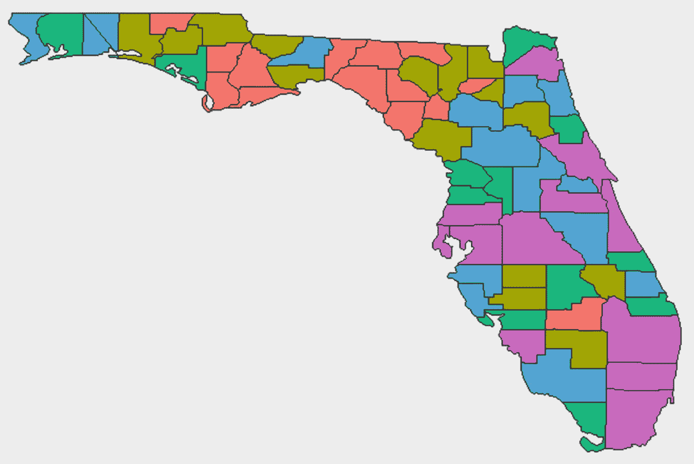

图 2-27 选择佛罗里达州时，使用默认颜色生成的地图可视化

图 2-28 是您通过 `scale_fill_manual()` 函数使用自定义颜色后地图的外观。

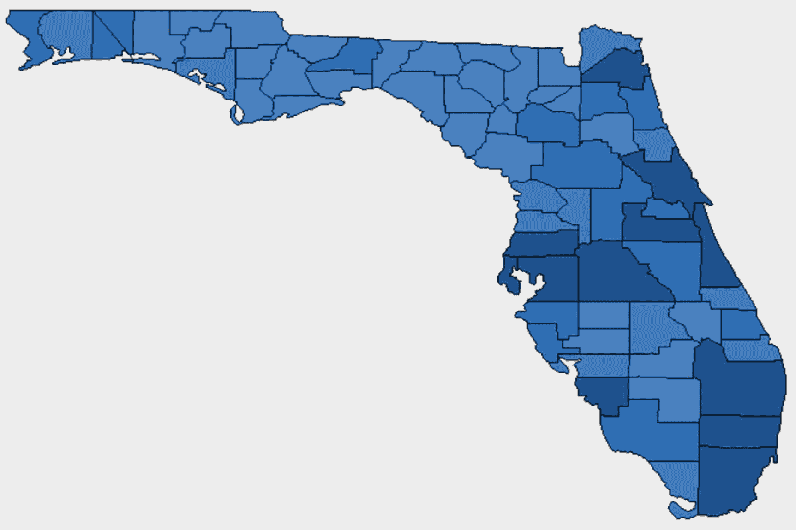

图 2-28 选择佛罗里达州时，使用自定义颜色生成的地图可视化

第二个版本使报告用户能够根据颜色深浅轻松判断哪些县人口较少，哪些县人口较多。

## 步骤 16：改进所选州的近似显示

以下代码用于基于*墨卡托地图*投影进行快速宽高比近似：

```r
coord_quickmap()
```

`geom_polygon()` 在创建地图方面做得很好，但使用上述代码可以快速使地图显示得更精确一些。

## 步骤 17：为自定义 R 视觉对象添加动态标题和说明文字

以下代码使用 `ggtitle()` 函数以及存储图表标题和副标题信息的变量来添加动态标题：

```r
ggtitle(chartTitle, subtitle = subTitle)
```

## 步骤 18：应用 `theme_map()` 主题

您可以使用 `ggthemes` 包中的 `theme_map()` 主题来进一步增强地图的视觉吸引力。

### 步骤 19：将代码添加到 Power BI

完整的脚本见代码清单 2-6。将其复制并粘贴到 Power BI 的 `R 脚本编辑器` 中。该 R 视觉对象将完全响应 Power BI 报表中的 `state` 切片器。

```r
library(tidyverse)
library(ggthemes)
currentColumns <- chartdata %>%
  mutate(quintile = factor(ntile(`Total Population`, 5)))
quintileColors <-
  c(
    "1" = "dodgerblue",
    "2" = "dodgerblue1",
    "3" = "dodgerblue2",
    "4" = "dodgerblue3",
    "5" = "dodgerblue4"
  )
ggplot(chartdata, aes(long, lat, group = County,
                      fill = quintile)) +
  geom_polygon(show.legend = FALSE, color = "black") +
  scale_x_continuous(name=NULL, labels=NULL, breaks=NULL) +
  scale_y_continuous(name=NULL, labels=NULL, breaks=NULL) +
  scale_fill_manual(values = quintileColors) +
  coord_quickmap() +
  ggtitle(chartTitle, subtitle = subTitle) +
  theme_map()
} else {
  plot.new()
  title("提供的数据不符合图表要求。")
}
```

代码清单 2-6：生成地图图表的 R 脚本

## 四象限图

作为 Microsoft 数据专业人士，您一定很熟悉 Gartner 生成的图 2-29 中的视觉对象。

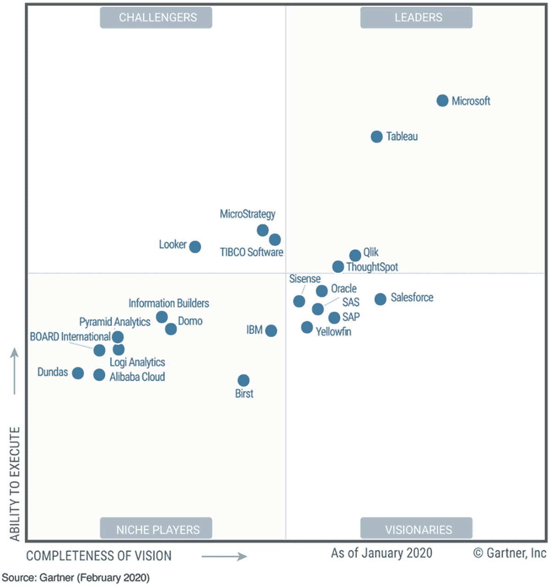

图 2-29：2020 年 Gartner 魔力象限图

Microsoft 在 `商业智能` 领域相比竞争对手表现出色，Gartner 也对此予以认可。Microsoft 一直使用像 `Gartner 魔力象限图` 这样的行业对比来宣传其在行业中的地位。

Gartner 使用的视觉对象——`四象限图`，在基于两个指标比较不同实体时非常有效。在此案例中，Gartner 根据各 BI 供应商的 `执行能力` 和 `愿景完整性` 进行比较。Gartner 通过添加一些细节使图表更具视觉吸引力。其中一些细节包括：

-   为象限添加标签
-   为象限 2 和 3 添加背景阴影
-   为 x 轴和 y 轴使用非传统标签
-   添加图表说明文字

在 Power BI 中创建这些细微之处并不容易，但在 R 中使用 `ggplot2` 则很简单。

在本节中，我将使用基于 2008-2009 赛季洛杉矶湖人队“逐回合”数据的数据集来说明我的观点。这些信息将用于创建图 2-30 中的四象限图，该图根据 `总得分` 和 `总篮板数` 对球员进行比较。

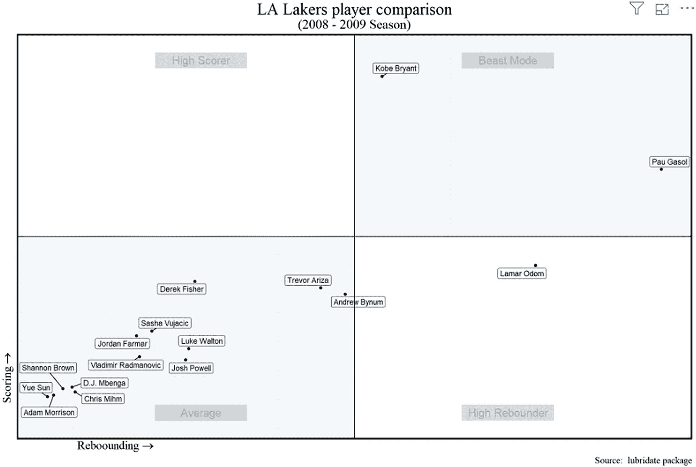

图 2-30：基于篮板和得分比较洛杉矶湖人队球员的四象限图

与之前的可视化类似，您将利用 Power BI 的交互功能，为视觉对象添加切片器，以便查看不同场景下的情况。将有一个用于比赛类型（主场或客场）的筛选器，以及一个用于比赛时段的筛选器。图 2-31 中的视觉对象显示了仅考虑客场比赛时的比较情况。

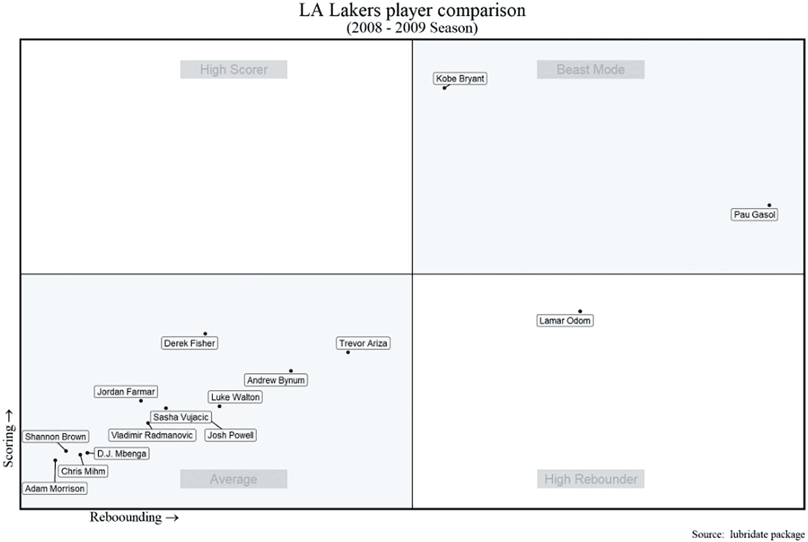

图 2-31：基于客场比赛的四象限图

让我们来看看创建这个精美可视化所需的步骤！

### 步骤 1：获取必要的数据

本例中使用的数据集来自 R 中的 `lubridate` 包。获取该数据集的代码如下：

```r
library(tidyverse)
library(lubridate)
chartData <- playbyplay %>%
  filter(
    (player != "" & team == "LAL" &
       result == "made" &
       etype %in% c("shot","free throw")
    ) |
      (player != "" &
         team == "LAL" &
         etype == "rebound")
  ) %>%
  mutate(
    rebound = ifelse(etype == "rebound",1,0)
  ) %>%
  group_by(game_type, period, player) %>%
  summarize(
    `Total Points` = sum(points),
    Rebounds = sum(rebound)
  ) %>%
  rename(
    `Game Type` = game_type,
    Period = period,
    Player = player
  )
path <- "lakers.csv"
write_csv(chartdata, path)
```

输出结果保存为一个 `csv` 文件，因为这种格式便于 Power BI 使用。如果您不理解上述代码，请不要担心，您将在本书后面学习到所使用的技术。现在，您只需知道，如果需要重新创建此可视化中使用的数据集，可以通过运行上述 R 脚本来实现。

### 步骤 2：将数据加载到 Power BI

使用 `获取数据` 从步骤 1 创建的 `csv` 文件中将数据加载到 Power BI。加载后，每个列的数据类型应如下表所示：

| 列名 | 数据类型 |
| --- | --- |
| 比赛类型 | 文本 |
| 时段 | 整数 |
| 球员 | 文本 |
| 总得分 | 整数 |
| 篮板 | 整数 |

该文件已加载到代码仓库中本例文件夹内的 `pbix` 文件中。您可以查看 Power Query 步骤以了解应用了哪些转换。

### 步骤 3：为比赛类型和时段创建切片器

基于 `比赛类型` 字段创建报表切片器：首先将 `比赛类型` 字段拖到报表画布上，然后在 `可视化` 窗格中选择 `切片器` 视觉对象。在将 `切片器` 视觉对象转换为切片器之前，请确保添加到画布上的字段处于高亮状态。切片器视觉对象是图像中包含筛选器图标的那个。对 `时段` 字段执行相同操作。

### 步骤 4：在报表画布上配置 R 视觉对象

转到可视化窗格，将 R 视觉对象拖到报表画布上。将视觉对象调整到所需大小。将 `chartData` 表中的 `球员`、`篮板` 和 `总得分` 字段拖到 `字段` 窗格中。如果 `字段` 窗格未显示，请选择 R 视觉对象，它应该会显示出来。

### 步骤 5：将数据导出到 R Studio 进行开发

单击 `R 脚本编辑器` 标题栏上的 45 度箭头。此操作会将传递给 R 的数据框以及 R 起始代码导出到 `R Studio`。如果需要更详细的说明，请参阅“标注图”部分中的步骤 4。

### 步骤 6：加载所需的包

此脚本所需的包如下：

```r
library(tidyverse)
library(ggrepel)
library(ggthemes)
library(scales)
```

`tidyverse` 中的 `dplyr` 包用于执行一些数据整理任务，`tidyverse` 中的 `ggplot2` 用于创建可视化，`ggrepel` 包用于向可视化中的数据点添加标签，`ggthemes` 包中的 `theme_tufte()` 主题用于格式化视觉对象的非数据元素，`scales` 包中的 `rescale()` 函数用于重新缩放部分数据。

### 第 7 步：创建数据验证测试所需的变量

验证测试所需的变量通过以下代码定义：

```r
currentColumns <- sort(colnames(dataset))
requiredColumns <- c("Player", "Rebounds", "Total Points")
columnTest <- isTRUE(all.equal(currentColumns, requiredColumns))
noPlayerDups <-
length(unique(dataset$Player)) == length(dataset$Player)
```

以下是对上述代码片段中每一行作用的说明：

-   第一行代码基于 `dataset` 数据框的列名创建了一个名为 `currentColumns` 的字符向量变量，这些列名按字母顺序排序。
-   第二行代码创建了一个名为 `requiredColumns` 的字符向量变量，其中包含四象限图所需的列，并按字母顺序排列。
-   第三行代码使用基础 R 语言中的 `all.equal()` 函数来测试 `currentColumns` 变量和 `requiredColumns` 变量是否等价。如果它们相等，则 `all.equal()` 返回 `TRUE`；否则，它会返回关于为何不相等的信息。我们使用 `isTRUE()` 包裹 `all.equal()` 以获取布尔值响应。
-   第四行代码（由于格式原因实际为两行）使用 `noPlayerDups` 变量来保存检查数据集中是否存在重复球员的测试结果。它通过比较 `Players` 列中唯一元素的数量与 `Players` 列的长度来实现。如果两者相等，则说明没有重复的球员。

### 第 8 步：创建数据验证测试

验证测试的模板如下所示：

```r
if (noPlayerDups & columnTest) {

} else {
plot.new()
title("The data supplied did not meet the requirements of the
chart.")
}
```

验证测试执行两个测试：`noPlayerDups` 测试和 `columnTest` 测试。如果两个测试结果都为 `TRUE`，则执行创建图表的代码。否则，会创建一个空白图表，并显示关于 `ggplot2` 为何无法创建图表的信息。

### 第 9 步：创建图表标题

本例中，图表标题、副标题和说明文字均使用静态字符串。它们通过以下代码定义：

```r
chart.title <- "LA Lakers player comparison"
chartsubtitle <- "(2008 - 2009 Season)"
chart_source <- "Source:  lubridate package"
```

### 第 10 步：向数据集添加额外列

您正在创建一个四象限图，用于根据篮板和得分比较洛杉矶湖人队的篮球运动员。篮板和得分处于两个不同的量级，因为得分的可能取值范围远高于篮板。四象限图要求它们处于同一量级。这一步通过以下代码实现：

```r
graph_data %>%
mutate(
Scaled.Rebounds =
round(rescale(Rebounds, to = c(-10, 10)), 1)
,Scaled.TotalPoints =
round(rescale(`Total Points`, to = c(-10, 10)), 1)
)
```

在这一步中，使用 `mutate` 动词向数据框添加了两个新列：`Scaled.Rebounds` 和 `Scaled.TotalPoints`。这两列使用 `scales` 包中的 `rescale()` 函数将它们都缩放到 -10 到 +10 之间。这些新列将在可视化中用于表示每位球员的篮板和总得分。

### 第 11 步：通过定义 ggplot 函数开始创建图表

以下代码用于定义 `ggplot()` 函数：

```r
p <- ggplot(graph_data,
aes(x = Scaled.Rebounds, y = Scaled.TotalPoints)
)
```

此可视化中使用的数据集是 `graph_data` 数据框，并且在 `ggplot()` 函数中仅定义了两个美学映射，即 `x` 和 `y` 美学映射。

### 第 12 步：使用 geom_point() 几何对象在图表上绘制球员点

接下来，您向图表添加点来表示球员。点的位置基于给定球员的篮板数和总得分的缩放版本。这通过向代码添加 `geom_point()` 几何对象来实现，如下所示：

```r
p <- ggplot(
graph_data,
aes(x = Scaled.Rebounds, y = Scaled.TotalPoints)
) +
geom_point()
```

`geom_point()` 几何对象继承了 `ggplot()` 函数的美学映射，因此无需在 `geom_point()` 图层中定义所需的 `x` 和 `y` 美学映射。

### 第 13 步：为每个象限添加标签

接下来，您向可视化添加一层标签，用于标识点所代表的球员名称。这通过使用 `geom_label_repel()` 几何对象来实现，如下列代码所示：

```r
ggplot(graph_data,
aes(x = Scaled.Rebounds,
y = Scaled.TotalPoints)
) +
geom_point() +
geom_label_repel(aes(
label = Player),
size = 4, show.legend = FALSE
)
```

`geom_label_repel()` 几何对象继承了 `ggplot()` 函数的 `x` 和 `y` 参数，因此您无需定义这两个美学映射。唯一需要定义的美学映射是 `label` 美学映射，您将其设置为 `Player` 列。该列中的值将用于用球员姓名标记其对应的点。您在 `aes()` 函数外部设置 `size` 参数，因为您希望所有标签具有相同的字体大小。此外，默认情况下，`ggplot2` 会为添加到 `x` 和 `y` 比例尺之外的每个比例尺创建一个图例。`label` 不需要图例，因此为了防止显示图例，您将 `show.legend` 属性设置为 `FALSE`。

### 第 14 步：在 x 轴和 y 轴上绘制垂直和水平线

可视化需要为 `x` 轴和 `y` 轴绘制清晰的线条。以下代码中的最后两行添加了所需的水平线和垂直线：

```r
p <- ggplot(
graph_data,
aes(x = Scaled.Rebounds,
y = Scaled.TotalPoints)
) +
geom_point() +
geom_label_repel(
aes(label = Player),
size = 4,
show.legend = FALSE
) +
geom_hline(yintercept = 0) +
geom_vline(xintercept = 0)
```

使用 `geom_hline()` 和 `geom_vline()` 几何对象来绘制线条。将 `geom_hline()` 函数中的 `yintercept` 设置为 0，可以绘制一条穿过 y 轴 0 点的水平线；将 `geom_vline()` 函数中的 `xintercept` 设置为 0，可以绘制一条穿过 x 轴 0 点的垂直线。

### 步骤 15：为图表添加象限标签

图 2-32 展示了执行前述步骤后的视觉效果。

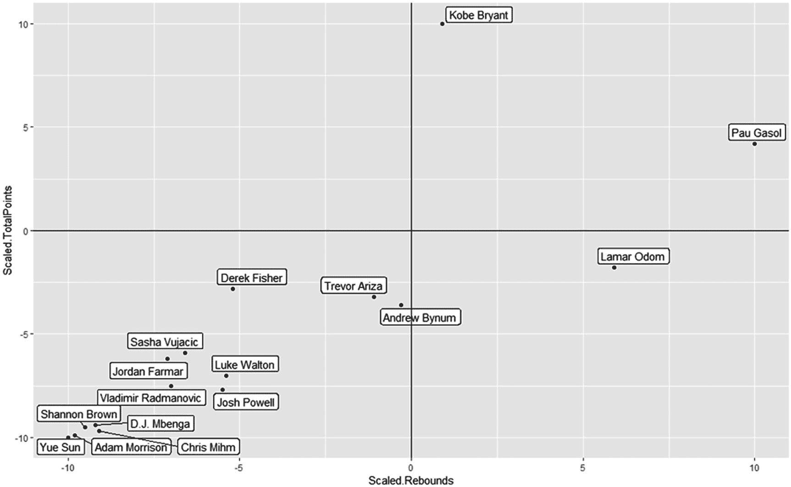

**图 2-32** 象限图的雏形

图表进展顺利，你正朝着最终目标稳步前进。在此步骤中，你将使用以下代码为每个象限添加标签：

```
annotate("text", x = -5, y = 11, label = "High Scorer",
alpha = 0.2, size = 6) +
annotate("rect", xmin = -3.5, xmax = -6.5, ymin = 10.5,
ymax = 11.5, alpha = .2) +
annotate("text", x = 5, y = 11, label = "Beast Mode",
alpha = 0.2, size = 6) +
annotate("rect", xmin = 3.5, xmax = 6.5, ymin = 10.5,
ymax = 11.5, alpha = .2)
annotate("text", x = -5, y = -11, label = "Average",
alpha = 0.2, size = 6) +
annotate("rect", xmin = -3.5, xmax = -6.5, ymin = -11.5,
ymax = -10.5, alpha = .2) +
annotate("text", x = 5, y = -11, label = "High Rebounder",
alpha = 0.2, size = 6) +
annotate("rect", xmin = 3.5, xmax = 6.5, ymin = -11.5,
ymax = -10.5, alpha = .2) +
```

上述代码为象限图中的每个象限构建了带边框的标签。左上角的第一个象限标记为`高分得分手`，因为该组球员得分排名高但篮板排名低；右上角的第二个象限命名为`野兽模式`，因为该象限球员在篮板和得分方面均排名靠前；左下角的第三个象限标记为`普通球员`，因为该象限球员在篮板和得分方面均相对较低；右下角的第四个象限标记为`篮板高手`，因为该象限球员篮板排名高但得分排名低。

象限标签的文本和边框均使用 `annotate()` 函数创建。`annotate()` 函数的第一个参数用于指定注释所使用的几何对象类型。本示例中创建象限标签所使用的几何对象类型是 `text` 和 `rect`。在上述代码中，相应象限的标签文本通过 `text` 几何对象创建，然后使用 `rect` 几何对象在文本周围放置矩形边框。首先，我们来了解 `text` 注释的工作原理，然后再介绍 `rect` 注释。

如前所述，创建 `text` 注释时，需将 `annotate()` 函数的第一个参数值设置为 `text`。`x` 和 `y` 参数用于确定“文本”的位置。在此可视化图表中，`text` 注释的 `x` 值位于各自象限的中心，而 `y` 值则位于可能数据点区域之外。这样做是为了尽量减少球员数据与象限标签的重叠。每个文本注释的 `alpha` 参数设置为 `0.2`，以确保即使球员姓名与标签位置重合，也能显示在标签之上。

`alpha` 参数用于设置图表中几何对象的透明度。数值越接近零，元素越透明；数值越接近一，元素越不透明。

使用 `text` 注释为给定象限创建象限标签后，再使用 `rect` 注释创建标签的边框。这通过将 `annotate()` 函数的第一个参数设置为 `rect` 来实现。要绘制的矩形通过 `xmin`、`xmax`、`ymin` 和 `ymax` 参数定义。以下是各参数用途的说明：

- `xmin` 参数用于确定左上角和左下角的 `x` 位置。
- `xmax` 参数用于确定右上角和右下角的 `x` 位置。
- `ymin` 参数用于确定左下角和右下角的 `y` 位置。
- `ymax` 参数用于确定左上角和右上角的 `y` 位置。

定义好角点后，`annotate()` 函数会用线条连接这些点，最终在标签周围形成一个矩形边框。

### 步骤 16：为 X 轴和 Y 轴添加标签

以下是用于为 X 轴和 Y 轴标签名称添加箭头的代码：

```
xlab(bquote("Rebounding" ~ symbol('\256'))) +
ylab(bquote("Scoring" ~ symbol('\256'))) +
```

这是一种技巧，我使用了通常用于在 R 中创建数学表达式的 `bquote()` 函数。在此示例中，你并非用它来创建数学表达式，而是为标签添加箭头符号。这通过 `xlab()` 和 `ylab()` 函数实现。`xlab()` 函数用于重命名 X 轴标签，`ylab()` 函数用于重命名 Y 轴标签。代码 `symbol('\256')` 是绘制箭头所需的代码。

### 步骤 17：为自定义 R 可视化添加动态标题和说明

使用 `labs()` 函数，通过以下代码为可视化添加图表标题、副标题和图表来源：

```
labs(
title = chart.title,
subtitle = chartsubtitle,
caption = chart_source
)
```

### 步骤 18：添加主题

图表的主题通过 `ggthemes` 包中的 `theme_tufte()` 主题，运用爱德华·塔夫特的可视化原则进行更改。这通过将以下代码添加到脚本中来实现：

```
theme_tufte() +
```

### 步骤 19：执行最后的清理工作

执行前面的步骤将得到图 2-33 中的可视化效果。

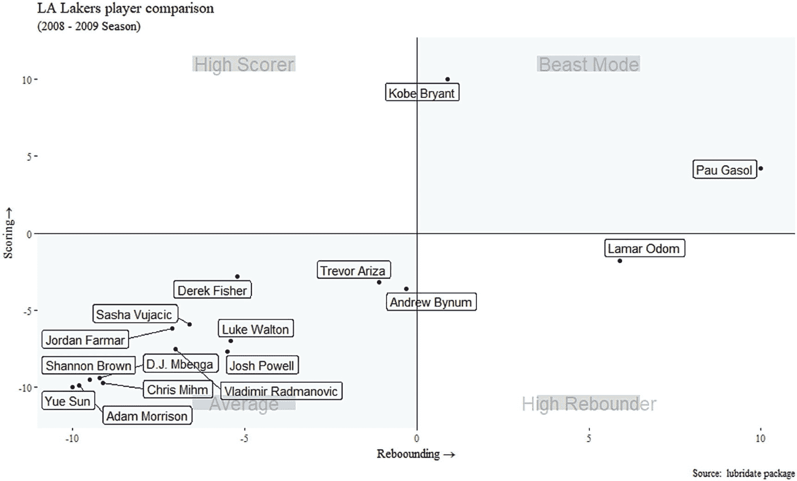

图 2-33

执行最后清理前的四象限图

您需要重新格式化图表标题和坐标轴标签，使其看起来像下面的可视化效果。

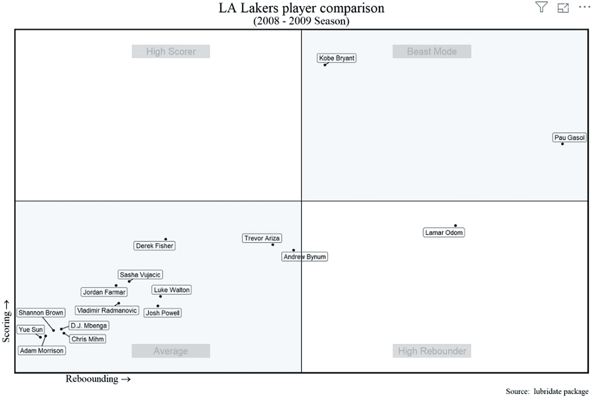

图 2-34

四象限图的最终版本

您可以使用以下代码来实现：

```
theme(
plot.title = element_text(hjust = 0.5, size = 25)
, plot.subtitle = element_text(hjust = 0.5, size = 20)
, panel.border = element_rect(
colour = "black",
size = 2,
fill = NA)
, axis.title.x = element_text(hjust = 0.1, size = 18)
, axis.title.y = element_text(hjust = 0.1, size = 18)
) +
scale_x_continuous(labels = NULL, breaks = NULL) +
scale_y_continuous(labels = NULL, breaks = NULL)
```

让我们详细分析一下前面的代码。如您所见，大部分所需的更改都是通过 `theme()` 函数处理的。以下是此步骤中由 `theme()` 函数修改的组件列表，以及它们是如何被修改的描述：

- `plot.title`：此组件用于控制图表标题，并通过 `element_text()` 函数实现。`element_text()` 函数的 `hjust` 参数用于控制文本的水平位置，它接受 `0` 到 `1` 之间的值。值为 `0` 表示文本左对齐，值为 `0.5` 表示文本居中，值为 `1` 表示文本靠右对齐。您使用了值 `0.5`，因为您希望文本居中。您使用 `size` 参数将字体大小增加到 `25`。

- `plot.subtitle`：此组件用于控制图表副标题，同样通过 `element_text()` 函数实现。`hjust` 参数的设置方式与 `plot.title` 组件中的相同，因为您希望像处理 `plot.title` 组件一样将文本居中。您希望副标题比主标题小，因此将其设置为较小的数值 `20`。

- `panel.border`：此组件用于控制可视化周围的边框，并通过 `element_rect()` 函数实现。`colour` 参数用于设置边框的颜色，`size` 参数用于设置边框的粗细。

- `axis.title.x`：此组件用于控制 x 轴的标签，并通过 `element_text()` 函数实现。您希望标签位于 x 轴的左侧，因此将 `hjust` 参数的值设置为 `0.1`。您使用 `size` 参数将文本的字体大小更改为 `18`。

- `axis.title.y`：此组件用于控制 y 轴的标签，其配置方式与 `axis.title.x` 类似。不同之处在于定位是在垂直线上而不是水平线上。因此，值越接近 `0`，其在 Y 轴上的位置越低；值越接近 `1`，其在 Y 轴上的位置越高。您使用了值 `0.1`，以便将 Y 轴标签定位在靠近原点处。

最后，使用 `scale_x_continuous()` 和 `scale_y_continuous()` 比例尺来重新格式化坐标轴。两个比例函数中的 `labels` 和 `breaks` 都设置为 `NULL`，以将它们从图表中移除。这些操作的结果已在之前的图 2-34 中展示。

### 步骤 20：将代码添加到 Power BI

生成该可视化效果的完整脚本见代码清单 2-7。

```
library(tidyverse)
library(ggrepel)
library(ggthemes)
library(scales)
currentColumns %
mutate(
Scaled.Rebounds =
round(rescale(Rebounds, to = c(-10, 10)), 1)
,Scaled.TotalPoints =
round(rescale(`Total Points`, to = c(-10, 10)), 1)
)
p <- ggplot(graph_data, aes(x = Scaled.Rebounds, y = Scaled.TotalPoints)) +
geom_point() +
geom_label_repel(aes(label = Player), size = 4, show.legend = FALSE) +
geom_hline(yintercept = 0) +
geom_vline(xintercept = 0) +
# quad 1
annotate("text", x = -5, y = 11, label = "High Scorer", alpha = 0.2, size = 6) +
annotate("rect", xmin = -3.5, xmax = -6.5, ymin = 10.5, ymax = 11.5, alpha = .2) +
# quad 2
annotate("text", x = 5, y = 11, label = "Beast Mode", alpha = 0.2, size = 6) +
annotate("rect", xmin = 3.5, xmax = 6.5, ymin = 10.5, ymax = 11.5, alpha = .2) +
# quad 3
annotate("text", x = -5, y = -11, label = "Average", alpha = 0.2, size = 6) +
annotate("rect", xmin = -3.5, xmax = -6.5, ymin = -11.5, ymax = -10.5, alpha = .2) +
# quad 4
annotate("text", x = 5, y = -11, label = "High Rebounder", alpha = 0.2, size = 6) +
annotate("rect", xmin = 3.5, xmax = 6.5, ymin = -11.5, ymax = -10.5, alpha = .2) +
# Shade lower left quadrant
annotate("rect", xmin = -Inf, xmax = 0.0, ymin = -Inf, ymax = 0, alpha = 0.1, fill = "lightskyblue") +
# Shade upper right quadrant
annotate("rect", xmin = 0.0, xmax = Inf, ymin = 0.0, ymax = Inf, alpha = 0.1, fill = "lightskyblue") +
# Titles
xlab(bquote("Rebounding" ~ symbol('\256'))) +
ylab(bquote("Scoring" ~ symbol('\256'))) +
labs(title = chart.title, subtitle = chartsubtitle, caption = chart_source) +
# Prettying things up
theme_tufte() +
theme(
plot.title = element_text(hjust = 0.5, size = 25)
, plot.subtitle = element_text(hjust = 0.5, size = 20)
, panel.border = element_rect(colour = "black", size = 2, fill = NA)
, axis.title.x = element_text(hjust = 0.1, size = 18)
, axis.title.y = element_text(hjust = 0.1, size = 18)
) +
scale_x_continuous(labels = NULL, breaks = NULL) +
scale_y_continuous(labels = NULL, breaks = NULL)
p
} else {
plot.new()
title("The data supplied did not meet the requirements of the chart.")
}
```

代码清单 2-7

生成四象限图的 R 脚本

复制该脚本，然后将其粘贴到此可视化效果关联的 `R 脚本编辑器` 中。生成的 R 可视化效果将完全响应报表中的筛选器。

## 添加回归线

数据分析师最常为其散点图添加的增强功能之一是趋势线。使用 `ggplot2` 在 R 中为散点图添加趋势线非常简单，而且您拥有的配置选项通常比其他可视化工具更多。例如，您可以选择：

- 为趋势线使用线性模型、广义线性模型、广义加性模型以及其他一些模型
- 确定您想要的置信水平
- 为趋势线使用您自己的公式
- 使用更多可配置的选项，数量多到无法一一列举

在本节中，您将使用一个基于 R 中预装数据集的简单示例。该数据集名为 `women`，它显示的是美国女性按身高的平均体重。您将使用散点图绘制这些信息，然后在散点图上叠加一条基于线性回归模型的趋势线。生成的可视化效果见图 2-35。

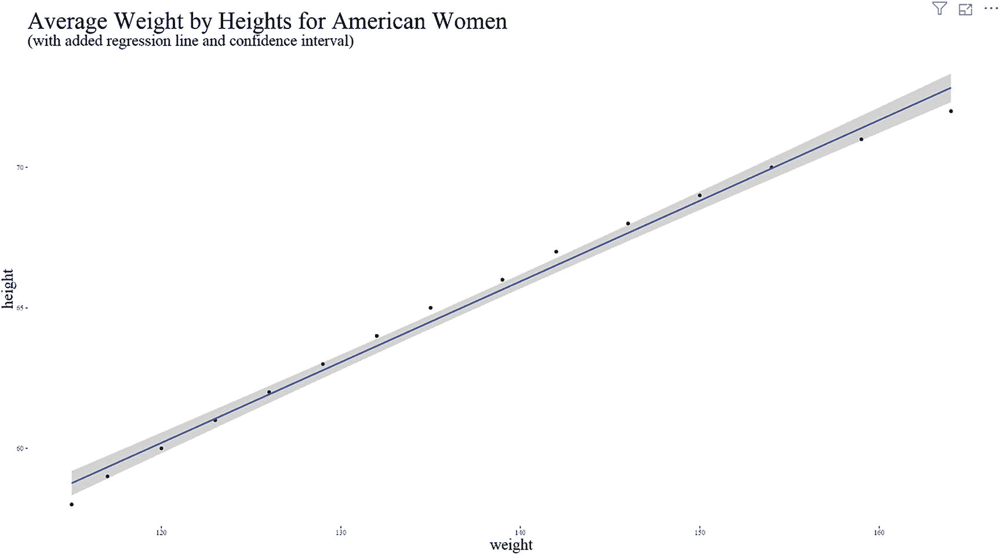

图 2-35

添加了线性回归线的散点图

让我们逐步了解如何生成此可视化效果！

### 步骤 1：获取必要的数据

本示例中使用的代码是基础 R 预装的数据集之一。以下是用于创建作为本示例源数据的 `csv` 文件的 R 代码：

```
library(tidyverse)
data(women)
setwd("")
write_csv(women, "women.csv")
```

运行上述代码将生成一个名为 `women.csv` 的文件，该文件将在下一步中作为 Power BI 的数据源。

### 步骤 2：将数据加载到 Power BI

使用 `GetData` 将数据读取到 Power BI。为此，请单击 Power BI 中的 `Home` 选项卡，然后单击 `GetData` ➤ `Text/CSV`。接下来，浏览到您保存 `women.csv` 文件的位置。加载数据时，请确保 `height` 和 `weight` 列均为数字格式。

### 步骤 3：配置 R 可视化对象

转到可视化窗格，将一个 R 可视化对象拖到报表画布上。将可视化对象调整到所需大小。将 `women` 表中的 `height` 和 `weight` 列拖放到 `Fields` 窗格中。如果 `Fields` 窗格未显示，请选中 R 可视化对象，它应该会出现。

### 步骤 4：将数据导出到 R Studio 进行开发

单击 `R script editor` 标题栏上的 45° 箭头。此操作会将传递给 R 的数据框和 R 起始代码导出到 `R Studio`。如果您需要更详细的说明，请参考“标注图”部分中的步骤 4。

### 步骤 5：加载所需的包

此脚本中将使用的 R 包是 `tidyverse` 和 `ggthemes`。来自 `tidyverse` 的 `ggplot` 包用于创建可视化，来自 `tidyverse` 的 `dplyr` 包用于为可视化塑造数据。`ggthemes` 包提供了 `theme_tufte()` 主题，该主题将用于更改图表的主题。

### 步骤 6：创建数据验证测试所需的变量

以下代码用于创建数据验证测试的变量：

```r
currentColumns <- sort(colnames(dataset))
requiredColumns <- c("height", "weight")
columnTest <- isTRUE(all.equal(currentColumns, requiredColumns))
```

您需要确保从 Power BI 传递给 R 的数据集具有正确的结构，并且需要准备好处理结构不正确的情况。在此示例中执行的测试是一个确保传递给 R 的数据集仅包含 R 可视化所需列的测试。

为此，您首先获取 `dataset` 数据框中列的名称，并将其分配给一个名为 `currentColumns` 的字符向量变量。该变量中的元素按字母顺序排序。下一行代码创建另一个字符向量，其中包含创建 R 可视化所需的列。它们也按字母顺序提供。代码片段中的最后一行使用 `all.equal()` 函数执行测试，以查看 `currentColumns` 和 `requiredColumns` 字符向量是否相等。`all.equal()` 函数用于比较两个 R 对象是否相等。如果它们相等，则返回 `TRUE`；否则，返回试图解释它们为何不相等的信息。在此示例中，您只关心 `currentColumns` 和 `requiredColumns` 变量是否相等。您只需要一个布尔响应。您可以通过使用 `isTRUE()` 函数包装 `all.equal()` 来获得它。

### 步骤 7：创建数据验证测试

以下是数据验证测试的框架：

```r
if (columnTest) {

} else {
plot.new()
title("提供的数据不符合图表的要求。")
}
```

回想一下，`columnTest` 变量基于一个返回布尔值的测试。如果 `columnTest` 变量的值为 `TRUE`，则将执行代码以构建可视化；否则，将执行 `else` 块中的代码。`else` 块中的代码使用 `plot.new()` 函数生成一个空白图，并向空白图添加文本，向报表用户解释为何未创建所需的图表。

### 步骤 8：通过初始化 ggplot 函数开始创建图表

以下是此步骤中使用的代码：

```r
chartdata <- dataset
ggplot(chartdata, aes(x = weight, y = height)) +
```

首先，您通过将 `dataset` 数据框分配给一个名为 `chartdata` 的变量来复制它。接下来，您定义 `ggplot()` 函数。第一个参数是可视化将使用的数据集。第二个参数使用 `aes()` 函数定义一些视觉美学。正在定义的美学是 `x` 和 `y` 坐标。

### 步骤 9：向 R 可视化对象添加散点图层

通过使用 `geom_point()` 几何对象添加散点图层。`x` 和 `y` 参数的值继承自 `ggplot()` 函数，并用于确定散点图中每个点的位置。以下是用于添加几何对象的代码：

```r
geom_point() +
```

将 `geom_point()` 几何对象添加到图表的结果如图 2-36 所示。

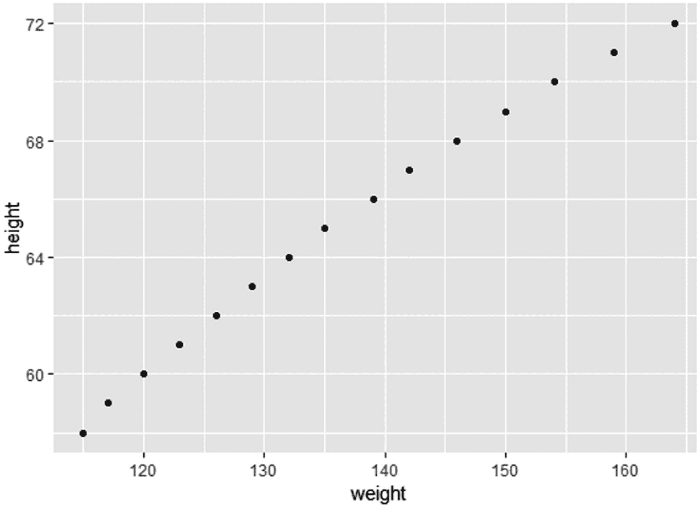

图 2-36

使用基础 R 自带的“women”数据集绘制的美国女性平均体重与身高的散点图

### 步骤 10：向 R 可视化对象添加回归线图层

在此步骤中，您使用 `geom_smooth()` 几何对象添加回归线图层。用于添加该图层的代码如下：

```r
geom_smooth(method='lm') +
```

上述代码将根据散点图中的数据向图表添加一条线性回归线。此函数之所以特别，是因为它非常可配置。`geom_smooth()` 函数使您能够：

- 指定您自己的线性回归公式
- 为您的线性回归线添加置信区间
- 选择您要使用的置信区间水平
- 使用其他平滑方法，例如 `广义线性回归 (glm)`、`局部回归 (loess)`、`稳健线性模型 (rlm)` 和 `广义加性模型 (gam)`

以下图 2-37 中的可视化显示了添加回归线后图表的外观。

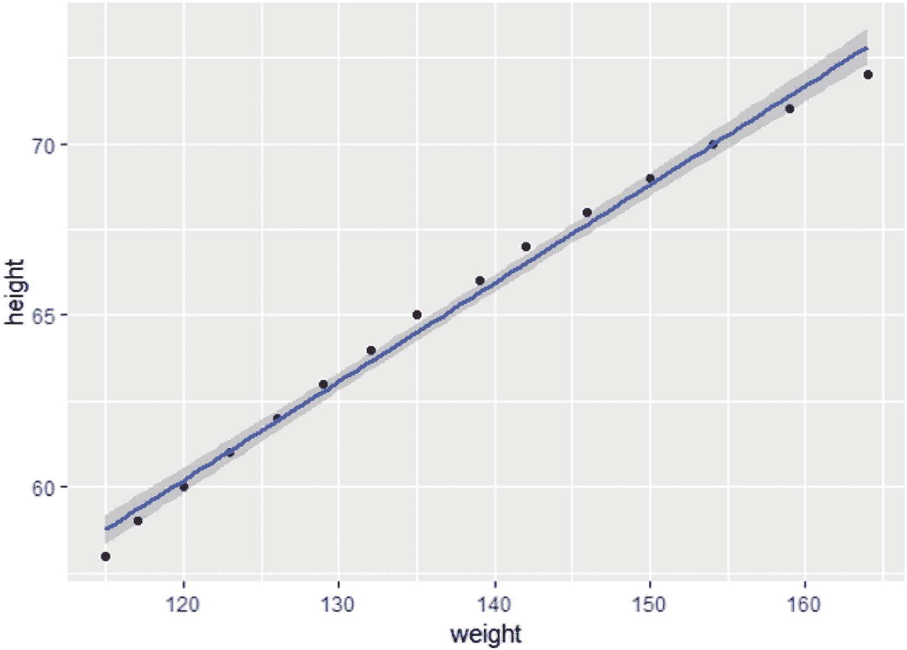

图 2-37

添加了回归线的散点图

### 步骤 11：为图表添加标题

使用 `ggtitle()` 函数添加图表标题和副标题，如下所示：

```r
ggtitle(
"美国女性身高与平均体重",
subtitle = "(添加了回归线和置信区间)"
) +
```

请注意，`ggtitle()` 函数是 `labs()` 函数的替代方案，但它具有此示例所需的功能。

### 步骤 12：更改图表的主题

您希望使用 Stephen Few 的原则来更改图表的外观和感觉。您可以使用以下代码将 `theme_tufte()` 主题添加到图表中：

```r
theme_tufte() +
```

### 步骤 13：进行最后的清理工作

`theme()` 函数用于更改图表标题、副标题和轴标签的字体大小。图表标题的字体使用 `plot.title` 组件更改，图表的副标题使用 `plot.subtitle` 组件更改，轴标签使用 `axis.title` 组件更改。所有三个组件都使用 `element_text()` 函数进行更改：

```r
theme(
axis.title = element_text(size = 20),
plot.title = element_text(size = 30),
plot.subtitle = element_text(size = 20)
)
```

### 步骤 14：向 Power BI 添加代码

完整的脚本如代码清单 2-8 所示。复制该脚本并将其粘贴到 Power BI 的 *R 脚本编辑器*中。

```r
library(tidyverse)
library(ggthemes)
currentColumns <- sort(colnames(dataset))
requiredColumns <- c("height","weight")
columnTest <- isTRUE(all.equal(currentColumns, requiredColumns))
if (columnTest) {
chartdata <- dataset
ggplot(chartdata, aes(x = weight, y = height)) +
geom_point() +
geom_smooth(method='lm') +
ggtitle(
"美国女性身高对应的平均体重",
subtitle = "（附回归线与置信区间）"
) +
theme_tufte() +
theme(
axis.title = element_text(size = 20),
plot.title = element_text(size = 30),
plot.subtitle = element_text(size = 20)
)
} else {
plot.new()
title("提供的数据不符合图表要求。")
}
代码清单 2-8
生成带回归线的散点图的 R 脚本
```

在本章中，你学习了几个示例，展示了如何通过 `ggplot2` 包在 Power BI 中实现富有表现力的可视化。你可以轻松修改这些示例以满足自身需求，或将其作为灵感来源，创建完全不同的可视化效果。`ggplot2` 包及其辅助包提供了一个出色的框架，让你能够以相对低代码的方式为 Power BI 构建 R 可视化。`ggplot2` 包是 Power BI 的绝佳搭档！