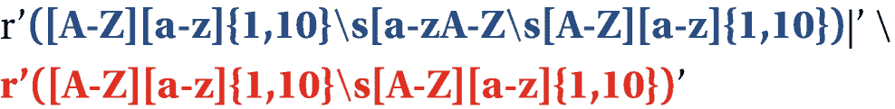

# 7. 高级字符串操作与模式匹配

基本的字符串操作和模式匹配任务可以使用 Power Query 中预装的众多字符串函数之一来处理。你可以通过图形界面访问其中的许多函数，它们也可用于自定义列。这些函数在简单情况下效果很好，但在更高级的场景中则不够用。幸运的是，R 和 Python 拥有高级工具，使你能够执行超出 Power Query 能力范围的高级字符串操作和模式匹配任务。

在本书的这一部分，你将学习如何利用 R 和 Python 进行高级字符串操作和模式匹配。重点将放在`正则表达式`的使用上。正则表达式（有时简称为 `regex`）是用于描述搜索模式的文本字符串。它们非常强大，能够让你执行需要高级业务逻辑的字符串操作和模式匹配，而这些是使用 Power Query 中的基本匹配方法无法实现的。

在本章中，你将学习如何：
- 屏蔽敏感数据
- 统计备注字段中的单词数和句子数
- 清洗格式不正确的名称
- 测试字符串中是否存在某种模式

你将通过可能在业务中遇到的场景来学习这些方法。首先，我们来学习如何屏蔽敏感数据。

## 屏蔽敏感数据

许多公司收集客户的个人数据，这使得公司及其客户都容易受到安全漏洞的影响。大多数公司都有严格的指导方针来最小化这种风险。但有时公司需要与外部供应商共享数据，以便更深入地了解其数据。在这种情况下，他们需要确保任何敏感数据都被屏蔽，以保护客户。

在此场景中，催收部门副总裁 Marc Lovejoy 正与 IT 部门副总裁 Didi Costas 合作，使用 Power BI 开发一个分析报告系统。该分析系统的要求之一是对催收员在与债务人每次通话后创建的备注进行情感分析。部分备注包含社会安全号码和电话号码。他们希望使用`Microsoft 认知服务`，但在将备注发送给`Microsoft 认知服务`进行情感分析之前，需要屏蔽其中的社会安全号码和电话号码。

`Microsoft 认知服务`是一组由 Microsoft 构建的机器学习算法，旨在帮助解决某些需要人工智能的问题。你将在后续章节中学习如何在 Power BI 中进行情感分析。

他们将需求分享给了分析师 Tank Wade，他提出了两种解决方案：一种使用 R，另一种使用 Python。以下是使用 R 的解决方案。

### 在 Power BI 中使用 R 屏蔽敏感数据

我们将在接下来的步骤中说明如何利用正则表达式通过 R 在 Power BI 中屏蔽数据。使用 Power Query 原生功能来完成此任务即使不是不可能，也会极其困难。让我们来看看所需的步骤！

#### 步骤 1：导入 `tidyverse` 和 `stringr`

像往常一样，你从加载包开始。你将加载的第一个包是`tidyverse`。你将使用`tidyverse`中的`dplyr`包向数据集添加新字段，并使用`tidyverse`中的`readr`包将数据读入数据框。`stringr`包将在此脚本中承担主要工作。你将利用`str_replace`函数结合正则表达式来屏蔽敏感数据。以下是加载所需包的代码：

```r
library(tidyverse)
library(stringr)
```

#### 步骤 2：创建数据脱敏函数

使用 R 语言的一个优点在于，可以轻松构建自定义函数并在后续脚本中复用。本脚本中的自定义函数将接收文本，使用正则表达式搜索 SSN 和电话号码，对找到的 SSN 和电话号码进行脱敏处理，并返回脱敏后的数据。以下是创建该函数所需的步骤：

1.  按如下所示创建函数框架：

    ```r
    mask_text <- function(unmask_text){
    }
    ```

    函数名称为`mask_text`，该函数接受一个名为`unmask_text`的参数。

2.  创建一个匹配美国电话号码模式的正则表达式，并将其赋值给名为`phone_pattern`的变量：

    ```r
    phone_pattern = "([2-9][0-9]{2})- .- ."
    ```

    上述正则表达式是用于匹配电话号码的常见表达式。此类正则表达式可通过必应搜索轻松找到。

3.  创建一个匹配 SSN 模式的正则表达式，并将其赋值给名为`ssn_pattern`的变量：

    ```r
    ssn_pattern = "\\d{3}-\\d{2}-\\d{4}"
    ```

    与电话号码示例类似，你很可能通过互联网搜索找到能够有效匹配有效 SSN 格式的正则表达式。但在此示例中，我想展示开发一个匹配 SSN 模式的正则表达式是多么简单。

    你可以使用`\d`字符组合在正则表达式中识别数字。由于`\`在正则表达式中是特殊字符，你需要通过添加另一个`\`来转义`\d`中的反斜杠。

    像`\`和`.`这样的字符在正则表达式中具有特殊含义，这些字符被称为`元字符`。如果你想在正则表达式中使用这些字符的字面表示，需要用`反斜杠（`\`）`对它们进行转义。因此，如果你想在字符串中搜索`句点（`.`）`，需要在它前面加上`\`，以告诉正则表达式你要精确搜索句点。由于`\`本身也是一个元字符，你还需要对它进行转义。也就是说，如果你想向正则表达式引擎发送`\.`，你需要发送字符串`"\\."`。

    既然你已经知道如何在正则表达式中识别数字，那么让我们来构建 SSN 的基本模式。SSN 的基本模式是三位数字，后跟一个短横线，再跟两位数字，再跟另一个短横线，最后以四位数字结尾。`ssn_pattern`中保存的正则表达式模式通过结合使用`\\d`和`{}`来模拟该模式。`\\d`告诉正则表达式你要匹配一个数字，而`{}`中的数字则告诉正则表达式你要匹配的数字出现次数。正则表达式中的短横线放置在 SSN 中预期出现的位置。

4.  使用以下代码对电话号码进行脱敏处理：

    ```r
    cleanned_text <- str_replace(
        unmask_text, pattern = phone_pattern,
        replacement = "XXX-XXX-XXXX")
    ```

    在上述代码中，`str_replace`函数用于对文本中找到的任何电话号码进行脱敏处理。该函数与 Power Query 中的`Text.Replace`函数的不同之处在于，你可以在`str_replace`中使用正则表达式，但不能在`Text.Replace`函数中使用。你可以在 Power Query 中进行非常基本的模式匹配，但无法像使用正则表达式那样进行复杂匹配。上述`str_replace`函数接收传入的字符串，并搜索它是否与传入的正则表达式模式匹配。如果找到该字符串，则将其替换为`replacement`参数中定义的脱敏字符串。因此，如果向该函数传入字符串“Ryan’s phone number is 555-852-6301 and his SSN is 123-45-6789”，将返回“Ryan’s phone number is XXX-XXX-XXXX and his SSN is 123-45-6789”。

5.  使用以下代码对评论中的 SSN 进行脱敏处理：

    ```r
    cleanned_text <- str_replace(
        cleanned_text, pattern = ssn_pattern,
        replacement = "XXX-XX-XXXX")
    ```

    上述代码接收电话号码脱敏处理的结果，并应用类似的技术，使用`ssn_pattern`对 SSN 进行脱敏处理。因此，如果向该函数传入字符串“Ryan’s phone number is XXX-XXX-XXXX and his SSN is 123-45-6789”，将返回“Ryan’s phone number is XXX-XXX-XXXX and his SSN is XXX-XX-XXXX”。

6.  函数的最后一行使用`return`函数返回 SSN 和电话号码脱敏处理的结果。

    以下是该函数的完整代码：

    ```r
    mask_text <- function(unmask_text){
        phone_pattern = "([2-9][0-9]{2})- .- ."
        ssn_pattern = "\\d{3}-\\d{2}-\\d{4}"
        cleanned_text <- str_replace(
            unmask_text, pattern = phone_pattern,
            replacement = "XXX-XXX-XXXX")
        cleanned_text <- str_replace(
            cleanned_text, pattern = ssn_pattern,
            replacement = "XXX-XX-XXXX")
        return(cleanned_text)
    }
    ```

执行 SSN 和电话号码脱敏处理所需的逻辑被封装在`mask_text`函数中。因此，当我们需要执行 SSN 和电话号码脱敏处理时，只需通过简单的函数调用即可完成。将业务逻辑封装在函数中，使代码更具可读性，并且更容易复用复杂的业务逻辑，而无需重写代码。

#### 步骤 3：将评论读入数据框

使用以下代码将`Comments.csv`文件的内容读入数据框，并将其存储在`df`变量中：

```r
df <- read_csv("Comments.csv")
```

如果你好奇读取的数据长什么样，可以在控制台中输入以下代码，返回一个将数据框显示为格式化表格数据集的视图：

`View(df)`

#### 步骤 4：对评论字段中的电话号码和 SSN 进行脱敏处理

在此步骤中，你将把`mask_text`函数应用于`Comment`字段。我们通过`dplyr`包中的`mutate()`函数来实现，该函数允许我们对`Comment`字段进行内联修改。以下是执行此任务的代码：

```r
df %>% 
    mutate(Comment = mask_text(Comment))
```

#### 步骤 5：将脚本复制到 Power BI

在最后一步中，你将复制整个脚本并将其粘贴到`GetData`中的 R 脚本编辑器中。以下是完整的脚本：

```r
library(tidyverse)
library(stringr)
setwd("")
mask_text <- function(unmask_text){
    phone_pattern = "([2-9][0-9]{2})- .- ."
    ssn_pattern = "\\d{3}-\\d{2}-\\d{4}"
    cleanned_text <- str_replace(
        unmask_text, pattern = phone_pattern,
        replacement = "XXX-XXX-XXXX")
    cleanned_text <- str_replace(
        cleanned_text, pattern = ssn_pattern,
        replacement = "XXX-XX-XXXX")
    return(cleanned_text)
}
df <- read_csv("Comments.csv")
df %>% 
    mutate(Comment = mask_text(Comment))
```

包含脱敏数据的最终数据框将作为数据集暴露给 Power BI，你可以将其添加到 Power BI 数据模型中。这些信息可用于增强你的 Power BI 数据模型，从而创建更丰富的可视化效果。

### 使用 Python 在 Power BI 中对敏感数据进行脱敏处理

在前面的示例中，我们使用 R 语言对评论中的 SSN 和电话号码进行了脱敏处理。我们可以使用 Python 通过类似的逻辑（只是编程语言不同）来完成相同的任务。你会发现，在许多情况下，使用 R 或 Python 都能同样出色地完成任务。使用哪种语言通常取决于个人偏好。现在，让我们来看看如何使用 Python 执行刚才用 R 完成的脱敏处理。

#### 步骤 1：导入 `pandas`、`os` 和 `re` 库

与往常一样，首先加载库。第一个要加载的库是`pandas`，你将使用它来读取数据并对`Comment`字段进行脱敏处理。你还需要加载`os`包来处理一些简单的文件系统任务，而`re`包将用于处理本脚本中的正则表达式需求。以下是加载必要库的代码：

```python
import pandas as pd
import re
import os
```

#### 步骤 2：创建 `mask_text` 函数

接下来，你需要构建一个自定义函数来屏蔽`Comment`字段中的电话号码和社会安全号码（SSN）。此脚本中的函数将接收`Comment`字段中的文本，根据正则表达式模式匹配查找其中的 SSN 和电话号码，对其进行屏蔽，然后返回带有屏蔽数据的文本。以下是创建该函数的步骤：

1.  按如下所示创建函数框架：

    ```python
    def mask_text (unmask_text):
    ```

    函数名称为`mask_text`。该函数接受一个名为`unmask_text`的参数。

2.  创建一个匹配美国电话号码模式的正则表达式，并将其值赋给名为`phone_pattern`的变量：

    ```python
    phone_pattern = r"([2-9][0-9]{2})- .- ."
    ```

    上述正则表达式是用于匹配电话号码的常见表达式。许多常见模式（例如匹配电话号码和 SSN 的模式）都可以通过必应或谷歌搜索轻松找到。

    请注意正则表达式前使用了`r`。在 Python 中（但在 4.0.0 版本之前的 R 语言中不行），你可以在字符串前加上`r`来告诉 Python 你想将该字符串视为原始字符串。这样做时，反斜杠会被视为其字面表示，而不是特殊的元字符。这可以避免你转义反斜杠。

3.  创建一个匹配 SSN 模式的正则表达式，并将其值赋给名为`ssn_pattern`的变量：

    ```python
    ssn_pattern = r"\d{3}-\d{2}-\d{4}"
    ```

    SSN 的模式是三位数字，后跟一个短横线，再跟两位数字，再跟一个短横线，最后以四位数字结尾。在上述正则表达式中，你使用`\d`来标识数字，并使用`{n}`来告诉正则表达式你想要匹配前面模式的次数。因此，正则表达式中的`\d{3}`表示你想要匹配三个连续的数字。

    此示例中的正则表达式比较宽松，会导致许多误报匹配，因为只有特定的数字组合才能用于 SSN。你可以使用更复杂的正则表达式来减少误报数量，但更高的复杂度可能会使其更难阅读。在使用正则表达式时，你必须权衡准确性和可解释性。

4.  使用以下代码屏蔽电话号码：

    ```python
    cleanned_text = re.sub(
        phone_pattern, "XXX-XXX-XXXX", unmask_text)
    ```

    在上述代码中，`re.sub`函数用于将文本中找到的任何电话号码替换为 X。此函数与 Power Query 中的`Text.Replace`函数的不同之处在于，你可以在此函数中使用正则表达式。

5.  使用以下代码屏蔽评论中的 SSN：

    ```python
    cleanned_text = re.sub(
        ssn_pattern, "XXX-XX-XXXX", cleanned_text)
    ```

    上述代码获取电话号码屏蔽的结果，并使用`ssn_pattern`模式应用类似的技术。

6.  函数的最后一行使用`return`语句返回 SSN 和电话号码屏蔽的结果。

以下是创建该函数所需的完整代码：

```python
def mask_text (unmask_text):
    phone_pattern = \
    r"([2-9][0-9]{2})- .- ."
    ssn_pattern = r"\d{3}-\d{2}-\d{4}"
    cleanned_text = re.sub(
        phone_pattern, "XXX-XXX-XXXX", unmask_text)
    cleanned_text = re.sub(
        ssn_pattern, "XXX-XX-XXXX", cleanned_text)
    return cleanned_text
```

执行 SSN 和电话号码屏蔽所需的逻辑被抽象在`mask_text`函数中。因此，当你需要屏蔽 SSN 和电话号码时，只需进行一次简单的函数调用即可。将业务逻辑抽象到函数中使代码更具可读性，并使业务逻辑更易于重用。

#### 步骤 3：设置工作目录

使用以下代码将工作目录设置为`Comments.csv`文件所在的位置：

```python
os.chdir("<path to folder that contains the Comments.csv file>")
```

#### 步骤 4：将评论读入数据框

使用`pandas`将`Comments.csv`文件的内容读入数据框，并使用以下代码将数据框赋给名为`df`的变量：

```python
df = pd.read_csv("Comments.csv")
```

#### 步骤 5：屏蔽电话号码和 SSN

以下代码通过该字段的`apply()`方法将`mask_text()`函数应用于`Comment`字段，从而对该字段进行内联更新：

```python
df.Comment = df.Comment.apply(mask_text)
```

### 步骤 6：将脚本复制到 Power BI

在最后一步中，你将复制整个脚本并将其粘贴到 `GetData` 中的 Python 脚本编辑器中。以下是完整的脚本：

```python
import pandas as pd
import re
import os
def mask_text (unmask_text):
phone_pattern = \
r"([2-9][0-9]{2})- .- ."
ssn_pattern = r"\d{3}-\d{2}-\d{4}"
cleanned_text = re.sub(
phone_pattern, "XXX-XXX-XXXX", unmask_text)
cleanned_text = re.sub(
ssn_pattern, "XXX-XX-XXXX", cleanned_text)
return cleanned_text
os.chdir("<path to folder that contains the Comments.csv file")
df = pd.read_csv("Comments.csv")
df.Comment = df.Comment.apply(mask_text)
df
```

生成的包含屏蔽数据的数据框将作为数据集暴露给 Power BI，你可以将其添加到 Power BI 模型中。添加的数据可用于帮助你讲述更好的数据故事。

## 统计评论中的单词数和句子数

当许多人想到数据科学时，他们会想到预测数值结果或事件发生概率的算法。他们几乎不知道你并不局限于在数据科学中进行这类预测。数据科学的一个子集包括处理非结构化文本的技术。这个数据科学领域被称为自然语言处理（NLP）。NLP 中使用的技术，如情感分析或主题分析，相当高级且难以构建。在下一章中，我们将利用 Microsoft 认知服务在 Power BI 中执行这些类型的任务。但也有一些更简单的 NLP 技术，我们无需调用像 Microsoft 认知服务这样的 API 即可使用。本章将介绍其中两种技术。我们将介绍的两种技术是统计文本语料库中的单词数和句子数。让我们通过一个例子来说明。

Sarah 是 Yelp 的数据分析师。她的任务是为 Yelp 提供给客户的报告添加额外信息。该报告包含客户评论，Sarah 的老板 Jessica 希望她添加一列包含每条评论的单词数，以及一列包含每条评论的句子数。她能够在 R 中实现这两个要求，但在 Python 中只能进行单词计数。以下是她用 R 执行该任务所使用的步骤。

### 使用 R 在 Power BI 中统计评论的字数和句子数

在本示例中，我们将使用 R 来计算 Yelp 评论中的单词数以及评论中的句子数。与之前一样，我们将借助 `tidyverse` 中的工具来完成此任务。

#### 步骤 1：导入 `tidyverse` 和 `stringr`

此脚本中将使用的两个包是 `tidyverse` 元包和 `stringr`。`tidyverse` 中的 `dplyr` 包将用于向数据集中添加一个包含字数的列，以及另一个包含句子数的列。`stringr` 包中的 `str_count` 函数在此脚本中承担了主要工作：

```r
library(tidyverse)
library(stringr)
```

#### 步骤 2：将工作目录更改为文件所在位置

与往常一样，您使用 `setwd()` 函数将工作目录设置为数据所在的位置。在本示例中，您使用以下代码将其设置为 `Yelp` 数据所在的位置：

```r
setwd("")
```

#### 步骤 3：读取 Yelp 数据

使用 `readr` 中的 `read_csv` 函数将 Yelp 数据读入 R 数据框。使用以下代码将数据框分配给 `df` 变量：

```r
df <- read_csv("yelp_training_set_review_sample.csv")
```

#### 步骤 4：子集化列

Yelp 数据集非常宽泛。它包含许多列，而您只对其中的一部分感兴趣。因此，您需要创建一个工作流，从 `df` 数据框开始，然后将其子集化为仅包含您感兴趣的列。这通过以下代码片段完成：

```r
df %>%
select(id, business_categories, business_review_count,
business_stars, business_state, business_type,
stars,text)
```

#### 步骤 5：添加字数列和句子数列

现在您需要向数据框添加两列，一列名为 `word_count`，另一列名为 `sent_count`。`word_count` 字段将存储评论中的单词数，`sent_count` 字段将包含评论中的句子数。您将使用 `stringr` 中的 `str_count` 函数完成这两项任务，如下列代码所示：

```r
mutate(word_count =
str_count(text, boundary("word"))
,sent_count = str_count(text, boundary("sentence"))
)
```

`str_count` 函数使用 `boundary` 函数来指定您想要进行的计数类型。请注意，进行字数和句子计数是多么容易！这只是一个简单的函数调用！在 Power Query 中执行句子计数是不可行的，但在 R 中只是一个简单的函数调用。

### 步骤 6：将脚本复制到 Power BI

以下是完整的脚本：

```r
library(tidyverse)
library(stringr)
setwd("")
df %>%
select(
id
,business_categories
,business_review_count
,business_stars
,business_state
,business_type,stars,text) %>%
mutate(
word_count = str_count(text, boundary("word"))
,sent_count = str_count(text, boundary("sentence"))
)
```

复制整个脚本并将其粘贴到 `GetData` 中的 R 脚本编辑器中，以便您可以将生成的数据框添加到 Power BI 数据模型中。现在，该数据集可用于增强您的 Power BI 数据模型，使您能够更有效地讲述您的数据故事。

### 使用 Python 在 Power BI 中统计评论的字数

在本示例中，您将使用 Python 来计算 Yelp 评论中的单词数。对于许多任务，R 和 Python 都同样适用，但在某些情况下，一种语言比另一种语言更适合执行任务。这里就是这种情况。在 Python 中计算评论句子数的解决方案不如在 R 中那么明显，因此我们将只关注字数统计。以下是可用于进行字数统计的步骤。

#### 步骤 1：导入 `pandas` 和 `os`

您在此脚本中将使用的两个库是 `pandas` 和 `os`。`pandas` 库将用于从 `Yelp` 文件读取数据，并计算评论中的 `words` 数量。`os` 包将用于一些文件系统任务。以下是导入这两个包的代码：

```python
import pandas as pd
import os
```

#### 步骤 2：将工作目录更改为文件所在位置

使用 `os.chdir()` 函数将工作目录设置为 Yelp 文件所在的位置。以下是执行此任务所需的代码：

```python
os.chdir(r"")
```

您可以使用传统的文件路径约定，因为您在文件路径字符串前加了 `r`，以告诉 Python 您想要字符串的原始版本。像 `C:\Users\Public` 这样的路径将有效，因为您不需要转义反斜杠。这是 Python 中已经存在一段时间的功能，但直到 4.0.0 版本才在 R 中可用。

#### 步骤 3：将 Yelp 数据读入 Python

通过 `pandas` 的 `read_csv()` 方法将 Yelp 文件的内容读入 Python，并使用以下代码将其分配给变量 `df`：

```python
df = pd.read_csv("yelp_training_set_review_sample.csv")
```

#### 步骤 4：创建 `word_count` 列

此步骤通过以下代码完成：

```python
df["word_count"] = df["text"].str.split().apply(len)
```

代码非常简洁，但做了很多事情。让我们来拆解一下。首先，pandas 使用 `str` 类的 `split()` 方法将文本中的单词拆分并放入一个 pandas 列表中。因此，如果 `text` 字段中的内容是“The cat in the hat.”，`split` 函数将拆分文本并将其放入一个包含五个元素的列表中，如下所示：`[The, cat, in, the, hat.]`。`split` 函数的默认分隔符是空格，这正是您在这种情况下所需要的。如果您停在这里，您将得到一个数据框，其中有一个名为 `word_count` 的列，该列填充了基于 `text` 字段的一系列列表。

您将 `text` 字段转换为列表的原因是为了利用特定的列表属性。您可以对列表使用 `len` 函数来获取其中的元素数量。在这里，列表中的每个元素代表文本中的一个单词，因此对其应用 `len` 函数的结果将是字数的良好近似值。后者通过使用 `apply()` 方法将 `len` 函数应用于由 `split()` 函数创建的列表来完成。

#### 步骤 5：将脚本复制到 Power BI

完整的脚本如下所示：

```python
import pandas as pd
import os
os.chdir(r"")
df = pd.read_csv("yelp_training_set_review_sample.csv")
df["word_count"] = df["text"].str.split().apply(len)
```

您需要复制此脚本并将其粘贴到 Power BI 的 Python 编辑器中。生成的数据框将可用于添加到 Power BI 数据模型中。

## 删除格式无效的名称

源系统中的数据通常杂乱且格式不佳。在许多情况下，数据在用于报告之前需要进行清理。下面的示例就是这种情况。

在此场景中，SQLWeave 的顾问 Jonathan 负责 ETL，他需要在将数据加载到 Power BI 之前，从 `DimEmployees` 维度表中清除格式无效的名称。只有符合 FN MI LN 或 FN LN 格式的名称才会被接受，其中 FN 代表*名字*，MI 代表*中间名首字母*，LN 代表*姓氏*。Jonathan 开发了一个 R 和 Python 脚本来处理此任务。以下是他在 R 中执行此任务所使用的步骤。

### 使用 R 在 Power BI 中删除格式无效的名称

以下是使用 R 清理名称所需的步骤。我们将使用 `tidyverse` 中提供的工具来完成此任务。以下是具体步骤。

#### 步骤 1：导入 `tidyverse` 和 `stringr`

在本脚本中，你将使用 `tidyverse` 元包和 `stringr`。`tidyverse` 中的 `readr` 包用于将 `DimEmployee.csv` 文件中的数据读入 R 数据框，而 `tidyverse` 中的 `dplyr` 用于对 `Name` 字段进行内联修改。该修改将利用 `stringr` 包中的 `str_extract()` 函数。以下代码导入所需的包：

```r
library(tidyverse)
library(stringr)
```

#### 步骤 2：将工作目录更改为 `DimEmployee.csv` 文件所在位置

`setwd()` 函数用于将工作目录设置为包含该文件的路径：

```r
setwd("")
```

#### 步骤 3：创建正则表达式以匹配有效名称

此处定义了用于匹配正确名称的正则表达式，并将其赋值给 `nameWithOrWithoutMiddleInitial` 变量：

```r
nameWithOrWithoutMiddleInitial = "(^[A-Z][a-z]{1,10}\\s[a-zA-Z]\\s[A-Z][a-z]{1,10}$)|(^[A-Z][a-z]{1,10}\\s[A-Z][a-z]{1,10}$)"
```

这个正则表达式看起来可能很复杂，但实际上相当简单。让我们逐步分解：

1.  该正则表达式匹配两种名称模式：一种格式为 `FN MI LN`，另一种格式为 `FN LN`，其中 `FN` 是名，`MI` 是中间名首字母，`LN` 是姓。两种模式用竖线分隔，竖线代表逻辑“或”。正则表达式中 `FN MI LN` 模式以蓝色显示，`FN LN` 模式以红色显示：

    

2.  现在我们来分解蓝色部分。回想一下，蓝色部分匹配的是 `FN MN LN` 模式。我们首先关注 `FN` 部分。正则表达式使用以下代码来识别 `FN`：`^[A-Z][a-z]{1,10}`。`^` 告诉正则表达式你从字符串的开头开始匹配。`^` 后面跟着 `[A-Z]`，这告诉正则表达式第一个字符必须是大写字母 A 到 Z 中的一个。接下来是 `[a-z]{1,10}`。这个组合告诉正则表达式接下来的 1 到 10 个字符应该是小写字母 a 到 z。这为正则表达式提供了灵活性，可以匹配长度为 2 到 11 个字母的名字。

3.  正则表达式蓝色部分中的 `MI` 使用以下代码进行匹配：`\\s[a-zA-Z]\\s`。`\\s` 在正则表达式中用于匹配空白字符。回想一下，`\` 是一个特殊的元字符，因此如果你想在正则表达式中直接使用反斜杠，你需要用另一个反斜杠对其进行转义。`MI` 需要是单个大写或小写字母，`[a-zA-Z]` 匹配这种情况。`MI` 和 `LN` 之间需要一个空白字符，因此使用 `\\s` 来匹配该条件。

4.  最后，我们需要匹配蓝色部分的姓氏。这是使用以下模式完成的：`[A-Z][a-z]{1,10}$`。`[A-Z]` 告诉正则表达式 `LN` 中的第一个字母需要大写。`[a-z]{1,10}` 组合告诉正则表达式姓氏中后续的字母必须是小写，而 `{1,10}` 表示可以有 1 到 10 个小写字母。正则表达式中的 `$` 终止匹配。

5.  `FN LN` 匹配以红色显示。唯一的区别是去掉了 `\\s[a-zA-Z]\\s`，因为你试图匹配一个没有中间名首字母的名称。

#### 步骤 4：将数据读入数据框

使用以下代码将 `DimEmployee.csv` 文件的内容读入 R 数据框，并将其赋值给 `df` 变量：

```r
df <- read_csv("DimEmployee.csv")
```

#### 步骤 5：对 `Name` 列进行内联更新

执行此步骤的代码如下所示：

```r
df <- df %>%
mutate(Name = str_extract(Name,nameWithOrWithoutMiddleInitial))
```

`mutate()` 函数用于执行内联更新。`stringr` 中的 `str_extract()` 函数测试 `Name` 字段，看它是否与 `nameWithOrWithoutMiddleInitial` 变量中定义的正则表达式模式匹配。如果找到匹配项，它将从 `Name` 字段中提取与模式匹配的文本。否则，它不返回任何内容。

### 步骤 6：将脚本复制到 Power BI

在最后一步中，你复制整个脚本并将其粘贴到 `GetData` 中的 R 脚本编辑器中。以下是完整的脚本：

```r
library(tidyverse)
library(stringr)
setwd("C:/Users/rwade/Downloads/Chapter5/Chapter5")
nameWithOrWithoutMiddleInitial = "(^[A-Z][a-z]{1,10}\\s[a-zA-Z]\\s[A-Z][a-z]{1,10}$)|(^[A-Z][a-z]{1,10}\\s[A-Z][a-z]{1,10}$)"
df <- df %>%
mutate(Name = str_extract(Name,nameWithOrWithoutMiddleInitial))
```

生成的包含掩码数据的数据框将作为数据集暴露给 Power BI，你可以将其添加到 Power BI 模型中。

### 使用 Python 在 Power BI 中删除格式无效的名称

以下是使用 Python 清洗名称所需的步骤。我们将使用 `pandas`、`re` 和 `os` 来完成此任务。具体步骤如下。

#### 步骤 1：导入 `pandas`、`re` 和 `os` 库

在本脚本中，你将使用 `pandas`、`re` 和 `os`。`pandas` 库用于将 `DimEmployee.csv` 文件中的数据读入 Python 数据框，并用于对 `Name` 字段进行内联修改。该修改将利用 `re` 库中的一些函数来执行一些正则表达式任务。它还将使用 `os` 包来处理文件系统任务。以下是导入这些库的代码：

```python
import pandas as pd
import re
import os
```

#### 步骤 2：将工作目录更改为 `DimEmployee.csv` 文件所在位置

脚本使用 `os.chdir()` 将工作目录更改为存放 `DimEmployee.csv` 文件的位置，代码如下：

```python
os.chdir(r"")
```

#### 步骤 3：将 `DimEmployee` 数据读入 R 数据框

使用 `pandas` 包中的 `read_csv()` 方法将 `DimEmployee.csv` 文件的内容读入 pandas 数据框，并将其赋值给 `df` 变量，代码如下：

```python
df = pd.read_csv("DimEmployee.csv")
```

### 第 4 步：创建匹配有效姓名的正则表达式

用于匹配正确姓名的正则表达式定义如下：

```
r'([A-Z][a-z]{1,10}\s[a-zA-Z]\s[A-Z][a-z]{1,10})|' \
r'([A-Z][a-z]{1,10}\s[A-Z][a-z]{1,10})'
```

该正则表达式使用 `re` 包中的 `compile()` 方法进行编译，并赋值给 `nameWithOrWithoutMiddleInitial` 变量。这个正则表达式看起来可能很复杂，但实际上相当简单。让我们逐步分解：

1. 该正则表达式匹配两种姓名模式：一种格式为 `名 中间名首字母 姓`，另一种格式为 `名 姓`，其中 `FN` 代表名，`MI` 代表中间名首字母，`LN` 代表姓。两种模式用竖线分隔，竖线代表逻辑“或”。正则表达式中 `名 中间名首字母 姓` 部分用蓝色表示，`名 姓` 部分用红色表示。表达式以 `r` 开头，这告诉 Python 将该字符串视为原始字符串。原始字符串会按字面意思解释反斜杠，而不是将其视为特殊字符，因此原始字符串中的反斜杠无需转义：



2. 现在我们来分解蓝色部分。回顾一下，蓝色部分匹配的是 `名 中间名 姓` 模式。我们首先关注 `名` 部分。正则表达式使用以下代码来识别 `名`：`[A-Z][a-z]{1,10}`。其中 `[A-Z]` 表示模式中的第一个字符应匹配 A 到 Z 之间的大写字母。接下来是 `[a-z]{1,10}`。这组字符告诉正则表达式，接下来的 1 到 10 个字符应为 a 到 z 之间的小写字母。这为正则表达式提供了灵活性，可以匹配长度为 2 到 11 个字符的名字。

3. 正则表达式蓝色部分中的 `MI` 使用以下代码进行匹配：`\s[a-zA-Z]\s`。`\s` 在正则表达式中用于匹配空白字符。`MI` 需要是一个大写或小写的单个字母，`[a-zA-Z]` 正好匹配这种情况。`MI` 和 `LN` 之间需要一个空白字符，因此使用 `\s` 来满足该条件。你不需要使用反斜杠来转义反斜杠，因为正则表达式字符串已被转换为原始字符串，所以反斜杠不会被解释为特殊字符。

4. 接下来，你需要匹配姓氏。这通过以下模式完成：`[A-Z][a-z]{1,10}`。`[A-Z]` 告诉正则表达式 `LN` 的第一个字母必须大写。`[a-z]{1,10}` 组合告诉正则表达式姓氏中后续的字母必须是小写，而 `{1,10}` 表示可以有 1 到 10 个小写字母。正则表达式中的 `$` 用于终止表达式。

5. `名 姓` 匹配部分用红色表示。唯一的区别是去掉了 `\s[a-zA-Z]\s`，因为我们不需要匹配中间名首字母。

以上五个步骤说明了正则表达式是多么简单，以及使用它们匹配模式是多么容易。我们之前使用的模式很简单，但正则表达式有许多特性，可以让你匹配一些复杂的模式。它们非常强大，是数据分析师工具箱中的必备工具。

### 第 5 步：编译正则表达式

执行此步骤所需的代码如下：

```
namepattern = \
r'([A-Z][a-z]{1,10}\s[a-zA-Z]\s[A-Z][a-z]{1,10})|' \
r'([A-Z][a-z]{1,10}\s[A-Z][a-z]{1,10})'
nameWithOrWithoutMiddleInitial = re.compile(namepattern)
```

首先，我们将第 4 步中创建的正则表达式赋值给一个名为 `namepattern` 的变量。然后，我们使用 `re` 中的 `compile()` 方法创建一个名为 `nameWithOrWithoutMiddleInitial` 的模式对象。该对象将用于在后续步骤中执行模式匹配。

### 第 6 步：定义执行姓名测试的函数

执行清洗操作的函数名为 `scrubName`。代码如下：

```
def scrubName(name):
    m = nameWithOrWithoutMiddleInitial.fullmatch(name)
    if m:
        return m.group(0)
    else:
        return None
```

该函数接受一个参数，即你想要清洗的姓名。函数中的第一行代码使用了 `nameWithOrWithoutMiddleInitial` 正则表达式对象的 `fullmatch()` 方法。该方法接受传递给函数的 `name` 参数，并测试该姓名是否完全匹配 `nameWithOrWithoutMiddleInitial` 中定义的模式。请注意，你不需要使用 `^` 或 `$` 来定义模式的开始和结束，因为你正在进行的是完全匹配。

结果存储在 `m` 中。如果匹配成功，则返回一个匹配对象；否则，返回 `None`，这是 Python 中与 `null` 等价的值。匹配对象有许多不同的方法。你将使用的是 `group()` 方法。让我们用一个简单的正则表达式来说明：

```
import re
p = re.compile("(Ryan)\\s(Wade)")
m = p.fullmatch("Ryan Wade")
m.group(0)
m.group(1)
m.group(2)
```

这里使用的正则表达式是一个字面表达式，用于匹配我的名字。我的名和姓被放在括号中分组。因此，如果我将字符串 "Ryan Wade" 传递给 `p`，`fullmatch()` 显然会找到匹配项，并将匹配结果分成三组。如果我想返回完全匹配的字符串 "Ryan Wade"，则使用 `m.group(0)`，因为 0 返回完整匹配。如果我只想返回 "Ryan"，则使用 `m.group(1)`；如果我只想返回 "Wade"，则使用 `m.group(2)`。

那么，让我们回到 `scrubName` 函数。如果找到匹配项，你想要返回整个字符串。你可以使用 `group(0)` 来检索完整匹配。如果未找到匹配项，则返回 `None`。

### 第 7 步：将函数应用于列以清洗姓名

使用以下代码进行原地更新：

```
df["Name"] = df.Name.apply(scrubName)
```

`Name` 字段的 `apply()` 方法用于将 `scrubName` 函数应用于 `Name` 字段。

### 第 8 步：将脚本复制到 Power BI

在最后一步中，你将整个脚本复制并粘贴到 *获取数据* 中的 Python 脚本编辑器中。以下是完整的脚本：

```
import pandas as pd
import re
import os
os.chdir(r"")
df = pd.read_csv("DimEmployee.csv")
namepattern = \
r'([A-Z][a-z]{1,10}\s[a-zA-Z]\s[A-Z][a-z]{1,10})|' \
r'([A-Z][a-z]{1,10}\s[A-Z][a-z]{1,10})'
nameWithOrWithoutMiddleInitial = re.compile(namepattern)
def scrubName(name):
    m = nameWithOrWithoutMiddleInitial.fullmatch(name)
    if m:
        return m.group(0)
    else:
        return None
df["Name"] = df.Name.apply(scrubName)
```

生成的数据框将可供 Power BI 数据模型使用。