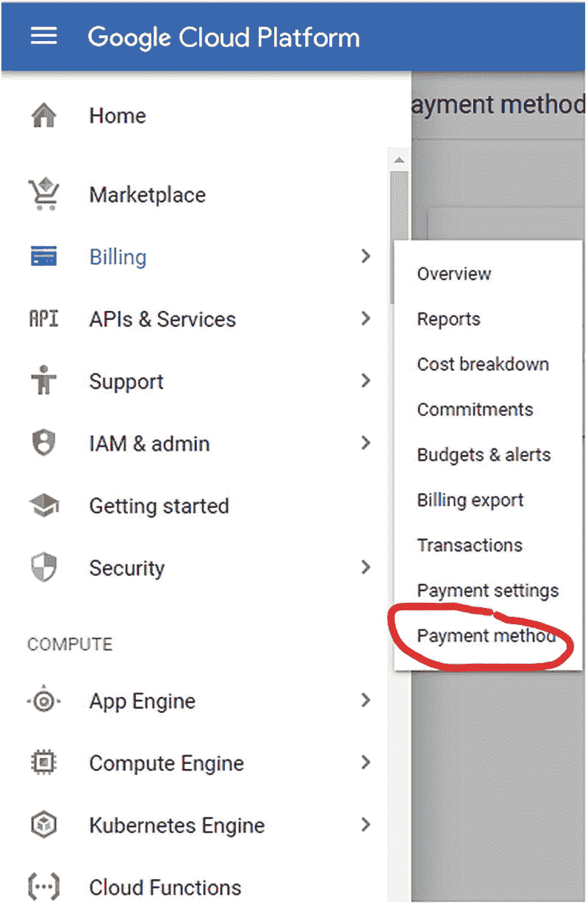
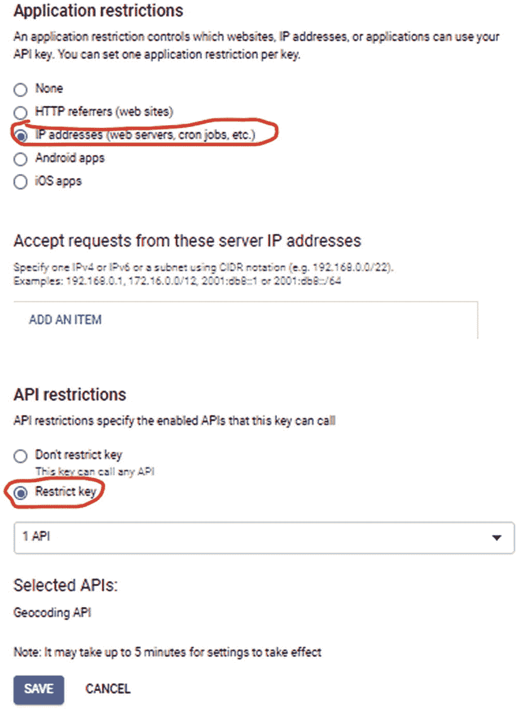

# 8. 使用 R 和 Python 创建计算列

在 Power Query 中，一项困难的任务是添加基于复杂数学公式的计算列。但在 R 或 Python 中，这个问题并不存在。R 由统计学家构建，因此它被设计用于执行复杂的统计和数学计算。Python 也是如此。Python 不仅用于数据科学，还用于其他计算密集型领域，如工程和物理学。与 R 类似，Python 经过优化，能够执行在 Power Query 中使用 M 语言无法实现的计算。因此，当您需要在 Power BI 中基于复杂计算添加计算列时，应考虑利用 R 或 Python。您不仅会受益于 R 和 Python 能更好地处理复杂计算这一事实，而且在许多情况下，您可能会发现 R 和/或 Python 拥有一个预构建的函数，可以为您完成繁重的工作。

让我们用一个场景来说明这一点。假设您是 Gee's Trucking, Inc. 的高级分析师。Gee's Trucking, Inc. 最近收购了另一家卡车运输公司，现在他们拥有超过 100 名司机，在印第安纳州印第安纳波利斯市区的三个枢纽站工作。

老板 Gee Troll 想要计算每位员工上班的通勤距离，以估算平均通勤距离。最终，他想知道如果他的司机更换枢纽站，是否有人可以缩短通勤距离。您知道，您可以使用大学学到的*哈弗辛*公式轻松估算两个地理位置之间的距离。

*哈弗辛*公式可用于根据两点的经度和纬度估算地球表面两点之间的距离。该公式之所以有效，是因为地球的形状类似于球体。

您向经理提出了四种解决方案：两种使用 R，两种使用 Python。两种 R 解决方案包括一个自定义解决方案和一个利用预构建函数的解决方案。Python 的两种解决方案也是如此。所有四种解决方案都需要对地址进行地理编码。

地理编码是将地址转换为由纬度和经度值组成的地理坐标的过程。纬度测量一个地理位置距离赤道有多北或多南，经度测量一个地理位置距离本初子午线有多东或多西。

以下是该过程的基本步骤：

1.  生成一个 Google API 密钥，用于与 *Google Geocoding API* 通信。
2.  在 R 和 Python 中使用 *Google Geocoding API* 对地址进行地理编码。
3.  使用 R 和 Python 中的自定义函数计算每位员工家庭地址与其工作枢纽站之间的距离。
4.  使用 R 和 Python 中的预构建函数计算每位员工家庭地址与其工作枢纽站之间的距离。

让我们从生成您的 Google API 密钥开始。

## 创建 Google Geocoding API 密钥

### 步骤 1：登录 Google 控制台

通过访问以下 URL 登录 Google 控制台：[`https://console.cloud.google.com/`](https://console.cloud.google.com/)。如果您没有 Google 帐户，则需要创建一个；否则，您应该能够使用您的凭据登录控制台。

### 步骤 2：设置结算帐户

为了使用 Google API，您的帐户需要关联一种付款方式。在撰写本文时，Google 提供 300 美元的赠金用于测试其 API，这足以完成此演示。如果您超出了免费分配的赠金额度，Google 将使用您提供的付款方式来确保付款。要设置您的付款方式，请按图 8-1 所示，在菜单中选择 *导航菜单* ➤ *结算* ➤ *付款方式*。



图 8-1

设置 Google 付款方式

### 步骤 3：添加新项目

接下来，您需要创建一个启用了地理编码的项目。执行以下菜单选择来创建项目：*导航菜单* ➤ *IAM 与管理* ➤ *管理资源*。菜单选择如图 8-2 所示。


图 8-2

导航至管理资源

点击屏幕右上角的 *创建项目* 按钮，如图 8-3 所示。


图 8-3

创建新的 Google 项目

填写表单以创建项目。

### 步骤 4：启用 Geocoding API

执行以下步骤以在您的项目中启用地理编码：

1.  选择 *导航菜单* ➤ *API 和服务* ➤ *库*，如图 8-4 所示。

    

    图 8-4

    导航至库

2.  在 *搜索 API 和服务* 文本框中搜索 *Geocoding API*，如图 8-5 所示。

    

    图 8-5

    搜索 Geocoding API

3.  点击 *启用* 按钮启用 *Geocoding API*。

4.  通过执行以下步骤创建凭据：
    *   在菜单栏中选择 *导航菜单* ➤ *API 和服务* ➤ *凭据*。
    *   点击 *创建凭据* 并选择 *API 密钥*，如图 8-6 所示。

      

      图 8-6

      生成 API 密钥

    *   应该会出现一个 API 密钥，并且您会收到限制该 API 密钥的选项。您希望对 API 密钥添加限制，以帮助防止未经授权的使用。点击 *限制密钥* 来设置您的限制。您将看到图 8-7 中的 Web 表单。对于此练习，我建议仅接受来自您 IP 地址的请求，并将密钥限制为仅用于 *Geocoding API*。您可以使用图 8-7 中的配置来完成此操作。完成配置后，点击 *保存* 按钮进行保存。

      

      图 8-7

      配置 API 限制

5.  现在您已拥有一个配置了限制的 API 密钥。将您的密钥保存在安全的地方。如果您丢失了它，可以返回 Google 控制台获取您的 API 密钥副本。


## 使用 R 对地址进行地理编码

现在你已经配置好 Google API 密钥，可以使用 R 来调用该 API，对 `EmployeeList.csv` 文件中的地址进行地理编码。地理编码过程会将每个地址转换为一个坐标点，该坐标点由 `经度` 和 `纬度` 值定义，代表地球上的一个位置。`经度` 值表示你位于 `本初子午线` 以东或以西多远，而 `纬度` 值表示你位于 `赤道` 以北或以南多远。将地址转换为这种格式，使得执行 `空间分析` 成为可能。在本练习中，你将执行的空间分析类型是估算两个地址之间的距离。清单 8-1 中的脚本展示了如何通过利用 `Google API` 在 R 中对地址进行地理编码。

```
library(tidyverse)
library(ggmap)
register_google(key = "")
setwd("")
EmployeeList <- read_csv("EmployeeList.csv")
EmployeeList <- EmployeeList %>% 
  mutate_geocode(EmployeeAddress, sensor = FALSE) %>%
  rename(lon_EmployeeAddress = lon, lat_EmployeeAddress = lat) %>%
  mutate_geocode(TerminalAddress, sensor = FALSE) %>%
  rename(lon_TerminalAddress = lon, lat_TerminalAddress = lat)
write_csv(EmployeeList, "EmployeeList.csv")
清单 8-1
使用 R 通过 Google API 对地址进行地理编码
```

在本书的这个阶段，你已经对 R 有了相当不错的理解，因此我不会像本书早期那样对解释过于详尽。以下是对脚本按逻辑步骤进行的简洁说明：

1. 首先导入所需的包。本脚本引入了一个新包 `ggmap`。`ggmap` 包的主要用途是可视化空间数据，但在这里你将用它来对地址进行地理编码。

2. 你使用 Google 地理编码 API 服务来对地址进行地理编码。为此，你需要使用 `register_google()` 函数注册你的 API 密钥。

3. 接下来，你读取 `Employee.csv` 文件。

4. 接着，你使用 `dplyr` 和来自 `ggmap` 的 `mutate_geocode()` 动词，将地理编码信息添加到你的数据集中。与 `dplyr` 中的 `mutate()` 动词类似，`mutate_geocode()` 用于向数据框添加或投影新列。`mutate_geocode()` 专门用于添加传递给它的地址的坐标。它会添加一个名为 `lon` 的列（包含传递给它的地址的经度）和一个名为 `lat` 的列（包含传递给它的地址的纬度）。

5. 然后，你使用 `dplyr` 中的 `rename()` 动词为 `lon` 和 `lat` 列赋予更有意义的名称。

   使用 `dplyr` 重命名列有两种选择：`rename()` 和 `select()`。`rename()` 与 `select()` 的不同之处在于，`rename()` 会保留数据集中的所有其他列，而不仅仅是正在重命名的列；而 `select()` 只保留你在 select 动词中指定的列，无论这些列是你正在重命名的列，还是你从数据框中选择的列。

6. 你对 `TerminalAddress` 重复步骤 4 和 5。

在本练习中，你能够通过 R 与 `Google API` 通信，对地址进行地理编码。当你不处于高级容量时，使用 Power Query 进行 API 调用并不容易。如果你使用的是 `Power BI Premium`，你可以选择使用 `Microsoft 认知服务`，但也仅此而已。使用 R 和 Python，则没有这个限制。在这个例子中，我们使用了 `Google API` 来对地址进行地理编码，但在本书后面，我们将展示如何利用其他 API，例如 `IBM Watson 自然语言理解`。在下一节中，你将学习如何在 Python 中对地址进行地理编码。

## 使用 Python 对地址进行地理编码

在上一节中，你通过 R 使用 `Google API` 对地址进行了地理编码。在本节中，你将使用 Python 完成同样的操作。如上一节所述，在 Power Query 中使用 API 要困难得多，除非你使用的是相对昂贵的 `Power BI Premium`。以下清单 8-2 中的脚本展示了如何通过利用 `Google API` 在 Python 中对地址进行地理编码。

```
import pandas as pd
import os
from geopy import geocoders
g_api_key = ""
g = geocoders.GoogleV3(g_api_key)
os.chdir("")
EmployeeList = pd.read_csv("EmployeeList.csv")
EmployeeList["EmployeeAddressGC"] = \
EmployeeList["EmployeeAddress"].apply(g.geocode)
EmployeeList["lat_EmployeeAddress"] = \
EmployeeList["EmployeeAddressGC"].apply(lambda x: x.latitude)
EmployeeList["lon_EmployeeAddress"] = \
EmployeeList["EmployeeAddressGC"].apply(lambda x: x.longitude)
EmployeeList["TerminalAddressGC"] = \
EmployeeList["TerminalAddress"].apply(g.geocode)
EmployeeList["lat_TerminalAddressGC"] = \
EmployeeList["TerminalAddressGC"].apply(lambda x: x.latitude)
EmployeeList["lon_TerminalAddress"] = \
EmployeeList["TerminalAddressGC"].apply(lambda x: x.longitude)
cols = ["EmployeeAddressGC", "TerminalAddressGC"]
EmployeeList.drop(cols, inplace=True)
EmployeeList.to_csv("EmployeeList.csv", index = False)
清单 8-2
使用 Python 通过 Google API 对地址进行地理编码
```

由于在本书的这个阶段，你应该已经对 Python 有了很好的理解，因此代码解释不会像本书早期那样冗长。以下是对上述 Python 脚本按逻辑步骤进行的说明：

1. 首先导入所需的库。本脚本中使用的新模块是来自 `geopy` 库的 `geocoders` 模块。该模块用于处理地理编码。

2. 接下来，你创建一个基于 `Google API` 类 `GoogleV3` 的对象 `g`。该对象将用于查询 `GoogleV3` API 类，以对地址进行地理编码。

3. 然后，你读取 `Employee.csv` 文件。

4. 数据集中包含两个需要地理编码的地址：`EmployeeAddress` 地址和 `TerminalAddress` 地址。首先，通过使用 `EmployeeAddress` 列的 `apply` 方法，应用对象 `g` 的 `geocode` 函数，对 `EmployeeAddress` 进行地理编码，代码如下：

```
    EmployeeList["EmployeeAddressGC"] = EmployeeList["EmployeeAddress"].apply(g.geocode)
```

上述代码行创建了一个 `location.Location` 对象，其中包含你需要的地理编码信息以及其他内容。该对象存储在 `EmployeeList["EmployeeAddressGC"]` 字段中。你将在后续步骤中从该对象中提取信息。

5. 接下来，通过从步骤 4 中创建的 `EmployeeAddressGC` 列提取信息，创建 `lat_EmployeeAddress` 列。如前所述，如果 Google 成功对你发送的地址进行了地理编码，Google 将向你发送一个包含地址、纬度和经度的 `location.Location` 对象。你感兴趣的是纬度和经度。你可以通过对 `EmployeeAddressGC` 字段应用 `lambda` 函数，从 `location.Location` 中提取这些信息。

   `lambda` 函数是一个只有单个表达式的匿名函数。它们通过关键字 `lambda` 标识，后跟参数，再后跟表达式，如下所示：`lambda arguments: <expression>`。它们提供了一种简洁的方式，将函数应用于 `pandas` 数据框。

   使用以下 lambda 函数从 `EmployeeAddressGC` 中提取纬度：`lambda x: x.latitude`。lambda 函数中的 `x` 代表 `EmployeeAddressGC` 字段。代码 `x.latitude` 使你能够访问 `x` 中的纬度属性。

6. 接下来，使用与步骤 5 相同的步骤创建 `lon_EmployeeAddress` 列，但将纬度替换为经度。


7. 接下来，对`TerminalAddress`字段重复步骤 4、5 和 6。

8. 接下来，从数据框中移除不需要的列。你只需要`EmployeeAddressGC`和`TerminalAddressGC`来提取员工地址和终端地址的经纬度。这些字段不再需要，因此可以移除。一个简单的方法是使用`EmployeeList`数据框的`drop`方法。通过以下代码实现：

```
cols = ["EmployeeAddressGC", "TerminalAddressGC"]
EmployeeList.drop(cols, inplace=True)
```

`cols`变量包含要删除的列列表。默认情况下，`drop`方法不会直接作用于数据框。如果你希望它直接作用于数据框并永久删除指定列，需要将`inplace`参数设置为`True`。

在本练习中，你通过 Python 与 Google API 通信，对地址进行了地理编码。你能够在 Python 中相对轻松地完成一项在 Power Query 中会困难得多的任务。在下一节中，你将学习如何使用 R 构建的自定义函数，利用地理编码信息估算以英里为单位的距离。

## 使用 R 中的自定义函数计算距离

在之前的练习中，你设置了地理编码 API 并对地址进行了地理编码。现在数据已处于合适的格式，可以计算距离了。清单 8-3 是 R 脚本，用于计算员工地址与其终端之间的英里距离。

```
library(tidyverse)
ComputeDist ")
EmployeeList %>%
mutate(
`Custom Distance Function Results` =
round(
ComputeDist(
lon_EmployeeAddress,
lat_EmployeeAddress,
lon_TerminalAddress,
lat_TerminalAddress
),1
)
)
Listing 8-3
Calculating distance in R using a custom function
```

该代码分解为以下逻辑步骤：

1. 首先，需要加载所需的包。此脚本中唯一需要的是`tidyverse`元包，因为所需的大部分功能已包含在基础 R 中。

2. 接下来，创建一个名为`ComputeDist`的自定义函数来计算距离。`ComputeDist`自定义函数需要四个参数：分别是员工地址和终端地址的纬度和经度。

   注意计算过程相当复杂。在 Power Query 中使用 M 语言进行此类数学运算会更加困难，且性能不如 R。我不会解释此计算的工作原理，因为它超出了本书的范围。此示例的目的是展示 R 在执行密集型数学计算方面比 M 更出色。

3. 接下来，加载`EmployeeList.csv`文件。

4. 接下来，使用`dplyr`中的`mutate()`动词向`EmployeeList`数据框添加一个名为`Custom Distance Function Results`的新列。使用名称`Custom Distance Function Results`是为了明确表明使用了自定义函数来计算距离。将所需的四个参数传递给函数，并使用`round()`函数将返回值四舍五入到一位小数。

5. 最后要做的是复制整个脚本，并通过`GetData`中的 R 脚本编辑器将其添加到 Power BI 数据模型中。

在本练习中，你通过五个简单的步骤，基于自定义函数创建了一个计算列。使用自定义函数的好处在于，你能够将执行计算所需的数学复杂性抽象到自定义函数中，并在需要时调用它。这样得到的代码更易读且更易于维护。

## 使用 Python 中的自定义函数计算距离

在之前的步骤中，你使用 Google 地理编码 API 对地址进行了地理编码。现在数据已处于合适的格式，可以计算距离了。清单 8-4 是 Python 脚本，用于估算员工地址与其终端之间的英里距离。

```
import pandas as pd
import numpy as np
import os
from math import cos, sin, atan2, pi, sqrt, pow
def ComputeDist(row):
R = 6371 / 1.609344 #radius in mile
delta_lat = row["lat_TerminalAddressGC"] -
row["lat_EmployeeAddress"]
delta_lon = row["lon_TerminalAddress"] -
row["lon_EmployeeAddress"]
degrees_to_radians = pi / 180.0
a1 = sin(delta_lat / 2 * degrees_to_radians)
a2 = pow(a1,2)
a3 = cos(row["lat_EmployeeAddress"] * degrees_to_radians)
a4 = cos(row["lat_TerminalAddress"] * degrees_to_radians)
a5 = sin(delta_lon / 2 * degrees_to_radians)
a6 = pow(a5,2)
a = a2 + a3 * a4 * a6
c = 2 * atan2(sqrt(a), sqrt(1 - a))
d = R * c
return d
os.chdir("")
EmployeeList = pd.read_csv("EmployeeList_Python.csv")
EmployeeList["Custom Function"] = \
EmployeeList.apply(lambda row: ComputeDist(row), axis=1)
Listing 8-4
Calculating distance in Python using a custom function
```

让我们将上述代码分解为逻辑步骤：

1. 首先，需要加载所需的库。此脚本中新增的是来自`math`库的一些函数。这些函数用于计算距离。

2. 接下来，创建一个名为`ComputeDist()`的自定义函数，用于估算两个地理点之间的英里距离。该函数需要一个参数，即数据框中的整行。你将从中提取执行计算所需的信息。计算过程非常复杂，在 Power Query 中使用 M 语言进行此类数学运算会更加困难，且性能不如 Python。我不会解释此计算的工作原理，因为它超出了本书的范围。目的是展示 Python 在执行密集型数学计算方面比 M 更出色。

3. 接下来，加载`EmployeeList.csv`文件。

4. 接下来，使用`apply`方法在`EmployeeList`数据框上应用一个`lambda`函数。完整的代码行如下：

```
EmployeeList["Custom Function"] = (
EmployeeList.apply(lambda row: ComputeDist(row), axis=1))
```

上述代码中使用括号可以让你在后续行继续编写代码，使代码更易读。后续行必须遵循`PEP8`中定义的缩进规则。`PEP8`概述了格式化 Python 代码的规则。你可以通过此 URL 了解更多关于`PEP8`的信息：[`https://realpython.com/python-pep8/`](https://realpython.com/python-pep8/)。

你在本章前面已经接触过`lambda`函数。之前使用的`lambda`函数应用于数据框中的特定列，但此示例中的`lambda`函数应用于整个数据框。当你将`lambda`函数应用于数据框时，你可以选择告诉 pandas 是将其应用于`0 轴`还是`1 轴`。如果应用于`0 轴`，则`lambda`函数将从上到下应用；但如果应用于`1 轴`，则从左到右应用。让我们通过一个示例来简化说明。

让我们用下面的代码创建一个小的数据框，以说明如何将`lambda`函数应用于数据框：

```
df = pd.DataFrame((
{'A':[10, 20, 30], 'B':[15, 5, 10]}))
```

上述代码生成以下数据框：

|   | **A** | **B** |
|---|-------|-------|
| 0 | 10    | 15    |
| 1 | 20    | 5     |
| 2 | 30    | 10    |

如果你想获取每列的总和，需要沿着`0 轴`操作，以便从上到下进行。使用以下代码实现：

```
df.apply(sum, axis = 0)
```

该代码产生以下输出：

| A | 60 |
|---|----|
| B | 30 |


通过将`axis`设置为`0`，代码将沿每一列“自上而下”工作，并对每一列中的所有元素求和。如果将`axis`设置为`1`，它将从左到右对每一行工作，并对每一行中的所有元素求和。因此，如果将`axis`更改为`1`，如下代码所示：

```
df.apply(sum, axis = 1)
```

将产生以下输出：

|   | 0  | 1  | 2  |
|---|----|----|----|
| 0 | 25 | 25 | 40 |

现在您已经理解了`lambda`函数在应用于数据帧时的工作原理。让我们回顾一下原始脚本中这一步的代码。代码如下：

```
EmployeeList["Custom Function"] = (
    EmployeeList.apply(lambda row: ComputeDist(row),
    axis=1))
```

上述代码将`lambda`函数应用于`1`轴。换句话说，它从左到右对每一行工作。整行被传递给`ComputeDist()`函数。`ComputeDist()`函数从传递给它的行对象中提取计算所需的信息。请注意，当您对数据帧使用`apply`方法时，并不局限于聚合函数。

5. 将上述清单 8-4 中的脚本复制到 Power BI 的*Python 脚本编辑器*（位于*获取数据*中），以将脚本生成的数据帧添加到 Power BI 数据模型中。

与之前的 R 练习类似，您通过五个简单步骤，基于自定义函数创建了一个计算列。与 R 一样，当您在 Power BI 中使用 Python 通过自定义函数创建计算列时，您能够获得代码更易读、更易维护的好处。

## 在 Power BI 中使用 R 通过预构建函数计算距离

在前两节中，您学习了如何在 R 和 Python 中开发自定义函数，以高效执行数学密集型计算。尽管实现一个数学密集型自定义函数并不困难，但通常存在更简单的解决方案。在撰写本文时，R 编程语言拥有超过 15,000 个包，Python 编程语言拥有超过 110,000 个库。通常，您可以在 R 和 Python 各自提供的众多包和库中找到问题的解决方案。

计算两个地理点之间的距离就是这种情况。您无需在 R 代码或 Python 代码中重构数学公式，而是可以利用预构建的函数。在本练习中，您将学习如何利用 R 中的`geosphere`包来执行距离计算。您将使用的完整脚本见清单 8-5。

```
library(tidyverse)
library(geosphere)
setwd("")
EmployeeList <- read_csv("EmployeeList.csv")
EmployeeList <- EmployeeList %>%
  rowwise() %>%
  mutate(
    `Geosphere Function Result` =
      distHaversine(
        c(lon_EmployeeAddress, lat_EmployeeAddress),
        c(lon_TerminalAddress, lat_TerminalAddress)
      ) / 1609.34
  )
```

**清单 8-5** 使用 R 中的预构建函数计算距离

让我们将代码分解为逻辑步骤：

1. 首先，加载所需的包。此脚本中的新包是`geosphere`包。您将利用此包执行空间计算。

2. 接下来，将`EmployeeList.csv`文件的内容加载到`EmployeeList`数据帧中。

3. 接下来，向`EmployeeList`数据帧添加一个名为`Geosphere Function`的新列。您正在使用`dplyr`中的链式方法创建一个工作流，该工作流向数据帧添加一列，用于基于`distHaversine`函数计算距离。工作流的第一步告诉`dplyr`您从原始数据帧开始。工作流的第二步将数据帧传递给`rowwise()`函数。`rowwise()`函数是必需的，因为后续步骤中使用的`distHaversine()`函数不是向量化的。

    *向量化*函数同时作用于整个向量。数据帧中的列就是向量。当您对向量应用*向量化*函数时，无需实现循环逻辑。

    `rowwise()`函数告诉工作流中的所有后续任务，在计算中仅考虑当前行中的元素。最后一步使用`geosphere`包中的`distHaversine()`函数执行计算。`distHaversine()`函数返回以米为单位的距离，因此将结果乘以`0.000621371`可将值转换为英里。

4. 与往常一样，您需要将清单 8-5 中的整个脚本复制到 Power BI 的 Python 编辑器中，以便将生成的数据集添加到 Power BI 数据模型中。

在本练习中，您能够利用`geosphere`包中的预构建函数，该函数为您抽象了计算的复杂性。所使用的函数是`distHaversine()`函数。您只需向该函数传递所需的参数，它就会为您执行计算。在下一个练习中，您将在 Python 中使用类似的功能。


## 在 Power BI 中使用 Python 预置函数计算距离

以下 Python 脚本（清单 8-6）使用预置函数来计算距离。

```python
import pandas as pd
import os
from haversine import haversine
os.chdir(r"")
EmployeeList = pd.read_csv("EmployeeList.csv")
def useHaversine(row):
point_one = \
(row["lat_EmployeeAddress"], row["lon_EmployeeAddress"])
point_two = \
(row["lat_TerminalAddress"], row["lon_TerminalAddress"])
return haversine(point_one, point_two, unit="mi")
EmployeeList["Haversine Function Result"] = \
EmployeeList.apply(lambda row: useHaversine(row), axis=1)
```

让我们将上述代码分解为逻辑步骤：

1. 首先，你需要加载所需的库。本脚本中的新库是 `haversine` 库。该库用于执行空间计算。
2. 接着，将 `EmployeeList.csv` 文件的内容加载到 `EmployeeList` 数据框中。
3. 然后，定义 `useHaversine()` 函数。该函数接受整行作为输入。使用你已经学过的方法，可以轻松地从传递给函数的行中提取信息。本例中的 `useHaversine()` 自定义函数使用 `haversine` 库中的 `haversine()` 函数来计算距离。你需要向 `haversine()` 函数传递三个参数：`location_one` 的坐标、`location_two` 的坐标以及你希望距离使用的单位。`location_one` 和 `location_two` 变量需要以 `tuple`（元组）的形式存在，元组的第一个元素是 `latitude`（纬度），第二个元素是 `longitude`（经度）。

   将 `Haversine` 库中的 `Haversine()` 函数封装在 `useHaversine()` 自定义函数中的原因是，`Haversine()` 函数并非向量化函数。如果 `Haversine()` 函数是向量化的，它就能并行处理数据框中的所有行，但由于它不是，它一次只能处理一行。这就是为什么需要将单行传递给 `useHaversine()` 函数。

4. 接下来，使用以下代码创建一个名为 `Haversine Function Result` 的列，该列将包含员工地址与终端之间的距离：

   `EmployeeList["Haversine Function Result"] = EmployeeList.apply(lambda row: useHaversine(row), axis=1)`

   一个 `lambda` 函数被应用于 `EmployeeList` 数据框的 `axis 1`（轴 1）。正如你在之前的自定义函数示例中学到的，这使你能够将整行传递给 `useHaversine()` 函数。

5. 最后但同样重要的是，复制该脚本并将其粘贴到 Power BI 的 Python 编辑器中，以便将生成的数据框添加到 Power BI 数据模型中。

在本练习中，你成功利用了 `Haversine` 库中的预置函数，该函数为你抽象了使用 `Haversine` 公式进行计算的复杂性。所使用的函数是 `Haversine()` 函数。就像在 R 中一样，你能够利用一个预置函数，通过 Python 为你执行数学计算。你所需要做的只是调用一个函数。

## 总结

本章阐述了两项非常重要的技术。第一项技术是如何使用 R 和 Python 基于复杂的数学公式创建计算列。本章的示例展示了 R 和 Python 在处理复杂数学运算方面比 Power Query 中的 M 语言要优秀得多。在大多数场景下，将 R 和 Python 与 DAX 进行比较时，情况也是如此。第二项技术展示了如何分别使用 R 和 Python 中众多包和库里的预置函数。该练习使用了基于 `Haversine` 公式的 R 和 Python 预置函数，但很可能在 15,000 多个 R 包和 110,000 多个 Python 库中，存在一个预置函数，你可以用它来为你抽象距离计算的复杂性，满足你绝大部分的计算需求。

在 Power BI 中使用 R 和 Python 创建计算列的能力，可以用来克服 Power Query 的许多其他限制。除了执行复杂计算，你还可以使用 R 或 Python 来：

-   创建基于算法的计算列，用于填补缺失数据点的值，这些算法比使用均值或众数等常见方法更准确
-   如你在第 7 章所学，创建基于复杂字符串操作的计算列
-   创建基于机器学习算法的计算列，你将在第 9 章学习该算法
-   以及更多其他用途

可能性是无限的！

