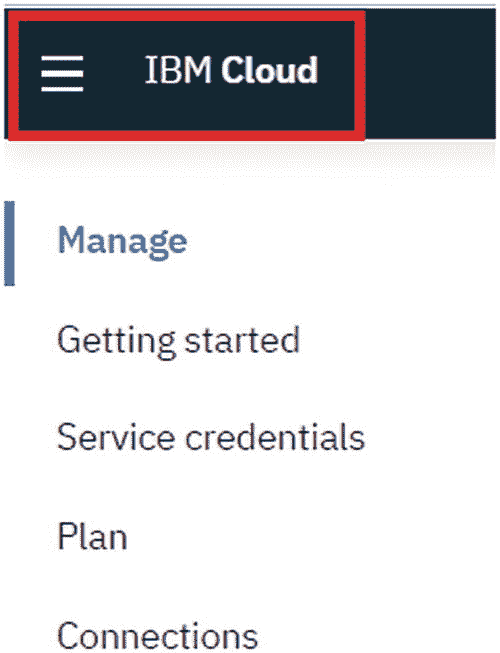
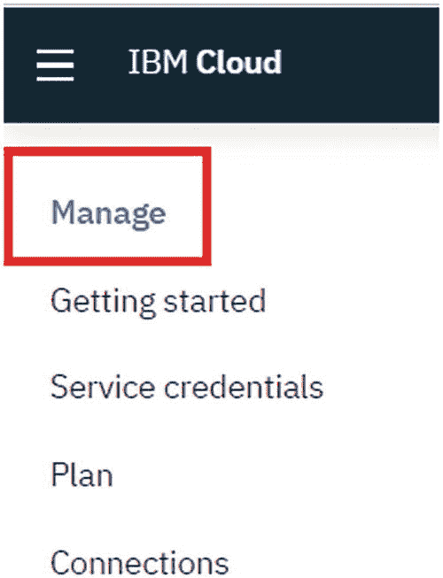
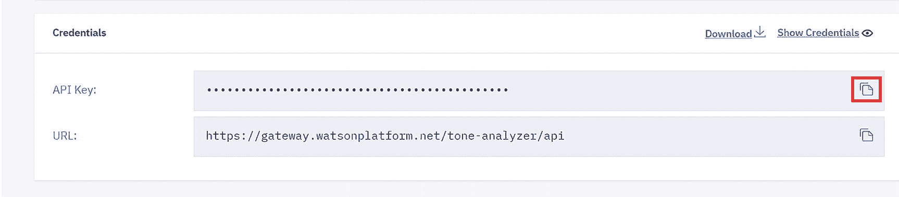

# 使用预构建的 AI 模型增强 Power BI 数据模型

开发 `AI 模型`并非易事。开发一个能够良好泛化真实数据的模型，可能需要耗费大量资源和时间。这通常需要一个由数据科学家和数据工程师组成的团队才能完成。幸运的是，像 `Microsoft` 和 `IBM` 这样的大型软件供应商已经开发出了复杂的 `AI 模型`，这些模型可以通过 `API 调用`轻松访问。这些模型基于多年的研究成果，你很难自行复制。

在本节中，你将学习如何使用这些模型来增强你的 Power BI 数据模型。你将学习如何使用 `Microsoft 认知服务`来执行`情感分析`。

情感分析用于检测一段文本（句子、段落、推文等）的情感是积极还是消极。在 `Microsoft 认知服务`中，这是通过分配一个介于 0 和 1 之间的数值分数来完成的。分数越接近 0，文本越消极；分数越接近 1，文本越积极。

你可以使用`情感分析`来增强 Power BI 数据模型，方法是为维度表添加属性。例如，如果你是一家餐厅，客户评论的平均情感分数可以作为客户维度表中某个属性的基础。这样的属性可用于发现诸如`情感`与客户流失之间的关联。以餐厅为例，你可能会发现大多数低情感分数与购买特定菜单项的客户相关。

让我们来了解一下使用 `Microsoft 认知服务`将`情感分析`添加到 Power BI 模型所需的步骤。本示例将仅使用 Python 完成，因为目前不支持 R。你也可以通过 `Power BI 数据流`使用 `AI Insights` 来执行此任务，但这需要 `Power BI Premium`，它相对昂贵，超出了许多 Power BI 用户的价格范围。

## 在 Azure 中设置认知服务

在 Power BI 中使用 `Microsoft 认知服务`之前，你必须在 `Azure` 中对其进行配置。如果你按照本书引言中的步骤创建了 `Azure 账户`，那么你将拥有一个。如果你是 `Azure` 新手，我强烈建议你注册一个免费账户。在撰写本文时，Microsoft 为第一个月提供了 200 美元的免费额度！如果你在服务的第一个月内完成本书中所有与 `Azure` 相关的活动，这些额度绰绰有余。如果你没有 `Azure 账户`，请前往本书引言获取注册说明。

如果你已有 `Azure 账户`，则需要登录 `Azure 门户`。你可以通过访问 [`portal.azure.com`](https://portal.azure.com) 来登录。登录你的 `Azure 账户`后，点击页面左上角的 `创建资源` 按钮。接下来点击 `AI + 机器学习` ➤ `文本分析`。这些操作将带你进入一个需要填写的表单，以设置 `文本分析` 服务。在 `名称` 文本框中为资源指定一个有意义的名称，在 `订阅` 文本框中附加一个订阅，在 `位置` 文本框中将位置设置为离你最近的区域，在 `定价层` 文本框中选择适合你需求的定价层，并在 `资源组` 文本框中将资源附加到现有资源组或创建一个新的资源组。如果你仍在第一个月内，则包含 200 美元额度的订阅将作为订阅选项提供给你。

## 数据科学虚拟机 (DSVM)

如前所述，本示例将仅使用 Python 完成，因为不支持 R。除了仅使用 Python 之外，本示例还将在 `Microsoft 数据科学虚拟机 (DSVM)` 中完成。推荐使用 `DSVM` 的原因是它预配置了数据科学所需的大部分工具。它预装了 Python 的 `Anaconda` 发行版、`Power BI`、`SQL Server`、`Jupyter Lab` 和 `Azure Data Studio` 等。自行配置这样的环境会很困难，但使用 `DSVM`，你可以按需快速启动一个。

在继续之前，你需要在 `DSVM` 中完成一些操作来配置你的环境。你需要为 Microsoft 认知服务安装一些包。以下是需要执行的步骤：

1. `启动你的 DSVM`：你可以在个人桌面上进行开发，但我强烈建议你使用 `DSVM`。如果你选择自行操作，请从你选择的环境开始。

2. `打开 conda 提示符`：要打开 conda 提示符，请在 Windows 搜索栏中键入 `anaconda prompt` 进行搜索。你应该会看到它出现在搜索列表中。右键单击它，然后以管理员身份启动。

3. `激活用于 Azure 开发的 Python 环境`：建议使用 `DSVM` 中预装的 `AzureML` 环境。要激活 `AzureML` 环境，请在 conda 提示符中键入以下内容：

    ```
    conda activate AzureML
    ```

    如果你在自己的环境中操作，并且不知道应该使用哪个环境，请在 conda 提示符中键入 `conda env list` 以获取可用环境列表。

4. `键入以下代码以安装库`：确保通过使用步骤 3 中的代码激活所需环境，在正确的环境中安装库。

    ```
    pip install azure-cognitiveservices-language-textanalytics
    ```

## 通过 Python 在 Microsoft 认知服务中执行情感分析

在本练习中，你将使用来自 Kaggle 的免费 Yelp 评论数据集。以下是你需要获取数据并在 Power BI 中对其进行评分的步骤。

### 步骤 1：从 Kaggle 获取 Yelp 评论数据

在撰写本文时，该数据集可通过以下 URL 获取：[`www.kaggle.com/yelp-dataset/yelp-dataset/version/4`](http://www.kaggle.com/yelp-dataset/yelp-dataset/version/4)。请确保为本示例下载 `yelp_review` 数据集的 `csv` 版本。该数据集将作为 zip 文件下载。解压 `yelp_review.csv` 文件，并将其保存到仓库中本章的 `Data` 文件夹中。

`yelp_review.csv` 数据集很大。它包含近 530 万条评论。本练习不需要那么多样本，*强烈*建议你使用样本以将成本降至最低。以下脚本从 `yelp_review.csv` 数据集中随机抽取 100 条评论，并将其保存为 `yelp_review_sample.csv` 文件：

```python
import pandas as pd
import numpy as np
import os
os.chdir("set to your working directory")
dfYelpReviews = pd.read_csv("yelp_review.csv")
dfYelpReviewsSample = dfYelpReviews.sample(100, random_state = 1)
dfYelpReviewsSample["id"] = np.arange(len(dfYelpReviewsSample))
dfYelpReviewsSample = dfYelpReviewsSample[["id","text"]]
dfYelpReviewsSample.to_csv(
"yelp_review_sample.csv", index = False)
```

脚本的工作原理如下：

1. `加载所需的库`：`Pandas` 用于一些基本的数据处理，`numpy` 中的 `arange` 函数用于创建行号列，`os` 用于设置工作目录。

2. `读取 yelp_review 数据集`：通过使用 `pandas` 的 `read_csv()` 方法完成。

3. `使用 dfYelpReviewsSample 数据框的 sample 方法创建数据集的样本`：你仅使用两个参数创建了样本。第一个参数是样本大小，在本例中为 100。第二个参数是 `random_state` 参数。如果你像之前一样将该参数设置为 1，那么你的样本将返回与本书作者使用的相同数据集。

### 步骤 2：导入脚本所需的库、模块和函数

此步骤是脚本开发的起点。您将从以下所示的导入语句开始：

```python
import pandas as pd
import ast
import os
from azure.cognitiveservices.language.textanalytics import TextAnalyticsClient
from msrest.authentication import CognitiveServicesCredentials
```

您已经了解前三个库中的两个。`ast` 库是新的。该库中的 `literal_eval()` 函数用于评估表示 Python 表达式的字符串。此功能将在本脚本中使用，并在后续步骤中进行说明。`TextAnalyticsClient` 和 `CognitiveServicesCredentials` 函数用于在下一步与 Microsoft 认知服务进行通信。

### 步骤 3：为脚本中使用的变量赋值

变量的值通过以下代码在脚本中设置：

```python
api_key = ""
endpoint = \
"https://rwtextanalyticsapi.cognitiveservices.azure.com/"
credentials = CognitiveServicesCredentials(subscription_key)
text_analytics = TextAnalyticsClient(
endpoint=endpoint, credentials=credentials)
```

您可以通过在 Azure 中访问文本分析资源来找到 API 密钥和端点的值。两者都可以在“概述”页面中找到。您可以通过单击右上角的“概述”选项卡进入该页面。API 密钥用于创建 `CognitiveServicesCredentials` 的实例。`credentials` 和 `endpoint` 变量一起用于创建 `TextAnalyticsClient` 的实例，该实例被赋值给 `text_analytics` 变量。`text_analytics` 变量将是执行情感分析的主力。

### 步骤 4：将 Yelp 评论数据样本读入 Python

以下代码将样本读入 pandas 数据框。**务必使用样本数据集，而不是整个数据集。** 整个数据集包含近 530 万条评论，这可能会导致您产生不必要的费用。样本数据集中的 100 条观测值足以用于练习。您之前创建的样本数据集包含两个字段：`id` 字段用于标识每条评论，`text` 字段包含将要分析的评论内容。添加了语言字段，以便 Microsoft 认知服务知道使用哪种语言。您使用 `en`，因为这是英语的代码，而评论的语言正是英语。

```python
df = pd.read_csv("")
df["language"] = "en"
```

### 步骤 5：将数据框转换为 Microsoft 认知服务所需的格式

Microsoft 认知服务要求发送给它的情感分析数据是一个字典列表。以下是字典列表的示例：

```python
documents = [
{"id": "1",
"language": "en",
"text": "Football is great sport."},
{"id": "1",
"language": "en",
"text": "Lamar Jackson is the best quarterback."},
{"id": "1",
"language": "en",
"text": "UK football sucks!!! "}
]
```

pandas 数据框的 `to_json()` 方法可用于将 `df` 数据框重新格式化为该格式。为此，您需要将 `orient` 参数设置为 `records`，如下列代码所示：

```python
documents = df.to_json(orient='records')
```

输出被格式化为字典列表，但 Python 并不这样看待它。Python 仅将其视为一个字符串。您需要明确告诉 Python 将 `df.to_json(orient='records')` 的输出评估为 Python 表达式。您可以通过使用 `ast` 库中的 `literal_eval()` 函数来实现这一点，如下列代码所示：

```python
documents = ast.literal_eval(documents)
```

现在，`documents` 变量以正确的格式包含了 Microsoft 认知服务所需的信息。传递给 Microsoft 认知服务的列表中的每个字典都包含三个键/值对。这三个键是：用于唯一标识您正在执行情感分析的每条评论的 `id`、表示您要分析的文本的 `text`，以及您希望进行情感分析所使用的 `language`。

### 步骤 6：使用 text_analytics 对象的情感分析方法对评论进行评分

用于对评论进行评分的代码如下：

```python
response = text_analytics.sentiment(documents=documents, raw = False)
```

它返回一个列表，其中包含传递给 `sentiment()` 方法的每条评论的批处理结果项。每个批处理结果项都包含保存评论信息的属性。您感兴趣的两个属性是 `id` 属性和 `score` 属性。您将在下一步中使用这两个属性来构建包含情感分数的数据框。

### 步骤 7：创建一个数据框来保存情感数据

您已经能够对评论进行评分，并以批处理结果项列表的形式获取返回的信息。如前所述，该列表包含发送给 Microsoft 认知服务的每条评论的批处理结果项。每个批处理结果项都包含公开评论信息的属性。您感兴趣的两个属性是评论的 `id` 和情感分数。

以下是脚本中使用 Microsoft 认知服务返回的每个对象的 `id` 和 `score` 属性来创建数据框的部分：

```python
listSentiments = []
for document in response.documents:
    id = document.id
    score = document.score
    listSentiments.append([id, score])
dfSentiments = pd.DataFrame(
    listSentiments, columns=['ID','Score'])
dfSentiments
```

以下是按步骤分解的脚本说明：

1. **创建一个空列表并将其命名为 `listSentiments`**：第一行创建一个名为 `listSentiments` 的空列表。此列表将填充从 Microsoft 认知服务检索到的输出，并最终在后续步骤中转换为数据框。

2. **使用 `for` 循环遍历 `response.documents` 中的每个文档**：`for` 循环用于遍历 `response.documents` 中的每个文档，以访问情感信息。

3. **获取每个文档的 `id` 和 `score`**：每次迭代返回的文档都包含 `id` 和 `score` 属性。您使用以下代码获取这些值并将其放入各自的变量中：

    ```python
    id = document.id
    score = document.score
    ```

4. **将当前文档的值追加到 `listSentiments` 列表中**：在此步骤中，您通过列表的 `append()` 方法，使用步骤 3 中创建的变量来填充 `listSentiments` 列表。`append()` 方法使用基于这两个变量的列表来追加信息。

5. **创建 `dfSentiments` 数据框**：使用 pandas 的 `DataFrame()` 方法将 `listSentiments` 列表转换为数据框。将包含所需列名的列表传递给 `DataFrame()` 方法的 `columns` 参数，以命名数据框中的列。

## 步骤 8：将数据添加到 Power BI

完整的脚本见代码清单 9-3。

```python
import pandas as pd
import json
import ast
from pandas.io.json import json_normalize
from azure.cognitiveservices.language.textanalytics import (
TextAnalyticsClient)
from msrest.authentication import CognitiveServicesCredentials
api_key = ""
endpoint = \
"https://rwtextanalyticsapi.cognitiveservices.azure.com/"
credentials = CognitiveServicesCredentials(api_key)
text_analytics = TextAnalyticsClient(
endpoint=endpoint, credentials=credentials)
df = pd.read_csv("")
df["language"] = "en"
documents = df.to_json(orient='records')
documents = ast.literal_eval(documents)
response = text_analytics.sentiment(
documents=documents, raw = False)
listSentiments = []
for document in response.documents:
id = document.id
score = document.score
listSentiments.append([id, score])
dfSentiments = pd.DataFrame(
listSentiments, columns=['ID','Score'])
```

代码清单 9-3：使用 Microsoft 认知服务执行情感分析的 Python 脚本。

将代码复制并粘贴到 Power BI 的 Python 编辑器中。这样做会将 `dfSentiments` 数据框暴露给 Power BI 数据模型。

## 使用 Microsoft 认知服务以外的服务将 AI 应用于 Power BI 数据模型

Microsoft 认知服务提供了丰富的 AI 模型供您利用，但它们并不能覆盖所有情况。幸运的是，IBM 和 Google 等其他供应商提供的服务功能极其强大，可以帮助填补这一空白。您会发现，某些服务（如情感分析）是所有供应商共有的，但也有一些服务可能为特定供应商所独有。其中一项服务就是 IBM Watson Natural Language Understanding 提供的 Tone Analyzer。

在本章中，您将学习如何利用 IBM Watson Natural Language Understanding 在 Power BI 中使用其 Tone Analyzer API。Tone Analyzer 用于返回文本的语气。它可以检测到的语气包括快乐、悲伤、兴奋等。本练习将仅使用 Python 完成，因为在撰写本文时，IBM Watson 尚不支持 R。下一节将介绍如何在 IBM Watson Natural Language Understanding 中设置您的账户，随后一节将介绍如何在 Power BI 中通过 Python 脚本使用该服务。

### 在 IBM Watson 中配置 Tone Analyzer 服务

与 Azure 类似，您需要先获取一个账户，然后设置 Tone Analyzer 服务。以下是具体步骤。

#### 步骤 1：注册 IBM Cloud 账户

访问 [`www.ibm.com/cloud/watson-natural-language-understanding/pricing`](http://www.ibm.com/cloud/watson-natural-language-understanding/pricing) 注册一个 IBM Watson Natural Language Understanding 账户。

#### 步骤 2：登录 IBM Cloud

注册后，访问此 URL 进行登录：[`https://cloud.ibm.com/login`](https://cloud.ibm.com/login)。

#### 步骤 3：进入 Tone Analyzer 页面

1.  点击页面顶部的“创建资源”按钮。这将带您进入一个页面，其中列出了大量可用服务。
2.  在页面右上角的“搜索目录...”搜索框中搜索 Tone Analyzer 服务。这将过滤列表，仅显示 Tone Analyzer 服务。看到后，点击 Tone Analyzer 服务。

#### 步骤 4：定义您的 Tone Analyzer 服务

1.  在“选择区域”部分，从下拉框中选择离您最近的区域。
2.  在“选择定价计划”部分，选择 Lite 计划。该计划足以完成本练习。如果未来需求超出每月免费提供的 2500 次 API 调用，或者您有隐私方面的顾虑，则可能需要升级您的计划。
3.  在“配置您的资源”部分：
    *   在“服务名称：”部分为您的计划起一个有意义的名称。
    *   选择一个资源组。如果您是 IBM Watson Natural Language Understanding 的新用户，可以使用默认资源组。如果您在 IBM Watson Natural Language Understanding 中已有资源组，则可以选择它们。与 Azure 类似，资源组允许您将 IBM Watson Natural Language Understanding 资源组合到一个组中，便于访问和计费。
    *   您可以选择在“标签：”部分添加标签，这有助于进一步组织和分组您的资源。
4.  点击左上角的“创建”按钮来创建资源。

#### 步骤 5：获取您的 API 密钥

当您向 IBM Watson Natural Language Understanding 服务发出 API 调用时，您的 API 密钥将用于验证您的身份。确保 API 密钥的安全*非常*重要。

在步骤 4 中点击“创建”按钮后，您应该会被带到一个可以管理 Tone Analyzer 资源的页面。如果由于某种原因没有，您可以通过点击页面右上角的导航图标（如图 9-1 所示）来访问它。


*图 9-1：IBM 导航菜单*

您会看到的选项之一是“资源列表”。点击它以进入“资源列表”页面。您应该在“服务”部分看到您的 Tone Analyzer 资源。点击它以进入允许您管理 Tone Analyzer 资源的页面。

到达目标位置后，点击右上角的“管理”选项卡，如图 9-2 所示。


*图 9-2：进入管理 Tone Analyzer 服务页面的链接*

到达后，您可以通过点击 API 密钥旁边的复制图标来获取您的 API 密钥，如图 9-3 所示。


*图 9-3：访问您的 Tone Analyzer 服务 API 密钥*

### 编写 Python 脚本以执行语气分析

既然您已经在 IBM Watson Natural Language Understanding 中设置好了资源，就可以开始开发 Python 脚本了。与 Microsoft 认知服务示例类似，该脚本将对数据进行评分，并生成一个包含评分结果的数据框，该数据框可以导入到 Microsoft Power BI 中。以下是具体步骤。

#### 步骤 1：导入所需的库和模块

您将首先定义脚本所需的导入，如下代码所示：

```python
import json
import pandas as pd
import ast
import os
from ibm_watson import ToneAnalyzerV3
from ibm_watson.tone_analyzer_v3 import ToneInput
from ibm_cloud_sdk_core.authenticators import IAMAuthenticator
```

此脚本使用 `pandas` 库处理一些基本的数据整理任务和 JSON 工作。`ast` 库中的 `literal_eval` 函数用于执行某些 Python 代码的字符串表示形式，而 `ToneAnalyzerV3` 和 `IAMAuthenticator` 用于执行语气分析。关于后两者的更多说明将在后续步骤中给出。

#### 步骤 2：创建 IAMAuthenticator 类的实例

执行此操作所需的代码如下：

```python
authenticator = IAMAuthenticator("")
```

此步骤用于身份验证。它基于您之前生成的 API 密钥初始化一个 `IAMAuthenticator` 对象，并将其赋值给 `authenticator` 变量。

#### 步骤 3：创建 ToneAnalyzerV3 类的实例

实现此操作所需的代码如下：

```python
service = ToneAnalyzerV3(
version='2019-12-22',
authenticator=authenticator
)
```

该代码创建了一个 `ToneAnalyzerV3` 类的实例，你将使用它与 IBM Watson Natural Language Understanding 语调分析器服务进行通信。你需要填充两个参数：`version` 参数和 `authenticator` 参数。`version` 参数用于告知 API 你想要使用的 API 版本。如果在指定日期创建了某个 API 版本，则将使用该版本。否则，将使用指定日期之前创建的最新 API 版本。使用开发期间测试过的日期非常重要，以防止代码出错。

#### 步骤 4：设置服务对象的服务 URL

执行此步骤所需的代码如下：

```python
service.set_service_url(
"https://gateway.watsonplatform.net/tone-analyzer/api")
```

你可以通过转到 IBM Watson Natural Language Understanding 语调分析器资源页面中的“管理”选项卡来找到你的服务 URL。

#### 步骤 5：创建一个数据框，用于保存语调分析所需的数据

代码很直接。你使用 `pandas` 中的 `read_csv()` 方法来检索数据，如下所示：

```python
dfDocuments = pd.read_csv(
"")
```

#### 步骤 6：基于评分数据创建一个数据框

使用以下代码创建一个空列表：

```python
listReturnedUtterance = []
```

语调分析将通过逐个将每个文档发送到 IBM Watson Natural Language Understanding 来完成，结果将以 JSON 格式返回给你。

在语调分析中，一个文档是一组代表分析层次的单词或句子。例如，如果你正在对 Twitter 进行语调分析，它可以是一条推文；如果你正在对餐厅评论进行语调分析，它可以是一条餐厅评论。

返回的 JSON 将被解析，以获取语调及其对应的分数。该信息将存储在前面代码行创建的列表中。此列表将成为数据框的基础，该数据框将是 Power BI 的数据源。

#### 步骤 7：创建一个循环结构，将文档逐个发送到 IBM Watson

这通过以下代码实现：

```python
for index, row in dfDocuments.iterrows():
```

IBM Watson Natural Language Understanding 语调分析服务每批只允许提交 50 个，但你通常需要发送更多。你可以通过一次一个请求（而不是分批）将文档发送到 IBM Watson Natural Language Understanding 来绕过此限制。你可以通过 `iterrows()` 方法迭代 `dfDocuments` 数据框来实现这一点。`iterrows()` 方法将迭代 `dfDocuments` 数据框，并返回一对索引和行值。`index` 代表行的索引值，`row` 作为 `pandas` 系列返回。此功能使你能够逐行对数据框的每一列进行操作。

#### 步骤 8：格式化并评分文档

执行此步骤所需的代码如下：

```python
submissionText = row["text"].replace("'","")
submissionText = submissionText[0:500]
PythonExpression = "[{'text':  '" + submissionText + "'}]"
Submission = ast.literal_eval(PythonExpression)
tone_chat = service.tone_chat(Submission).get_result()
```

IBM Watson Natural Language Understanding 需要以列表形式接收请求，列表中的每个元素都是一个包含需要分析的文档的字典。你一次只发送一个请求，因此请求需要按如下格式进行格式化：

```python
[{'text': '<需要分析的文档'}]
```

结果是一个包含一个字典元素的列表。你的数据位于数据框中，因此你需要进行一些操作才能将数据转换为上述格式。

在前面的代码片段的第一行代码中，你将文档中的所有单引号符号替换为空字符串。单引号符号用于封装文档中的文本。删除文档中出现的单引号实例将防止解析错误。

第二行代码确保你只获取文档的前 500 个字符，因为这是 IBM Watson 允许的最大大小。该行中的 `0` 告诉 Python 你想从字符串的哪个位置开始，并且该位置是包含在内的。Python 是一种基于零的编程语言，而 R 是一种基于一的编程语言。这意味着 Python 中创建的默认初始索引将是 `0`，但在 R 中将是 `1`。`500` 告诉 Python 你想在哪个位置停止，但该位置是不包含在内的。因此，上述代码将检索从位置 `0` 开始到位置 `500` 之前的位置（如果字符串长度小于 `500`，则到字符串末尾）的所有字符。这导致最多返回 `500` 个字符。这是 IBM Watson 允许的最大字符数。

第三行代码创建一个字符串，该字符串表示创建一个列表所需的表达式，该列表包含一个字典，字典中包含你想要评分的文档。它是通过将静态部分（所有提交都相同）与动态部分（包含要分析的文档）连接起来构建的。

第四行代码将该字符串作为 Python 表达式执行。在这种情况下，其结果是一个包含一个字典的列表对象。生成的列表被赋值给 `Submission` 变量。

最后，第五行代码使用你之前创建的 `service` 对象中的 `tone_chat()` 方法将提交内容发送到 IBM Watson Natural Language Understanding。结果存储在 `tone_chat` 变量中。

#### 步骤 9：分配语调分析的结果并设置语调变量的初始值

以下代码用于执行此步骤：

```python
utterances = tone_chat["utterances_tone"]
sad, frustrated, satisfied, excited, \
polite, impolite, sympathetic, unknown = \
0.0, 0.0, 0.0, 0.0, 0.0, 0.0, 0.0, 0.0
```

前面的第一行代码获取从 IBM Watson Natural Language Understanding 返回的 `utterances_tone` 字典，并将其赋值给 `utterances` 变量。`utterances_tone` 的输出看起来像下面的示例 JSON：

```python
{'utterances_tone':
[{'utterance_id': 0,
'utterance_text': '',
'tones': [{'score': ,
'tone_id': '',
'tone_name': ''},
…………………………………………………………………………
{'score': ,
'tone_id': '',
'tone_name': ''}
]
}
]
}
```

你感兴趣的上述 JSON 的主要部分是语调。请注意，每个提交的文档可能会返回多个语调。可能的语调由你在此步骤中创建的语调变量表示。每个可能的语调都初始化为值 `0`。

请注意，在初始化语调变量时使用了 `\` 进行续行。这三行实际上代表一行代码，但该行太宽，无法放在此页面上。使用续行是为了克服宽度限制。

对于返回的每个语调，你会得到分数、ID 和语调名称。在下一步中，你将遍历这些语调以获取每个返回语调的分数。

### 步骤 10：遍历返回的语气并为其评分分配至相应变量

以下代码用于完成此步骤：

```python
tones = utterances[0]["tones"]
for tone in tones:
    toneid = tone["tone_id"]
    if toneid == "sad":
        sad = tone["score"]
    elif toneid == "frustrated":
        frustrated = tone["score"]
    elif toneid == "satisfied":
        satisfied = tone["score"]
    elif toneid == "excited":
        excited = tone["score"]
    elif toneid == "polite":
        polite = tone["score"]
    elif toneid == "impolite":
        impolite = tone["score"]
    elif toneid == "sympathetic":
        sympathetic = tone["score"]
    else:
        unknown = tone["score"]
listReturnedUtterance.append(
    [index, sad, frustrated, satisfied, excited,
     polite, impolite, sympathetic, unknown])
```

由于您一次只提交一个文档，因此返回值代表一次提交的语气。即使只返回一个文档的语气，您仍然需要明确告知 Python 您想要第一个文档。您可以通过以下代码实现：`utterances[0]["tones"]`。其中 `[0]` 获取第一个话语，`["tones"]` 则从该话语中提取语气。结果存储在 `tones` 变量中。接下来，您遍历 `tones` 变量中的元素，并将评分分配给相应的语气。因此，如果当前迭代的 `toneid` 值为 `impolite`，则 `impolite` 变量的评分将从 0 更改为不礼貌的评分。遍历完所有返回的语气并分配给相应的语气变量后，当前迭代的索引值以及每个语气的值将被追加到 `listReturnedUtterance` 列表中。

### 步骤 11：基于 `listReturnedUtterance` 列表创建数据框

完成此步骤所需的代码如下：

```python
colnames = ["index", "sad", "frustrated", "satisfied", "excited",
            "polite", "impolite", "sympathetic", "unknown"]
dfReturnedUtterance = pd.DataFrame(
    listReturnedUtterance, columns=colnames)
```

使用 `pandas` 的 `DataFrame` 方法将 `listReturnedUtterance` 列表转换为数据框相对容易。您需要提供两个参数。第一个参数是您要转换为数据框的列表，此处为 `listReturnedUtterance` 列表。第二个参数是 `columns` 参数。您需要提供一个包含列名的 Python 列表作为该参数的值。

### 步骤 12：合并 `dfReturnedUtterance` 数据框与 `dfDocuments` 数据框

以下是执行此步骤所需的代码：

```python
dfOutput = pd.merge(
    dfDocuments, dfReturnedUtterance,
    how='inner', left_on = 'id', right_on = 'index')
dfOutput = dfOutput[
    ['id', 'text', 'sad', 'frustrated', 'satisfied',
     'excited', 'polite', 'impolite', 'sympathetic', 'unknown']]
```

您使用 `pandas` 的 `merge` 方法将 `dfReturnedUtterance` 数据框与 `dfDocuments` 数据框合并。具体做法是：将表示连接左侧的数据框作为 `merge()` 方法的第一个参数，将表示连接右侧的数据框作为第二个参数。接下来，使用 `how` 参数告知 `pandas` 您要执行的连接类型。在此示例中，您执行的是 `inner` 连接。最后，您指定每个数据框中用于连接的列。左侧数据框中要使用的列在 `left_on` 参数中指定，右侧数据框中要使用的列在 `right_on` 参数中指定。

### 步骤 13：将完整脚本复制到 Power BI

以下是您需要复制并放入通过 `GetData` 访问的 `Python 脚本编辑器` 中的完整脚本。该脚本返回多个数据框，这些数据框将暴露给 Power BI。您要添加的是 `dfOutput` 数据框。

```python
import json
import pandas as pd
import ast
import os
from ibm_watson import ToneAnalyzerV3
from ibm_watson.tone_analyzer_v3 import ToneInput
from ibm_cloud_sdk_core.authenticators import IAMAuthenticator
authenticator = IAMAuthenticator("")
service = ToneAnalyzerV3(
    version='2019-12-22',
    authenticator=authenticator)
service.set_service_url(
    "https://gateway.watsonplatform.net/tone-analyzer/api")
dfDocuments = pd.read_csv(
    "")
listReturnedUtterance = []
for index, row in dfDocuments.iterrows():
    submissionText = row["text"].replace("'","")
    submissionText = submissionText[0:500]
    PythonExpression = "[{'text':  '" + submissionText + "'}]"
    Submission = ast.literal_eval(PythonExpression)
    tone_chat = service.tone_chat(Submission).get_result()
    utterances = tone_chat["utterances_tone"]
    sad, frustrated, satisfied, excited, \
    polite, impolite, sympathetic, unknown = \
    0.0, 0.0, 0.0, 0.0, 0.0, 0.0, 0.0, 0.0
    tones = utterances[0]["tones"]
    for tone in tones:
        toneid = tone["tone_id"]
        if toneid == "sad":
            sad = tone["score"]
        elif toneid == "frustrated":
            frustrated = tone["score"]
        elif toneid == "satisfied":
            satisfied = tone["score"]
        elif toneid == "excited":
            excited = tone["score"]
        elif toneid == "polite":
            polite = tone["score"]
        elif toneid == "impolite":
            impolite = tone["score"]
        elif toneid == "sympathetic":
            sympathetic = tone["score"]
        else:
            unknown = tone["score"]
    listReturnedUtterance.append(
        [index, sad, frustrated, satisfied, excited,
         polite, impolite, sympathetic, unknown])
colnames = ["index", "sad", "frustrated", "satisfied", "excited",
            "polite", "impolite", "sympathetic", "unknown"]
dfReturnedUtterance = pd.DataFrame(
    listReturnedUtterance, columns=colnames)
dfOutput = pd.merge(
    dfDocuments, dfReturnedUtterance,
    how='inner', left_on = 'id', right_on = 'index')
dfOutput = dfOutput[
    ['id', 'text', 'sad', 'frustrated', 'satisfied',
     'excited', 'polite', 'impolite', 'sympathetic', 'unknown']]
```
*清单 9-4: 使用 IBM Watson 进行语气分析的 Python 脚本*

在本章中，我们介绍了将 AI 应用于 Power BI 数据模型所需的技术细节，这些模型使用 R 和 Python 构建的自定义模型。您还学习了如何轻松执行机器学习模型所需的数据转换，而这些转换在 Power Query 中很难实现。最后，我们介绍了如何使用来自云服务（如 `Microsoft Cognitive Services` 和 `IBM Watson Natural Language Understanding`）的预构建模型。本章中的技术是基于自助服务的技术，并非旨在作为企业级解决方案。在第 10 章中，您将学习如何在企业规模上使用类似的技术！