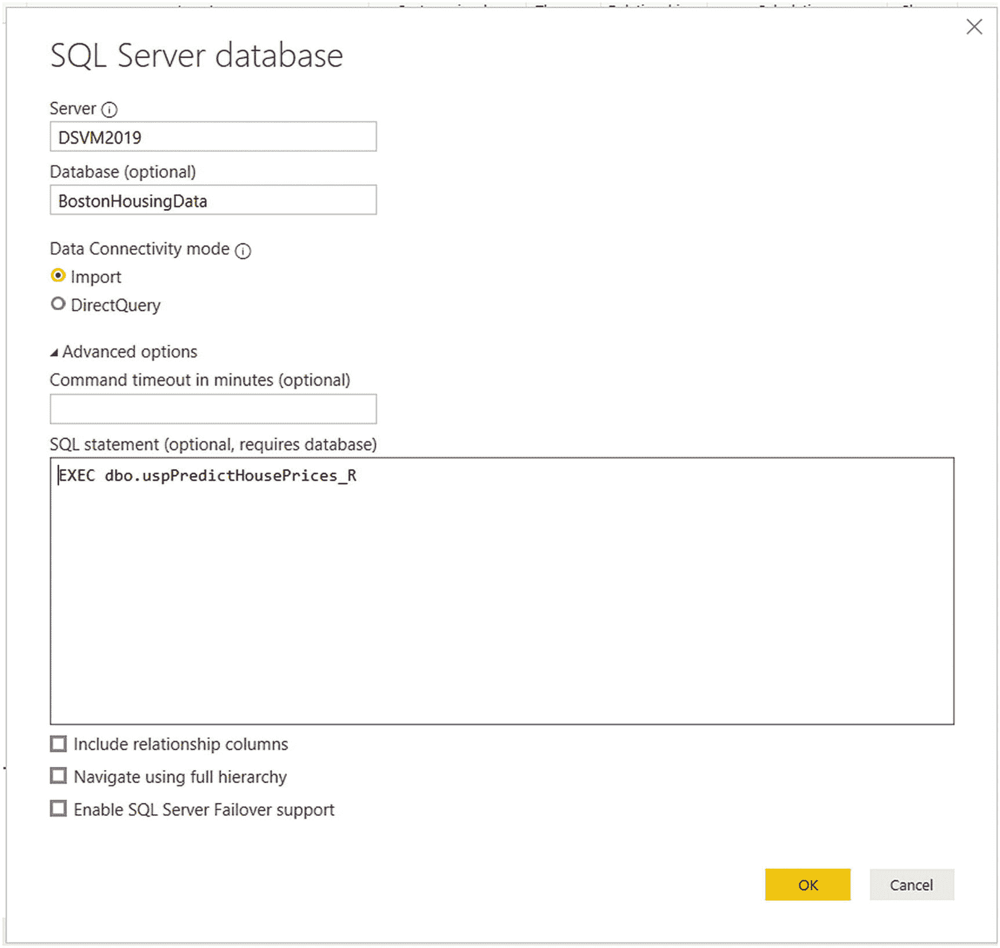

# 10. 将数据科学模型和数据整理脚本投入生产

前几章中的数据整理脚本和数据评分脚本在自助服务场景或由一人负责维护 Power BI 数据模型的小型团队中运行良好。这是因为在这些情况下，你可以使用个人版的*本地数据网关*。但是，企业解决方案需要企业版的*本地数据网关*，而它不允许使用嵌入在 Power BI 中的 R 或 Python 脚本。幸运的是，你可以利用 SQL Server 中一个相对较新的功能来克服这一限制，即 *SQL Server 机器学习服务 (SSMLS)*。*SSMLS* 是 SQL Server 的一项功能，它允许你通过封装在特殊 T-SQL 存储过程中的 R 和 Python 脚本在数据库内部执行高级数据分析。由于你可以通过使用*本地数据网关*调用存储过程来获取数据，因此你可以通过将脚本封装在存储过程中，将之前在 Power BI 中编写的数据整理和数据评分脚本重构为企业级解决方案。

在本章中，我们将通过一些示例来展示如何重构数据整理脚本和数据评分脚本，此外，我们还将展示如何使用 *SSMLS* 附带的预构建模型来免费获取情感评分！首先，让我们在 *SSMLS* 中重构波士顿房价预测示例。

## 在 SQL Server 机器学习服务中使用 R 预测 Power BI 中的房屋价值

在此示例中，我们将重构第 9 章中用于预测房价的 R 脚本，并将其封装在一个特殊的存储过程中。这样做将使该 R 脚本能够与企业版的*本地数据网关*一起使用。这一改变将使你能够在企业环境中使用该解决方案。以下是所需步骤。

### 构建将模型添加到 SQL Server 的 R 脚本

清单 10-1 显示了将 R 模型添加到 SQL Server 所需的代码。

```
library(RODBC)
# 将模型加载到 R 会话中
model <- readRDS("./Models/Model.rds")
# 连接到数据库
server.name = "DSVM2019"
db.name = "BostonHousingData"
connection.string = paste(
"driver={SQL Server}", ";",
"server=", server.name, ";",
"database=", db.name, ";",
"trusted_connection=true", sep = "")
conn <- odbcDriverConnect(connection.string)
# 定义参数
model_name <- "R Model"
modelbin <- serialize(model, NULL)
modelbinstr = paste(modelbin, collapse = "")
# 构建 SQL 语句并使用 sqlQuery 命令执行
sql_code <- paste0(
"EXEC AddModel_R ",
"@ModelName='",
model_name, "', ",
"@Model_Serialized='",
modelbinstr, "'")
sqlQuery(conn, sql_code)
odbcClose(conn)
```

*清单 10-1* 将 R 模型添加到 SQL Server 所需的代码

现在让我们逐步分析这段代码。

#### 第 1 步：加载必要的包

```
library(RODBC)
```

此脚本只需加载一个包，即 `RODBC` 包。`RODBC` 包将用于与 SQL Server 交互。

#### 第 2 步：将模型加载到 R 会话中

以下代码用于执行此任务：

```
model <- readRDS("./Models/Model.rds")
```

在此步骤中，你使用基础 R 中的 `readRDS()` 函数将模型加载到 R 中。如果你的工作目录设置为第 10 章的 R 文件夹，则可以使用相对文件路径。

#### 第 3 步：创建与数据库的连接

以下代码用于连接数据库：

```
server.name = "DSVM2019"
db.name = "BostonHousingData"
connection.string = paste(
"driver={SQL Server}", ";",
"server=", server.name, ";",
"database=", db.name, ";",
"trusted_connection=true", sep = "")
conn <- odbcDriverConnect(connection.string)
```

连接字符串基于你分别用于设置 `server.name` 和 `db.name` 变量的服务器和数据库名称创建。该信息与一些静态信息拼接在一起以构建连接字符串。结果被赋值给 `connection.string` 变量。最后，将 `connection.string` 变量传递给 `odbcDriverConnection()` 函数以创建连接对象。创建的连接对象名为 `conn`。

#### 第 4 步：定义模型变量

此步骤的代码如下：

```
model_name <- "R Model"
modelbin <- serialize(model, NULL)
modelbinstr = paste(modelbin, collapse = "")
```

`model_name` 变量用于保存模型的名称。它将在后续步骤中用于在 `dbo.Models` 表中标识该模型。使用 `serialized()` 函数对模型进行序列化，序列化的结果存储在 `modelbin` 变量中。接下来，通过使用 `paste()` 函数的 `collapse` 选项将 `modelbin` 转换为标量字符向量，结果存储在 `modelbinstr` 变量中。该 `modelbinstr` 变量是将要插入数据库的模型的表示形式。

#### 第 5 步：构建将模型添加到数据库的 T-SQL 语句

执行此任务的代码如下：

```
sql_code <- paste0(
"EXEC AddModel_R ",
"@ModelName='",
model_name, "', ",
"@Model_Serialized='",
modelbinstr, "'")
```

`paste0()` 函数用于构建执行 SQL Server 中 `AddModel_R` 存储过程的 T-SQL。`AddModel_R` 存储过程使用 `INSERT` 语句，基于第 4 步中构建的变量作为参数将模型插入到 SQL Server 中。`VALUES` 子句与 `INSERT` 语句一起使用，以传递在 `model_name` 变量中定义的模型名称和在 `modelbinstr` 变量中定义的模型的字符串表示形式。`AddModel` 存储过程已在数据库中预先配置好，你将在后续步骤中将其添加到你的服务器。添加数据库后，你可以通过检查 `dbo.AddModel_R` 存储过程中的代码来查看正在执行的 T-SQL 代码。

#### 第 6 步：添加从 R 执行 T-SQL 语句所需的代码

此步骤的代码如下：

```
sqlQuery(conn, sql_code)
odbcClose(conn)
```

使用 `RODBC` 包中的 `sqlQuery()` 函数执行第 5 步构建的 T-SQL 代码。它使用 `conn` 对象连接到数据库，并使用 `sql_code` 变量向函数提供要执行的 T-SQL 语句。执行 T-SQL 代码后，关闭与数据库的连接。

#### 第 7 步：保存脚本

如果你是从头开始，请确保保存脚本。你需要在后续步骤中执行它以将模型添加到 SQL Server。请注意，该脚本可在本书的代码仓库中找到。

### 使用 SQL Server 机器学习服务与 R 对数据进行评分

在本节中，我们将介绍将本示例中使用的数据库添加到服务器所需的步骤。你还将了解配置数据库和对数据进行评分所需的步骤。

#### 第 1 步：启动 SQL Server Management Studio

如果你使用的是推荐的 *Windows 2019 DSVM*，那么 *SQL Management Studio (SSMS)* 和 *SQL Server 2019* 将已安装并启用了 *SQL Server 机器学习服务*。如果你的环境中未安装这些资源，请参阅引言中的安装说明。

#### 第 2 步：创建与要使用的服务器的连接

当你启动 *SQL Server Management Studio (SSMS)* 时，服务器名称应已填入文本框字段。如果未列出且你不知道服务器名称，则可以输入“.”，SSMS 将打开你环境中的本地服务器。


#### 步骤 3：将 `BostonHousingInfo` 数据库添加到你的服务器

本练习的入门数据库位于本章的 `Databases` 文件夹中。用于还原数据库的文件名为 `BostonHousingData.bak`。请执行以下步骤来还原 `BostonHousingData` 数据库：

1. 将 `BostonHousingData.bak` 文件复制到 SQL Server 的 `Backup` 文件夹。在 `DSVM` 中的路径为 `C:\Program Files\Microsoft SQL Server\MSSQL15.MSSQLSERVER\MSSQL\Backup`。

2. 打开 `SSMS`，右键单击 `Databases` 文件夹，然后选择 `Restore Databases…`。

3. 将弹出 `Restore Database` 表单。确保你位于 `General` 页面选项卡上。在 `Source` 部分，选择 `Device` 单选按钮。

4. 单击省略号按钮（带有三个点的按钮），然后单击 `Add` 按钮。接下来，浏览到 `BostonHousingData.bak` 所在的位置。

5. 选择 `BostonHousingData.bak` 文件，然后单击 `OK` 按钮关闭 `Locate Backup File` 表单。

6. 单击 `OK` 关闭 `Select backup devices` 表单。

7. 单击 `OK` 关闭 `Restore Database` 表单。这样做将添加该数据库。

此步骤中添加的数据库将包含本练习所需的基础设施以及将要评分的数据。本示例中使用的 `Boston Housing` 数据是通过 `sklearn.datasets` 中的 `load_boston()` 函数获取的。用于获取数据集的代码位于代码仓库中。

#### 步骤 4：将模型添加到数据库

返回 R Studio 中的 `AddModelToDatabase.R` 脚本。确保工作目录设置为 `R` 文件夹。执行该脚本。如果脚本配置正确，R 模型将被添加到 `BostonHousingInfo` 数据库的 `dbo.Models` 表中。

#### 步骤 5：将用于评分的存储过程添加到数据库

清单 10-2 是创建该存储过程的代码。

```sql
CREATE PROCEDURE [dbo].[uspPredictHousePrices_R]
AS
BEGIN
-- 定义变量
DECLARE @model varbinary(max) =
(SELECT MODEL
FROM [dbo].[Models]
WHERE ModelName = 'R Model');
DECLARE @RScript nvarchar(max);
DECLARE @Query nvarchar(max);
DECLARE @InputDFName nvarchar(25);
DECLARE @OutputDFName nvarchar(25);
-- 定义源数据
SET @Query='SELECT [crim], [rm], [tax], [lstat]
FROM [dbo].[BostonHousingInfo]'
-- 用于评分的 R 脚本
SET @RScript = N'
bhmodel_deserialized <-
unserialize(as.raw(bhmodel_serialized));
model_data <- dfInputData
pred_medv <-
predict(bhmodel_deserialized, model_data)
dfOutputData <-
cbind(model_data, pred_medv)'
SET @InputDFName = 'dfInputData'
SET @OutputDFName = 'dfOutputData'
EXEC sp_execute_external_script
@language = N'R'
,@script = @RScript
,@input_data_1 = @Query
,@input_data_1_name = @InputDFName
,@output_data_1_name = @OutputDFName
,@params = N'@bhmodel_serialized varbinary(max)'
,@bhmodel_serialized = @model
WITH RESULT SETS((
[crim] float
,[rm] float
,[tax] float
,[lstat] float
,[pred_medv] float
));
END
```

**清单 10-2** `uspPredictHousePrices_R` 存储过程

上述代码执行以下操作：

1. 定义脚本中所需的以下变量：
   - `@model` 变量用于保存模型。你使用 T-SQL 从 `dbo.Models` 表中检索模型。
   - `@RScript` 变量保存执行评分的 R 脚本。
   - `@query_string` 变量保存定义将要评分的数据集的 TSQL 脚本。
   - `@InputDFName` 变量保存输入数据集的名称，Python 将使用该名称来引用输入数据集。
   - `@OutputDFName` 变量保存输出数据集的名称，R 将使用该名称来引用输出数据集。

2. 使用返回输入数据集的 TSQL 代码设置 `@Query`。输入数据集表示将使用 R 进行评分的数据。

3. 使用将执行评分的 R 代码设置 `@RScript` 变量。分配给此变量的 R 脚本执行以下步骤：
   - 以原始格式加载 `bhmodel_serialized`，然后使用 `unserialize()` 函数对其进行反序列化，并将结果分配给 `bhmodel_deserialized` 变量。
   - 创建一个名为 `model_data` 的变量，该变量基于 `dfInputData` 数据框。这样做是因为最佳实践是不直接操作从 SQL Server 传递给 R 的输入数据集。
   - 使用基础 R 中的 `predict()` 函数对数据进行评分。传递给该函数的第一个参数是模型，第二个参数是需要评分的数据。输出是一个包含预测值的向量，它将存储在 `pred_medv` 变量中。
     请注意，你能够包含整个数据框。这是因为它只包含回归公式所需的列。在更复杂的情况下，你可能需要对传递给 R 的数据进行转换，使其符合模型公式所需的结构。
   - 使用 `cbind()` 函数创建一个 `dfOutputData` 数据框，执行基于列的绑定，将 `model_data` 数据框和 `pred_medv` 向量合并为一个数据框。
   - 设置要用于输入和输出数据框的名称。

4. 配置 `sp_execute_external_script` 存储过程。其中大部分内容不言自明，但 `@params` 和 `@bhmodel_serialized` 参数可能需要一些解释。`@params` 参数使你能够定义模型所需的额外参数。在本例中，我们定义了一个名为 `@bhmodel_serialized` 的参数，其数据类型为 `varbinary(max)`。此参数会将模型传递给 R 脚本，并以参数名称（去掉 @ 符号，在本例中为 `bhmodel_serialized`）将其暴露给脚本。`@bhmodel_serialized` 参数的值在下一行中设置。

5. `WITH RESULT SETS` 子句用于定义列名和列数据类型。这将为 Power BI 提供所需的信息，以确定从 SQL Server 传递给它的评分数据集的列名和数据类型。

执行上述脚本以将存储过程添加到数据库。现在，你将能够通过调用该存储过程来对数据进行评分。

#### 步骤 6：在 Power BI 中从 SQL Server 获取评分数据

要在 Power BI 中获取评分数据，请启动 Power BI，然后转到 `GetData` ➤ `SQL Server`。填写 `Server and Database (optional)` 文本框。接下来，展开 `Advanced options` 部分，并在 `SQL statement (optional, requires database)` 文本框中输入 `EXEC [dbo].[uspPredictHousePrices_R]`。`Include relationship columns` 复选框默认处于选中状态，但在此情况下不需要，因此将其取消选中。图 10-1 显示了配置后的表单外观。



**图 10-1** 已填充执行 `dbo.uspPredictedHousePrices_R` 存储过程所需信息的 GetData 表单

单击 `OK` 将数据添加到 Power BI 数据模型。

本示例的重点不应放在模型上。本练习中的模型基于一个简单的线性回归公式，并且设计得比较简单，以便重点放在如何通过 `SSMLS` 在 Power BI 中实现 R 模型来评分数据。我们有意没有专注于开发复杂的模型。开发准确的机器学习模型远远超出了本书的范围。但是，如果你或你团队中的数据科学家已经知道如何在 R 中开发能够产生准确预测的复杂模型，那么本章中概述的步骤可用于通过 `SSMLS` 将这些 R 模型应用于 Power BI 数据模型。接下来，你将学习如何使用 Python 在 `SSMLS` 中执行类似的任务。


