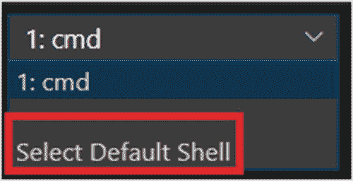
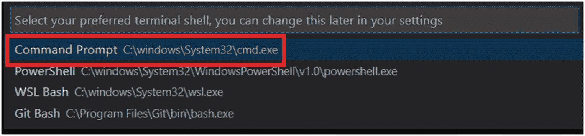
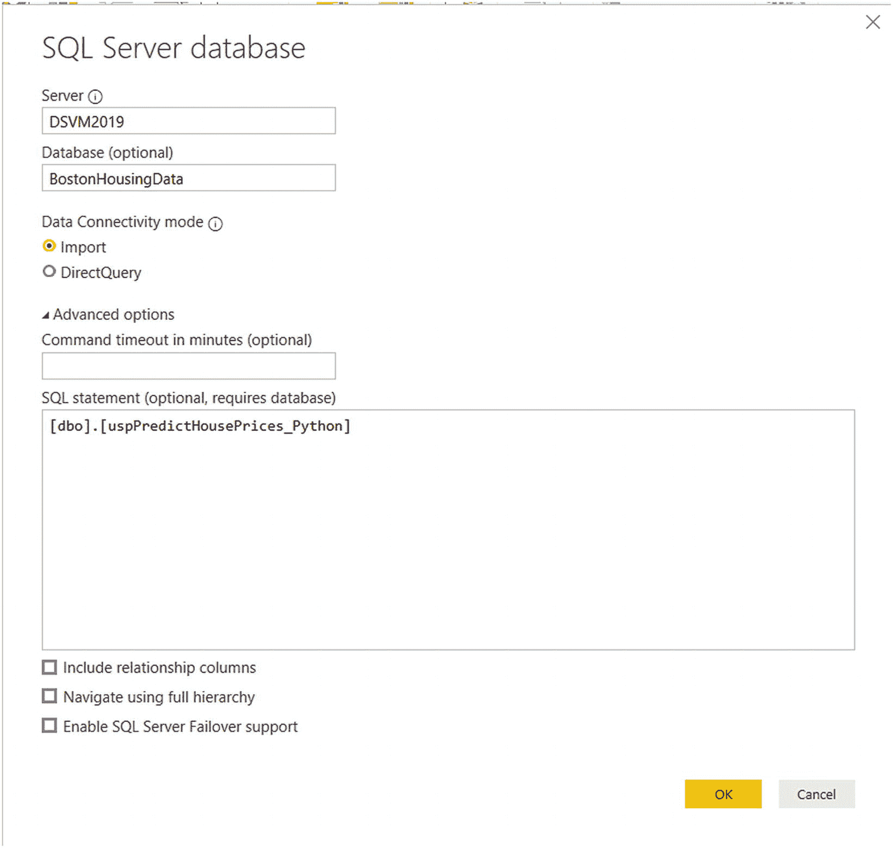
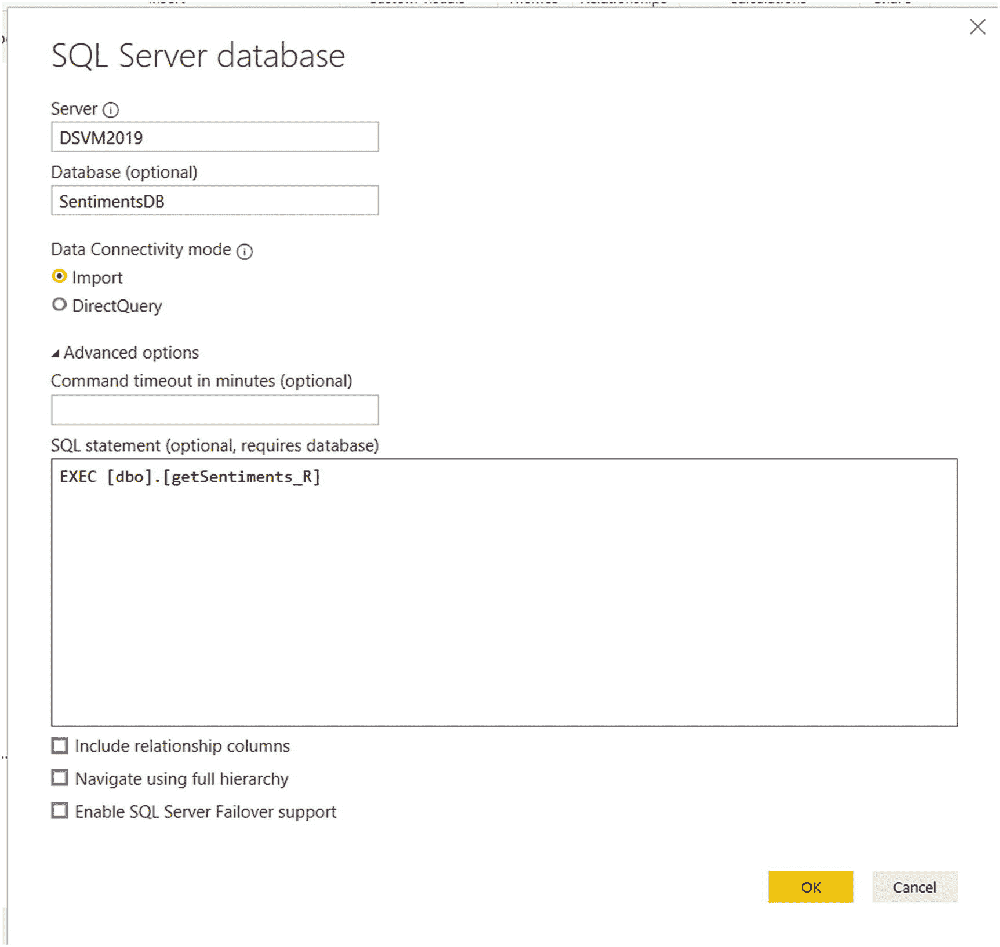
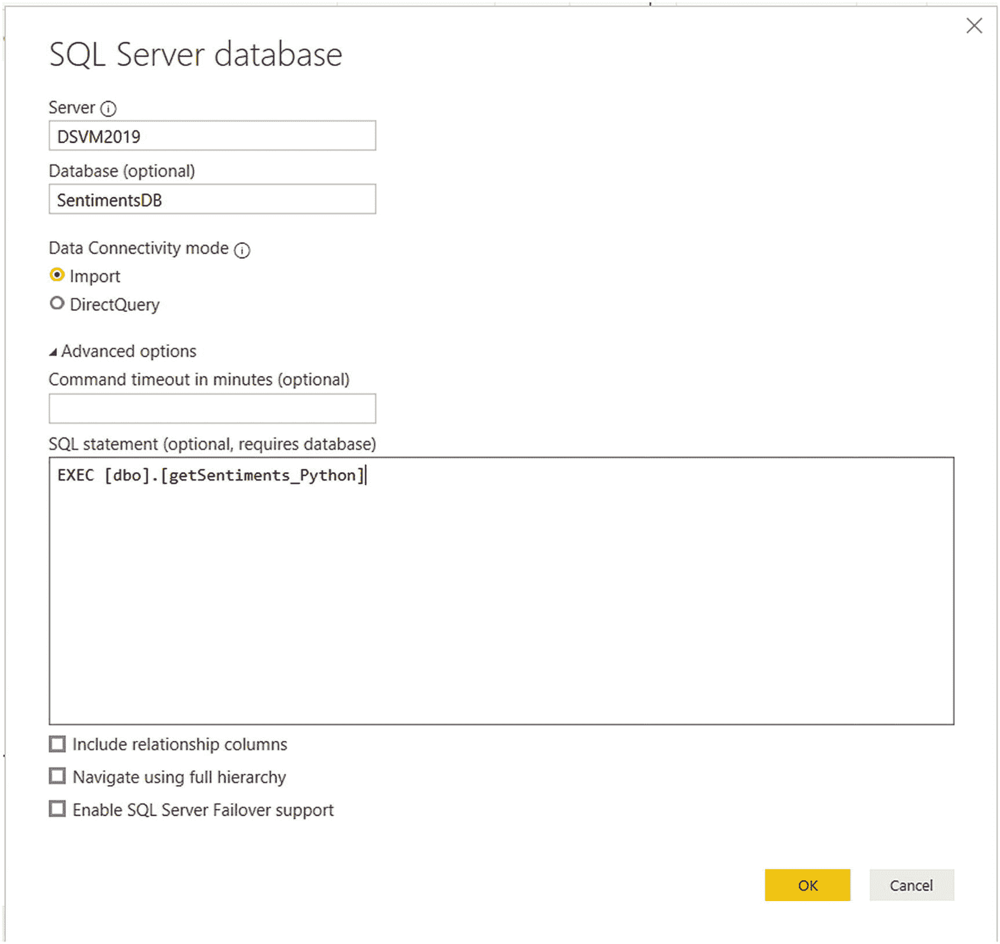
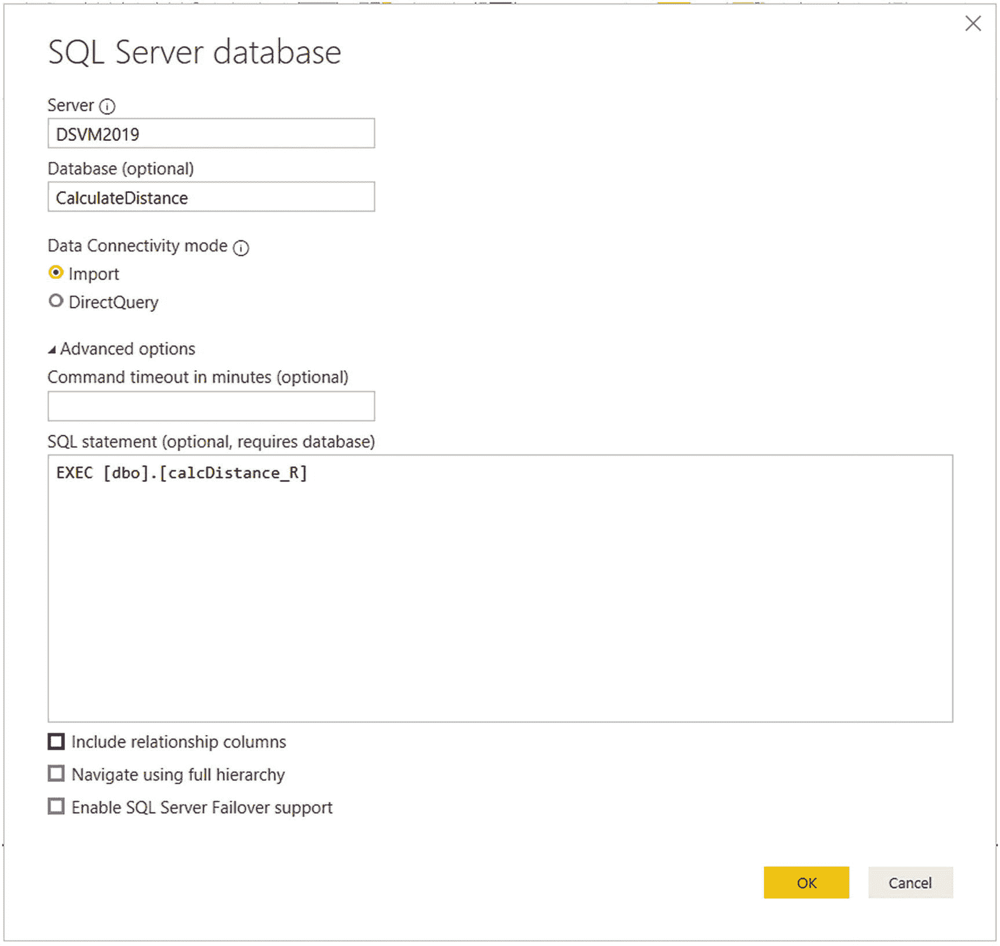
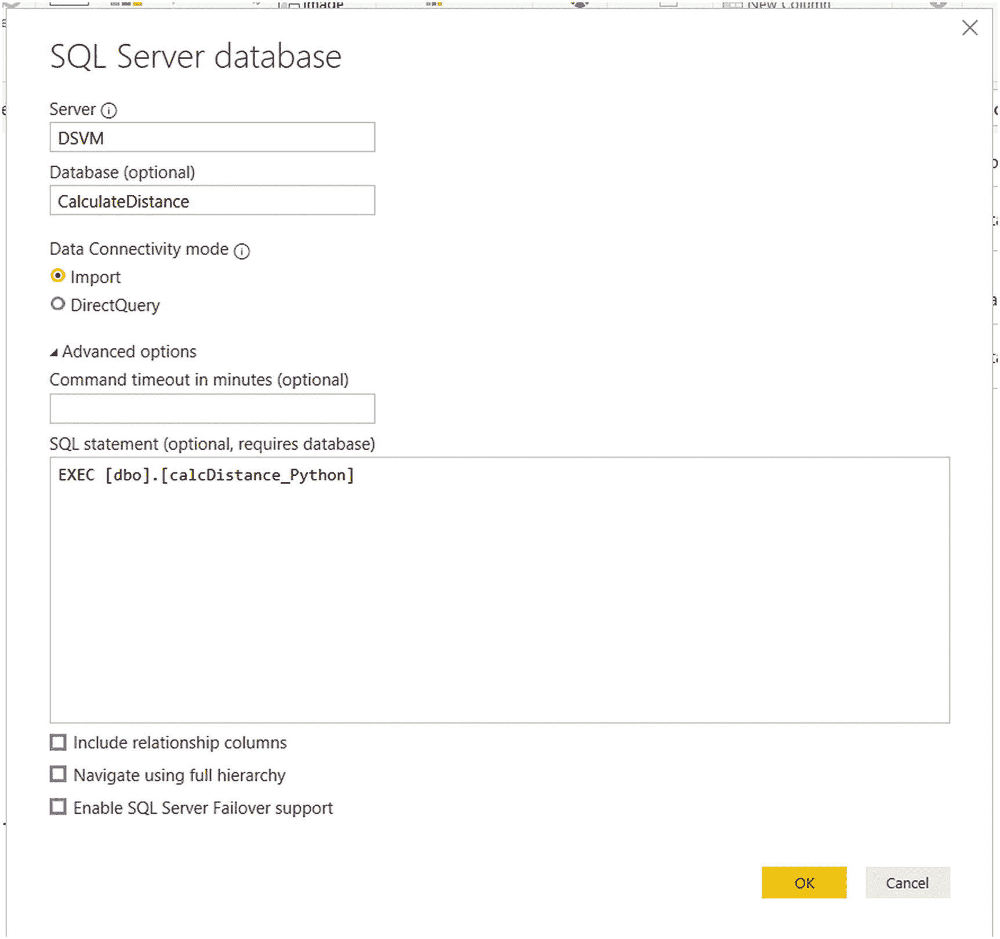

# 使用 SQL Server 机器学习服务中的 Python 在 Power BI 中预测房价

在本示例中，我们将重构第 9 章中用于预测房价的 Python 脚本，并将其封装到一个特殊的存储过程中。将 Python 脚本嵌入存储过程，可使其能够与企业版*本地数据网关*配合使用。以下是所需步骤。

## 创建将 Python 模型添加到 SQL Server 所需的脚本

### 步骤 1：获取本练习所用库的版本

本练习使用的库包括 `pickle`、`os`、`pyodbc`、`scikit-learn` 和 `pandas`。你需要确保开发环境中使用的这些包版本与 *SSMLS* 中的版本一致。你可以通过在 SQL Server 中运行清单 10-3 所示的 T-SQL 脚本来获取 *SSMLS* 中使用的版本。

```sql
EXECUTE sp_execute_external_script
@language = N'Python'
,@script = N'
import pkg_resources
import pandas as pd
installed_packages = pkg_resources.working_set
installed_packages_list =
sorted(["%s==%s" % (i.key, i.version) for i in installed_packages])
df = pd.DataFrame(installed_packages_list)
OutputDataSet = df'
WITH RESULT SETS (( PackageVersion nvarchar (150) ))
```
清单 10-3
获取已安装 Python 库的脚本

上述脚本会返回 *SSMLS* 中 Python 安装环境下所有已安装包的列表。截至撰写本文时，*SSMLS 2019* 中使用的库版本如下：

- `pyodbc` 4.0.25
- `scikit-learn` 0.20.2
- `pandas` 0.23.4

请注意，`os` 和 `pickle` 库并未列出。这是因为这些包默认包含在所有 Python 安装中。

### 步骤 2：创建 conda 环境

我们需要确保所有开发工作都使用与 *SSMLS* 相同的版本，以避免不必要的版本冲突，因此必须设置一个名为 *conda* 环境的特殊开发环境。

*conda 环境* 通过让你指定要使用的 Python 版本、要包含的库以及这些库的版本，帮助你隔离项目开发。Python 中还有其他环境管理选项。*conda* 与其他工具的不同之处在于它与语言无关，因此可以与其他编程语言一起使用。

请执行以下步骤来创建 *conda 环境*：

1. **打开 VS Code**

   打开命令提示符，输入以下代码以更改工作目录：

   ```
   cd
   ```

   接下来，输入以下代码从上述位置打开 VS Code：

   ```
   code .
   ```

2. **在上述位置的 VS Code 中打开终端 shell**

   输入 `CTRL+SHIFT+`` 打开终端 shell。本示例中使用的是*命令提示符*。如果需要更改终端 shell，请打开位于右上角的 shell 选项窗口，如图 10-2 所示。

   

   图 10-2
   VS Code shell 选项窗口

   完成上述选择后，你将看到如图 10-3 所示的选项。

   

   图 10-3
   终端 shell 选项

   选择高亮显示的选项，将终端 shell 更改为*命令提示符*。

3. **创建一个名为** `ssmls` **的新 conda 环境**

   我们需要一个开发环境，该环境使用与 *SSMLS* 相同的 Python 版本和库版本。*SSMLS 2019* 中使用的 Python 版本是 Python 3.7.3。在命令提示符中输入以下代码，使用该 Python 版本创建环境：

   ```
   conda create --name ssmls python=3.7.3
   ```

4. **切换到刚刚创建的环境**

   在步骤 3 中，你创建了一个环境，但尚未在该环境中工作。如果你使用的是推荐的*数据科学虚拟机*，那么你将拥有许多预安装的环境以及你创建的任何环境。你需要在命令提示符中输入以下代码，以获取可用环境列表：

   ```
   conda env list
   ```

   如果你在 *DSVM* 中工作，你将看到多个环境以及 `ssmls` 环境。如果你在自己的个人机器上工作，那么你可能只会看到 `ssmls` 环境、基础环境以及你个人创建的任何其他环境。在命令提示符中输入以下命令以激活 `ssmls` 环境：

   ```
   activate ssmls
   ```

   现在你已进入 `ssmls` 环境，该环境基于与 *SSMLS 2019* 相同的 Python 版本。

5. **在 ssmls 环境中安装所需的库**

   现在你需要安装 `pandas`、`scikit-learn` 和 `pyodbc` 库。我们先安装 `pandas`。要安装此任务所需的 `pandas` 版本，请输入以下代码：

   ```
   conda install pandas=0.23.4
   ```

   上述代码将开始安装过程。你需要通过几个提示才能完成安装。对 `scikit-learn 0.20.2` 和 `pyodbc 4.0.25` 执行相同操作。请确保在库名称和版本之间加上 `=` 号，如 `pandas` 示例所示。

### 步骤 3：创建将模型推送到 SQL Server 的代码

清单 10-4 中的代码用于将模型推送到 SQL Server。

```python
import os
import pyodbc
import pickle
server = 'DSVM2019'
database = 'BostonHousingData'
con = pyodbc.connect(
'Trusted_Connection=yes',
driver = '{SQL Server}',
server = server,
database = database
)
cursor = con.cursor()
model = pickle.load(open("./Models/model.pkl", "rb"))
modelstr = pickle.dumps(model)
cursor.execute(
"INSERT INTO [dbo].Models VALUES (?, ?)",
"Python Model", modelstr
)
con.commit()
con.close()
```
清单 10-4
将模型推送到数据库的脚本

上述代码使用 `os` 库与文件系统交互，使用 `pyodbc` 库与 SQL Server 交互，并使用 `pickle` 库加载和保存模型对象。以下是脚本中执行的步骤：

1.  基于 `Windows 身份验证`类型的连接创建了一个名为 `con` 的连接对象。该连接从之前定义的 `server` 和 `database` 变量中获取服务器名称和数据库名称。
2.  创建了一个名为 `cursor` 的游标对象，用于执行 T-SQL 语句。
3.  使用 `open()` 函数和 `pickle.load()` 函数将之前保存到磁盘的模型加载到 Python 会话中。`open()` 函数使用 `"rb"` 访问模式打开模型，其中 `"rb"` 代表以二进制格式读取。然后，使用 `pickle.load()` 函数将结果加载到会话中，并赋值给名为 `model` 的变量。接下来，使用 `pickle.dumps()` 函数对 `model` 变量中的模型进行序列化，并将结果赋值给 `modelstr` 变量。
4.  使用游标对象的 `execute` 方法在目标数据库上执行 T-SQL 语句。第一个参数是 T-SQL 语句。该 T-SQL 语句是一条 INSERT 语句，用于将模型和模型名称插入到指定表中。`?` 符号用作 `ModelName` 和 `Model` 参数的占位符。接下来的两个参数用于提供这些参数。请注意，顺序很重要。
5.  将脚本保存为 `AddModelToDatabase.py`。保持此文件打开。我们将在后续步骤中再次用到它。

### 使用 Power BI 中的 Python 调用 SQL Server 机器学习服务对数据进行评分

在本节中，您将把 `BostonHousingData` 数据库添加到您的服务器，并添加您在上一步骤中创建的用于将模型添加到该数据库的脚本，然后创建一个 Python 存储过程来预测房价。以下是执行此操作的步骤。

#### 步骤 1：启动 SQL Server Management Studio

如果您使用的是推荐的 `Windows 2019 DSVM`，那么 `SQL Management Studio (SSMS)` 和 `SQL Server 2019` 将已安装并启用了 `SSMLS`。我强烈建议使用 `DSVM`，因为它可以大大减少配置环境所需的工作量。如果您没有使用 `DSVM`，则需要手动安装启用了 `SSMLS` 的 `SQL Server 2019`。您还需要安装 `SQL Server Management Studio`。安装说明包含在 `引言` 中。

#### 步骤 2：创建与要使用的服务器的连接

当您启动 `SQL Server Management Studio` 时，服务器名称应已填入文本框字段。如果未列出且您不知道服务器名称，则可以键入 `"."`，`SSMS` 将打开您环境本地的数据库服务器。

#### 步骤 3：将 BostonHousingInfo 数据库添加到您的服务器

本项目的初始数据库位于本章的数据库文件夹中。文件名为 `BostonHousingData.bak`。如果您已经完成了本练习的 R 语言版本，则可以跳过此步骤，因为该数据库已添加到服务器中。否则，请执行以下步骤来还原数据库：

1.  将 `BostonHousingData.bak` 文件复制到 SQL Server 的 `Backup` 文件夹。在 `DSVM` 中的位置是 `C:\Program Files\Microsoft SQL Server\MSSQL15.MSSQLSERVER\MSSQL\Backup`。
2.  转到 `SQL Server Management Studio (SSMS)`，右键单击 `Databases` 文件夹，然后选择 `Restore Databases…`。
3.  将出现 `Restore Database` 弹出表单。确保您位于 `General` 页面选项卡上。在 `Source` 部分，选择 `Device` 单选按钮。
4.  单击省略号按钮（带三个点的按钮），然后单击 `Add` 按钮。浏览到 `BostonHousingData.bak` 所在的位置。
5.  选择 `BostonHousingData.bak` 文件，然后单击 `OK` 按钮关闭 `Locate Backup File` 表单。
6.  单击 `OK` 关闭 `Select backup devices` 表单。
7.  单击 `OK` 关闭 `Restore Database` 表单。

此步骤中添加的数据库将包含本练习所需的基础设施以及将要评分的数据。`Boston Housing` 数据是使用 `sklearn.datasets` 中的 `load_bostondata()` 函数获取的。获取数据的脚本包含在本书的代码仓库中。

#### 步骤 4：将模型添加到数据库

返回 VS Code 中的 `AddModelToDatabase.py` 脚本。确保工作目录设置为 `Python` 文件夹。执行该脚本。如果您正确配置了脚本，模型将被添加到 `BostonHousingInfo` 数据库的 `dbo.Models` 表中。

#### 步骤 5：将用于评分的存储过程添加到数据库

清单 10-5 是创建该存储过程的代码。

```sql
CREATE PROCEDURE [dbo].[uspPredictHousePrices_Python]
AS
BEGIN
DECLARE @model VARBINARY(max) =
(SELECT MODEL
FROM [dbo].[Models]
WHERE ModelName = 'Python Model');
DECLARE @PythonScript nvarchar(max);
DECLARE @Query nvarchar(max);
DECLARE @InputDFName nvarchar(25);
DECLARE @OutputDFName nvarchar(25);
-- 定义源数据
SET @Query='SELECT [crim], [rm], [tax], [lstat]
FROM [dbo].[BostonHousingInfo]'
-- 用于评分的 Python 脚本
SET @PythonScript = N'
import pickle
from sklearn import linear_model
bhmodel_deserialized = pickle.loads(bhmodel_serialized)
pred_medv = bhmodel_deserialized.predict(dfInputData)
dfOutputData = dfInputData
dfOutputData["pred_medv"] = pred_medv
'
SET @InputDFName = 'dfInputData'
SET @OutputDFName = 'dfOutputData'
EXECUTE sp_execute_external_script
@language = N'Python'
,@script = @PythonScript
,@input_data_1 = @Query
,@input_data_1_name = @InputDFName
,@output_data_1_name = @OutputDFName
,@params = N'@bhmodel_serialized varbinary(max)'
,@bhmodel_serialized = @model
WITH RESULT SETS((
[crim] float
,[rm] float
,[tax] float
,[lstat] float
,[pred_medv] float
));
END;
```
清单 10-5
uspPredictHousePrices_Python 存储过程

上述代码执行了以下操作：

1.  定义脚本中所需的以下变量：
    -   `@model` 变量用于保存模型。分配给此变量的 Python 模型是通过 T-SQL 从 `dbo.Models` 表中检索得到的。
    -   `@PythonScript` 变量保存执行评分的 Python 脚本。
    -   `@Query` 变量保存定义将被评分的数据集的 TSQL 脚本。
    -   `@InputDFName` 变量保存输入数据集的名称，Python 将使用该名称来引用输入数据集。
    -   `@OutputDFName` 变量保存输出数据集的名称，Python 将使用该名称来引用输出数据集。
2.  使用返回输入数据集的 TSQL 代码设置 `@Query`。
3.  设置 `@PythonScript` 变量。分配给此变量的 Python 脚本执行以下步骤：
    -   加载 `pickle` 包以处理与模型的交互。
    -   使用 `pickle.loads()` 函数反序列化 `bhmodel_serialized` 模型对象，并将结果分配给 `bhmodel_deserialized`。
    -   使用 `bhmodel_deserialized` 对象的 `predict()` 方法，基于 `dfInputData` 数据框预测 `medv`。请注意，您可以包含整个数据框。这是因为该数据框仅包含回归模型所需的列。在更复杂的情况下，您可能需要对传递给 Python 的数据进行转换，使其符合模型公式所需的结构。
    -   使用 `dfInputData` 数据框创建一个 `dfOutputData` 数据框，并将 `pred_medv` 变量作为新列添加进去。
4.  使用 `@InputDFName` 和 `@OutputDFName` 变量设置您想要用于输入和输出数据框的名称。
5.  配置 `sp_execute_external_script` 存储过程。大多数参数不言自明，但这里将解释 `@params` 和 `@bhmodel_serialized` 参数。`@params` 参数使您能够定义模型所需的额外参数。在本例中，您定义了一个名为 `@bhmodel_serialized` 的参数，其数据类型为 `varbinary(max)`。此参数会将模型传递给 Python 脚本，并且该模型将通过参数名称（去掉 `@` 符号）暴露给脚本。`@bhmodel_serialized` 参数的值在后续代码行中设置。
6.  使用 `WITH RESULT SETS` 子句定义输出的列名和列数据类型。此信息将帮助 Power BI 确定应使用的数据类型以及如何在 Power BI 数据模型中命名列。

执行上述脚本以将存储过程添加到数据库。现在，您将能够通过调用该存储过程来对数据进行评分。

#### 步骤 6：在 Power BI 中从 SQL Server 获取评分数据

要在 Power BI 中获取评分数据，请启动 Power BI，然后转到`获取数据` ➤ `SQL Server`。在`服务器和数据库（可选）`文本框中填入您的服务器名称和存储模型的数据库名称。接下来，展开`高级选项`部分，并在`SQL 语句（可选，需要数据库）`文本框中输入 `EXEC [dbo].[uspPredictHousePrices_Python]`。`包括关系列`复选框默认处于选中状态，但在此情况下不需要，因此将其取消选中。图 10-4 显示了配置完成后的表单样式。



**图 10-4** – 已填入执行 `dbo.uspPredictedHousePrices_Python` 存储过程所需信息的“获取数据”表单

点击`确定`将数据添加到 Power BI 数据模型。

与 R 示例一样，本示例的重点不在于模型本身，而在于如何通过`SSMLS`在 Power BI 数据上实现模型。开发准确的机器学习模型远远超出了本书的范围。但是，如果您或您团队中的数据科学家已经知道如何在 Python 中开发能够产生准确预测的复杂模型，那么本章概述的步骤可用于通过`SSMLS`将这些 Python 模型应用于 Power BI 数据模型。

## 在 Power BI 中使用 SQL Server 机器学习服务中的 R 执行情感分析

您在第 9 章中使用 Python 脚本调用了`Microsoft 认知服务`来执行情感分析。大多数 DBA 不允许从数据库进行 API 调用，因此在大多数情况下，`Microsoft 认知服务`将不是一个可选方案。幸运的是，`SSMLS`附带的预构建模型使您无需调用`Microsoft 认知服务`的 API 即可执行情感分析。以下是使用预构建的`SSMLS`模型执行情感分析所需的步骤。

### 使用 PowerShell 将预构建的 R 模型添加到 SQL Server 机器学习服务

#### 步骤 1：检查预训练模型是否已安装

检查预构建模型是否安装在以下路径中：

```
C:\Program Files\Microsoft SQL Server\MSSQL15.MSSQLSERVER\R_SERVICES\library\MicrosoftML\mxLibs\x64
```

您应该能在上述路径中看到以下文件：

- `AlexNet_Updated.model`
- `ImageNet1K_mean.xml`
- `pretrained.model`
- `ResNet_101_Updated.model`
- `ResNet_18_Updated.model`
- `ResNet_50_Updated.model`

如果已存在这些文件，您可以跳至`在 SQL Server 机器学习服务中使用预构建的 R 情感模型对 Power BI 中的数据进行评分`部分。否则，请继续执行步骤 2。

#### 步骤 2：以管理员身份打开 PowerShell

有多种方式可以打开 PowerShell，一种简单的方法是在任务栏上`Windows`图标旁边的搜索栏中搜索 PowerShell。这样做会导致`Windows PowerShell`应用出现在搜索结果中。右键单击它并选择`以管理员身份运行`。

#### 步骤 3：下载 PowerShell 脚本

访问 [`https://aka.ms/mlm4sql`](https://aka.ms/mlm4sql) 下载文件 `Install-MLModels.ps1`。此文件包含将 Python 模型添加到`SSMLS`所需的 PowerShell 脚本。点击链接后，文件应下载到您的`下载`文件夹。请确认文件已成功下载到`下载`文件夹，因为下一步骤将假定文件在此位置。

#### 步骤 4：在 PowerShell 中运行下载的脚本

在 PowerShell 中运行以下命令：

```
C:\Users\<用户名>\Downloads\Install-MLModels.ps1 MSSQLSERVER
```

如果文件已下载到您的`下载`文件夹，则只需将`<用户名>`替换为您的用户名。如果无法成功运行代码，请参考“故障排除”部分。

#### 故障排除

- 如果您无法运行脚本，可能没有相应权限。您可以通过在 PowerShell 中运行以下代码来查看当前权限：

    ```
    Get-ExecutionPolicy
    ```

- 如果设置为`受限`，您可以使用以下代码将其更改为`不受限`：

    ```
    Set-ExecutionPolicy unrestricted
    ```

- 运行上述代码后，您应该能够运行 `Install-MLModels.ps1` 脚本。如果 PowerShell 最初处于受限状态，则应将其恢复为受限状态。您可以使用以下代码完成此操作：

    ```
    Set-ExecutionPolicy restricted
    ```

### 在 SQL Server 机器学习服务中使用预构建的 R 情感模型对 Power BI 中的数据进行评分

如果 SQL Server 机器学习服务已启用，并且您已成功加载预训练模型，那么您就可以执行情感分析了。以下是您需要遵循的步骤。

#### 步骤 1：开始定义存储过程

以下是用于开始定义存储过程的 T-SQL 代码：

```
CREATE PROCEDURE [dbo].[getSentiments_R]
AS
BEGIN
END
```

`CREATE PROCEDURE` 命令用于向数据库添加存储过程。在上述脚本中，您添加了一个名为 `[dbo].[getSentiments_R]` 的存储过程。名称中的 `[dbo]` 表示该存储过程所属的架构。架构用于将数据库对象分组。默认架构是 `dbo`。第二部分是实际名称。命名存储过程后，键入 `AS`，然后跟随定义该存储过程的 T-SQL 代码。在此示例中，T-SQL 代码将包含在 `BEGIN… END` 语句中，以便以批处理方式执行。

#### 步骤 2：定义变量

以下是将在存储过程中使用的变量：

```
DECLARE @RScript nvarchar(max);
DECLARE @Query nvarchar(max);
DECLARE @InputDataFrame nvarchar(128) = 'dfInput';
DECLARE @OutputDataFrame nvarchar(128) = 'dfOutput';
```

`@RScript` 变量将保存负责执行情感分析的 R 代码，`@Query` 变量用于保存定义将传递给 R 的输入数据集的 T-SQL 语句，`@InputDataFrame` 变量将保存 R 用于引用输入数据集的名称，`@OutputDataFrame` 变量将保存 R 用于引用输出数据集的名称。

#### 步骤 3：设置 `@Query` 变量

以下代码用于设置 `@Query` 变量：

```
SET @Query = 'SELECT [id], [text] ' +
'FROM [dbo].[SentimentData]'
```

该代码构建了检索脚本输入数据所需的 T-SQL 字符串。将执行情感分析的字段是 `text` 字段。`id` 字段用于唯一标识数据集中的每条记录。

#### 步骤 4：设置 `@RScript` 变量

下面使用将执行评分的 R 代码来设置 `@RScript` 变量：

```
SET @RScript = '
dfInput$text = as.character(dfInput$text)
sentimentScores <-
rxFeaturize(
data = dfInput,
mlTransforms = getSentiment(
vars = list(SentimentScore = "text"))
)
sentimentScores$text <- NULL
dfOutput <- cbind(dfInput, sentimentScores)'
```

该脚本相对较短，因为预训练模型承担了繁重的工作。在上述 R 脚本中，第一行将 `dfInput` 数据框中的 `text` 字段更改为字符数据类型。默认情况下，R 会将任何基于字符的字段转换为一种称为 `factor` 的数据类型。`factor` 字段用于分类数据。

以因子数据类型存储的数据，其存储方式类似于 Microsoft 表格引擎中使用的字典编码。字段中的每个唯一元素都会被替换为一个用作索引的整数，并创建一个映射，将该索引映射到它所替换的唯一元素。这种技术很有用，因为整数处理起来更高效，并且比长字符串占用更少的内存。因子对于数据分析很有用，但在此示例中并不需要从使用它们中获得的好处。你只需要实际的文本，因此使用基础 R 中的 `as.character()` 函数将该字段转换为字符数据类型。

实际的情感分析在脚本的这一部分执行：

```
sentimentScores <-
rxFeaturize(
data = dfInput,
mlTransforms = getSentiment(
vars = list(SentimentScore = "text"))
)
```

核心函数是 `RevoScaleR` 中的 `rxFeaturize()` 和 `getSentiment()` 函数。`RevoScaleR` 是一个 R 函数包，旨在克服处理大数据集时的许多挑战。

`RevoScaleR` 是一个非常强大的包，如果你计划在 `SSMLS` 中进行严肃的 R 开发，我强烈建议你学习如何使用它。以下是提供 `RevoScaleR` 全面介绍的指南的 URL：[`https://packages.revolutionanalytics.com/doc/8.0.0/win/RevoScaleR_Users_Guide.pdf`](https://packages.revolutionanalytics.com/doc/8.0.0/win/RevoScaleR_Users_Guide.pdf)。

`rxFeaturize()` 函数用于访问已通过 `MicrosoftML` 进行机器学习数据转换的数据。它在 `mlTransforms` 参数中指定正在执行的机器学习转换。此示例中发生的机器学习转换是通过 `getSentiment()` 进行的情感转换。`getSentiment()` 中的 `vars` 参数用于指定数据集中将执行情感分析的字段。如果你指定一个`命名列表`，那么列表中每个元素的`名称`代表将保存情感得分的列的名称，而`值`代表你想要执行情感分析的字段。使用`命名列表`的一个好处是，你可以使用包含多个元素的`命名列表`一次对多个字段进行评分。以下是对名为 `textB` 和 `textC` 的两个额外字段进行评分时代码的样子：

```
sentimentScores <-
rxFeaturize(
data = dfInput,
mlTransforms = getSentiment(
vars = list(
SentimentScore = "text",
SentimentScoreB = "textB",
SentimentScoreC = "textC")
)
)
```

`getSentiment()` 函数将为其执行的每次情感分析返回一个介于 0 和 1 之间的数值。值越接近 0，情感越负面；值越接近 1，情感越正面。通常，此时你会制定一个规则来决定如何对结果进行分类。最常见的方法是通过使用一个临界点来将结果二值化，该临界点将用于确定什么是好的情感，什么是坏的情感。最常见的临界点是 0.5。当使用该临界点时，任何得分大于或等于 0.5 的文本被视为正面，任何得分低于 0.5 的文本被视为负面。

你不必将得分限制为转换为二值类别。例如，你可能希望将其转换为三个类别。你可以决定将 0.33 到 0.66 之间的任何得分视为中性，大于 0.66 的得分视为良好，小于 0.33 的得分视为差。如何对输出进行分类完全取决于你。

#### 步骤 5：配置 `sp_execute_external_script`

以下是用于配置 `sp_execute_external_script` 的代码：

```
EXEC sp_execute_external_script
@language = N'R'
,@input_data_1 = @Query
,@input_data_1_name = @InputDFName
,@output_data_1_name = @OutputDFName
,@script = @RScript
```

特殊的存储过程 `sp_execute_external_script` 用于在 SQL Server 中执行使用 T-SQL 以外的编程语言的代码。在撰写本文时，可用的语言有 R、Python 和 Java。此特殊存储过程所需的参数取决于你正在执行的脚本。在此场景中，你需要定义五个参数。以下是这些参数及其描述：

*   `@language` 用于指定你正在使用的语言。
*   `@input_data_1` 表示创建输入数据集所需的 T-SQL 代码。
*   `@input_data_1_name` 表示 R 脚本将用于引用输入数据框的名称。
*   `@output_data_1_name` 表示 R 脚本将用于引用输出数据框的名称。
*   `@script` 将包含执行情感分析的 R 脚本。

#### 步骤 6：定义输出

使用以下代码定义输出：

```
WITH RESULT SETS((
[crim] float
,[rm] float
,[tax] float
,[lstat] float
,[pred_medv] float
));
```

如果没有上述代码，SQL Server 将返回没有名称或已知数据类型的输出。当你从 Power BI 调用存储过程时，这可能是一个问题。`WITH RESULT SETS` 子句使你可以为输出指定名称和数据类型，使其更易于被 Power BI 等第三方客户端使用。

#### 步骤 7：将过程添加到数据库

清单 10-6 包含完整的脚本。

```
CREATE PROCEDURE [dbo].[getSentiments_R]
AS
BEGIN
DECLARE @RScript nvarchar(max);
DECLARE @Query nvarchar(max);
DECLARE @InputDFName nvarchar(128) = 'dfInput';
DECLARE @OutputDFName nvarchar(128) = 'dfOutput';
SET @Query = 'SELECT [id], [text], [likes] ' +
'FROM [dbo].[SentimentData]'
SET @RScript = '
dfInput$text = as.character(dfInput$text)
sentimentScores <-
rxFeaturize(
data = dfInput,
mlTransforms = getSentiment(
vars = list(SentimentScore = "text"))
)
sentimentScores$text <- NULL
dfOutput <- cbind(dfInput, sentimentScores)'
'
EXEC sp_execute_external_script
@language = N'R'
,@input_data_1 = @Query
,@input_data_1_name = @InputDFName
,@output_data_1_name = @OutputDFName
,@script = @RScript
WITH RESULT SETS (
(
[id] [bigint],
[text] varchar,
[score] [float]
)
)
END
```

**清单 10-6** – `getSentiments_R` 存储过程

在 SQL Server 的 `SentimentsDB` 数据库中运行上述代码，以将该存储过程添加到数据库中。

#### 步骤 8：从 Power BI 调用存储过程

要在 Power BI 中获取评分数据，请启动 Power BI，然后转到`获取数据` ➤ `SQL Server`。填写`服务器和数据库（可选）`文本框。接下来，展开`高级选项`部分，并在`SQL 语句（可选，需要数据库）`文本框中输入 `EXEC [dbo].[getSentiments_R]`。`包括关系列`复选框默认处于选中状态，但在此情况下不需要，因此请取消选中。图 10-5 显示了配置完成后的表单样式。



**图 10-5** – 已填入执行 `dbo.getSentiment_R` 存储过程所需信息的获取数据表单

与类似的存储过程调用一样，结果将暴露给 Power BI 数据模型。

## 在 Power BI 中使用 SQL Server 机器学习服务中的 Python 执行情感分析

如本示例的 R 版本所述，出于安全原因，你无法使用`Microsoft 认知服务`在`SSMLS`中执行情感分析。但 SSMLS 中的情感预构建模型允许你执行情感分析，而无需进行可能存在安全风险的 API 调用。以下是使用预构建的`SSMLS`模型通过 Python 执行情感分析所需的步骤。

# 将预构建的 Python 模型添加到 SQL Server 机器学习服务

## 步骤 1：检查预训练模型是否已安装

检查预构建模型是否安装在以下路径中：

```
C:\Program Files\Microsoft SQL Server\MSSQL15.MSSQLSERVER\PYTHON_SERVICES\Lib\site-packages\microsoftml\mxLibs
```

你应在上述路径中看到以下文件：

- `AlexNet_Updated.model`
- `ImageNet1K_mean.xml`
- `pretrained.model`
- `ResNet_101_Updated.model`
- `ResNet_18_Updated.model`
- `ResNet_50_Updated.model`

如果已存在，你可以跳至“在 SQL Server 机器学习服务中使用预构建的 Python 情感模型对 Power BI 中的数据进行评分”部分。否则，请转到步骤 2。

## 步骤 2：以管理员身份打开 PowerShell

有多种方法可以打开 PowerShell，但一种简单的方法是在任务栏上 *Windows* 图标旁边的搜索栏中搜索 PowerShell。这样做会导致 *Windows PowerShell* 应用出现在搜索结果中。右键单击它并选择 *以管理员身份运行*。

## 步骤 3：下载 PowerShell 脚本

转到 [`https://aka.ms/mlm4sql`](https://aka.ms/mlm4sql) 下载文件 `Install-MLModels.ps1`。此文件包含将模型添加到 *SSMLS* 所需的 PowerShell 脚本。单击链接后，文件应下载到你的 *下载* 文件夹。请验证文件是否已成功下载到 *下载* 文件夹，因为下一步骤假定它会在那里。

## 步骤 4：在 PowerShell 中运行下载的脚本

在 PowerShell 中运行以下命令：

```
C:\Users\<用户名>\Downloads\Install-MLModels.ps1 MSSQLSERVER
```

如果文件已下载到你的 *下载* 文件夹，则需要将 `<用户名>` 替换为你的用户名。如果你无法成功运行代码，请参考“故障排除”部分。

## 故障排除

- 如果你无法运行脚本，可能没有权限。你可以通过在 PowerShell 中运行以下代码来查看你拥有的权限：

  ```
  Get-ExecutionPolicy
  ```

- 如果设置为 *受限*，你可以使用以下代码将其更改为 *不受限制*：

  ```
  Set-ExecutionPolicy unrestricted
  ```

- 运行上述代码后，你应该能够运行 `Install-MLModels.ps1` 脚本。如果 PowerShell 最初处于受限状态，则应将其恢复为受限状态。你可以使用以下代码执行此操作：

  ```
  Set-ExecutionPolicy restricted
  ```

预训练模型现在应已添加到 *SSMLS* 中。

# 在 SQL Server 机器学习服务中使用预构建的 Python 情感模型对 Power BI 中的数据进行评分

如果你成功执行了前面的步骤，那么你应该处于良好的数据评分状态。评分所需的步骤如下。

## 步骤 1：开始定义存储过程

```sql
CREATE PROCEDURE [dbo].[getSentiments_Python]
AS
BEGIN
END
```

`CREATE PROCEDURE` 命令用于向数据库添加存储过程。在上述脚本中，你正在添加一个名为 `[dbo].[getSentiments_Python]` 的存储过程。名称中的 `[dbo]` 表示存储过程所属的 *架构*。*架构* 用于对数据库对象进行分组。默认架构是 `dbo`。第二部分是实际名称。命名存储过程后，键入 `AS`，然后跟随定义存储过程的 T-SQL 代码。T-SQL 代码将在 `BEGIN… END` 语句中定义，以便以批处理方式执行。

## 步骤 2：定义变量

```sql
DECLARE @PythonScript nvarchar(max);
DECLARE @Query nvarchar(max);
DECLARE @InputDataFrame nvarchar(128) = 'dfInput';
DECLARE @OutputDataFrame nvarchar(128) = 'dfOutput';
```

`@PythonScript` 变量将保存负责执行情感分析的 Python 代码，`@Query` 变量用于保存定义将传递给 Python 的输入数据集的 T-SQL 语句，`@InputDataFrame` 变量将保存 Python 用于引用输入数据集的名称，`@OutputDataFrame` 变量将保存 Python 用于引用输出数据集的名称。

## 步骤 3：设置 @Query

`@Query` 变量保存检索 Python 脚本输入数据所需的 T-SQL 字符串。代码如下：

```sql
SET @Query = 'SELECT [id], [text] FROM [dbo].[SentimentData]'
```

`@Query` 变量保存检索 Python 脚本输入数据所需的 T-SQL 字符串。

## 步骤 4：设置 @PythonScript

将执行情感分析的 Python 代码通过以下代码设置到 `@PythonScript` 中：

```python
SET @PythonScript = '
from microsoftml import rx_featurize, get_sentiment
sentiment_scores = rx_featurize(
data=dfInput,
ml_transforms=[get_sentiment(cols=dict(scores="text"))])
dfOutput = sentiment_scores'
```

上述脚本中的第一行代码加载所需的函数。它们是来自 `microsoftml` Python 库的 `rx_featurize()` 函数和 `get_sentiment()` 函数。下一行将 `rx_featurize()` 函数和 `get_sentiment()` 函数结合使用来进行情感分析。`rx_featurize()` 函数使你能够通过 `microsoftml` 访问经过机器学习数据转换的数据。它在 `ml_transforms` 参数中指定正在执行的机器学习转换。在此示例中，转换是使用 `get_sentiment()` 函数进行的情感转换。`get_sentiment()` 中的 `cols` 参数用于指定数据集中你想要评分的列。它使用一个字典，字典中每个 *键/值* 对的 *键* 表示将包含情感分数的新列的名称，*值* 表示包含你要评分的文本的列。

请注意，你可以同时对多个列执行情感分析。你只需将必要的键/值对添加到字典中，新的键表示将保存情感分数的新列，新的值表示你想要评分的列。

`get_sentiment()` 函数将为其执行的每次情感分析返回一个介于 0 和 1 之间的数值。值越接近 0，情感越负面；值越接近 1，情感越正面。

## 步骤 5：配置 `sp_execute_external_script`

使用以下代码配置 `sp_execute_external_script`：

```sql
EXEC sp_execute_external_script
@language = N'Python'
,@input_data_1 = @Query
,@input_data_1_name = @InputDFName
,@output_data_1_name = @OutputDFName
,@script = @PythonScript
```

在此步骤中，你需要配置 `sp_execute_external_script` 过程。该配置与我们为 R 所做的配置几乎相同。唯一的区别在于语言参数。

## 步骤 6：定义输出

使用以下代码定义输出：

```sql
WITH RESULT SETS((
[crim] float
,[rm] float
,[tax] float
,[lstat] float
,[pred_medv] float
));
```

如果没有上述代码，SQL Server 将返回没有名称或已知数据类型的输出。当从 Power BI 调用存储过程时，这可能会引发问题。`WITH RESULT SETS` 子句允许你为输出列指定名称和数据类型，使其更易于被 Power BI 等第三方客户端使用。

## 步骤 7：将过程添加到数据库

清单 10-7 包含了完整的脚本。

```sql
CREATE PROCEDURE [dbo].[getSentiments_Python]
AS
BEGIN
DECLARE @PythonScript nvarchar(max);
DECLARE @Query nvarchar(max);
DECLARE @InputDFName nvarchar(128) = 'dfInput';
DECLARE @OutputDFName nvarchar(128) = 'dfOutput';
SET @Query = 'SELECT ID, [text] FROM dbo.SentimentData'
SET @PythonScript = '
import pandas as pd
from microsoftml import rx_featurize, get_sentiment
sentiment_scores = rx_featurize(
data=dfInput,
ml_transforms=[get_sentiment(cols=dict(scores="text"))])
dfOutput = sentiment_scores
'
EXEC sp_execute_external_script
@language = N'Python'
,@input_data_1 = @Query
,@input_data_1_name = @InputDFName
,@output_data_1_name = @OutputDFName
,@script = @PythonScript
WITH RESULT SETS (
(
[ID] [bigint],
[text] varchar,
[score] [float]
)
)
END
```
清单 10-7
`getSentiments_Python` 存储过程

在 `SentimentsDB` 数据库中，通过 `SSMS` 运行上述 T-SQL 代码，将 `[dbo].[getSentiments_Python]` 添加到 `SentimentsDB` 数据库中。

## 步骤 8：从 Power BI 调用该过程

要对数据进行评分，请启动 Power BI，然后转到 `获取数据` ➤ `SQL Server`。填写 `服务器和数据库（可选）` 文本框。接下来，展开 `高级选项` 部分，并在 `SQL 语句（可选，需要数据库）` 文本框中输入 `EXEC [dbo].[getSentiments_Python]`。`包含关系列` 复选框默认处于选中状态，但在此场景下不需要，因此请取消选中。图 10-6 显示了配置完成后的表单样式。



图 10-6

已填充执行 `dbo.getSentiment_Python` 存储过程所需信息的 `获取数据` 表单

结果将可用于 Power BI 数据模型。

# 在 Power BI 中使用 SQL Server 机器学习服务中的 R 计算距离

在 SQL Server 中访问 R 带来的好处远不止使用机器学习模型对数据进行评分。其中一些好处包括执行数据转换或执行传统 T-SQL 难以实现的复杂数学计算。以下是一个执行复杂数学计算的示例，该计算在 T-SQL 中难以实现，但在 R 中却很容易实现。你将学习如何实现 `Haversine` 公式来计算两个地理点之间的距离。让我们逐步了解！

## 步骤 1：确保 `dplyr` 已加载到 SSMLS 中

如果你使用的是 `DSVM`，则 `dplyr` 包将可用。如果不是，请参阅本书引言部分，了解如何将 R 包添加到 `SSMLS`。你可以运行清单 10-8 中所示的脚本来获取 `SSMLS` 中可用的 R 包。

```r
EXECUTE sp_execute_external_script
@language=N'R',
@script = N'
packagematrix <- installed.packages();
Name <- packagematrix[,1];
Version <- packagematrix[,3];
OutputDataSet <- data.frame(Name, Version);'
WITH RESULT SETS ((PackageName nvarchar(250), PackageVersion nvarchar(max) ))
```
清单 10-8
获取已安装 R 包的脚本

## 步骤 2：启动 SSMS 并连接到 SQL Server

确保连接到已启用 R 功能的 `SSMLS` 的 `SQL Server`。如果你使用的是 `DSVM`，则默认情况下会启用该功能。如果你使用的是在 `DSVM` 之外配置的实例，则需要启用它。如果你正在使用的 `SQL Server` 实例未启用 R 功能，请参阅本书引言部分的安装章节，了解如何在 `SSMLS` 中启用 R。你可以运行以下代码作为快速测试，以检查是否已启用：

```r
EXEC sp_execute_external_script @language = N'R',
@script = N'
Test <- "Test R"
OutputDataSet = data.frame(Test)'
```

如果 R 已启用，将返回一个包含值 `Test R` 的单单元格表。

## 步骤 3：将 `CalculateDistance` 数据库添加到服务器

`CalculateDistance` 数据库已预先配置了此示例所需的数据集和表。它包含在本书的代码仓库中。你可以在第 10 章的 `Databases` 文件夹中找到它。以下是需要执行的步骤，以便将数据库添加到 SQL Server：

1.  将 `CalculateDistance.bak` 文件复制到 SQL Server 的 `Backup` 文件夹。在 `DSVM` 中的位置是 `C:\Program Files\Microsoft SQL Server\MSSQL15.MSSQLSERVER\MSSQL\Backup`。

2.  转到 SSMS，右键单击 `数据库` 文件夹，然后选择 `还原数据库...`。

3.  将弹出 `还原数据库` 表单。确保你位于 `常规` 页面选项卡上。在 `源` 部分中选择 `设备` 单选按钮。

4.  单击省略号按钮（带三个点的按钮），然后单击 `添加` 按钮，然后浏览到 `CalculateDistance.bak` 所在的位置。

5.  选择 `CalculateDistance.bak` 文件，然后单击 `确定` 按钮关闭 `定位备份文件` 表单。

6.  单击 `确定` 关闭 `选择备份设备` 表单。

7.  单击 `确定` 关闭 `还原数据库` 表单。执行此操作将添加该数据库。

# 在 Power BI 中使用 SQL Server 机器学习服务中的 Python 计算距离

与 R 一样，在 SQL Server 中使用 Python 比仅使用机器学习模型进行评分有更多好处。其中一些好处包括执行数据转换或执行传统 T-SQL 难以实现的复杂数学计算。你刚刚完成了一个练习，该练习使用 `SSMS` 中的 R 重构了一个相对复杂的公式——*Haversine* 公式。现在你将使用 Python 完成同样的操作。让我们来看看具体的步骤。

## 第 1 步：启动 SSMS 并连接到 SQL Server

确保你的 SQL Server 实例已启用 `SSMS` 并包含 Python。在 `DSVM` 中的 SQL Server 实例上已启用。你可以使用以下代码检查 Python 是否已启用：

```sql
EXEC sp_execute_external_script @language =N'Python',
@script=N'
OutputDataSet = InputDataSet;
',
@input_data_1 =N'SELECT 1 AS hello'
WITH RESULT SETS (([hello] int not null));
GO
```

如果 Python 已启用，上述脚本将返回一个包含一列一行的表。列标题将为 `hello`，行中的值将为 `1`。

## 第 2 步：将 CalculateDistance 数据库添加到服务器

`CalculateDistance` 数据库已预先配置了此示例所需的数据集和表。它包含在本书的仓库中。你可以在第 10 章的 `Databases` 文件夹中找到它。以下是需要执行的步骤，以将该数据库添加到 SQL Server：

1.  将 `CalculateDistance.bak` 文件复制到 SQL Server 的 `Backup` 文件夹。在 `DSVM` 中的位置是 `C:\Program Files\Microsoft SQL Server\MSSQL15.MSSQLSERVER\MSSQL\Backup`。

2.  转到 `SSMS`，右键单击 `Databases` 文件夹，然后选择 `还原数据库…`。

3.  将出现 `还原数据库` 弹出表单。确保你位于 `常规` 页面选项卡上。在 `源` 部分，选择 `设备` 单选按钮。

4.  单击省略号按钮（带三个点的按钮），然后单击 `添加` 按钮，然后浏览到 `CalculateDistance.bak` 所在的位置。

5.  选择 `CalculateDistance.bak` 文件，然后单击 `确定` 按钮关闭 `定位备份文件` 表单。

6.  单击 `确定` 关闭 `选择备份设备` 表单。

7.  单击 `确定` 关闭 `还原数据库` 表单。执行此操作将添加该数据库。

## 第 3 步：添加用于计算距离的存储过程

清单 10-10 列出了创建用于计算两个地址之间距离的存储过程所需的 T-SQL 代码。

```sql
CREATE PROCEDURE [dbo].[calcDistance_Python]
AS
BEGIN
DECLARE @PythonScript nvarchar(max);
DECLARE @Query nvarchar(max);
DECLARE @InputDFName nvarchar(128) = 'dfInput';
DECLARE @OutputDFName nvarchar(128) = 'dfOutput';
SET @Query = 'SELECT [Employee_ID], [EmployeeAddress], [TerminalAddress], [lon_EmployeeAddress], [lat_EmployeeAddress], [lon_TerminalAddress], [lat_TerminalAddress]
FROM [dbo].[EmployeeList]'
SET @PythonScript = '
from math import cos, sin, atan2, pi, sqrt, pow
def ComputeDist(row):
R = 6371 / 1.609344 #radius in mile
delta_lat = row["lat_EmployeeAddress"] - row["lat_TerminalAddress"]
delta_lon = row["lon_EmployeeAddress"] - row["lon_TerminalAddress"]
degrees_to_radians = pi / 180.0
a1 = sin(delta_lat / 2 * degrees_to_radians)
a2 = pow(a1,2)
a3 = cos(row["lat_TerminalAddress"] * degrees_to_radians)
a4 = cos(row["lat_EmployeeAddress"] * degrees_to_radians)
a5 = sin(delta_lon / 2 * degrees_to_radians)
a6 = pow(a5,2)
a = a2 + a3 * a4 * a6
c = 2 * atan2(sqrt(a), sqrt(1 - a))
d = R * c
return d
dfOutput = dfInput
dfOutput["Distance"] = dfOutput.apply(lambda row: ComputeDist(row), axis=1)'
EXEC sp_execute_external_script
@language = N'Python'
,@input_data_1 = @Query
,@input_data_1_name = @InputDFName
,@output_data_1_name = @OutputDFName
,@script = @PythonScript
WITH RESULT SETS (
(
[ID] [bigint],
[AddressA] varchar,
[AddressB] varchar,
[lon_AddressA] [FLOAT],
[lat_AddressA] [FLOAT],
[lon_AddressB] [FLOAT],
[lat_AddressB] [FLOAT],
[Distance] [FLOAT]
)
)
END
```

*清单 10-10：`calcDistance_Python` 存储过程*

该脚本使用了与第 8 章相同的逻辑。第 8 章中的方法适用于由单个分析师维护的自助服务场景。而本方法则更适合企业级解决方案，原因与 R 版本练习中所述相同。

现在，我们来详细说明上述存储过程的工作原理：

1.  定义脚本中所需的以下变量：
    *   `@PythonScript` 变量保存执行计算的 Python 脚本。
    *   `@Query` 变量保存定义计算所应用数据集的 TSQL 脚本。
    *   `@InputDFName` 变量保存 Python 用于引用输入数据集的名称。
    *   `@OutputDFName` 变量保存 Python 用于引用输出数据集的名称。

2.  使用返回输入数据集的 TSQL 代码设置 `@Query` 变量。

3.  设置 `@PythonScript` 变量。分配给此变量的 Python 脚本执行以下步骤：
    *   从 `math` 库中加载 `cos`、`sin`、`atan2`、`pi`、`sqrt` 和 `pow` 函数。这些函数将被脚本中的距离计算公式使用。
    *   定义 `ComputeDist()` 函数。这与我们在第 8 章中使用的函数相同。我们只是将其用在存储过程中，而不是 Power Query 中。
    *   基于传递给脚本的 `dfInput` 数据框创建 `dfOutput` 数据框。
    *   通过使用 `lambda` 函数应用 `ComputeDist()` 函数，将 `Distance` 字段添加到 `dfOutput` 数据框。

4.  配置 `sp_execute_external_script`。请注意，此任务中的参数与*波士顿房价*示例不同。在此任务中，我们没有使用模型对数据进行评分，因此不需要处理模型所需的参数。

5.  配置 `WITH RESULT SETS` 子句，以便显式定义输出数据的列名和数据类型。

上述步骤已在第 8 章中详细解释。如果您需要更详细的说明，请参考该章节。在 `SSMS` 中执行 T-SQL 脚本，将 `dbo.calcDistance_Python` 添加到数据库中。

---

## 第 4 步：添加用于计算距离的存储过程

用于创建计算两个地址之间距离的存储过程所需的 T-SQL 代码如代码清单 10-9 所示。

```sql
CREATE PROCEDURE [dbo].[calcDistance_R]
AS
BEGIN
DECLARE @RScript nvarchar(max);
DECLARE @Query nvarchar(max);
DECLARE @InputDFName nvarchar(128) = 'dfInput';
DECLARE @OutputDFName nvarchar(128) = 'dfOutput';
SET @Query = 'SELECT [Employee_ID], [EmployeeAddress], [TerminalAddress], [lon_EmployeeAddress], [lat_EmployeeAddress], [lon_TerminalAddress], [lat_TerminalAddress]
FROM [dbo].[EmployeeList]'
SET @RScript = '
library(dplyr)
ComputeDist %
mutate(
Distance =
round(ComputeDist(lon_EmployeeAddress, lat_EmployeeAddress, lon_TerminalAddress, lat_TerminalAddress), 1)
)'
EXEC sp_execute_external_script
@language = N'R'
,@input_data_1 = @Query
,@input_data_1_name = @InputDFName
,@output_data_1_name = @OutputDFName
,@script = @RScript
WITH RESULT SETS (
(
[ID] [bigint],
[AddressA] varchar,
[AddressB] varchar,
[lon_AddressA] decimal,
[lat_AddressA] decimal,
[lon_AddressB] decimal,
[lat_AddressB] decimal,
[Distance] decimal
)
)
END
```

*代码清单 10-9：`calcDistance_R` 存储过程*

该脚本使用了与第 8 章相同的逻辑。第 8 章中的方法适用于自助服务场景，但不适用于企业级解决方案。在 Power BI 中使用 R 脚本时，你只能使用个人版`本地数据网关`进行刷新。这一限制使其无法应用于企业级解决方案。当你在 `SSMS` 中使用 R 时，情况就不同了。由于你的 R 脚本嵌入在 T-SQL 存储过程中，因此你可以使用企业版`本地数据网关`。

现在你已经了解了在 `SSMS` 中使用基于 R 的存储过程的一些优势背景，让我们来看看上述存储过程是如何工作的：

1.  定义脚本中所需的以下变量：
    *   `@RScript` 变量保存执行计算的 R 脚本。
    *   `@Query` 变量保存定义计算所应用数据集的 T-SQL 脚本。通过 T-SQL 语句定义输入数据集的好处之一是，你可以利用 T-SQL 的强大功能来整合复杂的业务逻辑或执行复杂的数据转换来定义数据集。
    *   `@InputDFName` 变量保存 R 用于引用输入数据集的名称。
    *   `@OutputDFName` 变量保存 R 用于引用输出数据集的名称。

2.  使用返回输入数据集的 T-SQL 代码设置 `@Query` 变量。

3.  设置 `@RScript` 变量。分配给此变量的 R 脚本执行以下步骤：
    *   加载 `dplyr` 包。该包用于向数据集中添加包含计算距离的列。
    *   定义 `ComputeDist()` 函数。这与我们在第 8 章中使用的函数相同。我们只是将 R 脚本放在存储过程中，而不是从 Power Query 中调用它。
    *   创建基于传递给 R 脚本的 `dfInput` 数据框的 `dfOutput` 数据框，然后添加一个基于 `ComputeDist` 函数的新列，名为 `Distance`。
    *   使用我们之前定义的变量配置 `sp_execute_external_script`。
    *   配置 `WITH RESULT SETS` 以显式定义输出数据的列名和数据类型。

上述步骤已在第 8 章中详细解释。如果需要更详细的说明，请参考该章节。在 `SSMS` 中执行 T-SQL 脚本，将 `dbo.calcDistance_R` 添加到数据库中。

## 第 5 步：从 Power BI 调用 Power BI 过程

要通过 Power BI 对数据进行评分，请启动 Power BI，然后转到 `获取数据` ➤ `SQL Server`。填写 `服务器和数据库（可选）` 文本框。接下来，展开 `高级选项` 部分，并在 `SQL 语句（可选，需要数据库）` 文本框中输入 `EXEC [dbo].[calcDistance_R]`。`包括关系列` 复选框默认处于选中状态，但在此情况下不需要，因此取消选中。图 10-7 显示了配置后的表单样式。



*图 10-7：已填充执行 `dbo.calcDistance_R` 存储过程所需信息的获取数据表单*

生成的数据集将可用于 Power BI 数据模型。

### 步骤 4：从 Power BI 调用 Power BI 存储过程

要在 Power BI 中对数据进行评分，请启动 Power BI，然后转到 `获取数据` ➤ `SQL Server`。填写 `服务器和数据库（可选）` 文本框。接下来，展开 `高级选项` 部分，并在 `SQL 语句（可选，需要数据库）` 文本框中输入 `[dbo].[calcDistance_Python]`。`包括关系列` 复选框默认处于选中状态，但在此情况下不需要，因此将其取消选中。图 10-8 显示了配置完成后的表单样式。



`图 10-8：已填充执行 dbo.calcDistance_Python 存储过程所需信息的“获取数据”表单`

在本章中，您学习了如何将 R 和 Python 脚本产品化，以便通过 `SSMLS` 与 Power BI 一起使用。由于这些脚本被封装在 SQL Server 的特殊存储过程中实现了产品化，因此 Power BI 仍然可以访问它们。对 `SSMLS` 的介绍非常高层。要全面覆盖 `SSMLS` 可能需要一本专门的书籍。`SSMLS` 提供的工具使得对大数据集进行数据科学处理比本书概述的方法更高效。这些工具专为数据工程师和数据科学家设计。如果您有兴趣更深入地学习 `SSMLS`，我强烈建议您研究以下 `SSMLS` 主题：

*   `原生评分`：通过 T-SQL 视图，使用基于特定 `revoscalepy` 或 `RevoScaleR` 算法开发的训练模型进行预测。原生评分比自定义的 R 和 Python 模型更快，因为它使用原生 C++ 库，无需调用 R 或 Python 解释器。
*   `RevoScaleR`：一组用于大规模导入、转换和分析数据的 R 函数。您可以在以下网址找到对 `RevoScaleR` 包的全面介绍：[https://packages.revolutionanalytics.com/doc/8.0.0/win/RevoScaleR_Users_Guide.pdf](https://packages.revolutionanalytics.com/doc/8.0.0/win/RevoScaleR_Users_Guide.pdf)。
*   `revoscalepy`：一组用于大规模导入、转换和分析数据的 Python 函数。您可以在此处了解更多关于 `revoscalepy` 的信息：[https://docs.microsoft.com/en-us/sql/machine-learning/python/ref-py-revoscalepy%253Fview%253Dsql-server-ver15](https://docs.microsoft.com/en-us/sql/machine-learning/python/ref-py-revoscalepy%253Fview%253Dsql-server-ver15)。
*   `实时评分`：实时评分使用 `sp_rxPredict` 系统存储过程实现高性能预测。它不依赖于 R 或 Python 运行时，因此可以在未安装 R 和 Python 的 SQL Server 实例上运行。

当您处理相对较小、可以轻松放入服务器内存的 SQL Server 数据集时，本章概述的方法效果很好。当您的数据太大而无法放入内存时，上述功能提供了您可以利用的功能。

除了 `SSMLS`，微软还提供了基于云的企业级解决方案，您也可以从 Power BI 中利用这些解决方案。这些解决方案包括 `Azure Machine Learning Services`、`Azure Databricks` 和 `Azure Synapse` 等。如果您使用的是 Power BI Premium，还可以获得更多解决方案。本书特意聚焦于 `SSMLS`，因为对于拥有 SQL Server 2016 及更高版本的用户来说，它是免费提供的，并且不需要您拥有高级容量。也许本书的下一个版本会涵盖基于云的解决方案！

非常感谢您购买本书，希望您觉得本书内容非常有用且富有教育意义！