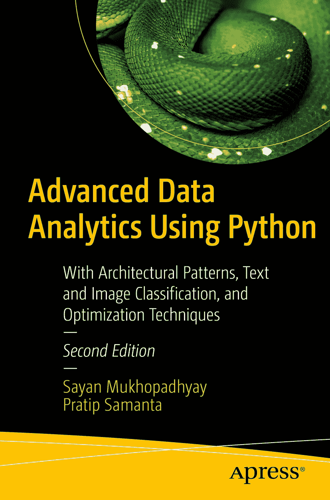

ISBN 978-1-4842-8004-1  
e-ISBN 978-1-4842-8005-8  
[`doi.org/10.1007/978-1-4842-8005-8`](https://doi.org/10.1007/978-1-4842-8005-8)  
© Sayan Mukhopadhyay, Pratip Samanta 2018, 2023  
Apress 标准出版社  

本出版物中使用的通用描述性名称、注册商标、商标、服务标记等，即使未作特别声明，也不意味着这些名称不受相关保护性法律和法规的约束，因此可自由使用。出版商、作者和编辑认为，本书中的建议和信息在出版之日是真实准确的。出版商、作者或编辑均不对本书所含材料或可能存在的任何错误或遗漏提供明示或暗示的担保。

本 Apress 印记由注册公司 APress Media, LLC（Springer Nature 的一部分）出版。  
注册公司地址为：1 New York Plaza, New York, NY 10004, U.S.A.

*本书成功的秘诀在于其原创性研究，因此我将此书献给教会我如何做研究的人：印度科学研究所的 Debnath Pal 博士。*  
*——Sayan Mukhopadhyay*

## 引言

我们正生活在数据科学/人工智能时代。在这个数据驱动着从商业到政府、体育到娱乐等一切决策的环境中，要想蓬勃发展，你需要掌握管理和分析海量数据的技能。我们可以共同利用这些数据，让世界变得更美好。事实上，人类尚未发掘出利用这些数据所能做到的一切。那么，让我们开始探索吧！

本书的目标是让你成为这个数据变革时代的领导者。通过本书，你将学习开发人工智能应用的技能，并对世界产生影响。

本书面向高级用户，因为我们融入了一些高级分析主题。重要的机器学习模型和深度学习模型均配有编程练习和实际案例进行讲解。

本书中使用的所有源代码均可从 [`https://github.com/apress/advanced-data-analytics-python-2e`](https://github.com/apress/advanced-data-analytics-python-2e) 下载。

祝阅读愉快！

## 致谢

感谢 Labonic Chakraborty (Ripa) 和 Soumili Chakraborty。

## 关于作者  
## 关于技术审校

