# 3. 特征工程与监督学习

监督学习，也称为监督式机器学习，是机器学习和人工智能的一个子类别，它将帮助我们利用模型解决各种现实世界的问题。在本章中，我们将介绍监督式机器学习的以下三个基本组成部分（聚类将在后续关于无监督学习的章节中介绍），以及对于为模型获取准确信息至关重要的特征工程：

-   *降维* 讲述如何从一组特征中选择最重要的特征。
-   *分类* 讲述如何借助给定的训练/示例数据集将数据归类到一组目标类别中。
-   *回归* 讲述如何将一个变量表示为一组自变量的线性或非线性多项式。

这些内容是构建任何预测模型的基础模块。

## 使用 Python 进行降维

降维是数据分析的一个重要方面。数值数据和分类数据都需要它。调查或因子分析是降维最流行的应用之一。例如，假设一个组织想要找出哪些因素对影响或改变其运营最为重要。它收集组织内不同员工的意见，并基于这些调查数据进行因子分析，最终得出一组较少的因素。

在投资银行业务中，不同的指数是作为工具的加权平均值来计算的。因此，当指数上涨时，可以预期指数中权重为正的工具也会上涨，而权重为负的工具则会下跌。交易员据此进行交易。通常，指数由大量工具（超过十个）组成。在高频算法交易中，要在几分之一秒内发送如此多的订单是很困难的。通过使用主成分分析，交易员可以将指数实现为一组较少的工具来开始交易。奇异值分解是一种流行的算法，既用于主成分分析，也用于因子分析。在本章中，我将详细讨论它。分类数据也需要降维。假设一个零售商想知道某个城市是否是销售额的重要贡献者；这可以通过使用互信息来衡量，本章也将涵盖这一点。在此之前，我将介绍皮尔逊相关性，它使用简单。这就是为什么它是一种流行的特征工程方法，更准确地说，是特征选择方法。

### 相关性分析

相关性有不同的度量方法。我将只讨论皮尔逊相关性。对于两个变量 `x` 和 `y`，皮尔逊相关性如下所示：

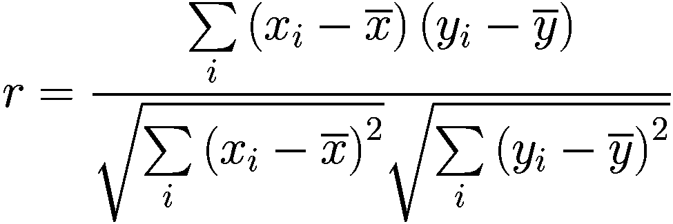

`r` 的值将在 -1 到 +1 之间变化。该公式清楚地表明，当 `x` 大于其平均值时，`y` 也更大，因此 `r` 值更大。换句话说，如果 `x` 增加，那么 `y` 也增加，那么 `r` 就更大。所以，如果 `r` 接近 1，意味着 `x` 和 `y` 正相关。类似地，如果 `r` 接近 -1，意味着 `x` 和 `y` 负相关。同样，如果 `r` 接近 0，意味着 `x` 和 `y` 不相关。这里展示了一个计算 `r` 的简化公式：

![$$ \textrm{r}=\frac{\textrm{n}\left(\sum xy\right)-\left(\sum \textrm{x}\right)\left(\sum \textrm{y}\right)}{\sqrt{\left[\textrm{n}\sum {\textrm{x}}²-{\left(\sum \textrm{x}\right)}²\right]}\left[\textrm{n}\sum {\textrm{y}}²-{\left(\sum \textrm{y}\right)}²\right]} $$](images/458833_2_En_3_Chapter/458833_2_En_3_Chapter_TeX_Equb.png)

你可以轻松地使用相关性进行特征选择或剔除相似特征。假设 `Y` 是一个变量，它是 `n` 个变量 `X1, X2, ... Xn` 的加权和。你想将这组 `X` 缩减为一组更少的变量。为此，你需要计算每个 `X` 对之间的相关系数。现在，如果 `Xi` 和 `Xj` 高度相关，那么你将研究 `Y` 与 `Xi` 和 `Xj` 的相关性。如果 `Xi` 的相关性大于 `Xj`，那么你就从集合中移除 `Xj`，反之亦然。以下是查找两个变量之间相关性的代码：

```
import numpy as np
import matplotlib.pyplot as plt
x = np.array([-4, -1, 0, 1, 3])
y = np.array([4, 1, -2, 1, 2])
corrcoef = np.corrcoef(x, y)
print(corrcoef)
```

在输出中，对角线上的 1 表示与自身的相关性，例如，`x` 与 `x`，`y` 与 `y`。

现在的问题是，之前所说的 `X` 和 `Y` 相关的阈值应该是多少？常见的做法是假设如果 `r` > 0.5，则表示变量相关；如果 `r` < 0.5，则表示不相关。这种方法的一个很大局限性是它没有考虑数据的长度。例如，一组 20 个数据点中的 0.5 相关性，不应与一组 10,000 个数据点中的 0.5 相关性具有相同的权重。为了克服这个问题，引入了概差概念，如下所示：

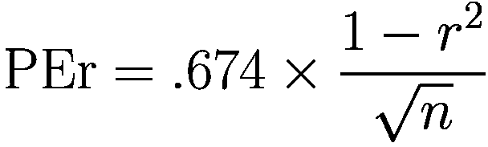

`r` 是相关系数，`n` 是样本量。

这里，`r` > 6PEr 意味着 `X` 和 `Y` 高度相关；如果 `r` < PEr，则意味着 `X` 和 `Y` 相互独立。使用这种方法，你可以看到，当数据量巨大时，即使 `r` = 0.1 也意味着高度相关。

相关性在电子商务网站的产品推荐中有一个有趣的应用。如果你计算用户对相同产品的共同评分之间的相关性，推荐系统可以识别出相似的用户。类似地，你也可以通过计算同一用户对产品的共同评分之间的相关性来找到相似的产品。这种方法被称为*协同过滤*。


### 主成分分析

从理论上讲，相关性对于具有高斯分布（即独立变量）的变量效果良好。对于其他情况，则必须使用主成分分析。假设你想降低 *N* 个变量：`X1`、`X2`、... `Xn` 的维度。让我们构建一个 *N*×*N* 维的矩阵，其中第 i 列代表观测值 `Xi`，并假设所有变量都有 *N* 个观测值。现在，如果 *k* 个变量是冗余的，为简单起见，假设这 *k* 列相同或互为线性组合。那么该矩阵的秩将为 *N*-*k*。因此，该矩阵的秩是衡量独立变量数量的指标，而特征值则表示该变量的强度。这一概念被用于主成分分析和因子分析。为了使矩阵成为方阵，我们选择协方差矩阵。奇异值分解用于求解特征值。

设 *Y* 为大小为 *p*×*q* 的输入矩阵，其中 *p* 是数据行数，*q* 是参数数量。

那么 *q*×*q* 的协方差矩阵 `Co` 由下式给出：


这是一个对称矩阵，因此可以按如下方式对角化：


`U` 的每一列都是一个特征向量，`D` 是一个对角矩阵，其对角线上的特征值 λi 按降序排列。这些特征向量被称为数据的*主轴*或*主方向*。数据在主轴上的投影称为主成分，也被称为 *PC 得分*；这些可以被视为新的、变换后的变量。第 j 个主成分由 `YU` 的第 j 列给出。新 PC 空间中第 i 个数据点的坐标由 `YU` 的第 i 行给出。

以下代码是使用 Python 进行 PCA 的示例。输入数据文件可从以下链接下载：

[`https://canvas.uw.edu/courses/1546077/files/92110986`](https://canvas.uw.edu/courses/1546077/files/92110986)

```
import pandas as pd
from sklearn.preprocessing import StandardScaler, normalize
from sklearn.decomposition import PCA
#### 加载 CSV 文件
df = pd.read_csv("book\\ch4\\CC_GENERAL.csv")
#### 预处理
df = df.drop('CUST_ID', axis = 1)
df.fillna(method ='ffill', inplace = True)
#### 缩放和归一化
ss = StandardScaler()
scaled_df = ss.fit_transform(df)
normalized_df= normalize(scaled_df)
#### 将维度降至 3
pca = PCA(n_components=3)
df_pca = pca.fit_transform(normalized_df)
df_pca = pd.DataFrame(df_pca)
df_pca.columns = ['P1', 'P2', 'P3']
```

如果向 `PCA` 构造函数提供一个整数，则会检查主成分的数量；如果传递一个小数，则会考虑在成分内保留的变异比例。更多信息请参见第 5 章。主成分或特征向量的物理意义在以下示例中进行了说明。

**示例：** 弹性膜的拉伸

在边界圆为 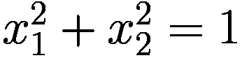 的 *x*[1]*x*[2] 平面中，一张弹性膜被拉伸，使得点 *P*(*x*[1], *x*[2]) 移动到点 *Q*(*y*[1], *y*[2])，如下所示：

![$$ \left[y\right]=\left[\begin{array}{c}{y}_1\\ {}{y}_2\end{array}\right]=\left[\begin{array}{cc}5&amp; 3\\ {}3&amp; 5\end{array}\right]\left[\begin{array}{c}{x}_1\\ {}{x}_2\end{array}\right]=\left[A\right]\left[x\right] $$](images/458833_2_En_3_Chapter/458833_2_En_3_Chapter_TeX_Equf.png)

需要找到主方向，即点 P 仅径向延伸至点 Q 的方向。这意味着需要一些特定的向量 `[x]` 和 `[y]`，使得：

![$$ \left[y\right]=\left[A\right]\left[x\right]=\lambda \left[x\right] $$](images/458833_2_En_3_Chapter/458833_2_En_3_Chapter_TeX_Equg.png)

以下是给出特征值的特征方程：

![$$ \left|\left[A\right]-\lambda \left[I\right]\right|=0 $$](images/458833_2_En_3_Chapter/458833_2_En_3_Chapter_TeX_Equh.png)

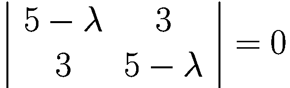

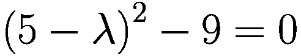

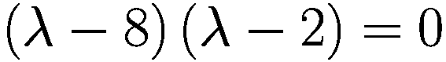

因此，λ = 8 或 2。当 *λ*[1] = 8 时，`[[A] − 8[I]][x][1] = 0`。

第一个特征向量为：

![$$ {\left[x\right]}_1={\left[\begin{array}{c}{x}_1\\ {}{x}_2\end{array}\right]}_1=\left[\begin{array}{c}1\\ {}1\end{array}\right] $$](images/458833_2_En_3_Chapter/458833_2_En_3_Chapter_TeX_Equl.png)

这意味着 *x*[1] = *x*[2]。当 *λ*[2] = 2 时，`[[A] − 2[I]][x][2] = 0`。

第二个特征向量为：

![$$ {\left[x\right]}_2={\left[\begin{array}{c}{x}_1\\ {}{x}_2\end{array}\right]}_2=\left[\begin{array}{c}1\\ {}-1\end{array}\right] $$](images/458833_2_En_3_Chapter/458833_2_En_3_Chapter_TeX_Equm.png)

这意味着 *x*[1] = −*x*[2]。根据特征值，该膜在主方向上分别被拉伸了 8 倍和 2 倍。拉伸后，圆形膜的边界变为椭圆形，其长轴和短轴位于特征向量方向上，如图 3-1 所示。

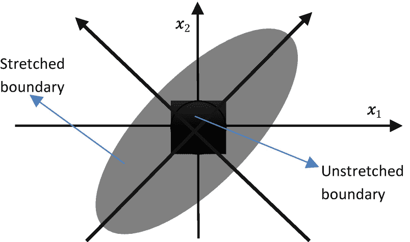

一个以 x 下标 2 和 x 下标 1 为坐标轴的笛卡尔平面中有一个灰度椭圆体。其中心有一个深色正方形，并带有拉伸和未拉伸的边界。

图 3-1

拉伸膜的主成分


### 互信息

两个随机变量的互信息（`MI`）是衡量两者之间相互依赖程度的指标。它也被用作两个变量分布的相似性度量。互信息值越高，表明两个变量的分布越相似。

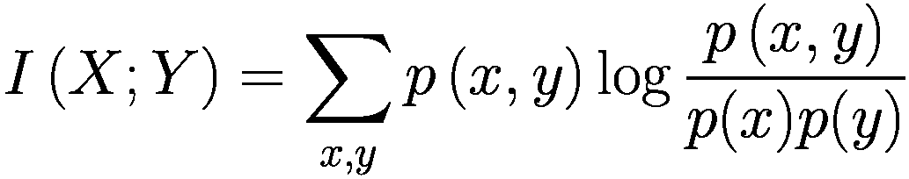

假设某零售商想调查特定城市是否是其销量的决定性因素。那么，零售商可以查看不同城市的销量分布情况。如果所有城市的销量分布都相同，那么就销量而言，特定城市就不是一个重要因素。为了计算两个概率分布之间的差异，这里应用了互信息。

以下是计算互信息的示例 Python 代码：

```
from sklearn import metrics
y_true = [0, 1, 0, 1, 2, 1]
y_pred = [0, 0, 1, 1, 1, 2]
print(metrics.mutual_info_score(y_true, y_pred))
```

让读者拥有一个包含特征工程的完整代码。它采用了一个深度学习模型。本节涵盖了特征工程的所有方面。

请在以下链接中查找 CSV 文件：

[`https://github.com/Apress/advanced-data-analytics-python-2e`](https://github.com/Apress/advanced-data-analytics-python-2e)

```
import pandas as pd
import numpy as np
from scipy.stats.stats import pearsonr
from keras.models import Sequential
from keras.layers import Dense
#Reading input data
df = pd.read_csv('book\\ch3\\fetaure_engineering_data.csv')
df_back = pd.read_csv('book\\ch3\\fetaure_engineering_data.csv')
print(df.shape)
```

以下代码片段对数值列进行归一化处理：

```
#normalize numeric columns
mean_map = {}
std_map = {}
for col in df.columns:
if np.issubdtype(df[col].dtype, np.number):
avg = df[col].mean()
st_d = df[col].std()
df[col] = (df[col] - avg)/st_d
mean_map[str(col)] = avg
std_map[str(col)] = st_d
```

这部分用于将分类值转换为数值：

```
#convert the categorical columns to numeric and store it
df_score = pd.DataFrame()
started = False
for col in df.columns:
if not np.issubdtype(df[col].dtype, np.number):
avgs = df.groupby(col, as_index=False)['SalePrice'].aggregate(np.mean)
for index,row in avgs.iterrows():
k = row[col]
v = row['SalePrice']
df.loc[df[col] == k, col] = v
df_temp = pd.DataFrame()
df_temp['feature_value'] = df_back[col]
df_temp['score'] = df[col]
df_temp['feature_name'] = str(col)
df_temp = df_temp.drop_duplicates()
if started:
df_score = df_score.append(df_temp)
else:
df_score = df_temp
started = True
df = df.fillna(df.mean())
df_score = df_score.fillna(0)
```

这里我们删除通常冗余且在模型构建中价值不大的相关列。

```
#drop the column which are correlated to each other
while(1):
flag = True
for I in range(df.shape[1]-2):
for j in range(i+1,df.shape[1]-1):
corr = pearsonr(df.iloc[:,i], df.iloc[:,j])
pEr= .674 * (1- corr[0]*corr[0])/ (len(df.iloc[:,i])**(1/2.0))
if corr[0] > 6*pEr:
corr1 = pearsonr(df.iloc[:,i], df‘'SalePric’'])
corr2 = pearsonr(df.iloc[:,j], df‘'SalePric’'])
stay = i
if corr1[0]  < corr2[0]:
stay = j
df.drop(df.columns[stay],inplace=True, axis=1)
flag = False
break
if flag:
break
print(df.shape)
```

最后，我们可以看到数据框中有 25 列，而最初我们有 81 列。通过前面的代码，我们转换了数据并移除了不必要的列。

现在我们将讨论监督学习的分类问题。

## 使用 Python 进行分类

分类是机器学习中一个广为人知的例子。它有一组目标类别和训练数据。每个训练数据都由一个特定的目标类别标记。分类模型通过训练数据进行训练，并预测测试数据的目标类别。分类的一个常见应用是在信用卡或贷款审批过程中的欺诈识别。它根据数据将申请人分类为欺诈或非欺诈。许多未受过教育的店主无需任何计算就能对商品进行分类。他们不会购买上周销售不佳的产品。这是一种某种形式的贝叶斯分类器。广告行业会屏蔽上周平均价格低于某个阈值的展示。分类也广泛应用于图像识别。从一组图像中，如果你识别出计算机的图像，那就是将计算机的图像与不属于计算机的类别进行分类。

情感分析是文本分类的一个流行应用。假设一家航空公司想要分析其客户的文本反馈。然后，每条反馈会根据情感（正面/负面/中性）以及上下文（关于员工/时间/食物/价格）进行分类。一旦完成，航空公司就能轻松找出其员工的优势、准点率或成本效益，甚至其弱点。广义上讲，分类有三种方法。

*   *基于规则的方法*：我将讨论决策树和随机森林算法。
*   *概率方法*：我将讨论朴素贝叶斯算法。
*   *基于距离的方法*：我将讨论支持向量机。

## 半监督学习

分类和回归是监督学习的类型。在这种学习类型中，你有一组训练数据来训练模型。然后，该模型用于预测测试数据。例如，假设你想根据情感对文本进行分类。有三个目标类别：正面、负面和中性。为了训练你的模型，你必须选择一些样本文本，并将其标记为正面、负面和中性。你使用这些训练数据来训练模型。一旦模型训练完成，你就可以将模型应用于测试数据。例如，你可以使用朴素贝叶斯分类器进行文本分类，并尝试预测句子“食物很好”的情感。在训练阶段，程序会分别计算单词*Food*、*is*和*good*出现时句子为正面、负面或中性的概率，并将其存储在模型中；在测试阶段，当*Food*、*is*和*good*同时出现时，它会计算联合概率。

相反，聚类是无监督学习的一个例子，其中没有可用的训练数据或目标类别。程序一次性从数据中学习。也存在半监督学习的实例。假设你将文本分类为正面和负面情感，但你的训练数据只有正面数据。非正面的训练数据是未标记的。在这种情况下，作为第一步，你假设所有未标记的数据都是负面的来训练模型，并将训练好的模型应用于训练数据。在输出中，结果为负面的数据应被标记为负面。最后，使用新标记的数据训练你的模型。最近邻分类器也被认为是半监督学习。它有训练数据，但没有模型的训练阶段。

## 决策树

*决策树*是一种规则树。树的每一层代表一个参数，该层的每个节点验证该层参数的一个约束条件，每个分支表示父节点参数的一个可能值。图 3-2 展示了一个决策树的示例。

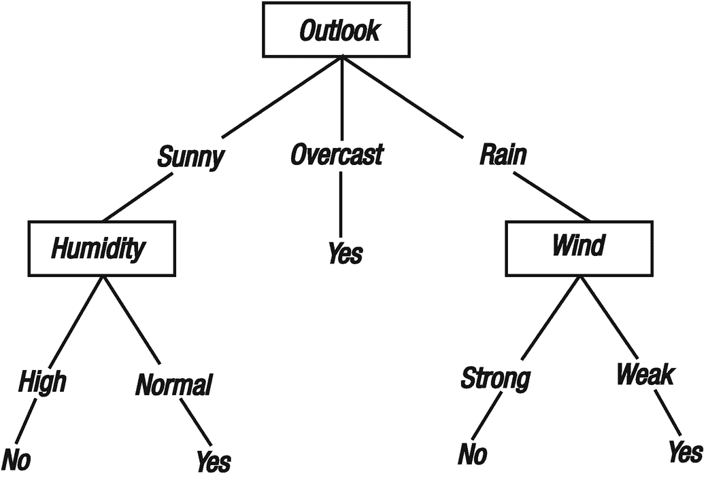

一个以父节点“天气”开头的树形图，根据晴天、阴天和雨天列出了湿度和风力。

图 3-2

用于判断好天气的决策树示例


### 哪个属性优先？

决策树的一个重要方面是决定特征的顺序。基于熵的信息增益度量决定了这一顺序。

`熵`是衡量系统随机性的指标。

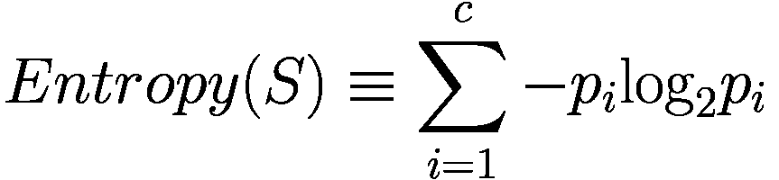

例如，对于任何确定的事件，如太阳从东方升起，熵为零，`P`=1，且`log(p)`=0。熵越大，意味着系统中的不确定性或随机性越大。

`信息增益`，即根据该属性划分示例所导致的熵的预期减少量，是这种情况下使用的度量标准。

具体来说，属性`A`相对于示例集合`S`的信息增益`Gain(S,A)`定义如下：

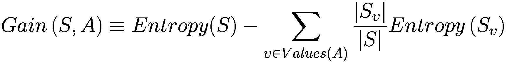

因此，信息增益更高的属性将在决策树中优先出现。

```
from sklearn.datasets import load_iris
from sklearn.tree import DecisionTreeClassifier
iris_data = load_iris()
data, labels = iris_data.data, iris_data.target
model = DecisionTreeClassifier()
model = model.fit(data, labels)
print(model.predict(data[[10]]))
```

### 随机森林分类器

`随机森林分类器`是决策树的一种扩展，该算法创建`N`棵决策树，每棵树随机选择`M`个特征。现在，测试数据将由所有决策树进行分类，并归类到多数决策树输出的目标类别中。

```
from sklearn.datasets import load_iris
from sklearn.ensemble import RandomForestClassifier
iris_data = load_iris()
data, labels = iris_data.data, iris_data.target
model = RandomForestClassifier()
model = model.fit(data, labels)
print(model.predict(data[[10]]))
```

## 朴素贝叶斯分类器

`X = (x1, x2, x3, ..., xn)` 是一个`n`维向量。贝叶斯分类器将每个`X`分配到集合`{C1, C2, …, Cm}`中的一个目标类别。这种分配基于`X`属于目标类别`Ci`的概率。也就是说，当且仅当对于所有满足`1 ≤ j ≤ m`的`j`，有`P(Ci |X) > P(Cj |X)`时，`X`被分配到类别`Ci`。

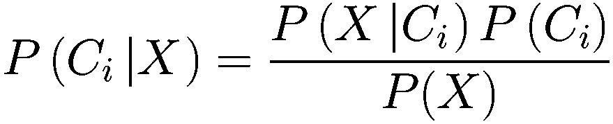

通常，计算`P(X|Ci)`的计算成本可能很高。如果`X`的每个分量`x[k]`可以取`r`个值之一，那么对于`m`个类别中的每一个，需要考虑`r^n`种组合。为了简化计算，做出了条件类别独立性的假设，这意味着对于每个类别，假设属性是独立的。基于此假设发展而来的分类器被称为朴素贝叶斯分类器。该假设允许你写出以下公式：

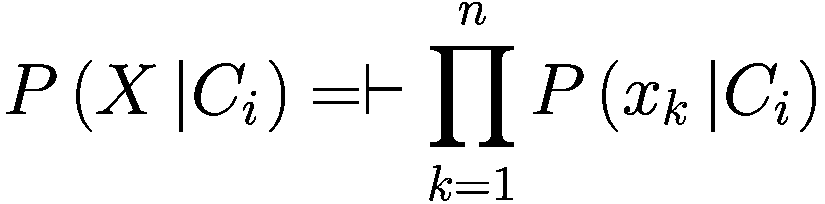

以下代码是数值数据朴素贝叶斯分类的一个示例：

```
from sklearn.naïve_bayes import GaussianNB
from sklearn.datasets import load_iris
iris_data = load_iris()
data, labels = iris_data.data, iris_data.target
model = GaussianNB()
model = model.fit(data, labels)
print(model.predict(data[[50]]))
```

注意

你将在“情感分析”部分看到朴素贝叶斯分类器的另一个示例。

## 支持向量机

如果你查看图 3-3，可以很容易地理解，圆形和方形点在二维空间（`x1`, `x2`）中是线性可分的。但它们在`x1`或`x2`任一维度上都不是线性可分的。支持向量机算法正是基于这一理论。它增加数据的维度，直到点变得线性可分。一旦完成，你需要找到两个平行的超平面来分隔数据。这些平面被称为`间隔`。算法选择间隔的方式是使它们之间的距离最大。这就是为什么它被称为最大间隔。位于这两个间隔中间或与它们等距的平面被称为`最优超平面`，用于对测试数据进行分类（见图 3-2）。分隔面也可以是非线性的。

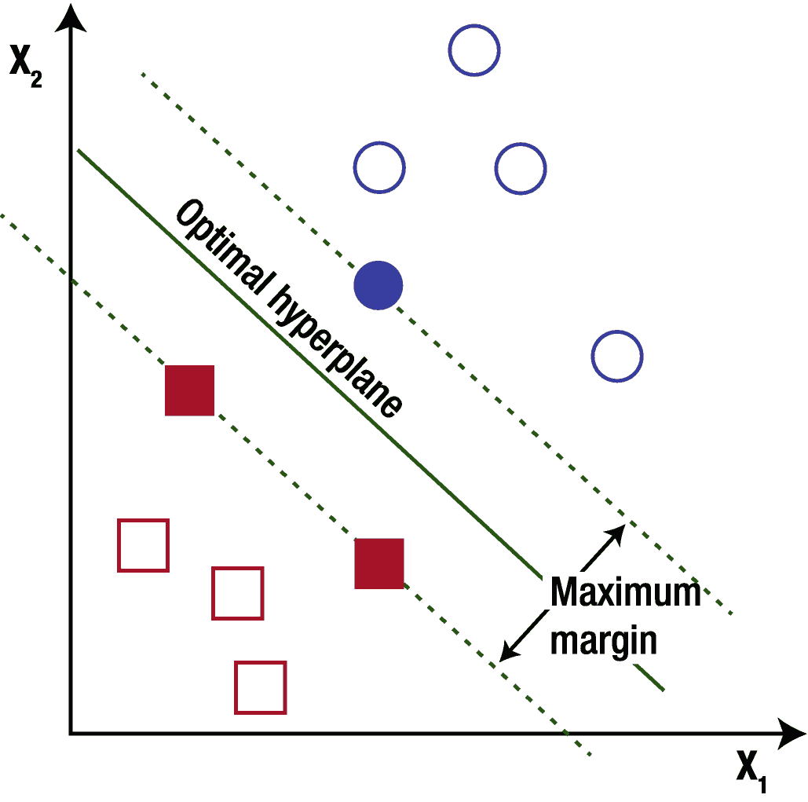

一个 X 下标 2 与 X 下标 1 的关系图。它在最大间隔处有一个负斜率的最优超平面，并且在其上下方有簇。

图 3-3

支持向量机

以下代码是使用 Python 进行支持向量机分类的示例：

```
from sklearn.svm import SVC
from sklearn.datasets import load_iris
iris_data = load_iris()
data, labels = iris_data.data, iris_data.target
model = SVC()
model = model.fit(data, labels)
print(model.predict(data[[50]]))
```

## 最近邻分类器

最近邻分类器是一种简单的基于距离的分类器。它计算测试数据与训练数据的距离，并根据目标类别对距离进行分组。与测试实例平均距离最小的目标类别被选为测试数据的类别。这里展示了一个 Python 示例：

```
from sklearn.neighbors import KNeighborsClassifier
from sklearn.datasets import load_iris
iris_data = load_iris()
data, labels = iris_data.data, iris_data.target
model = KNeighborsClassifier()
model = model.fit(data, labels)
print(model.predict(data[[50]]))
```


## 情感分析

情感分析是文本分类的一个有趣应用。例如，假设一家航空公司想要分析其客户反馈。它根据情感（正面/负面）以及方面（食物/员工/准点率）对反馈进行分类。之后，它可以轻松了解其业务优势（获得最多正面反馈的方面）和劣势（获得最多负面反馈的方面）。该航空公司还可以将此结果与竞争对手进行比较。与竞争对手进行比较的一个有趣优势是，它消除了模型准确性的影响，因为相同的准确性适用于所有竞争对手。使用 `textblob` 库在 Python 中实现这一点很简单，如下所示：

```
from textblob.classifiers import NaïveBayesClassifier
train = [('I love this sandwich.', 'pos'),  ('this is an amazing place!', 'pos'),('I feel very good about these beers.', 'pos'),('this is my best work.', 'pos'),("what an awesome view", 'pos'),('I do not like this restaurant', 'neg'),('I am tired of this stuff.', 'neg'),("I can't deal with this", 'neg'),('he is my sworn enemy!', 'neg'),('my boss is horrible.', 'neg')]
cl = NaïveBayesClassifier(train)
print (cl.classify("This is an amazing library!"))
```

*输出 : pos*

```
from textblob.classifiers import NaïveBayesClassifier
train = [('Air India did a poor job of queue management both times.', 'staff service'),  ("The 'cleaning' by flight attendants involved regularly spraying air freshener in the lavatories.", 'staff'),('The food tasted decent.', 'food'),('Flew Air India direct from New York to Delhi round trip.', 'route'),('Colombo to Moscow via Delhi.', 'route'),('Flew Birmingham to Delhi with Air India.', 'route'),('Without toilet, food or anything!', 'food'),('Cabin crew announcements included a sincere apology for the delay.', 'cabin flown')]
cl = NaïveBayesClassifier(train)
tests = ['Food is good.']
for c in tests:
print(cl.classify(c))
```

`textblob` 库还支持随机森林分类器，该分类器在处理以规范英语（例如正式信函）撰写的文本时效果最佳。对于通常语法不规范的文本（例如客户反馈），朴素贝叶斯效果更好。朴素贝叶斯在实时分析中还有另一个优势：你可以在不丢失先前训练结果的情况下更新模型。

## 图像识别

图像识别是图像分类的一个常见示例。通过应用 `opencv` 库，在 Python 中很容易实现。

请从 OpenCV GitHub ([`https://github.com/opencv/opencv/tree/master/data/haarcascades`](https://github.com/opencv/opencv/tree/master/data/haarcascades)) 下载模型文件 (`haarcascade_frontalface_default.xml`)，并从 [`https://en.wikipedia.org/wiki/File:Lenna_(test_image).png`](https://en.wikipedia.org/wiki/File:Lenna_%2528test_image%2529.png) 下载示例 Lenna 图像。

以下是示例代码：

```
import cv2
#### 加载级联分类器
face_model = cv2.CascadeClassifier('haarcascade_frontalface_default.xml')
#### 读取图像
img = cv2.imread('lena.jpg')
#### 转换为灰度图
gray_img = cv2.cvtColor(img, cv2.COLOR_BGR2GRAY)
#### 检测人脸
faces_detected = face_model.detectMultiScale(gray_img, 1.1, 4)
#### 在人脸周围绘制矩形
for (x, y, w, h) in faces_detected:
cv2.rectangle(img, (x, y), (x+w, y+h), (255, 0, 0), 2)
#### 显示输出
cv2.imshow('img', img)
cv2.waitKey()
使用以下命令安装 opencv：
sudo pip3 install opencv-contrib-python
现在我们将讨论另一种监督学习问题：回归。
```

## 使用 Python 进行回归

回归将一个变量实现为一组自变量的线性或非线性多项式。

这里有一个有趣的用例：使产品利润最大化的销售价格是多少？对于任何商家来说，这都是一个价值百万美元的问题。这个问题并不简单。最大化销售价格可能不会导致利润最大化，因为提高销售价格有时会降低销售量，从而降低总利润。因此，会存在一个最优的销售价格值，使得利润达到最大。

有 *N* 条交易记录，包含 *M* 个特征，称为 F1、F2、... Fm（销售价格、购买价格、返现、SKU、订单日期等）。你需要找到一个由 K (K<M) 个特征组成的子集，这些特征对商家的利润有影响，并为这 K 个特征建议一个最优值 V1、V2、... Vk，以最大化收入。

你可以使用以下公式计算商家的利润：


(1)

对于此公式，变量如下：

*   SP = 销售价格
*   TCB = 总返现金额
*   BP = 购买价格
*   SV = 销售量

现在，使用回归，你可以将 SV 表示如下：

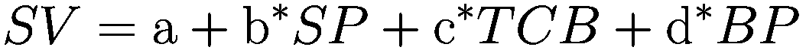

现在，你可以将利润表示为 SP、TCB 和 BP 的函数，并使用数学优化方法。通过约束所有参数值，你可以获得使利润最大化的参数最优值。

这是回归的一个有趣用例。在许多场景中，一个变量必须实现为其他变量的线性或多项式函数。

### 最小二乘估计

最小二乘估计是进行回归的最简单、最古老的方法。它也被称为*曲线拟合方法*。普通最小二乘（OLS）回归是最常用的技术，由卡尔·弗里德里希·高斯和阿德里安-马里·勒让德在 18 世纪发明。以下是普通最小二乘估计中系数计算的推导过程：


以下代码是 OLS 回归的一个简单示例：

请在以下链接找到 CSV 文件：

[`https://github.com/Apress/advanced-data-analytics-python-2e`](https://github.com/Apress/advanced-data-analytics-python-2e)

```
import pandas as pd
import statsmodels.api as sm
df = pd.read_csv('book\\ch3\\fetaure_engineering_data.csv')
#### df = pandas.read_csv("restaurants.csv")
X = df['LotArea']
Y = df['SalePrice']
X = sm.add_constant(X)
model = sm.OLS(Y, X).fit()
summary = model.summary()
print(summary)
```

### 逻辑回归

逻辑回归是回归的一个有趣应用，它计算事件发生的概率。它引入了一个中间变量，该变量是线性变量的线性回归。然后，它通过逻辑函数传递该中间变量，将中间变量映射到 0 到 1 之间。该变量被视为事件发生的概率。

以下代码是对数值数据进行逻辑回归的示例：

```
from sklearn.preprocessing import StandardScaler
from sklearn.linear_model import LogisticRegression
from sklearn.datasets import load_iris
data, labels = load_iris(return_X_y=True)
scaler = StandardScaler()
data = scaler.fit_transform(data)
model = LogisticRegression(random_state=0)
model = model.fit(data, labels)
print(model.predict(data[[50]]))
```


#### 分类与回归

分类与回归可应用于同一问题。例如，银行在审批信用卡或贷款时，会通过回归方法基于多个参数计算申请人的信用评分，并设定一个阈值。信用评分高于阈值的申请人被归类为潜在非欺诈用户，其余则被视为潜在欺诈用户。同样，任何二分类问题都可以通过对回归结果应用阈值来解决。在第 4 章中，我详细讨论了如何从任意参数的分布中选择阈值。类似地，某些二分类方法也可替代逻辑回归使用。例如，假设某电商网站希望预测订单转化为成功发票的概率，该网站可以轻松通过逻辑回归实现。朴素贝叶斯分类器可直接应用于该问题，因为它在将订单分类为成功或失败类别时会计算概率。随机森林算法同样适用于此问题。在这种情况下，在*N*棵决策树中，如果有*M*棵决策树判定订单将成功，则*M*/*N*即为订单成功的概率。

## 有意使模型过拟合或欠拟合

有时你需要有意进行过高或过低的预测。在拍卖中，当你从买方角度预测时，出价略低于原价总是有利的。同样，从卖方角度，你希望将价格设定得略高于原价。有两种方法可以实现这一点。在回归中，当你使用相关性选择特征时，有意过高预测会剔除某些负相关变量；类似地，过低预测则会剔除某些正相关变量。另一种处理方式是：在预测数值时，同时预测误差值。若要过高预测，当发现预测误差为正时，将预测值减去误差量；若要过低预测，当误差为正时，将预测值加上误差量。

分类中的另一个问题是训练数据偏差。假设你有两个目标类别 A 和 B，大部分（例如 90%）训练数据属于 A 类。因此，当你用这些数据训练模型时，所有预测结果都会偏向 A 类。一种解决方案是对训练数据进行有偏采样，即有意移除训练数据中的 A 类样本。另一种方法可用于二分类：由于 B 类在样本预测概率中属于少数，其概率始终低于 0.5。接着计算所有归入 B 类的点的平均概率。对于任意点，如果其 B 类概率大于平均概率，则标记为 B 类，否则标记为 A 类。

## 处理分类数据

对于支持向量机或回归等算法，输入数据必须是数值型。因此，处理分类数据时需要将其转换为数值型数据。一种转换策略是使用序数作为数值评分。另一种流行技术是使用*独热编码*。在第一种方法中，我们为每个类别分配数字。如果某列有五个类别，则对应五个数字（例如 0 到 4）。而在独热编码中，会为每个类别创建一个新的二进制列，并根据类别标记为真或假。请运行以下代码以更好地理解：

请通过以下链接查找 CSV 文件：

[`https://github.com/Apress/advanced-data-analytics-python-2e`](https://github.com/Apress/advanced-data-analytics-python-2e)

```
import pandas as pd
from sklearn.preprocessing import OneHotEncoder
from sklearn.preprocessing import OrdinalEncoder
df = pd.read_csv('book\\ch3\\fetaure_engineering_data.csv')
oe = OrdinalEncoder()
df["Functional_code"] = oe.fit_transform(df[["Functional"]])
print(df[["Functional", "Functional_code"]]. head(20))
ohe = OneHotEncoder()
ohe_results = ohe.fit_transform(df[["Functional"]])
print(pd.DataFrame(ohe_results.toarray(), columns=ohe.categories).head(20))
```

## 总结

本章讨论了特征工程，这是获得模型高精度的关键。随后我们详细描述了监督学习技术，如分类与回归。

