# 无监督学习：聚类

在第 3 章中，我们讨论了如何利用训练数据根据情感（正面、负面、中性）以及上下文对客户评论进行分类。例如，在航空业中，上下文可能涉及准点率、餐饮、舒适度、娱乐等方面。通过这种分析，企业主可以确定业务需要重点关注的领域。例如，如果发现负面评论中占比最高的是餐饮问题，那么优先事项就是提升提供给客户的餐饮质量。然而，在某些场景下，企业主并不清楚具体的上下文。也存在训练数据不可用的情况。此外，参考框架可能随时间变化。当目标类别未知时，分类算法无法应用。此时需要使用聚类算法。聚类在酿酒业中有典型应用：每个聚类代表一种葡萄酒品牌，葡萄酒根据其成分比例进行聚类。在第 3 章中，你了解到分类可用于识别图像类型，但有些场景下图像包含多种形状，需要算法来分离图形。聚类算法正适用于此类用例。

聚类基于相似度或距离度量将对象分组。这是无监督学习的一个示例。聚类与分类的主要区别在于，后者具有明确定义的目标类别。目标类别的特征由训练数据及其学习到的模型定义，因此分类本质上是监督学习。相比之下，聚类试图基于数据及其相似度或距离来定义有意义的类别。图 4-1 展示了文档聚类过程。

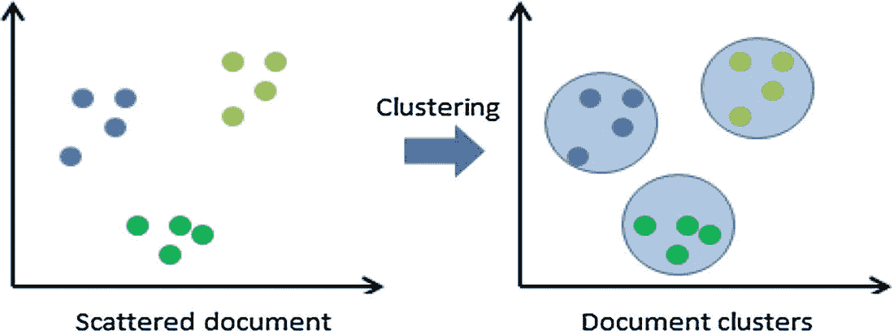

散点图展示了三个不同的文档聚类如何通过聚类被归入三个圆形区域。

`图 4-1` 文档聚类

## K-Means 聚类

假设一家零售分销商有一个在线系统，本地代理在其中手动输入交易信息。他们必须填写的字段之一是城市。但由于此数据输入过程是手动的，人们通常容易犯很多拼写错误。例如，人们可能会输入`Dehi`、`Dehli`、`Delly`等，而不是`Delhi`。你可以尝试使用聚类来解决这个问题，因为聚类的数量是已知的；换句话说，零售商知道代理在多少个城市运营。这是*K-means 聚类*的一个例子。

K-means 算法有两个输入。第一个是数据`X`，它是一组`N`个向量；第二个是`K`，它表示需要创建的聚类数量。输出是每个聚类中的一组`K`个质心，以及`X`中每个向量的一个标签，该标签指示分配给相应聚类的点。一个聚类内的所有点与其质心的距离都比与其他任何质心的距离更近。`K`个聚类`C[k]`和`K`个质心`μ[k]`的条件可以表示如下：

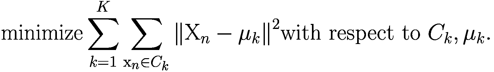

然而，这个优化问题无法在多项式时间内解决。但 Lloyd 提出了一种迭代方法作为解决方案。它包含两个步骤，迭代进行直到程序收敛到解。

1.  它有一组`K`个质心，每个点被分配到一个唯一的聚类或质心，其中相关质心到该特定点的距离是最小的。

2.  它使用以下公式重新计算每个聚类的质心：

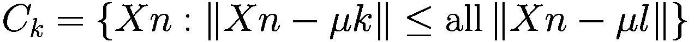

(1)

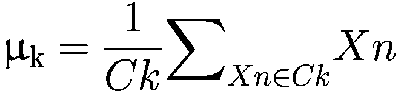

(2)

这个两步过程会持续进行，直到聚类点不再重新排列。该算法的收敛性是有保证的，但它可能会收敛到局部最小值。

以下是在 Python 中执行 K-means 聚类的 Lloyd 算法的简单实现：

```python
import random
def ED(source, target):
if source == "":
return len(target)
if target == "":
return len(source)
if source[-1] == target[-1]:
cost = 0
else:
cost = 1
res = min([ED(source[:-1], target)+1,ED(source, target[:-1])+1,ED(source[:-1], target[:-1]) + cost])
Return(res)
def find_centre(x, X, mu):
min = 100
cent = 0
for c in mu:
dist = ED(x, X[c])
if dist< min:
min = dist
cent = c
return(cent)
def cluster_arrange(X, cent):
clusters  = {}
for x in X:
bestcent = find_centre(x, X, cent)
try:
clusters[bestcent].append(x)
exceptKeyError:
clusters[bestcent] = [x]
return( clusters)
def rearrange_centers(cent, clusters):
newcent = []
keys = sorted(clusters.keys())
for k in keys:
newcent.append(k)
return(newcent)
def has_converged(cent, oldcent):
return (sorted(cent) == sorted(oldcent))
def locate_centers(X, K):
oldcent = random.sample(range(0,5), K)
cent = random.sample(range(0,5), K)
while not has_converged(cent, oldcent):
oldcent = cent
#### Assign all points in X to clusters
clusters = cluster_arrange(X, cent)
#### Reevaluate centers
cent = rearrange_centers(oldcent, clusters)
return(cent, clusters)
X = ['Delhi','Dehli', 'Delli','Kolkata','Kalkata','Kalkota']
print(locate_centers(X,2))
```

然而，K-means 聚类有一个局限性。例如，假设你所有的数据点都位于印度东部。对于`K=4`聚类，初始步骤是你随机选择德里、孟买、金奈和加尔各答中的一个中心。你所有的点都在印度东部，因此所有点都离加尔各答最近，并且总是被分配给加尔各答。因此，程序将一步收敛。为了避免这个问题，该算法会运行多次并取平均值。程序员可以使用各种技巧来初始化第一步中的质心。

## 选择 K：肘部法则

在某些情况下，你必须确定 K-means 聚类中的`K`。为此，你必须使用肘部法则，该法则使用方差百分比作为依赖于聚类数量的变量。最初，选择几个聚类。然后添加另一个聚类，但这并不会使数据建模变得更好。此时选择聚类数量，这就是*肘部准则*。这个“肘部”并不总是能被明确识别。方差百分比被实现为各个聚类的组间方差与总方差的比率。假设在前面的例子中，零售商有四个城市：德里、加尔各答、孟买和金奈。程序员不知道这一点，因此使用`K=2`到`K=9`进行聚类，并绘制方差百分比。程序员将得到一条肘形曲线，该曲线清楚地表明`K=4`是`K`的正确数量。

## 轮廓分析

轮廓分析是选择`K`值的另一种方法。它衡量一个对象与其自身聚类（内聚性）相比与其他聚类（分离度）的相似程度。轮廓值的范围是 −1 到 +1；值越高，对象与其自身聚类的匹配度越高。对于大多数数据点来说，拥有高值是理想的。如果许多点的值较低或为负，则聚类配置不正确。

轮廓可以使用任何距离度量来计算，例如欧几里得距离，这将在后面讨论。

每个数据点`i`的轮廓分数`s(i)`定义如下：

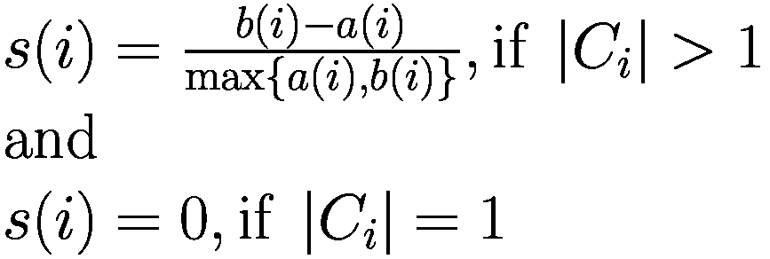

来源：维基百科

这里，`a(i)`是点`i`与其自身聚类的相似性度量，`b(i)`是点`i`与其他聚类中点的相异性度量，如果`i`是聚类中唯一的点，则`s(i)`定义为等于零。

请参考以下代码了解轮廓评分的示例：

```python
from sklearn.datasets import make_blobs
from sklearn.cluster import KMeans
import matplotlib.pyplot as fig
from sklearn.metrics import silhouette_score
#### Create dataset with 4 random cluster centers and 1000 datapoints
x, y = make_blobs(n_samples = 1000, centers = 4, n_features=2, shuffle=True, random_state=31)
sil_score = []
kmax = 10
#### number of clusters should be greater or equal to 2
for k in range(2, kmax+1):
kmeans = KMeans(n_clusters = k).fit(x)
labels = kmeans.labels_
sil_score.append(silhouette_score(x, labels, metric = 'euclidean'))
fig.plot([i for i in range(2,11)], sil_score)
fig.xlabel("K value")
fig.ylabel("silhouette_score")
fig.show()
```

图 4-2 由代码生成。这清楚地表明，对于`k`值 4，轮廓分数最大。因此，我们需要选择四个聚类。

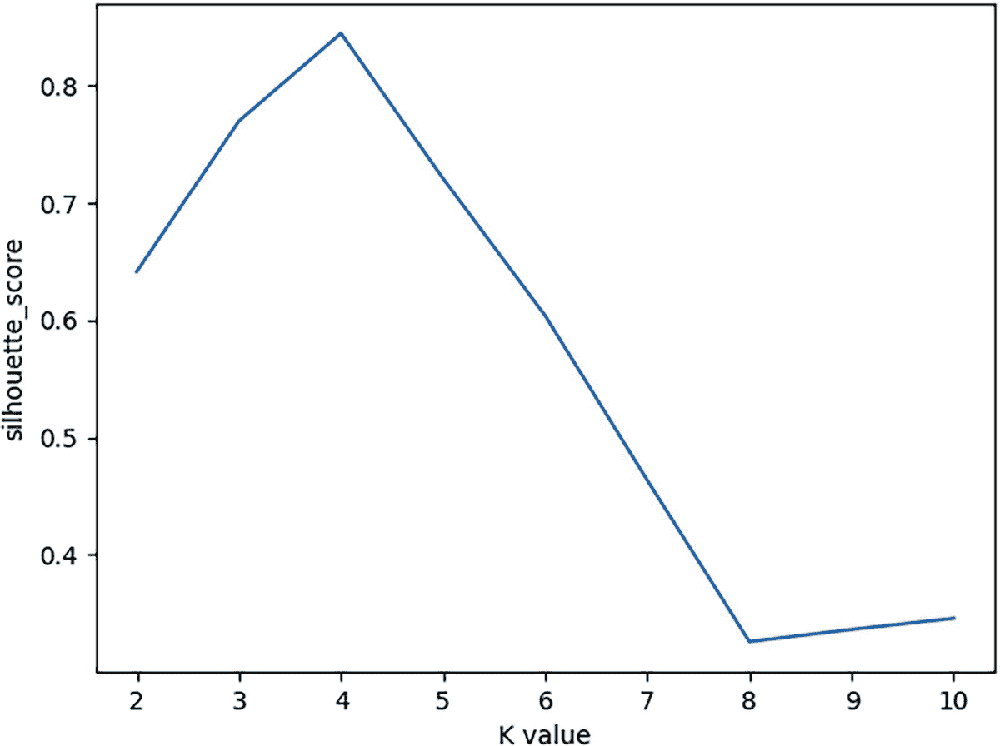

轮廓分数与 K 值的折线图。该线呈波动趋势，分别在 K 值为 4 和 8 处出现上升和下降。

图 4-2

轮廓分数与 k 值

# 距离或相似性度量

距离或相似性的度量是聚类的关键因素之一。在本节中，我们将描述不同类型的距离和相似性度量。在此之前，我们将解释这里的*距离*实际含义。

## 性质

距离是满足以下性质的度量：

- 当且仅当 `x = y` 时，`dist(x, y) = 0`。
- 当 `x ≠ y` 时，`dist(x, y) > 0`。
- `dist(x, y) = dist(y, x)`。
- 对于所有 `x`、`y` 和 `z`，`dist(x, y) + dist(y, z) >= dist(z, x)`。

## 一般距离与欧几里得距离

点 `p` 和 `q` 之间的距离是它们之间几何线段的长度：(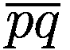)。这被称为*欧几里得距离*。

根据笛卡尔坐标，如果 `p = (p[1], p[2], …, p[n])` 和 `q = (q[1], q[2], …, q[n])` 是欧几里得 `n` 维空间中的两个点，那么从 `q` 到 `p` 或从 `p` 到 `q` 的距离 (`d`) 可由勾股定理推导得出，如下所示：

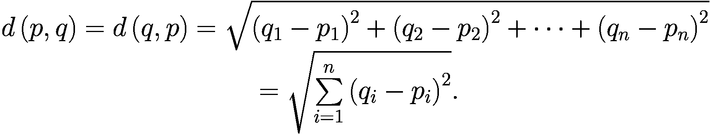

欧几里得向量是欧几里得 `n` 维空间中一个点的位置。向量的大小是一种度量。其长度由以下公式计算：

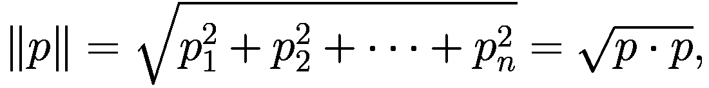

向量具有方向以及距离。两点 `p` 和 `q` 之间的距离可能具有方向，因此，它可以用另一个向量表示，如下所示：

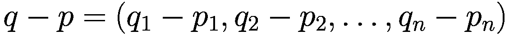

`p` 和 `q` 之间的欧几里得距离就是该距离（或位移）向量的欧几里得长度。

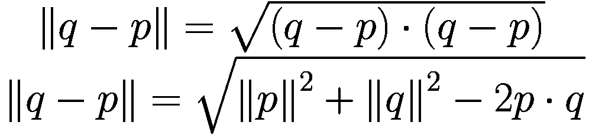

**在一维空间中：**

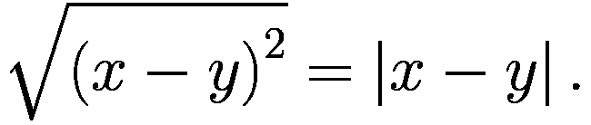

**在二维空间中：**

在欧几里得平面中，如果 `p = (p[1], p[2])` 且 `q = (q[1], q[2])`，则距离由下式给出：

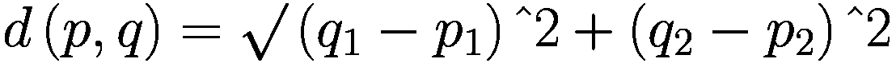

或者，根据该等式，如果点 `p` 的极坐标为 (`r[1]`, `θ[1]`)，点 `q` 的极坐标为 (`r[2]`, `θ[2]`)，则两点之间的距离如下：

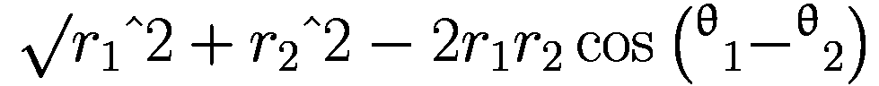

**在 `n` 维空间中：**

在一般情况下，距离如下：

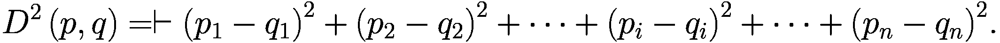

在第 3 章中，你将在最近邻分类器示例中找到一个欧几里得距离的示例。

## 平方欧几里得距离

标准欧几里得距离可以平方，以便对相距更远的对象赋予逐渐增大的权重。在这种情况下，等式变为：

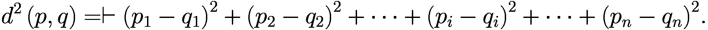

平方欧几里得距离不是度量，因为它不满足三角不等式。然而，它经常用于仅需比较距离的优化问题中。

## 字符串编辑距离

*编辑距离*是衡量两个字符串之间差异程度的一种度量。它计算使两个字符串相同所需的最少操作次数。编辑距离在自然语言处理中有应用，其中自动拼写纠正可以为拼写错误的单词指出候选纠正项。编辑距离有两种类型。

- 莱文斯坦编辑距离
- 尼德曼编辑距离

### 莱文斯坦距离

两个单词之间的莱文斯坦距离是将一个单词更改为另一个单词所需的最少插入、删除或替换次数。1965 年，弗拉基米尔·莱文斯坦提出了这种距离。

莱文斯坦距离也称为*编辑距离*，尽管该术语也可能指代更大一类距离度量。它与成对字符串对齐有关。

例如，`Calcutta` 和 `Kolkata` 之间的莱文斯坦距离是 5，因为以下五次编辑将一个单词更改为另一个：

- `Calcutta` → `Kalcutta`（将 `C` 替换为 `K`）
- `Kalcutta` → `Kolcutta`（将 `a` 替换为 `o`）
- `Kolcutta` → `Kolkutta`（将 `c` 替换为 `k`）
- `Kolkutta` → `Kolkatta`（将 `u` 替换为 `a`）
- `Kolkatta` → `Kolkata`（删除 `t`）

当字符串相同时，莱文斯坦距离有几个简单的上界（即较长字符串的长度）和下界（零）。莱文斯坦距离的代码示例在 K 均值聚类代码中给出。

### 尼德曼-翁施算法

尼德曼-翁施算法用于生物信息学中，以比对蛋白质或核苷酸序列。它是最早将动态规划应用于比较生物序列的算法之一。它使用动态规划工作。首先，它创建一个矩阵，其中行和列是字母。矩阵的每个单元格是该行和列中对应字母的相似性得分。得分有三种类型：匹配、不匹配，或带插入或删除的匹配。矩阵填充完毕后，算法从右下角单元格到左上角单元格执行回溯操作，并找到邻居得分距离最小的路径。回溯路径的得分总和就是两个字符串的尼德曼-翁施距离。

`Pyopa` 是一个 Python 模块，它提供了两个字符串之间现成的尼德曼-翁施距离。

```python
import pyopa
data = {'gap_open': -20.56,
'gap_ext': -3.37,
'pam_distance': 150.87,
'scores': [[10.0]],
'column_order': 'A',
'threshold': 50.0}
env = pyopa.create_environment(**data)
s1 = pyopa.Sequence('AAA')
s2 = pyopa.Sequence('TTT')
print(pyopa.align_double(s1, s1, env))
print(env.estimate_pam(aligned_strings[0], aligned_strings[1]))
```

尽管莱文斯坦距离实现简单且计算成本较低，但如果你想在字符串匹配中引入间隙（例如，`New Delhi` 和 `NewDelhi`），那么尼德曼-翁施算法是更好的选择。

## 文档上下文中的相似性

文档之间的相似性度量表示两个文档的相同程度。通常，相似性度量的范围限定在 `[-1,1]` 或 `[0,1]` 内，其中相似性得分为 1 表示最大相似性。

### 相似度类型

为了衡量相似度，文档被表示为去除停用词后的词项向量。假设 `A` 和 `B` 是代表两个文档的向量。在这种情况下，不同的相似度度量如下所示：

*   **Dice（戴斯系数）**

    Dice 系数由下式表示：

    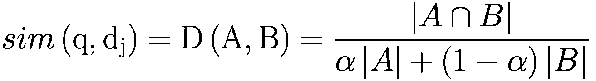

    同时，`α` ∈ [0, 1]，并令 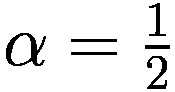

*   **Overlap（重叠系数）**

    重叠系数的计算方式如下：

    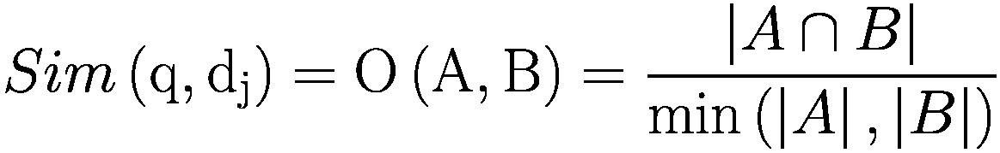

    重叠系数使用 max 运算符而非 min 进行计算。

*   **Jaccard（杰卡德系数）**

    杰卡德系数由下式给出：

    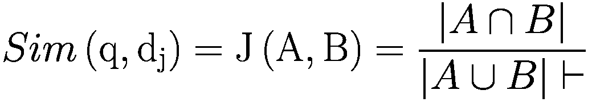

    杰卡德度量表示相关程度。

*   **Cosine（余弦相似度）**

    两个向量之间夹角的余弦值由下式给出：

    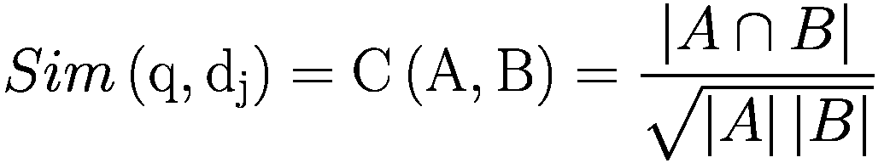

距离和相似度是两个相反的度量。例如，数值数据相关性是一种相似度度量，而欧几里得距离是一种距离度量。通常，相似度度量的值限制在 0 到 1 之间，但距离没有这样的上限。相似度可以为负，但根据定义，距离不能为负。聚类算法几乎与该领域诞生之初时相同，但研究人员正在不断为各种应用寻找新的距离度量。

在下一节中，既然我们已经了解了该技术的基础知识，我们将使用 K-means 算法对图像中的颜色阴影进行聚类。

# 图像中的 K-Means 示例

首先，我们会得到一个包含色块的画布，每个色块是红色、绿色或蓝色的不同色调（图 4-3）。

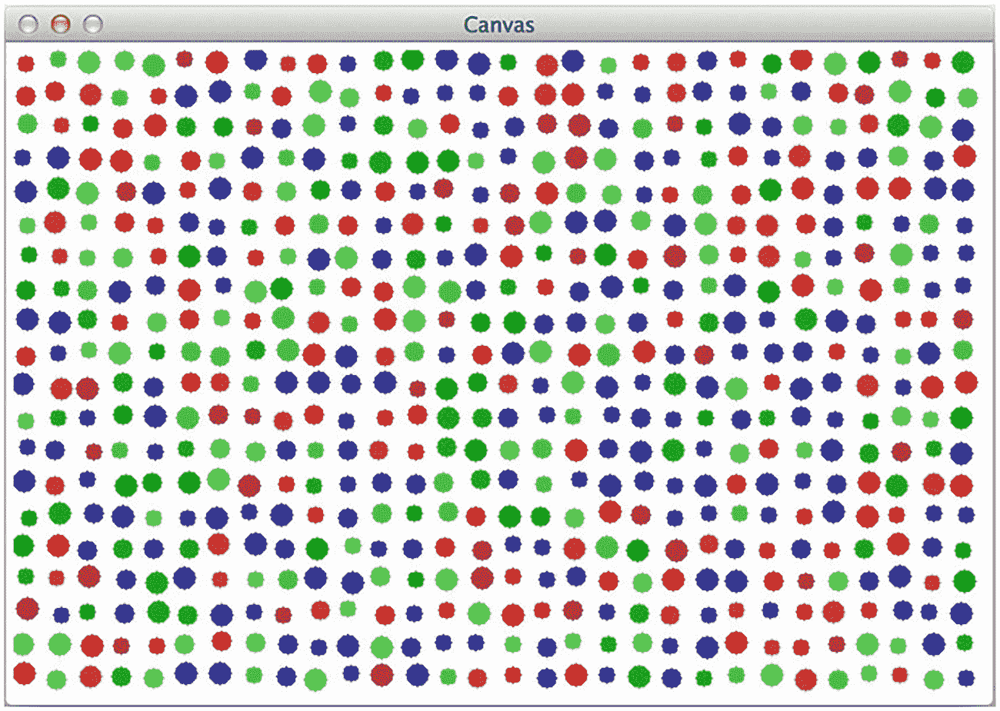

图 4-3 一个包含红色、绿色和蓝色色块的画布

目标是根据色块的色调将其分为三类。然后我们将使用 K-means 将红色、绿色和蓝色的色块分别分组，同时将它们彼此分离。图 4-4 显示了一个示例输出图像，其中红色色块已与所有其他色块分离。

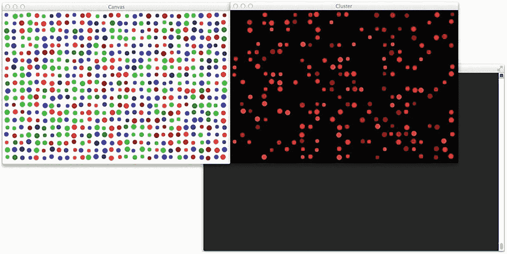

图 4-4 将红色色块与绿色和蓝色色块分离

## 准备聚类

第一步是创建一个看起来类似于图 4-2 的图片，以便我们可以按如下方式进行聚类：

```python
#### 导入必要的包
from sklearn.cluster import KMeans
import numpy as np
import random
import cv2
import imutils
#### 初始化色调选择列表
hues = [
#### 红色、绿色和蓝色的色调
(138, 8, 8), (180, 4, 4), (223, 1, 1), (255, 0, 0), (250, 88, 88),
(8, 138, 8), (4, 180, 4), (1, 223, 1), (0, 255, 0), (46, 254, 46),
(11, 11, 97), (8, 8, 138), (4, 4, 180), (0, 0, 255), (46, 46, 254)]
#### 初始化画布
canvas = np.ones((400, 600, 3), datatype="uint8") * 255
#### 遍历画布
for y in range(0, 400, 20):
    for x in range(0, 600, 20):
        #### 为圆形生成随机的 (x, y) 坐标、半径和色调
        (dx, dy) = np.random.randint(5, 10, size=(2,))
        r = np.random.randint(5, 8)
        hue = random.choice(hues)[::-1]
        #### 在画布上绘制圆形
        cv2.circle(canvas, (x + dx, y + dy), r, hue, -1)
#### 为图像添加边框
canvas = cv2.copyMakeBorder(canvas, 5, 5, 5, 5, cv2.BORDER_CONSTANT,
                           value=(255, 255, 255))
```

前面代码的第 9-13 行设置了红色、绿色和蓝色的五种不同颜色。当我们在第 16 行的画布上绘制颜色时，我们将从此列表中随机抽取样本。第 19-28 行处理绘制随机色块的实际过程。我们首先以 20 像素的步长遍历整个图像。然后，在第 23 和 24 行，我们为色块中心生成一个随机的 `(x, y)` 坐标（第 23 行），为色块选择一个随机半径（第 24 行），并在第 25 行从我们的颜色列表中采样。色调列表是 RGB 顺序；我们将其反转成 BGR 顺序，以便 OpenCV 能够正确绘制。最后，我们使用随机生成的值在画布上绘制一个圆形。图 4-2 显示了此代码的输出。

## 阈值处理

现在我们已经有了人工生成的色块图像，我们需要识别每个色块并提取颜色特征来描述它们。以下是一个使用阈值处理的示例：

```
#### 将画布转换为灰度图，进行阈值处理，并检测图像中的轮廓
gray = cv2.cvtHue(canvas, cv2.HUE_BGR2GRAY)
gray = cv2.bitwise_not(gray)
thresh = cv2.threshold(gray, 10, 255, cv2.THRESH_BINARY)[1]
cnts = cv2.findContours(gray.copy(), cv2.RETR_LIST, cv2.CHAIN_APPROX_SIMPLE)
cnts = imutils.grab_contours(cnts)
#### 初始化数据矩阵
data = []
#### 遍历轮廓
for c in cnts:
#### 从轮廓构建掩膜
mask = np.zeros(canvas.shape[:2], datatype="uint8")
cv2.drawContours(mask, [c], -1, 255, -1)
features = cv2.mean(canvas, mask=mask)[:3]
data.append(features)
```

第 36-38 行仅对我们的图像进行阈值处理，得到色块的二值表示，如图 4-5 所示。

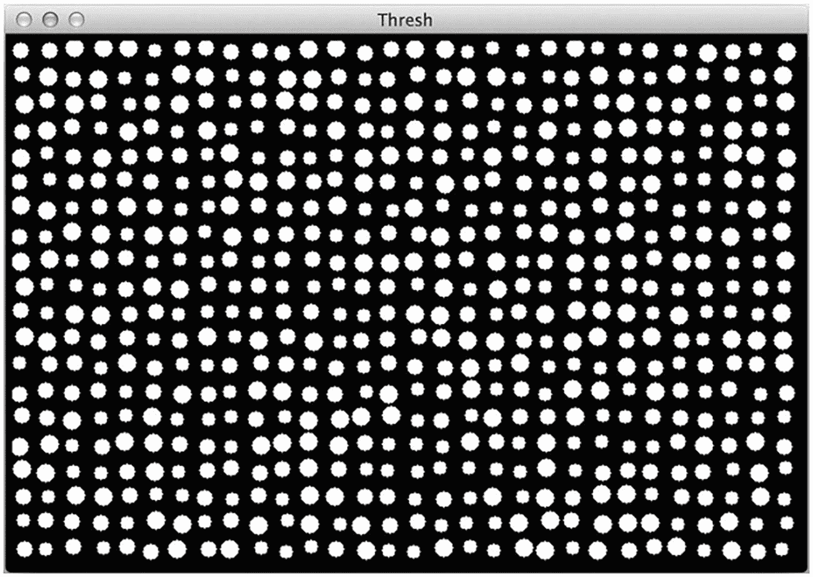

一个标记为“thresh”的窗口截图。它有一个深色屏幕，上面重叠着几个不同大小的浅色点。

图 4-5

使用阈值处理将背景和前景分离，以对图像进行二值化

在第 39 行，我们捕获圆形的轮廓，创建我们的数据矩阵（该矩阵将保存从每个色块提取的特征），并从上述代码的第 46 行开始遍历每个单独的轮廓。我们为每个轮廓创建一个掩膜，并提取平均 RGB 值；我们将使用这三个平均值来描述圆形的颜色。

### 聚类时刻

现在，我们可以使用 `scikit-learn` 实现的 K-means 算法进行实际的聚类操作。

```python
#### 对色调特征进行聚类
clt = KMeans(n_clusters=3)
clt.fit(data)
cv2.imshow("Canvas", canvas)
#### 遍历唯一的聚类标识符
for i in np.unique(clt.labels_):
#### 为当前聚类构建掩码
mask = np.zeros(canvas.shape[:2], datatype="uint8")
#### 遍历当前聚类的索引并绘制轮廓
for j in np.where(clt.labels_ == i)[0]:
cv2.sketchContours(mask, [cnts[j]], -1, 255, -1)
#### 显示该聚类的输出图像
cv2.imshow("Cluster", cv2.bitwise_and(canvas, canvas, mask=mask))
cv2.waitKey(0)
```

在第 54 行，我们声明了 K-means 类，并将 `n` 个聚类参数设置为 3，表示我们需要三个不同的聚类——分别对应红色、绿色和蓝色。然后使用 `fit` 方法对我们的数据矩阵进行聚类。

现在我们已经得到了三个聚类，需要一种机制来检索属于每个聚类的斑点。由于我们已经有了存储斑点轮廓的 `cnts` 变量，这个方法比看起来要简单得多。要完成这个示例，我们只需要巧妙地运用 NumPy 函数即可。

从第 59 行开始，我们遍历每个唯一的聚类标签。然后，对于每个聚类，我们使用 `np.where` 函数创建一个掩码，并收集所有与当前聚类对应的标签索引（第 64 行）。有了这些索引，我们就可以利用它们来绘制仅属于当前聚类的轮廓（第 65 行）。

### 揭示当前聚类

最后，我们将使用按位运算来仅显示属于当前聚类的斑点，同时隐藏所有其他斑点。

只需使用以下命令运行我们的脚本：

```bash
$ python cluster_hues.py
```

通过 K-means 方法，我们可以观察到我们的斑点已自动按红、绿、蓝三种颜色分类。在图 4-6 中，我们可以看到只有红色调被分离出来。

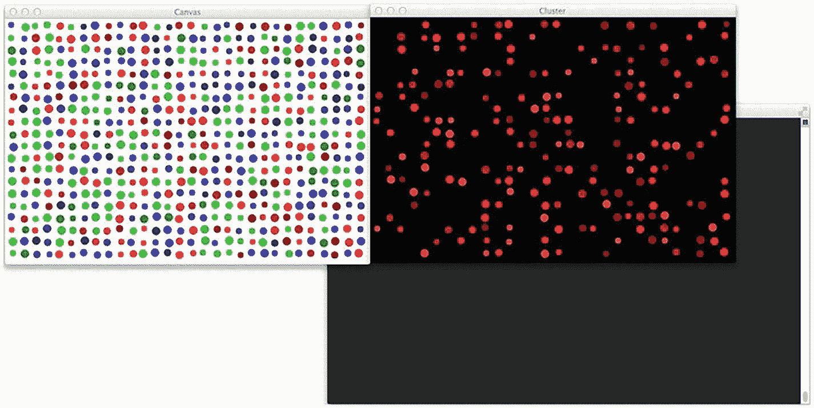

一个包含多个不同大小彩色圆点的画布窗口展示了红色圆点是如何被分离出来的，该窗口叠加在一个深色窗口之上。

图 4-6

红色斑点正从蓝色和绿色斑点中分离出来

图 4-7 仅描绘了绿色调。

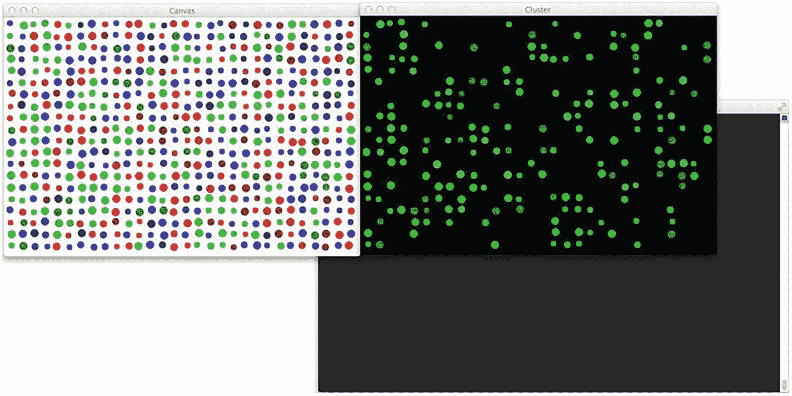

一个包含多个不同大小彩色圆点的画布窗口展示了绿色圆点是如何被分离出来的，该窗口叠加在一个深色窗口之上。

图 4-7

仅提取出绿色圆形

最后，我们仅得到蓝色调，如图 4-8 所示。

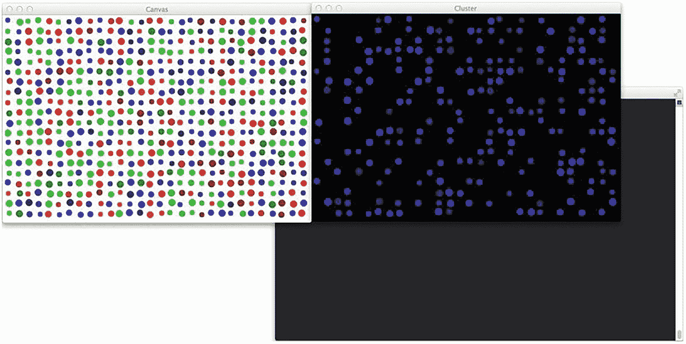

一个包含多个不同大小彩色圆点的画布窗口展示了蓝色圆点是如何被分离出来的，该窗口叠加在一个深色窗口之上。

图 4-8

仅查看“蓝色斑点”聚类

现在我们将讨论另一种类型的聚类算法。

## 层次聚类

层次聚类是一种对数据对象进行迭代聚类的方法。它有两种类型。

*   凝聚层次算法，即自底向上方法
*   分裂层次算法，即自顶向下方法

### 自底向上方法

自底向上的聚类方法称为*凝聚层次聚类*。在这种方法中，每个输入对象被视为一个单独的聚类。在每次迭代中，算法将两个最相似的聚类合并为一个聚类。该过程持续进行，直到所有聚类合并成一个单一的聚类。该算法的复杂度为 `O(n³)`。

在该算法中，给定一组输入对象 `I = {I[1], I[2], …, I[n]}`。一组有序三元组为 `<D, K, S>`，其中 `D` 是阈值距离，`K` 是聚类数量，`S` 是聚类集合。

该算法的一些变体可能允许在一次迭代中合并多个具有相同距离的聚类。算法如下：

**输入：** `I = {I[1], I[2], …, I[n]}`

**输出：** `O`

```
for i = 1 to n do
Ci ← {Ii};
end for
D ← 0;
K ← n;
S ← {C1, ....., Cn};
O ← ;
repeat
Dist ← CalcultedMinimumDistance(S);
D ← ∞;
For i = 1 to K–1 do
For j = i+1 to K do
if Dist(i, j) < D then
D ← Dist(i, j);
end if
end for
end for
Until K = 1;
```

本章稍后会给出一个层次聚类的 Python 示例。

### 聚类间的距离

在层次聚类中，计算两个聚类之间的距离是一个关键步骤。有三种计算方法。

*   单链接法
*   全链接法
*   平均链接法

#### 单链接法

在单链接法中，两个聚类之间的距离是两个聚类中所有对象对之间距离的最小值。由于距离是最小值，因此会存在一对对象，其距离小于或等于两个聚类之间的距离。因此，单链接法可以表示如下：

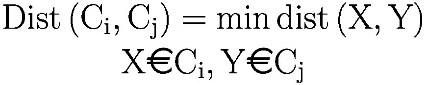

#### 全链接法

在全链接法中，两个聚类之间的距离是两个聚类中所有对象对之间距离的最大值。由于距离是最大值，因此所有对象对的距离都小于或等于两个聚类之间的距离。因此，全链接法可以表示如下：

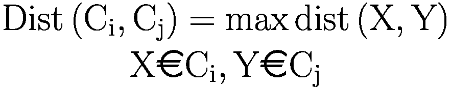

#### 平均链接法

平均链接法是前两种链接法之间的折衷方案。它避免了形成过大或过紧密聚类的极端情况。聚类 `C[i]` 和 `C[j]` 之间的距离定义如下：

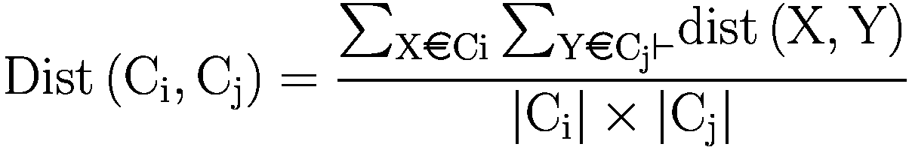

`|C[k]|` 是聚类 `C[k]` 中的数据对象数量。

质心链接法与平均链接法类似，但这里的两个聚类之间的距离实际上是质心之间的距离。聚类 `C[i]` 的质心定义如下：

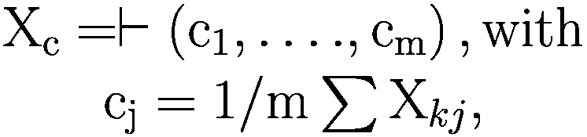

`X[kj]` 是聚类 `C[i]` 中第 k 个数据对象的第 j 维。

### 自顶向下方法

自顶向下聚类方法也称为*分裂层次聚类*。它是自底向上聚类的逆过程。该方法从一个包含所有输入对象的单一簇开始。每次迭代后，它会将簇分裂为距离最大的两个部分。算法如下：

**输入：** `I = {I1, I2, … , In}`

**输出：** `O`

```
D ← ∞;
K ← 1;
S ← {I1,I2 , ... , In};
O ← ;
repeat
X ← 包含距离最远的两个数据对象 dist;
Y ← ∅;
S ← S – X;
Xi ← 在 A 中与 X 距离最大的数据对象 D (Xi, X);
X ← X − {Xi};
Y ← Y ∪ {Xi};
repeat
for all data object Xj in X do
```

`e(j) ←←` `D(X[j], X) D(X[j], Y);`

```
end for
if∃e(j) > 0 then
Xk ←← 在 X 中 e(j) 最大的数据对象;
X ← X  {Xk};
Y ←← Y ∪∪ {Xk};
split ←← TRUTH;
else
split← FALSE;
end if
until split == FALSE;
D ← dist;
K ← K+1;
S ← S∪∪ X ∪ Y
O ← 0 ∪ ;
Until  K = n;
```

树状图 `O` 是任何层次聚类的输出。图 4-9 展示了一个树状图。

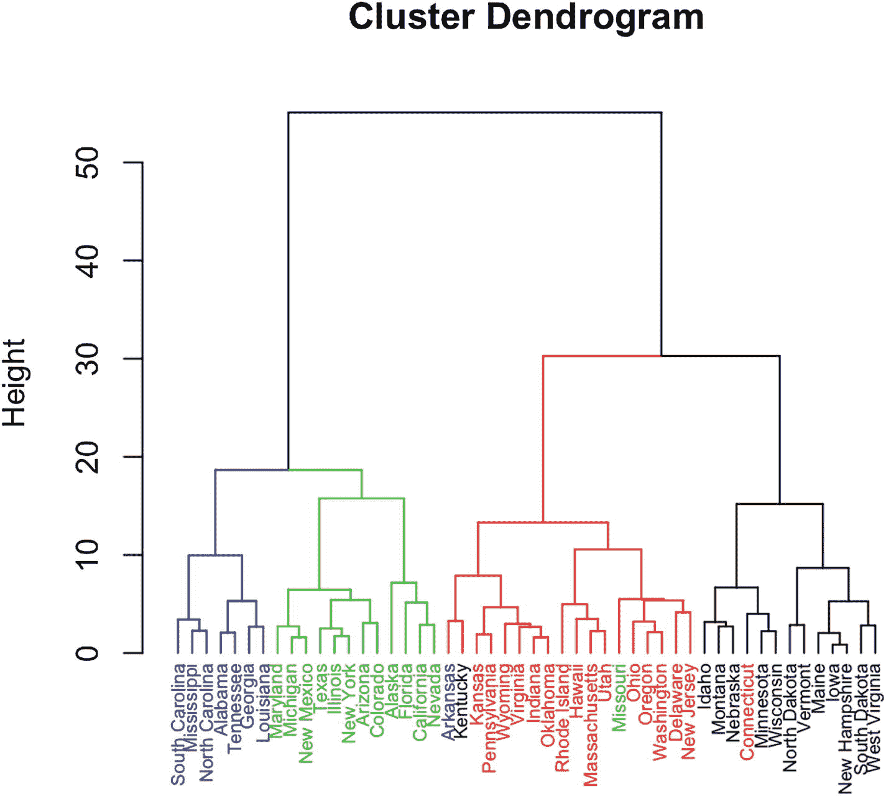

一个簇树状图描绘了多个美国州的高度，例如罗德岛州、爱达荷州、南卡罗来纳州、阿肯色州、密苏里州、康涅狄格州等。

**图 4-9** 树状图

要从树状图中创建一个簇，你需要一个距离或相似度的阈值。一个简单的方法是绘制距离或相似度的分布图，并找到曲线的拐点。对于高斯分布数据，拐点位于 `x = mean + n*std` 和 `x = mean – n*std` 处，如图 4-10 所示。

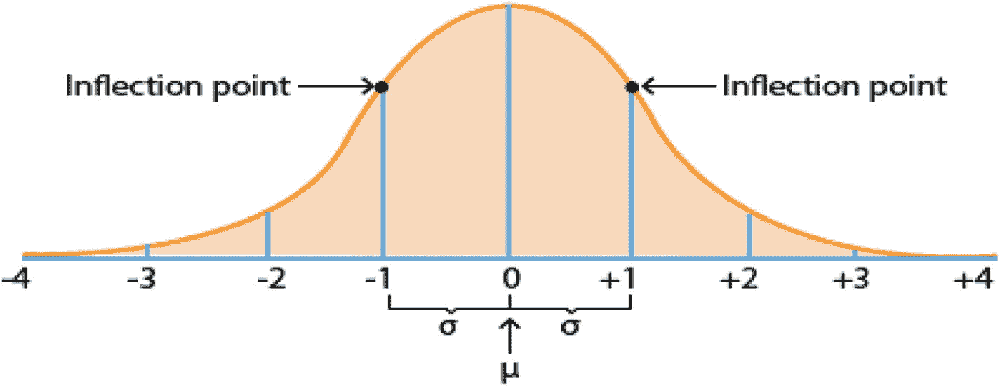

直方图绘制出一个钟形结构。它在两个正焦弦上各有一个拐点。可以观察到投影。

**图 4-10** 拐点

以下代码使用 Python 创建了一个层次聚类。输入数据文件可以从 [`https://canvas.uw.edu/courses/1546077/files/92110986`](https://canvas.uw.edu/courses/1546077/files/92110986) 下载。

```python
import numpy as np
import pandas as pd
from sklearn.preprocessing import StandardScaler, normalize
from sklearn.decomposition import PCA
import scipy.cluster.hierarchy as hc
import matplotlib.pyplot as plt
from sklearn.cluster import AgglomerativeClustering
#### Load the CSV file
df = pd.read_csv("book\\ch4\\CC_GENERAL.csv")
#### preprocessing
df = df.drop('CUST_ID', axis = 1)
df.fillna(method ='ffill', inplace = True)
#### Scale and normalize
ss = StandardScaler()
scaled_df = ss.fit_transform(df)
normalized_df= normalize(scaled_df)
#### Reduce the dimensionality to 3
pca = PCA(n_components=3)
df_pca = pca.fit_transform(normalized_df)
df_pca = pd.DataFrame(df_pca)
df_pca.columns = ['P1', 'P2', 'P3']
#### Dendogram plot
plt.figure(figsize =(10, 10))
plt.title('Visualising the data')
dendrogram = hc.dendrogram((hc.linkage(df_pca, method ='ward')))
#### create 3 clusters using Agglomerative hierarchical clustering
hrc= AgglomerativeClustering(n_clusters = 3)
plt.figure(figsize =(10, 10))
plt.scatter(df_pca['P1'], df_pca['P2'], df_pca['P3'], c = hrc.fit_predict(df_pca), cmap ='rainbow')
plt.title("Agglomerative Hierarchical Clusters - Scatter Plot", fontsize=18)
plt.show()
```

### 图论方法

聚类问题可以映射到一个图，其中图中的每个节点都是一个输入数据点。如果两个图之间的距离小于阈值，则相应的节点被连接起来。现在，使用图划分算法，你可以对图进行聚类。聚类在投资银行中的一个行业示例是，聚类工具取决于其价格时间序列的相关性以及每个聚类一起进行的表现交易。这在算法交易中被称为*篮子交易*。因此，通过使用相似性度量，你可以构建一个图，其中节点是工具，节点之间的边表示这些工具是相关的。要创建篮子，你需要一组彼此都相关的工具。在图中，这是一个节点集或子图，其中子图中的所有节点都相互连接。这种子图被称为*团*。寻找最大规模的团是一个 NP 完全问题。人们使用启发式解决方案来解决这个聚类问题。

### 如何判断聚类结果是否良好？

应用聚类算法后，验证结果的好坏是聚类分析中的关键步骤。有三个参数用于衡量聚类的质量，即质心、半径和直径。

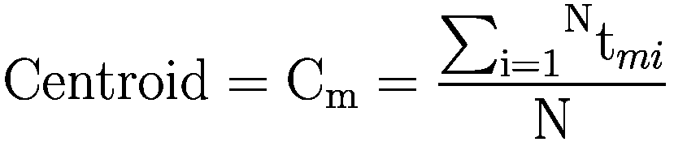
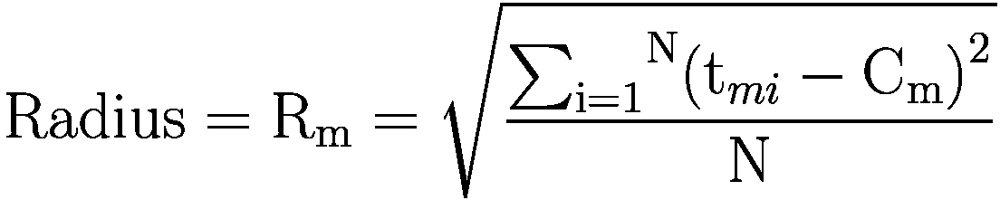
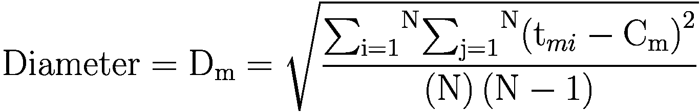

如果你将簇视为一个包围该簇中所有成员点的空间中的圆，那么你可以将质心视为圆心。类似地，簇的半径和直径就是该圆的半径和直径。任何簇都可以用这三个参数来表示。良好聚类的一个衡量标准是，中心之间的距离应大于半径之和。

以下来自先前脚本的代码片段可用于可视化输出，其中来自同一簇的数据点应被视为聚集在一起。

```python
#### create 3 clusters using Agglomerative hierarchical clustering
hrc= AgglomerativeClustering(n_clusters = 3)
plt.figure(figsize =(10, 10))
plt.scatter(df_pca['P1'], df_pca['P2'], df_pca['P3'], c = hrc.fit_predict(df_pca), cmap ='rainbow')
plt.title("Agglomerative Hierarchical Clusters - Scatter Plot", fontsize=18)
plt.show()
```

## 总结

除了这些章节外，其他每一章都将包含我们将用于标记模型训练的数据。然后会有一组没有标签的新数据。模型会对这些数据进行标记。这被称为*监督学习*。

然而，本章中没有数据标签。算法根据它们的相似性对它们进行分组或标记。在一个非英语国家，孩子们在学校里在老师的监督下学习英语。然而，在观看 YouTube 视频两三年后，孩子们开始在没有指导的情况下说一些简单的英语。这被称为无监督学习。