# 5. 深度学习与神经网络

神经网络，特指`人工神经网络`（ANNs），由最早神经计算机的发明者之一罗伯特·赫克特-尼尔森博士提出。他将神经网络定义为：“……一个由大量简单、高度互联的处理单元组成的计算系统，这些单元通过对外部输入的动态状态响应来处理信息。”

通常，神经网络按多层结构排列。这些层由多个包含激活函数的互联节点组成。输入层与隐藏层通信，描绘出模式特征。隐藏层则连接到输出层。

神经网络用途广泛。例如，在航空领域的乘客负载预测中，`t`月的乘客负载高度依赖于`t-12` 个月的数据，而非`t-1` 或`t-2` 的数据。因此，神经网络通常能比时间序列模型甚至图像分类产生更好的结果。在聊天机器人系统中，记忆网络（实际上是一种基于先前对话词袋的神经网络）是一种流行的方法。实现神经网络的方式有很多种。

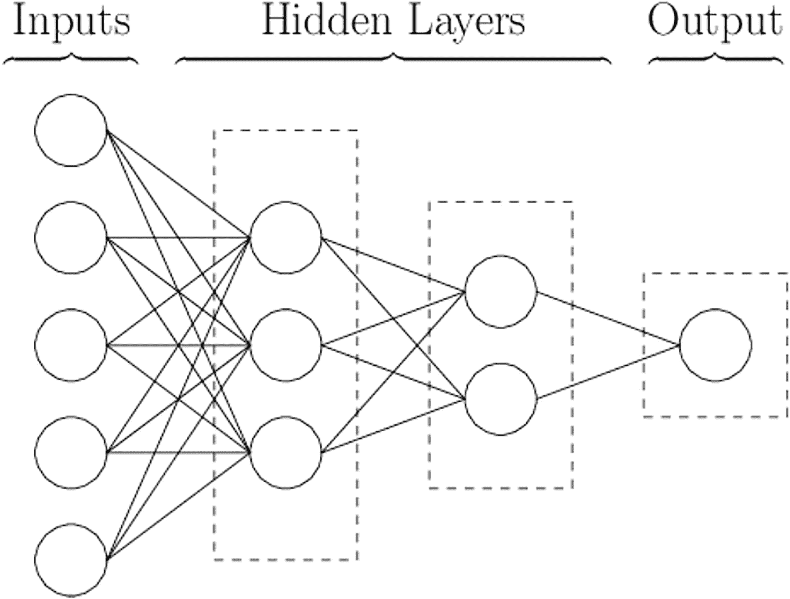

该图展示了多个输入节点如何连接到隐藏层中的层级节点，并最终预测输出节点。

**图 5-1** 神经网络架构

## 反向传播

*反向传播*通常替代梯度下降等优化方法，是训练人工神经网络的常用方法。该方法计算最外层的误差，并将其反向传播至输入层，然后根据该误差、输入和学习率更新权重。最终目标是尽可能最小化误差。

### 反向传播方法

将输入向量 `X[p] = (x[p1], x[p2], …, x[pN])^(t)` 应用于输入单元。

计算隐藏层单元的净输入值。

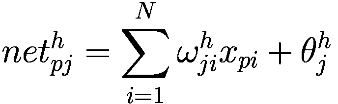

计算隐藏层的输出。

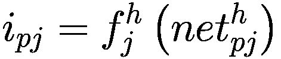

计算每个单元的净输入值。

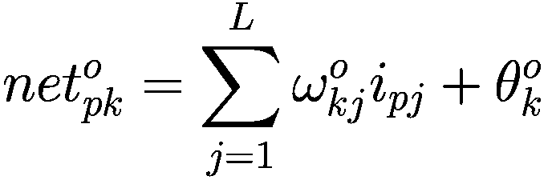

计算输出。

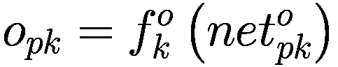

计算输出单元的误差项。

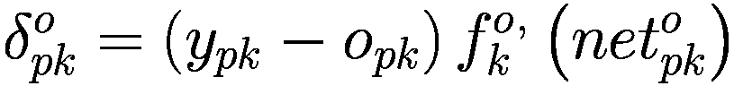

计算隐藏单元的误差项。

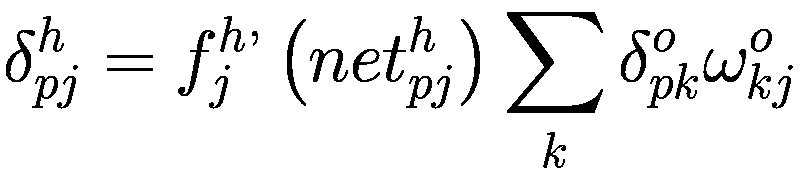

更新输出层的权重。

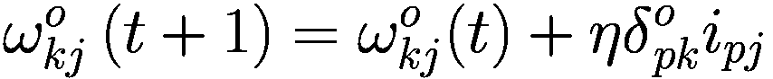

更新隐藏层的权重。

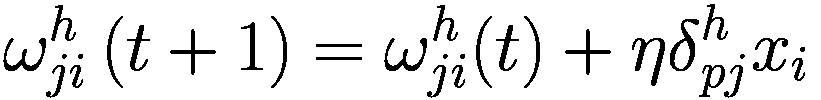

让我们看一些代码：

```python
from numpy import exp, dot, array, random
class SimpleNN():
    def __init__(self):
        random.seed(2)
        self.weights = random.random((3, 1))
    #### 激活函数
    def __sigmoid(self, x):
        return 1 / (1 + exp(-x))
    #### Sigmoid 函数的导数
    def __sigmoid_derivative(self, x):
        return x * (1 - x)
    #### 训练神经网络并调整权重
    def train(self, training_set_inputs, training_set_outputs, number_of_training_iterations):
        for iteration in range(number_of_training_iterations):
            output = self.predict(training_set_inputs)
            error = training_set_outputs - output
            adjustment = dot(training_set_inputs.T, error * self.__sigmoid_derivative(output))
            self.weights += adjustment
    #### 预测
    def predict(self, inputs):
        return self.__sigmoid(dot(inputs, self.weights))

if __name__ == "__main__":
    neural_network = SimpleNN()
    print("随机初始权重: ")
    print(neural_network.weights)
    # 训练集。我们有 4 个样本，每个样本包含 3 个输入值
    # 和 1 个输出值。
    training_set_inputs = array([[0, 0, 1], [1, 1, 1], [1, 0, 1], [0, 1, 1]])
    training_set_outputs = array([[0, 1, 1, 0]]).T
    neural_network.train(training_set_inputs, training_set_outputs, 10000)
    print("训练后的新权重: ")
    print(neural_network.weights)
    #### 用新情况测试神经网络。
    print(neural_network.predict(array([1, 0, 0])))
```

## 其他算法

除了反向传播，还有许多技术可用于训练神经网络。其中一种方法是使用常见的优化算法，如梯度下降、`Adam` 优化器等。简单的感知机方法也经常被应用。赫布假说是另一种流行的方法。在赫布学习中，不是使用误差，而是使用输入和输出的乘积作为反馈来修正权重。

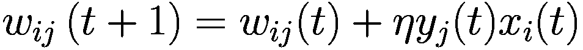

## TensorFlow

`TensorFlow` 是 Python 中一个流行的深度学习库。它是原始库的 Python 封装。它支持基于 CUDA 的 GPU 平台上的并行计算。以下代码是使用 TensorFlow 进行 MNIST 数字分类的示例：

```python
import tensorflow as tf
#### 获取 mnist 数据集
mnist = tf.keras.datasets.mnist
#### 加载数据并分割为训练集和测试集
(x_train, y_train), (x_test, y_test) = mnist.load_data()
x_train, x_test = x_train / 255.0, x_test / 255.0
#### 模型
model = tf.keras.models.Sequential([
    tf.keras.layers.Flatten(input_shape=(28, 28)),
    tf.keras.layers.Dense(128, activation='relu'),
    tf.keras.layers.Dropout(0.2),
    tf.keras.layers.Dense(10, activation="softmax")
])
#### 损失函数
loss_fn = tf.keras.losses.SparseCategoricalCrossentropy(from_logits=True)
#### 模型编译
model.compile(optimizer='adam',
              loss=loss_fn,
              metrics=['accuracy'])
#### 模型拟合
model.fit(x_train, y_train, epochs=5)
#### 模型评估
model.evaluate(x_test,  y_test, verbose=2)
```

如今人们不再直接使用原始的 TensorFlow 代码。他们使用 Keras 封装，这是一种利用多个家庭调查数据来确定分娩风险的代码。

你可以在本书 Git 仓库的 `deep_learning_keras_1st_example` 文件夹中找到相关数据。请参考 [`https://github.com/Apress/advanced-data-analytics-python-2e/tree/main/deep_learning_keras_1st_example`](https://github.com/Apress/advanced-data-analytics-python-2e/tree/main/deep_learning_keras_1st_example)。

```python
#### 导入模块
import pandas as pd
import numpy as np
import csv
from keras.layers.core import Dense, Activation, Dropout
from keras.layers.recurrent import LSTM
from keras.models import Sequential
import sys
from keras.preprocessing.sequence import TimeseriesGenerator
from sklearn.preprocessing import StandardScaler
from sklearn.metrics import classification_report, confusion_matrix, ConfusionMatrixDisplay
import keras
import keras
from sklearn.decomposition import PCA
from sklearn.model_selection import train_test_split
from plot_keras_history import plot_history
import matplotlib.pyplot as plt
from sklearn.ensemble import RandomForestClassifier
from keras.utils import np_utils
import pandas as pd

PATH_TO_FOLDER = ''
df_delivery = pd.read_csv(PATH_TO_FOLDER+"delivery (1).csv")
print(df_delivery.head())
df_family_survey = pd.read_csv(PATH_TO_FOLDER+"family_survey (1).csv")
print(df_family_survey.head())
df_merged = pd.merge(df_delivery, df_family_survey, how="left", left_on=  ['hh_id'], right_on= ['hh_id'])
print(df_merged.columns)
print(df_merged.head())
print(df_merged.danger_signs_at_delivery.value_counts())

#### 删除不必要的列并进行类型转换
columns = ['delivery_id', 'patient_id', 'hh_id', 'delivery_date_time_submitted']
df_merged.drop(columns, inplace=True, axis=1)
print(df_merged.columns)
df_merged = pd.get_dummies(df_merged, columns = ['facility_delivery',  'first_visit_on_time', 'hand_washing_facilities', 'electricity', 'floor',
'highest_education_achieved'])
print(df_merged.head())
print(df_merged.columns)
y = pd.Categorical(df_merged.danger_signs_at_delivery).codes
print(y[:10])

#### 缩放和 PCA
X = df_merged
X.fillna(0,inplace=True)
np.nan_to_num(X)
#### scaled_X = X
Xscaler = StandardScaler()
Xscaler.fit(X)
scaled_X = Xscaler.transform(X)
np.nan_to_num(scaled_X)
pca = PCA(.95)
pca.fit(scaled_X)
scaled_X = pca.transform(scaled_X)
print(scaled_X.shape)

#### 训练集、测试集划分
train_x, test_x, train_y, test_y = train_test_split( scaled_X, np.array(y), test_size=1/7.0, random_state=0)
train_y=np_utils.to_categorical(train_y,num_classes=2)
test_y=np_utils.to_categorical(test_y,num_classes=2)
print("Shape of y_train",train_y.shape)
print("Shape of y_test",test_y.shape)

#### 模型架构
model=Sequential()
model.add(Dense(500,input_dim=scaled_X.shape[1],activation='relu'))
model.add(Dense(200,activation='relu'))
model.add(Dense(100,activation='relu'))
model.add(Dropout(0.1))
model.add(Dense(2,activation='sigmoid'))
model.compile(loss='binary_crossentropy',optimizer='adam',metrics=['accuracy',keras.metrics.Recall()])
print(model.summary())
history = model.fit(train_x,train_y,validation_data=(test_x,test_y),batch_size=500,epochs=4,verbose=1)
plot_history(history.history, path="standard.png")
plt.show()
prediction=model.predict(test_x)
y_label=np.argmax(test_y,axis=1)
predict_label=np.argmax(prediction,axis=1)
#### accuracy=np.sum(y_label==predict_label)/length * 100
#### print("Accuracy of the dataset",accuracy )
print(classification_report(y_label, predict_label))
```

### 网络架构与正则化技术

在进入下一节之前，请注意，随着网络中隐藏层数量的增加，准确率会提高，但应用程序会消耗更多内存。通常，人们会使用两到三个隐藏层。

`Adam` 优化器是常见的选择，因为它结合了梯度下降和随机梯度下降。人们可能会在损失函数中加入结果方程的系数，因为较大的系数表明存在过拟合。另一种选择是使用丢弃层，它在训练过程中会随机忽略一定比例的神经元。对于分类问题，损失函数中应使用熵函数，它是系统混乱程度的度量。对于二分类和多分类问题，存在多个版本。

请注意，第 3 章中介绍的 PCA 在此处使用，方差保留 95%。这是标准做法。

# 可更新模型与迁移学习

在深度学习中，如第3章所述，声明模型可训练是创建可更新机器学习模型的全部要求。以下代码是一个异常检测系统的示例。每个云服务都提供网络数据包信息，任何工具（例如 `Suricata`）都可以发送安全警报。以下预处理代码处理数据，并根据警报类型将网络数据包标记为警报或非警报。

您可以在本书的 Git 仓库中找到 `frame_packet_june_14.csv` 文件中的数据。请参考以下链接：

[`https://github.com/Apress/advanced-data-analytics-python-2e/blob/main/eve.json`](https://github.com/Apress/advanced-data-analytics-python-2e/blob/main/eve.json)

[`https://github.com/Apress/advanced-data-analytics-python-2e/blob/main/frame_packet_June14.csv`](https://github.com/Apress/advanced-data-analytics-python-2e/blob/main/frame_packet_June14.csv)

```python
#### 导入模块
import pandas as pd
import json
import gzip
import glob
import sys, codecs
#### 读取数据包文件并构建数据框
PATH_TO_FOLDER = ""
#### PATH_TO_FOLDER = "/home/ubuntu/AWS/"
df = pd.read_json(codecs.open(PATH_TO_FOLDER+'new-data\sample-1.json','r','utf-8').read().replace("\\","/"), lines=True)
print(df.columns)
#### 添加警报类型并进行必要的类型转换
df['class_label'] = 0
df['alert_type'] = ""
#### df['StartTime'] = pd.to_datetime(df['StartTime'])
df['src_port'] = df['src_port'].astype(int,errors = 'ignore')
df['dst_port'] = df['dst_port'].astype(int,errors = 'ignore')
df['source'] = df['source'].str.strip()
df['destination'] = df['destination'].str.strip()
print(df.head())
#### 处理事件 txt 文件，如果发现警报则更新 df
with open(PATH_TO_FOLDER+'new-data\eve.json','r') as fjson:
for line in fjson:
data = json.loads(line)#.decode('utf-8'))
if data['event_type'] == 'alert':
src_ip = data['src_ip'].strip()
src_port = int(data['src_port'])
dest_ip = data['dest_ip'].strip()
dest_port = int(data['dest_port'])
df.loc[(df.source == src_ip) & (df.destination == dest_ip) & (df.src_port == src_port) & (df.dst_port == dest_port),['class_label','alert_type']] = [1, data['alert']['category']]
#### 保存到训练文件 csv
df_label = df[df.class_label == 1]
print(df_label)
df.to_csv('frame_packet_June14.csv')
```

以下是第一次迭代的代码（构建模型并保存）：

```python
#### 文件名: predict_type_packet.py
#### 目的/描述: 主要分类代码
#### 作者: Sayan Mukhopadhyay
''' 用于预测数据包类型并生成分类报告的模块 '''
#### 导入模块
import pandas as pd
import numpy as np
import csv
from keras.layers.core import Dense, Activation, Dropout
from keras.layers.recurrent import LSTM
from keras.models import Sequential
import sys
from keras.preprocessing.sequence import TimeseriesGenerator
from sklearn.preprocessing import StandardScaler
from sklearn.metrics import classification_report, confusion_matrix, ConfusionMatrixDisplay
import keras
import keras
from sklearn.decomposition import PCA
from sklearn.model_selection import train_test_split
from plot_keras_history import plot_history
import matplotlib.pyplot as plt
from sklearn.ensemble import RandomForestClassifier
from keras.utils import np_utils
'''全局变量/参数'''
UNITS1 = 1000
UNITS2 = 500
UNITS3 = 300
EPOCHS = 4
DROPOUT_RATE = 0.2
BATCH_SIZE = 500
'''读取训练 CSV 文件'''
df = pd.read_csv('frame_packet_June14.csv', nrows=49000)
'''删除不必要的列并进行类型转换'''
columns = ['id', 'conn_flag', 'pckt_info', 'TSval', 'TSecr', 'SLE', 'SRE']#, 'time']
df.drop(columns, inplace=True, axis=1)
columns2 = ['Unnamed: 0', 'class_label']
df.drop(columns2, inplace=True, axis=1)
print(len(df.columns))
df = df.replace('-',0.0)
df = pd.get_dummies(df, columns = ['src_port', 'dst_port', 'source', 'destination', 'protocol'])
print(len(df.columns))
print(df.columns)
df['time'] = pd.to_datetime(df['time'])
df = df.sort_values(by="time")
df.set_index('time', inplace=True)
print(df.head())
df.alert_type = df.alert_type.fillna('NonAlert')
df['alert_type'] = df['alert_type'].astype('category')
'''将分类列转换为编码'''
df['alert_type'] = pd.Categorical(df.alert_type).codes
y = df['alert_type'].tolist()
print(y[:10])
labels = df['alert_type'].unique()
print(labels)
count = len(df['alert_type'].unique())
print("alert_type 数量 ",count)
columns3 = ['alert_type']
df.drop(columns3, inplace=True, axis=1)
'''标准化转换和 PCA，选择重要列'''
X = df
X.fillna(0,inplace=True)
np.nan_to_num(X)
#### scaled_X = X
Xscaler = StandardScaler()
Xscaler.fit(X)
scaled_X = Xscaler.transform(X)
np.nan_to_num(scaled_X)
pca = PCA(400)
pca.fit(scaled_X)
scaled_X = pca.transform(scaled_X)
print(scaled_X.shape)
'''训练集、测试集划分及标签编码'''
train_x, test_x, train_y, test_y = train_test_split( scaled_X, np.array(y), test_size=1/7.0, random_state=0)
train_y=np_utils.to_categorical(train_y,num_classes=5)
test_y=np_utils.to_categorical(test_y,num_classes=5)
print("y_train 的形状",train_y.shape)
print("y_test 的形状",test_y.shape)
''' DNN 模型架构 '''
model=Sequential()
model.add(Dense(UNITS1,input_dim=scaled_X.shape[1],activation='relu'))
model.add(Dense(UNITS2,activation='relu'))
model.add(Dense(UNITS3,activation='relu'))
model.add(Dropout(DROPOUT_RATE))
model.add(Dense(count,activation='softmax'))
model.compile(loss='categorical_crossentropy',optimizer='adam',metrics=['accuracy', keras.metrics.Recall()])
''' 模型拟合 '''
history = model.fit(train_x,train_y,validation_data=(test_x,test_y),batch_size=BATCH_SIZE,epochs=EPOCHS,verbose=1)
model.save('my_model_400.h5')
prediction=model.predict(train_x)
length=len(prediction)
y_label=np.argmax(train_y,axis=1)
predict_label=np.argmax(prediction,axis=1)
print(classification_report(y_label, predict_label))
matrix = confusion_matrix(y_label, predict_label)
print(matrix)
```

以下是全迭代模型（加载模型、训练并保存）：

```python
''' 导入模块 '''
import pandas as pd
import numpy as np
import csv
from keras.layers.core import Dense, Activation, Dropout
from keras.layers.recurrent import LSTM
from keras.models import Sequential
import sys
from keras.preprocessing.sequence import TimeseriesGenerator
from sklearn.preprocessing import StandardScaler
from sklearn.metrics import classification_report, confusion_matrix, ConfusionMatrixDisplay
import keras
import keras
from sklearn.decomposition import PCA
from sklearn.model_selection import train_test_split
from plot_keras_history import plot_history
import matplotlib.pyplot as plt
from sklearn.ensemble import RandomForestClassifier
from keras.utils import np_utils
from keras.models import load_model
'''全局变量/参数'''
'''读取训练 CSV 文件'''
df = pd.read_csv(' frame_packet_June14.csv')#, nrows=5000)
cols = ['time_x', 'source_x', 'destination_x', 'protocol_x', 'length_x', 'src_port',
'dst_port_x', 'Seq_x', 'Ack_x', 'Win_x', 'Len_x', 'MSS_x', 'WS_x', 'SACK_PERM_x',
'alert_type']
df = df[cols]
print(df.head())
'''删除不必要的列并进行类型转换'''
df = df.replace('-',0.0)
df = pd.get_dummies(df, columns = ['src_port', 'dst_port_x', 'source_x', 'destination_x', 'protocol_x'])
print(len(df.columns))
print(df.columns)
print(df.loc[0,'time_x'])
df['time_x'] = pd.to_datetime(df['time_x'])
df = df.sort_values(by="time_x")
df.set_index('time_x', inplace=True)
df.alert_type = df.alert_type.fillna('NonAlert')
df['alert_type'] = df['alert_type'].astype('category')
'''将分类列转换为编码'''
codes = pd.Categorical(df.alert_type).codes
y = codes
print(y[:10])
count = len(df['alert_type'].unique())
print("alert_type 数量 ",count)
columns3 = ['alert_type']
df.drop(columns3, inplace=True, axis=1)
'''标准化转换和 PCA，选择重要列'''
X = df
X.fillna(0,inplace=True)
np.nan_to_num(X)
Xscaler = StandardScaler()
Xscaler.fit(X)
scaled_X = Xscaler.transform(X)
np.nan_to_num(scaled_X)
pca = PCA(400)
pca.fit(scaled_X)
scaled_X = pca.transform(scaled_X)
print(scaled_X.shape)
'''训练集、测试集划分及时间序列生成器'''
train_x, test_x, train_y, test_y = train_test_split( scaled_X, np.array(y), test_size=1/7.0, random_state=0)
train_y=np_utils.to_categorical(train_y,num_classes=5)
test_y=np_utils.to_categorical(test_y,num_classes=5)
print("y_train 的形状",train_y.shape)
print("y_test 的形状",test_y.shape)
model = load_model('my_model_400.h5')
for i in range(3):
model.layers[i].trainable = True
history = model.fit(train_x,train_y,validation_data=(test_x,test_y),batch_size=500,epochs=4,verbose=1)
plot_history(history.history, path="standard.png")
plt.show()
'''模型准确率'''
prediction=model.predict(test_x)
y_label=np.argmax(test_y,axis=1)
predict_label=np.argmax(prediction,axis=1)
print(classification_report(y_label, predict_label))
labels = [i for i in range(0,count)]
matrix = confusion_matrix(y_label, predict_label)
print(matrix)
prediction=model.predict(train_x)
length=len(prediction)
y_label=np.argmax(train_y,axis=1)
predict_label=np.argmax(prediction,axis=1)
print(classification_report(y_label, predict_label))
matrix = confusion_matrix(y_label, predict_label)
print(matrix)
```

请注意，`PCA` 并未以 95% 的方差进行初始化，因为每次迭代需要相同数量的参数；因此，我们选择 `15` 作为参数数量，因为网络数据包总共有 `22` 个输入参数。`PCA` 不是一个可更新的模型。开发可更新的特征选择模型仍是一个研究领域。

这类系统对于想要预测用户是否会流失的电视频道非常有用。由于用户对频道没有成瘾性，*流失*被定义为在计划到期后 `24` 小时内未续订的用户。然而，由于黑客不断尝试新方法，网络入侵检测模型总是会出现新型警报。因此，系统应首先对数据进行聚类，每个组代表一种不同类型的警报。对于每个类别，我们都有一个分类器模型，用于判断警报是否属于该类型。

# 循环神经网络

`循环神经网络`是一种极为流行的网络类型，其前一步的输出会反馈至隐藏层或作为其输入。对于序列化算法或时间序列预测这类问题，它是一种非常有效的解决方案。序列化算法的一个常见应用是搜索引擎的自动补全功能。

## LSTM

在 RNN 中，网络会接收来自过去的反馈。`X[(t)] = K × X[(t − 1)] = K² × X[(t − 2)] = K^(N) × X[(t − N)]`。此时，如果 `K > 1`，则 `K^(N)` 会非常大；反之，如果 `K < 1`，则 `K^(N)` 会非常小。为避免此问题，网络会通过编程方式遗忘部分过去的状态。LSTM 正是为此而生。

这样一来，它就能在任意时间间隔内记住数值。LSTM 在处理具有未知时长时滞的时间序列分类、处理和预测任务时表现优异。对间隔长度相对不敏感的特性，使得 LSTM 相比其他 RNN、隐马尔可夫模型及其他序列学习方法更具优势。

RNN 和 HMM 依赖于发射/序列之前的隐藏状态。如果我们想预测 500 个间隔后的序列（而非 5 个），LSTM 能够记住这些状态并进行准确预测。

简单来说，假设一个人会遗忘旧记忆，只记得近期的事情。但未来执行某些任务时，他们又需要这些过去的记忆。这就是传统 RNN 面临的问题。而另一个人则能同时记住过去的重要记忆和近期记忆，并删除无用的旧记忆。这样，他们就能更高效地利用这些信息来完成任务。这正是 LSTM 的工作方式。

每个 LSTM 单元有三个输入：`h[{t − 1}]`、`c[{t − 1}]` 和 `x[t]`，以及两个输出：`h[t]` 和 `c[t]`。对于给定时间 `t`，`h[t]` 是隐藏状态，`c[t]` 是单元状态或记忆，`x[t]` 是当前数据点或输入。第一个 Sigmoid 层有两个输入：`h[{t − 1}]` 和 `x[t]`，其中 `h[{t − 1}]` 是前一个单元的隐藏状态。该层被称为`遗忘门`，其输出用于选择前一个单元信息被保留的比例。输出是 `[0,1]` 范围内的一个数值，该数值与前一个单元状态 `c[{t − 1}]` 进行逐元素相乘。

网络数据包是一个序列，因此 RNN 可以方便地应用于异常检测系统。一个区别在于，我们将数据存储在云数据库中，并按 IP 地址和端口进行排序。这种排序至关重要，因为如果没有合适的序列，就无法获得良好的结果。第 3 章讨论的自相关函数可用于判断序列是否正确。

```
#### 导入模块
import pandas as pd
import numpy as np
import csv
from keras.layers.core import Dense, Activation, Dropout
from keras.layers.recurrent import LSTM
from keras.models import Sequential
import sys
from keras.preprocessing.sequence import TimeseriesGenerator
from sklearn.preprocessing import StandardScaler
from sklearn.metrics import classification_report, confusion_matrix, ConfusionMatrixDisplay
import keras
import keras
from sklearn.decomposition import PCA
from sklearn.model_selection import train_test_split
from plot_keras_history import plot_history
import matplotlib.pyplot as plt
sys.path.append('../resource')
from MSSqlDb import MSSqlDbWrapper
mssql_instance = MSSqlDbWrapper("../config/config1.txt")
con = mssql_instance.get_connect()
df = pd.read_sql("SELECT * from packet_table order by IP, PORT;",con)
#全局变量/参数
LSTM_UNITS1 = 150
LSTM_UNITS2 = 100
LSTM_UNITS3 = 50
EPOCHS = 3
DROPOUT_RATE = 0.2
TIMESERIESLEN = 50
#读取训练 CSV
df = pd.get_dummies(df, columns = ['src_port', 'dst_port', 'source', 'destination', 'protocol'])
df['time'] = pd.to_datetime(df['time'])
df = df.sort_values(by="time")
df.set_index('time', inplace=True)
print(df.head())
df['alert_type'] = df['alert_type'].astype('category')
#将分类列转换为编码
df['alert_type'] = pd.Categorical(df.alert_type).codes
y = df['alert_type'].tolist()
labels = df['alert_type'].unique()
count = len(df['alert_type'].unique())
print("alert_type count ",count)
columns3 = ['alert_type']
df.drop(columns3, inplace=True, axis=1)
#标准化转换和 PCA，选择重要列
X = df
X.fillna(0,inplace=True)
np.nan_to_num(X)
Xscaler = StandardScaler()
Xscaler.fit(X)
scaled_X = Xscaler.transform(X)
np.nan_to_num(scaled_X)
#更改类别标签格式
y_intermediate = [[0 for i in range(count)] for j in range(len(y))]
for i in range(len(y)):
y_intermediate[i][y[i]] = 1
y_final = np.array(y_intermediate)
#### sys.exit()
#训练集、测试集划分和时间序列生成器
train_x, test_x, train_y, test_y = train_test_split( scaled_X, y_final, test_size=1/7.0, random_state=0)
train_generator = TimeseriesGenerator(train_x,train_y, length=TIMESERIESLEN)
test_generator = TimeseriesGenerator(test_x, test_y, length=TIMESERIESLEN)
print(len(test_generator))
for i in range(len(test_generator)):
x, y = test_generator[i]
print(len(y))
print(len(test_y))
print("train generator")
for i in range(len(train_generator)):
x, y = train_generator[i]
print(len(y))
print(len(train_y))
#LSTM 模型训练
model =  Sequential()
model.add(LSTM(LSTM_UNITS1, activation='relu', input_shape=(TIMESERIESLEN,scaled_X.shape[1]),return_sequences=True))
model.add(Dropout(DROPOUT_RATE))
model.add(LSTM(LSTM_UNITS2,return_sequences=True))
model.add(Dropout(DROPOUT_RATE))
model.add(LSTM(LSTM_UNITS3,return_sequences=False))
model.add(Dropout(DROPOUT_RATE))
model.add(Dense(count, activation='softmax'))
model.compile(optimizer='adam',loss='categorical_crossentropy',metrics=[keras.metrics.Recall(), 'accuracy'])
history= model.fit_generator(train_generator,epochs=EPOCHS)
#模型准确率
plot_history(history.history, path="standard.png")
plt.show()
scores = model.evaluate(test_generator)
print("Final Score")
print(scores)
```

# 强化学习

本节我们将讨论强化学习。从反馈中学习被称为`强化学习`。强化学习是机器学习三大主要方法之一，另外两种是监督学习和无监督学习。它通过在给定环境中执行特定任务来学习模型。程序与环境交互，执行动作以在不同状态之间移动。随后，动作会通过奖励或惩罚被赋予正面或负面评价。成功的动作得到强化，不成功的动作则受到惩罚。模型会经历多次迭代，以找到实现给定目标的最佳动作序列。以下是其背后的算法。

### TD0

**算法** 此函数实现了 `TD(0)` 表格算法。每次状态转换后都必须调用此函数。

**函数** `TD0(X, R, Y, V)`:

- `X` = 上一个状态
- `Y` = 下一个状态
- `R` = 与此转换相关的即时奖励
- `V` = 估计值数组

`δ = R + γ [V(Y) - V(X)]`
`V[Y] = V[X] + α · δ`

其中 `α` 是步长。

**返回** `V`

运行此函数时，请在命令提示符中传入以下文件：
[`https://github.com/Apress/advanced-data-analytics-python-2e/blob/main/reinforcement_learning_td0_reduce_dat.csv`](https://github.com/Apress/advanced-data-analytics-python-2e/blob/main/reinforcement_learning_td0_reduce_dat.csv)

以下是一个 `alpha` 和 `gamma` 均为 1 的四步 `TD0` 示例：

```python
import pandas as pd
import numpy as np
import sys
from sklearn.model_selection import train_test_split
import tensorflow as tf
from keras.models import Sequential
from keras.layers.core import Dense
from scipy.stats.stats import pearsonr
from math import sqrt

if len(sys.argv)         ")
    exit(0)

#读取输入数据
df = pd.read_csv(sys.argv[1])
split = int(sys.argv[3])
out = open(sys.argv[2], 'w')
final_error = []
size = int(df.shape[0] / split)
matched = 0
relaxed_matched = 0
count = 0
square_sum = 0
sum = 0

#对每个数据分片运行代码
for i in range(split):
    X = df.loc[i*size: (i+1)*size]
    X = X.astype(float)
    #用列平均值填充缺失值
    X.fillna(X.mean(), inplace=True)
    y = X['y']
    X.drop('y', inplace=True, axis=1)
    X_back = X
    X = X.as_matrix()
    y = y.as_matrix()
    #将数据拆分为测试集和训练集
    X_train, X_test, y_train, y_test = train_test_split(X, y, test_size=0.4, random_state=42)
    #数据标准化
    while(1):
        flag = True
        for i in range(X_train.shape[1]):
            if X_train[:,i].std() != 0:
                X_train[:,i] = (X_train[:,i]- X_train[:,i].mean()) / X_train[:,i].std()
                X_test[:,i] = (X_test[:,i]- X_test[:,i].mean()) / X_test[:,i].std()
            else:
                X_train = np.delete(X_train, i, 1)
                X_test = np.delete(X_test, i, 1)
                flag = False
                break
        if flag:
            break

    av = y_train.mean()
    st = y_train.std()
    y_train = (y_train- y_train.mean()) / y_train.std()
    index = []
    i1 = 0
    processed = 0

    #选择与 y 相关的列
    while(1):
        flag = True
        for i in range(X_train.shape[1]):
            if i > processed:
                i1 = i1 + 1
                corr = pearsonr(X_train[:,i], y_train)
                PEr = .674 * (1- corr[0]*corr[0]) / (len(X_train[:,i])**(1/2.0))
                if abs(corr[0]) < 6*PEr:
                    X_train = np.delete(X_train, j, 1)
                    X_test = np.delete(X_test, j, 1)
                    flag = False
                    break
            break
        if flag:
            break

    #构建模型预测 y
    learning_rate = 0.0001
    model = Sequential([
        Dense(64, activation=tf.nn.relu, input_shape=[X_train.shape[1]]),
        Dense(64, activation=tf.nn.relu),
        Dense(1)
    ])
    optimizer = tf.train.RMSPropOptimizer(learning_rate)
    model.compile(loss='mse',
                  optimizer=optimizer,
                  metrics=['mae', 'mse'])
    model.fit(
        X_train, y_train,
        epochs=int(X_train.shape[1]/2), validation_split=0.2, verbose=0)
    predict = model.predict(X_train)

    #构建模型预测预测误差
    error = []
    for i in range(len(predict)):
        error.append(y_train[i] - predict[i][0])
    error = np.array(error)
    model_e = Sequential([
        Dense(64, activation=tf.nn.relu, input_shape=[X_train.shape[1]]),
        Dense(64, activation=tf.nn.relu),
        Dense(1)
    ])
    model_e.compile(loss='mse',
                    optimizer=optimizer,
                    metrics=['mae', 'mse'])
    model_e.fit(
        X_train, error,
        epochs=int(X_train.shape[1]/2), validation_split=0.2, verbose=0)

    #使用训练好的模型预测测试数据
    predict = model.predict(X_test)
    err_p = model_e.predict(X_test)
    predict = predict + err_p
    predict = predict * st + av
    for i in range(len(predict)):
        error = y_test[i] - predict[i][0]
        if abs(error) <= 3:
            matched = matched + 1
        if abs(error / y_test[i]) <= 0.1:
            relaxed_matched = relaxed_matched + 1
        square_sum = square_sum + error * error
        sum = sum + error
        count = count + 1

    out.write("RMSE=" + str(sqrt(square_sum / count)) + '\n')
    out.write("matched count=" + str(matched) + '\t Total count=' + str(count) + '\n')
    out.write("ME=" + str(sqrt(abs(sum) / count)) + '\n')
    out.write("relaxed matched count=" + str(relaxed_matched) + '\t Total count=' + str(count) + '\n')
out.close()

print("RMSE=", str(sqrt(square_sum / count)), '\n')
print("matched count=", str(matched), '\t', "Total count=", str(count), '\n')
print("ME=", str(sqrt(abs(sum) / count)), '\n')
print("relaxed matched count=", str(relaxed_matched), '\t', "Total count=", str(count), '\n')
```

你可以通过预测误差来提升任何回归问题的准确率，但对于分类问题来说，这种方法会稍微复杂一些。

#### TDλ

**算法** 该函数使用替换迹（replacing traces）来执行表格形式的 `TD(λ)` 算法。每次状态转换后，都必须调用此函数。

**函数** `TDLambda(X, R, Y, V, z)`

- `X` = 上一个状态
- `Y` = 下一个状态
- `R` = 与该转换相关的即时奖励
- `V` = 估计值的数组
- `z` = 资格迹的数组

    `δ = R + γ · V[Y] - V[X]`

对于所有 `x ∈ X` 执行：

```
z[x] = γ · λ · z[x]

if X = x then
    z[x] = 1
end if

V[X] = V[x] + α · δ · z[x]
```

返回 `(V, z)`

### 辩证学习的示例

一位算法交易员现在希望将股票价格分为三个目标类别：`same`（持平）、`up`（上涨）和 `down`（下跌）。类别 `same` 表示股票价格保持不变。类别 `up` 表示股票价格正在上涨。类别 `down` 表示股票价格正在下跌。

百分之九十七的数据被归类为 `same` 类别。时间序列大约有 20,000 个数据点。对于这类问题，大多数人会使用有偏采样。而我们则采用了不同的方法。我们将数据分成每批 1,000 个点，每次迭代使用 1,000 个数据点训练模型，以预测接下来的 100 个点。在 Keras 中，我们使用带有序列长度为 100 的 RNN 的 SoftMax 回归。现在，我们计算每次迭代中属于 `up`、`down` 或 `same` 的概率。我们还计算了概率分布的均值和标准差。现在我们使用以下公式来确定每个类别的得分：

`inc = (prob_increasing[j] - increasing_mean + k_inc*increasing_std)`

`dec = (prob_decreasing[j] - decreasing_mean + k_dec*decreasing_std)`

`same = (prob_same[j] - same_mean + k_same*same_std)`

其中 `k_inc`、`k_dec` 和 `k_same` 是初始化为 1 的常数。

然后我们使用以下逻辑对数据进行分类：

```python
if same > 0:
    pr_status = 0
else:
    if inc > dec:
        pr_status = 100
    else:
        pr_status = -100
```

因此，大部分数据被分类为 `same`，其余数据则归入其他类别。

然后我们在每次迭代中计算以下参数：

```python
if acc_status == 0:
    if pr_status == 0:
        wrong_count_pos_same = wrong_count_pos_same + 1
        total_count_acc_same = total_count_acc_same + 1
    else:
        if pr_status != 0:
            wrong_count_neg_same = wrong_count_neg_same + 1
            total_count_acc_not_same = total_count_acc_not_same + 1
```

其中

* `wrong_count_pos_same` = 被错误分类为 `same` 类别的点数
* `total_count_acc_same` = 实际属于 `same` 类别的点数
* `wrong_count_neg_same` = 未被正确分类为 `same` 类别的点数
* `total_count_acc_not_same` = 实际不属于 `same` 类别的点数

对于 `up` 和 `down` 类别，也计算相同的参数，考虑那些不属于 `same` 类别的点，然后在每次迭代后，使用以下逻辑调整常数：

```python
if total_count_acc_same != 0:
    if wrong_count_neg_same/total_count_acc_same > .5:
        k_same = 1.2 * k_same
if total_count_acc_not_same !=0:
    if wrong_count_pos_same/total_count_acc_not_same > .5:
        k_same = 0.9 * k_same
```

因此，在所有候选类别之间建立了一种辩证关系，并且根据基于前 1,000 个点预测的局部 100 个点趋势来调整这些点。这种模式可以提高任何模型在股票点预测中的分类准确率。原始代码如下所示。

请从 `https://github.com/Apress/advanced-data-analytics-python-2e` 复制 CSV 文件。

```python
import matplotlib.pyplot as plt
import numpy as np
import csv
from keras.layers.core import Dense, Activation, Dropout
from keras.layers.recurrent import LSTM
from keras.models import Sequential
import sys

def read_data(path_to_dataset, path_to_target, sequence_length=50, ratio=1.0):
    max_values = ratio * 2049280
    with open(path_to_dataset) as f:
        data = csv.reader(f, delimiter=",")
        power = []
        nb_of_values = 0
        for line in data:
            try:
                power.append([float(line[1]), float(line[4]), float(line[7])])
                nb_of_values += 1
            except ValueError:
                pass
            if nb_of_values >= max_values:
                break
    with open(path_to_target) as f:
        data = csv.reader(f, delimiter=",")
        target = []
        nb_of_values = 0
        for line in data:
            try:
                target.append(float(line[0].strip()))
                nb_of_values += 1
            except ValueError:
                pass
            if nb_of_values >= max_values:
                break
    return power, target

def create_matrix(y_train):
    y = [[0 for i in range(3)] for j in range(len(y_train))]
    for i in range(len(y_train)):
        if y_train[i] == -100:
            y[i][0] = 1
        else:
            if y_train[i] == 100:
                y[i][1] = 1
            else:
                if y_train[i] == 0:
                    y[i][2] = 1
    return y

def process_data(power, target, sequence_length):
    result = []
    for index in range(len(power) - sequence_length - 1):
        result.append(power[index: index + sequence_length])
    result = np.array(result)
    row = int(round(0.9 * result.shape[0]))
    X_train = result[:row, :]
    y_train = np.array(create_matrix(target))
    X_test = result[row:, :]
    y_test = y_train[row:]
    y_train = y_train[:row]
    X_train = np.reshape(X_train, (X_train.shape[0], X_train.shape[1], 3))
    X_test = np.reshape(X_test, (X_test.shape[0], X_test.shape[1], 3))
    return [X_train, y_train, X_test, y_test]

def build_model():
    model = Sequential()
    layers = [3, 100, 50, 3]
    model.add(LSTM(layers[1], input_shape=(None, layers[0]), return_sequences=True))
    model.add(Dropout(0.2))
    model.add(LSTM(layers[2], return_sequences=False))
    model.add(Dropout(0.2))
    model.add(Dense(layers[3]))
    model.add(Activation('softmax'))
    model.compile(loss="categorical_crossentropy", optimizer="adam")
    return model

def run_network(data=None, target=None):
    epochs = 2
    ratio = 0.5
    sequence_length = 50
    X_train, y_train, X_test, y_test = process_data(data, target, sequence_length)
    model = build_model()
    try:
        model.fit(X_train, y_train, batch_size=512, nb_epoch=epochs, validation_split=0.05, verbose=0)
        predicted = model.predict(X_test)
    except KeyboardInterrupt:
        exit(0)
    return y_test, predicted

def convert(x):
    if x[0] == 1:
        return -100
    if x[1] == 1:
        return 100
    if x[2] == 1:
        return 0
```

if __name__ == '__main__':
    path_to_dataset = 'dialectic_learnign_data.csv'
    path_to_target = 'dialectic_learning_label.csv'
    data, target = read_data(path_to_dataset, path_to_target)
    k_inc = 1
    k_dec = 1
    k_same = 1
    for i in range(0, len(data) - 1000, 89):
        d = data[i:i + 1001]
        t = target[i:i + 1001]
        y_test, predicted = run_network(d, t)
        prob_increasing = predicted[:, 1]
        increasing_mean = prob_increasing.mean()
        increasing_std = prob_increasing.std()
        prob_decreasing = predicted[:, 0]
        decreasing_mean = prob_decreasing.mean()
        decreasing_std = prob_decreasing.std()
        prob_same = predicted[:, 2]
        same_mean = prob_same.mean()
        same_std = prob_same.std()
        wrong_count_pos_same = 0
        total_count_acc_not_same = 0
        wrong_count_neg_same = 0
        total_count_acc_same = 0
        wrong_count_pos_up = 0
        total_count_acc_not_up = 0
        wrong_count_neg_up = 0
        total_count_acc_up = 0
        wrong_count_pos_down = 0
        total_count_acc_not_down = 0
        wrong_count_neg_down = 0
        total_count_acc_down = 0
        for j in range(len(predicted) - 1):
            inc = (prob_increasing[j] - increasing_mean + k_inc * increasing_std)
            dec = (prob_decreasing[j] - decreasing_mean + k_dec * decreasing_std)
            same = (prob_same[j] - same_mean + k_same * same_std)
            acc_status = convert(y_test[j])
            if same > 0:
                pr_status = 0
            else:
                if inc > dec:
                    pr_status = 100
                else:
                    pr_status = -100
            if acc_status == 0:
                if pr_status == 0:
                    wrong_count_pos_same = wrong_count_pos_same + 1
                    total_count_acc_same = total_count_acc_same + 1
                else:
                    if pr_status != 0:
                        wrong_count_neg_same = wrong_count_neg_same + 1
                        total_count_acc_not_same = total_count_acc_not_same + 1
            if acc_status == 100:
                if pr_status != 100:
                    wrong_count_pos_up = wrong_count_pos_up + 1
                    total_count_acc_up = total_count_acc_up + 1
                else:
                    if pr_status == 100:
                        wrong_count_neg_up = wrong_count_neg_up + 1
                        total_count_acc_not_up = total_count_acc_not_up + 1
            if acc_status == -100:
                if pr_status != -100:
                    wrong_count_pos_down = wrong_count_pos_down + 1
                    total_count_acc_down = total_count_acc_down + 1
                else:
                    if pr_status == -100:
                        wrong_count_neg_down = wrong_count_neg_down + 1
                        total_count_acc_not_down = total_count_acc_not_down + 1
            print(acc_status, ',', pr_status)
        if total_count_acc_same != 0:
            if wrong_count_neg_same / total_count_acc_same > 0.5:
                k_same = 1.2 * k_same
        if total_count_acc_not_same != 0:
            if wrong_count_pos_same / total_count_acc_not_same > 0.5:
                k_same = 0.9 * k_same
        if total_count_acc_up != 0:
            if wrong_count_neg_up / total_count_acc_up > 0.5:
                k_inc = 1.2 * k_inc
        if total_count_acc_not_up != 0:
            if wrong_count_pos_up / total_count_acc_not_up > 0.5:
                k_inc = 0.9 * k_inc
        if total_count_acc_down != 0:
            if wrong_count_neg_down / total_count_acc_down > 0.5:
                k_dec = 1.2 * k_dec
        if total_count_acc_not_down != 0:
            if wrong_count_pos_down / total_count_acc_not_down > 0.5:
                k_dec = 0.9 * k_dec

你可以在本书的 Git 仓库中的`dialectic_learning_data.csv`和`dialectic_learning_label.csv`文件中找到这些数据。

## 卷积神经网络

现在我们将讨论另一种神经网络：卷积神经网络。

在经典的前馈神经网络（如本书前面研究过的那些）中，输入层的每个神经元都与下一层的每个输出神经元相连，形成全连接层。然而，在卷积神经网络中，全连接层仅在网络的最后一层（或最后几层）才被使用。

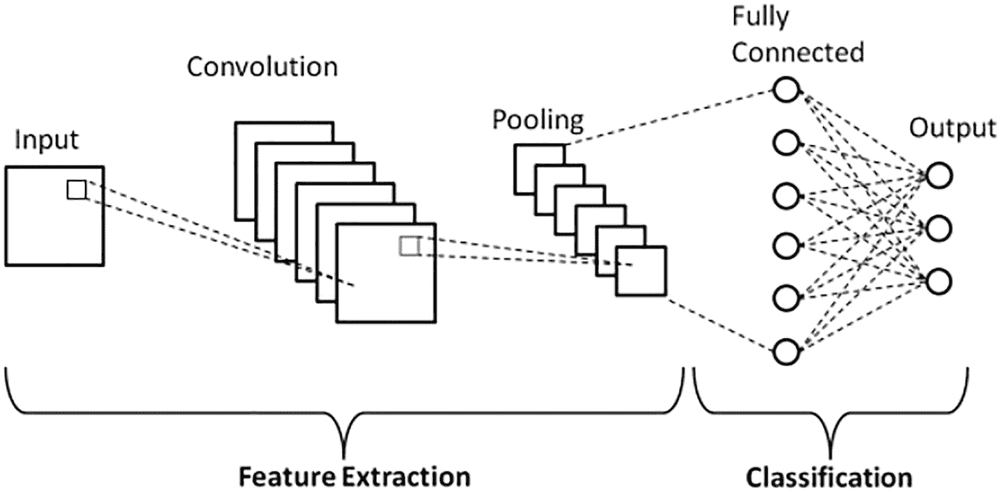

该图展示了输入帧如何被卷积，以及特征如何被提取、池化，并通过全连接层进行分类，最终预测输出。

**图 5-2** 卷积神经网络架构

相反，我们使用应用于输入层的卷积滤波器来计算输出。当你使用这些卷积时，你会得到局部连接，这意味着输入的每个部分都与输出的一个部分相连（我们将在本章后面解释这一点）。在卷积神经网络中，每一层都应用一组独立的滤波器，通常有数百或数千个，然后将结果合并。

在训练过程中，卷积神经网络会自动学习这些滤波器的值。在图像分类任务中，我们的卷积神经网络可以学习执行以下操作：

- 在第一层，使用原始像素数据检测边缘。
- 在第二层，利用这些边缘来识别形状（例如，斑点）。
- 在网络的高层，利用这些形状来检测更高级别的特征，比如面部结构。
- 最后一层是分类器，它根据这些高级别特征对图像内容进行预测。

如果你有一系列图像，例如视频，那么循环神经网络或卷积神经网络都是合适的选择。在以下代码中，我们对一系列图像进行分类：

```python
import numpy as np
from keras.models import Sequential
from keras.layers import Conv2D, MaxPooling2D, Dense, Flatten
from keras.utils import to_categorical
import tensorflow as tf
mnist = tf.keras.datasets.mnist
#### loads data and splits into train and test set
(x_train, y_train), (x_test, y_test) = mnist.load_data()
x_train, x_test = x_train / 255.0, x_test / 255.0
#### # Reshape the images.
train_images = np.expand_dims(x_train, axis=3)
test_images = np.expand_dims(x_test, axis=3)
num_filters = 4
filter_size = 2
pool_size = 2
#### Build the model.
model = Sequential([
Conv2D(num_filters, filter_size, input_shape=(28, 28, 1)),
MaxPooling2D(pool_size=pool_size),
Flatten(),
Dense(10, activation='softmax'),
])
#### Compile the model.
model.compile(
'adam',
loss='categorical_crossentropy',
metrics=['accuracy'],
)
#### Train the model.
model.fit(
train_images,
to_categorical(y_train),
epochs=3,
validation_data=(test_images, to_categorical(y_test)),
)
#### Predict on the first 10 test images.
predictions = model.predict(test_images[:10])
print(np.argmax(predictions, axis=1))
#### Check our predictions against the ground truths.
print(x_test[:10])
```

## 本章小结

本章是本书的核心。我们讨论了诸如循环神经网络和卷积神经网络等神经网络，并结合强化学习使用了真实示例。在下一章中，我们将讨论一些用于分析时间序列数据的经典统计方法，而最后一章则全部关于如何扩展你的分析应用。