# 6. 时间序列

*时间序列*是按时间顺序排列的一系列数据点。最常见的情况是，这些时间点是等间隔的。例如，过去两年中每月记录的航空公司乘客量，或过去一年中每天记录的股票市场工具价格。时间序列分析的主要目的是根据参数的过去数据来预测其未来值。

## 变异的分类

传统上，时间序列分析将变异分为三个主要组成部分，即趋势、季节性变化和其他周期性变化。剩余的变异则归因于“不规则”波动或误差项。当变异主要由趋势和季节性构成时，这种方法尤其有价值。

## 分析包含趋势的序列

*趋势*是均值水平的长期性变化。例如，如果你有一个像 2, 4, 6, 8 这样的序列，有人问你下一个值是什么，显而易见的答案是 10。你可以通过使用简单最小二乘估计或任何其他回归方法对数据拟合一条直线来证明你的答案。趋势也可以是非线性的。图 6-1 展示了一个带有趋势的时间序列示例。

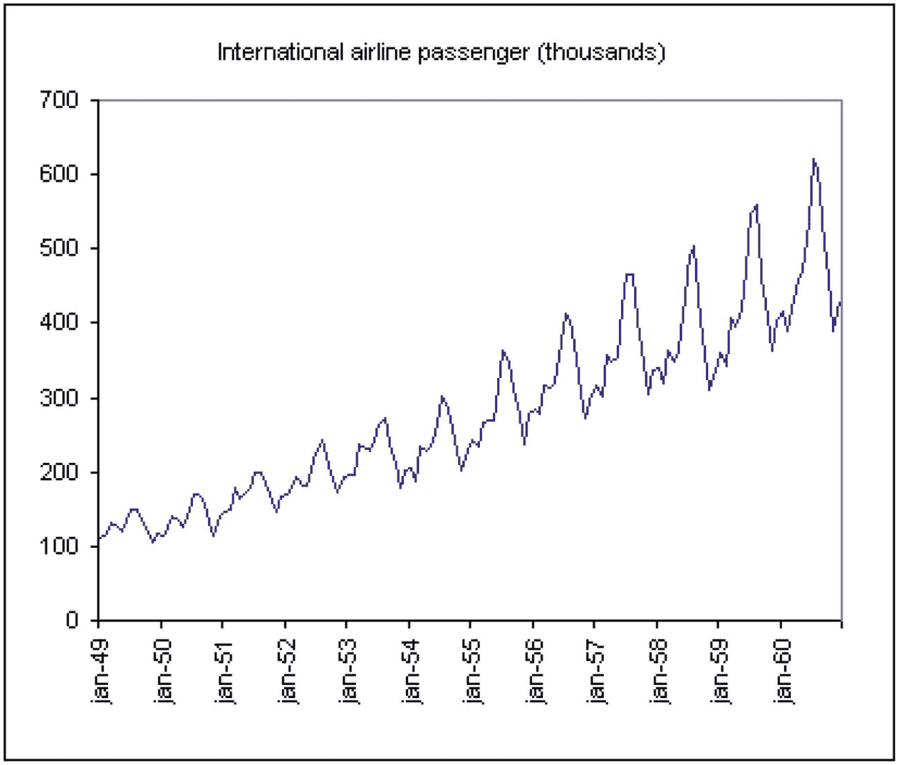

该图绘制了以千为单位的国际航空公司乘客数据。它显示了一个从 1949 年 1 月的大约 100 增长到 1960 年 1 月的大约 600 的上升趋势。

**图 6-1** 带有趋势的时间序列

最简单的时间序列类型是常见的“线性趋势加噪声”，其中在时间 *t* 的观测值是一个随机变量 `X[t]`，如下所示：

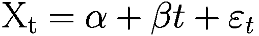

这里，`α`、`β` 是常数，`ε[t]` 表示均值为 0 的随机误差项。在时间 *t* 的平均水平由 `m[t] = (α + βt)` 给出。这有时被称为*趋势项*。

### 曲线拟合

*拟合*一个简单的时间函数，例如多项式曲线（线性、二次等）、冈珀茨曲线或逻辑曲线，是处理包含趋势的非季节性数据（特别是年度数据）的一种众所周知的方法。全局线性趋势是最简单的多项式曲线类型。冈珀茨曲线可以写成以下格式，其中 `α`、`β` 和 `γ` 是参数，且 `0 < r < 1`：

![$$ {\textrm{X}}_{\textrm{t}}=\alpha \exp \left[\beta \exp \left(-\gamma \textrm{t}\right)\right] $$](images/458833_2_En_6_Chapter/458833_2_En_6_Chapter_TeX_Equb.png)

这看起来相当不同，但只要 `t > 0`，实际上是等价的。逻辑曲线如下所示：

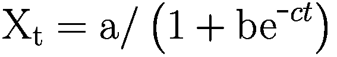

这两条曲线都是 S 形的，并且当 `t → ∞` 时趋近于一个渐近值，其中冈珀茨曲线通常比逻辑曲线收敛得慢。将曲线拟合到数据可能会导致非线性联立方程。

对于所有此类性质的曲线，拟合函数提供了趋势的度量，而残差则提供了局部波动的估计，其中残差是观测值与拟合曲线对应值之间的差值。


### 从时间序列中移除趋势

对给定的时间序列进行差分，直至其变得平稳，是一种特殊的滤波方法，对于移除趋势特别有用。你会看到，这是 Box-Jenkins 方法中不可或缺的一部分。对于具有线性趋势的数据，一阶差分通常足以移除趋势。

数学上，其形式如下：


趋势也可能是指数型的。在这种情况下，你需要进行对数变换，将指数趋势转换为线性趋势。

数学上，其形式如下：


## 分析包含季节性的序列

许多时间序列，例如航空公司的乘客负载量或天气读数，会显示出在特定时间段后重复的变动。例如，在印度，排灯节假期期间航空公司的乘客负载量总是会增加。这种年度变化很容易理解，如果对季节性有直接兴趣，也可以进行估计。同样，类似于趋势，如果你有一个像 1, 2, 1, 2, 1, 2 这样的序列，那么你对序列下一个值的明显选择将是 1 和 2。

Holt-Winters 模型是实现具有季节性的时间序列的流行模型，也被称为*指数平滑法*。Holt-Winters 模型有两种变体：加法模型和乘法模型。在具有单一指数平滑时间序列的加法模型中，季节性的实现方式如下：

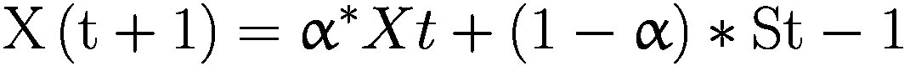

在这个模型中，每个点都被实现为前一个点和季节性的加权平均值。因此，`X(t+1)` 将作为 `X(t-1)` 和 `S(t-2)` 以及 `α` 的平方的函数来计算。这样，随着过程的进行，`α` 的值会呈指数增长。这就是它被称为指数平滑法的原因。`St` 的起始值在此方法中至关重要。通常，这个值从 1 开始，或者取前四个观测值的平均值。

乘法季节性模型的时间序列如下：

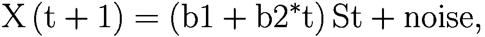

这里，`b1`（通常被称为*永久成分*）是季节性的初始权重；`b2` 代表趋势，在此情况下是线性的。

然而，Python 中没有 Holt-Winters 模型的标准实现。它在 R 中可用（关于如何从 Python 代码中调用 R 的 Holt-Winters 模型，请参见第 1 章）。

## 从时间序列中移除季节性

从时间序列中移除季节性有两种方法。

*   通过滤波
*   通过差分

### 通过滤波

序列 `{x[t]}` 通过如下所示的线性运算转换为另一个称为 `{y[t]}` 的序列，其中 `{a[r]}` 是一组权重：

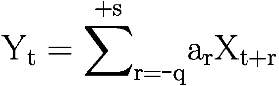

为了平滑局部波动并估计局部均值，你应明确选择权重，使得 `∑a[r] = 1`；那么该运算通常被称为*移动平均*。它们通常是对称的，即 `s = q` 且 `a[j] = a[-j]`。对称平滑滤波器最简单的例子是简单移动平均，其中对于 `r = -q, …, + q`，有 `a[r] = 1 / (2q+1)`。

`x[t]` 的平滑值由下式给出：

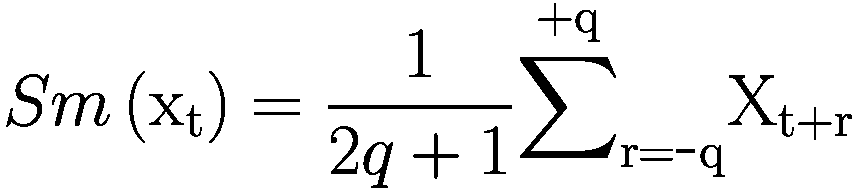

简单移动平均对于移除季节性变化很有用，但无法很好地处理趋势。

### 通过差分

差分被广泛使用，并且通常效果良好。季节性差分可以移除季节性变化。

数学上，如果时间序列 `y(t)` 包含周期为 `T` 的加法季节性 `S(t)`，那么：

![$$ {\displaystyle \begin{array}{c}\textrm{y}\left(\textrm{t}\right)={\textrm{a}}^{\ast}\textrm{S}\left(\textrm{t}\right)={\textrm{b}}^{\ast}\textrm{t}+\textrm{c}\\ {}\textrm{y}\left(\textrm{t}+\textrm{T}\right)= aS\left(\textrm{t}+\textrm{T}\right)+{\textrm{b}}^{\ast}\left(\textrm{t}+\textrm{T}\right)+\textrm{c}\\ {}\textrm{z}\left(\textrm{t}\right)=\textrm{y}\left(\textrm{t}+\textrm{T}\right)-\textrm{y}\left(\textrm{t}\right)={\textrm{b}}^{\ast}\textrm{T}+\textrm{noise}\ \textrm{term}\end{array}} $$](img/458833_2_En_6_Chapter_TeX_Equj.png)

与趋势类似，你可以通过对数变换将乘法季节性转换为加法季节性。

现在，在时间序列中找到周期 `T` 是关键部分。可以通过两种方式实现：在时域中使用自相关函数，或者在频域中使用傅里叶变换。在这两种情况下，你都会在图中看到一个尖峰。对于自相关，图上的尖峰将出现在滞后 `T` 处，而对于傅里叶变换分布，尖峰将出现在频率 `1/T` 处。

## 变换

到目前为止，我已经讨论了时间序列中各种类型的变换。进行变换的三个主要原因将在接下来的章节中介绍。

### 稳定方差

标准的做法是对序列进行对数变换；它可以使空间中分散较远的点彼此靠近。

### 使季节性效应变为加法

如果序列存在趋势，并且季节性效应的幅度似乎随均值上升，那么修改数据以使季节性效应逐年保持恒定可能是可取的。这种季节性效应被称为加法效应。然而，如果季节性效应的幅度与均值成正比，那么该季节性效应被称为乘法效应，并且需要进行对数变换才能使其再次变为加法效应。


### 使数据分布正态化

在大多数概率模型中，都假设数据分布是高斯分布或正态分布。例如，趋势中可能存在偏态证据，导致时间图中出现方向一致的“尖峰”。

要将数据转换为正态分布，最常见的变换是减去均值，然后除以标准差。我在第 5 章的 RNN 示例中给出了这种变换的例子；在本章的最后一个示例中，我将再给出一个。这种变换背后的逻辑是，它使均值为 0，标准差为 1，这是正态分布的一个特征。另一种流行的变换是使用对数。对数的主要优点是它能减少变异，并且高斯分布数据的对数仍然是高斯分布。变换可能是特定于问题或特定于领域的。例如，在航空公司的乘客载客量时间序列中，可以通过除以该月的天数或该月的假期数来对序列进行归一化。

#### 循环变动

在某些时间序列中，季节性并非恒定，而是一个随机变量。这被称为*循环变动*。在这种情况下，首先需要预测周期性，然后以与处理季节性变动相同的方式将其移除。

#### 不规则波动

没有趋势和循环变动的时间序列可以被视为弱平稳时间序列。在下一节中，你将研究各种概率模型来实现弱平稳时间序列。

## 平稳时间序列

通常，如果时间序列的均值和方差没有系统性变化，并且严格的周期性变化已被消除，则称该时间序列是平稳的。在现实生活中，不存在平稳的时间序列。无论你通过变换获得什么数据，你都可以尝试使其在某种程度上更接近平稳序列。

### 平稳过程

如果对于所有 `t[1],…,t[k],τ`，`X(t[1]),...,X(t[k])` 的联合分布与 `X(t[1] + τ),...,X(t[k] + τ)` 的联合分布相同，则该时间序列是严格平稳的。如果 `k=1`，严格平稳意味着 `X(t)` 的分布对于所有 `t` 都是相同的，因此，假设前两阶矩是有限的，则有：

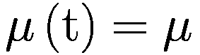

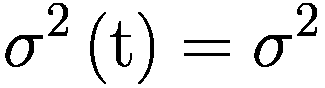

两者都是常数，不依赖于 `t` 的值。

弱平稳时间序列是一个随机过程，其均值是常数，自协方差是时间滞后的函数。

### 自相关与相关图

称为*样本自相关系数*的量是了解时间序列性质的重要指南。它们评估不同距离的观测值之间是否存在相关性，并提供有价值的描述性信息。你将看到，它们也是模型构建中的重要工具，并且通常为给定数据集选择合适的概率模型提供有价值的线索。该系数的取值范围为 `[-1,1]`，衡量两个变量之间线性关联的强度。可以很容易地证明，该值不依赖于两个变量的测量单位；如果变量是独立的，那么理想的相关性为零。

在解释一组自相关系数时，一个有用的辅助工具是称为*相关图*的图形。相关图也可以称为*样本自相关函数*。

假设一个平稳随机过程 `X(t)` 具有均值 `μ`、方差 `σ²`、自协方差函数 (acv.f.) `γ(t)` 和自相关函数 (ac.f.) `ρ(τ)`。

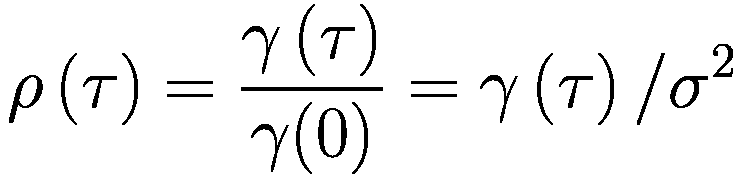

### 估计自协方差和自相关函数

在随机过程中，自协方差是过程自身在成对时间点上的协方差。自协方差的计算如下：

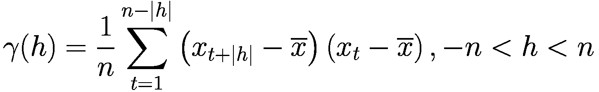

图 6-2 显示了一个样本自相关分布。

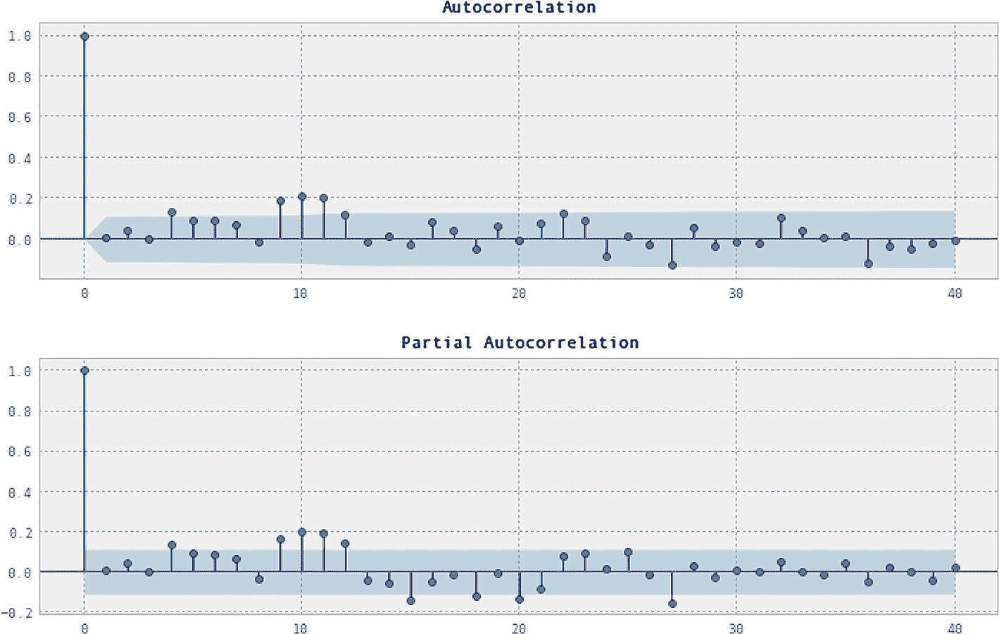

一对用于自相关和偏自相关的模拟离散时间序列。两个图在点 0 处都有最高峰值为 0。

图 6-2

样本自相关

## 使用 Python 进行时间序列分析

`Statsmodels` 是一个 Python 包，它为包括描述性统计和统计模型估计在内的统计计算提供了对 `SciPy` 的补充。除了早期的模型、线性回归、稳健线性模型、广义线性模型和离散数据模型之外，`scikits.statsmodels` 的最新版本还包含了一些用于时间序列分析的基本工具和模型，例如描述性统计、统计检验以及几个线性模型类。这些线性模型类包括自回归 (AR)、自回归移动平均 (ARMA) 和向量自回归模型 (VAR)。

### 有用的方法

让我们从移动平均开始。

#### 移动平均过程

假设 `{Z[t]}` 是一个均值为 0、方差为 `σ[z]²` 的纯随机过程。那么，过程 `{X[t]}` 被称为 `q` 阶移动平均过程。

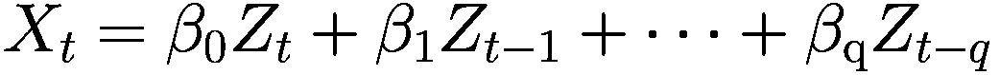

这里，`{β[i]}` 是常数。`Zs` 通常被缩放，使得 `β[0] = 1`。

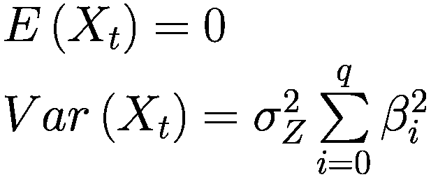

`Zs` 是独立的。


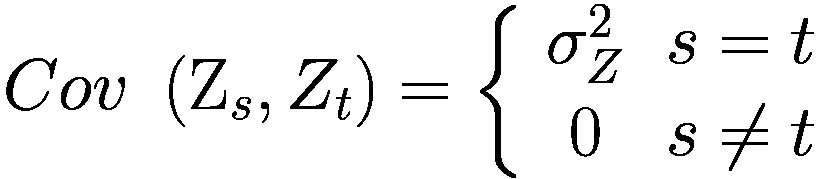

由于 `γ(k)` 不依赖于 `t` 且均值是常数，因此对于所有 `{β[i]}` 的值，该过程都是二阶平稳的。

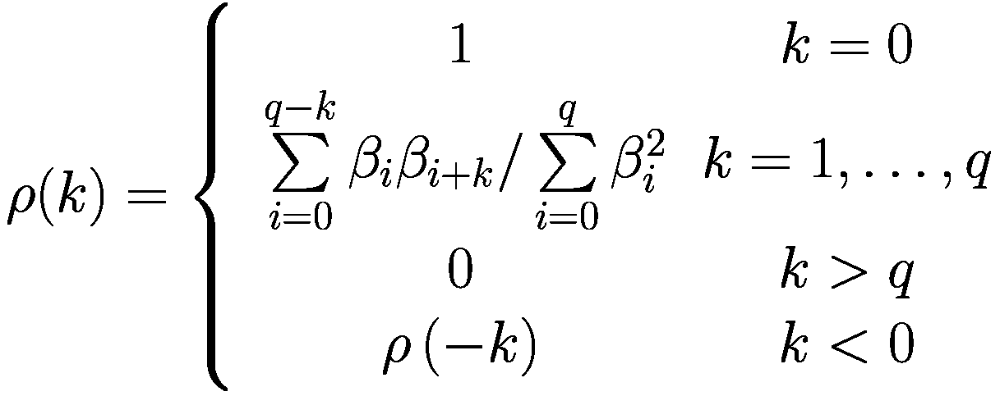


#### 拟合移动平均过程

移动平均（MA）模型是实现单变量周平稳时间序列的著名方法（见图 6-3）。移动平均模型规定，输出变量线性依赖于其自身过去的误差项以及一个随机项。AR 模型被称为*移动平均模型*，它是时间序列 ARMA 和 ARIMA 模型的一个特例和关键组成部分。

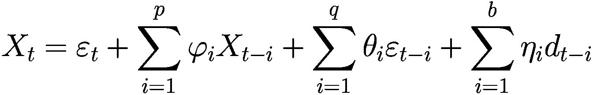

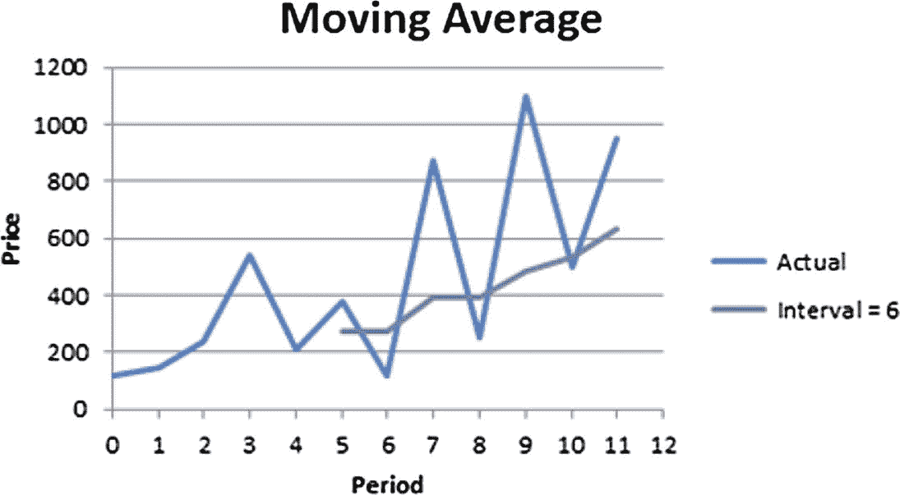

价格与周期的关系图。它绘制了实际值和区间值在 6 处的移动平均线的两条上升趋势。实际值的峰值最高，达到 9。

图 6-3

移动平均示例

以下是移动平均模型的示例代码：

```
请通过以下命令安装 numpy：
pip install numpy
import numpy as np
def moving_average(x, w):
return np.convolve(x, np.ones(w), 'valid') / w
data = np.array([10,5,8,9,15,22,26,11,15,16,18,7])
print(moving_average(data,4))
```

### 自回归过程

假设 `{Z[t]}` 是一个均值为 0、方差为 `σ[z]²` 的纯随机过程。那么，如果满足以下条件，则称过程 `{X[t]}` 为 `p` 阶自回归过程：

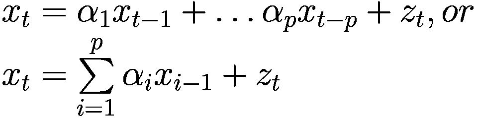

自协方差函数由下式给出：

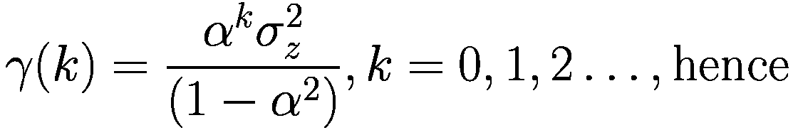

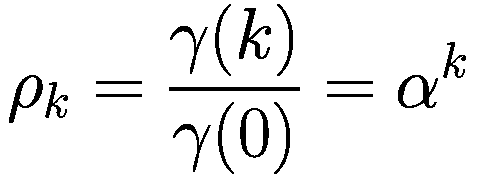

图 6-4 显示了一个时间序列及其 AR 模型的自相关图。

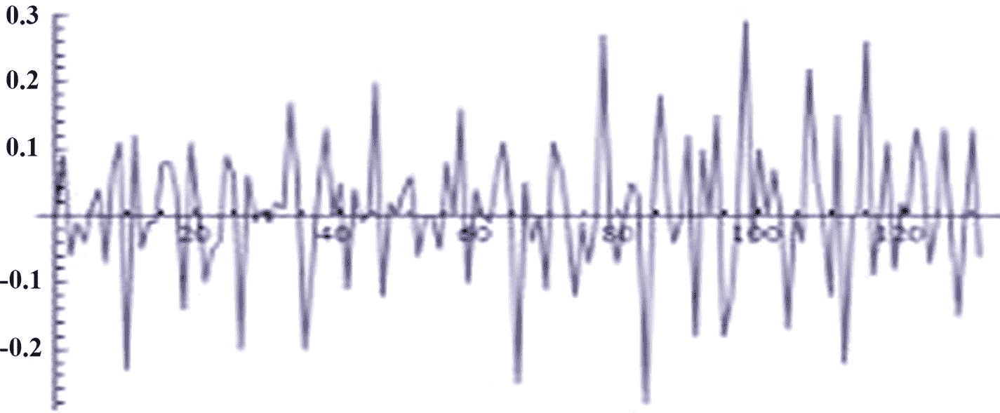

时间序列和 AR 模型的模拟图。它绘制了具有多个波峰和波谷的波动趋势。

图 6-4

时间序列与 AR 模型

### 估计 AR 过程的参数

如果一个过程的均值恒定，且自协方差函数仅依赖于时间滞后，则该过程称为*弱平稳*。虽然不存在绝对的弱平稳过程，但为了进行随机分析，通常会对时间序列数据施加此假设。假设 `Z(t)` 是一个均值为 0、方差恒定的弱平稳过程。那么，如果满足以下条件，则 `X(t)` 是一个 `p` 阶自回归过程：


现在，`E[X(t)]` 是 `X(t)` 的期望值。

![$$ {\displaystyle \begin{array}{c}\textrm{Covariance}\left(\textrm{X}\left(\textrm{t}\right),\textrm{X}\left(\textrm{t}+\textrm{h}\right)\right)=\textrm{E}\left[{\left(\textrm{X}\left(\textrm{t}\right)\hbox{-} \textrm{E}\left[\textrm{X}\left(\textrm{t}\right)\right]\right)}^{\ast }\ \left(\textrm{X}\left(\textrm{t}+\textrm{h}\right)\hbox{-} \textrm{E}\left[\textrm{X}\left(\textrm{t}+\textrm{h}\right)\right]\right)\right]\\ {}=\textrm{E}\left[{\left(\textrm{X}\left(\textrm{t}\right)\hbox{-} \textrm{m}\right)}^{\ast }\ \left(\textrm{X}\left(\textrm{t}+\textrm{h}\right)\hbox{-} \textrm{m}\right)\right]\end{array}} $$](images/458833_2_En_6_Chapter/458833_2_En_6_Chapter_TeX_Equy.png)

如果 `X(t)` 是一个弱平稳过程，那么：

![$$ {\displaystyle \begin{array}{c}\textrm{E}\left[\textrm{X}\left(\textrm{t}\right)\right]=\textrm{E}\left[\textrm{X}\left(\textrm{t}+\textrm{h}\right)\right]=\textrm{m}\ \left(\textrm{constant}\right)\\ {}=\textrm{E}\left[\textrm{X}{\left(\textrm{t}\right)}^{\ast }\ \textrm{X}\left(\textrm{t}+\textrm{h}\right)\right]-{\textrm{m}}²=\textrm{c}\left(\textrm{h}\right)\end{array}} $$](images/458833_2_En_6_Chapter/458833_2_En_6_Chapter_TeX_Equz.png)

这里，`m` 是常数，对于弱平稳过程，`cov[X(t),X(t+h)]` 仅是 `h(c(h))` 的函数。`c(h)` 被称为自协方差。

类似地，相关性 `(X(t),X(t+h) = ρ(h) = r(h) = c(h) = c(0)` 被称为*自相关*。

如果 `X(t)` 是一个实现为自回归模型的平稳过程，那么：


`相关性(X(t),X(t)) = a1 * 相关性 (X(t),X(t-1)) + …. + ap * 相关性 (X(t),X(t-p))+0`

由于协方差 `(X(t),X(t+h))` 仅依赖于 `h`，因此：

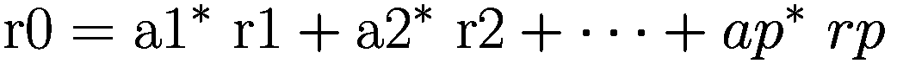

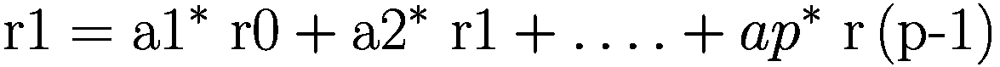

因此，对于一个 `n` 阶模型，你可以轻松生成 `n` 个方程，并通过求解这 `n` 个方程组来找到 `n` 个系数。

在这种情况下，仅在一阶和二阶自回归模型中实现数据集，并选择残差均值较小的模型。为此，简化公式如下：

*   *一阶*：`a1 = r1`
*   *二阶*：`a1 = r1(1 - r2) / (1 - r1²)`, `a2 = (r2 - r1²) / (1 - r1²)`

以下是自回归模型的一些示例代码：

```
请从 https://github.com/pratips/book-Advanced-Data-Analytics-Using-Python 下载所需的 CSC 文件，并使用 pip 命令安装 Python 库。
from pandas import read_csv
from matplotlib import pyplot
from statsmodels.tsa.ar_model import AutoReg
from sklearn.metrics import mean_squared_error
from math import sqrt
#### 加载数据集
series = read_csv('temperatures.csv', header=0, index_col=0, parse_dates=True, squeeze=True)
#### 拆分数据集
X = series.values
train, test = X[1:len(X)-7], X[len(X)-7:]
#### 训练自回归模型
model = AutoReg(train, lags=29)
model_fit = model.fit()
print('系数: %s' % model_fit.params)
#### 进行预测
predictions = model_fit.predict(start=len(train), end=len(train)+len(test)-1, dynamic=False)
for i in range(len(predictions)):
print('预测值=%f, 期望值=%f' % (predictions[i], test[i]))
rmse = sqrt(mean_squared_error(test, predictions))
print('测试 RMSE: %.3f' % rmse)
#### 绘制结果
pyplot.plot(test)
pyplot.plot(predictions, color='red')
pyplot.show()
```


## 混合 ARMA 模型

混合 ARMA 模型是 MA 和 AR 过程的组合。一个包含`p`个 AR 项和`q`个 MA 项的混合自回归/移动平均过程，被称为阶数为`(p,q)`的 ARMA 过程。其定义如下：

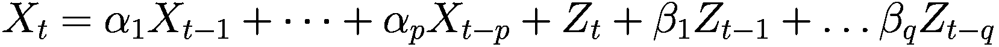

以下示例代码取自 stat model 网站，用于将时间序列数据实现为 ARMA 模型。

请在运行代码前，使用`pip`命令安装`matplotlib`、`statsmodels`和`numpy`。

```
import matplotlib.pyplot as plt
import numpy as np
from statsmodels.tsa.arima_process import ArmaProcess
import statsmodels.api as sm
np.random.seed(1234)
data = np.array([1, .85, -.43, -.63, .8])
parameter = np.array([1, .41])
model = ArmaProcess(data, parameter)
fig = plt.figure(figsize=(12, 8))
ax = fig.add_subplot(111)
ax.plot(model.generate_sample(nsample=50))
plt.show()
```

以下是估计 ARMA 模型参数的方法：

1. 在指定平稳 ARMA 过程的阶数后，你需要估计参数。
2. 假设如下：
   - 模型阶数（`p`和`q`）已知。
   - 数据具有零均值。
3. 如果步骤 2 的假设不合理，你可以减去样本均值`Y`，并拟合一个零均值的 ARMA 模型，如`Ø(B)X[t] = θ(B)a[t]`所示，其中`X[t] = Y[t] – Y`。然后使用`X[t] + Y`作为`Y[t]`的模型。

## 集成 ARMA 模型

为了拟合像前面讨论的平稳模型，必须消除非平稳的变异来源。差分法广泛应用于计量经济学数据。如果将`X[t]`替换为`∇^dX[t]`，那么你就拥有了一个能够描述某些类型非平稳序列的模型。

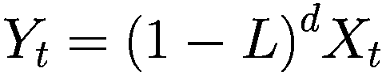

以下是 ARIMA 模型的估计参数：

- ARIMA 模型通过自回归、差分和移动平均的阶数来指定。
- 该方法不假设任何模式，而是采用迭代方法来识别模型。
- 如果残差通常较小、随机分布，并且总体上不包含有用信息，则模型“拟合良好”。

以下是 ARIMA 模型的示例代码。

请从`https://github.com/pratips/book-Advanced-Data-Analytics-Using-Python`下载所需的 CSV 文件，并使用`pip`命令安装 Python 库。

```
#### 导入库
from pandas import read_csv
from matplotlib import pyplot
from statsmodels.tsa.arima.model import ARIMA
from sklearn.metrics import mean_squared_error
#### 读取 CSV 文件
series = read_csv('temperatures.csv', header=0, index_col=0, parse_dates=True, squeeze=True)
P = series.values
size = int(len(P) * 0.9)
#### 分割为训练集和测试集
train, test = P[0:size], P[size:len(P)]
history = [p for p in train]
predictions = list()
for t in range(len(test)):
#### 拟合模型
model = ARIMA(history, order=(5,1,0))
model_fit = model.fit()
output = model_fit.forecast()
yhat = output[0]
predictions.append(yhat)
obs = test[t]
history.append(obs)
print('预测值=%f, 期望值=%f' % (yhat, obs))
error = mean_squared_error(test, predictions)
print('测试集 MSE: %.3f' % error)
#### 绘制结果
pyplot.plot(test)
pyplot.plot(predictions, color='red')
pyplot.show()
```

## 傅里叶变换

非周期信号可以通过一个简单的极限过程用永续指数信号来表示，我将说明非周期信号可以表示为永续指数信号的连续和（积分）。假设你想表示非周期信号`g(t)`。将任何非周期信号视为具有无限时间周期的周期信号，你会得到以下结果：

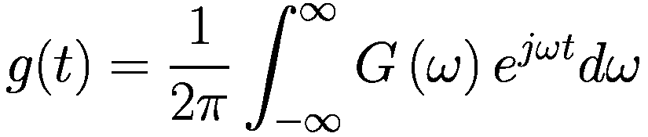

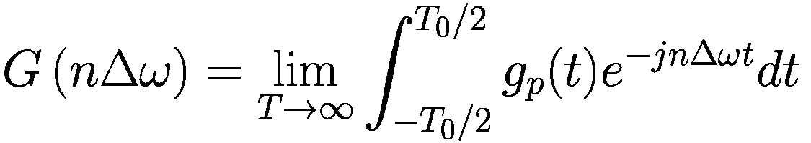

因此：

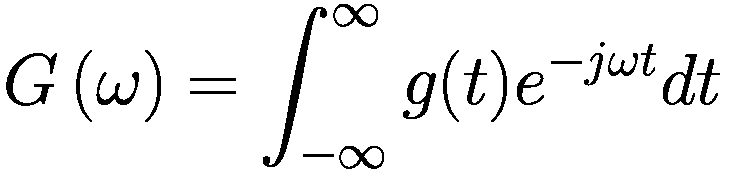

`G(w)`被称为`g(t)`的傅里叶变换。

以下是自协方差与傅里叶变换之间的关系：

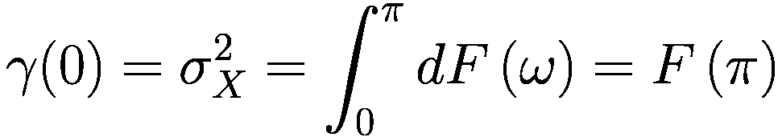

## 一个特殊场景

在航空或酒店领域，第`t`个月的乘客量与`t-1`或`t-2`个月的数据相关性较低，但与`t-12`个月的数据相关性更高。例如，排灯节（十月）的乘客量与去年排灯节的数据相关性高于同年八月和九月的数据。历史上，拾取模型用于预测这类数据。拾取模型有两种变体。

在加法拾取模型中，

![$$ \textrm{X}\left(\textrm{t}\right)=\textrm{X}\left(\textrm{t}\hbox{-} 1\right)+\left[\textrm{X}\left(\textrm{t}\hbox{-} 12\right)\hbox{-} \textrm{X}\left(\textrm{t}\hbox{-} 13\right)\right] $$](images/458833_2_En_6_Chapter/458833_2_En_6_Chapter_TeX_Equaj.png)

在乘法拾取模型中，

![$$ \textrm{X}\left(\textrm{t}\right)=\textrm{X}{\left(\textrm{t}\hbox{-} 1\right)}^{\ast }\ \left[\textrm{X}\left(\textrm{t}\hbox{-} 12\right)/\textrm{X}\left(\textrm{t}\hbox{-} 13\right)\right] $$](images/458833_2_En_6_Chapter/458833_2_En_6_Chapter_TeX_Equak.png)

研究表明，对于这类数据，基于神经网络的预测器比时间序列模型具有更高的准确性。

在投资银行的高频交易中，时间序列模型过于耗时，无法捕捉工具的最新模式。因此，他们实时计算`dX/dt`和`d2X/dt2`，其中`X`是工具的价格。如果两者均为正，他们盲目地发出买入该工具的订单。如果两者均为负，并且投资组合中持有该工具，他们则盲目卖出。但如果符号相反，他们会利用时间序列数据进行更详细的分析。

正如我之前所说，在时间序列分析中有许多场景下，R 比 Python 是更好的选择。因此，这里有一个使用 R 进行时间序列预测的示例。`auto.arima`模型的优点在于它能自动找到数据的阶数、趋势和季节性，并拟合模型。在预测中，我们只打印均值，但该模型在预测时提供了预测的上限和下限。

请使用以下命令安装`pmdarima`库：

```
pip install pmdarima
```

安装完成后，你可以尝试运行基于`pmdarima`手册的以下代码。它会加载包中可用的数据集，然后尝试拟合自动 ARIMA 并进行预测。

```
import numpy as np
import pmdarima as pm
from pmdarima.datasets import load_wineind
#### 加载数据集
wineind = load_wineind().astype(np.float64)
#### 拟合逐步模型：
stepwise_fit = pm.auto_arima(wineind, start_p=1, start_q=1, max_p=3, max_q=3, m=12, start_P=0, seasonal=True, d=1, D=1, trace=True, error_action='ignore', suppress_warnings=True, stepwise=True)
stepwise_fit.summary()
predicted_15 = stepwise_fit.predict(n_periods=15)
print(predicted_15)
```

## 缺失数据

时间序列和许多其他数据分析工作中的一个重要方面是弄清楚如何处理缺失数据。在前面的代码中，你用平均值填充了缺失的记录。当缺失数据实例的数量不是很高时，这没问题。但如果数量很高，那么最高值和最低值的平均值是一个更好的替代方案。


## 总结

在特征工程之后，我们将介绍一些基础统计学知识，特别是时间序列模型。需要记住的一点是，如果你将特征向量（`1xn`）转换为矩阵（`kxn`），其中每行的每个`k`元素是第一列最新的`k`个观测值，那么你就可以在时间序列数据上应用任何监督式机器学习模型。

