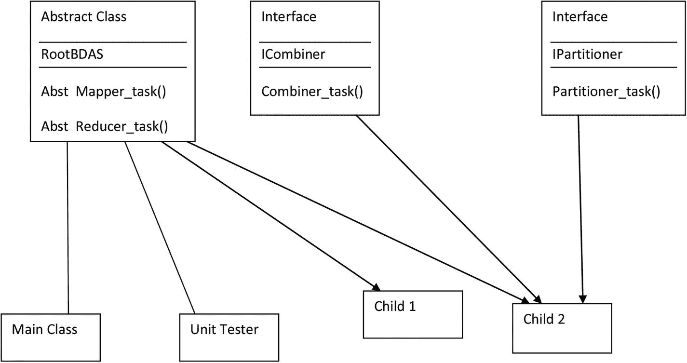
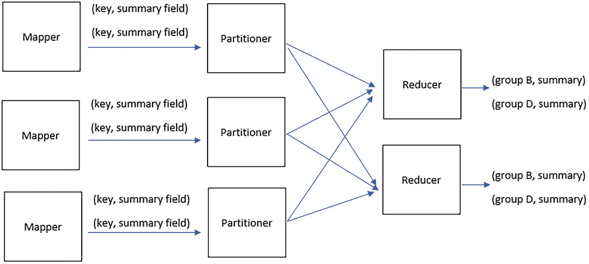
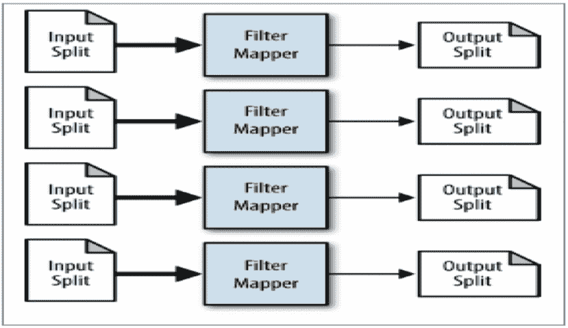
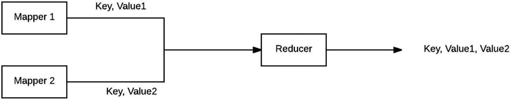
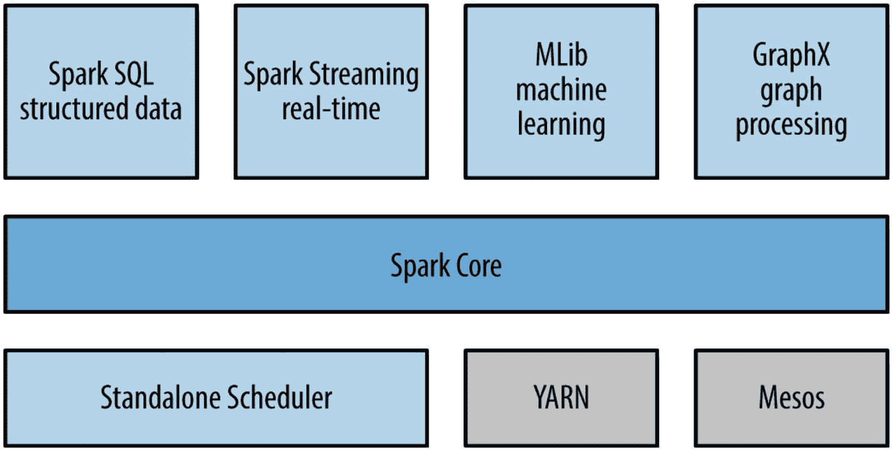
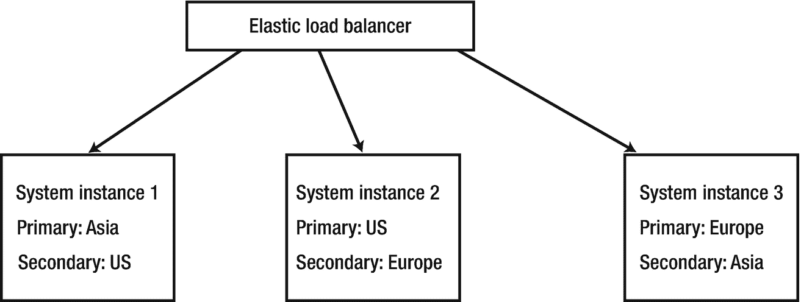
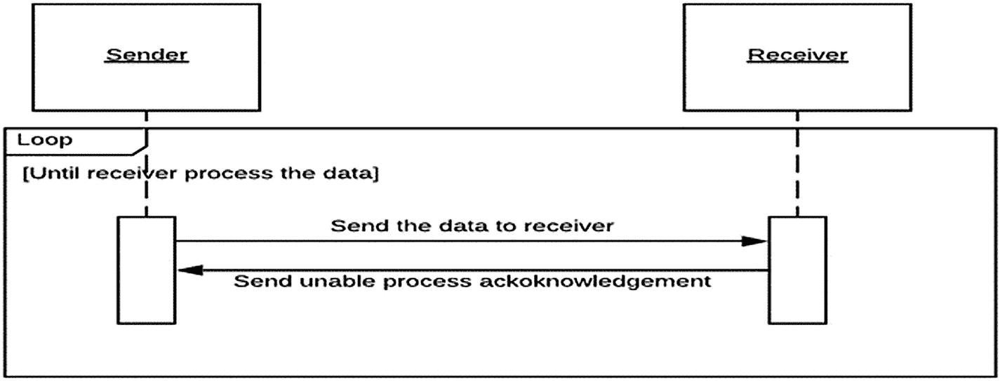

# 7. 大规模分析

近几十年来，由于大数据的发展，分析技术领域发生了革命性的变化。数据正从各种来源被收集，因此，即使在分布式环境中，甚至实时地分析这些数据的技术也得到了发展。

## Hadoop

这场革命始于 Hadoop 框架的开发，该框架有两个主要组件，即 `MapReduce` 编程和 `HDFS` 文件系统。

### MapReduce 编程

`MapReduce` 是一种受函数式编程启发的编程风格，用于处理大量数据。程序员可以使用 `MapReduce` 代码处理大数据，而无需了解分布式环境的内部细节。在 `MapReduce` 之前，像 `Condor` 这样的框架在分布式数据上进行并行计算。但 `MapReduce` 的主要优势在于它基于 `RPC`（远程过程调用）。数据不会移动；相反，代码会跳转到不同的机器上来处理数据。在处理大数据时，这极大地节省了网络带宽和计算时间。

一个 `MapReduce` 程序有两个主要组件：映射器（`mapper`）和归约器（`reducer`）。在映射器中，输入被分割成小单元。通常，输入文件的每一行都成为每个映射任务的输入。映射器处理输入并向归约器发出一个键值对。归约器接收特定键的所有值作为输入，并处理数据以生成最终输出。

以下伪代码是统计文档中单词频率的一个示例：

```
map(String key, String value):
    // key: 文档名称
    // value: 文档内容
    for each word w in value:
        EmitIntermediate(w, "1");
reduce(String key, Iterator values):
    // key: 一个单词
    // values: 计数列表
    int result = 0;
    for each v in values:
        result += ParseInt(v);
    Emit(AsString(result));
```

### 分区函数

有时需要将特定的数据集发送到特定的归约任务。分区函数就是为了解决这个目的。例如，在前面的 `MapReduce` 示例中，假设用户希望输出按排序顺序存储。那么他指定归约任务的数量为 32（对应 32 个字母），并在分区函数中，对于以`a`开头的键返回 1，以`b`开头的键返回 2，依此类推。那么所有以相同字母开头的单词都会进入同一个归约任务。输出将存储在同一个输出文件中，并且由于 `MapReduce` 保证中间键值对会按键的递增顺序处理，因此在给定的分区内，输出将按排序顺序存储。

### 组合器函数

组合器是 `MapReduce` 中的一个功能，在映射阶段进行部分聚合。它不仅提高了性能，而且当数据集非常大以至于归约器抛出堆栈溢出异常时，有时必须使用它。通常，归约器和组合器的逻辑是相同的，但这可能取决于 `MapReduce` 如何处理输出。

为了实现这个单词计数示例，我们将遵循一个特定的设计模式。将有一个根类`RootBDAS`（`BDAS` 代表大数据分析系统），它有两个抽象方法：一个映射器任务和一个归约器任务。所有子类都实现这些映射器和归约器任务。主类将使用反射创建子类的实例，并在 `MapReduce` 的 `map` 函数中调用该实例的映射器任务，在 `reduce` 函数中调用归约器任务。这种模式的主要优点是你可以对 `MapReduce` 功能进行单元测试，并且它具有适应性。添加任何新的子类都不需要对主类或单元测试进行任何更改。你只需要更改配置。某些代码可能需要实现组合器或分区器逻辑。它们必须继承`ICombiner`或`IPartitioner`接口。

图 7-1 展示了该系统的类图。



**图 7-1** 类图

以下是`RootBDAS`类：

```
import java.util.ArrayList;
import java.util.HashMap;
/**
*
*/
/**
* @author SayanM
*
*/
public abstract class RootBDAS {
    abstract  HashMap<String, ArrayList<String>>  mapper_task(String line);
    abstract  HashMap<String, ArrayList<String>>  reducer_task(String key, ArrayList<String> values);
}
```

以下是子类：

```
import java.util.ArrayList;
import java.util.HashMap;
/**
*
*/
/**
* @author SayanM
*
*/
public final class WordCounterBDAS extends RootBDAS{
    @Override
    HashMap<String, ArrayList<String>> mapper_task(String line) {
        // TODO Auto-generated method stub
        String[] words = line.split(" ");
        HashMap<String, ArrayList<String>> result = new HashMap<>();
        for(String w : words)
        {
            if(result.containsKey(w))
            {
                ArrayList<String> vals = result.get(w);
                vals.add("1");
                result.put(w, vals);
            }
            else
            {
                ArrayList<String> vals = new ArrayList<>();
                vals.add("1");
                result.put(w, vals);
            }
        }
        return result;
    }
    @Override
    HashMap<String, ArrayList<String>> reducer_task(String key, ArrayList<String> values) {
        // TODO Auto-generated method stub
        HashMap<String, ArrayList<String>> result = new HashMap<>();
        ArrayList<String> tempres = new ArrayList<>();
        tempres.add(values.size()+ "");
        result.put(key, tempres);
        return result;
    }
}
```

以下是`WordCounterBDAS`工具类：

```
import java.util.ArrayList;
import java.util.HashMap;
/**
*
*/
/**
* @author SayanM
*
*/
public final class WordCounterBDAS extends RootBDAS{
    @Override
    HashMap<String, ArrayList<String>> mapper_task(String line) {
        // TODO Auto-generated method stub
        String[] words = line.split(" ");
        HashMap<String, ArrayList<String>> result = new HashMap<>();
        for(String w : words)
        {
            if(result.containsKey(w))
            {
                ArrayList<String> vals = result.get(w);
                vals.add("1");
                result.put(w, vals);
            }
            else
            {
                ArrayList<String> vals = new ArrayList<>();
                vals.add("1");
                result.put(w, vals);
            }
        }
        return result;
    }
    @Override
    HashMap<String, ArrayList<String>> reducer_task(String key, ArrayList<String> values) {
        // TODO Auto-generated method stub
        HashMap<String, ArrayList<String>> result = new HashMap<>();
        ArrayList<String> tempres = new ArrayList<>();
        tempres.add(values.size()+ "");
        result.put(key, tempres);
        return result;
    }
}
```

以下是`MainBDAS`类：

```java
import java.io.IOException;
import java.util.ArrayList;
import java.util.HashMap;
import org.apache.hadoop.conf.Configuration;
import org.apache.hadoop.fs.Path;
import org.apache.hadoop.io.LongWritable;
import org.apache.hadoop.io.Text;
import org.apache.hadoop.mapreduce.Job;
import org.apache.hadoop.mapreduce.Mapper;
import org.apache.hadoop.mapreduce.Reducer;
import org.apache.hadoop.mapreduce.lib.input.FileInputFormat;
import org.apache.hadoop.mapreduce.lib.input.TextInputFormat;
import org.apache.hadoop.mapreduce.lib.output.FileOutputFormat;
import org.apache.hadoop.mapreduce.lib.output.TextOutputFormat;
/**
*
*/
/**
* @author SayanM
*
*/
public class MainBDAS {
    public static class MapperBDAS extends Mapper<LongWritable, Text, Text, Text> {
        protected void map(LongWritable key, Text value, Context context)
                throws IOException, InterruptedException {
            String classname = context.getConfiguration().get("classname");
            try {
                RootBDAS instance = (RootBDAS) Class.forName(classname).getConstructor().newInstance();
                String line = value.toString();
                HashMap<String, ArrayList<String>> result = instance.mapper_task(line);
                for(String k : result.keySet())
                {
                    for(String v : result.get(k))
                    {
                        context.write(new Text(k), new Text(v));
                    }
                }
            } catch (Exception e) {
                // TODO Auto-generated catch block
                e.printStackTrace();
            }
        }
    }
    public static class ReducerBDAS extends Reducer<Text, Text, Text, Text> {
        protected void reduce(Text key, Iterable<Text> values,
                Context context) throws IOException, InterruptedException {
            String classname = context.getConfiguration().get("classname");
            try {
                RootBDAS instance = (RootBDAS) Class.forName(classname).getConstructor().newInstance();
                ArrayList<String> vals = new ArrayList<>();
                for(Text v : values)
                {
                    vals.add(v.toString());
                }
                HashMap<String, ArrayList<String>> result = instance.reducer_task(key.toString(), vals);
                for(String k : result.keySet())
                {
                    for(String v : result.get(k))
                    {
                        context.write(new Text(k), new Text(v));
                    }
                }
            } catch (Exception e) {
                // TODO Auto-generated catch block
                e.printStackTrace();
            }
        }
    }
    public static void main(String[] args) throws Exception {
        // TODO Auto-generated method stub
        String classname = Utility.getClassName(Utility.configpath);
        Configuration con = new Configuration();
        con.set("classname", classname);
        Job job = new Job(con);
        job.setJarByClass(MainBDAS.class);
        job.setJobName("MapReduceBDAS");
        job.setOutputKeyClass(Text.class);
        job.setOutputValueClass(Text.class);
        job.setInputFormatClass(TextInputFormat.class);
        job.setOutputFormatClass(TextOutputFormat.class);
        FileInputFormat.setInputPaths(job, new Path(args[0]));
        FileOutputFormat.setOutputPath(job, new Path(args[1]));
        job.setMapperClass(MapperBDAS.class);
        job.setReducerClass(ReducerBDAS.class);
        System.out.println(job.waitForCompletion(true));
    }
}
```

要测试该示例，你可以使用这个单元测试类：

```java
import static org.junit.Assert.*;
import java.util.ArrayList;
import java.util.HashMap;
import org.junit.Test;
public class testBDAS {
    @Test
    public void testMapper() throws Exception{
        String classname = Utility.getClassName(Utility.testconfigpath);
        RootBDAS instance = (RootBDAS) Class.forName(classname).getConstructor().newInstance();
        String line = Utility.getMapperInput(Utility.testconfigpath);
        HashMap<String, ArrayList<String>> actualresult = instance.mapper_task(line);
        HashMap<String, ArrayList<String>> expectedresult = Utility.getMapOutput(Utility.testconfigpath);
        for(String key : actualresult.keySet())
        {
            boolean haskey = expectedresult.containsKey(key);
            assertEquals(true, haskey);
            ArrayList<String> actvals = actualresult.get(key);
            for(String v : actvals)
            {
                boolean hasval = expectedresult.get(key).contains(v);
                assertEquals(true, hasval);
            }
        }
    }
    @Test
    public void testReducer(){
        fail();
    }
}
```

最后，这里是接口：

```java
import java.util.ArrayList;
import java.util.HashMap;
public interface ICombiner {
    HashMap<String, ArrayList<String>>  combiner_task(String key, ArrayList<String> values);
}
public interface IPartitioner {
    public int  partitioner_task(String line);
}
```

## HDFS 文件系统

除了 `MapReduce`，`HDFS` 是 `Hadoop` 框架中的第二个组件。它旨在分布式环境中，使用通用的低成本硬件来处理大数据。`HDFS` 建立在 Unix POSIX 文件系统之上，并做了一些修改，其目标是处理流式数据。

Hadoop 集群由两种类型的主机组成：名称节点和数据节点。名称节点存储元数据，控制执行，并充当集群的主节点。数据节点执行实际工作；它充当从节点，执行名称节点发送的指令。

## MapReduce 设计模式

`MapReduce` 是一种用于处理分布在数百台计算机上的数据的原型。在 `MapReduce` 编程中有一些常见的设计模式。

### 汇总模式

简而言之，`reducer` 为每个键创建汇总（见图 7-2）。如果你想对数据进行排序或用于其他目的，可以使用该实践。单词计数是汇总器模式的一个例子。此模式可用于查找数据的最小值、最大值和计数，或查找平均值、中位数和标准差。



**图 7-2** 汇总模式的详细信息

### 过滤模式

在 MapReduce 中，过滤是以分而治之的方式完成的（图 7-3）。每个 mapper 任务过滤一个数据子集，reducer 聚合过滤后的子集并生成最终输出。生成前 N 条记录、搜索数据和采样数据是过滤模式的常见用例。



一个流程图说明了四个输入分片如何通过过滤 mapper 连接到它们各自的输出分片。

图 7-3

过滤模式的详细信息

### 连接模式

在 MapReduce 中，连接（图 7-4）可以在 map 端或 reduce 端完成。对于 map 端，要连接的数据集应存在于同一个集群中；否则，需要使用 reduce 端连接。连接可以是外连接、内连接或反连接。



一个流程图说明了 `mapper 1` 和 `mapper 2` 如何连接到一个共同的 `reducer`，以预测键以及值 1 和值 2 的输出。

图 7-4

连接模式的详细信息

以下代码是 reducer 端连接的示例：

```java
package MapreduceJoin;
import java.io.IOException;
import java.util.ArrayList;
import java.util.Iterator;
import org.apache.hadoop.fs.Path;
import org.apache.hadoop.io.LongWritable;
import org.apache.hadoop.io.Text;
import org.apache.hadoop.mapred.JobConf;
import org.apache.hadoop.mapred.MapReduceBase;
import org.apache.hadoop.mapred.OutputCollector;
import org.apache.hadoop.mapred.Reporter;
import org.apache.hadoop.mapred.lib.MultipleInputs;
import org.apache.hadoop.mapreduce.Job;
import org.apache.hadoop.mapred.Mapper;
import org.apache.hadoop.mapred.Reducer;
import org.apache.hadoop.mapreduce.lib.output.FileOutputFormat;
import org.apache.hadoop.mapred.TextInputFormat;
@SuppressWarnings("deprecation")
public class MapreduceJoin {
////////////////////////////////////////////////////////
@SuppressWarnings("deprecation")
public static class JoinReducer extends MapReduceBase implements Reducer
{
public void reduce(Text key, Iterator values, OutputCollector output, Reporter reporter) throws IOException
{
ArrayList translist = new ArrayList();
String secondvalue = "";
while (values.hasNext())
{
String currValue = values.next().toString().trim();
if(currValue.contains("trans:")){
String[] temp = currValue.split("trans:");
if(temp.length > 1)
translist.add(temp[1]);
}
if(currValue.contains("sec:"))
{
String[] temp = currValue.split("sec:");
if(temp.length > 1)
secondvalue = temp[1];
}
}
for(String trans : translist)
{
output.collect(key, new Text(trans +'\t' + secondvalue));
}
}
}
////////////////////////////////////////////////////////
@SuppressWarnings("deprecation")
public static class TransactionMapper extends MapReduceBase implements Mapper
{
int index1 = 0;
public void configure(JobConf job) {
index1 = Integer.parseInt(job.get("index1"));
}
public void map(LongWritable key, Text value, OutputCollector output, Reporter reporter) throws IOException
{
String line = value.toString().trim();
if(line=="") return;
String splitarray[] = line.split("\t");
String id = splitarray[index1].trim();
String ids = "trans:" + line;
output.collect(new Text(id), new Text(ids));
}
}
////////////////////////////////////////////////////////
@SuppressWarnings("deprecation")
public static class SecondaryMapper extends MapReduceBase implements Mapper
{
int index2 = 0;
public void configure(JobConf job) {
index2 = Integer.parseInt(job.get("index2"));
}
public void map(LongWritable key, Text value, OutputCollector output, Reporter reporter) throws IOException
{
String line = value.toString().trim();
if(line=="") return;
String splitarray[] = line.split("\t");
String id = splitarray[index2].trim();
String ids = "sec:" + line;
output.collect(new Text(id), new Text(ids));
}
}
////////////////////////////////////////////////////////////
@SuppressWarnings({ "deprecation", "rawtypes", "unchecked" })
public static void main(String[] args) throws IOException, ClassNotFoundException, InterruptedException {
// TODO Auto-generated method stub
JobConf conf = new JobConf();
conf.set("index1", args[3]);
conf.set("index2", args[4]);
conf.setReducerClass(JoinReducer.class);
MultipleInputs.addInputPath(conf, new Path(args[0]), TextInputFormat.class, (Class) TransactionMapper.class);
MultipleInputs.addInputPath(conf, new Path(args[1]), TextInputFormat.class, (Class) SecondaryMapper.class);
Job job = new Job(conf);
job.setJarByClass(MapreduceJoin.class);
job.setJobName("MapReduceJoin");
job.setOutputKeyClass(Text.class);
job.setOutputValueClass(Text.class);
FileOutputFormat.setOutputPath(job, new Path(args[2]));
System.out.println(job.waitForCompletion(true));
}
}
```

## 关于函数式编程的说明

`MapReduce` 是函数式编程。函数式编程是一种所有变量都不可变的编程方式，这使得并行化变得容易，并避免了竞态条件。普通的 Python 也支持函数式编程。

以下是一个示例：

```python
employees = [{
'name': 'Jane',
'salary': 90000,
'job_title': 'developer'
}, {
'name': 'Bill',
'salary': 50000,
'job_title': 'writer'
}, {
'name': 'Kathy',
'salary': 120000,
'job_title': 'executive'
}, {
'name': 'Anna',
'salary': 100000,
'job_title': 'developer'
}, {
'name': 'Dennis',
'salary': 95000,
'job_title': 'developer'
}, {
'name': 'Albert',
'salary': 70000,
'job_title': 'marketing specialist'
}]
#计算开发人员的平均薪资
developers = mean(map( lambda e: e.salary if e.job_title =='developer'))
```

## Spark

继 Hadoop 之后，Spark 是大数据技术的下一次革命性演进。Spark 的主要优势在于它为整个大数据技术栈提供了统一接口。过去，如果你需要类似 SQL 的大数据接口，你会使用 Hive；如果需要实时数据处理，你会使用 Storm；如果想构建机器学习模型，你会使用 Mahout。而 Spark 将所有功能整合到一个框架之下。此外，它支持大数据的内存计算，这使得处理速度非常快。图 7-5 描述了 Spark 的所有组件。



一个框图列出了 `Spark Core` 的组件，包括：Spark SQL 结构化数据、Spark Streaming 实时处理、MLib 机器学习、GraphX、调度器、YARN 和 Mesos。

图 7-5 `Spark` 的组件

`Spark Core` 是 `Spark` 的基础组件。它可以运行在 Hadoop 之上，也可以独立运行。它将数据集抽象为弹性分布式数据集（`RDD`）。`RDD` 是一个只读对象的集合。由于它是只读的，因此在与多个并行操作共享时不会出现任何同步问题。对 `RDD` 的操作是惰性的。`RDD` 上的操作分为两种类型：转换（transformation）和动作（action）。在转换中，数据集上不会执行任何操作。Spark 仅将操作序列存储为一个称为血统（`lineage`）的有向无环图。当调用动作时，才会执行实际计算。首次执行后，结果会缓存在内存中。因此，当调用新的执行时，Spark 会遍历血统图，最大限度地重用之前的计算结果，从而使新操作的计算量降至最低。这使得数据处理速度非常快，并且也使数据具有容错性。如果任何节点发生故障，Spark 会查看该节点数据的血统图，并轻松地重新生成它。
Hadoop 框架的一个局限性是它在并行计算中没有消息传递接口。但有许多用例需要并行作业之间相互通信。Spark 通过使用两种共享变量来实现这一点：广播变量（broadcast variable）和累加器（accumulator）。当一个作业需要向所有其他作业发送消息时，该作业使用广播变量；而当多个作业想要将结果聚合到一个地方时，它们使用累加器。`RDD` 将其数据集分割成称为分区（`partition`）的单元。Spark 提供了一个接口来指定数据的分区，这对于未来的操作（如 `join` 或 `find`）非常有效。用户可以在 Spark 中指定分区的存储类型。Spark 提供了 Python、Java 和 Scala 的编程接口。以下是在 Spark 中实现单词计数程序的示例代码：

```scala
val conf = new SparkConf().setAppName("wiki_test") // 创建一个 Spark 配置对象
val sc = new SparkContext(conf) // 创建一个 Spark 上下文
val data = sc.textFile("/path/to/somedir") // 从 "somedir" 读取文件到 RDD 中，RDD 包含 (文件名, 内容) 对。
val tokens = data.flatMap(_.split(" ")) // 将每个文件拆分为一个 token（单词）列表。
val wordFreq = tokens.map((_, 1)).reduceByKey(_ + _) // 为每个 token 添加计数 1，然后按单词类型求和。
wordFreq.sortBy(s => -s._2).map(x => (x._2, x._1)).top(10) // 获取前 10 个单词。交换单词和计数以便按计数排序。
```

在 `Spark Core` 之上，Spark 提供了以下功能：

*   Spark SQL，通过命令行或数据库连接器接口提供 SQL 接口。它还为 Spark 数据帧对象提供了 SQL 接口。
*   Spark Streaming，使您能够实时处理流式数据。
*   MLib，一个机器学习库，用于在 Spark 数据上构建分析模型。
*   GraphX，一个分布式图处理框架。

## PySpark

PySpark 是 Apache Spark 的 Python 接口。使用简单的 Python API，我们可以编写 Spark 应用程序。Spark 的所有主要特性，即 Spark SQL、MLib 和数据帧，都受 PySpark 支持。以下是安装步骤：

1.  首先，我们需要 Java 运行时环境（JRE）来运行 Spark。建议从以下链接安装 JRE：[`https://adoptium.net/temurin/releases/?version=8`](https://adoptium.net/temurin/releases/%253Fversion%253D8)。此外，您也可以从其他发行版安装 JRE。

    安装过程会自动创建 `JAVA_HOME`。如果没有，我们需要将 `JAVA_HOME` 设置为系统变量；其值应为 Java 安装文件夹的位置，例如 `JAVA_HOME=C:\Program Files\Eclipse Adoptium\jdk-8.0.345.1-hotspot\`。

2.  然后，我们需要使用命令 `pip install pyspark` 安装 PySpark。

    为此，我们需要安装 Python 3.7 或更高版本。之后，我们需要将 `env PYSPARK_PYTHON` 设置为 Python 的位置。示例如下：`C:\Users\...\Programs\Python\Python39\python.exe`。

3.  此外，通过使用 `pip install pyarrow` 安装 PyArrow，以便在 PySpark 中使用 Pandas API。

现在，我们可以开始用 PySpark 编写代码了。CSV 文件与我们之前使用的相同。

```python
from pyspark.sql import SparkSession
from datetime import datetime, date
import pandas as pd
from pyspark.sql import Row
import pyspark.pandas as ps
import numpy as np
#### 创建 Spark 会话
spark = SparkSession.builder.getOrCreate()
print(spark)
#### 创建序列
s = ps.Series([11, np.nan, 51, 16, 82])
print(s)
#### 创建数据帧
pandas_df = pd.DataFrame({
'C1': [11, 22, 31],
'C2': [12., 13., 14.],
'C3': ['text1', 'text2', 'text3'],
'C4': [date(2010, 1, 1), date(2011, 2, 1), date (2012, 3, 1)]
})
df = spark.createDataFrame(pandas_df)
df.show()
df.printSchema()
#### 使用 Spark 读取 CSV 文件
df = spark.read.csv ('book\\ch4\\CC_GENERAL.csv', header=True)
df.show()
psdf = df.pandas_api()
print(psdf.describe())
```

## 可更新机器学习与 Spark 内存模型

在本节中，我们将探讨一个新的机器学习主题：如何开发一个可更新的机器学习模型，这是模型实现可扩展性的基本要求。

在机器学习中训练模型时，我们是从零开始用数据训练模型，这意味着之前训练迭代中的所有信息都会被替换掉。例如，如果我们用某月第一周的数据训练模型，它将基于第一周的数据进行预测；如果用第二周的数据训练同一个模型对象，它将基于第二周的数据进行预测。模型开始仅根据该月第二周的数据进行预测，其中没有留下第一周数据的痕迹。然而，在现实世界中，有许多场景要求模型在训练后能基于第一周和第二周的数据进行预测，这意味着每次训练迭代都应更新模型，而不是抹去之前的训练信息。

当模型是 `X` 的函数，且对于任意两个数据集 `N1` 和 `N2` 满足以下条件时，这种模型是可行的：

`X(N1) + X(N2) = X(N1+N2)`

这类函数的例子包括 `count`、`max`、`min` 和 `sum`。任何基于概率的模型都可以分解为 `sum` 和 `count`，从而转化为可更新模型。在我们的应用中，贝叶斯分类器被用作模型，接下来的 Spark 代码是我们对该分类器的自主实现。

该算法的目标是确定在特定特征值下观察到某个 `节点（视频或内容）` 的条件概率。

假设我们正在计算节点 `10033207` 的得分，其特征标识符（设备 ID）为 `49`（你可以根据实际情况选择任意设备 ID）。

- 特征计数 = 该设备 ID（`49`）出现的记录数
- 条件计数 = `is_completed` 等于 `1`、`identifier` 等于 `49` 且 `node` 等于 `10033207` 的记录数

条件计数与特征计数的比值将代表实际概率，但我们在此阶段不进行除法运算，因为这样模型将无法更新。

在以下代码的每次执行中，会发生以下步骤：

1. 创建一个用户自定义函数，将 IP 地址转换为地理位置。
2. 从配置文件中读取目标频道的名称。
3. 在数据框中加载应用服务器日志中的行，但排除包含 `newlog` 的行。
4. 筛选出包含频道名称的日志行。
5. 从配置文件中读取重要的列名，并从数据框中选择这些列。
6. 连接到 MySQL，并从 `threshold` 表中读取阈值时间戳。
7. 在 MySQL 中，筛选数据框中时间戳大于阈值的列，从选中的日志行中获取最大时间戳，并将其设置为下一次迭代的新阈值。
8. 被点击的内容或节点 ID 随后被保存到数据库中。
9. 将热门内容或节点存储到数据库中。
10. 每一行包含用户的下一个观看节点，这是通过自连接用户的上一个观看节点获得的。
11. 然后计算观看时间与视频时长的比值作为得分。
12. 如果得分大于配置中定义的频道阈值，则标记为 `1`；否则标记为 `0`。
13. 然后，如第 3 章所述，以计数的形式计算用户观看时长超过阈值的视频的条件概率。

```python
from pyspark.sql import SQLContext
from pyspark import SparkConf, SparkContext
from pyspark.sql.functions import col
import pyspark.sql.functions as F
from pyspark.sql.functions import when
from pyspark.sql.functions import lit
from pyspark.sql.functions import trim
from pyspark.sql.functions import udf
from pyspark.sql.types import *
import pyspark.sql
import GeoIP

def ip_to_geo(ip):
    gi = GeoIP.open("/home/hadoop/GeoLiteCity.dat", GeoIP.GEOIP_STANDARD)
    gir = gi.record_by_name(ip)
    del gi
    if gir is not None:
        if gir['city'] is None:
            gir['city']=' '
        if gir['region_name'] is None:
            gir['region_name']=' '
        if gir['country_name'] is None:
            gir['country_name']=' '
        return gir['city'] + ',' + gir['region_name'] + ',' +  gir['country_name']
    else:
        return " , , "

geo_udf = udf(ip_to_geo,StringType())
sc = SparkContext(appName="BuildModelContent")
sqlContext = SQLContext(sc)

channel_config = sqlContext.read.json('/tmp/config_channels.json')
channels_list = channel_config.select("channels").collect()
channels = [(row.channels) for row in channels_list]

lines = sc.textFile("/tmp/log2.txt")
rows = lines.filter(lambda line: 'newlog' not in line)

config = sqlContext.read.json('/tmp/config.json', multiLine=True)
lim = config.select('limit').collect()[0]['limit']

rows = rows.filter(lambda row: any(c in row for c in channels))
rdd = rows.map(lambda x: x.split('|'))
#r_f = rdd.first()
df_log = rdd.toDF()     #filter(lambda row: len(row) == len(r_f)).toDF()
rdd.unpersist()
sqlContext.clearCache()
df_log.show()

parameter_config = sqlContext.read.json('/tmp/config_parameters.json')
parameter_config.show()
column_index_list = parameter_config.select("Index").collect()
column_name_list = parameter_config.select("Name").collect()
column_index =  [col(row.Index) for row in column_index_list]
column_name =  [(row.Name) for row in column_name_list]
print column_index
print column_name

df_log_reduced = df_log.select(column_index)
df_log.unpersist()
sqlContext.clearCache()

oldColumns = df_log_reduced.schema.names
newColumns = column_name
df_log_reduced = reduce(lambda df_log_reduced, idx: df_log_reduced.withColumnRenamed(oldColumns[idx], newColumns[idx]), xrange(len(oldColumns)), df_log_reduced)
df_log_reduced.show()

df_log_reduced = df_log_reduced.filter(df_log_reduced.timestamp.isNotNull())
df_log_reduced.show()
print df_log_reduced.count()

df_log_reduced = df_log_reduced.withColumn("timestamp",trim(col("timestamp")))
df_log_reduced = df_log_reduced.filter(df_log_reduced.timestamp.isNotNull())
df_log_reduced = df_log_reduced.withColumn("timestamp", df_log_reduced["timestamp"].cast(LongType()))
df_log_reduced.show()
print df_log_reduced.count()

db_config = sqlContext.read.format('csv').options(delimiter=' ').load("/tmp/dbconfig.txt")
db_config.show()
hostname = db_config.where(db_config._c0 == "hostname").select("_c1").rdd.flatMap(list).first()
username = db_config.where(db_config._c0 == "username").select("_c1").rdd.flatMap(list).first()
passwd = db_config.where(db_config._c0 == "passwd").select("_c1").rdd.flatMap(list).first()
dbname = db_config.where(db_config._c0 == "dbname").select("_c1").rdd.flatMap(list).first()

time_threshold = sqlContext.read.format('jdbc').options(url="jdbc:mysql://"+ hostname + '/' + dbname,driver='com.mysql.jdbc.Driver',dbtable='threshold',user=username,password=passwd).load()
time_threshold = time_threshold.withColumn("threshold", time_threshold["threshold"].cast(LongType()))
threshold = time_threshold.where(time_threshold.job == "BuildModelContent").select("threshold").rdd.flatMap(list).first()
print threshold
print lim

df_log_reduced = df_log_reduced[df_log_reduced.timestamp > threshold].limit(lim)
df_log_reduced.show()
print df_log_reduced.count()

status = "Regular job is continued"
if df_log_reduced.count()  row.threshold) ,F.lit(str(1))).otherwise(F.lit(str(0))))
df_log = df_log.drop('watch_time')
df_log = df_log.drop("Duration")
df_log = df_log.drop("score")
df_log = df_log.withColumn("ip",geo_udf(df_log["ip"]))

split_col = pyspark.sql.functions.split(df_log['ip'], ',')
df_log = df_log.withColumn('city', split_col.getItem(0))
df_log = df_log.withColumn('region', split_col.getItem(1))
df_log = df_log.withColumn('country', split_col.getItem(2))
df_log = df_log.drop('ip')
df_log.show()
sqlContext.clearCache()

for co in df_log.columns:
    if str(co) != 'is_watched' and str(co) != 'Node':
        feature_prob = df_log.groupby(co).count()
        feature_prob = feature_prob.withColumn('featureCount', col('count'))
        feature_prob.show()
        cond_prob = df_log.groupby(['is_watched', str(co),'Node']).count()
        cond_prob = cond_prob.withColumn('jointCount', col('count'))
        cond_prob_joined = cond_prob.join(feature_prob,str(co))
        cond_prob.unpersist()
        feature_prob.unpersist()
        sqlContext.clearCache()
        cond_prob = cond_prob_joined[cond_prob_joined.is_watched != str(0)]
        cond_prob_joined.unpersist()
        sqlContext.clearCache()
        cond_prob = cond_prob.drop('is_watched')
        cond_prob = cond_prob.withColumn('featurevalue', col(str(co)))
        cond_prob = cond_prob.drop(str(co))
        cond_prob = cond_prob.drop('count')
        cond_prob = cond_prob.withColumn('featurename', lit(str(co)))
        cond_prob.show()
        cond_prob.write.format('jdbc').options(url="jdbc:mysql://"+ hostname + '/' + dbname,driver='com.mysql.jdbc.Driver',dbtable='score_rec',user=username,password=passwd).mode('append').save()
        cond_prob.unpersist()
        sqlContext.clearCache()

df_log.unpersist()
sqlContext.clearCache()
sc.stop()

f = open('/home/hadoop/status.txt','w')
f.write(status)
f.close()
```

以下是 HDFS 中的配置文件：

```
Config_channel.jsoin
{"channels" :  "moviesbyfawesome"}
{"channels" : "gousa"}
Config_drop.json
{"drop" : "watch_time"}
{"drop" : "ip"}
{"drop" : "timestamp"}
Config_parameters.json
{"Name": "Identifier", "Index" : "_1"}
{"Name": "NextNode", "Index" : "_4"}
{"Name": "timestamp", "Index" : "_6"}
{"Name": "Node", "Index" : "_20"}
{"Name": "ContentType", "Index" : "_21"}
{"Name": "Author", "Index" : "_24"}
{"Name": "Platform-Channelname", "Index" : "_7"}
{"Name": "ip", "Index" : "_9"}
{"Name": "watch_time", "Index" : "_26"}
{"Name": "Duration", "Index" : "_25"}
{"Name": "channel_id", "Index" : "_8"}
Config_threshold.json
{"channel" : "all", "threshold" : 0.5 }
{"channel" : "236", "threshold" : 0.2}
{"channel" : "922", "threshold" : 0.6}
Dbconfig.txt
hostname 10.10.10.10
username hadoop
passwd sayan123
dbname model
```

以下命令将运行代码：

# Spark 内存模型与云端分析

```
spark-submit --packages mysql:mysql-connector-java:5.1.39 build_model_first.py --driver-memory 5g --executor-memory 10g --spark.driver.maxResultSize 5g  --spark.executor.extraJavaOptions -XX:+UseG1GC --spark.python.worker.memory 5g --spark.shuffle.memoryFraction .5 --packages com.databricks:spark-csv_2.10:1.1.0
```

现在我们将讨论关于 Spark 内存模型的一些关键点。Spark 在内存中执行操作。通过命令行参数，我们可以更改执行内存的默认大小。Spark 可以处理大于其 RAM 的文件，但必须使用磁盘内存来完成。例如，输入的日志文件大于 Spark 内存大小，但程序成功地从其中过滤出了重要行。然而，有一个例外。如果你决定执行 `join` 操作，Spark 需要两个数据帧的内存。我们在这里使用 `join`，并通过 `unpersist` 函数手动调用 Spark 垃圾回收器，以使代码尽可能内存优化。但这会降低代码速度。如果去掉这段代码，程序运行会更快，但会消耗更多内存。

## 云端分析

与其他许多领域一样，分析领域也正受到云计算的冲击。这种影响体现在两个方面。大型云服务商持续推出机器学习 API，因此开发者无需关注底层算法，就能轻松编写机器学习应用。例如，谷歌提供了计算机视觉、自然语言处理、语音处理等众多 API。用户只需编写两三行代码，就能分析人脸图像或语音的情感倾向。

云计算的第二个方面体现在数据工程领域。在第 1 章中，我们举例说明了如何使用 `Falcon` 将模型封装为高性能 REST API。现在，如果有一百万用户要使用该 API，且负载波动较大，那么自动扩缩容就成为该应用的必备功能。若将应用部署在 Google App Engine 或 AWS Lambda 上，只需 15 分钟即可实现自动扩缩容。应用实现自动扩缩容后，就需要考虑数据库问题。亚马逊的 `DynamoDB` 和谷歌的 `Cloud Datastore` 都是云端自动扩缩容的数据库。使用其中任何一种，你的应用都将具备高性能和自动扩缩容能力。但由于全球用户都会访问，地理距离会造成额外延迟，对性能产生负面影响。你还必须确保应用始终可用。此外，你需要将应用部署在三个区域：欧洲、亚洲和美国（如果预算允许，可以选择更多区域）。如果使用带有地理负载均衡路由规则的弹性负载均衡器，将各区域的流量路由到该区域的 App Engine，那么应用就能在全球范围内可用。在地理负载均衡中，你可以为每条规则指定一个辅助 App Engine，这能实现应用的高可用性。当主 App Engine 宕机时，辅助 App Engine 会接管服务。

图 7-6 描述了该系统。



流程图列出了弹性负载均衡器。它包含系统实例 1、2 和 3，主区域分别为亚洲、美国和欧洲，辅助区域分别为美国、欧洲和亚洲。

图 7-6

系统架构

在第 1 章中，我展示了一些将深度学习模型发布为 REST API 的示例代码。以下代码是在云环境中实现相同逻辑的代码，其中其他存储被替换为谷歌数据存储：

```python
#### 导入库
import falcon
from falcon_cors import CORS
import json
import pygeoip
import json
import datetime as dt
import ipaddress
import math
from concurrent.futures import *
import numpy as np
from google.cloud import datastore
#### logistic 函数
def logit(x):
    return (np.exp(x) / (1 + np.exp(x)))
def is_visible(client_size, ad_position):
    y=height=0
    try:
        height  = int(client_size.split(',')[1])
        y = int(ad_position.split(',')[1])
    except:
        pass
    if y  .65:
        pred, prob = pred_big, prob_big
    resp.status = falcon.HTTP_200
    res = math.exp(pred)-1
    if res  0.9:
        prob = 0.9
    if self.big:
        high, low, high_big, low_big = thread.result()
        if howbig > 0.6:
            high = high_big
            low = low_big
    else:
        high, low = thread.result()
    multiplier = low + (high -low)*prob
    res = multiplier*res
    resp.body = str(res)
    #except Exception,e:
    #### print(str(e))
    #### resp.status = falcon.HTTP_200
    #### resp.body = str("0.1")
cors = CORS(allow_all_origins=True,allow_all_methods=True,allow_all_headers=True)
wsgi_app = api = falcon.API(middleware=[cors.middleware])
f = open('publishers2.list_test')
for line in f:
    if "#" not in line:
        fields = line.strip().split('\t')
        domain = fields[0].strip()
        big = (fields[1].strip() == '1')
        p = Predictor(domain, big)
        url = '/predict/' + domain
        api.add_route(url, p)
f.close()
```

你可以使用以下命令将此应用部署到 Google App Engine：

```
gcloud app deploy --prject   --version 
```

函数的流程如下：

1. 广告服务器请求进行曝光预测。
2. 当主线程接收到请求预测器时，它会为每个特征创建一个新线程。
3. 每个线程通过向数据存储发送并发请求，计算每个特征的 `is big`、`floor`、`floor big`、`probability` 和 `probability big`。如果在数据存储中未找到该特征或值，则返回 0。
4. 如果 `is big` 指示为高价值曝光，则使用高分值；否则，使用一般分值。
5. 预测得分 = 每个特征的得分之和。
6. 使用从数据存储获取的乘数范围计算最终的预测底价。
7. 在响应中将预测的底价值返回给广告服务器。

## 物联网

物联网简单来说就是由嵌入传感器、软件、网络连接和必要电子元件的互联设备组成的网络，这些设备能够收集和交换数据，使其具备响应能力。随着大数据、实时分析框架、移动通信和智能可编程设备等技术的兴起，这一领域正在蓬勃发展。在物联网中，你可以使用本书中介绍的技术在服务器端分析数据；你也可以使用树莓派（一种基于 Python 的嵌入式系统）在设备端部署逻辑。

### 数据科学家必备的架构模式

数据并非孤立实体。它必须从某个应用或系统收集数据，然后准确地存储在特定的存储中，再在该模型之上构建模型，最后必须将该模型作为 API 提供，以便与其他系统连接。这个 API 有时需要以一定的延迟在全球范围内提供服务。因此，创建一个成功的智能系统需要大量的工程投入。在当今的初创企业环境中，这是一个价值数十亿美元的行业，一个组织无法负担雇佣大量专家来为其产品创造独特功能。在初创企业世界中，数据科学家必须是全栈分析专家。因此，在接下来的章节中，我们将通过虚构人物汤姆的不同场景，来说明任何数据科学家都应了解的几种关键架构模式。

### 场景一：烫手山芋反模式

汤姆受聘为一家在线公司的数据科学家，负责开发实时分析产品。因此，第一步是从其组织的应用程序中收集数据。他们使用云来自动扩展存储，并将数据直接从应用程序推送到数据库。在测试环境中，一切似乎都井然有序。为了确保没有数据丢失，他们使用了 TCP 连接。然而，当系统上线时，他们没有对主应用程序做任何更改，但它却崩溃了。公司在半小时内遭受了巨大损失，而汤姆也为他实时分析系统的第一步收到了实时反馈：他被解雇了。

现在的问题是，为什么在没有任何改变的情况下，主应用程序会崩溃。从经典计算机科学的角度来看，这被称为*忙碌消费者问题*。这里，主应用程序是数据的发送方，而数据库是消费者。当消费者忙碌时（这在任何运行大量查询的数据库中都很常见），它很难处理传入的数据。此外，由于 TCP 连接保证了数据的送达，发送方会重新发送数据，这导致发送方再次负载，而发送方正是主应用程序。这种情况类似于将烫手山芋从一个人传给另一个人，而接收者反复将烫手山芋送回给发送者。这就是为什么它被称为烫手山芋反模式。图 7-7 直观地解释了这一序列。



一张图表说明了发送方如何将数据发送给接收方，而接收方又循环地将无法处理的确认信息返回给发送方。

图 7-7 描述烫手山芋反模式的序列图

这种情况包含两个要素。如果发送方和接收方之间传递的数据不是必需的，我们可以使用 UDP 协议，它会丢弃无法送达的数据。这也是为什么 UDP 被用于所有网络监控协议（如 SNMP 和 NetFlow）的原因之一。它不需要设备为了监控而负载。然而，如果数据是关键的，例如在金融行业，我们必须在发送方和接收方之间创建一个消息队列。当接收方无法处理数据时，它充当一个缓冲区。如果队列内存已满，数据会丢失，或者负载会转移到发送方。`ZMQ` 代表“零消息队列”，它本质上不过是一个 UDP 套接字。

在云平台中，有许多现成的解决方案；我们在第 2 章中深入探讨了它们。以下 Node.js 代码展示了一个收集器的示例，该收集器使用 Rabit-MQ 并将其作为 REST API 暴露给发送方，并使用 Google Big Query 作为接收方。

#### 代码：数据收集模块

```javascript
var https = require("https");
var express = require('express');
var router = express.Router();
var _ = require('underscore');
var moment = require('moment-timezone');
var RedisSMQ = require('rsmq');
var RSMQWorker = require('rsmq-worker');
var rsmq_h = new RedisSMQ({host: '127.0.0.1', port: 6379, ns: 'rsmq'});
rsmq_h.createQueue({qname: 'hadoopqueue'}, function (err, resp) {
    if (err) {
        console.log(err.message);
    }
    if (resp === 1) {
        console.log('✔ Message Queue created');
    }
});
var worker_h = new RSMQWorker('hadoopqueue');
worker_h.on('message', function(data, next, id) {
    const BigQuery = require('@google-cloud/bigquery');
    const bigquery = BigQuery({
        projectId: 'sayantest1979'
    });
    const dataset = bigquery.dataset('adlog');
    const table = dataset.table('day1');
    rows = JSON.parse(data);
    table.insert(rows)
    .then((insertErrors) => {
        console.log('Inserted:');
        rows.forEach((row) => console.log(row));
    });
    next();
});
worker_h.on('error', function(err, msg) {
    console.log('ERROR', err, msg.id);
});
worker_h.start();
router.post('/collect', function(req, res, next) {
    res.setHeader('Access-Control-Allow-Origin', '*');
    var data = req.body,
    dataArray = [],
    for (k in data) {
        var kv = data[k].split('|');
        var dataObj = {};
        for (i=0; i < kv.length; i++) {
            var d = kv[i].split(':');
            dataObj[d[0]] = decodeURIComponent(d[1]);
        }
        dataObj['server_time'] = moment().toDate().valueOf();
        dataObj['ip'] = require('ipware')().get_ip(req).clientIp;
        var str = JSON.stringify(dataObj, require('json-decycle').decycle());
        dataArray.push(str);
    }
    var dataString = dataArray.join(',\n');
    dataString = "[ " + dataString + " ]";
    rsmq_h.sendMessage({qname: 'hadoopqueue', message: dataString + '\n'}, function (err, resp) {
        resp && console.log('Message sent. ID:', resp);
    });
    res.end('OK');
});
module.exports = router;
```

现在，让我们探讨其他重要的架构模式：代理模式和分层模式。

### 场景二：代理与分层模式

汤姆开始在一家新公司工作。由于公司规模很大，没有失业风险。在这种情况下，他不再冒险去收集数据。数据存储在一个 MySQL 服务器上。汤姆之前对数据库一无所知。他热衷于学习 MySQL。在他的代码中，他编写了大量的查询语句。数据库由另一个团队拥有，他们的经理喜欢研发。所以每周一，汤姆都会接到电话，通知他数据库从 MySQL 换成了 Mongo，随后又从 Mongo 换成了 SQL Server，这要求他修改整个代码。汤姆不再失业，但他每天午夜才能下班回家。

似乎所有人都同意解决方案是合理地组织代码。然而，理解代理模式和分层模式会很有帮助。在代理模式中，不要在代码中使用原始的 MySQL 或 Mongo 连接，而是使用一个包装类作为代理。使用分层技术，将代码分成多个层，每一层只使用其下一层的方法。在这种情况下，数据库配置应该在最低层，即核心层完成。其上是数据库工具层，包含数据库查询语句。再往上是业务实体层，它使用数据库查询。下面的 Python 代码将帮助你更清晰地理解这一点。汤姆现在知道，如果数据库层面有任何变化，他需要检查核心层；如果查询有任何变化，他需要检查数据库工具层；如果业务参与者有任何变化，他需要检查实体层。因此，他的生活现在变得简单了。

### 数据库核心层

```python
import MySQLdb

class MysqlDbWrapper(object):
    connection = None
    cursor = None

    def __init__(self, configpath):
        f = open(configpath)
        config = {}
        for line in f:
            fields = line.strip().split(' ')
            config[fields[0]] = fields[1].strip()
        f.close()
        self.connection = MySQLdb.connect(host=config['hostname'], user=config['username'], passwd=config['passwd'], db=config['dbname'])
        self.cursor = self.connection.cursor()

    def close_mysql(self):
        self.cursor.close()
        self.connection.close()

    def get_data(self, query):
        self.cursor.execute(query)
        return self.cursor.fetchall()
```

```python
from pymongo import MongoClient

class MongoDbWrapper(object):
    collection = None
    client = None
    db = None

    def __init__(self, configpath):
        f = open(configpath)
        mongoconfig = {}
        for line in f:
            fields = line.strip().split('=')
            mongoconfig[fields[0]] = fields[1].strip()
        f.close()
        self.client = MongoClient('mongodb://' + mongoconfig['usr'] + ':' + mongoconfig['pswd'] + '@' + mongoconfig['host'] + '/' + mongoconfig['db'])
        self.db = self.client[mongoconfig['db']]
        self.collection = self.db[mongoconfig['collection']]

    def close_mongo(self):
        self.client.close()

    def get_data(self):
        return self.collection.find({"_type": "node", "status": 1})
```

### 数据库工具层

```python
from mongo import MongoDbWrapper
import collections
import time

class MongoUtility(object):
    mongo_instance = None
    res = None

    def __init__(self, configpath):
        self.mongo_instance = MongoDbWrapper(configpath)

    def load_data(self):
        self.res = self.mongo_instance.get_data()
        # print self.res

    def shutdown(self):
        self.mongo_instance.close_mongo()
```

```python
from mysql import MysqlDbWrapper

class MysqlUtility(object):
    mysql_instance = None

    def __init__(self, configpath):
        self.mysql_instance = MysqlDbWrapper(configpath)

    def load_score(self):
        scores = {}
        data = self.mysql_instance.get_data("select * from category_score")
        for row in data:
            feature_name = row[1].strip()
            provider = row[0].strip()
            feature_value = row[2].strip()
            score = row[4] / row[3]
            # print feature_name, feature_value, provider, score
        return scores

    def shutdown(self):
        self.mysql_instance.close_mysql()
```

### 推荐系统配置示例

最后一层将是一个推荐系统的抽象，以 JSON 代码形式呈现，如下所示：

```json
{
    "all": {
        "block_categories": [916105, 1011724, 1011726, 1011727],
        "no_of_category": 8,
        "no_of_node": 40,
        "no_of_match": 2,
        "favourite_weight": 0.5,
        "default_category": [10037913, 10037914, 10053952],
        "conditional_block_categories": {
            "rule": [
                {
                    "if": {
                        "categories": [10244361],
                        "relation": "or"
                    },
                    "then": {
                        "categories": [10244361, 10057506],
                        "relation": "or",
                        "blockOrallow": false
                    }
                }
            ]
        },
        "category_weightedge": {
            "rule": [
                {
                    "origin": "Identifier",
                    "weight": 0.5
                },
                {
                    "origin": "previousnode",
                    "weight": 0.5
                }
            ]
        }
    },
    "250": {}
}
```