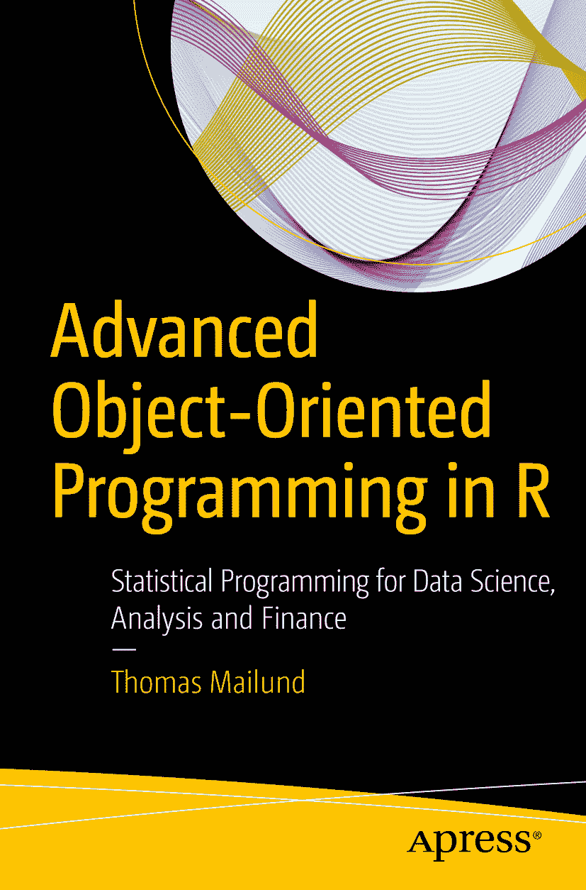

# R 语言中的高级面向对象编程
## 数据科学、分析与金融的统计编程

本书作者引用的任何源代码或其他补充材料，读者均可通过本书的产品页面在 GitHub 上获取，地址为 [`www.apress.com/9781484229187`](http://www.apress.com/9781484229187)。欲了解更多详细信息，请访问 [`http://www.apress.com/source-code`](http://www.apress.com/source-code)。

ISBN 978-1-4842-2918-7
e-ISBN 978-1-4842-2919-4
DOI 10.1007/978-1-4842-2919-4
国会图书馆控制号: 2017945396

© Thomas Mailund 2017

本作品受版权保护。所有权利由出版商保留，无论材料是整体还是部分，具体包括翻译、转载、插图再利用、朗诵、广播、缩微胶片复制或其他任何物理方式的复制，以及信息存储和检索、电子改编、计算机软件，或现在已知或将来开发的类似或不同方法。

本书中可能出现商标名称、徽标和图像。我们没有在每个商标名称、徽标或图像出现时都使用商标符号，而是仅以编辑方式使用这些名称、徽标和图像，且旨在使商标所有者受益，无意侵犯商标权。本出版物中使用的商号、商标、服务标记及类似术语，即使未如此标识，也不应理解为表达其是否受专有权利保护的意见。

尽管本书中的建议和信息在出版时被认为是真实和准确的，但作者、编辑或出版商对于可能存在的任何错误或遗漏不承担任何法律责任。出版商对本材料不作任何明示或暗示的担保。

采用无酸纸印刷

由 Springer Science+Business Media New York（地址：233 Spring Street, 6th Floor, New York, NY 10013）向全球图书贸易发行。电话 1-800-SPRINGER，传真(201) 348-4505，电子邮件 orders-ny@springer-sbm.com，或访问 www.springeronline.com。Apress Media, LLC 是加利福尼亚有限责任公司，其唯一成员（所有者）是 Springer Science + Business Media Finance Inc (SSBM Finance Inc)。SSBM Finance Inc 是特拉华州公司。

