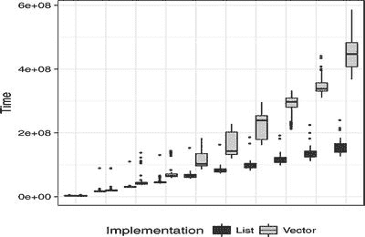

# 1. 类与泛型函数

R 语言实现面向对象编程的方式是通过泛型函数和类。如前所述，R 语言实际上有三种实现此功能的系统，分别称为`S3`、`S4`和`R6`。在本章中，我仅会描述`S3`系统，它是三者中最简单的一种，但我将在后面的章节中回到另外两种系统进行讨论。

## 泛型函数

“泛型函数”这一术语指的是能够用于多种数据类型的函数。由于 R 语言是动态类型语言，这意味着在运行程序之前不会进行类型一致性检查，因此类型检查实际上只取决于你能否按照函数尝试的方式对数据进行操作。这也被称为“鸭子类型”，源自那句谚语“如果它走路像鸭子……”。如果你能对某个数据对象执行所需操作，那么它就具备了正确的类型。泛型函数发挥作用的地方在于，当你希望对不同类型对象执行相同语义的操作，但该操作的实现方式却取决于具体类型时。泛型函数就是能在不同类型对象上以不同方式工作的函数。因此，它们也被称为多态函数。

为了将讨论从抽象层面拉回到更具体的内容，让我们考虑一种抽象数据类型，比如栈。栈是由我们能在其上执行的操作来定义的，例如：

*   获取栈顶元素
*   从栈中弹出第一个元素
*   向栈顶压入一个新元素

为了给栈提供一个基础情形，我们通常还需要一种方法：

*   创建一个空栈
*   检查栈是否为空

这五个操作定义了一个栈是什么，但我们可以用多种不同的方式来实现一个栈。通过我们能在栈上执行的操作来定义栈，这使其成为一种抽象数据类型。要实现一个栈，我们需要一个具体的实现。

在静态类型的编程语言中，我们会通过这五个操作来定义栈的类型。具体如何实现取决于编程语言的类型和具体的语言，但通常，在静态类型的函数式语言中，你会为栈定义一个签名——即这五个操作的函数及其类型；而在面向对象语言中，你则会定义一个抽象的父类。

在 R 语言中，类型是隐式定义的，但对于栈，我们同样需要定义这五个函数。这些函数应该是泛型的，并且实际上不包含任何实现；实现会放入栈的具体实现中。

在定义栈的五个函数中，有一个比较特殊。创建空栈不能作为一个泛型函数。当我们创建一个栈时，总是需要一个具体的实现。但其他四个函数可以定义为泛型函数。定义泛型函数需要使用`UseMethod`函数，这四个函数可以定义如下：

```r
top <- function(stack) UseMethod("top")
pop <- function(stack) UseMethod("pop")
push <- function(stack, element) UseMethod("push")
is_empty <- function(stack) UseMethod("is_empty")
```

`UseMethod`在这里的作用是，在 S3 面向对象编程系统中，将调用分派到不同的具体函数实现。当它被调用时，它会寻找某个函数的具体实现，并用调用泛型函数时的参数来调用它。我们很快会看到这种查找机制是如何工作的。

在定义泛型函数时，你也可以指定“默认”函数。当`UseMethod`找不到具体的实现时，就会调用这些默认函数。这些默认函数在大多数情况下可以提供一个通用的默认行为时特别有用，这样并非所有具体类都需要自己实现。但始终建议实现它们，即使它们唯一的作用是告知你未找到实际实现。例如：

```r
top.default <- function(stack) .NotYetImplemented()
pop.default <- function(stack) .NotYetImplemented()
push.default <- function(stack, element) .NotYetImplemented()
is_empty.default <- function(stack) .NotYetImplemented()
```

## 类

要实现抽象数据类型的具体实现，我们需要使用类。在 S3 系统中，你只需在对象上设置一个属性，即可创建类并将类分配给对象。类的名称就是定义它的全部依据，因此不涉及真正的类型检查。任何对象都可以拥有一个名为`class`的属性，并且任何字符串都可以作为类的名称。

我们可以使用向量来实现一个具体的栈。要定义这个类，我们只需要为它选一个名字。我们可以使用`vector_stack`。我们通过一个创建空栈的函数来创建这样一个栈，并在该函数中使用`class<-`修改函数来设置`class`属性。

```r
empty_vector_stack <- function() {
  stack <- vector("numeric")
  class(stack) <- "vector_stack"
  stack
}
stack <- empty_vector_stack()
stack
## numeric(0)
## attr(,"class")
## [1] "vector_stack"
attributes(stack)
## $class
## [1] "vector_stack"
class(stack)
## [1] "vector_stack"
```

这个空栈是一个数值型向量，这只是因为我们需要为空向量指定某种类型，但向其中压入其他值只会强制进行类型转换，所以我们也可以将其他基本类型放入其中。它仅限于基本数据类型，因为向量不能包含复杂数据；对于复杂数据，我们需要使用列表。如果需要处理复杂数据，我们可以轻松地将实现改为使用列表而不是向量。

我们将元素放在向量的前面来实现压入操作，通过获取除第一个元素之外的所有元素来实现弹出操作，当然，通过索引第一个元素来获取栈顶元素。这样的实现看起来如下：

```r
top.vector_stack <- function(stack) stack[1]
pop.vector_stack <- function(stack) {
  new_stack <- stack[-1]
  class(new_stack) <- "vector_stack"
  new_stack
}
push.vector_stack <- function(element, stack) {
  new_stack <- c(element, stack)
  class(new_stack) <- "vector_stack"
  new_stack
}
is_empty.vector_stack <- function(stack) length(stack) == 0
```

你会注意到这些函数的名称由两部分组成。在`.`（点号）之前是定义栈的泛型函数名，在点号之后是类的名称。这种名称格式具有语义上的意义；泛型函数正是通过它来确定，基于提供给它们的数据应该调用哪个具体函数。

当泛型函数调用`UseMethod`时，该函数会检查调用该泛型函数时的第一个值是否关联了一个类。如果是，它会获取该类的名称，并查看是否能找到一个函数，该函数的名称是点号前的泛型函数名（即传递给`UseMethod`的名称参数，不一定是调用`UseMethod`的函数名）加上点号后的类名。如果能找到，则调用该函数。如果找不到，它会转而查找后缀为`.default`的函数，如果存在则调用该函数。

这种查找机制赋予了函数名称语义意义，因此你确实不应该在函数名中使用点号，除非你希望 R 以这种方式解释名称。R 的内置函数在这方面并不严谨——R 语言历史久远，在函数命名方式上并不十分一致——但如果你不希望意外地实现一个作为泛型函数具体实现的函数，就不应该这样做。

因此，如果我们在一个向量栈上调用`push`，那么被调用的将是`push.vector_stack`而不是`push.default`。

```r
stack <- push(stack, 1)
stack <- push(stack, 2)
stack <- push(stack, 3)
stack
## [1] 1 2 3
## attr(,"class)
## [1] "vector_stack"
```

在`push.vector_stack`中，我们显式地设置了连接后新向量的类。如果我们不这样做，创建的就只是一个普通的向量——`c`函数的第二个参数的“栈属性”不会传递到连接后的向量上——这样我们返回的就不是一个栈了。通过设置新向量的类，我们确保返回的是一个栈。

当我们移除向量的第一个元素时，其类属性不会保留，因此我们也必须在`pop.vector_stack`函数中显式地设置类属性。否则，只有第一次弹出元素时我们才会得到一个栈，之后它就只是一个普通的向量。通过显式设置类属性，我们确保该函数返回一个栈，以便我们可以再次将其用于泛型函数。

```r
while (!is_empty(stack)) {
  stack <- pop(stack)
}
```

剩余的两个函数`top`和`is_empty`不返回栈对象，它们也不应该返回，因此我们不需要在那里设置类属性。

我们可以通过将类创建代码封装到另一个函数中，来避免在每次更新（即返回一个新值时；我们实际上从未在此修改过对象）时都需要显式设置类属性。这样的版本如下所示：

```r
make_vector_stack <- function(elements) {
  structure(elements, class = "vector_stack")
}
empty_vector_stack <- function() {
  make_vector_stack(vector("numeric"))
}
top.vector_stack <- function(stack) stack[1]
pop.vector_stack <- function(stack) {
  make_vector_stack(stack[-1])
}
push.vector_stack <- function(stack, element) {
  make_vector_stack(c(element, stack))
}
is_empty.vector_stack <- function(stack) length(stack) == 0
```

我们当然仍然在创建更新后的栈时设置了类属性，只不过这是隐式完成的——通过使用`make_vector_stack`将向量转换为栈。该函数使用`structure`函数来设置类属性，但除此之外，栈的表示仍与之前一样，是一个向量。

## 多态性的实际应用

使用泛型函数的意义在于，我们可以为抽象操作提供不同的实现。对于栈，我们可以尝试不同的表示方式。向量版本的缺点在于，每次返回一个修改后的栈时，都需要创建一个新向量，这需要从旧向量中复制所有元素。这使得操作的时间复杂度与向量大小成线性关系。而使用链表，我们可以使其成为常数时间操作。这样的实现如下所示：

```r
make_list_node <- function(head, tail) {
  list(head = head, tail = tail)
}
make_list_stack <- function(elements) {
  structure(list(elements = elements), class = "list_stack")
}
empty_list_stack <- function() make_list_stack(NULL)
top.list_stack <- function(stack) stack$elements$head
pop.list_stack <- function(stack) make_list_stack(stack$elements$tail)
push.list_stack <- function(stack, element) {
  make_list_stack(make_list_node(element, stack$elements))
}
is_empty.list_stack <- function(stack) is.null(stack$elements)
stack <- empty_list_stack()
stack <- push(stack, 1)
stack <- push(stack, 2)
stack <- push(stack, 3)
stack
## $elements
## $elements$head
## [1] 3
##
## $elements$tail
## $elements$tail$head
## [1] 2
##
## $elements$tail$tail
## $elements$tail$tail$head
## [1] 1
##
## $elements$tail$tail$tail
## NULL
##
##
##
##
## attr(,"class)
## [1] "list_stack"
```

通常，在使用列表时，我们会使用`NULL`作为终止列表的基础情况。当我们需要为元素关联一个类时，就不能简单地用这种方式包装列表并使用`NULL`。你不能将类设置为`NULL`。因此，我们将实际列表包装在另一个列表中，并在其中设置类属性。真实数据存储在这个列表的`elements`中，但除了需要使用对象的这个列表元素外，我们处理列表的方式与通常处理链表的方式相同。

现在我们有了栈接口的两种不同实现，但——这正是使用泛型函数的意义所在——只要代码仅通过泛型接口访问栈，使用栈的代码就不需要知道它操作的是哪种实现。

我们可以在下面的小函数中看到这一点，该函数通过先将元素全部压入栈，然后再将它们全部弹出，来反转一个序列。

```r
stack_reverse <- function(empty, elements) {
  stack <- empty
  for (element in elements) {
    stack <- push(stack, element)
  }
  result <- vector(class(top(stack)), length(elements))
  for (i in seq_along(result)) {
    result[i] <- top(stack)
    stack <- pop(stack)
  }
  result
}
stack_reverse(empty_vector_stack(), 1:5)
## [1] 5 4 3 2 1
stack_reverse(empty_list_stack(), 1:5)
## [1] 5 4 3 2 1
```

由于`stack_reverse`函数仅通过抽象接口引用具体的栈，我们可以向其传入向量栈或列表栈，它都能执行相同的操作。只要具体的数据结构都正确地实现了抽象接口，那么只使用泛型函数的代码就能在任何实现上工作。

单一的具體实現在所有情况下都很少是最优的，因此，能够将作用于抽象数据类型的算法与具体实现结合起来是有意义的，具体取决于我们需要解决的特定问题。对于这两种栈实现，它们通常都能同样良好地工作，但如上所述，向量实现的最坏情况时间复杂度是二次方，而列表实现是线性时间。因此，对于大型栈，我们预期列表实现是最佳选择；但对于小型栈，以我们的方式操作列表实现会产生更多开销（例如查找变量名和链接列表等操作），所以对于短栈，向量实现更快。

```r
library(microbenchmark)
microbenchmark(stack_reverse(empty_vector_stack(), 1:10),
               stack_reverse(empty_list_stack(), 1:10))
## Unit: microseconds
##                                       expr
##  stack_reverse(empty_vector_stack(), 1:10)
##    stack_reverse(empty_list_stack(), 1:10)
##      min       lq     mean   median       uq
##  195.787 217.2255 245.5698 229.8335 252.4785
##  235.270 257.0180 283.9289 271.5655 289.5300
##       max neval cld
##   965.714   100  a
##  1174.888   100   b
microbenchmark(stack_reverse(empty_vector_stack(), 1:1000),
               stack_reverse(empty_list_stack(), 1:1000))
## Unit: milliseconds
##                                         expr
##  stack_reverse(empty_vector_stack(), 1:1000)
##    stack_reverse(empty_list_stack(), 1:1000)
##       min       lq     mean   median       uq
##  28.22786 32.30359 37.77813 34.25044 36.49355
##  23.38964 24.40046 26.14922 25.47550 26.65488
##        max neval cld
##  124.57810   100   b
##   61.01179   100  a
```

绘制不同栈长度下的时间使用情况更能说明问题：随着栈变长，列表实现相对于向量实现会越来越快。



图 1-1. 使用两种不同栈进行反转的时间消耗

只有当栈非常短时，向量实现才更可取——二次方与线性时间复杂度的差异在 n 非常小时就会体现出来——但通常，不同的使用场景会偏好不同的实现。通过编写多态的代码，我们确保可以在不修改使用算法的代码的情况下，更改数据结构的实现。

## 设计接口

具有多态性的并非只有泛型函数。任何仅通过泛型函数操作数据的函数也都具有多态性。我们之前用栈实现的逆序函数，将空栈作为参数传入，而这个空栈决定了我们具体使用哪种栈的实现。在该函数中，我们从未引用任何真实实现的细节。倘若我们直接在函数内部创建一个空栈，那么即使其他部分都仅通过泛型函数的接口访问实现，该函数也会被绑定到单一实现上。

要想充分利用多态性，你需要尽可能将函数设计成具有多态性。这需要满足两个条件：

1.  除非万不得已，否则不要引用具体实现。
2.  任何时候必须引用具体类型的实现细节时，都要通过泛型函数来进行。

逆序函数具有多态性，因为它没有引用任何具体实现。具体使用哪种栈由参数决定，而它对特定栈执行的操作都通过泛型函数完成。

在编程热情高涨时，人们很容易破坏这些规则。在算法中使用参数来确定数据结构并不难，但如果你正在编写的算法使用了多种不同的数据结构，你可能不想把所有不同的具体实现都作为参数。不过，你确实应该这么做。只需编写一个包装该算法并提供具体实现的函数即可——如果你不想记住算法所需的所有具体数据结构的话。这样你就能两全其美。

更常见的情况是，你想访问具体实现的细节。例如，假设你想弹出元素直到看到某个特定元素，但前提是该元素必须在栈中。如果我们习惯于使用基于向量的栈实现，那么很自然地会写出这样的函数：

```R
pop_until <- function(stack, element) {
  if (!(element %in% stack)) return(stack)
  s <- stack
  while (top(s) != element) s <- pop(s)
  s
}
```

（既然我们要编写一个实用函数，不如就用 `magrittr` 管道的风格来写吧。）

```R
pop_until(vector_stack() %>%
  push(1) %>%
  push(2) %>%
  push(3) %T>% print,
  1)
## [1] 3 2 1
## attr(,"class")
## [1] "vector_stack"
## [1] 1
## attr(,"class")
## [1] "vector_stack"
pop_until(vector_stack(), 5)
## [1] 3 2 1
## attr(,"class")
## [1] "vector_stack"
```

这里我们使用 `%in%` 函数来测试元素是否在栈中（同时使用 `magrittr` 管道操作符来创建测试用的栈）。只要栈是向量栈，这段代码就能正常工作；但如果栈是基于列表实现的，它就会失效。你不会收到错误信息；`%in%` 测试将始终返回 `FALSE`，因此如果你替换了栈的实现，就会得到不正确的代码，而它甚至不会提醒你它无法工作。

依赖实现细节是破坏多态对象接口最糟糕的做法。这不仅会将你绑定到单一实现上，还会让你完全依赖于该具体数据的具体实现方式。如果该实现发生了变化，使用它的算法就会出问题。于是，你既不能更改实现，又不得不在实现变更时修改使用它的算法。运气好的话，如果你破坏了接口，可能会收到错误消息；但就像我们刚看到的情况（如果你不信，可以自己试试），你甚至可能连错误消息都得不到。该函数只会始终返回原始栈，即使你想要弹出的元素就在栈中。

```R
list_stack <- list_stack() %>%
  push(1) %>%
  push(2) %>%
  push(3)
pop_until(list_stack, 1)
```

如果你编写的算法要操作多态对象，请尽可能遵循它所提供的接口。对于 `pop_until` 函数，我们完全可以仅使用栈接口来轻松实现。

```R
pop_until <- function(stack, element) {
  s <- stack
  while (!is_empty(s) && top(s) != element) s <- pop(s)
  if (is_empty(s)) stack else s
}
```

如果使用现有接口无法满足需求，你应该考虑对其进行扩展。你随时都可以编写适用于某个类的新泛型函数。

```R
contains <- function(stack, element) {
  UseMethod("contains")
}
contains.default <- function(stack, element) {
  .NotYetImplemented()
}
contains.vector_stack <- function(stack, element) {
  element %in% stack
}
```

你无需为抽象数据类型的所有实现都编写具体函数来添加泛型函数。如果你有一个会报错的默认实现，并且你对自己使用的任何代码都编写了适当的单元测试，那么当你的算法试图使用尚未实现的函数时，你将收到错误提示，届时再补充实现即可。

如果抽象数据类型来自其他包，添加新的泛型函数并不像一开始就使用原始接口那么理想。如果该包中的实现在后续发生了变化，你新增的泛型函数可能会出错——并且可能是无声无息地出错。不过，结合适当的单元测试，这仍然比在其他函数中直接访问具体实现细节要好得多。

设计接口是一门艺术。在创建自己的抽象类型时，你需要仔细思考该类型应该具备哪些操作。操作数量不宜过多，否则会增加他人实现该类型其他版本的工作量；他们需要实现所有操作，而具体取决于这些操作是什么，这可能会涉及大量工作。另一方面，操作数量也不能太少，否则使用该类型的算法常常不得不破坏接口来获取实现细节，从而破坏这些算法的多态性。

你在算法课程中学到的抽象数据类型，就是最小化且功能强大的接口的绝佳范例。它们定义了完成有用工作所需的最少操作数量，同时仍能以最少的工作量实现具体的栈、队列、字典等。

在设计你自己的类型时，请努力达成这种最小化接口的境界。

## 多态性的实用性

多态性不仅对传统意义上的抽象数据结构有用。多态性让你能够实现抽象数据结构，从而使算法可以在抽象接口上运行，永远无需知道它们操作的是哪个具体实现。但泛型函数在许多我们通常不认为是数据结构的场景中也同样有用。

在 `R` 语言中，你经常会将统计模型拟合到数据上。这些模型不完全是数据结构，但它们拥有一个抽象接口。你拟合一个具体的模型，例如线性模型，但一旦你有了一个拟合好的模型，就会有许多对所有模型都有用的通用操作。你可能想对新数据预测响应变量，或者想获取拟合值的残差。这些操作对所有模型来说都是一样的——尽管不同模型实现这些操作的方式会不同——因此它们可以从泛型化中获益。事实上，它们正是如此。实现这两个操作的函数 `predict` 和 `residuals` 就是泛型函数，每个模型都可以实现自己的版本。

有一长串常用于拟合模型的标准函数，所有这些函数都是作为泛型函数实现的。如果你编写的分析代码仅使用这些泛型函数来操作拟合模型，那么你可以在任何时候更改模型，并复用所有代码而无需修改。

打印和绘图函数也是如此。`print` 和 `plot` 都是泛型函数，它们针对不同的数据类型（通常也针对不同的拟合模型）都有具体的实现。平日里我们可能不会过多思考这一点，但如果没有像这样的泛型函数，例如，我们就需要使用不同的函数来显示向量和显示矩阵。

在不同数据类型之间进行转换也是一种常见操作，而多态性在此再次显示出极大的实用性（且在 `R` 中经常使用）。要将一种数据结构转换为向量，你会使用 `as.vector` 函数——这个名字不太理想，因为它看起来像是一个专门针对 `vector` 的泛型函数 `as`，但实际上它是一个名为 `as.vector` 的泛型函数。要将一个因子转换为向量，实际调用的是具体实现 `as.vector.factor`。

一个需要将某些输入数据转换为向量的算法可以使用 `as.vector` 函数，这样只要数据类型实现了 `as.vector` 函数，该算法就无需关心实际数据是如何实现的。

### 多态性与算法编程

将多态性作为设计算法（尤其是实现算法）的一个组成部分，在课堂和教科书中并不常见，但它可能是编写可复用软件的一个重要方面。你可能不认为 `R` 是一种用来实现算法的语言，但每当你编写数据分析流程、操作数据框或拟合模型时，你都可以将其视为实现或使用算法。我们希望数据分析高效，因此也希望算法高效，但我们还想编写能够多次使用的代码，以避免重复造轮子。这意味着我们需要编写能够用于不同数据的代码，而在许多情况下，这涉及到将具体数据隐藏在泛型接口之后。

就拿一个简单的排序函数来说。对于许多排序算法，要对元素进行排序，你所需要做的仅仅是确定一个元素是否小于另一个元素。如果你在实现这类算法时硬编码了比较操作（例如使用整数比较或浮点数比较），那么你只能对这些类型的对象进行排序。一般来说，如果你硬编码了比较操作，那么你需要为每种要排序的元素类型提供不同的实现。

正因如此，大多数语言都会在其运行库中提供一个泛型排序函数，你可以提供它应该使用的比较功能，通常要么是通过向该函数传递一个比较函数，要么是通过允许你为新的类型指定一个比较函数。不幸的是，`R` 中的 `sort` 函数并非此类——它确实允许你为新的类型定义排序，但它要求输入数据为原子形式，因此你不能向其提供复杂数据类型的序列——仅限于简单的数值、布尔或字符串类型。通常，你可以将数据转换为矩阵或类似形式，然后通过这种方式进行排序，但如果你实际上有一个复杂数据的列表，则无法使用该函数。

不过，我们可以轻松地自己实现一个函数来完成这个任务，我们可以称其为 `sort_list`——不要与内置函数 `sort.list` 混淆，后者实际上做的并不是对列表排序……

### 排序列表

归并排序的直接实现可能如下所示：

```R
merge_lists <- function(x, y) {
  if (length(x) == 0) return(y)
  if (length(y) == 0) return(x)
  if (x[[1]] < y[[1]]) {
    c(x[1], merge_lists(x[-1], y))
  } else {
    c(y[1], merge_lists(x, y[-1]))
  }
}
sort_list <- function(x) {
  if (length(x) <= 1) return(x)
  start <- 1
  end <- length(x)
  middle <- end %/% 2
  merge_lists(sort_list(x[start:middle]),
              sort_list(x[(middle+1):end]))
}
```

这个实现虽然能完成功能，但归并函数的运行时间是二次的，因为它像 `x[-1]` 和 `y[-1]` 那样通过下标取值时会复制列表，并且在递归调用中组合结果时也会复制。我们可以编写一个稍微复杂一点的函数，使用迭代方法而非递归，在线性时间内完成归并：

```R
merge_lists <- function(x, y) {
  n <- length(x) + length(y)
  result <- vector("list", length = n)
  i <- 1
  j <- 1
  for (k in 1:n) {
    if (i <= length(x) && (j > length(y) || x[[i]] < y[[j]])) {
      result[[k]] <- x[[i]]
      i <- i + 1
    } else {
      result[[k]] <- y[[j]]
      j <- j + 1
    }
  }
  result
}
sort_list <- function(x) {
  if (length(x) <= 1) return(x)
  start <- 1
  end <- length(x)
  middle <- end %/% 2
  merge_lists(sort_list(x[start:middle]),
              sort_list(x[(middle+1):end]))
}
```

在排序函数的递归调用中我们仍然会复制，但复制量不会超过后续要归并的量，因此至少渐近运行时间是可接受的。

使用此函数，我们可以对元素之间能用 `"<"` 判断大小的列表进行排序。不过，内置的 `"<"` 函数不一定适用于你自定义的类。

```R
make_tuple <- function(x, y) {
  structure(c(x, y), class = "tuple")
}
x <- list(make_tuple(1,2), make_tuple(2,0), make_tuple(1,1))
sort_list(x)
## Warning in if (x[[i]] < y[[j]]) {: the condition has length > 1 and only the first element will be used
## Warning in if (x[[i]] < y[[j]]) {: the condition has length > 1 and only the first element will be used
## Warning in if (x[[i]] < y[[j]]) {: the condition has length > 1 and only the first element will be used
## [[1]]
## [1] 1 1
## attr(,"class")
## [1] "tuple"
##
## [[2]]
## [1] 1 2
## attr(,"class")
## [1] "tuple"
##
## [[3]]
## [1] 2 0
## attr(,"class")
## [1] "tuple"
```

有几种方法可以解决这个问题。一种选择是定义一个通用的比较函数：我们可以称它为 `less`，然后在归并函数中使用它。

```R
merge_lists <- function(x, y) {
  n <- length(x) + length(y)
  result <- vector("list", length = n)
  i <- 1
  j <- 1
  for (k in 1:n) {
    if (i <= length(x) && (j > length(y) || less(x[[i]], y[[j]]))) {
      result[[k]] <- x[[i]]
      i <- i + 1
    } else {
      result[[k]] <- y[[j]]
      j <- j + 1
    }
  }
  result
}
less <- function(x, y) UseMethod("less")
less.numeric <- function(x, y) x < y
less.tuple <- function(x, y) x[1] < y[1] || x[2] < y[2]
sort_list(x)
## [[1]]
## [1] 1 1
## attr(,"class")
## [1] "tuple"
##
## [[2]]
## [1] 1 2
## attr(,"class")
## [1] "tuple"
##
## [[3]]
## [1] 2 0
## attr(,"class")
## [1] "tuple"
```

不过，我们需要为所有希望排序的类型定义 `less` 的具体实现。另一种方式是可以告诉 `R` 如何处理我们自定义类型的 `"<"` 操作符，我们将在后面的章节中了解如何实现。采用这种方法，所有可以通过这种方式比较的对象都能获得排序功能。第三种可能性是将 `less` 作为排序函数的一个参数：

```R
merge_lists <- function(x, y, less) {
  # 函数体与之前相同
}
sort_list <- function(x, less = `<`) {
  if (length(x) <= 1) return(x)
  result <- vector("list", length = length(x))
  start <- 1
  end <- length(x)
  middle <- end %/% 2
  merge_lists(sort_list(x[start:middle], less),
              sort_list(x[(middle+1):end], less),
              less)
}
unlist(sort_list(as.list(sample(1:5))))
## [1] 1 2 3 4 5
tuple_less <- function(x, y) x[1] < y[1] || x[2] < y[2]
sort_list(x, tuple_less)
## [[1]]
## [1] 1 1
## attr(,"class")
## [1] "tuple"
##
## [[2]]
## [1] 1 2
## attr(,"class")
## [1] "tuple"
##
## [[3]]
## [1] 2 0
## attr(,"class")
## [1] "tuple"
```

我们将默认的 `less` 函数设置为 `"<"`，但对于这种比较函数不适用的类型，我们可以提供其他函数。

### 关于算法实现的灵活性的通用评论

一般来说，你希望算法实现能够通过提供多态性的接口来适应变化，无论是为特定函数提供选项（如上面我们对 `less` 所做的），还是为抽象数据类型使用通用函数。

在为特定用途实现算法时，你可能能够尝试最优的数据结构和操作实现，但通过提供修改函数的接口，你可以使代码更具可复用性。即使在算法对不同应用都能正确执行的情况下，你仍然可能希望提供灵活性；算法的性能通常取决于具体使用场景。在渐近分析中，我们通常偏好理论上运行时间更优的实现，但在实践中，我们希望代码运行最快，而这并不一定是渐近最快的算法。使用“大 O”分析时，我们忽略了常数，但这些常数很重要，因此你希望你的实现的用户能够替换算法实现中使用的数据结构和操作。

要弄清楚如何在实现中最佳地提供这种灵活性，通常需要一些实践。对于抽象数据结构，通用函数通常是最好的方法。对于上面排序示例中的比较功能，三种解决方法（通用函数、操作符重载或提供带有良好默认值的函数）可能同样有效。但就像设计良好的软件界面需要进行实验和思考一样，算法编程也需要如此。

### 关于`UseMethod`的更多内容

`UseMethod`函数是我们用来定义通用函数的工具，它通过我们之前看到的名称查找机制，负责找到合适的具体实现。不过，我之前遗漏了一些关于`UseMethod`的细节。

首先，它实际上并不像一个普通函数那样工作。它看起来像一个函数，并且在很大程度上确实是一个函数，但如果你仅仅把它当作其他函数来对待，可能会得到意想不到的效果。

其次，如果你在调用`UseMethod`之前对局部变量进行了赋值，你可以将这些局部变量传递到具体实现中。让我们看一个简单的例子。

```r
foo <- function(object) UseMethod("foo")
foo.numeric <- function(object) object
foo(4)
## [1] 4
bar <- function(object) {
x <- 2
UseMethod("bar")
}
bar.numeric <- function(object) x + object
bar(4)
## [1] 6
```

这里的`foo`函数使用了我们之前看到的模式。它只是调用了`UseMethod`。然后我们定义了一个具体函数，当`foo`被应用于数字时调用。数字具有类，这个类是`numeric`。（严格来说，数字除了这个类还有更多属性，但目前我们无需担心。）`foo`的行为并无异常。

然而，对于`bar`，我们在调用`UseMethod`之前赋值了一个局部变量。这个变量`x`在`bar.numeric`被调用时是可见的。在普通函数调用中，你需要采取措施才能访问调用作用域，因此这里的`UseMethod`的行为不像普通函数。

在对`UseMethod`的调用中，它的行为也不同于普通函数。你不能将`UseMethod`用作表达式的一部分。

```r
baz <- function(object) UseMethod("baz") + 2
baz.numeric <- function(object) object
baz(4)
## [1] 4
```

当`UseMethod`被调用时，具体函数会完全接管控制权，而对`UseMethod`的调用永远不会返回。在这方面，它与`return`函数类似。因此，任何包含`UseMethod`的表达式都不会被求值，而在`UseMethod`调用之后放置的任何代码也永远不会被执行。

`UseMethod`函数除了通用函数的名称外，还接受第二个参数。这个参数是用于分发通用函数的对象——即其类型决定了要调用的具体函数的对象。如果你不想基于调用`UseMethod`的函数的第一个参数进行分发，可以使用这个参数。由于基于第一个函数参数的类型进行分发是非常常见的模式，在调用`UseMethod`时使用另一个对象可能会引起混淆，我建议除非你有非常充分的理由，否则不要这样做。