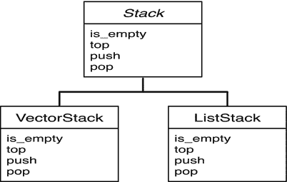
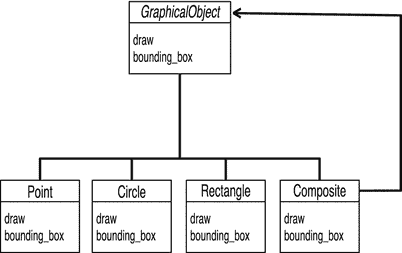
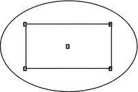
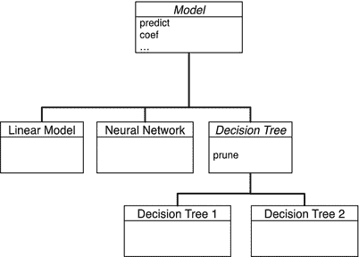
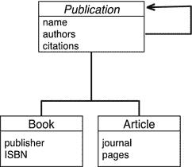

# 2. 类层次结构

多态性不仅仅体现在抽象数据类型可以有不同的具体实现上。大多数面向对象编程语言中的一个基本概念是类和类层次结构。类层次结构服务于两个概念上不同的目的：优化对象接口和代码复用。严格来说，这两个概念在 R 中都不需要类层次结构，因为 R 是动态类型语言，不像 C++ 或 Java 等编程语言那样，类层次结构与静态类型系统交织在一起。尽管如此，类层次结构为思考软件设计提供了一个极其有用的框架，在动态类型语言中尤其如此。

我们将在接下来的两节中详细讨论这两个概念，但简而言之，接口描述了某个类的对象必须实现哪些（泛型）函数，而层次结构则基于这些函数，以“更抽象/更优化”的关系将接口链接在一起。在此上下文中，代码复用仅指编写能够操作多种类对象的函数——本质上就是我们在前一章中看到的多态函数类型——并将此类函数作为泛型函数本身融入类层次结构中。

## 接口与实现

我们可以将类的接口视为可以应用于该类对象的一系列操作或方法。在 R 中，这意味着我们可以用这些对象作为参数，以有意义的方式调用哪些函数。

如果我们从抽象数据结构（例如上一章中的栈）的角度来思考，这些数据结构是由它们所支持的操作来定义的。你可以对栈进行压入（`push`）和弹出（`pop`）操作，检查它是否为空，并且可以获取顶部元素；这些函数，连同创建栈的方式，共同定义了什么是“栈性”。至少，只要这四个函数也具有我们与栈相关联的语义，便是如此。

在抽象层面上，我们可以通过形式参数和语义来描述一个函数的接口。例如，我们可以将函数 `push` 与其两个形式参数（一个栈和一个元素）以及这样的语义关联起来：它应该返回栈，但顶部已添加了该元素。如果我们将 `push` 操作与这两个属性（形式参数和语义）关联起来，我们就得到了一个所谓的抽象函数。正如我们所看到的，我们可以用不同的具体方式来实现这些抽象函数，但调用这些具体函数的人只需关心抽象描述即可确保功能正确性（尽管性能当然也可能是一个考虑因素，但这里我们并未将其与抽象函数的接口相关联）。

有了这个抽象函数的定义，我们可以说一个抽象数据类型是由一组抽象函数定义的。如果我们将一组抽象函数称为一个接口，那么抽象数据类型就是由一个接口定义的。我们可以通过编写接口中所有抽象函数的实现来实现一个抽象数据结构。这可以称为该接口的一个（具体）实现，或类似的说法。仅通过了解抽象数据类型的接口，我们就可以推理算法和设计软件；如果我们有不同的接口实现可供选择，那么理论上任何实现都可以使用。

像接口和实现这样的概念不仅在抽象数据结构方面有用。对于程序中你想要操作的任何类型的数据，你都可以构思出一组可以对该数据执行的有意义的操作，从而为该数据类型创建一个接口，并且你可以为这些操作编写不同的函数，以创建不同的实现。

### 多态性与接口

如果我们回到接口的思考上，可以说如果一个类实现了构成接口的所有抽象函数，那么该类就实现了一个接口。这仅仅意味着，如果我们取这个类的对象，我们就有具体的函数可以为接口中的每个抽象函数调用。然而，如果没有泛型/多态函数，对于实现给定接口的每个类，我们需要知道哪个具体函数映射到哪个抽象函数。将一个接口的实现替换为另一个实现，将需要重写使用该实现的代码。因此，自然而然，我们也会要求具体函数的名称与抽象函数的名称相匹配。

这显然直接对应到泛型函数。如果我们每当想到抽象函数时，就将其映射到一个泛型函数——一个仅调用 `UseMethod` 的函数——并且每当我们想到具体函数时，就将其视为泛型函数的实现——一个名称中带有句点的函数——那么我们就拥有了一种近乎自动的方法，可以将接口和实现的概念映射到代码中。

由于 R 不进行任何静态类型检查，你几乎无法保证以这种方式编写的类确实实现了一个给定的接口。泛型函数中没有任何东西明确地将它们绑定为一个接口，因此对于你决定实现的任何类，你都可以实现任意子集的泛型函数。接口和实现是设计概念，你可以很容易地将设计映射到 R 代码中，但 R 并不强制要求你的代码与你的设计相匹配。

### 抽象类与具体类

在设计软件时，我们通常将接口和实现统称为类。面向对象的软件思维方式是：你操纵的每一段数据都是一个对象，所有对象都有一个决定其行为的类。这里所说的“行为”，指的是我们可以在对象上调用哪些函数。这种思维方式在可以修改数据且对象因此拥有状态的语言中更有意义。无论如何，你可以将所有数据视为对象，它们拥有相关联的类，这些类决定了你能对它们执行哪些操作。

因此，一个类既封装了你能对对象做什么（即你拥有的接口），也封装了如何做到（即接口是如何实现的）。

对象拥有类，类决定了你能对对象做什么，但类存在于由更抽象或更衍生的类组成的层级结构中。一个基于向量的栈实现是一个栈。它当然是一种特殊的栈，但它仍然是栈。“栈”这个通用概念比基于向量的实现更抽象，因此可以将向量实现视为栈的一种特化——即一种使用向量实现的栈。

我们通常将类层级关系理解为“是一个（is-a）”关系。栈的向量实现“是一个”栈。基于列表的实现也是如此。如果你有一个更专业类的对象，你也应该能够将其视为一个更抽象类的对象。如果你有一个向量栈，你可以将其视为一个栈，因为它的类是向量栈类，而该类是栈类的一个特例。

最接近接口和实现概念的就是抽象类和具体类。抽象类本质上就是一个接口。它不过是对你可以用此类的对象执行哪些操作的描述；它没有任何关联的实现。另一方面，具体类则为你可以在给定类的对象上调用的所有函数提供了实现。不过，很多时候，类只实现了其接口描述的部分函数，而非全部，因此在实际操作中，这种区分并不那么清晰。

我们常常用类似图 2-1 所示的图表来展示类及其关系。这里，`Stack` 以斜体显示，表示它是一个抽象类。类名下方列出了你可以在该类上调用的方法，而从一个类指向另一个类的箭头表示一个类派生自另一个类。在这里我们看到，向量栈和列表栈（此处称为 `VectorStack` 和 `ListStack`）都派生自 `Stack`。



图 2-1. 栈的类层级结构

这两个具体类只实现了抽象类中列出的方法，因此，我们不会总是在派生类中再次列出这些方法。需要理解的是，任何在更抽象类中实现的方法，在更衍生的类中也会被实现。

### 在 R 中实现抽象类与具体类

在上一章中，我们已经看到了如何使用属性 `class` 来决定为给定对象调用泛型函数的哪个版本。这种调度泛型函数的方式是 S3 系统实现类的方法，但从某种意义上说，它只处理了抽象函数的具体实现。有一个泛型方法 `foo`：

```
foo <- function(object) UseMethod("foo")
```

我们为类 `bar` 实现了它：

```
foo.bar <- function(object) ...
```

这仅仅告诉了 R 语言，类 `bar` 是如何实现 `foo` 函数的。如果 `foo` 是一个由多个函数组成的接口的一部分，那么在 R 代码中并没有明确声明这一点。

如果我们把接口看作一组抽象函数，那么在 R 中，将这些函数视为一个整体只是我们非正式地做的事情。由于抽象类本质上就是接口，我们可以对抽象类做同样的事。在上一章中，当我们实现基于向量的栈时，我们通过将构造函数 `empty_vector_stack` 返回的对象的 `class` 属性设置为 `vector_stack`，并实现了我们认为属于栈接口的四个函数：`push`、`pop`、`top` 和 `is_empty`。在整个过程中，我们从未指明存在某个抽象的栈类，并且 `vector_stack` 是它的一个特化。

由于以这种方式实现的类机制本质上是在单个函数级别上运作的——我们有泛型函数以及根据函数名称进行调度的实现——因此，类及其关系在 R 中可能会变得非常混乱。你可以通过以比语言要求更结构化的方式来思考你的软件设计，从而缓解这一问题。在设计软件时始终牢记类的概念，通过定义一组泛型函数来实现抽象类——你可以使用注释将它们分组并记录这些函数构成了一个接口。确保在定义实现某个接口的具体类时，没有忘记接口中的任何一个函数。你可能不会实现所有函数；有时有充分的理由不去实现，有时只是出于实用主义，没有实现那些可能难以实现但目前还不需要的功能。不过，请确保这是一个有意识的选择，而不是你单纯忘记了某个函数。

你可以使用函数 `methods` 来获取某个类实现的所有方法的列表：

```
methods(class = "vector_stack")
## [1] is_empty pop      push     top
## see '?methods' for accessing help and source code
```

并检查你是否实现了所有功能。你也可以使用此函数来获取所有实现了某个特定泛型函数的类的列表：

```
methods("top")
## [1] top.default      top.list_stack
## [3] top.vector_stack
## see '?methods' for accessing help and source code
```

### 另一个示例：图形对象

类层次结构所依赖的“is-a”关系，比仅仅拥有抽象类及其实现要灵活得多。它为我们提供了一种建模方式，来表现某些对象确实属于不同但相关的类，同时也提供了一种机制，让我们可以将接口视为其他接口的特化。

例如，考虑一个应用程序，我们在其中操作一些图形对象——也许是作为某个新可视化包的一部分。这个应用程序中最基础的类是 `GraphicalObject`，它的对象可以被 `draw`（绘制）。能够绘制对象是我们处理图形对象所需的最基本操作。图形对象还有一个“边界框”（bounding box）——一个能够告诉我们图形大小的矩形，这在绘制对象时可能是必需的。

这个类是抽象的，不仅是因为我们正在定义一个接口以便拥有不同的实现（就像我们处理栈那样），更是因为在如此抽象的层级上拥有一个图形接口并没有实际意义。一个具体到确实可以拥有其实例对象的类是 `Point`（点），它代表单个点的图形对象。其他类可以是 `Circle`（圆）和 `Rectangle`（矩形）。

为了便于处理多个图形对象，我们还在接口中提供了一个类 `Composite`（组合），用于捕获一组图形对象。



图 2-2. 图形对象的类层次结构。从 `Composite` 指向 `GraphicalObject` 的箭头（起点为菱形，终点为箭头）表示 `Composite` 由一组 `GraphicalObject` 组成。

将一个对象集合视为与其组件同类的对象，是一种所谓的**设计模式**（design pattern），它使得在此应用程序中处理复杂图形变得更加容易。我们可以将图形对象分组到一个层次结构中——类似于在绘图工具中对对象进行分组——并且我们无需在代码中显式检查当前操作的是单个对象还是一个对象集合。一个对象集合本身也是一个图形对象，我们可以直接将其当作图形对象来处理。

实现这个类层次结构相当直接。抽象类 `GraphicalObject` 并没有显式表示，但我们需要将其方法作为泛型函数来使用。

```
draw <- function(object) UseMethod("draw")
bounding_box <- function(object) UseMethod("bounding_box")
```

在构造图形对象时，我们需要设置它们的类，以下是具体类的构造函数：

```
point <- function(x, y) {
  object <- c(x, y)
  class(object) <- "point"
  names(object) <- c("x", "y")
  object
}
rectangle <- function(x1, y1, x2, y2) {
  object <- c(x1, y1, x2, y2)
  class(object) <- "rectangle"
  names(object) <- c("x1", "y1", "x2", "y2")
  object
}
circle <- function(x, y, r) {
  object <- c(x, y, r)
  class(object) <- "circle"
  names(object) <- c("x", "y", "r")
  object
}
composite <- function(...) {
  object <- list(...)
  class(object) <- "composite"
  object
}
```

我们将图形对象实现为向量，除了组合对象用列表表示，以便它能包含不同类型的其他图形对象。点只是坐标向量，矩形由两个坐标（左下角和右上角）表示，圆则由中心点和半径表示。

对于 `draw` 方法，我们可以直接使用基本的图形函数：

```
draw.point <- function(object) {
  points(object["x"], object["y"])
}
draw.rectangle <- function(object) {
  rect(object["x1"], object["y1"], object["x2"], object["y2"])
}
draw.circle <- function(object) {
  plotrix::draw.circle(object["x"], object["y"], object["r"])
}
draw.composite <- function(object) {
  invisible(Map(draw, object))
}
```

除了圆（为了方便，我们使用了 `plotrix` 包中的 `draw.circle` 函数），我们可以使用基本的图形函数。对于集合类，我们只需对集合中的所有组件调用 `draw`。我们将对 `Map` 的调用包装在 `invisible` 中，是因为我们不希望在命令行调用该函数时每次都打印出一个对象列表，否则实现是直接的。

利用这些函数，我们可以构建图形元素的绘图，见图 2-3。



图 2-3. 图形元素绘图

```
plot(c(0, 10), c(0, 10),
     type = 'n', axes = FALSE, xlab = '', ylab = '')
draw(point(5,5))
draw(rectangle(2.5, 2.5, 7.5, 7.5))
draw(circle(5, 5, 4))
corners <- composite(point(2.5, 2.5), point(2.5, 7.5),
                     point(7.5, 2.5), point(7.5, 7.5))
draw(corners)
```

这里我们必须设置绘图区域的大小，使其能真正包含我们想要显示的元素。我们有 `bounding_box` 函数用于计算该区域，并且可以像这样实现不同的方法：

```
bounding_box.point <- function(object) {
  c(object["x"], object["y"], object["x"], object["y"])
}
bounding_box.rectangle <- function(object) {
  c(object["x1"], object["y1"], object["x2"], object["y2"])
}
bounding_box.circle <- function(object) {
  c(object["x"] - object["r"], object["y"] - object["r"],
    object["x"] + object["r"], object["y"] + object["r"])
}
bounding_box.composite <- function(object) {
  if (length(object) == 0) return(c(NA, NA, NA, NA))
  bb <- bounding_box(object[[1]])
  x1 <- bb[1]
  y1 <- bb[2]
  x2 <- bb[3]
  y2 <- bb[4]
  for (element in object) {
    bb <- bounding_box(element)
    x1 <- min(x1, bb[1])
    y1 <- min(y1, bb[2])
    x2 <- max(x2, bb[3])
    y2 <- max(y2, bb[4])
  }
  c(x1, y1, x2, y2)
}
```

有了它，我们可以将所有希望绘制的图形元素收集到一个组合对象中，并在绘制前计算边界框。

```
all <- composite(
  point(5,5),
  rectangle(2.5, 2.5, 7.5, 7.5),
  circle(5, 5, 4),
  composite(point(2.5, 2.5), point(2.5, 7.5),
            point(7.5, 2.5), point(7.5, 7.5))
)
bb <- bounding_box(all)
plot(c(bb[1], bb[3]), c(bb[2], bb[4]),
     type = 'n', axes = FALSE, xlab = '', ylab = '')
draw(all)
```

当然，结果与图 2-3 所示完全相同。

## 作为带有细化功能的接口的类层次结构

在之前的示例中，我们有一个抽象类定义了接口，然后由不同的具体类来实现它。以栈为例，不同的实现为我们提供了不同的时间复杂度权衡，但不同的实现概念上都是栈。对于图形对象而言，各种具体类在概念上是不同的对象，只是这些对象都可以被视为图形对象，从而通过通用接口进行操作。这些是软件设计中常见的模式，但当子类（例如不同类型的图形对象）代表不同的概念类时，它们通常也可以扩展接口。

以统计模型为例。这些模型通常被实现为某些通用函数（例如 `predict` 或 `coef`）的类，这些函数为我们提供了统一的模型接口，使得我们能够在分析中切换不同模型，而无需对分析代码进行重大重写。所有模型实现的通用函数为最抽象的模型类型提供了一个接口。例如，所有模型都必须实现 `predict` 和 `coef`，这样我们才能在分析代码中将它们作为即插即用的替代品使用。但不同类型的模型可能会在接口中添加并非所有模型都相关的额外功能。例如，我们可以设想决策树增加了修剪树的功能，比如一个 `prune` 函数。如果所有决策树实现都有一个 `prune` 函数，我们就可以替换决策树的实现并仍然复用我们的代码，但由于并非所有模型都实现了 `prune`，我们只能将一个决策树实现替换为另一个决策树，而不能替换为任意类型的模型。我们可以说决策树是模型的特化形式。所有决策树都是模型，但并非所有模型都是决策树。在类的层面上，我们会有一个模型的超类，以及一个决策树的子类，它向模型接口中添加了诸如 `prune` 之类的函数。如果我们有不同的决策树实现，那么决策树类通常也是抽象的，不同的实现将继承自这个类，而不是更通用的模型类（参见图 2-4）。



**图 2-4.** 模型层次结构，其中决策树是 `Model` 类的特化形式，该类添加了 `prune` 函数，并为我们提供了一个额外的抽象类，决策树的实例必须实现该类

作为另一个例子，我们可以考虑一个参考文献列表，它本质上是一系列出版物的列表。存在不同类型的出版物，但所有出版物至少都有一个名称和一位或多位作者，因此表示出版物的最抽象方式只需包含这两个属性。对一系列出版物，我们可能想做的其中一件事是计算文献计量指标，例如每篇出版物的引用次数。如果每篇出版物都有一个其所引用的其他作品的列表，那么我们可以从所有相关出版物的数据库中计算出这个引用次数。如果我们有一位给定作者的所有出版物的列表，我们还可以计算出该作者获得的引用次数，或推导出诸如 h 指数之类的统计数据。

存在不同类型的出版物，因此我们可以为书籍和文章等创建子类。书籍会有一个关联的出版商和一个 ISBN，而期刊文章会有一个关联的期刊以及（通常）文章在期刊中所在的页码。为简单起见，如果我们只允许这两种类型的出版物，我们可以将其表示为图 2-5 所示的类层次结构。



**图 2-5.** 参考文献对象的层次结构。通用的 `Publication` 类为每篇出版物赋予一个名称、一个作者列表以及一个其他出版物引用列表。两种具体类型的出版物，`Article` 和 `Book`，则添加了额外的属性。

在这个层次结构中，所有函数都只是访问对象的属性；也就是说，它们只是提取存储在这些对象中的数据。通过函数访问属性，而不是访问作为对象表示一部分的列表或向量，通常是一个好主意。它允许你更改数据的表示方式，而无需修改访问函数之外的任何代码。如果你的代码仅通过函数访问对象，那么你就封装了实现细节，以后更新代码将比不这样做简单得多。

还要注意，在这两种具体类型的出版物之间，没有任何访问函数需要有所不同。抽象类 `Publication` 访问 `name` 和 `authors`，而其他类中提供的附加属性是不相交的。正因如此，没有必要为实现此类层次结构而使用通用函数。我们可以仅使用普通的旧式函数来实现它。

```
## 出版物接口
publication <- function(name, authors, citations) {
structure(list(name = name, authors = authors,
citations = citations),
class = "publication")
}
name <- function(pub) pub$name
authors <- function(pub) pub$authors
## 文章
article <- function(name, authors, citations, journal, pages) {
structure(list(name = name, authors = authors,
citations = citations,
journal = journal, pages = pages),
class = c("article", "publication"))
}
journal <- function(pub) pub$journal
pages <- function(pub) pub$pages
## 书籍
book <- function(name, authors, citations, publisher, ISBN) {
structure(list(name = name, authors = authors,
citations = citations,
publisher = publisher, ISBN = ISBN),
class = c("book", "publication"))
}
publisher <- function(pub) pub$publisher
ISBN <- function(pub) pub$ISBN
```

通用函数非常适合在相同概念操作下为不同类提供不同行为，但当我们能使用普通旧式函数获得所需操作时，就没有必要调用通用函数了。

出版物的实现是直接的，除了在构造函数中设置的 `class` 属性。这里我们将类设置为类名列表，而不仅仅是类名。这就是我们指定一个 `"book"` 对象或 `"article"` 对象同时也是 `"publication"` 对象的方式。我们想要的设计要求书籍和文章都是出版物，但由于 `S3` 类只是表示为字符串的名称，我们无法在 R 中明确这一点。相反，我们通过让 `class` 属性成为类名列表来表示类层次结构，该列表从最特化的对象向上追溯到最抽象的对象。R 如何解释这种类名列表，以及如何用它来找到通用函数的正确实现，是下一章的主题。

创建一个类似于我们为出版物所做的类层次结构并不罕见，但它存在一些小问题。要访问书籍特有的属性，你需要知道你正在处理的对象是一本书；在不编写专门处理书籍或文章的特化代码的情况下，聚合处理出版物，这才是使用面向对象编程以及首先构建出版物层次结构的初衷。拥有一个子类为其超类接口添加函数的类层次结构本身并没有问题，但如果你发现自己正在编写这样的层次结构，你应该仔细考虑应该如何访问和操作该层次结构中的对象。

通常来说，将函数置于层次结构中尽可能高的位置是最佳做法，这样就能确保层次结构中尽可能多的类能够支持这些函数。通过泛型函数，不同的子类可以用截然不同的方式实现这些方法，但你操作的所有对象至少都会实现你调用它们的方法。在我们这里设计的出版物类层次结构中，如果要编写可重用的代码，唯一能真正做的事情就是访问名称和作者，以及构建引用关系图。书籍和文章的特殊属性只有在我们明确检查访问的是书籍还是文章时，才能以类型安全的方式使用。

我们可能希望编写一些代码来格式化出版物，以便制作出版物列表等。这里我们需要书籍和文章中存储的信息，但由于直接访问这些信息需要我们首先测试对象的类别，因此代码会有些繁琐，而且很可能容易出错。更糟的是，如果我们在层次结构中添加另一种出版物类型（例如，会议论文），我们就需要更新所有执行这种类别检查并以不同方式处理不同类别的代码，以便也能处理这种新类型。正是为了避免这种情况，我们才需要泛型函数，因此正确的设计应该是拥有一个用于格式化引文的泛型函数，并为其子类进行特化。

```
format <- function(publ) UseMethod("format")
format.article <- function(publ) {
  paste(name(publ), authors(publ),
        journal(publ), pages(publ), sep = ", ")
}
format.book <- function(publ) {
  paste(name(publ), authors(publ),
        publisher(publ), ISBN(publ), sep = ", ")
}
```

然后，我们可以在另一个泛型函数 `print` 中使用这个 `format` 函数来显示出版物：

```
print.publication <- function(x, ...) print(format(x))
```

当我们通过创建子类来扩展接口时，我们添加的函数只有一部分对象会支持。有时，当某些操作确实只对某些对象有意义时——比如修剪决策树，修剪像线性模型这样的东西就没有意义——这是必要的，但作为一般原则，我建议你将这种特化降到最低。拥有一个由或多或少特化的类组成的大型层次结构，可能感觉像是一个好的设计，但当你要处理来自该层次结构的对象时，你希望它们尽可能相似。你希望能够使用相同的（泛型）函数来处理所有这些对象，因此，总的来说，在任何情况下你都希望坚持使用最抽象的接口。你最好在设计代码时就考虑到这一点。

能够统一地处理对象也是我们将图形对象的集合本身设为一个图形对象的原因。如果我们不这样做，那么我们就需要显式地处理对象集合，并编写递归函数来遍历它们。通过将集合设为一个图形对象类，我们可以将此复杂性隐藏在泛型函数中。这是一个非常常见的技巧，被称为组合设计模式。