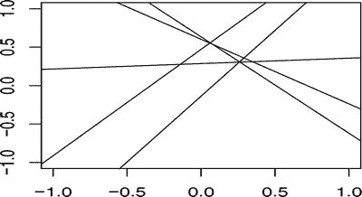
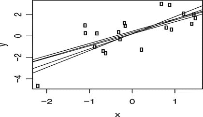
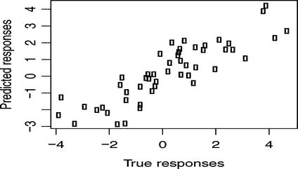
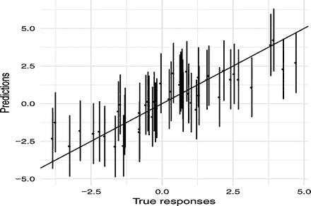

# 4. 统计模型

说实话，在大多数日常 R 编程中，你不会使用面向对象编程。你在 R 中进行的大多数分析涉及数据转换，通常实现为某种数据流，这最好通过函数式编程来捕获。当你编写此类管道时，你可能会使用多态函数，但很少需要创建自己的类。然而，如果你需要实现一个新的统计模型，你通常确实希望创建一个新类。

大量数据分析要求你推断感兴趣的参数，或者你构建一个模型来预测数据的属性，但在许多此类情况下，你不一定需要确切知道我们是如何构建模型的、它如何推断参数，或者它如何预测新值。你可以使用`coefficients`函数从拟合模型中获取推断的参数，或者使用`predict`函数预测新值，并且你可以将这两个函数与几乎任何统计模型一起使用。这是因为大多数模型都是作为实现了泛型函数`coefficients`和`predict`的类来实现的。

作为面向对象编程的实际示例，我们可以在本章中实现我们自己的模型。我们将保持简单，以便专注于编程方面而非统计理论，但仍然实现一些 R 尚未内置的东西。我们将实现贝叶斯线性回归的一个版本。


## 贝叶斯线性回归

线性回归的最简单形式是对数据点拟合一条直线。假设我们有向量 `x` 和 `y`，并且希望得到系数 `w[1]` 和 `w[2]`，使得 `y[i] = w[1] + w[2] x[i] + e[i]`，其中 `e` 是我们希望尽可能小的误差向量。当将其视为统计问题时，我们通常假设误差服从相同的正态分布，因此我们希望误差的方差最小。使用 `lm` 函数拟合线性模型时，你会得到权重 `w[1]` 和 `w[2]` 的最大似然值，但如果你希望进行贝叶斯统计，则应将此权重向量 `w` 视为一个随机变量，并根据 `x` 中的数据对其进行拟合，而 `y` 则意味着将其从先验分布更新为后验分布。

线性回归权重的一个典型分布是正态分布。如果我们认为权重的多元正态分布是先验分布，那么给定数据后它们的后验分布也将是正态分布，这使得数学计算非常方便。

我们将假设 `w` 的先验分布是均值为零且分量独立的正态分布，因此协方差矩阵是对角矩阵。这意味着，平均而言，我们认为要拟合的直线是平坦的并通过平面原点，但我们对此信念的强弱取决于协方差矩阵中的值。我们将用一个所谓的超参数 `a` 来参数化它，该超参数是权重分量的精度（即方差的倒数）。协方差矩阵的对角线为 `1/a`，非对角线元素为零。

我们可以将权重的分布表示为多元正态分布的均值和协方差矩阵，并像这样从精度构造先验分布：

```
weight_distribution <- function(mu, S) {
structure(list(mu = mu, S = S), class = "wdist")
}
prior_distribution <- function(a) {
mu = c(0, 0)
S = diag(1/a, nrow = 2, ncol = 2)
weight_distribution(mu, S)
}
```

我们给权重分布指定了一个类，只是为了将其与普通列表区分开，除此之外没什么特别之处。

如果我们希望从此分布中采样，可以使用 `MASS` 包中的 `mvrnorm` 函数。

```
sample_weights <- function(n, distribution) {
MASS::mvrnorm(n = n,
mu = distribution$mu,
Sigma = distribution$S)
}
```

我们可以尝试从先验分布中采样一些直线并绘制出来。当然，我们可以将采样的 `w` 向量绘制为平面上的点，但由于它们代表直线，我们将以直线形式展示它们（见图 4-1）。



**图 4-1.** 从直线的先验分布中采样的样本

```
prior <- prior_distribution(1)
(w <- sample_weights(5, prior))
##            [,1]        [,2]
## [1,]  0.6029080 -0.84085548
## [2,]  0.4721664  1.38435934
## [3,]  0.6353713 -1.25549186
## [4,]  0.2857736  0.07014277
## [5,] -0.1381082  1.71144087
plot(c(-1, 1), c(-1, 1), type = 'n',
xlab = '', ylab = '')
plot_lines <- function(w) {
for (i in 1:nrow(w)) {
abline(a = w[i, 1], b = w[i, 2])
}
}
plot_lines(w)
```

当我们观察到匹配的 `X` 和 `y` 值形式的数据时，必须更新 `w` 向量以反映这一点，这意味着更新权重的分布。我不会推导数学公式（毕竟这不是一本数学教科书），但如果 `mu0` 是先验均值，`S0` 是先验协方差矩阵，那么后验均值和协方差矩阵的计算如下：

```
S <- solve(S0 + b * t(X) %*% X)
mu <- S %*% (solve(S0) %*% mu0 + b * t(X) %*% y)
```

你无法直接执行这里的代码——它依赖于我们尚未定义的变量——但它是我们稍后定义的函数的主体。这涉及到一些线性代数，涉及先验分布和观测值。这些表达式中我们之前未见过的参数是 `b` 和 `X`。前者是误差项的精度——我们假设已知并用此超参数表示——后者则捕获了 `x` 值。我们不能单独使用 `x`，因为我们想用两个权重来表示直线。当我们将 `y[i]` 的估计值写成 `w[1] + w[2] * x[i]` 时，我们可以将其视为 `w` 和 `c(0, x[i])` 的向量积，这也正是我们实际做的。我们将所有 `x[i]` 表示为矩阵 `X` 中的行 `c(0, x[i])`。因此，在此记法中，我们估计 `y[i] = w[1] * X[i, 1] + w[2] * X[i, 2]`，或者 `y = X %*% w`。

作为拟合函数，我们可以这样编写：

```
fit_posterior <- function(x, y, b, prior) {
mu0 <- prior$mu
S0 <- prior$S
X <- matrix(c(rep(1, length(x)), x), ncol = 2)
S <- solve(S0 + b * t(X) %*% X)
mu <- S %*% (solve(S0) %*% mu0 + b * t(X) %*% y)
weight_distribution(mu = mu, S = S)
}
```

我们可以尝试绘制一些点，将模型拟合到这些点，然后绘制从后验分布中采样的直线。与从先验分布采样的直线不同，这些直线现在应该落在点周围。用于拟合模型的点越多，从后验分布采样的直线落在点周围的紧密程度就越高（见图 4-2）。



**图 4-2.** 后验直线的样本

```
x <- rnorm(20)
y <- 0.2 + 1.3 * x + rnorm(20)
plot(x, y)
posterior <- fit_posterior(x, y, 1, prior)
w <- sample_weights(5, posterior)
plot_lines(w)
```

我们在这里将权重的分布从先验分布更新为后验分布的方式，并不要求先验分布必须是我们使用变量 `a` 创建的精确分布。任何分布都可以用作先验，并且在贝叶斯统计中，随着数据不断增加而更新后验分布的情况并不少见。我们可以从刚刚创建的先验开始，将其拟合到一些数据上以获得后验分布。然后，如果我们获得更多数据，就可以将第一个后验分布作为先验来拟合更多数据，并得到一个新的后验分布，该分布捕获了我们从所有数据中获得的知识。如果我们一开始就拥有所有数据，这样做并没有特别的好处，但在数据流式传入的应用中，我们可以利用这一点，在每次新数据可用时快速更新我们的知识。

由于本书并非关于贝叶斯统计，并且我们仅将贝叶斯线性回归作为编写新统计模型的一个示例，因此我们不再对此进行深入探讨。


## 模型矩阵

我们拟合后验时使用的`X`矩阵就是所谓模型矩阵或设计矩阵的一个例子。以这种方式使用矩阵，将响应变量`y`拟合到某个表达式（此处为`1 + x`，从某种意义上说，我们使用了行`c(1, x[i])`）是一种通用的数据拟合方法。线性模型被称为线性，并非因为我们用一条直线拟合数据，而是因为我们拟合的权重（即`w`向量）在拟合模型中以数学意义上的线性方式被使用。如果我们将权重拟合到向量`w`，那么拟合出的直线由`X %*% w`给出。也就是说，我们的直线是模型矩阵与权重向量的矩阵乘积。之所以得到一条直线，是因为`X`具有我们赋予它的形式，但对于一个线性模型而言，它并不一定要代表一条直线。我们可以在拟合模型之前，以任何想要的方式转换输入数据（此处为我们的向量`x`）。你可能以前用过对数变换，或者将数据拟合到多项式，这些也都是线性模型的例子。

如果你以不同的方式构建`X`矩阵，就可以使用我们上面编写的函数来拟合各种类型的转换后数据。只要每个数据点在`X`中成为一行，你做什么变换都没关系，数学原理是相同的。例如，要将二次方程而非直线拟合到数据，你只需让`X`的第 i 行变为`c(1, x[i], x[i]**2)`即可。

在 R 中，你有一个非常强大的机制，可以根据公式构建模型矩阵。每当你使用类似`y ∼ x + y`这样的公式将`y`拟合到两个变量`x`和`z`时，就使用到了这个特性。该公式会被转换为一个模型矩阵，一旦你得到了这个矩阵，执行模型拟合的代码就不需要再了解关于数据的任何其他信息。

用于将公式转换为模型矩阵的函数叫做`model.matrix`。尽管它的名字中有一个点，但它并不是一个泛型函数。只是由于历史原因，它有一个不太合适的名字。

该函数将公式作为输入，并生成一个模型矩阵。它会通过在其作用域中查找来获取公式中变量的值。我们可以像这样使用它：

```
x <- rnorm(5)
y <- 1.2 + 2 * x + rnorm(5)
model.matrix(y ∼ x)
##   (Intercept)          x
## 1           1 -1.1365828
## 2           1  0.8548304
## 3           1 -0.5783704
## 4           1  0.4963615
## 5           1 -0.7600579
## attr(,"assign")
## [1] 0 1
```

不过，像这样依赖全局变量是有风险的编码方式，所以我们通常会将数据放入一个数据框中。

```
d <- data.frame(x, y)
```

如果这样做，我们可以向`model.matrix`函数提供一个数据框，它会从其中获取变量。

```
model.matrix(y ∼ x, data = d)
##   (Intercept)          x
## 1           1 -1.1365828
## 2           1  0.8548304
## 3           1 -0.5783704
## 4           1  0.4963615
## 5           1 -0.7600579
## attr(,"assign")
## [1] 0 1
```

如果公式中使用了的变量在数据框中未找到，`model.matrix`仍然会在调用作用域中查找缺失的变量，但这确实是风险极高的编码方式，因此你应该避免这样做。

公式决定了模型矩阵的构建方式。公式`y ∼ x`给出了我们上面使用的模型矩阵，其中第一列的 1 用于捕获截距，第二列是`x`值，用于捕获直线的斜率。我们可以使用公式`y ∼ x - 1`来移除截距项：

```
model.matrix(y ∼ x - 1, data = d)
##            x
## 1 -1.1365828
## 2  0.8548304
## 3 -0.5783704
## 4  0.4963615
## 5 -0.7600579
## attr(,"assign")
## [1] 1
```

我们也可以添加项；例如，可以通过构建以下模型矩阵来将二次公式拟合到数据：

```
model.matrix(y ∼ x + I(x**2), data = d)
##   (Intercept)          x    I(x²)
## 1           1 -1.1365828 1.2918205
## 2           1  0.8548304 0.7307351
## 3           1 -0.5783704 0.3345123
## 4           1  0.4963615 0.2463748
## 5           1 -0.7600579 0.5776881
## attr(,"assign")
## [1] 0 1 2
```

在这里，我们需要将平方后的`x`包裹在函数`I`中，以便让 R 使用`x`实际平方后的值。在公式内部，乘积项会被解释为交互作用，但通过将`x**2`包裹在`I`中，我们明确地使其成为了`x`值的平方。

模型矩阵不包含响应变量`y`，因此我们无法从中获取它。相反，我们可以使用一个相关的函数`model.frame`，它也会为我们提供一个响应变量的列。

```
model.frame(y ∼ x + I(x**2), data = d)
##            y          x       I(x²)
## 1 -1.4145519 -1.1365828 1.291820....
## 2  0.8073317  0.8548304 0.730735....
## 3 -0.2584431 -0.5783704 0.334512....
## 4  0.9203396  0.4963615 0.246374....
## 5 -0.5997820 -0.7600579 0.577688....
```

然后，你可以使用函数`model.response`提取响应变量，如下所示：

```
model.response(model.frame(y ∼ x + I(x**2), data = d))
##          1          2          3          4
## -1.4145519  0.8073317 -0.2584431  0.9203396
##          5
## -0.5997820
```

有了这些机制，我们可以推广我们的分布和模型拟合，使其能够处理通用的公式。我们可以像这样编写先验函数：

```
prior_distribution <- function(formula, a, data) {
n <- ncol(model.matrix(formula, data = data))
mu <- rep(0, n)
S <- diag(1/a, nrow = n, ncol = n)
weight_distribution(mu, S)
}
```

理想情况下，先验不应依赖于任何数据，但模型矩阵的形式确实依赖于我们使用的数据类型。数值型数据在模型矩阵中会表示为单列，而因子在公式中则会针对每个水平处理为一个二元向量，因此我们确实需要知道将要处理的是哪种类型的数据。我们本可以将`n`作为一个参数添加进来，使函数独立于任何数据，但我选择了包含一个数据框作为另一种解决方案。不过，我们并不使用实际的数据；我们只是用它来获取模型框架中的列数。

然而，用于拟合数据的函数变化较小。它只是使用`model.matrix`函数来构建模型矩阵，而不是像之前那样显式构建。

```
fit_posterior <- function(formula, b, prior, data) {
mu0 <- prior$mu
S0 <- prior$S
X <- model.matrix(formula, data = data)
S <- solve(S0 + b * t(X) %*% X)
mu <- S %*% (solve(S0) %*% mu0 + b * t(X) %*% y)
weight_distribution(mu = mu, S = S)
}
```

有了这些之后，我们可以像以前一样拟合一条直线，但现在使用的是公式。

```
d <- {
x <- rnorm(5)
y <- 1.2 + 2 * x + rnorm(5)
data.frame(x = x, y = y)
}
prior <- prior_distribution(y ∼ x, 1, d)
posterior <- fit_posterior(y ∼ x, 1, prior, d)
posterior
## $mu
##                  [,1]
## (Intercept) 1.1979166
## x           0.2875647
##
## $S
##             (Intercept)           x
## (Intercept)  0.16935519 -0.04441203
## x           -0.04441203  0.73364645
##
## attr(,"class")
## [1] "wdist"
```

相反，如果我们想拟合一个二次函数，我们不需要修改任何函数，只需提供一个不同的公式即可。

```
prior <- prior_distribution(y ∼ x + I(x**2), 1, d)
posterior <- fit_posterior(y ∼ x + I(x**2), 1, prior, d)
posterior
## $mu
##                  [,1]
## (Intercept) 1.1906733
## x           0.2815418
## I(x²)      0.1185518
##
## $S
##             (Intercept)           x      I(x²)
## (Intercept)  0.17301554 -0.04136841 -0.05990922
## x           -0.04136841  0.73617725 -0.04981521
## I(x²)      -0.05990922 -0.04981521  0.98053972
##
## attr(,"class")
## [1] "wdist"
```


## 构建拟合模型对象

现在，我们希望将拟合后的模型封装到一个类中，以便为其编写构造函数。对于拟合模型，传统上会将公式、数据和函数调用与拟合模型一同包含，因此我们将把这些内容作为对象的属性。构造函数可以如下所示：

```
blm <- function(formula, b, data, prior = NULL, a = NULL) {
  if (is.null(prior)) {
    if (is.null(a)) stop("未提供先验时，必须提供 a 参数。")
    prior <- prior_distribution(formula, a, data)
  } else {
    if (inherits(prior, "blm")) {
      prior <- prior$prior
    }
  }
  if (!inherits(prior, "wdist")) {
    stop("提供的先验分布类型不符合预期。")
  }
  posterior <- fit_posterior(formula, b, prior, data)
  structure(
    list(formula = formula,
         data = model.frame(formula, data),
         dist = posterior,
         call = match.call()),
    class = "blm"
  )
}
```

构造函数开头的检查允许我们将先验指定为正态分布或一个先前拟合的 `blm` 对象。如果获得一个先验分布，我们可能还应检查该先验是否与实际公式兼容，不过我会让您自行编写这样的检查来尝试一下。

如果打印使用 `blm` 函数拟合的对象，它们会以列表形式输出，但我们可以通过特化 `print` 泛型函数来提供自己的 `print` 函数。按惯例，这里应输出用于指定模型的函数调用，因此目前我仅实现此功能。

```
print.blm <- function(x, ...) {
  print(x$call)
}
```

我们必须与泛型函数的参数匹配，这就是为什么参数是 `x` 和 `...`。不过我们做的仅仅是打印对象的 `call` 属性。

现在，我们可以像这样拟合数据并获取一个 `blm` 对象：

```
(model <- blm(y ~ x + I(x**2), a = 1, b = 1, data = d))
## blm(formula = y ~ x + I(x²), b = 1, data = d, a = 1)
```

## 系数与置信区间

一旦有了拟合模型，我们可能希望获取拟合值。传统上，这通过泛型函数 `coef` 实现，它应直接返回这些值。对于贝叶斯线性回归模型，拟合值是完整的分布，但我们可以取均值作为点估计并返回，因此可以这样实现 `coef` 函数：

```
coef.blm <- function(object, ...) {
  t(object$dist$mu)
}
coef(model)
##      (Intercept)         x    I(x²)
## [1,]    1.190673 0.2815418 0.1185518
```

这里，我转置了均值矩阵，使系数的格式与传统线性模型（使用 `lm` 函数拟合）得到的格式相似，除此之外，该函数仅返回均值。

对于经典的频率学派模型，我们通常还需要参数的置信区间，传统上使用 `confint` 函数获取。该函数的签名如下：

```
confint(object, parm, level = 0.95, ...)
```

`object` 参数是拟合模型，`parm` 包含我们需要置信区间的参数。如果缺失，应返回所有模型参数，而 `level` 参数指定了置信水平。

同样，对于贝叶斯模型，我们拥有完整的分布而不仅仅是置信区间，但我们可以通过获取每个参数边缘分布的分位数来获得类似结果。参数服从正态分布，我们可以分别从均值和协方差矩阵中获取均值和标准差。之后，我们可以使用 `qnorm` 函数获取分位数，并像这样构建区间：

```
confint.blm <- function(object, parm, level = 0.95, ...) {
  if (missing(parm)) {
    parm <- rownames(object$dist$mu)
  }
  means <- object$dist$mu[parm,]
  sds <- sqrt(diag(object$dist$S)[parm])
  lower_q <- qnorm(p = (1-level)/2,
                   mean = means,
                   sd = sds)
  upper_q <- qnorm(p = 1 - (1-level)/2,
                   mean = means,
                   sd = sds)
  quantiles <- cbind(lower_q, upper_q)
  quantile_names <- paste(
    100 * c((1-level)/2, 1 - (1 -level)/2),
    "%",
    sep = ""
  )
  colnames(quantiles) <- quantile_names
  quantiles
}
confint(model)
##                   2.5%    97.5%
## (Intercept)  0.3754236 2.005923
## x           -1.4001225 1.963206
## I(x²)      -1.8222478 2.059351
```


## 预测响应变量

当涉及到对新数据的响应变量进行预测时，模型矩阵还需要进行一些额外工作。如果在创建模型矩阵时我们没有响应变量，即使模型矩阵实际上并不包含该变量的列，也会收到错误信息。如果我们删除之前创建数据框时使用的 `x` 和 `y` 变量，就能看到这一点。

```
rm(x) ; rm(y)
```

如果我们从包含 `x` 和 `y` 的数据框构建模型矩阵，则没有问题。

```
model.matrix(y ∼ x + I(x**2), data = d)
##   (Intercept)           x      I(x²)
## 1           1 -0.20409732 0.041655716
## 2           1 -0.22561419 0.050901761
## 3           1  0.34702845 0.120428747
## 4           1  0.03236784 0.001047677
## 5           1  0.41353129 0.171008128
## attr(,"assign")
## [1] 0 1 2
```

然而，如果我们创建一个只包含 `x` 值的数据框，就会收到错误。

```
dd <- data.frame(x = rnorm(5))
model.matrix(y ∼ x + I(x**2), data = dd)
## Error in eval(expr, envir, enclos): object 'y' not found
```

这当然是个问题，因为我们的兴趣恰恰是在没有响应变量时对其进行预测。这颇具讽刺意味，因为模型矩阵实际上从不包含响应变量；尽管如此，这就是 R 的工作方式。

要在构建模型矩阵之前从公式中移除响应变量，我们需要使用 `delete.response()` 函数。不幸的是，这个函数不能直接作用于公式，而是作用于所谓的“项”（terms）对象。我们可以使用 `terms()` 函数将公式转换为它的项。因此，要从公式中移除项，我们需要采用以下结构：

```
delete.response(terms(y ∼ x))
```

结果是一个 `terms` 对象，但由于 `terms` 类是 `formula` 类的特化，我们可以直接将其与 `model.matrix()` 函数一起使用来构建模型矩阵。

```
model.matrix(delete.response(terms(y ∼ x)), data = dd)
##   (Intercept)           x
## 1           1  0.49841617
## 2           1 -1.74230249
## 3           1  0.97552910
## 4           1 -0.02408287
## 5           1  0.67568448
## attr(,"assign")
## [1] 0 1
```

现在，对于实际预测数据，我们传统上使用 `predict()` 泛型函数。该函数具有以下签名：

```
function(object, ...)
```

坦率地说，这没什么用。不过，我们可以像 `lm` 类那样为其添加参数，向其添加一个 `newdata` 参数。我们将根据 `newdata` 构建一个模型矩阵，并对其中的数据进行预测。如果我们只需要新数据的点估计值，可以简单地计算权重均值与模型矩阵每一行的内积，因此我们可以像这样实现 `predict()` 函数：

```
predict.blm <- function(object, newdata, ...) {
  updated_terms <- delete.response(terms(object$formula))
  X <- model.matrix(updated_terms, data = newdata)
  predictions <- vector("numeric", length = nrow(X))
  for (i in seq_along(predictions)) {
    predictions[i] <- t(object$dist$mu) %*% X[i,]
  }
  predictions
}
predict(model, d)
## [1] 1.138150 1.133188 1.302653 1.199910 1.327373
```

为了检查模型，我们可以将预测值与真实响应值绘制成图。不过，对于我们目前使用的只有五个数据点的数据，我们预期预测效果不会特别好，也不指望这样的图能展示多少信息，但我们可以尝试使用更多的数据点（见图 4-3）。



图 4-3. 真实值与预测值对比

```
d <- {
  x <- rnorm(50)
  y <- 0.2 + 1.4 * x + rnorm(50)
  data.frame(x = x, y = y)
}
model <- blm(y ∼ x, d, a = 1, b = 1)
plot(d$y, predict(model, d),
     xlab = "真实响应",
     ylab = "预测响应")
```

对原始数据进行预测非常常见，以至于存在另一个用于此目的的泛型函数，名为 `fitted()`。我们可以这样实现它：

```
fitted.blm <- function(object, ...) {
  predict(object, newdata = object$data, ...)
}
```

有了这个函数，我们可以像下面这样创建图表：

```
plot(d$y, fitted(model),
     xlab = "真实响应",
     ylab = "预测响应")
```

当然，我们能做的不仅仅是预测点估计值。我们有一个权重分布，这意味着直线的斜率和截距并非固定不变。至少在概念上，它们是从一个分布中抽取的。斜率微小的变化，对于数据主体部分附近的预测准确性影响不大，但靠近数据边缘的数据点则会因此产生更大的不确定性。在进行预测时，我们可以将此分布考虑在内，从而获得预测的误差条。如果 `X` 是模型矩阵，`S` 是后验的协方差矩阵，那么第 i 个预测值的方差由下式给出：

```
1/b + t(X[i,]) %*% S %*% X[i,]
```

我们并没有在拟合的模型对象中存储精度参数 `b`，所以如果想获取误差条，需要将其保留下来。因此，请更新你的 `blm()` 函数，使其返回如下结构：

```
structure(
  list(formula = formula,
       data = model.frame(formula, data),
       dist = posterior,
       precision = b,
       call = match.call()),
  class = "blm"
)
```

现在，我们可以扩展我们的 `predict()` 函数，增加一个选项，当该选项为 `TRUE` 时，也返回置信区间：

```
predict.blm <- function(object, newdata,
                        intervals = FALSE,
                        level = 0.95,
                        ...) {
  updated_terms <- delete.response(terms(object$formula))
  X <- model.matrix(updated_terms, data = newdata)
  predictions <- vector("numeric", length = nrow(X))
  for (i in seq_along(predictions)) {
    predictions[i] <- t(object$dist$mu) %*% X[i,]
  }
  if (!intervals) return(predictions)
  S <- model$dist$S
  b <- model$precision
  sds <- vector("numeric", length = nrow(X))
  for (i in seq_along(predictions)) {
    sds[i] <- sqrt(1/b + t(X[i,]) %*% S %*% X[i,])
  }
  lower_q <- qnorm(p = (1-level)/2,
                   mean = predictions,
                   sd = sds)
  upper_q <- qnorm(p = 1 - (1-level)/2,
                   mean = predictions,
                   sd = sds)
  intervals <- cbind(lower_q, predictions, upper_q)
  colnames(intervals) <- c("lower", "mean", "upper")
  as.data.frame(intervals)
}
model <- blm(y ∼ x, d, a = 1, b = 1)
```

有了这个 `predict()` 函数，我们还可以在预测值周围绘制误差条，参见图 4-4。在该图中，我还绘制了 `x = y` 的直线。如果预测准确，数据点应落在这条线上。由于数据中存在一些随机性，我们不期望完全落在线上，但我们期望在 95% 的时间内该线能与误差条重叠。



图 4-4. 带置信区间的预测值与真实值对比

```
require(ggplot2)
predictions <- fitted(model, intervals = TRUE)
ggplot(cbind(data.frame(y = d$y), predictions),
       aes(x = y, y = mean)) +
  geom_point() +
  geom_errorbar(aes(ymin = lower, ymax = upper)) +
  geom_abline(slope = 1) +
  xlab("真实响应") +
  ylab("预测值") +
  theme_minimal()
```

当然，对于统计模型，我们能做的还有很多，还可以为其添加更多泛型函数，为模型类提供统一的接口。但我希望这个示例至少能让你了解到，将模型表示为一个类是多么有用。


