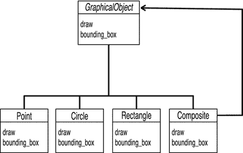
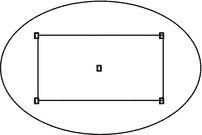
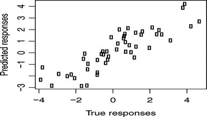
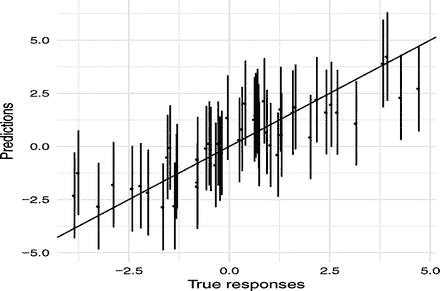

# 2. 类层次结构

多态性的含义远不止是拥有不同具体实现的抽象数据类型。在大多数面向对象的编程语言中，一个基本概念是类和类层次结构。类层次结构服务于两个概念上不同的目的：对象接口的细化和代码复用。严格来说，这两个概念在 R 语言中都不需要类层次结构，因为 R 是动态类型的，不像 C++ 或 Java 等语言，其类层次结构与静态类型系统紧密交织。尽管如此，类层次结构提供了一个思考软件设计的框架，这非常有用，尤其是在动态类型语言中。

我们将在接下来的两节中详细探讨这两个概念，但简而言之，接口描述了一个给定类的对象必须实现哪些（泛型）函数，而层次结构则根据这些函数，以“更抽象/更细化”的关系将接口链接起来。在上下文中，代码复用仅仅是指编写能够操作不止一类对象的函数——本质上就是我们上一章看到的多态函数类型——并将这类函数本身作为泛型函数纳入类层次结构。

## 接口与实现

我们可以将一个类的接口视为我们可以应用于该类对象的操作或方法类型。在 R 中，这意味着我们可以以有意义的方式调用哪些函数，并将这些对象作为参数传递。

如果我们从抽象数据结构的角度思考，例如上一章中的栈，它们是由其支持的操作定义的。你可以对栈进行压入（`push`）和弹出（`pop`）操作，检查它是否为空，并且可以获取顶部元素；这些函数，连同创建栈的方法，共同定义了“栈性”。至少，只要这四个函数也具备我们与栈关联的语义。

在抽象层面，我们可以通过形式参数和语义来描述一个函数的接口。例如，我们可以将函数 `push` 与其两个形式参数——一个栈和一个元素——以及它应该返回添加了该元素到顶部的栈的语义关联起来。如果我们用形式参数和语义这两个属性来关联 `push` 操作，我们就得到了一个可以称之为抽象函数的东西。正如我们所见，我们可以用不同的具体方式实现这样的抽象函数，但这些具体函数的调用者只需关心抽象描述就能确保功能正确性（尽管性能当然也可能是一个考量点，但此处我们并未将其与抽象函数的接口关联）。

有了抽象函数的这个定义，我们可以说一个抽象数据类型是由一组抽象函数定义的。如果我们称一组抽象函数为一个接口，那么一个抽象数据类型就是由一个接口定义的。我们可以通过编写接口中所有抽象函数的实现来实现一个抽象数据结构。这可以称之为接口的（具体）实现或类似的说法。我们仅通过了解抽象数据类型的接口就可以推理算法和设计软件，并且如果我们有接口的不同实现可供选择，那么理论上可以使用其中任何一个。

接口和实现等概念不仅在设计抽象数据结构时有用。对于你想在程序中操作的任何类型的数据，你都可以想出可以对该数据执行的一组有意义的操作，从而为该数据类型创建一个接口，并且你可以以不同的方式为这些操作编写函数，以创建不同的实现。

## 多态性与接口

如果我们回过头来思考接口，我们可以说，如果一个类实现了构成接口的所有抽象函数，那么它就实现了一个接口。这仅仅意味着，如果我们取这个类的对象，我们就拥有了可以针对接口中每个抽象函数调用的具体函数。然而，如果没有泛型/多态函数，对于实现给定接口的每个类，我们需要知道哪个具体函数映射到哪个抽象函数。将一个接口的实现替换为另一个将需要重写使用该实现的代码。因此很自然地，我们也会要求具体函数的名称与抽象函数的名称相匹配。

这显然直接映射到了泛型函数。如果每当我们想到抽象函数时，就将其映射到一个泛型函数——一个简单调用 `UseMethod` 的函数——而每当想到具体函数时，就想到一个泛型函数的实现——一个名称中带有句点的函数——那么我们就有了一个几乎自动的将接口和实现概念映射到代码的方式。

由于 R 不进行任何静态类型检查，你几乎无法保证以这种方式编写的类确实实现了给定的接口。泛型函数中没有任何东西明确地将它们作为一个接口绑定在一起，因此对于你决定实现的任何类，你可以实现泛型函数的任意子集。接口和实现是设计概念，你可以非常容易地将设计映射到 R 代码中，但 R 并不强制你的代码与设计匹配。

## 抽象类与具体类

在设计软件时，我们常常将接口和实现统一视为类。面向对象的软件思考方式如下：你所处理的每一条数据都是一个对象，而所有对象都有一个决定其行为的类。这里的“行为”仅指我们可以在对象上调用的函数。这种思维方式在可以修改数据、因而对象具有状态的语言中更有意义。无论如何，你都可以将所有数据视为对象，其关联的类决定了你可以对它们做什么。

因此，一个类既封装了你可以对对象做什么——即你拥有的接口，也封装了如何做到——即接口是如何实现的。

对象拥有类，而类决定了你能对对象做什么。但类存在于由更抽象或更派生的类构成的层次结构中。一个基于向量实现的栈就是一个栈。诚然，它是一种特殊的栈，但它仍然是一个栈。栈的一般概念比基于向量的实现更为通用，因此向量实现可以被视为栈的一种特例——即使用向量实现的栈。

我们通常将类层次结构视为“是一种”关系的一部分。一个基于向量的栈实现“是一种”栈。基于列表的实现也是如此。如果你有一个更具体类的对象，你应该也能够将其视为一个更抽象类的对象。如果你有一个向量栈，你可以将其视为一个栈，因为它的类是向量栈类，而这是栈类的一个特例。

最接近接口和实现概念的是抽象类和具体类。抽象类实质上就是一个接口。它只不过是对你可以用这个类的对象做什么的描述；它本身没有与之关联的实现。另一方面，具体类则实现了你可以在给定类的对象上调用的所有函数。然而，很多时候，类实现了其接口所描述的部分但并非全部函数，因此在实践中这种区分并不那么清晰。

我们经常用图表来展示类及其关系，如图 2-1 所示。这里 `Stack` 以斜体显示，表示它是一个抽象类。类名下方列出了你可以在该类上调用的方法，从一个类指向另一个类的箭头表示一个类派生自另一个类。这里我们看到向量栈和列表栈（这里称为 `VectorStack` 和 `ListStack`）派生自 `Stack`。


图 2-1. 栈的类层次结构

这两个具体类只实现了抽象类中也列出的方法，因此，我们并不总是在派生类中再次列出这些方法。应理解的是，任何在更抽象类中实现的方法，也会在更派生的类中实现。

## 在 R 中实现抽象类和具体类

我们在前一章已经看到，属性 `class` 如何用于确定给定对象调用泛型函数的哪个版本。这种分派泛型函数的方法是 S3 系统实现类的方式，但在某种意义上只处理了抽象函数的具体实现。拥有一个泛型方法 `foo`

```
foo <- function(object) UseMethod("foo")
```

我们为类 `bar` 实现它

```
foo.bar <- function(object) ...
```

这只告诉 R 类 `bar` 如何实现 `foo` 函数。如果 `foo` 是由多个函数组成的接口的一部分，这在 R 代码中并没有明确说明。

如果我们把接口看作一组抽象函数，那么在 R 中，将它们视为一个整体只是我们非正式的做法。既然抽象类不过是接口，我们可以对抽象类做同样的事情。当我们在前一章实现基于向量的栈时，我们通过将从构造函数 `empty_vector_stack` 返回的对象的 `class` 属性设置为 `vector_stack` 来实现，并通过实现我们认为属于栈接口的四个函数：`push`、`pop`、`top` 和 `is_empty`。我们从未明确指出存在某个抽象的栈类以及 `vector_stack` 是它的特化。

由于以这种方式实现的类机制本质上是在函数级别工作的——我们有泛型函数以及基于其名称分派的实现——类和它们的关系在 R 中可能非常混乱。你可以通过以比语言本身要求更有结构的方式思考软件设计来缓解这个问题。在设计软件时考虑类，通过定义一组泛型函数来实现抽象类——你可以使用注释将它们组合在一起，并记录这些函数构成一个接口。确保当你定义一个实现接口的具体类时，不会忘记接口中的任何函数。你可能不会全部实现它们；有时有充分的理由，有时你只是务实，暂时不去实现那些可能难以实现但你目前还不需要的功能。但要确保这是一个经过深思熟虑的选择，而不是仅仅忘记了一个函数。

你可以使用 `methods` 函数来获取一个类实现的所有方法列表

```
methods(class = "vector_stack")
## [1] is_empty pop      push     top
## see '?methods' for accessing help and source code
```

并检查你是否已经实现了所有内容。你也可以使用这个函数来获取实现给定泛型函数的所有类列表。

```
methods("top")
## [1] top.default      top.list_stack
## [3] top.vector_stack
## see '?methods' for accessing help and source code
```

### 另一个示例：图形对象

类层次结构所基于的`“是一个”`关系，其灵活性远超仅仅拥有抽象类及其实现。它不仅为我们提供了一种建模方式，表明某些对象确实属于不同但相关的类，还为我们提供了一种将接口视为其他接口特化的机制。

让我们考虑一个例子，比如在一个操作某些图形对象的应用程序中——也许是作为新可视化包的一部分。该应用程序最基础的类是 `GraphicalObject`，其对象可以被 `绘制`。能够绘制对象是图形对象所需的最基本操作。图形对象还有一个`“边界框”`——一个矩形，用于告诉我们形状有多大，这在绘制对象时可能是必需的。

这个类是抽象的，不仅仅因为我们定义了一个接口以便拥有不同的实现（就像我们处理栈时那样），而且因为在如此抽象的层面上拥有一个图形接口本身并无实际意义。一个有意义的具体类是 `Point`，它是一个代表单个点的图形对象。其他类可以是 `Circle` 和 `Rectangle`。

为了以便捷的接口处理多个图形对象，我们还有一个类 `Composite`，用于捕获图形对象的集合。



图 2-2. 图形对象的类层次结构。从 `Composite` 指向 `GraphicalObject` 的箭头，其起点为菱形，终点为箭头，表示一个 `Composite` 由一系列 `GraphicalObject` 组成。

将对象集合视为与其组成部分属于同一类的对象，是一种所谓的设计模式，它使得在此应用程序中处理复杂图形变得更容易。我们可以将图形对象以层次结构分组——类似于在绘图工具中分组对象——并且在我们的代码中无需显式检查我们是在处理单个对象还是一个对象集合。一个对象集合本身也是一个图形对象，我们可以直接这样对待它。

实现这个类层次结构相当简单。抽象类 `GraphicalObject` 没有被显式表示，但我们需要将其方法作为泛型函数。

```
draw <- function(object) UseMethod("draw")
bounding_box <- function(object) UseMethod("bounding_box")
```

在构造图形对象时，我们需要设置它们的类，以下是具体类的构造函数：

```
point <- function(x, y) {
    object <- c(x, y)
    class(object) <- "point"
    names(object) <- c("x", "y")
    object
}
rectangle <- function(x1, y1, x2, y2) {
    object <- c(x1, y1, x2, y2)
    class(object) <- "rectangle"
    names(object) <- c("x1", "y1", "x2", "y2")
    object
}
circle <- function(x, y, r) {
    object <- c(x, y, r)
    class(object) <- "circle"
    names(object) <- c("x", "y", "r")
    object
}
composite <- function(...) {
    object <- list(...)
    class(object) <- "composite"
    object
}
```

我们只是将图形对象实现为向量，除了 `composite`，我们将其表示为列表，以便它能包含其他不同类型的图形对象。点只是坐标向量，矩形由两个坐标（矩形的左下角和右上角）表示，圆由一个中心点和一个半径表示。

对于 `draw` 方法，我们可以直接使用基本的图形函数：

```
draw.point <- function(object) {
    points(object["x"], object["y"])
}
draw.rectangle <- function(object) {
    rect(object["x1"], object["y1"], object["x2"], object["y2"])
}
draw.circle <- function(object) {
    plotrix::draw.circle(object["x"], object["y"], object["r"])
}
draw.composite <- function(object) {
    invisible(Map(draw, object))
}
```

除了圆以外，我们都可以使用基本的图形函数，为了便利，对于圆我们使用了 `plotrix` 包中的 `draw.circle` 函数。对于集合类，我们只是对其所有组成部分调用 `draw`。我们将对 `Map` 的调用包裹在 `invisible` 中，是因为我们不希望在命令提示符每次调用该函数时都打印一个对象列表，除此之外，实现是直接的。

利用这些函数，我们可以构造图形元素的图形，参见图 2-3。



图 2-3. 图形元素的图形

```
plot(c(0, 10), c(0, 10),
     type = 'n', axes = FALSE, xlab = '', ylab = '')
draw(point(5,5))
draw(rectangle(2.5, 2.5, 7.5, 7.5))
draw(circle(5, 5, 4))
corners <- composite(point(2.5, 2.5), point(2.5, 7.5),
                     point(7.5, 2.5), point(7.5, 7.5))
draw(corners)
```

这里我们必须设置图形的尺寸，使其确实包含我们想要显示的元素。我们有 `bounding_box` 函数来计算该区域，我们可以像这样实现不同的方法：

```
bounding_box.point <- function(object) {
    c(object["x"], object["y"], object["x"], object["y"])
}
bounding_box.rectangle <- function(object) {
    c(object["x1"], object["y1"], object["x2"], object["y2"])
}
bounding_box.circle <- function(object) {
    c(object["x"] - object["r"], object["y"] - object["r"],
       object["x"] + object["r"], object["y"] + object["r"])
}
bounding_box.composite <- function(object) {
    if (length(object) == 0) return(c(NA, NA, NA, NA))
    bb <- bounding_box(object[[1]])
    x1 <- bb[1]
    y1 <- bb[2]
    x2 <- bb[3]
    y2 <- bb[4]
    for (element in object) {
        bb <- bounding_box(element)
        x1 <- min(x1, bb[1])
        y1 <- min(y1, bb[2])
        x2 <- max(x2, bb[3])
        y2 <- max(y2, bb[4])
    }
    c(x1, y1, x2, y2)
}
```

有了这些，我们可以在绘图前将所有想要绘制的图形元素收集到一个 `composite` 对象中并计算边界框。

```
all <- composite(
    point(5,5),
    rectangle(2.5, 2.5, 7.5, 7.5),
    circle(5, 5, 4),
    composite(point(2.5, 2.5), point(2.5, 7.5),
              point(7.5, 2.5), point(7.5, 7.5))
)
bb <- bounding_box(all)
plot(c(bb[1], bb[3]), c(bb[2], bb[4]),
     type = 'n', axes = FALSE, xlab = '', ylab = '')
draw(all)
```

结果当然与图 2-3 中所示相同。

# 通过细化实现类层次结构的接口

到目前为止，在给出的示例中，我们有一个抽象类定义了一个接口，然后由不同的具体类来实现它。在`stack`的例子中，不同的实现为我们提供了不同的时间复杂度权衡，但这些不同实现在概念上都只是栈。在图形对象的例子中，各种具体类在概念上是不同的对象，但它们都可以被视为图形对象，从而通过通用接口进行操作。这些是软件设计中常见的模式，但当子类（例如不同类型的图形对象）代表不同的概念类时，它们通常也可以扩展接口。

以统计模型为例。这些通常被实现为类，这些类实现一些泛型函数，例如`predict`或`coef`，这为我们提供了统一的模型接口，使得在分析中能够切换不同的模型而无需对分析代码进行重大重写。所有模型实现的泛型函数为我们提供了最抽象类型的模型接口。例如，所有模型都必须实现`predict`和`coef`，我们才能在分析代码中将它们作为即插即用的替代品，但不同类型的模型可能会向此接口添加并非所有模型都适用的附加功能。例如，我们可以想象决策树会添加用于剪枝的功能，例如一个`prune`函数。如果所有决策树实现都有一个`prune`函数，我们可以更换决策树的实现并且仍然重用我们的代码，但由于`prune`并非为所有模型实现，我们只能用一个决策树实现替换另一个决策树，而不是任意类型的模型。我们会说决策树是模型的`特化`。所有决策树都是模型，但并非所有模型都是决策树。在类的术语中，我们会有一个模型的超类和一个决策树的子类，该子类向模型的接口添加了如`prune`这样的函数。如果我们有决策树的不同实现，决策树类通常也是抽象的，不同的实现会继承自这个类，而不是更通用的模型类（见图 2-4）。

## 图 2-4. 模型层次结构


模型层次结构，其中决策树是`Model`类的特化，它添加了`prune`函数，并为我们提供了一个额外的抽象类，决策树的实例必须实现此类。

另一个例子，我们可以考虑参考书目，它本质上是一个出版物列表。有不同类型的出版物，但所有出版物至少有一个名称和一个或多个作者，因此表示出版物的最抽象方式将只具有这两个属性。我们可能希望对出版物列表做的一件事是计算文献计量学指标，例如一篇出版物有多少次引用。如果每篇出版物都有一个它所引用的其他著作的列表，那么我们可以从所有相关出版物的数据库中计算出这个数字。如果我们有给定作者创建的所有出版物的列表，我们也可以计算这位特定作者收到了多少引用，或者推导出如 h 指数这样的统计数据。

有不同类型的出版物，因此我们可以为书籍和文章等创建子类。一本书将有一个相关的出版商和一个 ISBN，而期刊文章将有一个相关的期刊和（通常）可以在期刊中找到该文章的页码。如果我们为了简化，只允许这两种类型的出版物，我们可以将其表示为图 2-5 所示的类层次结构。

## 图 2-5. 参考书目对象的层次结构


通用的`Publication`类为每篇出版物提供名称、作者列表和引用的其他出版物列表。两种具体类型的出版物，`Article`和`Book`，添加了额外的属性。

在这个层次结构中，所有函数都只是访问对象的属性；也就是说，它们只是提取存储在这些对象中的数据。通常，通过函数访问属性，而不是访问作为对象表示形式一部分的列表或向量，是一个好主意。这允许您更改数据的表示方式，而无需修改除了访问器函数之外的任何代码。如果您的代码仅通过函数访问您的对象，那么您就封装了实现细节，后续更新代码将比原来简单得多。

还要注意，在这两种具体类型的出版物之间，没有一个访问器函数需要不同。抽象的`Publication`类访问`name`和`authors`，其他类中提供的附加属性是互不相交的。因此，不需要为这个类层次结构实现泛型函数。我们可以只使用普通的旧函数来完成。

```r
# publication interface
publication <- function(name, authors, citations) {
structure(list(name = name, authors = authors,
citations = citations),
class = "publication")
}
name <- function(pub) pub$name
authors <- function(pub) pub$authors
# articles
article <- function(name, authors, citations, journal, pages) {
structure(list(name = name, authors = authors,
citations = citations,
journal = journal, pages = pages),
class = c("article", "publication"))
}
journal <- function(pub) pub$journal
pages <- function(pub) pub$pages
# book
book <- function(name, authors, citations, publisher, ISBN) {
structure(list(name = name, authors = authors,
citations = citations,
publisher = publisher, ISBN = ISBN),
class = c("book", "publication"))
}
publisher <- function(pub) pub$publisher
ISBN <- function(pub) pub$ISBN
```

对于在不同类中为相同的概念操作获得不同行为，泛型函数是完美的，但是当我们能够使用普通的旧函数获得期望的操作时，就没有理由调用泛型函数。

出版物的实现很简单，除了构造函数中设置的`class`属性。在这里，我们将类设置为类名的列表，而不仅仅是类名。这就是我们指定`"book"`对象或`"article"`对象也是一个`"publication"`对象的方式。我们设想的这种设计要求书籍和文章都是出版物，但由于 S3 类只是表示为字符串的名称，我们无法在 R 中明确这一点。相反，我们通过让`class`属性成为类名的列表来表示类层次结构，从最特殊的对象到最抽象的对象沿层次结构向上。R 如何解释这样的类名列表，以及它如何使用它来查找泛型函数的正确实现，是下一章的主题。

拥有类似于我们这里为出版物创建的类层次结构并不少见，但它存在一些轻微的问题。要访问书籍特有的属性，您需要知道您正在处理的对象是一本书；处理聚合的出版物而无需编写专门处理书籍或文章的代码，正是使用面向对象并创建出版物层次结构的目的所在。拥有子类向其超类接口添加函数的类层次结构并没有错，但如果您发现自己在编写这样的层次结构，您应该仔细思考如何访问和操作来自该层次结构的对象。

# 函数放置与通用函数设计

通常，最好将函数放置在层级中尽可能高的合理位置，以确保层级中的尽可能多的类都能支持这些函数。对于通用函数，不同的子类可以用非常不同的方式实现这些方法，但你操作的所有对象至少会实现你所调用的方法。以我们这里设计的出版物类层次结构为例，如果我们想编写可重用的代码，唯一真正能做的操作就是访问名称和作者信息，以及构建引用图谱。只有当我们显式检查当前正在访问的是书籍还是文章时，才能以类型安全的方式访问书籍和文章所特有的属性。

我们可能需要编写代码来格式化出版物，以生成出版物列表等。这需要用到存储在书籍和文章中的信息，但由于直接访问这些信息首先需要测试对象的类别，代码会变得有些繁琐且可能容易出错。更糟糕的是，如果我们在层次结构中添加另一种出版物类型（例如，会议投稿），我们就需要更新所有执行此类检查并针对不同类进行不同处理的代码，以同时处理这种新类型。这正是为了避免这种情况，我们需要通用函数。因此，正确的设计是：拥有一个用于格式化引用的通用函数，并针对不同的子类进行特化实现。

```
format <- function(publ) UseMethod("format")
format.article <- function(publ) {
paste(name(publ), authors(publ),
journal(publ), pages(publ), sep = ", ")
}
format.book <- function(publ) {
paste(name(publ), authors(publ),
publisher(publ), ISBN(publ), sep = ", ")
}
```

然后，我们可以在另一个通用函数 `print` 中使用这个 `format` 函数来显示出版物：

```
print.publication <- function(x, ...) print(format(x))
```

当我们通过子类化来扩展接口时，我们添加了一些只有部分对象支持的函数。有时这是必要的，因为某些操作确实只对特定对象有意义——例如，修剪决策树是有意义的，但修剪像线性模型这样的对象则没有意义——但作为一般规则，我建议将这种特化保持在最低限度。拥有一个由或多或少特化的类组成的大型层次结构可能感觉像是一个好的设计，但当你必须处理来自该层次结构的对象时，你希望它们尽可能相似。你希望能够使用相同的（通用）函数处理所有这些对象。因此，一般来说，你希望在任何情况下都坚持使用最抽象的接口。你不妨在设计代码时就考虑到这一点。

能够统一处理对象也是为什么我们将图形对象集合本身也设计成一个图形对象的原因。如果我们没有这样做，那么我们就需要显式处理对象集合并编写递归函数来遍历它们。通过使集合成为图形对象的一个类，我们可以将这种复杂性隐藏在通用函数中。这是一种非常常见的技巧，被称为**组合设计模式**。

# 实现重用

最容易编写的代码是已经写好的代码。如果你能重用现有代码，这总是比编写新代码更好。你不需要花时间编写代码，而且如果现有代码已经存在了一段时间，那么它很可能经过了充分的测试，因此比你引入的新代码更可能正确。因此，作为程序员，你的目标应该是编写尽可能少的新代码，尽管这听起来有些矛盾。

然而，重用代码的正确方法，不是简单地将现有代码块从一个程序复制并粘贴到另一个地方。这样做你确实重用了代码，但最终你会得到两份相同的代码。如果在未来的某个时间点，你发现必须修改这段代码（也许是因为尽管经过了测试，其中仍然隐藏了一个错误），你将不得不记住在两个地方都进行修改。当你有这样的重复代码时，很难记住，如果这两个副本开始变得不一致，维护起来将是一场噩梦。

重用代码的方法是编写可以在许多不同上下文中使用的函数。编写那些能处理单一问题、并处理好它的函数，同时尽量减少对它们将被调用的上下文的假设。使用小的、可重用的构建块来构建程序，这样会使你的代码更易于维护和扩展。

然而，在面向对象编程中，我们经常为代码重用添加另一个维度。当一个类定义了通用函数时，该类及其所有子类的所有实现都必须实现这些通用函数。如果每个类都以独特的方式实现所有通用函数，那么重用的机会就很小，但所有东西都独特的情况很少见。通常，对于给定问题，存在很好的默认解决方案，适用于大多数类，只有少数类需要实现特殊的函数。在面向对象编程中，你希望在类层次结构中最高的可能级别上实现函数，并让子类在可能的情况下通过调用通用函数，而不是提供它们自己特化的函数，来重用这些实现。层次结构中的任何类都可能需要特化一个通用函数的子集，而任何子类都应该使用其上层结构中最特化的那个版本。但一般来说，一个子类只应在自己的通用函数版本与超类中定义的版本不同时才定义自己的版本，其余的函数它应该直接重用。我们说它从其超类`继承`了这些函数，而通用函数的查找机制在很大程度上自动完成了这一点。

在日常的R编程中，深度类层次结构很少使用。与其编造一个不切实际的人为示例，或者展示那些与类层次结构介绍关系不大的示例代码，我将使用抽象的例子来说明。如果你对R中面向对象编程的实际应用更感兴趣，我在第4章给出了一个现实的例子，尽管那个例子只有一层深度。

## 类层次结构中的方法查找

正如我们之前看到的，对于一个泛型函数`f`，调用`f(x)`会使R寻找一个名称派生自`class(x)`的函数。如果`class(x)`是单个字符串，例如`"A"`，它将寻找`f.A`。如果R找到这样一个函数，它将调用它；如果没有，它将寻找`f.default`并调用它。否则，如果不存在`f.default`，它将放弃并给出错误。这是当对象的类是单个字符串时R的行为。如果它是一系列类名，则R会按顺序遍历此序列，并尝试为序列中的每个类寻找函数。

考虑下面定义的三个类`A`、`B`和`C`。

```
A <- function() {
structure(list(), class = "A")
}
B <- function() {
structure(list(), class = c("B", "A"))
}
C <- function() {
structure(list(), class = c("C", "B", "A"))
}
```

由于类仅由字符串表示，我们并没有真正地明确定义它们；我们只是有三个函数，用于创建设置了`class`属性的对象。创建对象的函数称为构造函数，对于S3系统来说，这实际上是定义类的唯一方式。

我们可以创建这些类的实例并检查它们的类。

```
x <- A()
y <- B()
z <- C()
class(x)
## [1] "A"
class(y)
## [1] "B" "A"
class(z)
## [1] "C" "B" "A"
```

如果我们定义一个只有默认实现的泛型函数：

```
f <- function(x) UseMethod("f")
f.default <- function(x) print("f.default")
```

在所有三个对象上调用它都只会给出默认行为。

```
f(x)
## [1] "f.default"
f(y)
## [1] "f.default"
f(z)
## [1] "f.default"
```

另一方面，如果我们定义一个具有默认实现和针对类`A`的实现泛型函数，则在三个对象上调用它都会导致调用`g.A`函数。

```
g <- function(x) UseMethod("g")
g.default <- function(x) print("g.default")
g.A <- function(x) print("g.A")
g(x)
## [1] "g.A"
g(y)
## [1] "g.A"
g(z)
## [1] "g.A"
```

对于`x`，我们知道为什么会发生这种情况。R寻找`g.A`并找到了它。对于`y`，R寻找`g.B`但没有找到。如果`y`的类只是`"B"`，那么搜索将结束，R将调用`g.default`。但是`y`的类同时包含`"B"`和`"A"`，所以当R找不到`g.B`时，它转而搜索`g.A`，它确实存在，于是调用它。类似地，当我们调用`g(z)`时，R首先搜索`g.C`，没找到，然后搜索`g.B`，也没找到，最后发现`g.A`存在并调用它。所以三次调用都是同一个`g.A`函数。类`B`和`C`从类`A`继承了`g`的实现。

我们现在可以尝试添加一个针对类`A`和`B`都有实现的泛型函数。

```
h <- function(x) UseMethod("h")
h.default <- function(x) print("h.default")
h.A <- function(x) print("h.A")
h.B <- function(x) print("h.B")
h(x)
## [1] "h.A"
h(y)
## [1] "h.B"
h(z)
## [1] "h.B"
```

在这种情况下，调用`h(x)`会调用`h.A`——自然地，`x`的唯一类是`A`并且`h.A`已实现——而调用`h(y)`和`h(z)`都会调用`h.B`。在这两种情况下，类`B`在类序列中都出现在类`A`之前，并且由于`h.B`存在，它被调用，匹配函数的搜索停止。`h.A`函数存在，但我们在第一次匹配后停止搜索，所以永远不会找到它。

为了完整性，如果我们添加一个对所有三个类都有实现的函数，每个对象都会调用最特化的函数。

```
i <- function(x) UseMethod("i")
i.default <- function(x) print("i.default")
i.A <- function(x) print("i.A")
i.B <- function(x) print("i.B")
i.C <- function(x) print("i.C")
i(x)
## [1] "i.A"
i(y)
## [1] "i.B"
i(z)
## [1] "i.C"
```

## 在构造函数中确保层次结构正确

当我们在上面创建三个类`A`、`B`和`C`时，我们在每个构造函数中显式地创建了代表类层次结构的类列表。对于我们这里的小型层次结构来说，这没有问题，因为我们将所有三个类定义在一起，并且知道它们应该协同工作。但是，如果代码变得更为复杂，这就引入了一个潜在的出错源。例如，我们可能想在某个时候在`A`和`B`之间插入另一个类。我们可能会记得更新`B`的类列表，但我们还会记得更新`C`的吗？如果`C`在一个不同的文件中，并且我们已经好几年没修改过它了怎么办？

由于类层次结构完全由这些类列表表示——没有显式的层次结构，只有这些隐式的列表——我们必须格外小心，确保我们的代码始终与我们的设计相匹配。我们应该避免在每个构造函数中显式地表示层次结构。

确保这一点的一种方法是在定义新类时始终调用直接超类的构造函数。R对类层次结构一无所知，并且在您创建`class`列表之前，它不知道您有哪些超类。因此，没有自动的方法来做到这一点；您必须手动调用超类的构造函数，以这种方式获取一个对象，然后将新的类名前置到其`class`列表中。

```
A <- function() {
structure(list(), class = "A")
}
B <- function() {
this <- A()
class(this) <- c("B", class(this))
this
}
C <- function() {
this <- B()
class(this) <- c("C", class(this))
this
}
```

使用这种编程习惯还可以避免另一个潜在的出错源。类的构造函数通常会创建一个对象，其属性处于构造函数期望的一致状态。如果您不调用构造函数，而是在子类的构造函数中设置这些属性，您可能会破坏超类所依赖的不变量。在编写子类构造函数时，您可能会小心避免这样做，但超类的实现可能会在未来被更改。当这种情况发生时，子类的实现可能会被破坏。试图调试一个由于代码中完全不同的位置发生更改而出现的错误是件很痛苦的事情。

通常，更好的做法是始终调用超类的构造函数，然后在返回子类对象之前修改结果对象。

## `NextMethod`

在定制泛型函数时，我们并不总是需要从零开始实现所有功能。有时我们可以重用更抽象类的实现，只需要稍作调整即可。我们总是可以通过函数的完整名称显式调用超类的函数，但这仅在类实际实现自己的版本时才有效。如果只是继承，这种方法就行不通了，而且每次修改类层次结构时都必须小心，以免破坏此类直接调用所依赖的假设。

更好的解决方案是使用`NextMethod`函数。该函数允许您以类似于`UseMethod`的方式调用继承的函数，并且会使用`class`序列。`NextMethod`函数与`UseMethod`一样具有神奇之处。它知道您正在实现哪个泛型函数——尽管与`UseMethod`一样，您可以覆盖这一点——并且它将在您函数的第一个对象的`class`序列中进行搜索。同样，您可以覆盖此行为，但这是一种非常常见的惯用法，您可能不应该这样做。不过，与`UseMethod`不同，它不会终止调用它的函数，并且您可以使用它返回的值。

举个例子，我们可以考虑上一章末尾讨论的参考书目对象。这里我们有超类`"publication"`和两个子类`"article"`与`"book"`，我们还有一个用于格式化引用的泛型方法`format`。我们可以为publication类编写一个`format`函数来格式化名称和作者列表，在方法的特化版本中，我们可以调用`NextMethod`来获取此字符串，并使用子类中可用的信息来扩展它。

```
format.publication <- function(publ) {
paste(name(publ), authors(publ), sep = ", ")
}
format.article <- function(publ) {
paste(NextMethod(), journal(publ), pages(publ), sep = ", ")
}
format.book <- function(publ) {
paste(NextMethod(), publisher(publ), ISBN(publ), sep = ", ")
}
```

当我们调用`NextMethod`时，R将在`class`序列中搜索——从上次搜索结束的地方开始——寻找实现了我们当前正在评估的泛型函数的类。

我们可以使用`A`、`B`和`C`类来观察这个过程的实际效果。如果我们定义全部调用`NextMethod`的函数，并对这三个类中的每一个类的对象进行评估，我们会看到：`A`对象`x`将评估`A`方法和默认函数；`B`对象`y`将评估`B`函数，然后在默认版本之前继续评估`A`函数；而`C`对象`z`将评估所有函数。

```
f <- function(x) UseMethod("f")
f.default <- function(x) print("f.default")
f.A <- function(x) {
print("f.A")
NextMethod()
}
f.B <- function(x) {
print("f.B")
NextMethod()
}
f.C <- function(x) {
print("f.C")
NextMethod()
}
f(x)
## [1] "f.A"
## [1] "f.default"
f(y)
## [1] "f.B"
## [1] "f.A"
## [1] "f.default"
f(z)
## [1] "f.C"
## [1] "f.B"
## [1] "f.A"
## [1] "f.default"
```

如果我们实现另一个函数，只针对类`A`和`C`实现版本而不为`B`实现，我们将看到`C`对象评估`C`版本然后评估`A`版本；由于没有`B`版本，调用`NextMethod`时的搜索将找不到它，因此会继续搜索到`A`版本。

```
j <- function(x) UseMethod("j")
j.default <- function(x) print("j.default")
j.A <- function(x) {
print("j.A")
NextMethod()
}
j.C <- function(x) {
print("j.C")
NextMethod()
}
j(x)
## [1] "j.A"
## [1] "j.default"
j(y)
## [1] "j.A"
## [1] "j.default"
j(z)
## [1] "j.C"
## [1] "j.A"
## [1] "j.default"
```

所有的方法分派——这个查找泛型函数实现的技术术语——完全基于`class`属性中的类列表。类层次结构并没有显式表示，`class`列表是否反映了您心目中的类层次结构设计由您自己负责。如果我们反转`class`列表的顺序，R同样可以正常工作。

```
f(z)
## [1] "f.C"
## [1] "f.B"
## [1] "f.A"
## [1] "f.default"
class(z) <- rev(class(z))
f(z)
## [1] "f.A"
## [1] "f.B"
## [1] "f.C"
## [1] "f.default"
```

如果我们反转类的顺序，`UseMethod`对第一个函数的搜索会从最抽象的类开始，然后顺着列表向下寻找，直到找到一个实现。在本例中，它会立刻找到，而对`NextMethod`的调用只是像以前一样，从`UseMethod`或前一个`NextMethod`调用结束的地方继续搜索。默认函数始终是最后一个，因为一旦遍历完列表，就会调用默认函数。如果`A`类是`C`特化的抽象类，这当然会导致错误的行为。您将调用抽象函数而非特化函数。但是，将泛型函数解析为具体类的机制并不了解类层次结构，因此它只会遍历列表进行搜索。

这也意味着，您可以编写不同的类，它们对其他类的层次结构持有完全不同的看法。如果一个`class`列表是`c("A", "B", "C")`，而另一个是`c("B", "C", "A")`，那么第一个列表认为`C`最抽象，`A`最派生；而第二个列表认为`A`最抽象，`B`最派生。R如何查找要调用的函数的机制足够简单，但是如果您开始编写代码，使得您的类层次结构取决于您正在查看的对象，那么您就踏上了通往混乱的道路。

## 统计模型

老实说，在大多数日常的R编程中，您不会使用面向对象编程。您在R中进行的大多数分析都涉及数据转换，通常实现为某种数据流，这用函数式编程来捕捉最为合适。当您编写这样的流水线时，您可能会使用多态函数，但很少需要创建自己的类。然而，如果您需要实现一个新的统计模型，您通常确实希望创建一个新类。

大量数据分析需要您推断感兴趣的参数，或者构建一个模型来预测数据的属性，但在许多情况下，您不一定需要确切知道我们是如何构建模型的，它是如何推断参数的，或者它是如何预测新值的。您可以使用`coefficients`函数从拟合模型中获取推断的参数，或者使用`predict`函数来预测新值，并且您几乎可以将这两个函数用于任何统计模型。这是因为大多数模型都实现为类，并实现了泛型函数`coefficients`和`predict`。

作为面向对象编程实际应用的示例，我们可以在本章中实现我们自己的模型。我们将保持其简单性，以便专注于编程方面而非统计理论，但仍然实现一些R内置功能中没有的东西。我们将实现一个贝叶斯线性回归的版本。

## 贝叶斯线性回归

线性回归的最简单形式是用一条直线拟合数据点。假设我们有向量`x`和`y`，我们希望得到系数`w[1]`和`w[2]`，使得`y[i] = w[1] + w[2] x[i] + e[i]`，其中`e`是误差向量，我们希望尽可能减小这些误差。当我们将其视为一个统计问题时，通常假设误差是独立同分布的正态分布，因此我们希望误差的方差最小。当使用`lm`函数拟合线性模型时，你会得到权重`w[1]`和`w[2]`的最大似然值，但如果你想进行贝叶斯统计，你应该将这个权重向量`w`视为一个随机变量，并根据数据`x`和`y`进行拟合，这意味着将其从先验分布更新到后验分布。

线性回归权重的一个典型分布是正态分布。如果我们假设权重的先验分布是多元正态分布，那么给定数据后，其后验分布也将是正态分布，这使得数学处理非常方便。

我们将假设`w`的先验分布是一个均值为零、分量独立的正态分布，因此其协方差矩阵是对角阵。这意味着，平均而言，我们认为正在拟合的直线是平坦的且通过平面原点，但我们对此的置信程度取决于协方差矩阵中的值。我们将用一个所谓的超参数`a`来参数化这个过程，它是权重分量的精度——方差的倒数。协方差矩阵的对角线上将是`1/a`，非对角线元素为零。

我们可以用多元正态分布的均值和协方差矩阵来表示权重的分布，并根据精度构建先验分布，如下所示：

```
weight_distribution <- function(mu, S) {
structure(list(mu = mu, S = S), class = "wdist")
}
prior_distribution <- function(a) {
mu = c(0, 0)
S = diag(1/a, nrow = 2, ncol = 2)
weight_distribution(mu, S)
}
```

我们给权重分布分配了一个类，只是为了将它们与普通列表区分开来，但除此之外，这里没有什么特别之处。

如果我们想从这个分布中抽样，可以使用`MASS`包中的`mvrnorm`函数。

```
sample_weights <- function(n, distribution) {
MASS::mvrnorm(n = n,
mu = distribution$mu,
Sigma = distribution$S)
}
```

我们可以尝试从先验分布中抽取一些直线样本并绘制它们。当然，我们可以将样本`w`向量作为平面上的点来绘制，但由于它们代表直线，我们将以这种方式显示它们（见图 4-1）。


图 4-1. 直线的先验样本

```
prior <- prior_distribution(1)
(w <- sample_weights(5, prior))
##            [,1]        [,2]
## [1,]  0.6029080 -0.84085548
## [2,]  0.4721664  1.38435934
## [3,]  0.6353713 -1.25549186
## [4,]  0.2857736  0.07014277
## [5,] -0.1381082  1.71144087
plot(c(-1, 1), c(-1, 1), type = 'n',
xlab = '', ylab = '')
plot_lines <- function(w) {
for (i in 1:nrow(w)) {
abline(a = w[i, 1], b = w[i, 2])
}
}
plot_lines(w)
```

### 用数据更新分布

当我们观察到匹配的`X`和`y`值形式的数据时，必须更新`w`向量以反映这一点，这意味着更新权重的分布。我不会推导数学公式（毕竟这不是一本数学教科书），但如果`mu0`是先验均值，`S0`是先验协方差矩阵，则后验均值和协方差矩阵的计算如下：

```
S <- solve(S0 + b * t(X) %*% X)
mu <- S %*% (solve(S0) %*% mu0 + b * t(X) %*% y)
```

你无法直接执行此处的代码——它依赖于我们尚未定义的变量——但这是我们稍后定义函数的主体部分。其中涉及一点关于先验分布和观测值的线性代数。在这些表达式中，我们之前未见过的参数是`b`和`X`。前者是误差项的精度——我们假设已知并将其表示为这个超参数——后者捕捉了`x`值。我们不能单独使用`x`，因为我们想用两个权重来表示直线。当我们为`y[i]`的估计值写下`w[1] + w[2] * x[i]`时，我们可以将其视为`w`和`c(0,x[i])`的向量积，这正是我们所做的。我们将所有`x[i]`表示为矩阵`X`中的行`c(0,x[i])`。因此，用这种表示法，我们估计`y[i] = w[1] * X[i, 1] + w[2] * X[I, 2]`，或者`y = X %*% w`。

作为一个拟合函数，我们可以将其写成这样：

```
fit_posterior <- function(x, y, b, prior) {
mu0 <- prior$mu
S0 <- prior$S
X <- matrix(c(rep(1, length(x)), x), ncol = 2)
S <- solve(S0 + b * t(X) %*% X)
mu <- S %*% (solve(S0) %*% mu0 + b * t(X) %*% y)
weight_distribution(mu = mu, S = S)
}
```

我们可以尝试绘制一些点，用这些点拟合模型，然后绘制从后验中抽取的直线样本。现在这些直线应该围绕点分布，而不像从先验中抽取的样本那样。我们用于拟合模型的点越多，从后验中抽取的直线样本围绕点分布的范围就越紧密（见图 4-2）。


图 4-2. 后验直线样本

```
x <- rnorm(20)
y <- 0.2 + 1.3 * x + rnorm(20)
plot(x, y)
posterior <- fit_posterior(x, y, 1, prior)
w <- sample_weights(5, posterior)
plot_lines(w)
```

### 迭代贝叶斯更新

我们这里将权重分布从先验更新到后验的方式，并不要求先验分布必须是使用变量`a`创建的那个确切分布。任何分布都可以用作先验，并且在贝叶斯统计中，随着越来越多的数据加入，不断更新后验分布并不罕见。我们可以从刚刚创建的先验开始，用一些数据拟合它来获得一个后验分布。然后，如果我们获得更多数据，可以将第一个后验分布用作先验来拟合更多数据，并获得一个新的后验分布，该分布捕捉了从看到所有数据中获得的知识。如果我们从一开始就拥有所有数据，这样做没有特别的好处，但在一个数据流式传输的应用中，我们可以利用这一点，在每次新数据可用时快速更新我们的知识。

由于本书不是关于贝叶斯统计的，并且我们仅将贝叶斯线性回归作为编写新统计模型的一个例子，我们将不在此进一步探讨。

## 模型矩阵

我们拟合后验分布时使用的`X`矩阵，就是所谓的`模型矩阵`或`设计矩阵`的一个例子。以这种方式使用矩阵，将响应变量`y`拟合到某个表达式（此处是`1 + x`，从某种意义上说，我们使用了行`c(1, x[i])`），是一种通用的数据拟合方法。线性模型之所以被称为“线性”，并不是因为我们用一条线来拟合数据，而是因为在我们拟合的模型中，权重（即我们拟合的`w`向量）在数学意义上是线性使用的。如果我们已将权重拟合到向量`w`，那么我们拟合的直线由`X %*% w`给出。也就是说，我们的直线是模型矩阵和权重向量的矩阵乘积。结果是一条直线，是因为`X`具有我们赋予它的形式，但模型要成为线性模型，它不一定非得代表一条直线。我们可以在拟合模型之前，以任何方式转换输入数据（此处是我们的向量`x`）。你可能之前使用过对数变换，或将数据拟合到多项式，这些也都是线性模型的例子。

只要以不同方式构造`X`矩阵，你就可以使用我们上面编写的函数来拟合各种经过转换的数据。只要你拥有的每个数据点都成为`X`中的一行，无论你做什么都可以。数学原理是相同的。例如，要将数据拟合为二次方程而非直线，你只需让`X`的第 i 行为`c(1, x[i], x[i]**2)`即可。

在 R 中，你有一个非常强大的机制，可以从公式构造模型矩阵。每当你使用诸如`y ~ x + z`这样的公式将`y`拟合到两个变量`x`和`z`时，你就在使用这个特性。该公式会被翻译成一个模型矩阵，一旦你有了这个矩阵，执行模型拟合的代码就无需了解关于你数据的任何其他信息。

用于将公式转换为模型矩阵的函数称为`model.matrix`。尽管其名称中有一个句点，但它并非泛型函数。这只是一个由于历史原因而不太理想的命名。

该函数将接受一个公式作为输入并生成一个模型矩阵。它会通过在其作用域内查找来获取公式中变量的值，我们可以像这样使用它：

```
x <- rnorm(5)
y <- 1.2 + 2 * x + rnorm(5)
model.matrix(y ~ x)
```

然而，依赖这样的全局变量是风险较高的编码方式，因此我们通常将数据放入数据框中。

```
d <- data.frame(x, y)
```

如果我们这样做，就可以向`model.matrix`函数提供一个数据框，它会从那里获取变量。

```
model.matrix(y ~ x, data = d)
```

如果公式使用的变量在数据框中找不到，`model.matrix`仍会在调用作用域中查找缺失的变量，但这确实是风险很高的编码方式，因此你应该避免这种情况。

公式决定了模型矩阵的构造方式。公式`y ~ x`给出了我们上面使用的模型矩阵，其中第一列有 1 用于捕获截距，第二列有`x`值用于捕获直线的斜率。我们可以使用公式`y ~ x - 1`来移除截距：

```
model.matrix(y ~ x - 1, data = d)
```

我们也可以添加项；例如，我们可以通过构造以下模型矩阵将数据拟合到二次公式：

```
model.matrix(y ~ x + I(x**2), data = d)
```

这里，我们需要将平方后的`x`包装在函数`I`中，以便让 R 使用`x`的实际平方值。在公式内部，乘积被解释为交互作用，但通过将`x**2`包装在`I`中，我们明确地使其成为`x`值的平方。

模型矩阵不包含响应变量`y`，所以我们无法从中获取它。相反，我们可以使用一个相关的函数`model.frame`，它也会为我们提供响应变量的列。

```
model.frame(y ~ x + I(x**2), data = d)
```

然后，你可以使用函数`model.response`提取响应变量，像这样：

```
model.response(model.frame(y ~ x + I(x**2), data = d))
```

有了这套机制，我们可以将分布和模型拟合推广到适用于通用公式。我们可以像这样编写先验函数：

```
prior_distribution <- function(formula, a, data) {
  n <- ncol(model.matrix(formula, data = data))
  mu <- rep(0, n)
  S <- diag(1/a, nrow = n, ncol = n)
  weight_distribution(mu, S)
}
```

理想情况下，先验不应依赖于任何数据，但模型矩阵的形式确实取决于我们使用的数据类型。数值数据在模型矩阵中表示为单列，但因子在公式中会作为每个水平的二进制向量来处理，因此我们确实需要知道我们将需要什么类型的数据。我们本可以在这里将`n`作为参数添加，并使函数独立于任何数据，但我选择了包含一个数据框作为另一种解决方案。不过，我们并不使用实际数据；我们只是用它来获取模型框架的列数。

然而，拟合数据的函数变化较小。它只是使用`model.matrix`函数来构造模型矩阵，而不是像我们之前那样显式构造。

```
fit_posterior <- function(formula, b, prior, data) {
  mu0 <- prior$mu
  S0 <- prior$S
  X <- model.matrix(formula, data = data)
  S <- solve(S0 + b * t(X) %*% X)
  mu <- S %*% (solve(S0) %*% mu0 + b * t(X) %*% y)
  weight_distribution(mu = mu, S = S)
}
```

准备好这些之后，我们可以像以前一样拟合直线，但现在使用公式。

```
d <- {
  x <- rnorm(5)
  y <- 1.2 + 2 * x + rnorm(5)
  data.frame(x = x, y = y)
}
prior <- prior_distribution(y ~ x, 1, d)
posterior <- fit_posterior(y ~ x, 1, prior, d)
posterior
```

如果我们想拟合二次函数，则无需更改任何函数，只需提供不同的公式即可。

```
prior <- prior_distribution(y ~ x + I(x**2), 1, d)
posterior <- fit_posterior(y ~ x + I(x**2), 1, prior, d)
posterior
```

## 构建拟合模型对象

现在，我们想将拟合模型包装在一个类中，以便为它们编写一个构造函数。对于拟合模型，传统做法是将公式、数据以及函数调用与拟合模型本身一起包含在对象中，因此我们将把这些作为属性放入对象中。构造函数可能如下所示：

```
blm <- function(formula, b, data, prior = NULL, a = NULL) {
if (is.null(prior)) {
if (is.null(a)) stop("Without a prior you must provide a.")
prior <- prior_distribution(formula, a, data)
} else {
if (inherits(prior, "blm")) {
prior <- prior$prior
}
}
if (!inherits(prior, "wdist")) {
stop("The provided prior does not have the expected type.")
}
posterior <- fit_posterior(formula, b, prior, data)
structure(
list(formula = formula,
data = model.frame(formula, data),
dist = posterior,
call = match.call()),
class = "blm"
)
}
```

构造函数开头的测试允许我们将先验指定为正态分布或先前拟合的`blm`对象。如果我们得到一个先验分布，我们可能还应该检查这个先验是否与实际公式兼容，但我将让你自己编写这样的检查来尝试一下。

如果我们打印使用`blm`函数拟合的对象，它们将仅以列表形式打印，但我们可以通过特化`print`泛型函数来提供我们自己的`print`函数。这里，传统做法是提供用于指定模型的函数调用，所以我目前就只做这些。

```
print.blm <- function(x, ...) {
print(x$call)
}
```

我们必须匹配泛型函数的参数，这就是参数是`x`和...的原因。然而，我们所做的只是打印对象的`call`属性。

现在，我们可以像这样拟合数据并获得一个`blm`对象：

```
(model <- blm(y ∼ x + I(x**2), a = 1, b = 1, data = d))
## blm(formula = y ∼ x + I(x²), b = 1, data = d, a = 1)
```

# 系数与置信区间

一旦我们有了一个拟合模型，我们可能想获取拟合值。传统上这是通过泛型函数 `coef` 完成的，它应该简单地返回这些值。对于贝叶斯线性回归模型，拟合值是整个分布，但我们可以将均值作为点估计并返回它们，从而实现如下的 `coef` 函数：

```R
coef.blm <- function(object, ...) {
t(object$dist$mu)
}
coef(model)
##      (Intercept)         x    I(x²)
## [1,]    1.190673 0.2815418 0.1185518
```

这里，我变换了均值矩阵，以使系数的形式类似于使用 `lm` 函数拟合的传统线性模型所得到的系数，除此之外，该函数只是返回均值。

对于经典的频率派模型，我们通常还想要参数的置信区间，传统方法是使用 `confint` 函数。这个函数的签名为：

```R
confint(object, parm, level = 0.95, ...)
```

`object` 参数是拟合模型，`parm` 包含我们想要获取置信区间的参数。如果缺失，我们应该返回所有模型参数，而 `level` 参数则指定我们所需的置信水平区间。

同样，对于贝叶斯模型，我们拥有整个分布而不仅仅是置信区间，但我们可以通过获取每个参数边际分布的分位数来得到类似的结果。参数服从正态分布，我们可以分别从均值和协方差矩阵获取均值和标准差。之后，我们可以使用 `qnorm` 函数获取分位数，并像这样构造区间：

```R
confint.blm <- function(object, parm, level = 0.95, ...) {
if (missing(parm)) {
parm <- rownames(object$dist$mu)
}
means <- object$dist$mu[parm,]
sds <- sqrt(diag(object$dist$S)[parm])
lower_q <- qnorm(p = (1-level)/2,
mean = means,
sd = sds)
upper_q <- qnorm(p = 1 - (1-level)/2,
mean = means,
sd = sds)
quantiles <- cbind(lower_q, upper_q)
quantile_names <- paste(
100 * c((1-level)/2, 1 - (1 -level)/2),
"%",
sep = ""
)
colnames(quantiles) <- quantile_names
quantiles
}
confint(model)
##                   2.5%    97.5%
## (Intercept)  0.3754236 2.005923
## x           -1.4001225 1.963206
## I(x²)      -1.8222478 2.059351
```

# 预测响应变量

当需要为新数据预测响应变量时，模型矩阵的构建需要额外处理。即使模型矩阵实际上并不包含响应变量列，但如果我们在创建模型矩阵时没有响应变量，仍然会收到错误信息。如果我们移除之前创建数据框时使用的 `x` 和 `y` 变量，就能看到这种情况。

```R
rm(x) ; rm(y)
```

如果从同时包含 `x` 和 `y` 的数据框构建模型矩阵，则一切正常。

```R
model.matrix(y ∼ x + I(x**2), data = d)
##   (Intercept)           x      I(x²)
## 1           1 -0.20409732 0.041655716
## 2           1 -0.22561419 0.050901761
## 3           1  0.34702845 0.120428747
## 4           1  0.03236784 0.001047677
## 5           1  0.41353129 0.171008128
## attr(,"assign")
## [1] 0 1 2
```

但是，如果我们创建一个只包含 `x` 值的数据框，就会得到一个错误。

```R
dd <- data.frame(x = rnorm(5))
model.matrix(y ∼ x + I(x**2), data = dd)
## Error in eval(expr, envir, enclos): object 'y' not found
```

当然，这成了一个问题，因为我们恰恰是在没有响应变量时才需要预测它。这有点讽刺，考虑到模型矩阵实际上从不包含响应变量；但这就是 R 的工作方式。

为了在构建模型矩阵之前从公式中移除响应变量，我们需要使用函数 `delete.response`。不幸的是，这个函数不能直接作用于公式，而是作用于所谓的"terms"对象。我们可以使用 `terms` 函数将公式转换为其 terms 对象。因此，要移除公式中的响应项，我们需要以下结构：

```R
delete.response(terms(y ∼ x))
```

结果是一个 `terms` 对象，但由于 `terms` 类是 `formula` 类的特化，我们可以直接将其与 `model.matrix` 函数一起使用来构建模型矩阵。

```R
model.matrix(delete.response(terms(y ∼ x)), data = dd)
##   (Intercept)           x
## 1           1  0.49841617
## 2           1 -1.74230249
## 3           1  0.97552910
## 4           1 -0.02408287
## 5           1  0.67568448
## attr(,"assign")
## [1] 0 1
```

现在，对于实际的数据预测，我们通常使用泛型函数 `predict`。这个函数的签名如下：

```R
function(object, ...)
```

坦率地说，这没什么用。不过，我们可以像 `lm` 类那样为其添加参数，比如添加一个 `newdata` 参数。我们将从 `newdata` 构建一个模型矩阵，并为此数据进行预测。如果我们只想要新数据的点估计，我们可以简单地取均值权重与模型矩阵中每一行的内积，因此我们可以像这样实现 `predict` 函数：

```R
predict.blm <- function(object, newdata, ...) {
updated_terms <- delete.response(terms(object$formula))
X <- model.matrix(updated_terms, data = newdata)
predictions <- vector("numeric", length = nrow(X))
for (i in seq_along(predictions)) {
predictions[i] <- t(object$dist$mu) %*% X[i,]
}
predictions
}
predict(model, d)
## [1] 1.138150 1.133188 1.302653 1.199910 1.327373
```

为了检查模型，我们可以将预测值与真实响应值绘制成散点图。不过，考虑到我们目前使用的数据只有五个数据点，我们并不期望预测结果特别好，也不期望这样的图能展示太多信息，但我们可以尝试用更多数据点来绘图。


图 4-3. 真实值 vs. 预测值

```R
d <- {
x <- rnorm(50)
y <- 0.2 + 1.4 * x + rnorm(50)
data.frame(x = x, y = y)
}
model <- blm(y ∼ x, d, a = 1, b = 1)
plot(d$y, predict(model, d),
xlab = "True responses",
ylab = "Predicted responses")
```

对原始数据进行预测非常常见，因此有另一个泛型函数来完成这个任务，叫做 `fitted`。我们可以这样实现它：

```R
fitted.blm <- function(object, ...) {
predict(object, newdata = object$data, ...)
}
```

有了这个函数，我们就可以这样创建绘图：

```R
plot(d$y, fitted(model),
xlab = "True responses",
ylab = "Predicted responses")
```

当然，我们能做的不仅仅是简单的点估计预测。我们有一个权重的分布，这意味着直线的斜率和截距并不是固定的。至少在概念上，它们是从一个分布中抽取的。斜率的微小变化不会对我们在数据主体区域附近的预测确定性产生太大影响，但对于靠近数据边缘的数据点，由于这个原因，不确定性会更大。我们在做预测时可以考虑这个分布，从而获得预测的误差范围。如果 `X` 是模型矩阵，`S` 是后验的协方差矩阵，那么第 `i` 个预测的方差由下式给出：

```R
1/b + t(X[i,]) %*% S %*% X[i,]
```

我们没有将精度参数 `b` 存储在拟合模型对象中，所以如果我们想要获取误差范围，就需要保留它。因此，更新你的 `blm` 函数以返回这个结构：

```R
structure(
list(formula = formula,
data = model.frame(formula, data),
dist = posterior,
precision = b,
call = match.call()),
class = "blm"
)
```

现在，我们可以扩展我们的 `predict` 函数，添加一个选项，如果为 `TRUE`，则同时返回区间：

```R
predict.blm <- function(object, newdata,
intervals = FALSE,
level = 0.95,
...) {
updated_terms <- delete.response(terms(object$formula))
X <- model.matrix(updated_terms, data = newdata)
predictions <- vector("numeric", length = nrow(X))
for (i in seq_along(predictions)) {
predictions[i] <- t(object$dist$mu) %*% X[i,]
}
if (!intervals) return(predictions)
S <- model$dist$S
b <- model$precision
sds <- vector("numeric", length = nrow(X))
for (i in seq_along(predictions)) {
sds[i] <- sqrt(1/b + t(X[i,]) %*% S %*% X[i,])
}
lower_q <- qnorm(p = (1-level)/2,
mean = predictions,
sd = sds)
upper_q <- qnorm(p = 1 - (1-level)/2,
mean = predictions,
sd = sds)
intervals <- cbind(lower_q, predictions, upper_q)
colnames(intervals) <- c("lower", "mean", "upper")
as.data.frame(intervals)
}
model <- blm(y ∼ x, d, a = 1, b = 1)
```

使用这个 `predict` 函数，我们还可以在预测值周围绘制误差条，见图 4-4。在图中，我也绘制了 `x = y` 的直线。如果我们做出准确的预测，数据点应该落在这条线上。由于数据中存在一些随机性，我们不期望完全落在线上，但我们期望有 95% 的时间与这条线重叠。


图 4-4. 带有置信区间的预测值 vs. 真实值

```R
require(ggplot2)
predictions <- fitted(model, intervals = TRUE)
ggplot(cbind(data.frame(y = d$y), predictions),
aes(x = y, y = mean)) +
geom_point() +
geom_errorbar(aes(ymin = lower, ymax = upper)) +
geom_abline(slope = 1) +
xlab("True responses") +
ylab("Predictions") +
theme_minimal()
```

当然，对于统计模型我们还能做更多，也可以添加更多泛型函数来为一类模型提供统一的接口，但我希望这个例子至少能让你体会到将模型表示为类的用处。
