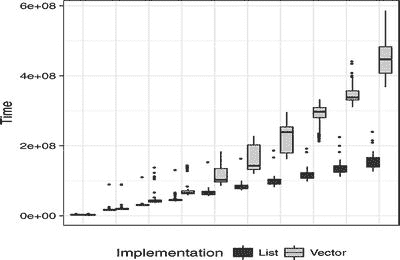

# 类与泛型函数

R 实现面向对象编程的方式是通过泛型函数和类。如引言所述，R 实际上有三种系统来实现这一点，分别称为 `S3`、`S4` 和 `R6`。在本章中，我将只描述三者中最简单的 `S3` 系统，但在后续章节中会介绍另外两种系统。


## 通用函数

术语“通用函数”指的是可用于多种数据类型的函数。由于 R 是动态类型语言，这意味着在运行程序之前不会进行类型一致性检查，类型检查实际上只关系到你是否能够按照函数尝试的方式操作数据。这也被称为“鸭子类型”，源自“如果它走起来像鸭子……”这一短语。如果你能对数据对象执行所需操作，那么它就具有正确的类型。通用函数发挥作用的地方在于，当你希望对不同类型的对象执行相同的语义操作，但操作的实现方式取决于具体类型时。通用函数是在不同类型的对象上以不同方式工作的函数。因此，它们也被称为多态函数。

为了使抽象讨论更加具体，让我们考虑一个抽象数据类型，例如栈。栈由我们可以对其执行的操作定义，例如：

*   获取栈顶元素
*   从栈中弹出第一个元素
*   将新元素推入栈顶

为了栈有一个基本情况，我们通常还需要一种方式来：

*   创建一个空栈
*   检查栈是否为空

这五个操作定义了什么是栈，但我们可以用许多不同的方式来实现栈。通过我们可以在栈上执行的操作来定义栈，使其成为一个抽象数据类型。要实现一个栈，我们需要一个具体的实现。

在静态类型编程语言中，我们会通过这些操作来定义栈的类型。具体做法取决于编程语言的类型和具体语言，但通常在静态类型的函数式语言中，你会为栈定义一个签名——即五个操作对应的函数及其类型——而在面向对象语言中，你会定义一个抽象超类。

在 R 中，类型是隐式定义的，但对于栈，我们同样会定义这五个函数。这些函数将是通用的，实际上并不包含任何实现；具体实现放在栈的具体实现中。

在定义栈的五个函数中，有一个是特殊的。创建一个空栈不能作为通用函数工作。当我们创建一个栈时，总是需要一个具体的实现。但其他四个可以定义为通用函数。定义通用函数需要使用`UseMethod`函数，这四个函数可以这样定义：

```
top <- function(stack) UseMethod("top")
pop <- function(stack) UseMethod("pop")
push <- function(stack, element) UseMethod("push")
is_empty <- function(stack) UseMethod("is_empty")
```

这里的`UseMethod`所做的是在 S3 面向对象编程系统中分派到不同的具体函数实现。当它被调用时，它会寻找一个函数的具体实现，并使用通用函数被调用时的参数来调用它。我们稍后会看到这个查找是如何工作的。

在定义通用函数时，你也可以指定“默认”函数。当`UseMethod`找不到具体实现时，这些函数会被调用。这通常在大多数情况下确实可以有一些默认行为时有用，这样并非所有具体类都需要实现它们。但是，即使它们所做的只是通知你未找到实际实现，也最好总是实现它们。例如：

```
top.default <- function(stack) .NotYetImplemented()
pop.default <- function(stack) .NotYetImplemented()
push.default <- function(stack, element) .NotYetImplemented()
is_empty.default <- function(stack) .NotYetImplemented()
```

## 类

为了实现抽象数据类型的具体实现，我们需要使用类。在 S3 系统中，你只需在对象上设置一个属性来创建一个类，并将一个类分配给一个对象。类的名称就是定义它的全部，所以实际上没有涉及真正的类型检查。任何对象都可以有一个名为“class”的属性，任何字符串都可以是类的名称。

我们可以使用向量来实现栈的具体实现。要定义这个类，我们只需要为它选择一个名称。我们可以使用`vector_stack`。我们通过一个用于创建空栈的函数来创建这样的栈，在这个函数中，我们使用`class<-`修改函数设置“class”属性。

```
empty_vector_stack <- function() {
stack <- vector("numeric")
class(stack) <- "vector_stack"
stack
}
stack <- empty_vector_stack()
stack
## numeric(0)
## attr(,"class")
## [1] "vector_stack"
attributes(stack)
## $class
## [1] "vector_stack"
class(stack)
## [1] "vector_stack"
```

空栈是一个数值向量，只是因为我们需一个类型来赋予空向量，但将其他值推入其中只会强制进行类型转换，因此我们也可以将其他基本类型放入其中。它仅限于基本数据类型，因为向量不能包含复杂数据；为此，我们需要一个列表。如果需要复杂数据，我们可以轻松地将实现更改为使用列表而不是向量。

我们将通过将元素放在向量的前面来推入元素，通过获取除第一个元素外的所有元素来弹出元素，当然，通过索引第一个元素来获取栈顶。这样的实现可能如下所示：

```
top.vector_stack <- function(stack) stack[1]
pop.vector_stack <- function(stack) {
new_stack <- stack[-1]
class(new_stack) <- "vector_stack"
new_stack
}
push.vector_stack <- function(element, stack) {
new_stack <- c(element, stack)
class(new_stack) <- "vector_stack"
new_stack
}
is_empty.vector_stack <- function(stack) length(stack) == 0
```

你会注意到，函数的名称由两部分组成。在“.”（点号）之前是定义栈的通用函数的名称，在点号之后是类名。这种名称格式具有语义意义；这是通用函数根据提供给它们的数据来确定应该调用哪个具体函数的方式。

当通用函数调用`UseMethod`时，该函数将检查调用通用函数时使用的第一个值是否具有关联的类。如果有，它将获取该类的名称，并查看是否能找到一个函数，其名称是通用函数的名称（即传递给`UseMethod`的`name`参数，不一定是调用`UseMethod`的函数的名称），后面跟着点号和类名。如果能找到，它将调用该函数。如果不能，它将寻找一个带有`.default`后缀的函数，如果存在，则调用该函数。

这种查找机制赋予了函数名称语义意义，除非你希望 R 以这种方式解释名称，否则你真的不应该在函数名中使用点号。R 中的内置函数在这方面并不谨慎——R 有很长的历史，在函数命名方面并不十分一致——但如果你不想意外地实现一个作为通用函数具体实现的函数，你就不应该这样做。

因此，如果我们对一个向量栈调用`push`，那么被调用的将是`push.vector_stack`而不是`push.default`。

```
stack <- push(stack, 1)
stack <- push(stack, 2)
stack <- push(stack, 3)
stack
## [1] 1 2 3
## attr(,"class")
## [1] "vector_stack"
```

在`push.vector_stack`中，我们显式地设置了连接后新向量的类。如果我们不这样做，我们只会创建一个普通向量——传递给`c`的第二个参数的栈特性不会传递到连接后的向量——并且我们不会返回一个栈。通过设置新向量的类，我们确保返回一个栈。


当我们移除向量的第一个元素时，类属性也不会被保留，这就是为什么我们还需要在`pop.vector_stack`函数中显式设置类。否则，我们只在第一次弹出元素时有一个栈，之后它就只是一个普通的向量了。通过显式设置类，我们确保函数返回的是一个栈，以便我们可以再次将其与泛型函数一起使用。

```
while (!is_empty(stack)) {
stack <- pop(stack)
}
```

剩余的两个函数，`top`和`is_empty`，并不返回栈对象，也不应该返回，所以我们不在那里设置类属性。

我们可以通过将类创建代码包装在另一个函数中，来避免每次更新时（即每次返回新值时；我们实际上并不修改对象）都显式设置类属性。这样的版本可能如下所示：

```
make_vector_stack <- function(elements) {
structure(elements, class = "vector_stack")
}
empty_vector_stack <- function() {
make_vector_stack(vector("numeric"))
}
top.vector_stack <- function(stack) stack[1]
pop.vector_stack <- function(stack) {
make_vector_stack(stack[-1])
}
push.vector_stack <- function(stack, element) {
make_vector_stack(c(element, stack))
}
is_empty.vector_stack <- function(stack) length(stack) == 0
```

当然，我们在创建更新后的栈时仍然设置类属性，只是我们通过使用`make_vector_stack`将向量转换为栈来隐式地完成。该函数使用`structure`函数来设置类属性，但除此之外，栈的表示方式和以前一样，只是一个向量。

## 运行中的多态性

拥有泛型函数的要点当然是，我们可以为抽象操作提供不同的实现。对于栈，我们可以尝试不同的表示。向量版本的缺点在于，每次我们返回一个修改后的栈时，都需要创建一个新的向量，这意味着要将旧向量中的所有元素复制到新向量中。这使得操作的时间复杂度与向量大小呈线性关系。使用链表，我们可以实现常数时间复杂度的操作。这样的实现可能如下所示：

```
make_list_node <- function(head, tail) {
list(head = head, tail = tail)
}
make_list_stack <- function(elements) {
structure(list(elements = elements), class = "list_stack")
}
empty_list_stack <- function() make_list_stack(NULL)
top.list_stack <- function(stack) stack$elements$head
pop.list_stack <- function(stack) make_list_stack(stack$elements$tail)
push.list_stack <- function(stack, element) {
make_list_stack(make_list_node(element, stack$elements))
}
is_empty.list_stack <- function(stack) is.null(stack$elements)
stack <- empty_list_stack()
stack <- push(stack, 1)
stack <- push(stack, 2)
stack <- push(stack, 3)
stack
## $elements
## $elements$head
## [1] 3
##
## $elements$tail
## $elements$tail$head
## [1] 2
##
## $elements$tail$tail
## $elements$tail$tail$head
## [1] 1
##
## $elements$tail$tail$tail
## NULL
##
##
##
##
## attr(,"class")
## [1] "list_stack"
```

通常，在使用列表时，我们会将`NULL`用作终止列表的基本情况。当我们需要为元素关联一个类时，我们不能只包装一个列表并以这种方式使用`NULL`。你不能将类的值设为`NULL`。因此，我们将实际的列表包装在另一个列表中，并在那里设置类属性。真实的数据位于这个列表的`elements`中，但是除了必须使用这个对象的列表元素外，我们只是像通常处理链表那样处理列表表示。

我们现在有了栈接口的两种不同实现，但是——这也是拥有泛型函数的全部意义——使用栈的代码不需要知道它操作的是哪种实现，只要它仅通过泛型接口访问栈。

我们可以在下面的小函数中看到这一点，该函数通过先将所有元素推入栈中，然后再将它们弹出栈来反转元素序列。

```
stack_reverse <- function(empty, elements) {
stack <- empty
for (element in elements) {
stack <- push(stack, element)
}
result <- vector(class(top(stack)), length(elements))
for (i in seq_along(result)) {
result[i] <- top(stack)
stack <- pop(stack)
}
result
}
stack_reverse(empty_vector_stack(), 1:5)
## [1] 5 4 3 2 1
stack_reverse(empty_list_stack(), 1:5)
## [1] 5 4 3 2 1
```

由于`stack_reverse`函数仅通过抽象接口引用具体的栈，我们可以给它一个向量栈或列表栈，它可以在两者上执行相同的操作。只要具体的数据结构都能正确地实现抽象接口，那么仅使用泛型函数的代码就可以在任何实现上工作。

一种单一的具体实现很少在所有情况下都占优势，因此，根据我们需要解决的具体问题，能够将适用于抽象数据类型的算法与具体实现相结合是有意义的。对于这两种栈实现，它们通常表现得同样好，但如上所述，栈实现具有最坏情况的二次运行时间，而列表实现具有线性运行时间。因此，对于大型栈，我们预计列表实现是最佳选择，但对于小型栈，以我们处理的方式操作列表实现有更多开销——与查找变量名和链接列表等有关——因此对于短栈，向量实现更快。

```
library(microbenchmark)
microbenchmark(stack_reverse(empty_vector_stack(), 1:10),
stack_reverse(empty_list_stack(), 1:10))
## Unit: microseconds
##                                       expr
##  stack_reverse(empty_vector_stack(), 1:10)
##    stack_reverse(empty_list_stack(), 1:10)
##      min       lq     mean   median       uq
##  195.787 217.2255 245.5698 229.8335 252.4785
##  235.270 257.0180 283.9289 271.5655 289.5300
##       max neval cld
##   965.714   100  a
##  1174.888   100   b
microbenchmark(stack_reverse(empty_vector_stack(), 1:1000),
stack_reverse(empty_list_stack(), 1:1000))
## Unit: milliseconds
##                                         expr
##  stack_reverse(empty_vector_stack(), 1:1000)
##    stack_reverse(empty_list_stack(), 1:1000)
##       min       lq     mean   median       uq
##  28.22786 32.30359 37.77813 34.25044 36.49355
##  23.38964 24.40046 26.14922 25.47550 26.65488
##        max neval cld
##  124.57810   100   b
##   61.01179   100  a
```

绘制不同长度栈的时间使用情况图，更加明显地表明，随着栈变长，列表实现相对于向量实现变得更高效。



图 1-1. 使用两种不同栈进行反转的时间消耗

仅在栈非常短的情况下，向量实现才是可取的——二次与线性运行时间的分界点出现在非常小的 n 值时——但一般来说，不同的使用场景会有不同的首选实现。通过编写多态代码，我们确保可以更改数据结构的实现，而无需修改使用它的算法。


