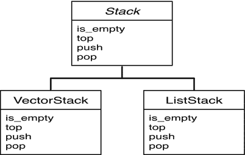
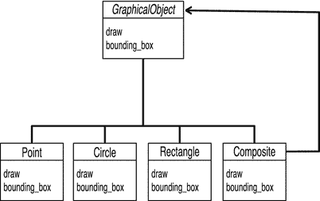
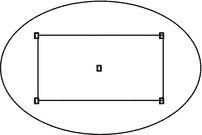

# 2. 类层次结构

多态性的含义远不止是拥有不同具体实现的抽象数据类型。在大多数面向对象的编程语言中，一个基本概念是类和类层次结构。类层次结构服务于两个概念上不同的目的：对象接口的细化和代码复用。严格来说，这两个概念在 R 语言中都不需要类层次结构，因为 R 是动态类型的，不像 C++ 或 Java 等语言，其类层次结构与静态类型系统紧密交织。尽管如此，类层次结构提供了一个思考软件设计的框架，这非常有用，尤其是在动态类型语言中。

我们将在接下来的两节中详细探讨这两个概念，但简而言之，接口描述了一个给定类的对象必须实现哪些（泛型）函数，而层次结构则根据这些函数，以“更抽象/更细化”的关系将接口链接起来。在上下文中，代码复用仅仅是指编写能够操作不止一类对象的函数——本质上就是我们上一章看到的多态函数类型——并将这类函数本身作为泛型函数纳入类层次结构。

## 接口与实现

我们可以将一个类的接口视为我们可以应用于该类对象的操作或方法类型。在 R 中，这意味着我们可以以有意义的方式调用哪些函数，并将这些对象作为参数传递。

如果我们从抽象数据结构的角度思考，例如上一章中的栈，它们是由其支持的操作定义的。你可以对栈进行压入（push）和弹出（pop）操作，检查它是否为空，并且可以获取顶部元素；这些函数，连同创建栈的方法，共同定义了“栈性”。至少，只要这四个函数也具备我们与栈关联的语义。

在抽象层面，我们可以通过形式参数和语义来描述一个函数的接口。例如，我们可以将函数 `push` 与其两个形式参数——一个栈和一个元素——以及它应该返回添加了该元素到顶部的栈的语义关联起来。如果我们用形式参数和语义这两个属性来关联 `push` 操作，我们就得到了一个可以称之为抽象函数的东西。正如我们所见，我们可以用不同的具体方式实现这样的抽象函数，但这些具体函数的调用者只需关心抽象描述就能确保功能正确性（尽管性能当然也可能是一个考量点，但此处我们并未将其与抽象函数的接口关联）。

有了抽象函数的这个定义，我们可以说一个抽象数据类型是由一组抽象函数定义的。如果我们称一组抽象函数为一个接口，那么一个抽象数据类型就是由一个接口定义的。我们可以通过编写接口中所有抽象函数的实现来实现一个抽象数据结构。这可以称之为接口的（具体）实现或类似的说法。我们仅通过了解抽象数据类型的接口就可以推理算法和设计软件，并且如果我们有接口的不同实现可供选择，那么理论上可以使用其中任何一个。

接口和实现等概念不仅在设计抽象数据结构时有用。对于你想在程序中操作的任何类型的数据，你都可以想出可以对该数据执行的一组有意义的操作，从而为该数据类型创建一个接口，并且你可以以不同的方式为这些操作编写函数，以创建不同的实现。

## 多态性与接口

如果我们回过头来思考接口，我们可以说，如果一个类实现了构成接口的所有抽象函数，那么它就实现了一个接口。这仅仅意味着，如果我们取这个类的对象，我们就拥有了可以针对接口中每个抽象函数调用的具体函数。然而，如果没有泛型/多态函数，对于实现给定接口的每个类，我们需要知道哪个具体函数映射到哪个抽象函数。将一个接口的实现替换为另一个将需要重写使用该实现的代码。因此很自然地，我们也会要求具体函数的名称与抽象函数的名称相匹配。

这显然直接映射到了泛型函数。如果每当我们想到抽象函数时，就将其映射到一个泛型函数——一个简单调用 `UseMethod` 的函数——而每当想到具体函数时，就想到一个泛型函数的实现——一个名称中带有句点的函数——那么我们就有了一个几乎自动的将接口和实现概念映射到代码的方式。

由于 R 不进行任何静态类型检查，你几乎无法保证以这种方式编写的类确实实现了给定的接口。泛型函数中没有任何东西明确地将它们作为一个接口绑定在一起，因此对于你决定实现的任何类，你可以实现泛型函数的任意子集。接口和实现是设计概念，你可以非常容易地将设计映射到 R 代码中，但 R 并不强制你的代码与设计匹配。


## 抽象类与具体类

在设计软件时，我们常常将接口和实现统一视为类。面向对象的软件思考方式如下：你所处理的每一条数据都是一个对象，而所有对象都有一个决定其行为的类。这里的“行为”仅指我们可以在对象上调用的函数。这种思维方式在可以修改数据、因而对象具有状态的语言中更有意义。无论如何，你都可以将所有数据视为对象，其关联的类决定了你可以对它们做什么。

因此，一个类既封装了你可以对对象做什么——即你拥有的接口，也封装了如何做到——即接口是如何实现的。

对象拥有类，而类决定了你能对对象做什么。但类存在于由更抽象或更派生的类构成的层次结构中。一个基于向量实现的栈就是一个栈。诚然，它是一种特殊的栈，但它仍然是一个栈。栈的一般概念比基于向量的实现更为通用，因此向量实现可以被视为栈的一种特例——即使用向量实现的栈。

我们通常将类层次结构视为“是一种”关系的一部分。一个基于向量的栈实现“是一种”栈。基于列表的实现也是如此。如果你有一个更具体类的对象，你应该也能够将其视为一个更抽象类的对象。如果你有一个向量栈，你可以将其视为一个栈，因为它的类是向量栈类，而这是栈类的一个特例。

最接近接口和实现概念的是抽象类和具体类。抽象类实质上就是一个接口。它只不过是对你可以用这个类的对象做什么的描述；它本身没有与之关联的实现。另一方面，具体类则实现了你可以在给定类的对象上调用的所有函数。然而，很多时候，类实现了其接口所描述的部分但并非全部函数，因此在实践中这种区分并不那么清晰。

我们经常用图表来展示类及其关系，如图 2-1 所示。这里 `Stack` 以斜体显示，表示它是一个抽象类。类名下方列出了你可以在该类上调用的方法，从一个类指向另一个类的箭头表示一个类派生自另一个类。这里我们看到向量栈和列表栈（这里称为 `VectorStack` 和 `ListStack`）派生自 `Stack`。



图 2-1. 栈的类层次结构

这两个具体类只实现了抽象类中也列出的方法，因此，我们并不总是在派生类中再次列出这些方法。应理解的是，任何在更抽象类中实现的方法，也会在更派生的类中实现。

## 在 R 中实现抽象类和具体类

我们在前一章已经看到，属性 `class` 如何用于确定给定对象调用泛型函数的哪个版本。这种分派泛型函数的方法是 S3 系统实现类的方式，但在某种意义上只处理了抽象函数的具体实现。拥有一个泛型方法 `foo`

```
foo <- function(object) UseMethod("foo")
```

我们为类 `bar` 实现它

```
foo.bar <- function(object) ...
```

这只告诉 R 类 `bar` 如何实现 `foo` 函数。如果 `foo` 是由多个函数组成的接口的一部分，这在 R 代码中并没有明确说明。

如果我们把接口看作一组抽象函数，那么在 R 中，将它们视为一个整体只是我们非正式的做法。既然抽象类不过是接口，我们可以对抽象类做同样的事情。当我们在前一章实现基于向量的栈时，我们通过将从构造函数 `empty_vector_stack` 返回的对象的 `class` 属性设置为 `vector_stack` 来实现，并通过实现我们认为属于栈接口的四个函数：`push`、`pop`、`top` 和 `is_empty`。我们从未明确指出存在某个抽象的栈类以及 `vector_stack` 是它的特化。

由于以这种方式实现的类机制本质上是在函数级别工作的——我们有泛型函数以及基于其名称分派的实现——类和它们的关系在 R 中可能非常混乱。你可以通过以比语言本身要求更有结构的方式思考软件设计来缓解这个问题。在设计软件时考虑类，通过定义一组泛型函数来实现抽象类——你可以使用注释将它们组合在一起，并记录这些函数构成一个接口。确保当你定义一个实现接口的具体类时，不会忘记接口中的任何函数。你可能不会全部实现它们；有时有充分的理由，有时你只是务实，暂时不去实现那些可能难以实现但你目前还不需要的功能。但要确保这是一个经过深思熟虑的选择，而不是仅仅忘记了一个函数。

你可以使用 `methods` 函数来获取一个类实现的所有方法列表

```
methods(class = "vector_stack")
## [1] is_empty pop      push     top
## see '?methods' for accessing help and source code
```

并检查你是否已经实现了所有内容。你也可以使用这个函数来获取实现给定泛型函数的所有类列表。

```
methods("top")
## [1] top.default      top.list_stack
## [3] top.vector_stack
## see '?methods' for accessing help and source code
```


### 另一个示例：图形对象

类层次结构所基于的 **“是一个”** 关系，其灵活性远超仅仅拥有抽象类及其实现。它不仅为我们提供了一种建模方式，表明某些对象确实属于不同但相关的类，还为我们提供了一种将接口视为其他接口特化的机制。

让我们考虑一个例子，比如在一个操作某些图形对象的应用程序中——也许是作为新可视化包的一部分。该应用程序最基础的类是 `GraphicalObject`，其对象可以被 `绘制`。能够绘制对象是图形对象所需的最基本操作。图形对象还有一个 **“边界框”** ——一个矩形，用于告诉我们形状有多大，这在绘制对象时可能是必需的。

这个类是抽象的，不仅仅因为我们定义了一个接口以便拥有不同的实现（就像我们处理栈时那样），而且因为在如此抽象的层面上拥有一个图形接口本身并无实际意义。一个有意义的具体类是 `Point`，它是一个代表单个点的图形对象。其他类可以是 `Circle` 和 `Rectangle`。

为了以便捷的接口处理多个图形对象，我们还有一个类 `Composite`，用于捕获图形对象的集合。



图 2-2.

图形对象的类层次结构。从 `Composite` 指向 `GraphicalObject` 的箭头，其起点为菱形，终点为箭头，表示一个 `Composite` 由一系列 `GraphicalObject` 组成。

将对象集合视为与其组成部分属于同一类的对象，是一种所谓的设计模式，它使得在此应用程序中处理复杂图形变得更容易。我们可以将图形对象以层次结构分组——类似于在绘图工具中分组对象——并且在我们的代码中无需显式检查我们是在处理单个对象还是一个对象集合。一个对象集合本身也是一个图形对象，我们可以直接这样对待它。

实现这个类层次结构相当简单。抽象类 `GraphicalObject` 没有被显式表示，但我们需要将其方法作为泛型函数。

```
draw <- function(object) UseMethod("draw")
bounding_box <- function(object) UseMethod("bounding_box")
```

在构造图形对象时，我们需要设置它们的类，以下是具体类的构造函数：

```
point <- function(x, y) {
object <- c(x, y)
class(object) <- "point"
names(object) <- c("x", "y")
object
}
rectangle <- function(x1, y1, x2, y2) {
object <- c(x1, y1, x2, y2)
class(object) <- "rectangle"
names(object) <- c("x1", "y1", "x2", "y2")
object
}
circle <- function(x, y, r) {
object <- c(x, y, r)
class(object) <- "circle"
names(object) <- c("x", "y", "r")
object
}
composite <- function(...) {
object <- list(...)
class(object) <- "composite"
object
}
```

我们只是将图形对象实现为向量，除了 `composite`，我们将其表示为列表，以便它能包含其他不同类型的图形对象。点只是坐标向量，矩形由两个坐标（矩形的左下角和右上角）表示，圆由一个中心点和一个半径表示。

对于 `draw` 方法，我们可以直接使用基本的图形函数：

```
draw.point <- function(object) {
points(object["x"], object["y"])
}
draw.rectangle <- function(object) {
rect(object["x1"], object["y1"], object["x2"], object["y2"])
}
draw.circle <- function(object) {
plotrix::draw.circle(object["x"], object["y"], object["r"])
}
draw.composite <- function(object) {
invisible(Map(draw, object))
}
```

除了圆以外，我们都可以使用基本的图形函数，为了便利，对于圆我们使用了 `plotrix` 包中的 `draw.circle` 函数。对于集合类，我们只是对其所有组成部分调用 `draw`。我们将对 `Map` 的调用包裹在 `invisible` 中，是因为我们不希望在命令提示符每次调用该函数时都打印一个对象列表，除此之外，实现是直接的。

利用这些函数，我们可以构造图形元素的图形，参见图 2-3。



图 2-3.

图形元素的图形

```
plot(c(0, 10), c(0, 10),
type = 'n', axes = FALSE, xlab = '', ylab = '')
draw(point(5,5))
draw(rectangle(2.5, 2.5, 7.5, 7.5))
draw(circle(5, 5, 4))
corners <- composite(point(2.5, 2.5), point(2.5, 7.5),
point(7.5, 2.5), point(7.5, 7.5))
draw(corners)
```

这里我们必须设置图形的尺寸，使其确实包含我们想要显示的元素。我们有 `bounding_box` 函数来计算该区域，我们可以像这样实现不同的方法：

```
bounding_box.point <- function(object) {
c(object["x"], object["y"], object["x"], object["y"])
}
bounding_box.rectangle <- function(object) {
c(object["x1"], object["y1"], object["x2"], object["y2"])
}
bounding_box.circle <- function(object) {
c(object["x"] - object["r"], object["y"] - object["r"],
object["x"] + object["r"], object["y"] + object["r"])
}
bounding_box.composite <- function(object) {
if (length(object) == 0) return(c(NA, NA, NA, NA))
bb <- bounding_box(object[[1]])
x1 <- bb[1]
y1 <- bb[2]
x2 <- bb[3]
y2 <- bb[4]
for (element in object) {
bb <- bounding_box(element)
x1 <- min(x1, bb[1])
y1 <- min(y1, bb[2])
x2 <- max(x2, bb[3])
y2 <- max(y2, bb[4])
}
c(x1, y1, x2, y2)
}
```

有了这些，我们可以在绘图前将所有想要绘制的图形元素收集到一个 `composite` 对象中并计算边界框。

```
all <- composite(
point(5,5),
rectangle(2.5, 2.5, 7.5, 7.5),
circle(5, 5, 4),
composite(point(2.5, 2.5), point(2.5, 7.5),
point(7.5, 2.5), point(7.5, 7.5))
)
bb <- bounding_box(all)
plot(c(bb[1], bb[3]), c(bb[2], bb[4]),
type = 'n', axes = FALSE, xlab = '', ylab = '')
draw(all)
```

结果当然与图 2-3 中所示相同。


