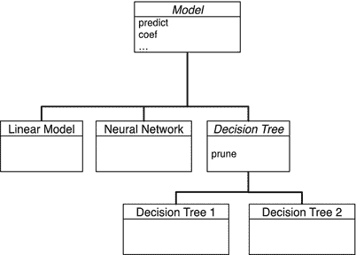
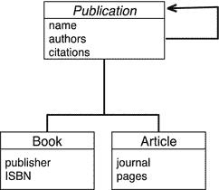

# 通过细化实现类层次结构的接口

到目前为止，在给出的示例中，我们有一个抽象类定义了一个接口，然后由不同的具体类来实现它。在`stack`的例子中，不同的实现为我们提供了不同的时间复杂度权衡，但这些不同实现在概念上都只是栈。在图形对象的例子中，各种具体类在概念上是不同的对象，但它们都可以被视为图形对象，从而通过通用接口进行操作。这些是软件设计中常见的模式，但当子类（例如不同类型的图形对象）代表不同的概念类时，它们通常也可以扩展接口。

以统计模型为例。这些通常被实现为类，这些类实现一些泛型函数，例如`predict`或`coef`，这为我们提供了统一的模型接口，使得在分析中能够切换不同的模型而无需对分析代码进行重大重写。所有模型实现的泛型函数为我们提供了最抽象类型的模型接口。例如，所有模型都必须实现`predict`和`coef`，我们才能在分析代码中将它们作为即插即用的替代品，但不同类型的模型可能会向此接口添加并非所有模型都适用的附加功能。例如，我们可以想象决策树会添加用于剪枝的功能，例如一个`prune`函数。如果所有决策树实现都有一个`prune`函数，我们可以更换决策树的实现并且仍然重用我们的代码，但由于`prune`并非为所有模型实现，我们只能用一个决策树实现替换另一个决策树，而不是任意类型的模型。我们会说决策树是模型的**特化**。所有决策树都是模型，但并非所有模型都是决策树。在类的术语中，我们会有一个模型的超类和一个决策树的子类，该子类向模型的接口添加了如`prune`这样的函数。如果我们有决策树的不同实现，决策树类通常也是抽象的，不同的实现会继承自这个类，而不是更通用的模型类（见图 2-4）。



**图 2-4.** 模型层次结构，其中决策树是`Model`类的特化，它添加了`prune`函数，并为我们提供了一个额外的抽象类，决策树的实例必须实现此类。

另一个例子，我们可以考虑参考书目，它本质上是一个出版物列表。有不同类型的出版物，但所有出版物至少有一个名称和一个或多个作者，因此表示出版物的最抽象方式将只具有这两个属性。我们可能希望对出版物列表做的一件事是计算文献计量学指标，例如一篇出版物有多少次引用。如果每篇出版物都有一个它所引用的其他著作的列表，那么我们可以从所有相关出版物的数据库中计算出这个数字。如果我们有给定作者创建的所有出版物的列表，我们也可以计算这位特定作者收到了多少引用，或者推导出如 h 指数这样的统计数据。

有不同类型的出版物，因此我们可以为书籍和文章等创建子类。一本书将有一个相关的出版商和一个 ISBN，而期刊文章将有一个相关的期刊和（通常）可以在期刊中找到该文章的页码。如果我们为了简化，只允许这两种类型的出版物，我们可以将其表示为图 2-5 所示的类层次结构。



**图 2-5.** 参考书目对象的层次结构。通用的`Publication`类为每篇出版物提供名称、作者列表和引用的其他出版物列表。两种具体类型的出版物，`Article`和`Book`，添加了额外的属性。

在这个层次结构中，所有函数都只是访问对象的属性；也就是说，它们只是提取存储在这些对象中的数据。通常，通过函数访问属性，而不是访问作为对象表示形式一部分的列表或向量，是一个好主意。这允许您更改数据的表示方式，而无需修改除了访问器函数之外的任何代码。如果您的代码仅通过函数访问您的对象，那么您就封装了实现细节，后续更新代码将比原来简单得多。

还要注意，在这两种具体类型的出版物之间，没有一个访问器函数需要不同。抽象的`Publication`类访问`name`和`authors`，其他类中提供的附加属性是互不相交的。因此，不需要为这个类层次结构实现泛型函数。我们可以只使用普通的旧函数来完成。

```
# publication interface
publication <- function(name, authors, citations) {
structure(list(name = name, authors = authors,
citations = citations),
class = "publication")
}
name <- function(pub) pub$name
authors <- function(pub) pub$authors
# articles
article <- function(name, authors, citations, journal, pages) {
structure(list(name = name, authors = authors,
citations = citations,
journal = journal, pages = pages),
class = c("article", "publication"))
}
journal <- function(pub) pub$journal
pages <- function(pub) pub$pages
# book
book <- function(name, authors, citations, publisher, ISBN) {
structure(list(name = name, authors = authors,
citations = citations,
publisher = publisher, ISBN = ISBN),
class = c("book", "publication"))
}
publisher <- function(pub) pub$publisher
ISBN <- function(pub) pub$ISBN
```

对于在不同类中为相同的概念操作获得不同行为，泛型函数是完美的，但是当我们能够使用普通的旧函数获得期望的操作时，就没有理由调用泛型函数。

出版物的实现很简单，除了构造函数中设置的`class`属性。在这里，我们将类设置为类名的列表，而不仅仅是类名。这就是我们指定`"book"`对象或`"article"`对象也是一个`"publication"`对象的方式。我们设想的这种设计要求书籍和文章都是出版物，但由于 S3 类只是表示为字符串的名称，我们无法在 R 中明确这一点。相反，我们通过让`class`属性成为类名的列表来表示类层次结构，从最特殊的对象到最抽象的对象沿层次结构向上。R 如何解释这样的类名列表，以及它如何使用它来查找泛型函数的正确实现，是下一章的主题。

拥有类似于我们这里为出版物创建的类层次结构并不少见，但它存在一些轻微的问题。要访问书籍特有的属性，您需要知道您正在处理的对象是一本书；处理聚合的出版物而无需编写专门处理书籍或文章的代码，正是使用面向对象并创建出版物层次结构的目的所在。拥有子类向其超类接口添加函数的类层次结构并没有错，但如果您发现自己在编写这样的层次结构，您应该仔细思考如何访问和操作来自该层次结构的对象。


