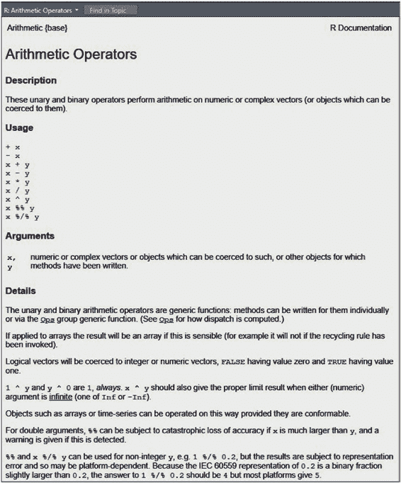

# `install.packages(ch02Packages)`

```r
library(data.table)
library(haven)
library(readxl)
library(writexl)
```

至此，你已拥有五个为本章节旅程添加额外功能的包。请注意，你需要事先知道这些包的*名称*。一般来说，这些节省时间和工作的包名是通过社交媒体（`#rstats` 是某个与鸟类相关的应用上的常见标签）、关注某些热门包的作者、阅读各类在线博客或阅读本书这样的读物而了解到的。许多 R 语言的作者（包括本人）和包的创建者都倾向于通过社交媒体分享小插图和包。

## 2.2 帮助与文档

R 社区拥有许多帮助用户的资源。从预构建的函数到包中整个主题函数的集合，存在多种支持形式。`?` 和 `help()` 都是访问对象或函数信息的有效方式。对于更常见的对象，R 不仅提供了关于输入（针对函数）等具体细节的详尽文档，还详细说明了这些输入应接收何种内容。

此外，通常还会有详细的示例展示可以实现的功能。图 2-1 展示了使用加法运算符时这两个函数的输出：

```
?'+'
help("+")
```



**图 2-1.** *一份 R 手册帮助文件*

请注意，算术运算符的文档提供了具体信息，指出输出可能因平台而异。重要的是要认识到，并非所有函数都拥有如此完整的文档，但对于许多最常见的函数和包，都可以获得极其丰富的信息。编写能重现预期结果且不受平台和环境影响的代码，并非总是可行。稍后当我们讨论调试时，正是这种对各种函数的高级了解会有所帮助。

当然，当你已经知道自己要使用的对象或函数，只需了解更多细节时，这种帮助更有用。当想要完成全新任务时，查阅手册会有所帮助。其中一个网站是由 *R 开发核心团队* 维护的 [`cran.r-project.org/manuals.html`](https://cran.r-project.org/manuals.html)。

一种更常见（虽然不太精确）的获取信息方式是在你喜欢的搜索引擎上进行合适的搜索查询。本书作者们经常使用类似 `R help 函数名` 的变体来查找示例和用例。此类搜索也可以包含错误或警告消息，这有助于加深对函数或输入可能出现问题的理解。

## 2.3 系统与文件

在 Windows 环境中，R 可能是实现文件操作自动化相当有效的方式。IT 部门通常愿意安装 R，并且它拥有与你的用户名相同的文件权限。从创建文件、移动文件到检查日期，R 提供了多种函数来从系统获取信息并自动化文件管理。使用基于 Unix 系统的读者通常已有更优雅的方式在命令行处理此类场景。

R 访问系统的一个有用特性是，它可以发现运行 R 的系统当前的日期、时间和时区。这有助于检测新文件，或用于在文件中添加时间戳（稍后会详细说明）。应注意，这些当然依赖于系统环境的准确性，因此在用于高风险项目之前需谨慎：

```r
Sys.Date()
## [1] "2020-04-29"

Sys.time()
## [1] "2020-04-29 19:13:56 CDT"

Sys.timezone()
## [1] "America/Chicago"
```

这些命令的帮助文档提供了有用的建议，以增加输出的精度，最高可达毫秒或微秒级。

出于故障排除的目的，`Sys.getenv()` 函数对于了解你的 R 环境的许多默认设置非常有用。虽然运行该命令足够安全，但由于其输出与特定机器（及个人）信息相关，我们选择不在此处展示输出结果。尽管如此，深入了解你的 R 环境“内部运作”还是很有趣的。

当我们将注意力转向各种文件管理函数时，需要提醒一句：R 拥有与你相同的权限，其中一些文件函数可能会删除文件、写入足以填满驱动器的文件，因此通常应该谨慎使用。

话虽如此，有时你需要“大规模”处理大量文件，而这些函数虽然功能强大，但都非常有用。这些函数共享 `file.*` 格式，其第一个参数是一个字符向量，应为当前*工作目录*下的一个文件名或路径加文件名。我们从工作目录下 `data/ch02` 文件夹内的一个文本文件 `ch02_text.txt` 开始。

**注意：** 对于以下示例，我们建议你已从本书的 github 站点下载了完整的文件集（详见第 1 章）。如果没有，那么你需要在工作目录内创建一个名为 `data` 的文件夹；在该文件夹内，创建一个名为 `ch02` 的子文件夹；并在该子文件夹内创建一个名为 `ch02_text.txt` 的空白文本文件。无论哪种情况，你的输出都不太可能与我们这里的输出完全一致，因为文件创建和复制的时间会有所不同。不过，结构应该保持不变。

函数 `file.exists()` 仅接受一个字符串输入，该字符串是一个文件名或路径加文件名。如果只是文件名，它仅检查工作目录。此工作目录可以通过 `getwd()` 函数验证（另一个虽然运行安全，但我们将避免使用的函数）。如果想检查另一个目录中的文件，可以在字符串中给出完整的文件路径来实现。此函数返回一个逻辑值 `TRUE` 或 `FALSE`。根据特定文件的用户权限，你可能会得到非预期的结果。换句话说，如果你无权访问某个文件（例如在共享网络驱动器上），即使该文件确实存在，存在性检查也可能返回 `false`：

```r
# getwd() #运行安全 - 结果因机器而异
file.exists("data/ch02/ch02_text.txt") #预期**返回** TRUE
## [1] TRUE

file.exists("NOSUCHFILE.FAKE") #预期**返回** FALSE
## [1] FALSE
```

前面的函数检查文件是否存在，另一个函数则测试我们是否有权访问某个文件。函数 `file.access()` 接受类似的输入，但它还接受第二个参数。测试存在性时，第二个参数是 `0`。测试可执行权限时，使用 `1`；测试写入权限时，使用 `2`。如果你想测试读取文件的能力，请使用 `4`。此函数返回一个整数向量，`0` 表示已授予权限，`-1` 表示未授予权限。

请注意，该函数的默认设置是测试简单的存在性。`file.access()` 的示例如下：

```r
file.access("data/ch02/ch02_text.txt", mode = 0)
## data/ch02/ch02_text.txt
## 0

file.access("data/ch02/ch02_text.txt", mode = 1)
## data/ch02/ch02_text.txt
## -1

file.access("data/ch02/ch02_text.txt", mode = 2)
## data/ch02/ch02_text.txt
## 0

file.access("data/ch02/ch02_text.txt", mode = 4)
## data/ch02/ch02_text.txt
```


