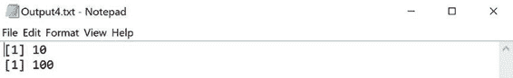

# 第 2 章：编程实用工具

## 2.5 输出

与输入类似，输出也有多种形式。可能由于与其他研究人员或合作伙伴的合作，常常需要适配其他软件系统。同样，R 可以轻松输出为多种文件类型。通常，除了单纯的文件格式转换外，更主要的兴趣在于将特定的控制台输出写入某些文件。这样，一台机器就可以查看在另一台计算机上运行的分析结果。在本节中，我们将演示如何将数据输出为 SPSS、Stata 和 Excel 格式。然后，我们将处理控制台输出。请您记住，还有许多其他创建文件的方式和类型，并且在更大型的示例中，我们会演示包括各类文档文件和图形在内的多种类型。

除了前缀 `write` 之外，这些函数调用与前文“输入”部分高度相似：

```
write_xlsx(countiesTxCSV, "data/ch02/Output1.xlsx")  # Excel
write_sav(countiesTxCSV, "data/ch02/Output2.sav")    # SPSS
write_dta(countiesTxCSV, "data/ch02/Output3.dta")    # Stata
```

`sink()` 函数接收控制台输出并将其定向到文件。因此，R 进程的结果可以保存下来供日后查看，或保存到共享驱动器供他人查阅。控制台仅将输出发送到文件，而非输入。调用不带文件参数的该函数将关闭与文件的连接。请仔细观察以下代码与图 2-2 所示的 `Output4.txt` 截图之间的区别：

```
sink("data/ch02/Output4.txt", append = TRUE, split = TRUE)
x <- 10
xSquared <- xˆ2
x
## [1] 10
xSquared
## [1] 100
sink()
```



**图 2-2.** 输出文本文件的截图

### 2.6 小结

在本章中，我们学习了安装一些外部包来获取额外的数据输入和输出功能。表 2-1 列出了本章的关键包和函数。

**表 2-1.** 本章描述的关键函数及其功能总结

| **函数** | **功能** |
|---|---|
| `data.table` | 良好地读取 CSV 文件。 |
| `haven` | 读取和写入 SPSS 及 Stata 文件。 |
| `readxl` | 读取 Excel 文件。 |
| `writexl` | 写入 Excel 文件。 |
| `?` | 在函数名之前使用，打开帮助手册。 |
| `help()` | 与上面的 `?` 相同。 |
| `Sys.Date()` | 显示系统日期。 |
| `Sys.time()` | 系统时间戳。 |
| `Sys.timezone()` | 本地系统时区。 |
| `getwd()` | 显示工作目录。 |
| `file.exists()` | 返回布尔值，指示指定文件是否存在。 |
| `file.access()` | 返回 0 表示“是”，返回 -1 表示“否”，指示访问权限。 |
| `file.info()` | 返回包含文件大小、类型、修改时间（相较于创建时间和访问时间）的数据框。 |
| `file.create()` | 创建文件。 |
| `file.remove()` | 删除文件，在 Windows 上可能不会使用回收站！ |
| `file.copy()` | 复制文件。 |
| `file.rename()` | 重命名文件，而无需创建新副本。 |
| `dir.create()` | 创建新文件夹或目录。 |
| `dir.exists()` | 返回布尔值，指示指定目录是否存在。 |
| `fread()` | 将 CSV 文件读取为 `data.table`。 |
| `head()` | 显示数据框的前六行。 |
| `read_dta()` | `haven` 包函数，用于读取 Stata 文件。 |
| `read_spss()` | `haven` 包函数，用于读取 SPSS 文件。 |
| `tail()` | 显示数据框的后六行。 |
| `read_xlsx()` | `readxl` 包函数，用于读取 Excel xlsx 文件。 |
| `write_xlsx()` | `writexl` 包函数，用于写入 Excel xlsx 文件。 |
| `write_sav()` | `haven` 包函数，用于写入 SPSS 文件。 |
| `write_dta()` | `haven` 包函数，用于写入 Stata 文件。 |
| `sink()` | 将 R 控制台输出写入文件。 |

---

