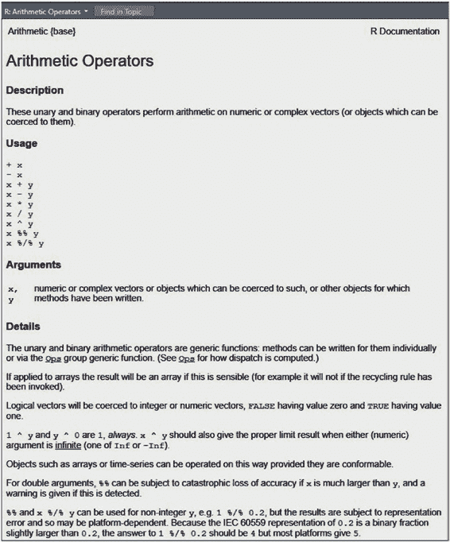
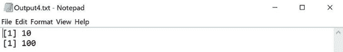

## 第 2 章 编程实用工具

R 语言的一个强大特性在于其拥有一个由技术娴熟、友善的爱好者、开发者和 *包* 作者组成的社区。特别是，为了扩展 *基础* R 的功能，你可以查找并添加 *包*，从而能够使用新的函数。

需要提醒的是，在 R 中，函数通常是代码根据一个或多个 *输入*（也称为 *形参*）来创建 *输出* 或结果所执行的操作。虽然我们将如何编写自定义函数的讨论留到另一章，但使用 R 社区创建和共享的函数，能够极大地扩展 R 的能力。

具体来说，本章将重点关注那些用于深入了解函数、操作系统环境与文件管理、以及 R 数据输入与输出的函数：

```r
options(width = 70, digits = 2)
```

## 2.1 安装与使用包

包托管在 CRAN[1] 上，它内置于基础 R 环境中（准确地说，是集成在一个名为 `utils` 的包中，该包随基础 R 预加载）。使用一个包需要用到两个函数。一个是 `install.packages()`，这个函数每台设备 *只需运行一次*。另一个是 `library()`，每次会话运行一次。我们注意到，一些刚接触 R 的同事和学生有时会过于频繁地安装包。虽然不必要地使用 `install.packages()` 函数没有特别的害处，但在每台设备上只运行一次可以节省时间。特别请注意，如果你已经学习过第 1 章的内容，那么 `data.table` 应该已经安装好了，因此无需重新安装该包。另一方面，如果你直接跳到了本章（当然这也没问题），那么你现在就需要安装 `data.table` 包。

在以下代码中，我们注释掉了对已熟悉的 `data.table`[9] 以及本章新介绍的 `haven`[33]、`readxl`[27] 和 `writexl`[13] 的安装。虽然我们现在运行了 `library()` 函数，但我们将在本章后面首次使用每个包时，再进行更深入的讨论。要运行被注释的代码，只需在使用该行代码时不包含井号（`#`）即可。请注意，R 语言在输入包名和函数名时区分大小写。

```r
# ch02Packages <- c("data.table", "haven", "readxl", "writexl")
```

# `install.packages(ch02Packages)`

```r
library(data.table)
library(haven)
library(readxl)
library(writexl)
```

至此，你已拥有五个为本章节旅程添加额外功能的包。请注意，你需要事先知道这些包的`名称`。一般来说，这些节省时间和工作的包名是通过社交媒体（`#rstats` 是某个与鸟类相关的应用上的常见标签）、关注某些热门包的作者、阅读各类在线博客或阅读本书这样的读物而了解到的。许多 R 语言的作者（包括本人）和包的创建者都倾向于通过社交媒体分享小插图和包。

## 2.2 帮助与文档

R 社区拥有许多帮助用户的资源。从预构建的函数到包中整个主题函数的集合，存在多种支持形式。`?` 和 `help()` 都是访问对象或函数信息的有效方式。对于更常见的对象，R 不仅提供了关于输入（针对函数）等具体细节的详尽文档，还详细说明了这些输入应接收何种内容。

此外，通常还会有详细的示例展示可以实现的功能。图 2-1 展示了使用加法运算符时这两个函数的输出：

```
?'+'
help("+")
```



`图 2-1. 一份 R 手册帮助文件`

请注意，算术运算符的文档提供了具体信息，指出输出可能因平台而异。重要的是要认识到，并非所有函数都拥有如此完整的文档，但对于许多最常见的函数和包，都可以获得极其丰富的信息。编写能重现预期结果且不受平台和环境影响的代码，并非总是可行。稍后当我们讨论调试时，正是这种对各种函数的高级了解会有所帮助。

当然，当你已经知道自己要使用的对象或函数，只需了解更多细节时，这种帮助更有用。当想要完成全新任务时，查阅手册会有所帮助。其中一个网站是由*R 开发核心团队*维护的 [`cran.r-project.org/manuals.html`](https://cran.r-project.org/manuals.html)。

一种更常见（虽然不太精确）的获取信息方式是在你喜欢的搜索引擎上进行合适的搜索查询。本书作者们经常使用类似 `R help 函数名` 的变体来查找示例和用例。此类搜索也可以包含错误或警告消息，这有助于加深对函数或输入可能出现问题的理解。

## 2.3 系统与文件

在 Windows 环境中，R 可能是实现文件操作自动化相当有效的方式。IT 部门通常愿意安装 R，并且它拥有与你的用户名相同的文件权限。从创建文件、移动文件到检查日期，R 提供了多种函数来从系统获取信息并自动化文件管理。使用基于 Unix 系统的读者通常已有更优雅的方式在命令行处理此类场景。

R 访问系统的一个有用特性是，它可以发现运行 R 的系统当前的日期、时间和时区。这有助于检测新文件，或用于在文件中添加时间戳（稍后会详细说明）。应注意，这些当然依赖于系统环境的准确性，因此在用于高风险项目之前需谨慎：

```r
Sys.Date()
## [1] "2020-04-29"

Sys.time()
## [1] "2020-04-29 19:13:56 CDT"

Sys.timezone()
## [1] "America/Chicago"
```

这些命令的帮助文档提供了有用的建议，以增加输出的精度，最高可达毫秒或微秒级。

出于故障排除的目的，`Sys.getenv()` 函数对于了解你的 R 环境的许多默认设置非常有用。虽然运行该命令足够安全，但由于其输出与特定机器（及个人）信息相关，我们选择不在此处展示输出结果。尽管如此，深入了解你的 R 环境“内部运作”还是很有趣的。

当我们将注意力转向各种文件管理函数时，需要提醒一句：R 拥有与你相同的权限，其中一些文件函数可能会删除文件、写入足以填满驱动器的文件，因此通常应该谨慎使用。

话虽如此，有时你需要“大规模”处理大量文件，而这些函数虽然功能强大，但都非常有用。这些函数共享 `file.*` 格式，其第一个参数是一个字符向量，应为当前*工作目录*下的一个文件名或路径加文件名。我们从工作目录下 `data/ch02` 文件夹内的一个文本文件 `ch02_text.txt` 开始。

**注意：** 对于以下示例，我们建议你已从本书的 github 站点下载了完整的文件集（详见第 1 章）。如果没有，那么你需要在工作目录内创建一个名为 `data` 的文件夹；在该文件夹内，创建一个名为 `ch02` 的子文件夹；并在该子文件夹内创建一个名为 `ch02_text.txt` 的空白文本文件。无论哪种情况，你的输出都不太可能与我们这里的输出完全一致，因为文件创建和复制的时间会有所不同。不过，结构应该保持不变。

函数 `file.exists()` 仅接受一个字符串输入，该字符串是一个文件名或路径加文件名。如果只是文件名，它仅检查工作目录。此工作目录可以通过 `getwd()` 函数验证（另一个虽然运行安全，但我们将避免使用的函数）。如果想检查另一个目录中的文件，可以在字符串中给出完整的文件路径来实现。此函数返回一个逻辑值 `TRUE` 或 `FALSE`。根据特定文件的用户权限，你可能会得到非预期的结果。换句话说，如果你无权访问某个文件（例如在共享网络驱动器上），即使该文件确实存在，存在性检查也可能返回 `false`：

```r
# getwd() #运行安全 - 结果因机器而异
file.exists("data/ch02/ch02_text.txt") #预期**返回** TRUE
## [1] TRUE

file.exists("NOSUCHFILE.FAKE") #预期**返回** FALSE
## [1] FALSE
```

前面的函数检查文件是否存在，另一个函数则测试我们是否有权访问某个文件。函数 `file.access()` 接受类似的输入，但它还接受第二个参数。测试存在性时，第二个参数是 `0`。测试可执行权限时，使用 `1`；测试写入权限时，使用 `2`。如果你想测试读取文件的能力，请使用 `4`。此函数返回一个整数向量，`0` 表示已授予权限，`-1` 表示未授予权限。

请注意，该函数的默认设置是测试简单的存在性。`file.access()` 的示例如下：

```r
file.access("data/ch02/ch02_text.txt", mode = 0)
## data/ch02/ch02_text.txt
## 0

file.access("data/ch02/ch02_text.txt", mode = 1)
## data/ch02/ch02_text.txt
## -1

file.access("data/ch02/ch02_text.txt", mode = 2)
## data/ch02/ch02_text.txt
## 0

file.access("data/ch02/ch02_text.txt", mode = 4)
## data/ch02/ch02_text.txt
```

# 第 2 章：编程实用工具

若需了解文件修改、变更或访问时间的更详细信息，可使用 `file.info()` 函数。该函数同样接受字符串作为输入。

输出结果包含文件大小、是否为目录、按读/写/执行顺序排列的文件权限整数、最后修改时间、最后变更时间、最后访问时间，以及文件是否可执行：

```
file.info("data/ch02/ch02_text.txt", "NOSUCHFILE.FAKE")
```

```
          size isdir mode mtime
data/ch02/ch02_text.txt   31 FALSE  666 2020-04-25 17:03:35
NOSUCHFILE.FAKE          NA    NA <NA>               <NA>
                      ctime               atime exe
data/ch02/ch02_text.txt 2020-02-15 15:27:15 2020-04-25 17:03:55  no
NOSUCHFILE.FAKE               <NA>               <NA> <NA>
```

借鉴第 1 章中将数据存储到变量中的思路，考虑将文件结果赋值给某个变量名，例如 `ch02FileData`。这实际上是一个数据框，可以按数据框来处理。可以访问列、确定值、执行逻辑运算，以了解哪些文件可能超过特定大小。在以下代码中，我们读取了两个潜在文件的系统信息，确认这确实是一个数据框，并更仔细地检查了其中一列，最后对该列执行了一些逻辑测试：

```
ch02FileData <- file.info("data/ch02/ch02_text.txt", "NOSUCHFILE.FAKE")
is.data.frame(ch02FileData)
```

```
[1] TRUE
```

```
ch02FileData$size
```

```
[1] 31 NA
```

```
is.numeric(ch02FileData$size)
```

```
[1] TRUE
```

```
ch02FileData$size > 5
```

```
[1] TRUE NA
```

在某些情况下，为特定文件设置时间戳可能会很有用。`Sys.setFileTime()` 函数可以实现这一点，它接受两个输入。第一个是文件名或路径加文件名。第二个输入是你希望在文件上设置的时间。在以下示例中，我们还从当前系统时间中减去了 20 秒。在此例中，被更改的是 `mtime`（修改时间）变量：

```
file.info("data/ch02/ch02_text.txt")
```

```
          size isdir mode               mtime
data/ch02/ch02_text.txt   31 FALSE  666 2020-04-25 17:03:35
                      ctime               atime exe
data/ch02/ch02_text.txt 2020-02-15 15:27:15 2020-04-29 19:13:56  no
```

```
newTime <- Sys.time() - 20
newTime
```

```
[1] "2020-04-29 19:13:36 CDT"
```

```
Sys.setFileTime("data/ch02/ch02_text.txt", newTime)
file.info("data/ch02/ch02_text.txt")
```

```
          size isdir mode               mtime
data/ch02/ch02_text.txt   31 FALSE  666 2020-04-29 19:13:36
                      ctime               atime exe
data/ch02/ch02_text.txt 2020-02-15 15:27:15 2020-04-29 19:13:56  no
```

现在将注意力转向文件的创建和删除，`file.create()` 和 `file.remove()` 函数的功能名副其实。除了执行指定的操作外，这些函数还会返回一个布尔值，显示其操作的成功或失败。值得再次提醒的是，删除文件应谨慎处理。特别是如果你在 Windows 系统上，运行以下代码后，请尝试检查回收站：

```
file.create("ch02_created.docx", showWarnings = TRUE)
```

```
[1] TRUE
```

```
file.remove("ch02_created.docx")
```

```
[1] TRUE
```

```
file.remove("NOSUCHFILE.FAKE")
```

```
Warning in file.remove("NOSUCHFILE.FAKE"): cannot remove file 'NOSUCHFILE.FAKE', reason 'No such file'
```

```
[1] FALSE
```

文件也可以被复制和重命名。`file.copy()` 函数可以授予覆盖权限，甚至可以通过 `recursive = TRUE` 选项来复制整个文件夹和子文件夹。此外，它还有选项可以复制模式（即文件权限）以及文件日期数据（或者，当然，也可以让副本拥有新的修改日期）。以下代码示例展示了所有这些功能是如何运行的：

```
Sys.time()
```

```
[1] "2020-04-29 19:13:56 CDT"
```

```
file.copy(
  "data/ch02/ch02_text.txt",
  "ch02_copy.txt",
  overwrite = TRUE,
  recursive = FALSE,
  copy.mode = TRUE,
  copy.date = TRUE
)
```

```
[1] TRUE
```

```
file.info("ch02_copy.txt")
```

```
          size isdir mode               mtime
ch02_copy.txt   31 FALSE  666 2020-04-29 19:13:36
              ctime               atime exe
ch02_copy.txt 2020-04-29 19:13:56 2020-04-29 19:13:56  no
```

```
file.rename("ch02_copy.txt", "ch02.txt")
```

```
[1] TRUE
```

除了创建文件，有时也需要创建目录。实际上，在不存在的目录中创建新文件是行不通的，因此利用 `dir.exists()` 的布尔结果来确保目录存在是很有价值的。如果目录不存在，`dir.create()` 函数可以构建必要的文件夹结构：

```
dir.create("output")
```

```
Warning in dir.create("output"): 'output' already exists
```

```
dir.exists("output")
```

```
[1] TRUE
```

## 2.4 输入

将新数据导入 R 成为下一个挑战。尽管我们在第 1 章中看到了一些手动构建数据的方法，但一般而言这并不可行。本章展示如何导入制表符或逗号分隔的文本文件，以及一些专有格式，包括 Excel、SPSS、SAS 和 Stata。虽然本章不涉及更特殊的数据导入（例如，SQL 数据库、Access、PDF 或 Word 文档），但有许多包可以处理大多数类型的文件导入。对于这些记录中的大多数而言，输入过程是相似的，因此或许不需要面面俱到，而更需要建立稳固的原则。请务必访问本书的 Apress 网站下载代码和文件。特别地，应该有四个名为 `Counties_in_Texas` 的文件，需要保存到我们之前使用过的工作目录下的 `data/ch02` 文件夹中。

我们从 `data.table` 包中的 `fread()` 函数开始，它用于读取 `.csv`（逗号分隔值）文件。该函数通常非常快——尤其对于非常大的文件——并且实际上有几个选项。虽然帮助文件或网络搜索可能会针对你的特定用例提供更具体的选项，但该函数有四个值得注意的特性。

该函数接受一个标题选项，用于决定是否应将文件中的第一行数据视为列名。它接受一个 `sep`（分隔符）参数，用于确定分隔符是什么字符（例如，逗号、空格、制表符）。请花点时间查看 `?fread` 帮助文件以了解所有可能的选项——这确实是一个非常强大的函数。

最后两个特性我们保留了它们的默认设置；这值得讨论一番。我们先花点时间看看数据，然后再回到这两个特性：

```
countiesTxCSV <- fread("data/ch02/Counties_in_Texas.csv",
                       header = TRUE,
                       sep = ",")
head(countiesTxCSV)
```

```
   CountyName FIPSNumber CountyNumber PublicHealthRegion
1:    Anderson          1            1                 4
2:    Andrews           3            2                 9
3:    Angelina          5            3                 5
4:    Aransas           7            4                11
5:    Archer            9            5                 2
6:   Armstrong         11            6                 1
   HealthServiceRegion MetropolitanStatisticalArea_MSA
1:               4/5N                              --
2:               9/10                              --
3:               4/5N                              --
4:                  11                   Corpus Christi
5:               2/3                   Wichita Falls
6:                  1                       Amarillo
   MetropolitanDivisions MetroArea NCHSUrbanRuralClassification_2006
1:                    --  Non-Metro                        Micropolitan
2:                    --  Non-Metro                        Micropolitan
3:                    --  Non-Metro                        Micropolitan
4:                    --      Metro                       Medium Metro
5:                    --      Metro                        Small Metro
6:                    --      Metro                        Small Metro
   NCHSUrbanRuralClassification_2013
1:                        Micropolitan
2:                        Micropolitan
3:                        Micropolitan
4:                       Medium Metro
5:                        Small Metro
```

# 6: 中型地铁

在 R 中，函数接收*输入*并使用它们来创建所需的精确*输出*。

当最初构建时，程序员会指定参数的数量、这些参数的预期顺序以及参数的名称。在前面的示例中，`fread()`依赖于第一个参数的*预期顺序*。换句话说，文件位置和名称被*预期*作为**第一个**输入。然而，接下来的两个输入——我们确保文本的第一行将成为我们的列名并强制分隔符为逗号——实际上*不是按顺序*的。因为我们为这两个参数使用了预期的变量名，R 仍然正确地解析了该函数，并且正确的事情发生了。这个函数原本会期望先输入分隔符。此外，默认值为`sep = "auto"`，它执行一些可能有效也可能无效的魔法来检测分隔字符。通过将其明确改为逗号，我们确保文件被正确读取。此外，默认值也是`header = "auto"`。对于许多读取输入的函数，默认值是`TRUE`。

取决于`fread()`自动处理过程的构成，这可能做出也可能不做出正确的选择。在撰写本文时，如果第一行仅包含字符数据，自动处理过程会假定第一行是列名。

现在，前面我们提到这个函数还有两个特性值得注意，但我们保留了默认设置。其中一个特性是默认选择`stringsAsFactors = FALSE`。因子，如第 1 章所述，是一种强制分类数据具有数值顺序的方式。然而，在输入时，进行排序的默认方式是“按数据读取的顺序”。这可能不是正确的顺序（例如，在大多数情况下，将“强烈同意”编码为 1，“中立”编码为 2，“同意”编码为 3 是不好的）。与许多默认将字符串转换为因子的基础 R 读取 CSV 输入的函数不同，`fread()`默认**不进行因子化**。

最后一个特性非常不错，并且随着我们更深入地探索数据表，它会变得更好。与一些仅将数据读取为数据框的函数不同，`fread()`默认将数据读取为数据表：

```
is.data.table(countiesTxCSV)
```

```
## [1] TRUE
```

在处理数据时，虽然逗号分隔值很常见，但通常还有其他格式需要读入内存。*Stata*就是其中一种格式，此类文件格式可以通过文件后缀`.dta`来识别，而函数`read_dta()`来自`haven`包。请记住，许多更新版本的 R 数据结构以数据框作为其底层格式，并在此基础上增加了一些额外功能，值得注意的是，从技术上讲，这个输入是一个`tibble`。正如第 1 章所述，我们将在第 9 章更详细地讨论这些内容。目前，它可以当作任何数据框处理。在这种情况下，虽然我们保留了默认的不跳过设置，但我们明确展示了`skip = 0`选项，该选项可用于跳过任意数量的顶部行（例如，`skip = 2`将跳过前两行）：

```
countiesTxDTA <- read_dta("data/ch02/Counties_in_Texas.dta", skip = 0)
tail(countiesTxDTA)
```

```
## # A tibble: 6 x 10
##   CountyName FIPSNumber CountyNumber PublicHealthReg˜ HealthServiceRe˜
##   <chr>            <dbl>        <dbl>            <dbl> <chr>
## 1 Wise               497          249                3 2/3
## 2 Wood               499          250                4 4/5N
## 3 Yoakum             501          251                1 1
## 4 Young              503          252                2 2/3
## 5 Zapata             505          253               11 11
## 6 Zavala             507          254                8 8
## # ... with 5 **more** variables: MetropolitanStatisticalArea_MSA <chr>,
## #   MetropolitanDivisions <chr>, MetroArea <chr>,
## #   NCHSUrbanRuralClassification_2006 <chr>,
## #   NCHSUrbanRuralClassification_2013 <chr>
```

```
is.data.frame(countiesTxDTA)
```

```
## [1] TRUE
```

类似地，我们也可以通过`read_spss()`函数导入 SPSS 文件。在这种情况下，从我们的头部视图来看，一切正常。以下示例中唯一特别新颖的特性是更改了`header()`中要显示的默认行数：

```
countiesTxSPSS <- read_spss("data/ch02/Counties_in_Texas.sav", skip = 0)
head(countiesTxSPSS, n = 10)
```

```
## # A tibble: 10 x 10
##    CountyName   FIPSNumber CountyNumber PublicHealthReg˜
##    <chr>              <dbl>        <dbl>            <dbl>
##  1 Anderson               1            1                4
##  2 Andrews                3            2                9
##  3 Angelina               5            3                5
##  4 Aransas                7            4               11
##  5 Archer                 9            5                2
##  6 Armstrong             11            6                1
##  7 Atascosa              13            7                8
##  8 Austin                15            8                6
##  9 Bailey                17            9                1
## 10 Bandera               19           10                8
## # ... with 6 **more** variables: HealthServiceRegion <chr>,
## #   MetropolitanStatisticalArea_MSA <chr>,
## #   MetropolitanDivisions <chr>, MetroArea <chr>,
## #   NCHSUrbanRuralClassification_2006 <chr>,
## #   NCHSUrbanRuralClassification_2013 <chr>
```

```
is.data.frame(countiesTxSPSS)
```

```
## [1] TRUE
```

到现在为止，通过文件位置读取数据应该相当平常了。值得注意的是，虽然我们的示例侧重于工作目录子文件夹中的文件，但没有理由要求文件位置必须是本地的。在具有共享驱动器的网络环境中，完全可以使用那些远程位置。如果驱动器在您的本地机器上被映射到一个字母（例如，“N:”驱动器），那么这些位置的文件可以像我们在这些示例中一样被访问。一个警告：使用此类完整文件路径编写的代码通常*不能*移植到其他机器上。有一些包和技术试图解决此类问题，但这超出了本书的范围。对于小型办公环境，统一驱动器映射字母名称是解决这一挑战的一种笨拙方法（前提是代码打算留在内部使用）：

```
countiesTxXl <- read_xlsx("data/ch02/Counties_in_Texas.xlsx")
head(countiesTxXl)
```

```
## # A tibble: 6 x 10
##   CountyName FIPSNumber CountyNumber PublicHealthReg˜ HealthServiceRe˜
##   <chr>      <chr>             <dbl>            <dbl> <chr>
## 1 Anderson   001                   1                4 4/5N
## 2 Andrews    003                   2                9 9/10
## 3 Angelina   005                   3                5 4/5N
## 4 Aransas    007                   4               11 11
## 5 Archer     009                   5                2 2/3
## 6 Armstrong  011                   6                1 1
## # ... with 5 **more** variables: MetropolitanStatisticalArea_MSA <chr>,
## #   MetropolitanDivisions <chr>, MetroArea <chr>,
## #   NCHSUrbanRuralClassification_2006 <chr>,
```

# `NCHSUrbanRuralClassification_2013` `<chr>`

# 第 2 章：编程实用工具

## 2.5 输出

与输入类似，输出也有多种形式。可能由于与其他研究人员或合作伙伴的合作，常常需要适配其他软件系统。同样，R 可以轻松输出为多种文件类型。通常，除了单纯的文件格式转换外，更主要的兴趣在于将特定的控制台输出写入某些文件。这样，一台机器就可以查看在另一台计算机上运行的分析结果。在本节中，我们将演示如何将数据输出为 SPSS、Stata 和 Excel 格式。然后，我们将处理控制台输出。请您记住，还有许多其他创建文件的方式和类型，并且在更大型的示例中，我们会演示包括各类文档文件和图形在内的多种类型。

除了前缀 `write` 之外，这些函数调用与前文“输入”部分高度相似：

```r
write_xlsx(countiesTxCSV, "data/ch02/Output1.xlsx")  # Excel
write_sav(countiesTxCSV, "data/ch02/Output2.sav")    # SPSS
write_dta(countiesTxCSV, "data/ch02/Output3.dta")    # Stata
```

`sink()` 函数接收控制台输出并将其定向到文件。因此，R 进程的结果可以保存下来供日后查看，或保存到共享驱动器供他人查阅。控制台仅将输出发送到文件，而非输入。调用不带文件参数的该函数将关闭与文件的连接。请仔细观察以下代码与图 2-2 所示的 `Output4.txt` 截图之间的区别：

```r
sink("data/ch02/Output4.txt", append = TRUE, split = TRUE)
x <- 10
xSquared <- xˆ2
x
## [1] 10
xSquared
## [1] 100
sink()
```



**图 2-2.** 输出文本文件的截图

## 2.6 小结

在本章中，我们学习了安装一些外部包来获取额外的数据输入和输出功能。表 2-1 列出了本章的关键包和函数。

**表 2-1.** 本章描述的关键函数及其功能总结

| **函数** | **功能** |
|---|---|
| `data.table` | 良好地读取 CSV 文件。 |
| `haven` | 读取和写入 SPSS 及 Stata 文件。 |
| `readxl` | 读取 Excel 文件。 |
| `writexl` | 写入 Excel 文件。 |
| `?` | 在函数名之前使用，打开帮助手册。 |
| `help()` | 与上面的 `?` 相同。 |
| `Sys.Date()` | 显示系统日期。 |
| `Sys.time()` | 系统时间戳。 |
| `Sys.timezone()` | 本地系统时区。 |
| `getwd()` | 显示工作目录。 |
| `file.exists()` | 返回布尔值，指示指定文件是否存在。 |
| `file.access()` | 返回 0 表示“是”，返回 -1 表示“否”，指示访问权限。 |
| `file.info()` | 返回包含文件大小、类型、修改时间（相较于创建时间和访问时间）的数据框。 |
| `file.create()` | 创建文件。 |
| `file.remove()` | 删除文件，在 Windows 上可能不会使用回收站！ |
| `file.copy()` | 复制文件。 |
| `file.rename()` | 重命名文件，而无需创建新副本。 |
| `dir.create()` | 创建新文件夹或目录。 |
| `dir.exists()` | 返回布尔值，指示指定目录是否存在。 |
| `fread()` | 将 CSV 文件读取为 `data.table`。 |
| `head()` | 显示数据框的前六行。 |
| `read_dta()` | `haven` 包函数，用于读取 Stata 文件。 |
| `read_spss()` | `haven` 包函数，用于读取 SPSS 文件。 |
| `tail()` | 显示数据框的后六行。 |
| `read_xlsx()` | `readxl` 包函数，用于读取 Excel xlsx 文件。 |
| `write_xlsx()` | `writexl` 包函数，用于写入 Excel xlsx 文件。 |
| `write_sav()` | `haven` 包函数，用于写入 SPSS 文件。 |
| `write_dta()` | `haven` 包函数，用于写入 Stata 文件。 |
| `sink()` | 将 R 控制台输出写入文件。 |

