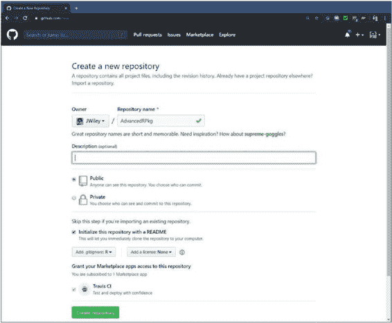
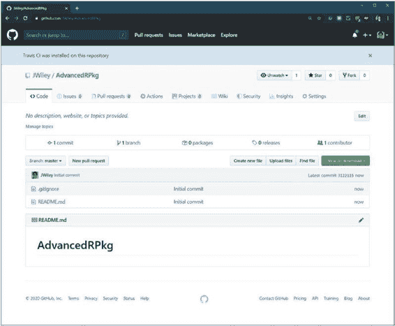
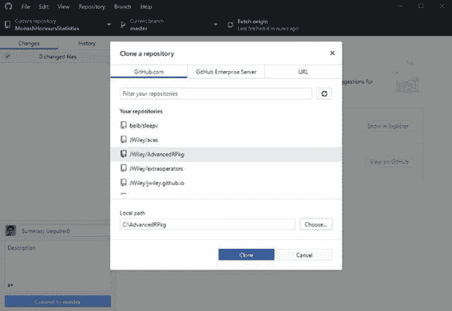
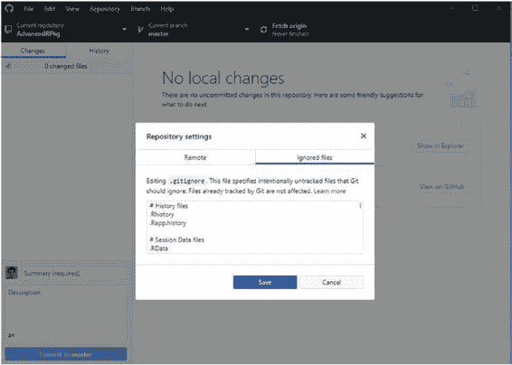
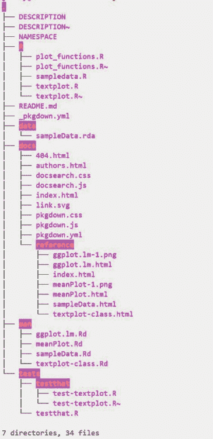

# 标签：e f g h

## 5.3 本章小结

本章介绍了 R 语言中用于开发新类和方法（`method`）的 S3 和 S4 系统。特别是 S4 系统可能相当复杂，它涉及从多个父类继承，以及针对多个参数类别进行特化的方法。即使您使用并开发 R 语言，也可能很少需要开发新类，因为大多数数据类型都已存在相应的类。然而，开发或扩展现有方法通常是有益的，至少，理解类和方法的运作方式能让您更轻松地使用现有功能。

希望本章的内容足以让您入门并了解这些系统的能力。表 5-1 描述了本章涵盖的关键函数。在第 6 章中，我们将把函数、类和方法整合在一起，构建我们自己的 R 包。

本章的重点是制作 R 包，因此您不需要对类和方法非常精通。如果您的工作需要用到 S4 系统，可以查阅 John Chambers 的 "How S4 Methods Work"（在线获取地址：[`developer.r-project.org/howMethodsWork.pdf`](http://developer.r-project.org/howMethodsWork.pdf)）以获得更深入的介绍。如果您打算使用 S4 系统并进行深入研究，我们推荐《Software for Data Analysis: Programming with R》一书。另一本更侧重于通用 R 编程和较旧的 S3 系统的优秀书籍是《S Programming》。

### 第 5 章 编写类和方法

#### 表 5-1. 本章描述的关键函数及其功能摘要

| `函数`         | `功能`                                                                 |
| -------------- | ---------------------------------------------------------------------- |
| `class()`      | 返回对象的类（S3 或 S4）。                                             |
| `inherits()`   | 检查对象是否属于某个特定类或继承自该类。                               |
| `methods()`    | 返回给定函数所有可用方法的列表。                                       |
| `showMethods()`| 返回给定函数的所有可用方法列表；如果使用了`classes`参数，则返回给定类所有可用的方法（适用于任何函数）。 |
| `:::`          | 运算符，允许访问包中未导出（非公开）的函数。                           |
| `class()`      | 命名 S3 方法的通用方案：使用函数名，后跟句点，再跟应应用该方法的对象类。 |
| `setClass()`   | 定义一个新的 S4 类。                                                   |
| `setMethod()`  | 为特定 S4 类的特定函数定义方法。                                       |
| `@`            | 在 S4 系统中按名称访问对象槽位的底层方式，类似于其他 R 对象或 S3 类对象的`$`。 |
| `new()`        | 创建特定类的新 S4 对象。                                               |
| `paste()`      | 拼接字符串。可以操作多个向量，或将单个向量的所有元素合并在一起。       |
| `sprintf()`    | 格式化字符串，并允许将数字和其他字符串替换到定义的模板中。用于生成信息丰富的错误消息或其他用户消息。 |
| `show()`       | 显示 R 对象的通用函数。也是在 R 控制台键入对象名称时调用的默认函数。   |
| `'['()`        | 用于子集数据或访问特定变量/行的运算符/通用函数。在 S4 系统中，对于新类，必须定义方法，否则该函数无法使用。 |
| `head()`       | 列出对象的前几个元素或前几行。                                         |
| `validObject()`| 使用类创建时指定的有效性检查（如果有的话）来检查 S4 类对象是否有效的通用函数。创建对象时默认调用，但也可以在修改对象后显式调用以检查其是否仍然有效。 |
| `slotNames()`  | 返回 S4 类对象的所有槽位名称，类似于其他 R 对象或 S3 类对象的`names()`。 |
| `slot()`       | 可用于访问 S4 对象的特定槽位。                                         |

## 第 6 章 编写 R 包

包是记录、共享和分发 R 代码与数据的基本方式。我们的目标是编写自己的包。预先说明，本章特别复杂，因为在 R 包开发过程中会用到许多软件工具。

本章中，我们将使用几个包。`devtools`包[32]提供了帮助设置、记录和管理 R 包开发过程的函数。而`devtools`包本身会安装并加载一整套用于开发的其他实用包。`roxygen2`包[28]通过允许使用注释将函数文档内联地写在函数旁边，极大地简化了 R 包文档的编写过程。`testthat`包[24]并非必需，但它提供了一些函数，通过测试函数是否返回预期值来实现质量控制。当编写包时，这是一种良好的实践，有助于确保代码按预期工作，并快速识别因 R 语言、您使用的其他包或您自身修改而可能引入的任何错误。`usethis`包有助于自动化测试（以及其它事项）[43]。类似地，`covr`包[11]通过测试包代码被测试执行的百分比（覆盖率）来促进质量控制。理想情况下，100%的代码应被测试覆盖，但实际上，许多 R 包根本没有测试，因此任何覆盖率都比平均水平要好。在包中，我们使用了第 5 章中针对`ggplot2`的方法之一，因此我们也包含了大家熟悉的`ggplot2`[25]包。最后，为了帮助共享和记录包，我们使用了`pkgdown`包[31]。这个包允许我们基于包文档、文件以及任何插页（vignettes）自动创建一个网页。由于 GitHub 可以托管网页，如果我们把包托管在一个公共的 GitHub 仓库中，代码不仅可以通过版本控制方便地获取，而且使用`pkgdown`我们还能为其获得一个漂亮的网页。

© Matt Wiley and Joshua F. Wiley 2020
M. Wiley and J. F. Wiley, *Advanced R 4 Data Programming and the Cloud*,
[`doi.org/10.1007/978-1-4842-5973-3_6`](https://doi.org/10.1007/978-1-4842-5973-3_6)

### 第 6 章 编写 R 包

编写包可能是一个复杂的过程。熟悉最终产品可能会有所帮助，该产品可在 [`github.com/JWiley/AdvancedRPkg`](https://github.com/JWiley/AdvancedRPkg) 在线获取。您也可以在 [`joshuawiley.com/AdvancedRPkg`](http://joshuawiley.com/AdvancedRPkg) 查看自动生成的包网站。当您阅读本章时，如果不确定某个文件是否放置在正确的位置或设置正确，我们也建议参考我们在 GitHub 上包的官方记录：

```r
options(width = 70, digits = 2)
library(testthat)
library(devtools)
library(covr)
library(pkgdown)
library(ggplot2)
```

### 6.1 准备工作

本章涵盖了编写 R 包的一些基础知识，并介绍了一些辅助工具，这些工具不在官方手册 "Writing R Extensions"（在线获取地址：[`cran.r-project.org/doc/manuals/R-exts.html`](https://cran.r-project.org/doc/manuals/R-exts.html)）中。该手册可能技术性很强，但它是权威指南。如果您计划向 CRAN 提交 R 包，这是必读材料；即使您只是计划为自己或公司、实验室小组等较小用户群体开发包，也建议阅读。

许多 R 包包含其他编程语言（如 C、C++、Fortran 或 Java）的代码。这通常是因为像 C 这样的语言可以被编译和优化，运行速度远快于 R，因此包开发者可能会选择将代码中计算密集的部分用编译型且高效的编程语言编写。然而，在本章中，我们只讨论如何编写包含纯 R 代码或数据的 R 包，因为其过程几乎相同，大多数差异仅在于所包含的编程语言（例如 makefile 文件）。

开发 R 包之前，需要一些工具。实际上，对于不习惯软件开发的人来说，编写 R 包可能需要一套相当令人生畏的工具链。如果您使用的是 Linux 系统，很可能已经安装了其中的许多工具，或者可以轻松安装。在 Windows 和 Mac OS 系统中，设置起来可能需要更多步骤。无论使用何种系统，工具都需要能够被访问到，这意味着需要将它们添加到系统路径中，以便从命令行调用时可以找到它们。

如果使用 Windows，所需的主要工具（一些命令行工具以及编译器）可以从 [`cran.r-project.org/bin/windows/Rtools/`](https://cran.r-project.org/bin/windows/Rtools/) 的二进制安装程序获取。在安装程序到达最后的"下一步"之前，有两个复选框，其中一个可能未被选中，其功能是将这些工具添加到系统路径中。请同时勾选这两个复选框。关于所需 Windows 工具链的更多详细信息，请参阅 R 手册：[`cran.r-project.org/doc/manuals/R-admin.html#The-Windows-toolset`](https://cran.r-project.org/doc/manuals/R-admin.html#The-Windows-toolset)。

另外，您还需要 LaTeX，一个排版系统。MiKTeX [21] 是一个流行的选择（[www.miktex.org/](http://www.miktex.org/)）；如果您的系统是 64 位的，请确保选择 64 位选项。虽然默认选项在大多数情况下已足够，但我们建议 MiKTeX 用户将"即时安装缺失的包"选项改为"是"。

如果使用 Mac OS，请从 App Store 获取 Xcode（开发者工具）。您可能还需要获取 XQuartz（[www.xquartz.org/](http://www.xquartz.org/)）。更多详细信息请参阅 R 手册（[`cran.r-project.org/doc/manuals/R-admin.html#macOS-packages`](https://cran.r-project.org/doc/manuals/R-admin.html#macOS-packages)）。与 Windows 一样，您需要 LaTeX。MacTeX 是一个选择（[www.tug.org/mactex/](http://www.tug.org/mactex/)）。

除了 MiKTeX 或 MacTeX，另一个选择是`tinytex` [40]。安装或运行该包的指令如下：

```r
#install.packages("tinytex")
#tinytex::install_tinytex()
library(tinytex)
```

在开始编写我们的第一个 R 包之前，还需要做两个决定。第一，如何命名这个 R 包？这个看似简单的任务因为 CRAN 上已有超过 15,000 个 R 包且数量快速增长而变得复杂（[`cloud.r-project.org/web/packages/available_packages_by_name.html`](https://cloud.r-project.org/web/packages/available_packages_by_name.html)）。虽然您可以为不上传到 CRAN 的包赋予与 CRAN 上某个包相同的名称，但如果您日后使用该 CRAN 包或任何依赖于它的包，就会产生问题。即使您的包不打算提交给 CRAN，未来也可能有人编写一个同名包并提交给 CRAN。出于这些原因，选择包名需要深思熟虑。在本章中，所有示例都将构建一个名为 `AdvancedRPkg` 的 R 包。第二个决定是为包选择什么许可证。如果您计划提交给 CRAN，许可证必须与 CRAN 兼容。即使包永远不会发送到 CRAN，许可证可能仍然重要。在本章中，我们使用 GPLv3 许可证。

### 版本控制

到目前为止，我们讨论了相对随意的代码开发、一些基本的编程、函数和类。开发新的 R 包更复杂，需要管理更多的文件。面对这种更高的复杂性，拥有一个高效的系统来备份文件和回退到早期版本至关重要。版本控制系统提供了一种极好的方式，既可以备份代码，也可以将更改回滚到之前的版本（例如，如果实现新功能的更改破坏了旧功能或引入了错误）。

存在各种版本控制系统，但当前最流行的可能是开源软件 Git，它最初是为了给 Linux 内核提供版本控制而开发的。Git 可以直接从命令行使用，也可以通过图形界面使用，后者的选择很多。许多人使用 GitHub（[`github.com/`](https://github.com/)），这是一个使用 Git 并在线免费托管公共项目仓库的服务。GitHub 也为 Windows 和 Mac OS 提供了图形界面（[`desktop.github.com/`](https://desktop.github.com/)）。然而，如果您不想学习或使用 Git 或其他版本控制系统，可以随意忽略本节以及本章中任何仅与版本控制相关的命令。

在本章中，我们使用 Git（和 GitHub for Windows）为我们开发的示例 R 包提供版本控制。具体来说，本书使用 Windows 版的 GitHub 桌面客户端。Git 仓库可以只在本地计算机上使用，但将其与 GitHub 结合使用可以轻松地在包上进行协作，并与他人共享早期包代码。

从命令行设置 Git 仓库是可能的，但对于新用户来说，创建新 Git 仓库最直观的方式可能是直接在线通过 GitHub 完成。我们为本章开发的 R 包创建一个新的仓库，并将其命名为 `AdvancedRPkg`。仓库初始化时会包含一个 README 文件，我们稍后会编辑它。我们可以通过将某些文件或特定扩展名的文件添加到一个名为 `.gitignore` 的文件中，来告诉 Git 忽略它们。每个文件或扩展名单独占一行。我们可以稍后编辑它，但现在我们只让 GitHub 创建一个。图 6-1 展示了执行这些步骤的过程。



### 第 6 章 编写 R 包

#### 图 6-1. GitHub 上创建 AdvancedRPkg 仓库的页面

如果一切按计划进行，结果应该类似于图 6-2。除了 README 和`.gitignore`文件外，仓库是空的。从这里，我们可以将仓库克隆到本地计算机。这本质上是在本地创建了一个副本，我们将在其中进行包的编写工作。为此，打开 GitHub 桌面客户端，点击"File"，选择"Clone repository"，然后选择仓库，如图 6-3 所示。我们可以选择将仓库克隆到哪个目录。请注意，无论您选择哪个目录，都会为仓库创建一个与仓库同名的新目录（即 `AdvancedRPkg`）。仓库的设置可以通过终端管理，或者通过在 GitHub 桌面客户端中点击您的仓库，然后进入设置。其中一个设置显示了当前被忽略的文件。文件是基于`.gitignore`文件被忽略的，由于我们在创建仓库时选择了 R，因此默认包含了一些通常希望忽略的默认文件扩展名（图 6-4）。

### 第 6 章 编写 R 包

Windows 经常在目录中创建临时（有时是隐藏的）文件，比如 `desktop.ini`。为了避免包含这些文件，我们可以编辑仓库设置，在文件末尾添加新的一行并输入 `desktop.ini`，然后保存。这样这些文件就会被忽略。被忽略的文件是指 Git 仓库不会随时间跟踪和存储其更改的文件。它们会继续存在于目录中；Git 只是不监视和版本控制它们。

# 第 6 章 编写 R 包

除了设置一个新的 `Git` 仓库，您可能需要用 `Git` 执行的任务包括：提交对仓库的更改，以及将本地仓库副本与在线（`GitHub`）版本同步。提交可以看作是在提交时对文件状态拍了一张快照。为了避免冗余提交，快照只记录自上次提交以来对文件所做的更改。尽管即使是略微修改过的二进制文件也可能难以比较，但像 `R` 代码这样的纯文本文件很容易比较。`Git` 在随时间跟踪文本文件的更改方面非常高效，它允许您查看所做的更改，或者回溯到过去的特定点。访问项目（仓库）的历史记录，在代码中引入错误或缺陷时尤其有用，这样可以精确定位引入错误的确切时间（例如，基于该代码的多少结果可能受到影响？），并查看以前能正常工作的代码版本。

在稍微复杂一些的用例中，`Git` 可以有效地用于管理代码的不同版本。例如，一个常见的做法是：有一个项目，定期发布稳定或生产就绪的代码版本，同时继续进行开发。这在 `Git` 中是通过使用同一仓库的不同分支，并定期将某个分支（比如开发分支）的一些更改合并到稳定分支来实现的。



*图 6-2. GitHub 页面显示已创建的 `AdvancedRPkg` 仓库*





*图 6-3. GitHub 桌面客户端克隆 `AdvancedRPkg` 仓库*

*图 6-4. GitHub 桌面客户端显示 `AdvancedRPkg` 仓库的设置，包括被 `Git` 仓库忽略的各种文件扩展名*

我们在本章中还会展示一些其他相关的 `Git` 命令。关于使用 `Git` 的更多背景知识，一个很好的免费资源是 Scott Chacon 和 Ben Straub 编写的《Pro Git》（Apress, 2014），可在 [`git-scm.com/book/`](https://git-scm.com/book/) 获取。对于问题和解答，`Stack Overflow`（[`stackoverflow.com`](http://stackoverflow.com)）是个不错的资源。很可能之前已经有人问过类似您的问题，如果没有，您也可以提问并获得解答。另请注意，如果您使用 `RStudio` 编写 `R` 代码，它内置了一些 `Git` 集成功能。更多信息请参阅 `RStudio` 支持页面：[`support.rstudio.com/hc/en-us/articles/200532077-Version-Control-with-Git-and-SVN`](https://support.rstudio.com/hc/en-us/articles/200532077-Version-Control-with-Git-and-SVN)。最后，请注意您可以公开访问在线仓库：[`github.com/JWiley/AdvancedRPkg`](https://github.com/JWiley/AdvancedRPkg)。

## 6.2 R 包基础知识

一个 `R` 包仅仅是一个包含特定文件集合的目录。虽然 `R` 包的核心当然是 `R` 代码，但许多文件严格来说并非 `R` 代码。表 6-1 列出了可能存在于 `R` 包目录根目录下的主要文件。并非所有这些文件都是必需的，这取决于包的其他特性。我们将在本章后面使用`devtools`包来帮助创建其中的一些文件。

除了根目录级别的文件，`R` 包还可以包含许多子目录。这些列在表 6-2 中，并附有简要说明。对于我们相对简单的包，我们只使用其中一部分，包括`R`、`man`、`tests`和`docs`。

*表 6-1. `R` 包根目录中可能使用的文件*

| **文件** | **描述** |
|----------|-----------------|
| `DESCRIPTION`* | 提供关于包的一般信息。必需字段包括：`Package`（包名）、`Version`（版本）、`License`（许可证）、`Title`（包描述）、`Author`（作者）、`Maintainer`（维护者，可能与作者相同或不同）。除非包是独立的，否则通常还包括依赖项信息。 |
| `NAMESPACE`* | 控制包命名空间，包括要导出的对象以及要从其他包导入的对象。虽然是必需文件，但我们通过使用`roxygen2`包来自动生成它。 |
| `README`/`README.md` | 不是必需的，`R` 会忽略它，但对读者和用户有帮助。提供包的一般信息（在哪里获取帮助、简要概述、安装指南，或其他任何在简短文档中有用的信息）。 |
| `NEWS` | 提供关于包的变更或新闻信息。通常包括新功能、错误修复以及与先前版本相比任何其他重大更改。 |
| `LICENSE` | 如果未使用常见许可证之一或需要附加信息，则提供许可证文件。 |
| `INDEX` | 可选，根据文档文件自动生成。但如果指定，则每行列出一个所有有趣/有用对象的名称和描述。 |
| `configure`, `cleanup` | 可选的 `Bourne shell` 脚本，分别在 `Unix` 系统（如 `Linux`, `Unix`）上安装前和安装后运行。 |

*`*` 表示必需文件。*

### 使用 DevTools 启动一个包

至少，在您的包的根目录下，您需要`DESCRIPTION`和`NAMESPACE`文件。您还需要一个子目录`R`，很明显，这是存放 `R` 代码的地方。这对于提交到 `CRAN` 的包来说是不够的，但对于启动一个供私人使用的功能性包已经足够了。然而，即使对于私人使用，适当的文档也极其有帮助。包的目录和文件结构不幸地很复杂，尤其是用文字描述时。因此作为参考，图 6-5 显示了本章结束时您应该拥有的包的最终目录结构（从`AdvancedRPkg`目录内部查看）。

对于初始设置，我们使用`create()`函数。我们可以指定更多信息，但最少的参数是路径。我们还将`open = FALSE`设置，这样项目就不会自动更改。为了查看创建了哪些内容，我们可以使用`list.files()`函数，它会显示已创建了`DESCRIPTION`和`NAMESPACE`文件以及一个`R`目录。对于以下代码，要么从 `R` 命令行运行，要么创建一个新的 `R` 文件（我们将其命名为`chapter06.R`）。调整`path`参数使其指向包含 `Git` 仓库的目录非常重要，即您在本地机器上克隆该仓库的位置。在我们的例子中，`R` 的工作目录（您可以通过调用`getwd()`函数检查）位于`AdvancedRPkg`目录的上一级目录中。如果您的 `R` 会话不在那里，请调整`path`参数，或者使用`setwd()`函数将 `R` 的工作目录更改到`AdvancedRPkg`的父目录：

```r
create(
  path = "AdvancedRPkg/",
  open = FALSE
)
```

```markdown
## v 将活动项目设置为`'C:/.../RCode/AdvancedRPkg'`
## v 正在创建`'R/'`
## v 正在写入`'DESCRIPTION'`
## 包名: `AdvancedRPkg`
## 标题: `包的用途（一行，标题式大小写）`
## 版本: `0.0.0.9000`
## Authors@R (解析后):
## * First Last <first.last@example.com> [aut, cre] (<https://orcid.org/YOUR-ORCID-ID>)
```



*图 6-5. 目录结构*

*表 6-2. `R` 包子目录*

| **子目录** | **描述** |
|------------|-----------------|
| `R`* | 包含所有函数、类、方法等 `R` 源代码的目录。 |
| `man`* | 包含 `R` 文档文件的目录。我们使用 `roxygen2` 包自动生成这些文件。 |
| `tests` | 可选目录，包含用于测试包是否按预期工作的 `R` 代码。 |
| `docs` | 可选目录，包含附加文档，供 `pkgdown` 用于构建包网站。 |
| `data` | 可选目录，包含与包一起分发的数据。通常，所含数据集较小，用于说明包的特性，而非共享数据的主要方式。 |
| `demo` | 可选目录，包含 `R` 包的演示，形式为 `R` 源代码文件。 |
| `exec` | 可包含所需的其他可执行脚本。仅包含文件，不包含子目录。 |
| `inst` | 可包含在安装包时复制到安装目录的其他文件。例如，可用于与用户共享新闻文件，或包含图像或其他非标准文档。 |
| `po` | 用于添加 `C` 和 `R` 错误消息的翻译以及其他与本地化相关的任务。 |
| `src` | 通常包含其他语言的源代码，如 `C`、`C++` 或 `Fortran`。此代码通常需要编译；如果你使用它，通常需要指定一个 `makefile`。 |
| `tools` | 不常用，但可用于提供配置所需的其他文件。 |
| `vignettes` | 用于提供一个或多个小插图或使用包的指南。与通常特定于某个函数的函数文档相比，小插图通常包含更多介绍性背景以及如何使用整个包的完整示例。虽然不是必需的，但对用户非常有帮助。 |

*`*` 表示必需的子目录。*

## 描述: `包的用途（一段落）。`

## 许可证: `使用的许可证`

## 编码: `UTF-8`

## 懒加载数据: `true`

## v 正在写入`'NAMESPACE'`

## v 将活动项目设置为`'<无活动项目>'`

```r
list.files("AdvancedRPkg")
```

```
[1] "DESCRIPTION" "NAMESPACE"   "R"           "README.md"
```

输出还展示了一些字段以及用于填充这些字段的信息。

由于这些大多是占位符，我们需要使用文本编辑器（任何文本编辑器都可以，包括 `RStudio`）打开文件并进行修改。`create()` 函数会根据目录名猜测包名，但其余部分需要我们自己填写。使用编辑器，我们将这些字段修改如下：

```
Package: AdvancedRPkg
Title: An Example R Package for the Book Advanced R
Version: 0.0.0.9000
Authors@R: c(
    person("Matt", "Wiley",
           email = "mattwiley@example.com", role = c("aut")),
    person("Joshua F.", "Wiley",
           email = "joshwiley@example.com", role = c("aut", "cre", "cph"))
    )
Description: This package will demonstrate the basics of an R
    package including documentation and tests.
Depends: R (>= 3.6.0)
License: GPL (>= 3)
Encoding: UTF-8
LazyData: true
```

请注意版本号，其设计格式为`主版本号.次版本号.修订号.开发版本号`。关于确定软件版本时需要考虑的因素，在*语义化版本规范*（[`semver.org/`](https://semver.org/)）中有很好的概述。该规范的建议相当具体，但有一套固定的规则来确定软件的主要或次要版本通常很有帮助。最后的`开发版本号`部分仅在开发版本中存在，发布时会被去掉。尽管有这些规则和指南，但许多 `R` 包的实际情况要更加多样化和不一致（并非所有人都认同这些规则，即使认同的人也未必会严格遵循）。

接下来是作者，使用 `person()` 函数描述。除了每个人的姓名和电子邮件，还使用三个字母的缩写来描述角色和关系。所有可能的角色都在 `MARC` 关联方代码表中列出，网址为 [www.loc.gov/marc/relators/relaterm.html](http://www.loc.gov/marc/relators/relaterm.html)。然而，最常用的几个是：`aut` 表示作者，`cre` 表示创建者，即对项目负责的人（或者用 `R` 的术语来说，是出现问题时应向其投诉的人，即维护者），以及 `cph` 表示版权持有人。然后，我们提供几句描述包功能的说明，并指定我们的包所依赖的 `R` 版本、许可证，以及可以按需加载数据（节省启动时间）。

### 添加 R 代码

有了包的基本框架，是时候开始添加一些 `R` 代码了——这才是包的真正意义所在！由于本章的重点是打包代码，我们将重用前几章中的一些函数和类。第一步，我们在 `AdvancedRPkg/R/` 目录下创建两个文件：`plot_functions.R` 和 `textplot.R`。

接下来，我们从第 4 章复制最终的 `meanPlot()` 函数来创建带有均值的图表。我们将这个函数的代码以及我们在第 5 章编写的 `S3` 方法 `ggplot.lm()` 一起添加到 `plot_functions.R` 中。然后，我们将第 5 章中 `textplot` 类的类和方法（`show` 和 `subset`，即括号运算符 `[`）复制到 `textplot.R` 中。由于很容易复制错误的代码，我们建议从我们的 `GitHub` 仓库 [`github.com/JWiley/AdvancedRPkg`](https://github.com/JWiley/AdvancedRPkg) 复制粘贴代码。如果一切正常，应该如下所示：

```r
list.files("AdvancedRPkg/R")
```

```
[1] "plot_functions.R" "textplot.R"
```

顺便提一下，决定将代码分成多少个文件有时会很困难。这对 `R` 本身没有影响，但对开发过程确有影响。将所有的代码放在一个文件中，或者将每个函数、类和方法都拆分成单独的文件，都不是好做法。如果结果文件不是太长，我们尝试将相关的函数（如绘图函数）分组，并将相关的类和方法分组。常识告诉我们，即使可以，也不要使用仅靠大小写区分的相同文件名来命名文件；在文件名中使用特殊字符或符号通常也是一个坏主意。

现在我们已经有了一个基本的包模板，可以使用 `devtools` 包中的 `load_all()` 函数来加载函数。我们只需要指定包的路径即可。

我们现在可以看到，我们的一些函数在包的命名空间中可用。我们使用 `ls()` 函数，并指定我们希望它列出可用对象的位置来做到这一点：

```r
load_all("AdvancedRPkg")
```

```
## Loading AdvancedRPkg
```

```r
ls(name = "package:AdvancedRPkg")
```

```
## [1] "ggplot.lm"            "library.dynam.unload"
## [3] "meanPlot"             "system.file"
## [5] "textplot"
```

在第 4 章中，我们简要讨论了作用域。在编写包时，理解作用域会变得更加重要。包的作者可以编写与其他包中函数同名的函数。虽然这些函数不会相互覆盖，但明确你要调用哪个函数可能会令人困惑。此时，包的命名空间就能派上用场。命名空间控制从其他包导入哪些函数（供包内代码使用），以及从本包导出哪些函数，使其对包的用户公开可用。你可以使用`import`功能从其他包导入特定函数。如果你需要另一个包中的许多函数，可以决定让你的包依赖于该包，在这种情况下，该包的所有公共函数都会对你的包可用。导入和依赖另一个包之间的另一个区别在于加载包时发生的情况。如果包 `B` 依赖于包 `A`，当用户调用`library(B)`时，包 `B` 和包 `A` 都会被加载并附加。如果包 `B` 从包 `A` 导入，当用户调用`library(B)`时，包 `B` 会被加载并附加，而包 `A` 会被加载但不附加。由于包 `A` 被加载，其函数对包 `B` 内的代码可用，但由于包 `A` 未附加，这些函数不会直接暴露给用户。即使包 `A`（或包 `B`）被加载并附加，也只有导出的函数对用户公开可用。这很有好处，因为它允许包开发者编写和记录仅供内部使用的函数。如果不需要导出某个函数，最好就不要导出。如果两个 `R` 包导出了同名函数，并且用户同时加载并附加了这两个包，则后加载的包中的函数会屏蔽先加载的包中的函数。对用户而言，唯一的选择要么是不加载并附加其中一个包，要么是使用双冒号运算符`PkgA::foo()`、`PkgB::foo()`明确指定函数调用。由于 `R` 包成千上万，函数更是数量繁多，只导出必要的函数有助于避免此类冲突和名称屏蔽。

所有这些都通过包的`NAMESPACE`文件进行控制。虽然我们没有查看，但我们的包确实有一个`NAMESPACE`文件，它是在我们运行`create()`时创建的。

然而，`load_all()`函数很特别，默认情况下，它在加载包时会导出所有对象。这是因为在开发过程中，能够调用所有函数（无论它们是否被导出）通常很方便。

### 测试

随着函数和方法被添加到我们的新包中并在 R 中运行，我们可以开始考虑质量控制。编写能够运行的代码固然重要，但确保代码按预期工作也至关重要。不过，预期意图和实际期望并不总是一致（这就是文档发挥关键作用的地方，我们将在下一节介绍）。即便如此，即使是对于开发者而言，测试也能确保所编写的代码完成其应完成的任务。

测试可以在包开发的任何阶段编写。如果函数、名称和特性正在大幅变动，那么也许开始编写大量测试还为时过早。然而，即使包尚未完成，如果某些函数相对稳定，尽早编写测试也会有所帮助。尽早编写测试而不是推迟是有益的，因为在编写函数后立即编写测试通常更容易，此时函数的目的和工作方式在你头脑中还记忆犹新。（如果你不知道或忘记了函数的工作方式，就很难对其进行充分测试！）这也有帮助，因为如果后续函数基于早期函数构建，那么沿途进行测试可以帮助确保问题是由新编写的函数引起的，而不是由之前的某个构建块引起的。

抛开好处不谈，`testthat` 包使得编写测试的实际操作更加容易。为了设置测试，我们使用 `usethis` 包中的一些函数，特别是 `use_test()` 函数。该函数接受测试的名称，并会创建 `testthat` 包所需的目录和子目录。我们还要先切换目录到我们的包目录，以确保相对路径全部正确。输出显示了 `use_test()` 函数执行的多种任务，包括将所需的包添加到我们的 `DESCRIPTION` 文件中，以及创建目录和骨架 R 文件供我们填写测试：

```r
setwd("AdvancedRPkg")
use_test("textplot")
```

```
## v Setting active project to 'C:/.../RCode/AdvancedRPkg'
## v Adding 'testthat' to Suggests field in DESCRIPTION
## v Creating 'tests/testthat/'
## v Writing 'tests/testthat.R'
## * Call 'use_test()' to initialize a basic test file and open it for editing.
## v Increasing 'testthat' version to '>= 2.1.0' in DESCRIPTION
## v Writing 'tests/testthat/test-textplot.R'
## * Modify 'tests/testthat/test-textplot.R'
```

要运行测试，我们需要指明我们的包需要 `testthat` 包。包的核心功能并不依赖于 `testthat`，因此我们将其添加到 `DESCRIPTION` 文件的新部分 `Suggests` 中。通常，你需要手动完成此操作，但从之前的输出中可以看出，`usethis` 包为我们完成了这项工作。

正确测试绘图函数相当困难，因此对于我们的测试，我们检查 `textplot` 的子集方法是否按预期工作。在位于 `AdvancedRPkg/tests/testthat/` 下的 `test-textplot.R` 文件中，我们设置一个简单的 `textplot` 类对象，然后运行一系列测试。这些测试包含两个部分。首先是外部调用 `test_that()`。第一个参数是对测试的描述，第二个参数是执行测试的代码。代码可以包含任何内容，但通常包括对某个 `expect_*()` 函数的调用，这类函数有很多。在我们做出选择之前，使用 `apropos()` 函数调用来展示所有 `expect_*()` 的选项：

```r
apropos("expect_")
```

```
## [1] "expect_condition"      "expect_cpp_tests_pass"
## [3] "expect_equal"          "expect_equal_to_reference"
## [5] "expect_equivalent"     "expect_error"
## [7] "expect_failure"        "expect_false"
## [9] "expect_gt"             "expect_gte"
## [11] "expect_identical"      "expect_invisible"
## [13] "expect_is"             "expect_known_failure"
## [15] "expect_known_hash"     "expect_known_output"
## [17] "expect_known_value"    "expect_length"
## [19] "expect_less_than"      "expect_lt"
## [21] "expect_lte"            "expect_mapequal"
## [23] "expect_match"          "expect_message"
## [25] "expect_more_than"      "expect_named"
## [27] "expect_null"           "expect_output"
## [29] "expect_output_file"    "expect_reference"
## [31] "expect_s3_class"       "expect_s4_class"
## [33] "expect_setequal"       "expect_silent"
## [35] "expect_success"        "expect_that"
## [37] "expect_true"           "expect_type"
## [39] "expect_vector"         "expect_visible"
```

### `expect_warning`

我们选择 `expect_is()` 来检查对象的类，并使用 `expect_equal()` 来检查其他特征。也可以使用 `expect_error()` 或 `expect_warning()` 来检查错误处理是否正常，这些函数在代码产生错误时会“通过”。

我们将以下代码放入 `test-textplot.R` 文件中：

```R
dat <- textplot(
  x = 1:4,
  y = c(1, 3, 5, 2),
  labels = letters[1:4])
```

```R
test_that("textplot 子集方法仅适用于行", {
  tmp <- dat[i = 1:2, ]
  expect_is(tmp, "textplot")
  expect_equal(length(tmp@x), 2)
})
```

```R
test_that("textplot 子集方法仅适用于变量", {
  tmp <- dat[, j = c("x", "y")]
  expect_is(tmp, "list")
  expect_equal(length(tmp), 2)
  expect_equal(length(tmp$x), 4)
})
```

第 6 章 编写包

```R
test_that("textplot 子集方法适用于行和变量", {
  tmp <- dat[1:2, j = c("x", "y")]
  expect_is(tmp, "list")
  expect_equal(length(tmp), 2)
  expect_equal(length(tmp$x), 2)
})
```

我们可以直接运行这些代码测试。如果一切正常，则没有输出。只有当某些检查未通过时才会产生输出。然而，通常这段代码不是直接运行的，而是批量运行的。我们通过使用 `devtools` 函数 `test()` 以及我们的包名/路径来运行所有测试。由于我们已将工作目录切换为包目录，因此可以留空参数。`devtools` 包了解 `testthat` 包的目录结构，因此它们能很好地协同工作。为了运行测试，`test()` 首先使用 `load_all()` 加载包，然后执行测试。回到包目录上一层目录，从章节级别的 R 文件 `chapter06.R` 中，我们执行以下代码来运行所有测试：

```R
test()
## Loading AdvancedRPkg
## Testing AdvancedRPkg
## v | OK F W S | Context
## v |   8        | textplot
##
## == Results ===========================================================
## OK:       8
## Failed:   0
## Warnings: 0
## Skipped:  0
```

现在，我们可以使用 `covr` 包来检查代码覆盖率。`covr` 包（[`covr.r-lib.org/`](https://covr.r-lib.org/)）会检查执行测试时代码的不同部分是否被运行。例如，一个包含 `if/else` 语句的函数，可能只有一个测试执行了其中部分代码，除非设计额外的测试来检查其他条件。同样，尽管开发包并非必须，但这是一个非常有用的工具，可以了解当前测试对包功能的覆盖程度。高覆盖率（力求 100%）是捕捉错误的好方法，并能确保新代码的开发不会破坏旧的功能和特性；所有这些也有助于向用户保证您的包是一个不错的选择。

回到顶层文件 `chapter06.R` 中，我们运行 `package_coverage()` 函数来测试我们的测试对包代码的覆盖程度。唯一需要的参数是包所在的目录。在我们的例子中，R 的工作目录是父目录 `AdvancedRPkg/`。如果您 R 实例的工作目录不同，则需要指定适当的路径来访问您机器上的 `AdvancedRPkg/` 目录：

```R
cov <- package_coverage()
```

输出结果（如下所示）显示当前测试覆盖率约为 36%，这主要来自 `textplot.R` 中的代码覆盖。还可以使用 `as.data.frame(cov)` 进行更详细的分析。输出内容很丰富，因此我们只展示几行几列，但如果您认为测试已覆盖所有内容，并需要找出代码中哪些部分尚未被测试，这将是一个宝贵的资源：

```R
cov
## AdvancedRPkg Coverage: 33.33%
## R/plot_functions.R: 0.00%
## R/textplot.R: 51.61%

as.data.frame(cov)[1:3, c(1, 2, 3, 11)]
##   filename       functions first_line value
## 1 R/plot_functions.R meanPlot         2     0
## 2 R/plot_functions.R meanPlot         3     0
```