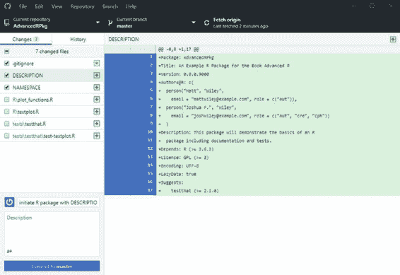
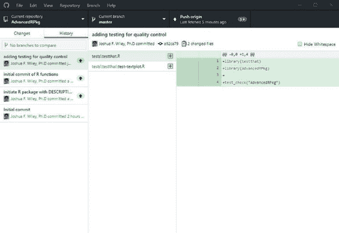

# 第 6 章 编写包

## 6.3 使用 `roxygen2` 编写文档

函数、数据、类及方法的 R 文档位于包的`man`子目录中，并通过扩展名为`.Rd`的特殊 R 文档文件完成。然而，对于程序员来说，这会更加困难，因为文档与实际 R 代码是分离的。此外，还需要编写相当多的标记，其中许多只是标准模板的一部分。`roxygen2`包完全自动化了这一过程，包括子目录的创建，并通过在 R 代码旁边使用特殊格式的注释提供了一种更简便的编写文档方式。运行`roxygen2`包后，它会将这些特殊注释转换为`man`目录中格式正确的`.Rd`文件，使 R 拥有为包函数创建帮助文件所需的一切。在本节中，我们将学习如何为多种类型的对象编写文档，包括函数、数据、类及方法。

### 函数

要使用 `roxygen2` 为对象编写文档，可在特殊的注释引导符 `##'` 或 `#'` 后添加文档内容。由于 `#` 是 R 的注释字符，R 会忽略它，但特殊的单引号向 `roxygen2` 指示应将这些信息处理为文档。请注意，此语法排除了注释这些代码的可能性。所有这些代码都添加在 `plot_functions.R` 文件中的 `meanPlot()` 函数代码之上。

如前所述，由于语法原因，注释被排除在外；因此，顺序变得至关重要。要了解每个部分对应哪个格式域，只需记住有三个部分通过换行符分隔：标题（title）、描述（description）和详情（details）。详情部分是可选的。为了读者清晰，我们在换行符之间增加了空格。函数参数通过使用 `@param 参数名 参数的简短描述` 来指示。这里列出的参数名称必须与函数中的命名参数完全一致。

`@return` 部分用于指明函数返回的对象类型。在本例中，函数的调用是为了产生绘图这一副作用，其返回值并不重要。`@author` 后面可以跟任意文本，用于指明函数的作者。通常，如果作者与整个包的作者相同，则不需要 `@author` 部分。为了使函数可公开访问，必须将其导出。这通过使用指令 `@export` 实现。`roxygen2` 包会将其转换为 `NAMESPACE` 文件中的额外代码行，指示该函数应被导出。

`@keywords` 部分是可选的。最后，对读者最有用的部分之一是 `@examples` 部分，它为读者提供了可执行的示例，是展示如何使用函数的最简单方式之一：

```
##' Function to plot data and mean summary
##'
##' This is a simple function designed to facilitate plotting raw
##' data along with dots indicating the **mean** at each x-**axis** value.
##'
##' Although this **function** can be used with **any type** of data that works
##' with \code{plot}, it works best when the x-axis values are discrete,
##' so that there are several y-values at the same x-**axis** value so that
##' the mean of multiple values is taken.
##'
##' @param formula A formula specifying the variable to be used on the
##' y-**axis** and the variable to be used on the x-**axis**.
##' @param d A data.frame class object containing the variables specified
##' in the \code{formula}.
##' @return Called for the side effect of creating a plot.
##' @author Wiley
##' @export
##' @keywords **plot**
##' @examples
##' # example usage of meanPlot
##' meanPlot(mpg ˜ factor(cyl), d = mtcars)
```

现在，要生成文档，我们可以运行 `roxygen2` 包。这可以通过直接使用 `roxygenize()` 函数并为其提供包目录的路径来完成，或者通过使用 `devtools` 包中的 `document()` 函数来完成。我们指定包目录，其余步骤自动进行。输出显示已写入文档文件（`meanPlot.Rd`）和 `NAMESPACE` 文件：

```
document()

## Updating AdvancedRPkg documentation
## Updating roxygen **version** in ˜\AdvancedRPkg/DESCRIPTION
## Writing NAMESPACE
## Loading AdvancedRPkg
## Writing NAMESPACE
```

最后，在对我们的包进行所有更改之后，是时候检查版本控制了。可以从命令行执行此操作，但我们此处使用 GitHub 桌面客户端。默认情况下，所有更改过的文件都被选中，但我们不是一次提交所有更改，而是将它们按相关文件批次进行提交，并附上有意义的消息。

提交消息伴随每次提交添加，用于提醒您自己或让他人了解所做更改的高级摘要或更改原因。不必详细说明每一项更改，因为 Git 会负责精确追踪哪些文件发生了更改以及它们的内容是如何更改的。

首先，我们选择 `DESCRIPTION`、`NAMESPACE` 和 `.gitignore` 文件，并添加消息 *initiate R package with DESCRIPTION and NAMESPACE*。此过程如图 6-6 所示。



**图 6-6.** GitHub 桌面客户端：选择已更改的文件，添加提交消息，并提交到主分支

接着，我们添加 `plot_functions.R` 和 `textplot.R`，并添加提交消息 *initial commit of R functions*。最后，我们添加 `testthat.R` 和 `test textplot.R`，并添加提交消息 *adding testing for quality control*。当然，您也可以在创建文件的过程中随时提交它们。如果我们切换到 GitHub 桌面客户端的 *History* 选项卡，就可以看到所做的更改。如果我们希望它们公开，可以点击 *Sync* 按钮，该按钮会从 GitHub 仓库拉取更改到本地仓库，并将所有已提交的更改从本地仓库推送到 GitHub 仓库。请注意，在同步之前，所有更改都应已提交，因为同步的实际对象不是目录中的实际文件，而是 Git 仓库。对文件的更改只有在提交时才会被添加到本地 Git 仓库，因此如果您不提交，更新就不会被添加到本地仓库，也不会被推送到远程（GitHub）仓库。图 6-7 展示了这一过程。



**图 6-7.** GitHub 桌面客户端显示提交历史记录以及右上角的同步按钮

我们仅仅触及了测试的皮毛，显然我们的包在彻底测试之前还有很长的路要走。然而，这些工具应该能让您在测试和质量控制方面走上正轨（并领先于 CRAN 上的大多数 R 包）。下一个关键部分是文档，这是我们接下来要讨论的主题。


好的，作为一名高级文档工程师和翻译员，我将严格按照您提供的注意事项和示例，将给定的英文文本翻译成中文。


