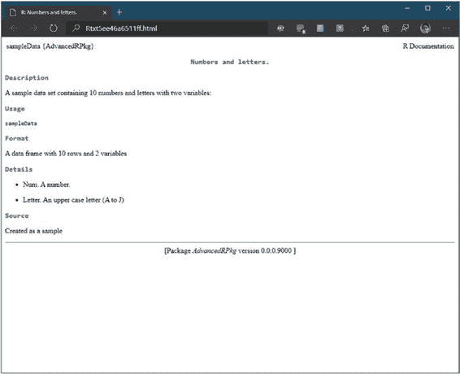
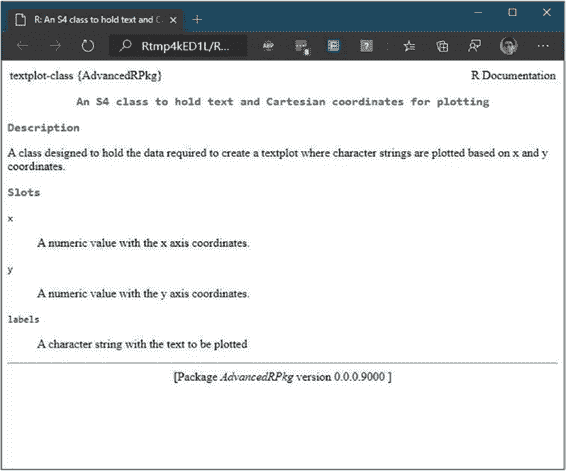
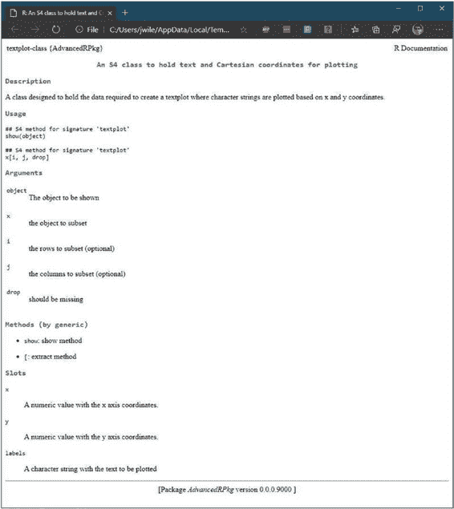

# 编写 meanPlot.Rd

当构建或安装时，R 文档文件会被转换为 HTML 和 PDF 格式。不过，您现在已经可以预览该文档的开发版本。

在 R 控制台中，获取函数帮助的常规方式现在应该可以正常工作：

`?meanPlot`

如果您使用 RStudio，您也可以打开该文件并进行预览。构建包后生成的 HTML 文件如图 6-8 所示。由于此函数的简洁性以及篇幅考虑，我们编写了相当精简的文档。

通常，为了用户和日后参考，更全面地记录文档，并仔细解释每个参数可以接受和不能接受的内容，会很有帮助。如果函数实现了新的程序或统计方法，通常会使用 `@references` 部分包含一些参考文献。

**图 6-8.** `meanPlot()` 函数的 R 文档文件的 HTML 输出* 154

**第 6 章 编写包**

## 数据

在记录数据之前，我们需要向包中添加一些数据。首先，我们创建一个小的样本数据框 `sampleData`。以前，我们会在包文件夹中创建一个 `data` 子目录，位于 `AdvancedRPkg/data/`，然后将数据保存为 `.rda` 文件。然而，`usethis` 包中的 `use_data()` 函数会负责创建正确的目录并以正确的格式将数据文件保存在正确的位置，并赋予正确的名称：

```r
sampleData <- data.frame(
  Num = 1:10,
  Letter = LETTERS[1:10])
use_data(sampleData)
## v Setting active project to 'C:/.../RCode/AdvancedRPkg'
## v Creating 'data/'
## v Saving 'sampleData' to 'data/sampleData.rda'
```

我们添加以下代码，将数据记录在 `R` 子目录（即 `AdvancedRPkg/R/sampledata.R`）中一个名为 `sampledata.R` 的新文件中。这提供了数据的标题和详细信息，以及用于指示数据格式或类型的特殊参数 `@format` 和用于指示数据来源的 `@source`。在末尾的引号中，给出了对象的名称：

```r
##' Numbers and letters.
##'
##' A sample data set containing 10 numbers and letters with two variables:
##'
##' \itemize{
##'   \item Num. A number.
##'   \item Letter. An upper case letter (A to J)
##' }
##'
##' @format A data frame with 10 rows and 2 variables
##' @source Created as a sample
"sampleData"
```



**第 6 章 编写包**

在通过使用 `document()` 函数重新对包进行 `roxygenize` 处理后，生成的 HTML 如图 6-9, a 所示（同样通过使用完全构建的包的帮助工具或使用 RStudio 的预览功能）。

请注意，当我们运行 `document()` 时，只会写入新文件。我们的绘图文档没有更改，因此无需重写该文件：

```r
document()
## Updating AdvancedRPkg documentation
## Writing NAMESPACE
## Loading AdvancedRPkg
## Writing NAMESPACE
## Writing sampleData.Rd
```

**图 6-9.** `sampleData` 数据集的 R 文档文件的 HTML 输出*

**第 6 章 编写包**

## 类

S3 类是非正式的，通常不需要记录。S4 类则很容易记录。它们的文档直接放在我们 `textplot.R` 文件（`AdvancedRPkg/R/textplot.R`）中 `setClass()` 调用的上方，包含一个标题、一个详细说明部分，然后是一些参数——每个插槽名称对应一个 `@slot`，详细说明插槽的名称和功能。要在包中使用 S4 系统，我们还需要添加 `methods` 包，这可以通过添加 `@import methods` 并将其添加到 `DESCRIPTION` 文件的 `Imports` 字段来完成。我们可以再次使用 `usethis` 包，特别是 `use_package()` 函数来指定包名及其所属部分：

`use_package("methods", "Imports")`

该类的完整文档如下所示：

```r
##' An S4 class to hold text and Cartesian coordinates for plotting
##'
##' A class designed to hold the data required to create a textplot
##' where character `strings` are plotted based on x and y coordinates.
##'
##' @slot x A numeric value with the x `axis` coordinates.
##' @slot y A numeric value with the y axis coordinates.
##' @slot labels A character string with the `text` to be plotted
##' @import methods
```

在通过使用 `document()` 函数重新对包进行 `roxygenize` 处理后，生成的 HTML 如图 6-10. 所示。



**第 6 章 编写包**

**图 6-10.** S4 类 `textplot` 的 R 文档文件的 HTML 输出*

## 方法

记录方法与记录常规函数类似。S3 方法可以没有文档，也可以作为函数进行记录。以下是添加给 `ggplot.lm` 方法的 `roxygen2` 风格文档。该代码直接添加在 `AdvancedRPkg/R/plot_functions.R` 中的函数定义上方。

请注意，这里我们导入了 `ggplot2` 包以确保其可用。我们还将 `ggplot2` 包添加到 `DESCRIPTION` 文件的 `Imports` 部分，用逗号与包所依赖的 R 版本隔开。我们可以再次使用 `usethis` 包，特别是 `use_package()` 函数来指定包名及其所属部分：

`use_package("ggplot2", "Imports")`

**第 6 章 编写包**

通过导入它，`roxygen2` 将自动将适当的导入代码添加到 `NAMESPACE` 文件中：

```r
##' Method for plotting linear models
##'
##' Simple method to plot a linear model using ggplot
##' along with 95% *confidence intervals*.
##'
##' @param data The linear model object from \code{lm}
##' @param mapping Regular mapping, see \code{ggplot} and \code{aes} for details.
##' @param vars A list of variable values used `for` prediction.
##' @param \ldots Additional arguments passed to \code{ggplot}
##' @return A ggplot class object.
##' @export
##' @import ggplot2
##' @examples
##' ggplot(
##'   lm(mpg ˜ hp * qsec, data = mtcars),
##'   aes(hp, mpg, linetype = factor(qsec)),
##'   vars = list(
##'     hp = `min`(mtcars$hp):`max`(mtcars$hp),
##'     qsec = round(mean(mtcars$qsec) + c(-1, 1) * sd(mtcars$qsec)), 1)) +
##'   geom_ribbon(aes(ymin = LL, ymax = UL), alpha = .2) +
##'   geom_line() +
##'   theme_bw()
```

S4 方法可以单独记录，可以与泛型函数一起记录，也可以与类一起记录。这可以通过使用 `@describeIn` 参数来实现，该参数用于替代标题。对于我们的 S4 方法，我们将其与类一起记录。`roxygen2` 代码相对简短。我们可以添加细节，但并非必须。`roxygen2` 包负责注册这些方法，所以我们真正需要做的就是添加任何特殊说明并记录参数的使用。`show()` 方法的文档如下：

```r
##' @describeIn textplot show method
##'
##' @param object The object to be shown
```

**第 6 章 编写包**

接下来是 `` 运算符方法的文档。请注意，我们还导出了 `[` 方法并添加了一个别名，这只是用户查找该方法的另一种方式：

```r
##' @describeIn textplot extract method
##'
##' @param x the object to subset
##' @param i the rows to subset (optional)
##' @param j the columns to subset (optional)
##' @param drop should be missing
##' @export
##' @aliases [,textplot-method
```

在使用 `document()` 重新进行 `roxygenize` 处理后，更新的 HTML 帮助文件如图 [6-11, inc 所示，其中包括了类和附加方法的文档。

```r
document()
## Updating AdvancedRPkg documentation
## Writing NAMESPACE
## Loading AdvancedRPkg
## Writing NAMESPACE
## Writing ggplot.lm.Rd
```

# 编写 textplot-class.Rd 文档

## 6.4 构建、安装和分发 R 包

与 Git 类似，在构建 R 包时，忽略目录中的某些文件会很有帮助。我们在主目录 `AdvancedRPkg/` 中创建一个名为 `.Rbuildignore` 的文件，其中包含以下代码。该文件应位于与 `DESCRIPTION` 文件相同的层级：

```
desktop.ini
.Rhistory
.RData
```

确保通过再次运行 `document()` 使文档保持最新后，准备工作就基本完成了。此时，我们做了一些更改，因此最好将这些更改添加并提交到 Git 仓库中（如果你在开始时选择了使用 Git 的话）。

虽然你可以通过运行 `git add` 一次性添加所有文件，但根据相似主题分块提交更改，信息更明确，以后（如果需要）也更容易回退。例如，我们对以下每一项都使用了单独的提交，如下方代码分块所示：



**图 6-11.** 为 S4 类 `textplot` 添加方法文档后的 R 文档文件 HTML 输出

-   更新的代码文件（`AdvancedRPkg/R/` 目录中的所有文件）、`DESCRIPTION` 和 `NAMESPACE`，提交信息为 "added roxygen-style documentation"
-   示例数据，提交信息为 "added sample data"
-   更新的文档文件（`AdvancedRPkg/man/` 目录中的所有文件），提交信息为 "re-roxygenized package"
-   `.Rbuildignore` 文件，提交信息为 "adding file to ignore files during package build"

现在，我们可以通过在 `chapter06.R` 文件中使用 `devtools` 包中的 `build()` 函数，将包构建成一个压缩的源代码 tarball。输出显示了构建过程，并表明最终生成了一个 `.tar.gz` 文件：

```r
build("AdvancedRPkg")

## v  checking for file 'C:\...\RCode\AdvancedRPkg/DESCRIPTION'
## -  preparing 'AdvancedRPkg':
## v  checking DESCRIPTION meta-information
## -  checking for LF line-endings in source and make files and shell scripts
## -  checking for empty or unneeded directories
## -  looking to see if a 'data/datalist' file should be added
## -  building 'AdvancedRPkg_0.0.0.9000.tar.gz'
##
## [1] "C:/.../RCode/AdvancedRPkg_0.0.0.9000.tar.gz"
```

我们可以安装并使用这个包。然而，再运行一组检查会很有帮助。`devtools` 包中的 `check()` 函数会对包运行 `Rcmd check` 命令。参数 `cran = TRUE` 表示使用 CRAN 的测试。以下代码应从我们的 `chapter06.R` 文件中运行：

```r
check("AdvancedRPkg", cran = TRUE)
```

输出显示了详细的检查过程和结果：

## 构建阶段

### 更新文档与命名空间

## 加载 AdvancedRPkg

## 设置环境变量

*   `CFLAGS`    : -Wall -pedantic
*   `CXXFLAGS`  : -Wall -pedantic
*   `CXX11FLAGS`: -Wall -pedantic

## 检查与构建流程

*   检查文件 `C:\...\RCode\AdvancedRPkg/DESCRIPTION`
*   准备 `AdvancedRPkg`：
    *   检查 `DESCRIPTION` 元信息
    *   检查源文件、make文件和脚本是否为LF行尾
    *   检查是否存在空或不必要的目录
    *   查看是否需要添加 `data/datalist` 文件
    *   构建 `AdvancedRPkg_0.0.0.9000.tar.gz`

## 检查阶段

### 设置环境变量

*   `_R_CHECK_CRAN_INCOMING_USE_ASPELL_`: TRUE
*   `_R_CHECK_CRAN_INCOMING_REMOTE_`   : FALSE
*   `_R_CHECK_CRAN_INCOMING_`          : FALSE
*   `_R_CHECK_FORCE_SUGGESTS_`         : FALSE
*   `NOT_CRAN`                         : true

### R CMD check 详细输出

*   使用日志目录：`'C:/.../Temp/.../AdvancedRPkg.Rcheck'`
*   使用 R 版本：3.6.3 (2020-02-29)
*   使用平台：`x86_64-w64-mingw32` (64-bit)
*   使用会话字符集：ISO8859-1
*   使用选项：`'--no-manual --as-cran'`
*   检查文件 `AdvancedRPkg/DESCRIPTION` ... OK
*   这是包 `AdvancedRPkg` 版本 `0.0.0.9000`
*   包编码：UTF-8
*   检查包命名空间信息 ... OK
*   检查包依赖关系 ... OK
*   检查是否为源码包 ... OK
*   检查是否存在命名空间 ... OK
*   检查可执行文件 ... OK
*   检查隐藏文件和目录 ... OK
*   检查文件名是否可移植 ... OK
*   检查包 `AdvancedRPkg` 是否可安装 ... OK
*   检查已安装包大小 ... OK
*   检查包目录 ... OK
*   检查未来文件时间戳 ... OK
*   检查 `DESCRIPTION` 元信息 ... WARNING
*   检查顶级文件 ... OK
*   检查残留文件 ... OK
*   检查索引信息 ... OK
*   检查包子目录 ... OK
*   检查 R 文件中的非ASCII字符 ... OK
*   检查 R 文件的语法错误 ... OK
*   检查包是否可以被加载 ... OK
*   检查在声明的依赖项下包是否可以被加载 ... OK
*   检查包是否可以干净地卸载 ... OK
*   检查在声明的依赖项下命名空间是否可以被加载 ... OK
*   检查命名空间是否可以干净地卸载 ... OK
*   检查不在库搜索路径上的加载情况 ... OK
*   检查 R 代码中的依赖关系 ... OK
*   检查 S3 泛型/方法一致性 ... OK
*   检查替换函数 ... OK
*   检查外部函数调用 ... OK
*   检查 R 代码中的可能问题 ... NOTE
    *   `ggplot.lm`: 未定义全局函数 `formula`
    *   `ggplot.lm`: 未定义全局函数 `predict`
    *   `ggplot.lm`: 未定义全局变量 `fit`
    *   `ggplot.lm`: 未定义全局函数 `qnorm`
    *   `ggplot.lm`: 未定义全局变量 `se.fit`
    *   `meanPlot`: 未定义全局函数 `plot`
    *   `meanPlot`: 未定义全局函数 `points`
    *   `show,textplot`: 未定义全局函数 `head`
    *   未定义的全局函数或变量：
        `fit`, `formula`, `head`, `plot`, `points`, `predict`, `qnorm`, `se.fit`
    *   考虑在 `NAMESPACE` 文件中添加：
        `importFrom("graphics", "plot", "points")`
        `importFrom("stats", "formula", "predict", "qnorm")`
        `importFrom("utils", "head")`
*   检查 Rd 文件 ... OK
*   检查 Rd 元数据 ... OK
*   检查 Rd 行宽 ... OK
*   检查缺失的文档条目 ... OK
*   检查代码/文档不匹配 ... OK
*   检查 Rd `\usage` 部分 ... OK
*   检查 Rd 内容 ... OK
*   检查示例中未声明的依赖关系 ... OK
*   检查 `data` 目录内容 ... OK
*   检查数据中的非ASCII字符 ... OK
*   检查数据是否为ASCII和未压缩保存 ... OK
*   检查示例 ... ERROR
    *   `AdvancedRPkg-Ex.R` 中的示例运行失败，错误最可能发生在：
        ```r
        base::assign(".ptime", proc.time(), pos = "CheckExEnv")
        ### Name: ggplot.lm
        ### Title: Method for plotting linear models
        ### Aliases: ggplot.lm

        ### ** Examples

        ggplot(
          lm(mpg ~ hp * qsec, data = mtcars),
          aes(hp, mpg, linetype = factor(qsec)),
          vars = list(
            hp = min(mtcars$hp):max(mtcars$hp),
            qsec = round(mean(mtcars$qsec) + c(-1, 1) * sd(mtcars$qsec)), 1)) +
          geom_ribbon(aes(ymin = LL, ymax = UL), alpha = .2) +
          geom_line() +
          theme_bw()
        ```