# 第 5 章 编写类和方法

让一个函数根据传入对象类型的不同而表现不同，这通常很有帮助。例如，在汇总一个变量时，为数值数据或字符串数据创建不同的汇总是有意义的。可以为每种对象类型编写不同的函数，但这样用户就需要记住很多函数名，并且为了保持唯一性，函数名可能会变长。面向对象编程（OOP）基于对象，并通过使用两个概念在 R 中实现（与大多数编程语言一样）：类和方法。类定义了一个模板或蓝图，描述对象的变量和特性，并确定哪些方法对其适用。例如，一栋房子可以被定义为有地板、四面墙、一个屋顶和一扇门。具体数据代表这些属性，比如每面墙的尺寸和颜色。方法是可以在特定对象类型上执行的行为或动作。例如，房子可以被粉刷，这会改变它的颜色，但房子不能被吃掉。R 有三种面向对象系统：S3、S4 和 R5。本章介绍最常用的 S3 和 S4 系统。

在本章中，我们使用 `ggplot2` 包 [25]。以下代码加载 `ggplot2` 包并设置一些文本显示选项：

```R
options(width = 70, digits = 2)
library(ggplot2)
```

© Matt Wiley and Joshua F. Wiley 2020  
M. Wiley and J. F. Wiley, *Advanced R 4 Data Programming and the Cloud*，[`doi.org/10.1007/978-1-4842-5973-3_5`](https://doi.org/10.1007/978-1-4842-5973-3_5#DOI)

## 5.1 S3 系统

S3 系统是最常见的面向对象系统。它也是最容易开始使用且最简单的系统。S3 系统易于使用，部分原因是它相当非正式，并且大部分重点放在函数或方法上。这些优点同时也是缺点，因为 S3 系统没有提供正式的框架来确保对象满足某个类的要求。有关使用 S3 系统进行 R 编程的更深入指南，请参阅 *S Programming*，作者 W. N. Venables 和 B. D. Ripley（Springer，2004 年）。

### S3 类

在 R 中，某些类型或类的对象默认可用，几乎所有对象都可以被视为向量或泛型向量。例如，矩阵和数组本质上是带有指示维度属性的向量。列表是泛型向量，其中的每个元素可以包含另一个向量。数据框是列表，其中每个项目都是一个向量，但所有向量的长度相等，因此具有表格格式。向量可以保存特定类型的数据，例如逻辑型、整型、数值型（实数）或字符串。这些基础对象和类由基础包提供。S3 类是通过构建在基础包提供的对象和类之上来创建的。

`注意` S3 类是通过使用常规 R 对象（例如向量或列表）和类（例如逻辑型或数值型）来创建的。S3 类通过 `class(object) <- "class name"` 设置类名来定义。S3 对象的元素通常使用 `$`、`[` 或 `[[` 来访问。

实际创建 S3 类很简单。首先，创建一个满足类要求或特性的 R 对象，然后通过用类名标记该对象来定义 S3 类。因为 S3 类与其他 R 对象的区别仅在于具有特殊的名称或属性，所以它们可以像其他基础 R 对象一样，使用 `$`、`[` 或 `[[` 进行访问和操作。要检查对象的类，我们可以使用 `class()` 函数。在以下示例中，查询 `mtcars` 对象以确定它具有 `data.frame` 类：

# S3 系统 - 类

要查看对象的类，我们可以使用 `class()` 函数：

```r
class(mtcars)
```

```
[1] "data.frame"
```

要查看对象的类是如何设置的，我们可以观察基础 R 环境中的许多函数，例如 `table()`。这里，我们打印了 `table()` 函数的源代码，省略了中间部分以节省空间：

```r
table
```

```
function (..., exclude = if (useNA == "no") c(NA, NaN), useNA = c("no", 
    "ifany", "always"), dnn = list.names(...), deparse.level = 1) 
{
    list.names <- function(...) {
        l <- as.list(substitute(list(...)))[-1L]
        nm <- names(l)
        fixup <- if (is.null(nm)) 
            seq_along(l)
        else nm == ""
        dep <- vapply(l[fixup], function(x) switch(deparse.level + 
            1, "", if (is.symbol(x)) as.character(x) else "", 
            deparse(x, nlines = 1)[1L]), "")
        if (is.null(nm)) 
            dep
        else {
            nm[fixup] <- dep
            nm
        }
    }
    miss.use <- missing(useNA)
    miss.exc <- missing(exclude)
    useNA <- if (miss.use && !miss.exc && !match(NA, exclude, 
        nomatch = 0L)) 
        "ifany"
    else match.arg(useNA)
    doNA <- useNA != "no"
    if (!miss.use && !miss.exc && doNA && match(NA, exclude, 
        nomatch = 0L)) 
        warning("'exclude' containing NA and 'useNA' != \"no\"' are a bit contradicting")
    args <- list(...)
    if (!length(args)) 
        stop("nothing to tabulate")
    if (length(args) == 1L && is.list(args[[1L]])) {
        args <- args[[1L]]
        if (length(dnn) != length(args)) 
            dnn <- if (!is.null(argn <- names(args))) 
                argn
            else paste(dnn[1L], seq_along(args), sep = ".")
    }
    bin <- 0L
    lens <- NULL
    dims <- integer()
    pd <- 1L
    dn <- NULL
    for (a in args) {
        if (is.null(lens)) 
            lens <- length(a)
        else if (length(a) != lens) 
            stop("all arguments must have the same length")
        fact.a <- is.factor(a)
        if (doNA) 
            aNA <- anyNA(a)
        if (!fact.a) {
            a0 <- a
            a <- factor(a, exclude = exclude)
        }
        add.na <- doNA
        if (add.na) {
            ifany <- (useNA == "ifany")
            anNAc <- anyNA(a)
            add.na <- if (!ifany || anNAc) {
                ll <- levels(a)
                if (add.ll <- !anyNA(ll)) {
                  ll <- c(ll, NA)
                  TRUE
                }
                else if (!ifany && !anNAc) 
                  FALSE
                else TRUE
            }
            else FALSE
        }
        if (add.na) 
            a <- factor(a, levels = ll, exclude = NULL)
        else ll <- levels(a)
        a <- as.integer(a)
        if (fact.a && !miss.exc) {
            ll <- ll[keep <- which(match(ll, exclude, nomatch = 0L) == 
                0L)]
            a <- match(a, keep)
        }
        else if (!fact.a && add.na) {
            if (ifany && !aNA && add.ll) {
                ll <- ll[!is.na(ll)]
                is.na(a) <- match(a0, c(exclude, NA), nomatch = 0L) > 
                  0L
            }
            else {
                is.na(a) <- match(a0, exclude, nomatch = 0L) > 
                  0L
            }
        }
        nl <- length(ll)
        dims <- c(dims, nl)
        if (prod(dims) > .Machine$integer.max) 
            stop("attempt to make a table with >= 2^31 elements")
        dn <- c(dn, list(ll))
        bin <- bin + pd * (a - 1L)
        pd <- pd * nl
    }
    names(dn) <- dnn
    bin <- bin[!is.na(bin)]
    if (length(bin)) 
        bin <- bin + 1L
    y <- array(tabulate(bin, pd), dims, dimnames = dn)
    class(y) <- "table"
    y
}
<bytecode: 0x000002ac81ef2848>
<environment: namespace:base>
```

函数末尾返回的对象 `y` 是一个数组，但具有表格类。对象的类是通过 `class(object) <- "类名"` 这个习语设置的。也可以为一个对象分配多个类。其实现方式与分配单个类大致相同，并按优先级顺序进行。以下示例将调用 `table()` 的结果存储在对象 `x` 中，然后设置了两个类，首先是 `newclass`，接着是原始的表格类：

```r
x <- table(mtcars$cyl)
class(x) <- c("newclass", "table")
class(x)
```

```
[1] "newclass" "table"
```

分配多个类的价值在于提供一种回退机制，主要针对方法而言。例如，如果你创建了一个新类，它是表格或数据框的变体，你可以为打印行为编写专门的方法，但对于其他函数（如绘图或汇总），则可以依赖原始类的方法。

你可以编写的类类型几乎是无穷无尽的。一个简单的起点是创建现有类的特殊或增强版本。在下面的例子中，我们创建了一个 `data.frame` 的特殊情况，它包含 `x` 和 `y` 坐标以及文本标签，称为 `textplot`。“创建”这个类最简单的方法是先创建一个 `data.frame`，然后更改其类。如果我们只使用新的类标签，调用 `print()` 函数将使用默认方法；但如果我们同时将其标记为新的 `textplot` 标签并次要地标记为 `data.frame`，那么调用 `print()` 会回退到 `data.frame` 的方法：

```r
d <- data.frame(
  x = c(1, 3, 5),
  y = c(1, 2, 4),
  labels = c("First", "Second", "Third")
)
class(d) <- "textplot"
print(d)
```

```
$x
[1] 1 3 5

$y
[1] 1 2 4

$labels
[1] "First"  "Second" "Third" 

attr(,"class")
[1] "textplot"

attr(,"row.names")
[1] 1 2 3
```

```r
class(d) <- c("textplot", "data.frame")
print(d)
```

```
  x y  labels
1 1 1   First
2 3 2  Second
```

## 第 5 章 编写类和方法

在 S3 系统中，没有正式的方法来创建特定类的对象。

然而，创建特定类对象最常见的方式是作为函数的输出。可以编写专用函数来创建特定类的对象，也可以编写执行操作并以特定类对象形式输出结果的函数。在 R 语言中使用 S3 系统时，后一种方法更为典型。

当您创建新类时，所需的某些特征或元素可能已存在于现有类中。如果是这种情况，那么在现有类的基础上进行构建或扩展可能是合理的。例如，数据框是在列表的基础上构建的，要求列表的每个元素都是长度相同的向量。同样，我们之前创建的 `textplot` 类是在数据框的基础上构建的，需要三个分别名为 `x`、`y` 和 `labels` 的元素。在这种情况下，我们说 `textplot` *继承* 自 `data.frame`。也就是说，`textplot` 是父类 `data.frame` 的子类（注意，父类也被称为*超类*或*基类*）。

如果一个类仅继承自另一个类，则称为单继承（即只有一个父类）。如果一个类继承自多个类，则称为多继承（即拥有多个父类）。如果一个类继承自另一个类，它可能继承数据的存储特征，也可能继承方法，即对特定类对象进行操作的函数。继承方法对于避免重复工作尤其有用。

**注意**：继承是指在现有类的特征和方法基础上创建新类。新类称为子类，而派生新类的类称为父类或超类。

子类既可以继承父类的特征，也可以使用父类的方法。

在下一个示例中，我们编写一个函数，利用公式接口从数据框构建一个 `textplot` 对象。该函数有两个参数：一个名为 `f` 的公式，以及一个名为 `d` 的数据。代码的第一部分使用第 4 章介绍的 `stopifnot()` 函数来检查传递给函数的对象类是否与预期相符。为了测试类，我们使用 `inherits()` 函数，该函数评估特定对象是否属于指定类，或是否继承自指定类。例如，我们的 `textplot` 类其次是一个 `data.frame`，因此使用 `inherits(object, "data.frame")` 进行测试会返回 `TRUE`。当我们构建 S4 类时，会看到更正式的类继承定义和系统。函数的下一部分按顺序从指定的数据框中获取公式中的所有变量，重命名列，应用我们的 `textplot` 类，并返回该对象：

```r
textplot_data <- function(f, d) {
  stopifnot(inherits(d, "data.frame"))
  stopifnot(inherits(f, "formula"))
  newdata <- get_all_vars(formula = f, data = d)
  colnames(newdata) <- c("y", "x", "labels")
  class(newdata) <- c("textplot", "data.frame")
  return(newdata)
}

textplot_data(f = mpg ~ hp | cyl, d = mtcars[1:10, ])
##                    y  x labels
## Mazda RX4         21 110      6
## Mazda RX4 Wag     21 110      6
## Datsun 710        23  93      4
## Hornet 4 Drive    21 110      6
## Hornet Sportabout 19 175      8
## Valiant           18 105      6
## Duster 360        14 245      8
## Merc 240D         24  62      4
## Merc 230          23  95      4
## Merc 280          19 123      6
```

这些示例展示了使用 S3 系统创建类是多么容易。接下来，我们将探讨如何为现有类或新类编写方法。

### S3 方法

方法是可以对特定类对象执行的函数或操作。

即使您不编写自己的类，也可以编写自己的方法。编写 S3 方法就像我们在第 4 章中编写函数一样。唯一的区别是 S3 方法有特殊的命名约定，并且需要一个供用户使用的泛型函数，该函数负责将调用分派到适当的方法。

**注意**：S3 方法是遵循特定命名约定的常规 R 函数：`FunctionVerb.classname()`。用户调用泛型函数 `FunctionVerb()`，该函数根据作为参数传入的对象的类，将调用分派到适当的方法。如果不存在泛型函数，则必须编写一个包含对 `UseMethods()` 调用的泛型函数，后者处理实际的方法分派。

首先，我们为我们开发的 `textplot` 对象类编写一个简单的绘图方法。为了创建 S3 绘图方法，我们使用函数动词 `plot`，后跟类名 `textplot`，在本例中即为 `plot.textplot()`。只要我们的函数以此方式命名，并且存在一个泛型 `plot()` 函数（我们稍后将讨论此主题），它就能作为 S3 方法工作。

我们的绘图函数如下代码所示。调用 `par()` 函数来调整图形的默认边距，以减少图形顶部和右侧的多余空白区域。结果存储在对象 `op` 中，因为它保存了原始的图形参数。然后，在函数退出时，可以通过调用 `par(op)` 来恢复用户原始的图形参数状态，这是您在第 4 章中学到的函数。接下来，我们通过调用 `plot.new()` 创建一个新的绘图区域，并通过调用 `plot.window()` 来设置新绘图的尺寸，其 `x` 和 `y` 的限制由数据的 `range` 决定。

然后，我们使用 `text()` 函数绘制标签，该函数接收坐标和标签。最后，我们在底部（`side = 1`）和左侧（`side = 2`）添加坐标轴。原始的 `textplot` 数据对象在函数末尾以不可见的方式返回：

```r
#### S3 System - Methods ####

plot.textplot <- function(d) {
  ## adjust the margins through a call to the
  ## graphical parameters, and store old parameters in op
  op <- par(mar = c(4, 4, 1, 1))
  ## ensure graphing parameters restored to what
  ## they were when function completes
  on.exit(par(op))
  ## create a new plot area
  plot.new()
  ## size the plot appropriate for the data
  plot.window(xlim = range(d$x, na.rm = TRUE),
              ylim = range(d$y, na.rm = TRUE))
  ## add the text to the plot
  text(d$x, d$y, labels = d$labels)
  ## create some axes to show the limits of the data
  axis(side = 1, range(d$x, na.rm = TRUE))
  axis(side = 2, range(d$y, na.rm = TRUE))
}
```

### 隐式返回对象 `invisible(d)`

接下来，我们需要生成一些数据并用 `plot()` 绘图。注意，由于这是一种方法，我们无需通过完整的函数名称 `plot.textplot()` 来调用它，只需直接调用 `plot()`，R 便会根据对象类 `textplot` 自动将数据对象分派到正确的方法。结果如图 5-1 所示，代码如下：

```r
dat <- textplot_data(f = mpg ~ hp | cyl, d = mtcars[1:10, ])
plot(dat)
```

此示例展示了使用 S3 系统是多么简单。几乎不需要特殊函数或额外的工作。只需按照你的意愿创建一个常规的 R 对象，添加自定义类标签，编写一个函数，并为其指定一个特殊的名称即可。这基本上就是所有需要做的。不过，S3 方法确实有一些特殊的函数和工具。首先，我们来看看查看 `plot()` 的源代码时会发生什么。这个泛型函数只包含三个参数。

函数体仅包含对 `UseMethod()` 的调用，该调用告诉 R 检查参数类并分派到合适的方法。如果你在编写方法，而泛型函数尚不存在，那么你也需要编写该泛型函数。

在 S3 系统中编写泛型函数是一项直接的任务，只需要考虑包含默认参数即可：

```r
plot
```

要查看可用的方法，我们使用 `methods()` 函数。结果显示 `plot()` 有许多特定方法可用，包括我们新编写的 `plot.textplot`：

```r
methods(plot)
```

部分函数后面带有星号，表示这些方法非公开或无法直接访问，例如 `plot.table()`。举个例子，如果我们输入该函数名，会得到“无法找到”的错误：

```r
plot.table
```

**注意**：`::` 运算符用于引用特定包中公开导出的函数，主要用于多个包导出同名函数的情况：`package::FunctionVerb()`。`:::` 运算符用于访问包命名空间中未导出的函数。请谨慎使用非公开函数，因为它们可能在没有通知的情况下更改。

未公开或未从包命名空间导出的函数仍然可以作为方法访问。这些函数也可以通过指定其来源包并使用 `:::` 运算符直接访问，从而显示函数的源代码：

```r
graphics:::plot.table
```

除了为新类编写方法外，有时为现有类编写方法也很有帮助。例如，流行的`ggplot2`包没有用于处理线性模型或回归对象的默认方法。首先，我们使用`mtcars`数据建立一个简单的回归模型。然后，我们通过调用`factor()`预测`mpg`，预测变量包括`hp`、`vs`、它们的交互项（由`hp * vs`生成，展开后包括两个主效应及其交互项或乘积项），以及虚拟编码的`cyl`。下面对该对象调用`summary()`显示结果：

```r
m <- lm(mpg ~ hp * vs + factor(cyl), data = mtcars)
summary(m)
```

## Call:
## lm(formula = mpg ~ hp * vs + factor(cyl), data = mtcars)
## 
## Residuals:
##     Min      1Q  Median      3Q     Max 
## -4.7639 -1.4422 -0.1694  1.5917  6.9384 
## 
## Coefficients:
##               Estimate Std. Error t value Pr(>|t|)    
## (Intercept)   26.9291     2.7176   9.91  2.6e-10 ***
## hp            -0.0152     0.0155  -0.98   0.3372    
## vs             8.5335     4.9530   1.72   0.0968 .  
## factor(cyl)6  -4.2112     1.9389  -2.17   0.0392 *  
## factor(cyl)8  -8.6510     2.6974  -3.21   0.0035 ** 
## hp:vs         -0.0910     0.0436  -2.09   0.0469 *  
## ---
## Signif. codes:  0 ‘***’ 0.001 ‘**’ 0.01 ‘*’ 0.05 ‘.’ 0.1 ‘ ’ 1
## 
## Residual standard error: 3 on 26 degrees of freedom
## Multiple R-squared: 0.791,    Adjusted R-squared: 0.751 
## F-statistic: 19.7 on 5 and 26 DF,  p-value: 4.18e-08

我们可以使用以下代码检查对象的类，并确认当前没有`ggplot()`方法：

```r
class(m)
```

## [1] "lm"

```r
methods(ggplot)
```

## [1] ggplot.default* ggplot.function* ggplot.summaryP*
## [4] ggplot.transcan*
##    see '?methods' for accessing help and source code

尽管 `fortify()` 函数为线性模型提供了一个方法，可以创建适用于 `ggplot()` 的数据框，但它只提取原始数据、拟合值和残差。为了展示模型的效果，将预测值作为某个变量的函数（同时将其他变量保持在特定值）绘制出来是很有帮助的。下文所述的方法实现了一个实现此功能的系统。

该方法采用与 `ggplot()` 相同的基本参数，但增加了 `vars` 参数，并且模型中使用的每个变量都传递一组特定的值，以便在预测时将其保持在该值。通过使用 `do.call()` 函数将这些列表作为参数传递给 `expand.grid()` 函数，可以创建这些值的所有可能组合。然后，从模型公式中提取因变量（即 `yvar`），并将其转换为字符。生成新的预测值以及预测值的标准误差。基于拟合值或预测值以及正态分位数乘以拟合值的标准误差，生成一个 95% 的置信区间，其中包含下限 `LL` 和上限 `UL`。最后，列名从 `fit` 更改为因变量的实际名称，然后将预测数据和预测值合并到一个新的数据框中。该数据框被传递给 `ggplot()`，后者会分派到数据框的 `ggplot()` 方法：

```r
ggplot.lm <- function(data, mapping, vars, ...) {
  newdat <- do.call(expand.grid, vars)
  yvar <- as.character(formula(data)[[2]])
  d <- as.data.frame(predict(data, newdata = newdat, se.fit = TRUE))
  d <- within(d, {
    LL <- fit + qnorm(.025) * se.fit
    UL <- fit + qnorm(.975) * se.fit
  })
  colnames(d)[1] <- yvar
  data <- cbind(newdat, d[, c(yvar, "LL", "UL")])
  ggplot(data = data, mapping = mapping, ...)
}
```

有了这个方法，我们可以轻松地从线性回归模型创建一些图表。以下代码使用了我们的新方法，指定了预测变量的确切值，通过 `geom_line()` 添加了一条线，并使用 `theme_bw()` 应用了黑白主题。结果如图 5-2 所示，代码如下：

```r
ggplot(m, aes(hp, mpg), vars = list(
  hp = min(mtcars$hp):max(mtcars$hp),
  vs = mean(mtcars$vs),
  cyl = 8)) +
  geom_line(size=2) +
  theme_bw()
```

图 5-2. 使用 `ggplot.lm()` 方法从模型得到的预测回归线

由于我们的方法中使用 `expand.grid()` 创建了预测变量值的所有可能组合，我们可以绘制多条预测线，例如将 `vs` 保持在 0 和 1 时，如以下示例代码和图 5-3 所示。

```r
ggplot(m, aes(hp, mpg, linetype = factor(vs), group = factor(vs)), vars =
  list(
    hp = min(mtcars$hp):max(mtcars$hp),
    vs = c(0, 1),
    cyl = 8)) +
  geom_ribbon(aes(ymin = LL, ymax = UL), alpha = .25) +
  geom_line(size=2) +
  theme_bw()
```

图 5-3. 使用 `ggplot.lm()` 方法从模型得到的带置信区间的预测回归线

这些例子简单介绍了编写新类和新方法，或扩展现有类和方法时可以做些什么。由于 S3 系统是 R 中最常用的系统，它可能是需要学习的最重要的系统；它可以被广泛使用，并能扩展许多对象类。

## 5.2 S4 系统

与 S3 系统相比，S4 系统是一个形式化的系统。这种形式化的好处是能够更好地保证特定类的对象完全包含预期的内容。形式化的缺点是复杂性更高：设置类和方法需要更多的函数，并且编程要求更严格。

S3 系统允许编写快速而粗糙的代码，而 S4 系统需要更周密的规划，并且开销更高。

对象有三个组成部分：类、槽和方法。对象的名称和结构（即对象包含的内容）是类。存储在对象中的变量或其他对象是槽。最后，可以对对象操作的函数是它的方法。在本节中，我们将逐一介绍这些组成部分。关于 S4 系统的进一步阅读，John Chambers 的《*Software for Data Analysis: Programming with R*》（Springer，2010）是一本极好的指南。

### S4 类

由于 S4 类更具形式化，在编写新类之前需要规划。与 S3 类不同，在 S4 中，必须指定要包含的每个变量的名称和类型。之前我们使用 S3 系统定义了一个名为 `textplot` 的类。我们可以使用 S4 系统定义相同的类。`x` 和 `y` 参数都应为数值类型，`labels` 参数应为字符串。我们还知道所有参数的长度应该相同。最后，我们可能希望断言，虽然允许缺少标签，但不允许空白标签。所有这些都需要提前考虑和指定，因为虽然在 S3 系统中无法控制这些，但在 S4 系统中我们可以在创建类时定义一切。

为了创建第一个 S4 类，我们使用 `setClass()` 函数，如下例所示。并非每个参数都是必需的，但通常认为在定义新类时尽可能明确是一种好的实践。

**注意** S4 类通过调用 `setClass()` 创建。`Class` 和 `slots` 参数是必需的。类名称指定为字符串，槽（持有变量）定义为一个命名字符向量；名称对应槽名称，值对应每个槽的类。可以使用 `prototype` 参数指定一个“空”对象，并且可以通过向 `validity` 参数传递一个函数来设置有效性检查。

第一个参数 `Class` 提供了类的名称。接下来，使用一个命名字典来定义槽，其中名称表示槽名称，值表示每个槽的类型。`prototype` 参数不是必需的，但定义它很有帮助，因为它决定了如何创建一个“空”对象，或者当未指定具体数据时如何创建该类的一个对象。`validity` 参数也不是必需的，但允许进行显式检查，以确保对象符合预期。R 默认情况下确保适当类型的对象被传递到槽中，但可以添加许多其他测试和有效性检查，以减少创建不按预期工作的对象的可能性。以下是 `setClass()` 的示例：

```r
setClass(
  Class = "textplot",
  slots = c(
    x = "numeric",
    y = "numeric",
    labels = "character"
  ),
  prototype = list(
    x = numeric(),
    y = numeric(),
    labels = character()
  ),
  validity = function(object) {
    if (length(object@x) != length(object@y)) {
      stop("Lengths of x and y must match")
    }
    if (length(object@x) != length(object@labels)) {
      stop("Lengths of x, y and labels must match")
    }
    if (any(object@labels == "")) {
      stop("Blank labels are not allowed")
    }
    return(TRUE)
  }
)
```

## S4 系统 - 类

```r
setClass(
  Class = "textplot",
  slots = c(
    x = "numeric",
    y = "numeric",
    labels = "character"),
  prototype = list(
    x = numeric(0),
    y = numeric(0),
    labels = character(0)),
  validity = function(object) {
    stopifnot(
      length(object@x) == length(object@y),
      length(object@x) == length(object@labels))
    if (! all(nchar(object@labels) > 0, na.rm = TRUE)) {
      stop("所有标签必须缺失或为非零长度字符")
    }
    return(TRUE)
  }
)
```

要在 S4 系统中创建特定类的对象，我们使用`new()`函数。在接下来的代码中，我们将检查三次创建新对象的尝试。首先，我们创建一个正确且有效的对象。然后，我们观察如果尝试使用错误类型的参数会发生什么。最后，我们来看一个测试我们创建的验证函数的示例：

```r
new("textplot",
    x = c(1, 3, 5),
    y = c(1, 2, 4),
    labels = c("First", "Second", "Third"))
```
```
## 一个类为"textplot"的对象
## 槽 "x":
## [1] 1 3 5
```
```
## 
## 槽 "y":
## [1] 1 2 4
## 
## 槽 "labels":
## [1] "First" "Second" "Third"
```

```r
new("textplot",
    x = c(1, 3, 5),
    y = c(1, 2, 4),
    labels = 1:3)
```
```
## Error in validObject(.Object): invalid class "textplot" object: invalid object for slot "labels"
```

```r
new("textplot",
    x = c(1, 3, 5),
    y = c(1, 2, 4),
    labels = c("First", "Second", ""))
```
```
## Error in validityMethod(object): All labels must be missing or non zero length characters
```

如果我们使用 S3 系统来定义类，这些错误就不会发生，因为 S3 系统没有类型检查或验证检查。在前面的例子中，每次尝试创建新对象时最多只有一个错误。下一个例子有两个错误：传递给`y`槽的向量与其他两个长度不同，并且有一个零长度的字符标签。然而，按照当前的编写方式，只有第一个错误会被捕获，因为验证函数一旦遇到任何问题就会停止：

```r
## 多个错误
new("textplot",
    x = c(1, 3, 5),
    y = c(1, 2),
    labels = c("First", "Second", ""))
```
```
## Error in validityMethod(object): length(object@x) == length(object@y) is not TRUE
```

另一种编写验证函数的方式是，不针对任何问题立即抛出错误，而是收集所有错误并在最后全部返回。在修改验证函数的同时，我们还可以考虑如何让错误信息更具信息量。目前来看，问题是什么相当直观，但可能无法确切了解问题所在。例如，显然长度不相等，但到底是`x`太长还是`y`太短？这一点在用于定义类的修订代码中得到了实现。

然而，在深入改进验证函数之前，我们需要简要了解一下在 R 中创建和格式化字符串的方法。首先，在编写文本时，可以通过包含特殊字符`\n`来插入换行符。为了查看示例，我们使用`cat()`函数，它代表拼接和打印，并将文本输出到 R 控制台（如果指定了文件，则输出到其他位置）。以下两个示例除了第二个示例中`a`和`b`之间的换行符外，完全相同：

```r
## 关于格式化文本字符串的简短说明
cat("ab", fill = TRUE)
## ab
cat("a\nb", fill = TRUE)
## a
## b
```

一个常用的函数是`paste()`，它可以组合向量或将其合并。第一个示例展示了组合操作。两个向量通过分隔符（在我们的例子中是空字符串）进行组合，分隔符由`sep`参数定义。在第二个示例中，一个包含多个元素的向量被合并成一个单一的字符串。向量元素如何组合成一个字符串由`collapse`参数决定，在我们的例子中，这个参数是换行符：

`paste(c("a", "b"), c(1, 2), sep = "")`
```
## [1] "a1" "b2"
```

`paste(c("a", "b"), collapse = "\n")`
```
## [1] "a\nb"
```

这些函数在编写验证函数时非常有用，因为它们允许我们根据需要将多个错误用换行符组合成一个字符串。我们使用的另一个关键函数是`sprintf()`。它的第一个参数是用户自定义的字符串，其中包含特殊符号（总是以百分号`%`开头），用于表示需要替换的值。后续参数是要替换的值。用一个例子来展示可能最清晰。这里，`%d`用于指示要替换一个整数，然后 R 会依次替换为`98`、`80`和`75`。替换的顺序就是出现的顺序：`sprintf("First (%d), Second (%d), Third (%d)", 98, 80, 75)`

```
## [1] "First (98), Second (80), Third (75)"
```

常用的格式化替换选项包括：`%d`用于整数，`%f`用于定点小数，`%s`用于字符串，`%%`用于字面百分号。每个选项都在下一个示例中演示，更多文档可在帮助页面`?sprintf`中找到。

对于数值，我们使用`0.2`来指定数字应四舍五入到小数点后两位：

`sprintf("Integer %d, Numeric %0.2f, String %s, They won by 58%%", 5, 3.141593, "some text")`
```
## [1] "Integer 5, Numeric 3.14, String some text, They won by 58%"
```

掌握了`paste()`和`sprintf()`之后，我们可以继续修改`textplot`类的验证函数，以提供更具信息量的错误信息，并运行所有检查，在过程中收集错误，最后全部返回。最后一点：之前我们使用`new("classname", arguments)`这个惯用法来创建特定类的新对象。虽然这完全可以接受，但有一种快捷方式。调用`setClass()`主要是为了定义新类的副作用，但它也会不可见地返回一个构造函数。如果我们保存`setClass()`调用的结果（按照惯例，保存在与类同名的对象中），我们就可以使用结果对象来创建该类的新对象：

```r
## 修订版，以捕获多个错误并提供更多信息
textplot <- setClass(
  Class = "textplot",
  slots = c(
    x = "numeric",
    y = "numeric",
    labels = "character"),
  prototype = list(
    x = numeric(0),
    y = numeric(0),
    labels = character(0)),
  validity = function(object) {
    errors <- character()
    if (length(object@x) != length(object@y)) {
      errors <- c(errors,
                  sprintf("x (长度为 %d) 和 y (长度为 %d) 不相等", length(object@x), length(object@y)))
    }
    if (length(object@x) != length(object@labels)) {
      errors <- c(errors,
                  sprintf("x (长度为 %d) 和 labels (长度为 %d) 不相等", length(object@x), length(object@labels)))
    }
    if (! all(nchar(object@labels) > 0, na.rm = TRUE)) {
      errors <- c(errors, sprintf(
        "有 %d 个标签长度为零。所有标签必须缺失或为非零长度",
        sum(nchar(object@labels) == 0, na.rm = TRUE)))
    }
    if (length(errors)) {
      stop(paste(c("\n", errors), collapse = "\n"))
    } else {
      return(TRUE)
    }
  }
)
```

现在，当我们创建同一个具有多个问题的对象时，我们会得到更多信息，并且节省了一些按键操作。我们可以看到`x`和`y`的长度，还能知道标签存在问题：

```r
## 多个错误，信息更丰富
textplot(
  x = c(1, 3, 5),
  y = c(1, 2),
  labels = c("First", "Second", ""))
```
```
## Error in validityMethod(object):
##
## x (长度为 3) 和 y (长度为 2) 不相等
```

# 有 1 个标签的长度为**零**。所有标签必须缺失或具有非零**长度**

### S4 类继承

到目前为止，你已经了解了如何定义新的 S4 类。这可能仍然让人觉得，使用 S4 系统比 S3 系统需要更多的工作，而且除了更正式的数据验证和错误检查之外，好处甚微。S4 系统的一个强大特性是继承。

**注意**：S4 类可以通过调用 `setClass()` 并附加参数 `contains = "要继承的 S4 类"` 来继承现有的 S4 类。现有的槽位、原型和有效性检查都会被继承。在新的 `setClass()` 调用中，只需要指定新的槽位以及相应的原型和有效性检查。

我们之前创建了一个简单的 `textplot` 类。现在假设，虽然有时我们的简单类已经足够，但其他时候我们可能需要更多功能。例如，有时我们可能希望深入数据，并根据某个分组变量为数据的不同子集创建一个面板图。为此，我们需要一个 `groupedtextplot` 类。然而，我们额外需要的数据只是一个新的槽位。一种选择是复制和粘贴我们旧的代码，然后根据需要修改它。在本节中，我们将探讨如何使用继承来重用和扩展现有的类。当一个类继承自另一个类时，前一个类的所有槽位以及有效性检查都会被继承。接下来，我们创建 `groupedtextplot` 类。这类似于创建一个新类，但我们只定义新的槽位，然后通过使用 `contains` 参数来指定继承关系。由于有效性检查也被继承，我们只需要为新的槽位指定有效性检查：

```r
# 修订版：捕获多个错误并提供更详细的信息
groupedtextplot <- setClass(
  Class = "groupedtextplot",
  slots = c(
    group = "factor"),
  prototype = list(
    group = factor()),
  contains = "textplot",
  validity = function(object) {
    if (length(object@x) != length(object@group)) {
      stop(sprintf("x (长度为 %d) 和 group (长度为 %d) 不相等", length(object@x), length(object@group)))
    }
    return(TRUE)
  }
)
```

只需这么一小段代码，我们就可以使用新类了。在以下两个示例中，第一个示例演示了正确创建的新对象，第二个示例则展示了当我们尝试创建无效对象时熟悉的错误信息：

```r
gdat <- groupedtextplot(
  group = factor(c(1, 1, 1, 1, 2, 2, 2, 2)),
  x = 1:8,
  y = c(1, 3, 4, 2, 6, 8, 7, 10),
  labels = letters[1:8])
```

```
## 一个 "groupedtextplot" 类的对象
## 槽位 "group":
## [1] 1 1 1 1 2 2 2 2
## 层级: 1 2
##
## 槽位 "x":
## [1] 1 2 3 4 5 6 7 8
##
## 槽位 "y":
## [1] 1 3 4 2 6 8 7 10
##
## 槽位 "labels":
## [1] "a" "b" "c" "d" "e" "f" "g" "h"
```

```r
groupedtextplot(
  group = factor(c(1, 1, 1, 1, 2, 2, 2, 2)),
  x = 1:8,
  y = c(1, 3, 4, 2, 6, 8, 7),
  labels = c(letters[1:7], ""))
```

```
## Error in validityMethod(as(object, superClass)):
##
## x (长度为 8) 和 y (长度为 7) 不相等
## 有 1 个标签的长度为零。所有标签必须缺失或具有非零长度
```

在这个例子中，`textplot` 被称为父类，而 `groupedtextplot` 被称为子类。这种关系可以用图来表示（有时对于复杂的继承关系，绘图是很有帮助的）。按照惯例，这种关系在图形上用箭头表示，从子类指向父类，例如 `textplot <- groupedtextplot`。同时按照惯例，父类通常位于左侧，或者如果从上到下绘图则位于上方。虽然本书仅涉及单一父类的继承，但类可以继承自多个父类，而这些父类又可以继承自其他父类，以此类推。正是在这些情况下，可视化图表特别有用。

与编写一个全新的类相比，使用继承的另一个好处是方法也会被继承。这意味着我们可以重用父类的槽位和为父类编写的方法，我们将在下一节讨论这个主题。

### S4 方法

除了你之前看到的 `methods()` 函数用于显示给定函数可用的方法之外，在 S4 系统中，我们可以通过使用 `showMethods()` 来查找方法。由于更正式的类系统，可以使用 `showMethods()` 来显示特定函数的所有方法，或者通过使用 `classes = "类名"` 参数来显示特定类（对于任何函数）的所有方法。如果你正在使用一个新类并想知道哪些方法已经被编写并且可用，这会很有帮助。

**注意**：可以通过使用 `showMethods("泛型函数")` 来检查 S4 方法。新的 S4 方法通过调用 `setMethod()` 来定义。主要的三个参数是 `f`、`signature` 和 `definition`，它们分别包含泛型函数的名称（字符串）、将分派到此方法的 S4 类名称（字符串），以及作为实际方法的函数。

要在 S3 系统中编写新方法，我们只需使用特殊的命名约定编写函数。要定义 S4 方法，我们使用函数 `setMethod()`。当然，我们可以为现有的类编写新方法，也可以为新类编写方法。对于一个新类，需要一个用于 `show()` 的方法。当对象被简单地在控制台中输入时，R 通过调用 `show()` 来显示它。如果没有为新类定义 `show()` 方法，默认的打印效果会很糟糕，正如你在我们之前的示例中看到的那样。

在下面的代码中，我们为 `textplot` 类定义了一个新方法。第一个参数是我们为其创建方法的函数名。下一个参数，即签名，是类的名称。在这种情况下，因为 `show()` 只接受一个参数，所以只需要指定一个类名。对于具有多个参数的函数，签名可能会变得更复杂，根据多个参数的类来定义不同的方法。最后，我们编写函数，即方法的定义。代码相对简单，使用 `cat()` 函数来显示值。参数 `fill = TRUE` 的效果是添加换行符，使得每一行都以 `X:` 或变量标签开头，然后是值。`head()` 函数用于获取最多前五个值，如果值少于五个则获取全部：

```r
setMethod(
  f = "show",
  signature = "textplot",
  definition = function(object) {
    cat(" X: ")
    cat(head(object@x, 5), fill = TRUE)
    cat(" Y: ")
    cat(head(object@y, 5), fill = TRUE)
    cat("Labels: ")
    cat(head(object@labels, 5), fill = TRUE)
  })
```

R 会回显我们刚刚为其创建方法的泛型函数的名称 `show()`。现在，当我们创建一个 `textplot` 类对象时，我们得到了更漂亮的输出：

```r
dat <- textplot(
  x = 1:4,
  y = c(1, 3, 5, 2),
  labels = letters[1:4])
```

```
## X: 1 2 3 4
## Y: 1 3 5 2
## Labels: a b c d
```

一旦我们开始定义方法，类继承的好处就变得更加明显。因为 `groupedtextplot` 继承自 `textplot`，如果没有为 `groupedtextplot` 定义方法，它会回退使用 `textplot` 的方法（如果可用）。虽然并不完美，因为分组信息没有显示出来，但这仍然比默认的输出要好：

```
## X: 1 2 3 4 5
## Y: 1 3 4 2 6
```

## 方法定义

接下来，我们为 `[` 函数定义一个方法，该方法用于对数据进行子集选取。这个函数更为复杂，因为我们必须构建一个逻辑树，以支持参数的多种可能组合。函数的第一个参数 `x` 代表要进行子集选取的对象。按照惯例，`i` 指代行或观测值，`j` 指代列或变量。如果只有 `i` 非缺失（即指定了行或观测值），通常包含所有变量。如果只有 `j`（变量）非缺失，通常包含所有观测值。如果两者都指定，则只包含选定的变量和观测值。这是通过使用一系列 `if` 和 `else if` 语句实现的。这里有三个新函数：

- `validObject()` 是一个泛型函数，用于对特定对象类执行有效性检查（如果存在）。
- `slotNames()` 返回一个字符向量，给出每个槽位的名称。
- `slot()` 的工作方式与 `@` 运算符类似，但可以使用字符串按名称提取槽位。

### 第 5 章 编写类和方法

```
setMethod(
  f = "[",
  signature = "textplot",
  definition = function(x, i, j, drop) {
    if (missing(i) & missing(j)) {
      out <- x
      validObject(out)
    } else if (!missing(i) & missing(j)) {
      out <- textplot(
        x = x@x[i],
        y = x@y[i],
        labels = x@labels[i])
      validObject(out)
    } else if (!missing(j)) {
      if (missing(i)) {
        i <- seq_along(x@x)
      }
      if (is.character(j)) {
        out <- lapply(j, function(n) {
          slot(x, n)[i]
        })
        names(out) <- j
      } else if (is.numeric(j)) {
        n <- slotNames(x)
        out <- lapply(j, function(k) {
          slot(x, n[j])[i]
        })
        names(out) <- n[j]
      } else {
        stop("j is not a valid type")
      }
    }
    return(out)
  }
)
```

现在方法已设定，下面展示几个使用示例：

```
dat[]
```

```
## X: 1 2 3 4
## Y: 1 3 5 2
## 标签: a b c d
```

```
dat[i = 1:2]
```

```
## X: 1 2
## Y: 1 3
## 标签: a b
```

```
dat[j = 1]
```

```
## $x
## [1] 1 2 3 4
```

```
dat[j = "y"]
```

```
## $y
## [1] 1 3 5 2
```

```
dat[i = 1:2, j = c("x", "y")]
```

```
## $x
## [1] 1 2
##
## $y
## [1] 1 3
```

通过为 `textplot` 类定义 `show` 方法和子集选取方法，我们可以按组循环遍历对象、选取子集并显示每个子集，从而轻松地为 `groupedtextplot` 类创建 `show` 方法：

```
setMethod(
  f = "show",
  signature = "groupedtextplot",
  definition = function(object) {
    n <- unique(object@group)
    i <- lapply(n, function(index) {
      cat("组: ", index, fill = TRUE)
      show(object[which(object@group == index)])
    })
  }
)
```

```
gdat
```

```
## 组: 1
## X: 1 2 3 4
## Y: 1 3 4 2
## 标签: a b c d
## 组: 2
## X: 5 6 7 8
## Y: 6 8 7 10
```

# 标签：e f g h

## 5.3 本章小结

本章介绍了 R 语言中用于开发新类和方法（`method`）的 S3 和 S4 系统。特别是 S4 系统可能相当复杂，它涉及从多个父类继承，以及针对多个参数类别进行特化的方法。即使您使用并开发 R 语言，也可能很少需要开发新类，因为大多数数据类型都已存在相应的类。然而，开发或扩展现有方法通常是有益的，至少，理解类和方法的运作方式能让您更轻松地使用现有功能。

希望本章的内容足以让您入门并了解这些系统的能力。表 5-1 描述了本章涵盖的关键函数。在第 6 章中，我们将把函数、类和方法整合在一起，构建我们自己的 R 包。

本章的重点是制作 R 包，因此您不需要对类和方法非常精通。如果您的工作需要用到 S4 系统，可以查阅 John Chambers 的 "How S4 Methods Work"（在线获取地址：[`developer.r-project.org/howMethodsWork.pdf`](http://developer.r-project.org/howMethodsWork.pdf)）以获得更深入的介绍。如果您打算使用 S4 系统并进行深入研究，我们推荐《Software for Data Analysis: Programming with R》一书。另一本更侧重于通用 R 编程和较旧的 S3 系统的优秀书籍是《S Programming》。

### 第 5 章 编写类和方法

#### 表 5-1. 本章描述的关键函数及其功能摘要

| `函数`         | `功能`                                                                 |
| -------------- | ---------------------------------------------------------------------- |
| `class()`      | 返回对象的类（S3 或 S4）。                                             |
| `inherits()`   | 检查对象是否属于某个特定类或继承自该类。                               |
| `methods()`    | 返回给定函数所有可用方法的列表。                                       |
| `showMethods()`| 返回给定函数的所有可用方法列表；如果使用了`classes`参数，则返回给定类所有可用的方法（适用于任何函数）。 |
| `:::`          | 运算符，允许访问包中未导出（非公开）的函数。                           |
| `class()`      | 命名 S3 方法的通用方案：使用函数名，后跟句点，再跟应应用该方法的对象类。 |
| `setClass()`   | 定义一个新的 S4 类。                                                   |
| `setMethod()`  | 为特定 S4 类的特定函数定义方法。                                       |
| `@`            | 在 S4 系统中按名称访问对象槽位的底层方式，类似于其他 R 对象或 S3 类对象的`$`。 |
| `new()`        | 创建特定类的新 S4 对象。                                               |
| `paste()`      | 拼接字符串。可以操作多个向量，或将单个向量的所有元素合并在一起。       |
| `sprintf()`    | 格式化字符串，并允许将数字和其他字符串替换到定义的模板中。用于生成信息丰富的错误消息或其他用户消息。 |
| `show()`       | 显示 R 对象的通用函数。也是在 R 控制台键入对象名称时调用的默认函数。   |
| `'['()`        | 用于子集数据或访问特定变量/行的运算符/通用函数。在 S4 系统中，对于新类，必须定义方法，否则该函数无法使用。 |
| `head()`       | 列出对象的前几个元素或前几行。                                         |
| `validObject()`| 使用类创建时指定的有效性检查（如果有的话）来检查 S4 类对象是否有效的通用函数。创建对象时默认调用，但也可以在修改对象后显式调用以检查其是否仍然有效。 |
| `slotNames()`  | 返回 S4 类对象的所有槽位名称，类似于其他 R 对象或 S3 类对象的`names()`。 |
| `slot()`       | 可用于访问 S4 对象的特定槽位。                                         |

## 第 6 章 编写 R 包

包是记录、共享和分发 R 代码与数据的基本方式。我们的目标是编写自己的包。预先说明，本章特别复杂，因为在 R 包开发过程中会用到许多软件工具。

本章中，我们将使用几个包。`devtools`包[32]提供了帮助设置、记录和管理 R 包开发过程的函数。而`devtools`包本身会安装并加载一整套用于开发的其他实用包。`roxygen2`包[28]通过允许使用注释将函数文档内联地写在函数旁边，极大地简化了 R 包文档的编写过程。`testthat`包[24]并非必需，但它提供了一些函数，通过测试函数是否返回预期值来实现质量控制。当编写包时，这是一种良好的实践，有助于确保代码按预期工作，并快速识别因 R 语言、您使用的其他包或您自身修改而可能引入的任何错误。`usethis`包有助于自动化测试（以及其它事项）[43]。类似地，`covr`包[11]通过测试包代码被测试执行的百分比（覆盖率）来促进质量控制。理想情况下，100%的代码应被测试覆盖，但实际上，许多 R 包根本没有测试，因此任何覆盖率都比平均水平要好。在包中，我们使用了第 5 章中针对`ggplot2`的方法之一，因此我们也包含了大家熟悉的`ggplot2`[25]包。最后，为了帮助共享和记录包，我们使用了`pkgdown`包[31]。这个包允许我们基于包文档、文件以及任何插页（vignettes）自动创建一个网页。由于 GitHub 可以托管网页，如果我们把包托管在一个公共的 GitHub 仓库中，代码不仅可以通过版本控制方便地获取，而且使用`pkgdown`我们还能为其获得一个漂亮的网页。

© Matt Wiley and Joshua F. Wiley 2020
M. Wiley and J. F. Wiley, *Advanced R 4 Data Programming and the Cloud*,
[`doi.org/10.1007/978-1-4842-5973-3_6`](https://doi.org/10.1007/978-1-4842-5973-3_6)

### 第 6 章 编写 R 包

编写包可能是一个复杂的过程。熟悉最终产品可能会有所帮助，该产品可在 [`github.com/JWiley/AdvancedRPkg`](https://github.com/JWiley/AdvancedRPkg) 在线获取。您也可以在 [`joshuawiley.com/AdvancedRPkg`](http://joshuawiley.com/AdvancedRPkg) 查看自动生成的包网站。当您阅读本章时，如果不确定某个文件是否放置在正确的位置或设置正确，我们也建议参考我们在 GitHub 上包的官方记录：

```r
options(width = 70, digits = 2)
library(testthat)
library(devtools)
library(covr)
library(pkgdown)
library(ggplot2)
```

### 6.1 准备工作

本章涵盖了编写 R 包的一些基础知识，并介绍了一些辅助工具，这些工具不在官方手册 "Writing R Extensions"（在线获取地址：[`cran.r-project.org/doc/manuals/R-exts.html`](https://cran.r-project.org/doc/manuals/R-exts.html)）中。该手册可能技术性很强，但它是权威指南。如果您计划向 CRAN 提交 R 包，这是必读材料；即使您只是计划为自己或公司、实验室小组等较小用户群体开发包，也建议阅读。

许多 R 包包含其他编程语言（如 C、C++、Fortran 或 Java）的代码。这通常是因为像 C 这样的语言可以被编译和优化，运行速度远快于 R，因此包开发者可能会选择将代码中计算密集的部分用编译型且高效的编程语言编写。然而，在本章中，我们只讨论如何编写包含纯 R 代码或数据的 R 包，因为其过程几乎相同，大多数差异仅在于所包含的编程语言（例如 makefile 文件）。

开发 R 包之前，需要一些工具。实际上，对于不习惯软件开发的人来说，编写 R 包可能需要一套相当令人生畏的工具链。如果您使用的是 Linux 系统，很可能已经安装了其中的许多工具，或者可以轻松安装。在 Windows 和 Mac OS 系统中，设置起来可能需要更多步骤。无论使用何种系统，工具都需要能够被访问到，这意味着需要将它们添加到系统路径中，以便从命令行调用时可以找到它们。

如果使用 Windows，所需的主要工具（一些命令行工具以及编译器）可以从 [`cran.r-project.org/bin/windows/Rtools/`](https://cran.r-project.org/bin/windows/Rtools/) 的二进制安装程序获取。在安装程序到达最后的"下一步"之前，有两个复选框，其中一个可能未被选中，其功能是将这些工具添加到系统路径中。请同时勾选这两个复选框。关于所需 Windows 工具链的更多详细信息，请参阅 R 手册：[`cran.r-project.org/doc/manuals/R-admin.html#The-Windows-toolset`](https://cran.r-project.org/doc/manuals/R-admin.html#The-Windows-toolset)。

另外，您还需要 LaTeX，一个排版系统。MiKTeX [21] 是一个流行的选择（[www.miktex.org/](http://www.miktex.org/)）；如果您的系统是 64 位的，请确保选择 64 位选项。虽然默认选项在大多数情况下已足够，但我们建议 MiKTeX 用户将"即时安装缺失的包"选项改为"是"。

如果使用 Mac OS，请从 App Store 获取 Xcode（开发者工具）。您可能还需要获取 XQuartz（[www.xquartz.org/](http://www.xquartz.org/)）。更多详细信息请参阅 R 手册（[`cran.r-project.org/doc/manuals/R-admin.html#macOS-packages`](https://cran.r-project.org/doc/manuals/R-admin.html#macOS-packages)）。与 Windows 一样，您需要 LaTeX。MacTeX 是一个选择（[www.tug.org/mactex/](http://www.tug.org/mactex/)）。

除了 MiKTeX 或 MacTeX，另一个选择是`tinytex` [40]。安装或运行该包的指令如下：

```r
#install.packages("tinytex")
#tinytex::install_tinytex()
library(tinytex)
```

在开始编写我们的第一个 R 包之前，还需要做两个决定。第一，如何命名这个 R 包？这个看似简单的任务因为 CRAN 上已有超过 15,000 个 R 包且数量快速增长而变得复杂（[`cloud.r-project.org/web/packages/available_packages_by_name.html`](https://cloud.r-project.org/web/packages/available_packages_by_name.html)）。虽然您可以为不上传到 CRAN 的包赋予与 CRAN 上某个包相同的名称，但如果您日后使用该 CRAN 包或任何依赖于它的包，就会产生问题。即使您的包不打算提交给 CRAN，未来也可能有人编写一个同名包并提交给 CRAN。出于这些原因，选择包名需要深思熟虑。在本章中，所有示例都将构建一个名为 `AdvancedRPkg` 的 R 包。第二个决定是为包选择什么许可证。如果您计划提交给 CRAN，许可证必须与 CRAN 兼容。即使包永远不会发送到 CRAN，许可证可能仍然重要。在本章中，我们使用 GPLv3 许可证。

### 版本控制

到目前为止，我们讨论了相对随意的代码开发、一些基本的编程、函数和类。开发新的 R 包更复杂，需要管理更多的文件。面对这种更高的复杂性，拥有一个高效的系统来备份文件和回退到早期版本至关重要。版本控制系统提供了一种极好的方式，既可以备份代码，也可以将更改回滚到之前的版本（例如，如果实现新功能的更改破坏了旧功能或引入了错误）。

存在各种版本控制系统，但当前最流行的可能是开源软件 Git，它最初是为了给 Linux 内核提供版本控制而开发的。Git 可以直接从命令行使用，也可以通过图形界面使用，后者的选择很多。许多人使用 GitHub（[`github.com/`](https://github.com/)），这是一个使用 Git 并在线免费托管公共项目仓库的服务。GitHub 也为 Windows 和 Mac OS 提供了图形界面（[`desktop.github.com/`](https://desktop.github.com/)）。然而，如果您不想学习或使用 Git 或其他版本控制系统，可以随意忽略本节以及本章中任何仅与版本控制相关的命令。

在本章中，我们使用 Git（和 GitHub for Windows）为我们开发的示例 R 包提供版本控制。具体来说，本书使用 Windows 版的 GitHub 桌面客户端。Git 仓库可以只在本地计算机上使用，但将其与 GitHub 结合使用可以轻松地在包上进行协作，并与他人共享早期包代码。

从命令行设置 Git 仓库是可能的，但对于新用户来说，创建新 Git 仓库最直观的方式可能是直接在线通过 GitHub 完成。我们为本章开发的 R 包创建一个新的仓库，并将其命名为 `AdvancedRPkg`。仓库初始化时会包含一个 README 文件，我们稍后会编辑它。我们可以通过将某些文件或特定扩展名的文件添加到一个名为 `.gitignore` 的文件中，来告诉 Git 忽略它们。每个文件或扩展名单独占一行。我们可以稍后编辑它，但现在我们只让 GitHub 创建一个。图 6-1 展示了执行这些步骤的过程。

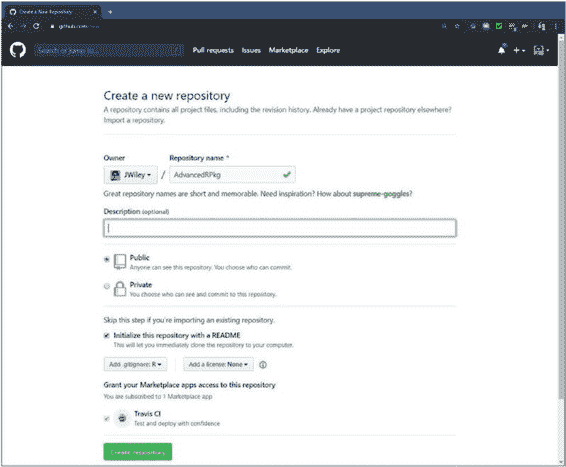

### 第 6 章 编写 R 包

#### 图 6-1. GitHub 上创建 AdvancedRPkg 仓库的页面

如果一切按计划进行，结果应该类似于图 6-2。除了 README 和`.gitignore`文件外，仓库是空的。从这里，我们可以将仓库克隆到本地计算机。这本质上是在本地创建了一个副本，我们将在其中进行包的编写工作。为此，打开 GitHub 桌面客户端，点击"File"，选择"Clone repository"，然后选择仓库，如图 6-3 所示。我们可以选择将仓库克隆到哪个目录。请注意，无论您选择哪个目录，都会为仓库创建一个与仓库同名的新目录（即 `AdvancedRPkg`）。仓库的设置可以通过终端管理，或者通过在 GitHub 桌面客户端中点击您的仓库，然后进入设置。其中一个设置显示了当前被忽略的文件。文件是基于`.gitignore`文件被忽略的，由于我们在创建仓库时选择了 R，因此默认包含了一些通常希望忽略的默认文件扩展名（图 6-4）。

### 第 6 章 编写 R 包

Windows 经常在目录中创建临时（有时是隐藏的）文件，比如 `desktop.ini`。为了避免包含这些文件，我们可以编辑仓库设置，在文件末尾添加新的一行并输入 `desktop.ini`，然后保存。这样这些文件就会被忽略。被忽略的文件是指 Git 仓库不会随时间跟踪和存储其更改的文件。它们会继续存在于目录中；Git 只是不监视和版本控制它们。

# 第 6 章 编写 R 包

除了设置一个新的 `Git` 仓库，您可能需要用 `Git` 执行的任务包括：提交对仓库的更改，以及将本地仓库副本与在线（`GitHub`）版本同步。提交可以看作是在提交时对文件状态拍了一张快照。为了避免冗余提交，快照只记录自上次提交以来对文件所做的更改。尽管即使是略微修改过的二进制文件也可能难以比较，但像 `R` 代码这样的纯文本文件很容易比较。`Git` 在随时间跟踪文本文件的更改方面非常高效，它允许您查看所做的更改，或者回溯到过去的特定点。访问项目（仓库）的历史记录，在代码中引入错误或缺陷时尤其有用，这样可以精确定位引入错误的确切时间（例如，基于该代码的多少结果可能受到影响？），并查看以前能正常工作的代码版本。

在稍微复杂一些的用例中，`Git` 可以有效地用于管理代码的不同版本。例如，一个常见的做法是：有一个项目，定期发布稳定或生产就绪的代码版本，同时继续进行开发。这在 `Git` 中是通过使用同一仓库的不同分支，并定期将某个分支（比如开发分支）的一些更改合并到稳定分支来实现的。

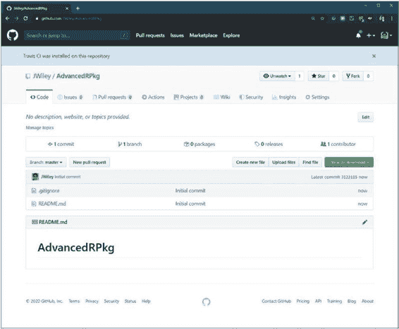

*图 6-2. GitHub 页面显示已创建的 `AdvancedRPkg` 仓库*

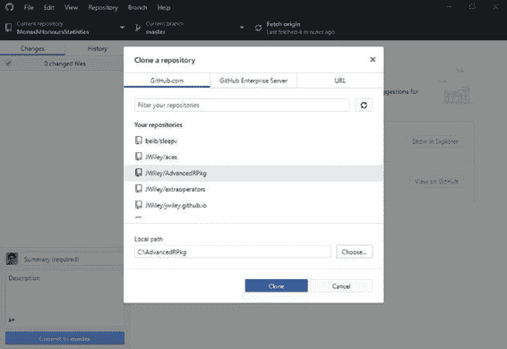

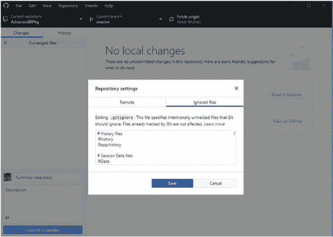

*图 6-3. GitHub 桌面客户端克隆 `AdvancedRPkg` 仓库*

*图 6-4. GitHub 桌面客户端显示 `AdvancedRPkg` 仓库的设置，包括被 `Git` 仓库忽略的各种文件扩展名*

我们在本章中还会展示一些其他相关的 `Git` 命令。关于使用 `Git` 的更多背景知识，一个很好的免费资源是 Scott Chacon 和 Ben Straub 编写的《Pro Git》（Apress, 2014），可在 [`git-scm.com/book/`](https://git-scm.com/book/) 获取。对于问题和解答，`Stack Overflow`（[`stackoverflow.com`](http://stackoverflow.com)）是个不错的资源。很可能之前已经有人问过类似您的问题，如果没有，您也可以提问并获得解答。另请注意，如果您使用 `RStudio` 编写 `R` 代码，它内置了一些 `Git` 集成功能。更多信息请参阅 `RStudio` 支持页面：[`support.rstudio.com/hc/en-us/articles/200532077-Version-Control-with-Git-and-SVN`](https://support.rstudio.com/hc/en-us/articles/200532077-Version-Control-with-Git-and-SVN)。最后，请注意您可以公开访问在线仓库：[`github.com/JWiley/AdvancedRPkg`](https://github.com/JWiley/AdvancedRPkg)。

## 6.2 R 包基础知识

一个 `R` 包仅仅是一个包含特定文件集合的目录。虽然 `R` 包的核心当然是 `R` 代码，但许多文件严格来说并非 `R` 代码。表 6-1 列出了可能存在于 `R` 包目录根目录下的主要文件。并非所有这些文件都是必需的，这取决于包的其他特性。我们将在本章后面使用`devtools`包来帮助创建其中的一些文件。

除了根目录级别的文件，`R` 包还可以包含许多子目录。这些列在表 6-2 中，并附有简要说明。对于我们相对简单的包，我们只使用其中一部分，包括`R`、`man`、`tests`和`docs`。

*表 6-1. `R` 包根目录中可能使用的文件*

| **文件** | **描述** |
|----------|-----------------|
| `DESCRIPTION`* | 提供关于包的一般信息。必需字段包括：`Package`（包名）、`Version`（版本）、`License`（许可证）、`Title`（包描述）、`Author`（作者）、`Maintainer`（维护者，可能与作者相同或不同）。除非包是独立的，否则通常还包括依赖项信息。 |
| `NAMESPACE`* | 控制包命名空间，包括要导出的对象以及要从其他包导入的对象。虽然是必需文件，但我们通过使用`roxygen2`包来自动生成它。 |
| `README`/`README.md` | 不是必需的，`R` 会忽略它，但对读者和用户有帮助。提供包的一般信息（在哪里获取帮助、简要概述、安装指南，或其他任何在简短文档中有用的信息）。 |
| `NEWS` | 提供关于包的变更或新闻信息。通常包括新功能、错误修复以及与先前版本相比任何其他重大更改。 |
| `LICENSE` | 如果未使用常见许可证之一或需要附加信息，则提供许可证文件。 |
| `INDEX` | 可选，根据文档文件自动生成。但如果指定，则每行列出一个所有有趣/有用对象的名称和描述。 |
| `configure`, `cleanup` | 可选的 `Bourne shell` 脚本，分别在 `Unix` 系统（如 `Linux`, `Unix`）上安装前和安装后运行。 |

*`*` 表示必需文件。*

### 使用 DevTools 启动一个包

至少，在您的包的根目录下，您需要`DESCRIPTION`和`NAMESPACE`文件。您还需要一个子目录`R`，很明显，这是存放 `R` 代码的地方。这对于提交到 `CRAN` 的包来说是不够的，但对于启动一个供私人使用的功能性包已经足够了。然而，即使对于私人使用，适当的文档也极其有帮助。包的目录和文件结构不幸地很复杂，尤其是用文字描述时。因此作为参考，图 6-5 显示了本章结束时您应该拥有的包的最终目录结构（从`AdvancedRPkg`目录内部查看）。

对于初始设置，我们使用`create()`函数。我们可以指定更多信息，但最少的参数是路径。我们还将`open = FALSE`设置，这样项目就不会自动更改。为了查看创建了哪些内容，我们可以使用`list.files()`函数，它会显示已创建了`DESCRIPTION`和`NAMESPACE`文件以及一个`R`目录。对于以下代码，要么从 `R` 命令行运行，要么创建一个新的 `R` 文件（我们将其命名为`chapter06.R`）。调整`path`参数使其指向包含 `Git` 仓库的目录非常重要，即您在本地机器上克隆该仓库的位置。在我们的例子中，`R` 的工作目录（您可以通过调用`getwd()`函数检查）位于`AdvancedRPkg`目录的上一级目录中。如果您的 `R` 会话不在那里，请调整`path`参数，或者使用`setwd()`函数将 `R` 的工作目录更改到`AdvancedRPkg`的父目录：

```r
create(
  path = "AdvancedRPkg/",
  open = FALSE
)
```

```markdown
## v 将活动项目设置为`'C:/.../RCode/AdvancedRPkg'`
## v 正在创建`'R/'`
## v 正在写入`'DESCRIPTION'`
## 包名: `AdvancedRPkg`
## 标题: `包的用途（一行，标题式大小写）`
## 版本: `0.0.0.9000`
## Authors@R (解析后):
## * First Last <first.last@example.com> [aut, cre] (<https://orcid.org/YOUR-ORCID-ID>)
```

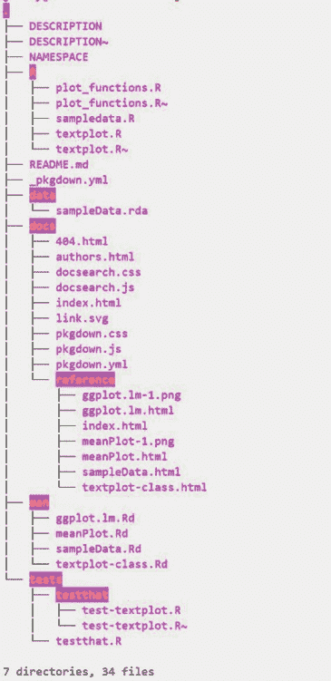

*图 6-5. 目录结构*

*表 6-2. `R` 包子目录*

| **子目录** | **描述** |
|------------|-----------------|
| `R`* | 包含所有函数、类、方法等 `R` 源代码的目录。 |
| `man`* | 包含 `R` 文档文件的目录。我们使用 `roxygen2` 包自动生成这些文件。 |
| `tests` | 可选目录，包含用于测试包是否按预期工作的 `R` 代码。 |
| `docs` | 可选目录，包含附加文档，供 `pkgdown` 用于构建包网站。 |
| `data` | 可选目录，包含与包一起分发的数据。通常，所含数据集较小，用于说明包的特性，而非共享数据的主要方式。 |
| `demo` | 可选目录，包含 `R` 包的演示，形式为 `R` 源代码文件。 |
| `exec` | 可包含所需的其他可执行脚本。仅包含文件，不包含子目录。 |
| `inst` | 可包含在安装包时复制到安装目录的其他文件。例如，可用于与用户共享新闻文件，或包含图像或其他非标准文档。 |
| `po` | 用于添加 `C` 和 `R` 错误消息的翻译以及其他与本地化相关的任务。 |
| `src` | 通常包含其他语言的源代码，如 `C`、`C++` 或 `Fortran`。此代码通常需要编译；如果你使用它，通常需要指定一个 `makefile`。 |
| `tools` | 不常用，但可用于提供配置所需的其他文件。 |
| `vignettes` | 用于提供一个或多个小插图或使用包的指南。与通常特定于某个函数的函数文档相比，小插图通常包含更多介绍性背景以及如何使用整个包的完整示例。虽然不是必需的，但对用户非常有帮助。 |

*`*` 表示必需的子目录。*

## 描述: `包的用途（一段落）。`

## 许可证: `使用的许可证`

## 编码: `UTF-8`

## 懒加载数据: `true`

## v 正在写入`'NAMESPACE'`

## v 将活动项目设置为`'<无活动项目>'`

```r
list.files("AdvancedRPkg")
```

```
[1] "DESCRIPTION" "NAMESPACE"   "R"           "README.md"
```

输出还展示了一些字段以及用于填充这些字段的信息。

由于这些大多是占位符，我们需要使用文本编辑器（任何文本编辑器都可以，包括 `RStudio`）打开文件并进行修改。`create()` 函数会根据目录名猜测包名，但其余部分需要我们自己填写。使用编辑器，我们将这些字段修改如下：

```
Package: AdvancedRPkg
Title: An Example R Package for the Book Advanced R
Version: 0.0.0.9000
Authors@R: c(
    person("Matt", "Wiley",
           email = "mattwiley@example.com", role = c("aut")),
    person("Joshua F.", "Wiley",
           email = "joshwiley@example.com", role = c("aut", "cre", "cph"))
    )
Description: This package will demonstrate the basics of an R
    package including documentation and tests.
Depends: R (>= 3.6.0)
License: GPL (>= 3)
Encoding: UTF-8
LazyData: true
```

请注意版本号，其设计格式为`主版本号.次版本号.修订号.开发版本号`。关于确定软件版本时需要考虑的因素，在*语义化版本规范*（[`semver.org/`](https://semver.org/)）中有很好的概述。该规范的建议相当具体，但有一套固定的规则来确定软件的主要或次要版本通常很有帮助。最后的`开发版本号`部分仅在开发版本中存在，发布时会被去掉。尽管有这些规则和指南，但许多 `R` 包的实际情况要更加多样化和不一致（并非所有人都认同这些规则，即使认同的人也未必会严格遵循）。

接下来是作者，使用 `person()` 函数描述。除了每个人的姓名和电子邮件，还使用三个字母的缩写来描述角色和关系。所有可能的角色都在 `MARC` 关联方代码表中列出，网址为 [www.loc.gov/marc/relators/relaterm.html](http://www.loc.gov/marc/relators/relaterm.html)。然而，最常用的几个是：`aut` 表示作者，`cre` 表示创建者，即对项目负责的人（或者用 `R` 的术语来说，是出现问题时应向其投诉的人，即维护者），以及 `cph` 表示版权持有人。然后，我们提供几句描述包功能的说明，并指定我们的包所依赖的 `R` 版本、许可证，以及可以按需加载数据（节省启动时间）。

### 添加 R 代码

有了包的基本框架，是时候开始添加一些 `R` 代码了——这才是包的真正意义所在！由于本章的重点是打包代码，我们将重用前几章中的一些函数和类。第一步，我们在 `AdvancedRPkg/R/` 目录下创建两个文件：`plot_functions.R` 和 `textplot.R`。

接下来，我们从第 4 章复制最终的 `meanPlot()` 函数来创建带有均值的图表。我们将这个函数的代码以及我们在第 5 章编写的 `S3` 方法 `ggplot.lm()` 一起添加到 `plot_functions.R` 中。然后，我们将第 5 章中 `textplot` 类的类和方法（`show` 和 `subset`，即括号运算符 `[`）复制到 `textplot.R` 中。由于很容易复制错误的代码，我们建议从我们的 `GitHub` 仓库 [`github.com/JWiley/AdvancedRPkg`](https://github.com/JWiley/AdvancedRPkg) 复制粘贴代码。如果一切正常，应该如下所示：

```r
list.files("AdvancedRPkg/R")
```

```
[1] "plot_functions.R" "textplot.R"
```

顺便提一下，决定将代码分成多少个文件有时会很困难。这对 `R` 本身没有影响，但对开发过程确有影响。将所有的代码放在一个文件中，或者将每个函数、类和方法都拆分成单独的文件，都不是好做法。如果结果文件不是太长，我们尝试将相关的函数（如绘图函数）分组，并将相关的类和方法分组。常识告诉我们，即使可以，也不要使用仅靠大小写区分的相同文件名来命名文件；在文件名中使用特殊字符或符号通常也是一个坏主意。

现在我们已经有了一个基本的包模板，可以使用 `devtools` 包中的 `load_all()` 函数来加载函数。我们只需要指定包的路径即可。

我们现在可以看到，我们的一些函数在包的命名空间中可用。我们使用 `ls()` 函数，并指定我们希望它列出可用对象的位置来做到这一点：

```r
load_all("AdvancedRPkg")
```

```
## Loading AdvancedRPkg
```

```r
ls(name = "package:AdvancedRPkg")
```

```
## [1] "ggplot.lm"            "library.dynam.unload"
## [3] "meanPlot"             "system.file"
## [5] "textplot"
```

在第 4 章中，我们简要讨论了作用域。在编写包时，理解作用域会变得更加重要。包的作者可以编写与其他包中函数同名的函数。虽然这些函数不会相互覆盖，但明确你要调用哪个函数可能会令人困惑。此时，包的命名空间就能派上用场。命名空间控制从其他包导入哪些函数（供包内代码使用），以及从本包导出哪些函数，使其对包的用户公开可用。你可以使用`import`功能从其他包导入特定函数。如果你需要另一个包中的许多函数，可以决定让你的包依赖于该包，在这种情况下，该包的所有公共函数都会对你的包可用。导入和依赖另一个包之间的另一个区别在于加载包时发生的情况。如果包 `B` 依赖于包 `A`，当用户调用`library(B)`时，包 `B` 和包 `A` 都会被加载并附加。如果包 `B` 从包 `A` 导入，当用户调用`library(B)`时，包 `B` 会被加载并附加，而包 `A` 会被加载但不附加。由于包 `A` 被加载，其函数对包 `B` 内的代码可用，但由于包 `A` 未附加，这些函数不会直接暴露给用户。即使包 `A`（或包 `B`）被加载并附加，也只有导出的函数对用户公开可用。这很有好处，因为它允许包开发者编写和记录仅供内部使用的函数。如果不需要导出某个函数，最好就不要导出。如果两个 `R` 包导出了同名函数，并且用户同时加载并附加了这两个包，则后加载的包中的函数会屏蔽先加载的包中的函数。对用户而言，唯一的选择要么是不加载并附加其中一个包，要么是使用双冒号运算符`PkgA::foo()`、`PkgB::foo()`明确指定函数调用。由于 `R` 包成千上万，函数更是数量繁多，只导出必要的函数有助于避免此类冲突和名称屏蔽。

所有这些都通过包的`NAMESPACE`文件进行控制。虽然我们没有查看，但我们的包确实有一个`NAMESPACE`文件，它是在我们运行`create()`时创建的。

然而，`load_all()`函数很特别，默认情况下，它在加载包时会导出所有对象。这是因为在开发过程中，能够调用所有函数（无论它们是否被导出）通常很方便。

### 测试

随着函数和方法被添加到我们的新包中并在 R 中运行，我们可以开始考虑质量控制。编写能够运行的代码固然重要，但确保代码按预期工作也至关重要。不过，预期意图和实际期望并不总是一致（这就是文档发挥关键作用的地方，我们将在下一节介绍）。即便如此，即使是对于开发者而言，测试也能确保所编写的代码完成其应完成的任务。

测试可以在包开发的任何阶段编写。如果函数、名称和特性正在大幅变动，那么也许开始编写大量测试还为时过早。然而，即使包尚未完成，如果某些函数相对稳定，尽早编写测试也会有所帮助。尽早编写测试而不是推迟是有益的，因为在编写函数后立即编写测试通常更容易，此时函数的目的和工作方式在你头脑中还记忆犹新。（如果你不知道或忘记了函数的工作方式，就很难对其进行充分测试！）这也有帮助，因为如果后续函数基于早期函数构建，那么沿途进行测试可以帮助确保问题是由新编写的函数引起的，而不是由之前的某个构建块引起的。

抛开好处不谈，`testthat` 包使得编写测试的实际操作更加容易。为了设置测试，我们使用 `usethis` 包中的一些函数，特别是 `use_test()` 函数。该函数接受测试的名称，并会创建 `testthat` 包所需的目录和子目录。我们还要先切换目录到我们的包目录，以确保相对路径全部正确。输出显示了 `use_test()` 函数执行的多种任务，包括将所需的包添加到我们的 `DESCRIPTION` 文件中，以及创建目录和骨架 R 文件供我们填写测试：

```r
setwd("AdvancedRPkg")
use_test("textplot")
```

```
## v Setting active project to 'C:/.../RCode/AdvancedRPkg'
## v Adding 'testthat' to Suggests field in DESCRIPTION
## v Creating 'tests/testthat/'
## v Writing 'tests/testthat.R'
## * Call 'use_test()' to initialize a basic test file and open it for editing.
## v Increasing 'testthat' version to '>= 2.1.0' in DESCRIPTION
## v Writing 'tests/testthat/test-textplot.R'
## * Modify 'tests/testthat/test-textplot.R'
```

要运行测试，我们需要指明我们的包需要 `testthat` 包。包的核心功能并不依赖于 `testthat`，因此我们将其添加到 `DESCRIPTION` 文件的新部分 `Suggests` 中。通常，你需要手动完成此操作，但从之前的输出中可以看出，`usethis` 包为我们完成了这项工作。

正确测试绘图函数相当困难，因此对于我们的测试，我们检查 `textplot` 的子集方法是否按预期工作。在位于 `AdvancedRPkg/tests/testthat/` 下的 `test-textplot.R` 文件中，我们设置一个简单的 `textplot` 类对象，然后运行一系列测试。这些测试包含两个部分。首先是外部调用 `test_that()`。第一个参数是对测试的描述，第二个参数是执行测试的代码。代码可以包含任何内容，但通常包括对某个 `expect_*()` 函数的调用，这类函数有很多。在我们做出选择之前，使用 `apropos()` 函数调用来展示所有 `expect_*()` 的选项：

```r
apropos("expect_")
```

```
## [1] "expect_condition"      "expect_cpp_tests_pass"
## [3] "expect_equal"          "expect_equal_to_reference"
## [5] "expect_equivalent"     "expect_error"
## [7] "expect_failure"        "expect_false"
## [9] "expect_gt"             "expect_gte"
## [11] "expect_identical"      "expect_invisible"
## [13] "expect_is"             "expect_known_failure"
## [15] "expect_known_hash"     "expect_known_output"
## [17] "expect_known_value"    "expect_length"
## [19] "expect_less_than"      "expect_lt"
## [21] "expect_lte"            "expect_mapequal"
## [23] "expect_match"          "expect_message"
## [25] "expect_more_than"      "expect_named"
## [27] "expect_null"           "expect_output"
## [29] "expect_output_file"    "expect_reference"
## [31] "expect_s3_class"       "expect_s4_class"
## [33] "expect_setequal"       "expect_silent"
## [35] "expect_success"        "expect_that"
## [37] "expect_true"           "expect_type"
## [39] "expect_vector"         "expect_visible"
```

### `expect_warning`

我们选择 `expect_is()` 来检查对象的类，并使用 `expect_equal()` 来检查其他特征。也可以使用 `expect_error()` 或 `expect_warning()` 来检查错误处理是否正常，这些函数在代码产生错误时会“通过”。

我们将以下代码放入 `test-textplot.R` 文件中：

```R
dat <- textplot(
  x = 1:4,
  y = c(1, 3, 5, 2),
  labels = letters[1:4])
```

```R
test_that("textplot 子集方法仅适用于行", {
  tmp <- dat[i = 1:2, ]
  expect_is(tmp, "textplot")
  expect_equal(length(tmp@x), 2)
})
```

```R
test_that("textplot 子集方法仅适用于变量", {
  tmp <- dat[, j = c("x", "y")]
  expect_is(tmp, "list")
  expect_equal(length(tmp), 2)
  expect_equal(length(tmp$x), 4)
})
```

第 6 章 编写包

```R
test_that("textplot 子集方法适用于行和变量", {
  tmp <- dat[1:2, j = c("x", "y")]
  expect_is(tmp, "list")
  expect_equal(length(tmp), 2)
  expect_equal(length(tmp$x), 2)
})
```

我们可以直接运行这些代码测试。如果一切正常，则没有输出。只有当某些检查未通过时才会产生输出。然而，通常这段代码不是直接运行的，而是批量运行的。我们通过使用 `devtools` 函数 `test()` 以及我们的包名/路径来运行所有测试。由于我们已将工作目录切换为包目录，因此可以留空参数。`devtools` 包了解 `testthat` 包的目录结构，因此它们能很好地协同工作。为了运行测试，`test()` 首先使用 `load_all()` 加载包，然后执行测试。回到包目录上一层目录，从章节级别的 R 文件 `chapter06.R` 中，我们执行以下代码来运行所有测试：

```R
test()
## Loading AdvancedRPkg
## Testing AdvancedRPkg
## v | OK F W S | Context
## v |   8        | textplot
##
## == Results ===========================================================
## OK:       8
## Failed:   0
## Warnings: 0
## Skipped:  0
```

现在，我们可以使用 `covr` 包来检查代码覆盖率。`covr` 包（[`covr.r-lib.org/`](https://covr.r-lib.org/)）会检查执行测试时代码的不同部分是否被运行。例如，一个包含 `if/else` 语句的函数，可能只有一个测试执行了其中部分代码，除非设计额外的测试来检查其他条件。同样，尽管开发包并非必须，但这是一个非常有用的工具，可以了解当前测试对包功能的覆盖程度。高覆盖率（力求 100%）是捕捉错误的好方法，并能确保新代码的开发不会破坏旧的功能和特性；所有这些也有助于向用户保证您的包是一个不错的选择。

回到顶层文件 `chapter06.R` 中，我们运行 `package_coverage()` 函数来测试我们的测试对包代码的覆盖程度。唯一需要的参数是包所在的目录。在我们的例子中，R 的工作目录是父目录 `AdvancedRPkg/`。如果您 R 实例的工作目录不同，则需要指定适当的路径来访问您机器上的 `AdvancedRPkg/` 目录：

```R
cov <- package_coverage()
```

输出结果（如下所示）显示当前测试覆盖率约为 36%，这主要来自 `textplot.R` 中的代码覆盖。还可以使用 `as.data.frame(cov)` 进行更详细的分析。输出内容很丰富，因此我们只展示几行几列，但如果您认为测试已覆盖所有内容，并需要找出代码中哪些部分尚未被测试，这将是一个宝贵的资源：

```R
cov
## AdvancedRPkg Coverage: 33.33%
## R/plot_functions.R: 0.00%
## R/textplot.R: 51.61%

as.data.frame(cov)[1:3, c(1, 2, 3, 11)]
##   filename       functions first_line value
## 1 R/plot_functions.R meanPlot         2     0
## 2 R/plot_functions.R meanPlot         3     0
```

# 第 6 章 编写包

## 6.3 使用`roxygen2`编写文档

函数、数据、类及方法的R文档位于包的`man`子目录中，并通过扩展名为`.Rd`的特殊R文档文件完成。然而，对于程序员来说，这会更加困难，因为文档与实际R代码是分离的。此外，还需要编写相当多的标记，其中许多只是标准模板的一部分。`roxygen2`包完全自动化了这一过程，包括子目录的创建，并通过在R代码旁边使用特殊格式的注释提供了一种更简便的编写文档方式。运行`roxygen2`包后，它会将这些特殊注释转换为`man`目录中格式正确的`.Rd`文件，使R拥有为包函数创建帮助文件所需的一切。在本节中，我们将学习如何为多种类型的对象编写文档，包括函数、数据、类及方法。

### 函数

要使用`roxygen2`为对象编写文档，可在特殊的注释引导符`##'`或`#'`后添加文档内容。由于`#`是R的注释字符，R会忽略它，但特殊的单引号向`roxygen2`指示应将这些信息处理为文档。请注意，此语法排除了注释这些代码的可能性。所有这些代码都添加在`plot_functions.R`文件中的`meanPlot()`函数代码之上。

如前所述，由于语法原因，注释被排除在外；因此，顺序变得至关重要。要了解每个部分对应哪个格式域，只需记住有三个部分通过换行符分隔：标题（title）、描述（description）和详情（details）。详情部分是可选的。为了读者清晰，我们在换行符之间增加了空格。函数参数通过使用`@param 参数名 参数的简短描述`来指示。这里列出的参数名称必须与函数中的命名参数完全一致。

`@return`部分用于指明函数返回的对象类型。在本例中，函数的调用是为了产生绘图这一副作用，其返回值并不重要。`@author`后面可以跟任意文本，用于指明函数的作者。通常，如果作者与整个包的作者相同，则不需要`@author`部分。为了使函数可公开访问，必须将其导出。这通过使用指令`@export`实现。`roxygen2`包会将其转换为`NAMESPACE`文件中的额外代码行，指示该函数应被导出。

`@keywords`部分是可选的。最后，对读者最有用的部分之一是`@examples`部分，它为读者提供了可执行的示例，是展示如何使用函数的最简单方式之一：

```
##' Function to plot data and mean summary
##'
##' This is a simple function designed to facilitate plotting raw
##' data along with dots indicating the mean at each x-axis value.
##'
##' Although this function can be used with any type of data that works
##' with \code{plot}, it works best when the x-axis values are discrete,
##' so that there are several y-values at the same x-axis value so that
##' the mean of multiple values is taken.
##'
##' @param formula A formula specifying the variable to be used on the
##' y-axis and the variable to be used on the x-axis.
##' @param d A data.frame class object containing the variables specified
##' in the \code{formula}.
##' @return Called for the side effect of creating a plot.
##' @author Wiley
##' @export
##' @keywords plot
##' @examples
##' # example usage of meanPlot
##' meanPlot(mpg ˜ factor(cyl), d = mtcars)
```

现在，要生成文档，我们可以运行`roxygen2`包。这可以通过直接使用`roxygenize()`函数并为其提供包目录的路径来完成，或者通过使用`devtools`包中的`document()`函数来完成。我们指定包目录，其余步骤自动进行。输出显示已写入文档文件（`meanPlot.Rd`）和`NAMESPACE`文件：

```
document()

## Updating AdvancedRPkg documentation
## Updating roxygen version in ˜\AdvancedRPkg/DESCRIPTION
## Writing NAMESPACE
## Loading AdvancedRPkg
## Writing NAMESPACE
```

最后，在对我们的包进行所有更改之后，是时候检查版本控制了。可以从命令行执行此操作，但我们此处使用GitHub桌面客户端。默认情况下，所有更改过的文件都被选中，但我们不是一次提交所有更改，而是将它们按相关文件批次进行提交，并附上有意义的消息。

提交消息伴随每次提交添加，用于提醒您自己或让他人了解所做更改的高级摘要或更改原因。不必详细说明每一项更改，因为Git会负责精确追踪哪些文件发生了更改以及它们的内容是如何更改的。

首先，我们选择`DESCRIPTION`、`NAMESPACE`和`.gitignore`文件，并添加消息*initiate R package with DESCRIPTION and NAMESPACE*。此过程如图6-6所示。

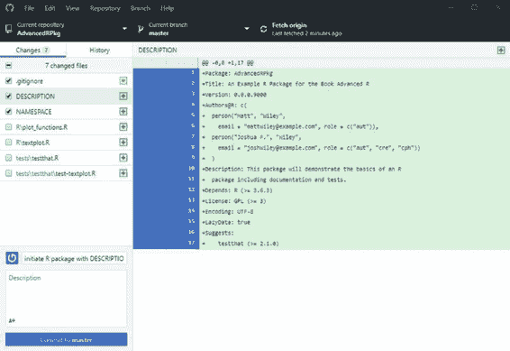

**图 6-6.** GitHub桌面客户端：选择已更改的文件，添加提交消息，并提交到主分支

接着，我们添加`plot_functions.R`和`textplot.R`，并添加提交消息*initial commit of R functions*。最后，我们添加`testthat.R`和`test textplot.R`，并添加提交消息*adding testing for quality control*。当然，您也可以在创建文件的过程中随时提交它们。如果我们切换到GitHub桌面客户端的*History*选项卡，就可以看到所做的更改。如果我们希望它们公开，可以点击*Sync*按钮，该按钮会从GitHub仓库拉取更改到本地仓库，并将所有已提交的更改从本地仓库推送到GitHub仓库。请注意，在同步之前，所有更改都应已提交，因为同步的实际对象不是目录中的实际文件，而是Git仓库。对文件的更改只有在提交时才会被添加到本地Git仓库，因此如果您不提交，更新就不会被添加到本地仓库，也不会被推送到远程（GitHub）仓库。图6-7展示了这一过程。

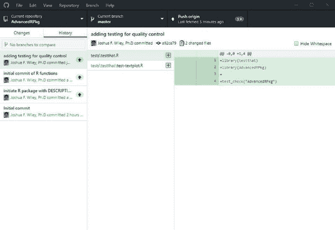

**图 6-7.** GitHub桌面客户端显示提交历史记录以及右上角的同步按钮

我们仅仅触及了测试的皮毛，显然我们的包在彻底测试之前还有很长的路要走。然而，这些工具应该能让您在测试和质量控制方面走上正轨（并领先于CRAN上的大多数R包）。下一个关键部分是文档，这是我们接下来要讨论的主题。

# 编写 meanPlot.Rd

当构建或安装时，R 文档文件会被转换为 HTML 和 PDF 格式。不过，您现在已经可以预览该文档的开发版本。

在 R 控制台中，获取函数帮助的常规方式现在应该可以正常工作：

`?meanPlot`

如果您使用 RStudio，您也可以打开该文件并进行预览。构建包后生成的 HTML 文件如图 6-8 所示。由于此函数的简洁性以及篇幅考虑，我们编写了相当精简的文档。

通常，为了用户和日后参考，更全面地记录文档，并仔细解释每个参数可以接受和不能接受的内容，会很有帮助。如果函数实现了新的程序或统计方法，通常会使用 `@references` 部分包含一些参考文献。

**图 6-8.** `meanPlot()` 函数的 R 文档文件的 HTML 输出* 154

**第 6 章 编写包**

## 数据

在记录数据之前，我们需要向包中添加一些数据。首先，我们创建一个小的样本数据框 `sampleData`。以前，我们会在包文件夹中创建一个 `data` 子目录，位于 `AdvancedRPkg/data/`，然后将数据保存为 `.rda` 文件。然而，`usethis` 包中的 `use_data()` 函数会负责创建正确的目录并以正确的格式将数据文件保存在正确的位置，并赋予正确的名称：

```r
sampleData <- data.frame(
  Num = 1:10,
  Letter = LETTERS[1:10])
use_data(sampleData)
## v Setting active project to 'C:/.../RCode/AdvancedRPkg'
## v Creating 'data/'
## v Saving 'sampleData' to 'data/sampleData.rda'
```

我们添加以下代码，将数据记录在 `R` 子目录（即 `AdvancedRPkg/R/sampledata.R`）中一个名为 `sampledata.R` 的新文件中。这提供了数据的标题和详细信息，以及用于指示数据格式或类型的特殊参数 `@format` 和用于指示数据来源的 `@source`。在末尾的引号中，给出了对象的名称：

```r
##' Numbers and letters.
##'
##' A sample data set containing 10 numbers and letters with two variables:
##'
##' \itemize{
##'   \item Num. A number.
##'   \item Letter. An upper case letter (A to J)
##' }
##'
##' @format A data frame with 10 rows and 2 variables
##' @source Created as a sample
"sampleData"
```

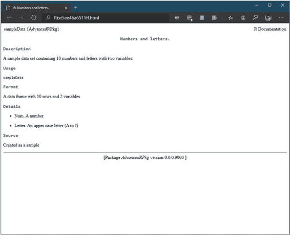

**第 6 章 编写包**

在通过使用 `document()` 函数重新对包进行 `roxygenize` 处理后，生成的 HTML 如图 6-9, a 所示（同样通过使用完全构建的包的帮助工具或使用 RStudio 的预览功能）。

请注意，当我们运行 `document()` 时，只会写入新文件。我们的绘图文档没有更改，因此无需重写该文件：

```r
document()
## Updating AdvancedRPkg documentation
## Writing NAMESPACE
## Loading AdvancedRPkg
## Writing NAMESPACE
## Writing sampleData.Rd
```

**图 6-9.** `sampleData` 数据集的 R 文档文件的 HTML 输出*

**第 6 章 编写包**

## 类

S3 类是非正式的，通常不需要记录。S4 类则很容易记录。它们的文档直接放在我们 `textplot.R` 文件（`AdvancedRPkg/R/textplot.R`）中 `setClass()` 调用的上方，包含一个标题、一个详细说明部分，然后是一些参数——每个插槽名称对应一个 `@slot`，详细说明插槽的名称和功能。要在包中使用 S4 系统，我们还需要添加 `methods` 包，这可以通过添加 `@import methods` 并将其添加到 `DESCRIPTION` 文件的 `Imports` 字段来完成。我们可以再次使用 `usethis` 包，特别是 `use_package()` 函数来指定包名及其所属部分：

`use_package("methods", "Imports")`

该类的完整文档如下所示：

```r
##' An S4 class to hold text and Cartesian coordinates for plotting
##'
##' A class designed to hold the data required to create a textplot
##' where character `strings` are plotted based on x and y coordinates.
##'
##' @slot x A numeric value with the x `axis` coordinates.
##' @slot y A numeric value with the y axis coordinates.
##' @slot labels A character string with the `text` to be plotted
##' @import methods
```

在通过使用 `document()` 函数重新对包进行 `roxygenize` 处理后，生成的 HTML 如图 6-10. 所示。

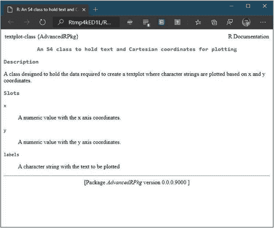

**第 6 章 编写包**

**图 6-10.** S4 类 `textplot` 的 R 文档文件的 HTML 输出*

## 方法

记录方法与记录常规函数类似。S3 方法可以没有文档，也可以作为函数进行记录。以下是添加给 `ggplot.lm` 方法的 `roxygen2` 风格文档。该代码直接添加在 `AdvancedRPkg/R/plot_functions.R` 中的函数定义上方。

请注意，这里我们导入了 `ggplot2` 包以确保其可用。我们还将 `ggplot2` 包添加到 `DESCRIPTION` 文件的 `Imports` 部分，用逗号与包所依赖的 R 版本隔开。我们可以再次使用 `usethis` 包，特别是 `use_package()` 函数来指定包名及其所属部分：

`use_package("ggplot2", "Imports")`

**第 6 章 编写包**

通过导入它，`roxygen2` 将自动将适当的导入代码添加到 `NAMESPACE` 文件中：

```r
##' Method for plotting linear models
##'
##' Simple method to plot a linear model using ggplot
##' along with 95% *confidence intervals*.
##'
##' @param data The linear model object from \code{lm}
##' @param mapping Regular mapping, see \code{ggplot} and \code{aes} for details.
##' @param vars A list of variable values used `for` prediction.
##' @param \ldots Additional arguments passed to \code{ggplot}
##' @return A ggplot class object.
##' @export
##' @import ggplot2
##' @examples
##' ggplot(
##'   lm(mpg ˜ hp * qsec, data = mtcars),
##'   aes(hp, mpg, linetype = factor(qsec)),
##'   vars = list(
##'     hp = `min`(mtcars$hp):`max`(mtcars$hp),
##'     qsec = round(mean(mtcars$qsec) + c(-1, 1) * sd(mtcars$qsec)), 1)) +
##'   geom_ribbon(aes(ymin = LL, ymax = UL), alpha = .2) +
##'   geom_line() +
##'   theme_bw()
```

S4 方法可以单独记录，可以与泛型函数一起记录，也可以与类一起记录。这可以通过使用 `@describeIn` 参数来实现，该参数用于替代标题。对于我们的 S4 方法，我们将其与类一起记录。`roxygen2` 代码相对简短。我们可以添加细节，但并非必须。`roxygen2` 包负责注册这些方法，所以我们真正需要做的就是添加任何特殊说明并记录参数的使用。`show()` 方法的文档如下：

```r
##' @describeIn textplot show method
##'
##' @param object The object to be shown
```

**第 6 章 编写包**

接下来是 `` 运算符方法的文档。请注意，我们还导出了 `[` 方法并添加了一个别名，这只是用户查找该方法的另一种方式：

```r
##' @describeIn textplot extract method
##'
##' @param x the object to subset
##' @param i the rows to subset (optional)
##' @param j the columns to subset (optional)
##' @param drop should be missing
##' @export
##' @aliases [,textplot-method
```

在使用 `document()` 重新进行 `roxygenize` 处理后，更新的 HTML 帮助文件如图 [6-11, inc 所示，其中包括了类和附加方法的文档。

```r
document()
## Updating AdvancedRPkg documentation
## Writing NAMESPACE
## Loading AdvancedRPkg
## Writing NAMESPACE
## Writing ggplot.lm.Rd
```

# 编写 textplot-class.Rd 文档

## 6.4 构建、安装和分发 R 包

与 Git 类似，在构建 R 包时，忽略目录中的某些文件会很有帮助。我们在主目录 `AdvancedRPkg/` 中创建一个名为 `.Rbuildignore` 的文件，其中包含以下代码。该文件应位于与 `DESCRIPTION` 文件相同的层级：

```
desktop.ini
.Rhistory
.RData
```

确保通过再次运行 `document()` 使文档保持最新后，准备工作就基本完成了。此时，我们做了一些更改，因此最好将这些更改添加并提交到 Git 仓库中（如果你在开始时选择了使用 Git 的话）。

虽然你可以通过运行 `git add` 一次性添加所有文件，但根据相似主题分块提交更改，信息更明确，以后（如果需要）也更容易回退。例如，我们对以下每一项都使用了单独的提交，如下方代码分块所示：

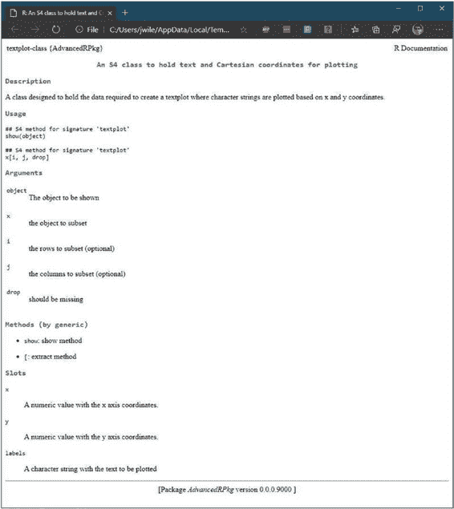

**图 6-11.** 为 S4 类 `textplot` 添加方法文档后的 R 文档文件 HTML 输出

-   更新的代码文件（`AdvancedRPkg/R/` 目录中的所有文件）、`DESCRIPTION` 和 `NAMESPACE`，提交信息为 "added roxygen-style documentation"
-   示例数据，提交信息为 "added sample data"
-   更新的文档文件（`AdvancedRPkg/man/` 目录中的所有文件），提交信息为 "re-roxygenized package"
-   `.Rbuildignore` 文件，提交信息为 "adding file to ignore files during package build"

现在，我们可以通过在 `chapter06.R` 文件中使用 `devtools` 包中的 `build()` 函数，将包构建成一个压缩的源代码 tarball。输出显示了构建过程，并表明最终生成了一个 `.tar.gz` 文件：

```r
build("AdvancedRPkg")

## v  checking for file 'C:\...\RCode\AdvancedRPkg/DESCRIPTION'
## -  preparing 'AdvancedRPkg':
## v  checking DESCRIPTION meta-information
## -  checking for LF line-endings in source and make files and shell scripts
## -  checking for empty or unneeded directories
## -  looking to see if a 'data/datalist' file should be added
## -  building 'AdvancedRPkg_0.0.0.9000.tar.gz'
##
## [1] "C:/.../RCode/AdvancedRPkg_0.0.0.9000.tar.gz"
```

我们可以安装并使用这个包。然而，再运行一组检查会很有帮助。`devtools` 包中的 `check()` 函数会对包运行 `Rcmd check` 命令。参数 `cran = TRUE` 表示使用 CRAN 的测试。以下代码应从我们的 `chapter06.R` 文件中运行：

```r
check("AdvancedRPkg", cran = TRUE)
```

输出显示了详细的检查过程和结果：

## 构建阶段

### 更新文档与命名空间

## 加载 AdvancedRPkg

## 设置环境变量

*   `CFLAGS`    : -Wall -pedantic
*   `CXXFLAGS`  : -Wall -pedantic
*   `CXX11FLAGS`: -Wall -pedantic

## 检查与构建流程

*   检查文件 `C:\...\RCode\AdvancedRPkg/DESCRIPTION`
*   准备 `AdvancedRPkg`：
    *   检查 `DESCRIPTION` 元信息
    *   检查源文件、make文件和脚本是否为LF行尾
    *   检查是否存在空或不必要的目录
    *   查看是否需要添加 `data/datalist` 文件
    *   构建 `AdvancedRPkg_0.0.0.9000.tar.gz`

## 检查阶段

### 设置环境变量

*   `_R_CHECK_CRAN_INCOMING_USE_ASPELL_`: TRUE
*   `_R_CHECK_CRAN_INCOMING_REMOTE_`   : FALSE
*   `_R_CHECK_CRAN_INCOMING_`          : FALSE
*   `_R_CHECK_FORCE_SUGGESTS_`         : FALSE
*   `NOT_CRAN`                         : true

### R CMD check 详细输出

*   使用日志目录：`'C:/.../Temp/.../AdvancedRPkg.Rcheck'`
*   使用 R 版本：3.6.3 (2020-02-29)
*   使用平台：`x86_64-w64-mingw32` (64-bit)
*   使用会话字符集：ISO8859-1
*   使用选项：`'--no-manual --as-cran'`
*   检查文件 `AdvancedRPkg/DESCRIPTION` ... OK
*   这是包 `AdvancedRPkg` 版本 `0.0.0.9000`
*   包编码：UTF-8
*   检查包命名空间信息 ... OK
*   检查包依赖关系 ... OK
*   检查是否为源码包 ... OK
*   检查是否存在命名空间 ... OK
*   检查可执行文件 ... OK
*   检查隐藏文件和目录 ... OK
*   检查文件名是否可移植 ... OK
*   检查包 `AdvancedRPkg` 是否可安装 ... OK
*   检查已安装包大小 ... OK
*   检查包目录 ... OK
*   检查未来文件时间戳 ... OK
*   检查 `DESCRIPTION` 元信息 ... WARNING
*   检查顶级文件 ... OK
*   检查残留文件 ... OK
*   检查索引信息 ... OK
*   检查包子目录 ... OK
*   检查 R 文件中的非ASCII字符 ... OK
*   检查 R 文件的语法错误 ... OK
*   检查包是否可以被加载 ... OK
*   检查在声明的依赖项下包是否可以被加载 ... OK
*   检查包是否可以干净地卸载 ... OK
*   检查在声明的依赖项下命名空间是否可以被加载 ... OK
*   检查命名空间是否可以干净地卸载 ... OK
*   检查不在库搜索路径上的加载情况 ... OK
*   检查 R 代码中的依赖关系 ... OK
*   检查 S3 泛型/方法一致性 ... OK
*   检查替换函数 ... OK
*   检查外部函数调用 ... OK
*   检查 R 代码中的可能问题 ... NOTE
    *   `ggplot.lm`: 未定义全局函数 `formula`
    *   `ggplot.lm`: 未定义全局函数 `predict`
    *   `ggplot.lm`: 未定义全局变量 `fit`
    *   `ggplot.lm`: 未定义全局函数 `qnorm`
    *   `ggplot.lm`: 未定义全局变量 `se.fit`
    *   `meanPlot`: 未定义全局函数 `plot`
    *   `meanPlot`: 未定义全局函数 `points`
    *   `show,textplot`: 未定义全局函数 `head`
    *   未定义的全局函数或变量：
        `fit`, `formula`, `head`, `plot`, `points`, `predict`, `qnorm`, `se.fit`
    *   考虑在 `NAMESPACE` 文件中添加：
        `importFrom("graphics", "plot", "points")`
        `importFrom("stats", "formula", "predict", "qnorm")`
        `importFrom("utils", "head")`
*   检查 Rd 文件 ... OK
*   检查 Rd 元数据 ... OK
*   检查 Rd 行宽 ... OK
*   检查缺失的文档条目 ... OK
*   检查代码/文档不匹配 ... OK
*   检查 Rd `\usage` 部分 ... OK
*   检查 Rd 内容 ... OK
*   检查示例中未声明的依赖关系 ... OK
*   检查 `data` 目录内容 ... OK
*   检查数据中的非ASCII字符 ... OK
*   检查数据是否为ASCII和未压缩保存 ... OK
*   检查示例 ... ERROR
    *   `AdvancedRPkg-Ex.R` 中的示例运行失败，错误最可能发生在：
        ```r
        base::assign(".ptime", proc.time(), pos = "CheckExEnv")
        ### Name: ggplot.lm
        ### Title: Method for plotting linear models
        ### Aliases: ggplot.lm

        ### ** Examples

        ggplot(
          lm(mpg ~ hp * qsec, data = mtcars),
          aes(hp, mpg, linetype = factor(qsec)),
          vars = list(
            hp = min(mtcars$hp):max(mtcars$hp),
            qsec = round(mean(mtcars$qsec) + c(-1, 1) * sd(mtcars$qsec)), 1)) +
          geom_ribbon(aes(ymin = LL, ymax = UL), alpha = .2) +
          geom_line() +
          theme_bw()
        ```

# R包检查报告：`ggplot.lm` 函数未找到错误

## 错误概述
执行 `ggplot(lm(mpg ˜ hp * qsec, data = mtcars), aes(hp, mpg, linetype = factor(qsec)),` 时出现错误：
**无法找到函数 `ggplot`**

## R CMD check 结果摘要

**高级RPkg 0.0.0.9000**
持续时间：28 秒
**状态：1 个错误，1 个警告，1 个提示**

详情请参见 `C:/.../Temp/.../AdvancedRPkg.Rcheck/00check.log`。

## 检查项详情

### 检查示例
错误。`AdvancedRPkg-Ex.R` 中的示例运行失败。
错误最可能发生在：
```
> base::assign(".ptime", proc.time(), pos = "CheckExEnv")
> ### 名称: ggplot.lm
> ### 标题: 绘制线性模型的方法
> ### 别名: ggplot.lm
> ### 示例
> ggplot(
+   lm(mpg ˜ hp * qsec, data = mtcars),
+   aes(hp, mpg, linetype = factor(qsec)),
+   vars = list(
+     hp = min(mtcars$hp):max(mtcars$hp),
+     qsec = round(mean(mtcars$qsec) + c(-1, 1) * sd(mtcars$qsec)), 1)) +
+   geom_ribbon(aes(ymin = LL, ymax = UL), alpha = .2) +
+   geom_line() +
+   theme_bw()
```
在 `ggplot(lm(mpg ˜ hp * qsec, data = mtcars), aes(hp, mpg, linetype = factor(qsec)),` 中出现错误：无法找到函数 `ggplot`

### 检查 DESCRIPTION 元信息
警告。
依赖于 R 版本 `3.6.3` 但未指定补丁级别 0。

### 检查 R 代码中可能存在的问题
提示。
- `ggplot.lm`：未找到 `formula` 的可见全局函数定义。
- `ggplot.lm`：未找到 `predict` 的可见全局函数定义。
- `ggplot.lm`：未找到变量 `fit` 的可见全局绑定。
- `ggplot.lm`：未找到 `qnorm` 的可见全局函数定义。
- `ggplot.lm`：未找到变量 `se.fit` 的可见全局绑定。
- `meanPlot`：未找到 `plot` 的可见全局函数定义。
- `meanPlot`：未找到 `points` 的可见全局函数定义。
- `show,textplot`：未找到 `head` 的可见全局函数定义。

**未定义的全局函数或变量：**
`fit` `formula` `head` `plot` `points` `predict` `qnorm` `se.fit`

考虑将以下内容添加到您的 `NAMESPACE` 文件中：
```
importFrom("graphics", "plot", "points")
importFrom("stats", "formula", "predict", "qnorm")
importFrom("utils", "head")
```

## 检查测试
正常。

## 检查临时目录中的残余文件
正常。

## 完成
正常。

# 第 6 章 编写包

`check()` 函数包含多个步骤。它首先确保文档是最新的，然后构建一个源代码压缩包，最后在其上运行 `Rcmd check`。我们可以看到，检查捕捉到了不少问题。所有这些问题基本上都归结为没有精确地告诉 R 导入或需要哪些函数或包。大多数问题的出现是因为包和交互式 R 工作方式之间的差异。在交互式会话期间，`base`、`methods`、`graphics`、`utils` 和 `stats` 包默认会被加载，即使没有调用 `library(stats)` 之类。这意味着在交互式会话中，默认情况下搜索路径上有许多可用的函数。在包中，R 在最近的版本中变得更加严格，并且要求明确导入 `base` 包之外的所需函数。这些检查甚至建议了我们可以在命名空间中添加什么。我们使用 `roxygen2` 包，因此我们不是将这些添加到命名空间，而是将它们添加到 R 代码文件中。具体来说，在 `AdvancedRPkg/R/plot_functions.R` 中，紧跟在 `@export` roxygen2 语句之后，我们为 `meanPlot()` 添加以下内容：

```r
##' @importFrom graphics plot points
##' @importFrom stats formula
```

并且在同一个文件中为 `ggplot.lm()` 方法添加以下内容：

```r
##' @importFrom stats predict qnorm
```

在 `AdvancedRPkg/R/textplot.R` 中，紧跟在 `@param object` roxygen2 语句之后，我们为 `show()` 方法添加以下内容：

```r
##' @importFrom utils head
```

此外，还有一个类似的问题是关于某些全局变量的绑定不可见。这源于 `ggplot.lm()` 方法；因为它使用了 `within()`，R 无法判断这些变量是否已被定义，即使它们是在包含这些变量的数据框环境中进行查找。虽然这只是一个有点虚假的提示，但最好还是消除所有提示。一个解决方案是在我们的 R 文件中的某处添加对 `globalVariables()` 的调用。在 `AdvancedRPkg/R/plot_functions.R` 文件的顶部，我们添加以下内容：

```r
globalVariables(c("fit", "se.fit"))
```

注意到的最后一个问题是，在其中一个示例中找不到 `ggplot()`。因为我们的包导入了 `ggplot2` 包，所以 `ggplot()` 函数对于包内的代码是可用的。但是，如果用户只加载了我们的包，`ggplot2` 函数并不会加载到用户的搜索路径中。函数的示例是作为用户来运行的，因此该函数不可用，R 会抛出一个错误。这里的最佳路径比较复杂。

我们可以省略这个示例，但那样文档的帮助性就会降低。我们可以将 `ggplot2` 从 `DESCRIPTION` 文件的 `Imports` 字段移动到 `Depends` 字段。被依赖的包会在加载包之前加载。这种方法的缺点是迫使用户在加载我们的包时必须加载 `ggplot2`。这会增加用户函数被屏蔽的几率，因为它强制加载了许多包。我们也可以确保代码不被运行。最后，我们可以通过添加 `ggplot2::function()` 来显式地指向 `ggplot2` 包。这样做很繁琐，因为我们在那个示例中使用了几个 `ggplot2` 函数，并且需要在各处添加。然而，这确保了示例能够正常工作，并且避免将 `ggplot2` 加载到用户的搜索路径上。当然，如果用户愿意，他们可以通过自己显式调用 `library(ggplot2)` 来加载 `ggplot2`。在 `AdvancedRPkg/R/plot_functions.R` 文件中，我们编辑 `ggplot.lm()` 示例的 roxygen2 代码，如下所示：

```r
##' @examples
##' ggplot2::ggplot(
##' lm(mpg ˜ hp * qsec, data = mtcars),
##' ggplot2::aes(hp, mpg, linetype = factor(qsec)),
##' vars = list(
##' hp = min(mtcars$hp):max(mtcars$hp),
##' qsec = round(mean(mtcars$qsec) + c(-1, 1) * sd(mtcars$qsec)), 1)) +
##' ggplot2::geom_ribbon(ggplot2::aes(ymin = LL, ymax = UL), alpha = .2) +
##' ggplot2::geom_line() +
##' ggplot2::theme_bw()
```

接下来，我们重新运行 `check()` 函数：

```r
check(cran = TRUE)
```

正在更新 AdvancedRPkg 文档

正在写入 NAMESPACE

正在加载 AdvancedRPkg

正在写入 NAMESPACE

-- 正在构建 ------------------------------------------ AdvancedRPkg --

正在设置环境变量：

* CFLAGS : -Wall -pedantic

* CXXFLAGS : -Wall -pedantic

* CXX11FLAGS: -Wall -pedantic

----------------------------------------------------------------------

v 正在查找文件 'C:\...\RCode\AdvancedRPkg/DESCRIPTION'

- 正在准备 'AdvancedRPkg':

v 正在检查 DESCRIPTION 元信息

- 正在检查源文件和 make 文件以及 shell 脚本中是否有 LF 换行符

- 正在检查是否存在空目录或不需要的目录

- 正在检查是否应添加 'data/datalist' 文件

- 正在构建 'AdvancedRPkg_0.0.0.9000.tar.gz'

--

-- 正在检查 ------------------------------------------ AdvancedRPkg --

正在设置环境变量：

* _R_CHECK_CRAN_INCOMING_USE_ASPELL_: TRUE

* _R_CHECK_CRAN_INCOMING_REMOTE_ : FALSE

* _R_CHECK_CRAN_INCOMING_ : FALSE

* _R_CHECK_FORCE_SUGGESTS_ : FALSE

* NOT_CRAN : true

-- R CMD check -------------------------------------------------------

在 `dir.create(pkgoutdir, mode = "0755")` 中出现警告：

'C:\...\Temp\...\AdvancedRPkg.Rcheck' 已存在

* 正在使用日志目录 'C:/.../Temp/.../AdvancedRPkg.Rcheck'

* 正在使用 R 版本 3.6.3 (2020-02-29)

* 正在使用平台: x86_64-w64-mingw32 (64-bit)

## 第 6 章 编写 paCkages

我们收到了一些关于临时文件已存在的警告，因为我们之前运行过代码。我们在尝试运行测试时也遇到了一个错误，因为虽然我们已经创建了它，但尚未安装 `AdvancedRPkg`。

我们可以通过将包安装到本地库来解决这个问题。确保你选择了所构建的 tar 包的位置：

```r
build()
install.packages("../AdvancedRPkg_0.0.0.9000.tar.gz")
```

要解决有关临时文件的问题（如果遇到），你可以关闭并重新启动 R。注意，你需要重新加载这些包。然后重新检查。如果一切顺利，我们应得到状态为“通过”，如下所示。你也应该得到零错误和零警告，并且测试应该运行正常：

```r
check(cran = TRUE)
```

### 初始检查输出

```txt
## * 正在使用会话字符集: ISO8859-1

```txt
## `dir.create(dir, mode = "0755")` 中的警告：
## 'C:\...\Temp\...\AdvancedRPkg.Rcheck\00_pkg_src' 已存在
## * 使用选项 '--no-manual --as-cran'
## * 正在检查文件 'AdvancedRPkg/DESCRIPTION' ... 通过
## * 这是包 'AdvancedRPkg' 版本 '0.0.0.9000'
## * 包编码：UTF-8
## * 正在检查包的命名空间信息 ... 通过
## * 正在检查包的依赖关系 ... 通过
## * 正在检查是否为源代码包 ... 通过
```

### 详细检查过程（部分警告与失败）

```txt
# 第 6 章 编写 paCkages

## * 正在检查是否存在命名空间 ... 通过
## * 正在检查可执行文件 ... 通过
## * 正在检查隐藏文件和目录 ... 通过
## * 正在检查可移植文件名 ... 通过
## * 正在检查包 'AdvancedRPkg' 是否可安装 ... 通过
## * 正在检查已安装包的大小 ... 通过
## * 正在检查包目录 ... 通过
## * 正在检查未来文件时间戳 ... 通过
## * 正在检查 DESCRIPTION 元信息 ... 警告
## 对 R 版本 '3.6.3' 的依赖没有补丁级别 0
## * 正在检查顶层文件 ... 通过
## * 正在检查遗留文件 ... 通过
## * 正在检查索引信息 ... 通过
## * 正在检查包子目录 ... 通过
## * 正在检查 R 文件中的非 ASCII 字符 ... 通过
## * 正在检查 R 文件的语法错误 ... 通过
## * 正在检查包是否可以加载 ... 通过
## * 正在检查包是否能以声明的依赖关系加载 ... 通过
## * 正在检查包是否能被干净地卸载 ... 通过
## * 正在检查命名空间是否能以声明的依赖关系加载 ... 通过
## * 正在检查命名空间是否能被干净地卸载 ... 通过
## * 正在检查不在库搜索路径上的加载情况 ... 通过
## * 正在检查 R 代码中的依赖关系 ... 通过
## * 正在检查 S3 泛型/方法一致性 ... 通过
## * 正在检查替换函数 ... 通过
## * 正在检查外部函数调用 ... 通过
## * 正在检查 R 代码中的潜在问题 ... 通过
## * 正在检查 Rd 文件 ... 通过
## * 正在检查 Rd 元数据 ... 通过
## * 正在检查 Rd 行宽 ... 通过
## * 正在检查缺失的文档条目 ... 通过
## * 正在检查代码/文档不匹配 ... 通过
```

```txt
# 第 6 章 编写 paCkages

## * 正在检查 Rd \usage 部分 ... 通过
## * 正在检查 Rd 内容 ... 通过
## * 正在检查示例中未声明的依赖关系 ... 通过
## * 正在检查 'data' 目录的内容 ... 通过
## * 正在检查数据中的非 ASCII 字符 ... 通过
## * 正在检查 ASCII 和未压缩保存的数据 ... 通过
## * 正在检查示例 ... 通过
## * 正在检查 'tests' 中未声明的依赖关系 ... 通过
## * 正在检查测试 ...
## 正在运行 'testthat.R'
## 通过
## * 正在检查临时目录中的残留 ... 通过
## * 完成
##
## 状态：1 个警告
##
## 详情请参见
## 'C:/.../Temp/.../AdvancedRPkg.Rcheck/00check.log'
##
##
## -- R CMD check 结果 ------------------ AdvancedRPkg 0.0.0.9000 ----
## 持续时间：26.3 秒
##
## > 正在检查 DESCRIPTION 元信息 ... 警告
## 对 R 版本 '3.6.3' 的依赖没有补丁级别 0
##
## -- 测试失败 --------------------------------------- testthat ----
##
## > library(testthat)
## > library(AdvancedRPkg)
## Error in library(AdvancedRPkg) :
## 没有名为 'AdvancedRPkg' 的包
## 执行终止
##
## 0 个错误 v | 1 个警告 x | 0 个注意事项 v
```

### 安装后检查输出

```r
## 正在更新 AdvancedRPkg 文档
## 正在写入 NAMESPACE
## 正在加载 AdvancedRPkg
## 正在写入 NAMESPACE
## -- 正在构建 -------------------------------------------- AdvancedRPkg --
## 设置环境变量：
## * CFLAGS : -Wall -pedantic
## * CXXFLAGS : -Wall -pedantic
## * CXX11FLAGS: -Wall -pedantic
## ------------------------------------------------------------------------
## v 正在检查文件 'c:\...\RCode\AdvancedRPkg/DESCRIPTION'
## - 正在准备 'AdvancedRPkg':
## v 正在检查 DESCRIPTION 元信息
## - 正在检查源文件和 make 文件以及 shell 脚本中是否使用 LF 行尾
## - 正在检查空目录或不需要的目录
## - 正在检查是否应添加 'data/datalist' 文件
## - 正在构建 'AdvancedRPkg_0.0.0.9000.tar.gz'
```

```txt
# 第 6 章 编写 paCkages

## * _R_CHECK_CRAN_INCOMING_USE_ASPELL_: TRUE
## * _R_CHECK_CRAN_INCOMING_REMOTE_ : FALSE
## * _R_CHECK_CRAN_INCOMING_ : FALSE
## * _R_CHECK_FORCE_SUGGESTS_ : FALSE
## * NOT_CRAN : true
## -- R CMD check ---------------------------------------------------------
## * 使用日志目录 'C:/.../Temp/.../AdvancedRPkg.Rcheck'
## * 使用 R 版本 3.6.3 (2020-02-29)
## * 使用平台: x86_64-w64-mingw32 (64-bit)
## * 使用会话字符集: ISO8859-1
## * 使用选项 '--no-manual --as-cran'
## * 正在检查文件 'AdvancedRPkg/DESCRIPTION' ... 通过
## * 这是包 'AdvancedRPkg' 版本 '0.0.0.9000'
## * 包编码：UTF-8
## * 正在检查包的命名空间信息 ... 通过
## * 正在检查包的依赖关系 ... 通过
## * 正在检查是否为源代码包 ... 通过
## * 正在检查是否存在命名空间 ... 通过
## * 正在检查可执行文件 ... 通过
## * 正在检查隐藏文件和目录 ... 通过
## * 正在检查可移植文件名 ... 通过
## * 正在检查包 'AdvancedRPkg' 是否可安装 ... 通过
## * 正在检查已安装包的大小 ... 通过
## * 正在检查包目录 ... 通过
## * 正在检查未来文件时间戳 ... 通过
## * 正在检查 DESCRIPTION 元信息 ... 通过
## * 正在检查顶层文件 ... 通过
## * 正在检查遗留文件 ... 通过
## * 正在检查索引信息 ... 通过
## * 正在检查包子目录 ... 通过
## * 正在检查 R 文件中的非 ASCII 字符 ... 通过
## * 正在检查 R 文件的语法错误 ... 通过
## * 正在检查包是否可以加载 ... 通过
## * 正在检查包是否能以声明的依赖关系加载 ... 通过
```

```txt
# 第 6 章 编写 paCkages

## * 正在检查包是否能被干净地卸载 ... 通过
## * 正在检查命名空间是否能以声明的依赖关系加载 ... 通过
## * 正在检查命名空间是否能被干净地卸载 ... 通过
## * 正在检查 R 代码中的依赖关系 ... 通过
## * 正在检查 S3 泛型/方法一致性 ... 通过
## * 正在检查替换函数 ... 通过
## * 正在检查外部函数调用 ... 通过
## * 正在检查 R 代码中的潜在问题 ... 通过
## * 正在检查 Rd 文件 ... 通过
## * 正在检查 Rd 元数据 ... 通过
## * 正在检查 Rd 行宽 ... 通过
## * 正在检查缺失的文档条目 ... 通过
## * 正在检查代码/文档不匹配 ... 通过
## * 正在检查 Rd \usage 部分 ... 通过
## * 正在检查 Rd 内容 ... 通过
## * 正在检查示例中未声明的依赖关系 ... 通过
## * 正在检查 'data' 目录的内容 ... 通过
## * 正在检查数据中的非 ASCII 字符 ... 通过
## * 正在检查 ASCII 和未压缩保存的数据 ... 通过
## * 正在检查示例 ... 通过
## * 正在检查 'tests' 中未声明的依赖关系 ... 通过
## * 正在检查测试 ...
## 正在运行 'testthat.R'
## 通过
```

### 最终检查状态

```txt
## 检查临时目录中的`detritus`... 通过

## `完成`

## 状态：正常

## -- R CMD 检查结果 -------------------- AdvancedRPkg 0.0.0.9000 ----
## 耗时：26.8 秒

## 0 个错误 v | 0 个警告 v | 0 个提示 v
```

# 第 6 章 编写包

此时，我们可以将所有更改提交到 `Git` 仓库，并与 `GitHub` 同步。

现在，如果你愿意，就可以在 `R` 中使用 `library(AdvancedRPkg)`。

你也可以分享通过 `build()` 从 `devtools` 包创建的压缩 `tar` 包。如果将包放在 `GitHub` 上，还可以通过运行以下代码轻松安装，只需将 `JWiley` 替换为你的用户名，并在 `R` 控制台（而非操作系统终端！）中运行：

```
library(devtools)
install_github("JWiley/AdvancedRPkg")
```

如果你愿意，可以编辑包的 `README` 文件。这不是必需的，但可以作为有用的参考。它使用 `Markdown` 标记语言编写。编辑后，它也会显示在 `GitHub` 上。我们编辑 `README.md` 文件，并添加以下文本和标记。简而言之，`Markdown` 使用不同数量的井号（`#`）来表示标题级别：例如，`#` 表示一级标题，`##` 表示二级标题。星号 `*` 之间的文本表示强调（斜体）。方括号 `[ ]` 和圆括号 `( )` 用于添加 `URL` 链接，而三个反引号（` ``` `）用于标示代码块的开始和结束。

# AdvancedRPkg
这是与《高级 R 4.0.0：数据编程与云》第 6 章配套的示例 R 包。
若要了解更多信息，请查阅[本书](https://www.apress.com/us/book/9781484259726)

## 安装
你可以通过运行以下命令来安装和测试该包：
```
library(devtools)
install_github("JWiley/AdvancedRPkg")
```
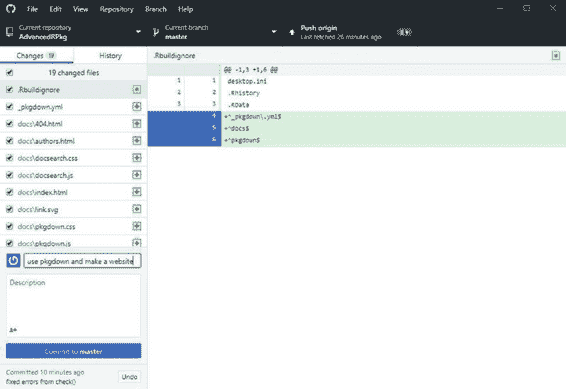

# 第 6 章 编写包
**图 6-12.** 提交构建包网站所做的更改

## 6.5 R 包网站
我们可以使用 `pkgdown` 包为我们的包构建一个漂亮的网站，该网站将放置在 `docs` 文件夹下。首先，为了配置我们的包以使用 `pkgdown`，我们再次依赖 `usethis` 包：
```
use_pkgdown(config_file = "_pkgdown.yml", destdir = "docs")
```

## v 设置活动项目为 'C:/.../RCode/AdvancedRPkg'
## v 将 'ˆ_pkgdown\\.yml$', 'ˆdocs$' 添加到 '.Rbuildignore'
## v 将 'ˆpkgdown$' 添加到 '.Rbuildignore'

## 正在写入`_pkgdown.yml`

# 修改`_pkgdown.yml`

## 第 6 章 编写 R 包

你可以修改 `pkgdown.yml` 文件，但这不是必需的。如果你想自定义内容，请查阅 [`pkgdown.r-lib.org/`](https://pkgdown.r-lib.org/) 以获取关于 `pkgdown` 包的更多详细信息。我们现在使用默认设置。接下来，我们可以通过运行 `build_site()` 来构建包的网站：

```r
build_site()
```

如果一切正常，这应该不会产生任何输出。你将在浏览器中看到主页弹出。要将包托管在 GitHub 上并附带我们的包网站，我们需要提交所有更改并推送。如图 6-12 所示，为包网站创建了大量文件。

现在，我们可以在线查看所有更改：[`github.com/JWiley/AdvancedRPkg`](http://github.com/JWiley/AdvancedRPkg)。

如果 GitHub 配置正确，你也可以在线查看网站。要配置 GitHub，请进入仓库的设置，选择 GitHub Pages，并将源设置为 `/docs` 文件夹，如图 6-13 所示。

由于我们设置了自定义 URL 并链接到 GitHub 帐户，你可以通过 [`joshuawiley.com/AdvancedRPkg`](http://joshuawiley.com/AdvancedRPkg) 访问包网站。

然而，即使没有自定义域名，你也可以拥有网站。它将是 [`jwiley.github.io/AdvancedRPkg`](http://jwiley.github.io/AdvancedRPkg)，你只需将 `jwiley` 替换为你的 GitHub 用户名。

最后，如果你愿意，可以将包提交到 CRAN。第一步是仔细关注他们当前的所有政策，这些政策位于 *CRAN Repository* 政策站点（[`cran.r-project.org/web/packages/policies.html`](https://cran.r-project.org/web/packages/policies.html)）。一旦你检查了你的包符合规定并纠正了任何不符合之处，就可以在 [`cran.r-project.org/submit.html`](https://cran.r-project.org/submit.html) 提交到 CRAN。CRAN 非常庞大，拥有数千个包和每天大量的更新。这是一个由志愿者运营的社区免费服务。因此，即使某些要求很繁琐，如果你希望你的包出现在 CRAN 上，遵守他们的规则并尽可能简化他们的工作也是公平的。否则，GitHub 是一个相对容易托管和分发包源代码的地方。

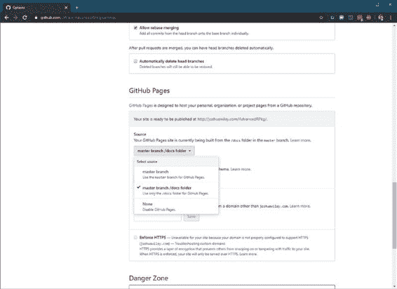

**图 6-13.** 包网站

### 6.6 总结

本章涵盖了开发、测试、文档编写和发布 R 包的逻辑流程。虽然这个过程不一定涉及复杂的 R 代码，但处理众多方面并让所有部分正确交互可能具有挑战性。这项工作的回报是用户安装和使用方便，以及高质量的文档和代码按预期运行的保证。如果你计划继续开发包，进一步阅读的有用资源包括官方手册 *Writing R Extensions*（[`cran.r-project.org/doc/manuals/R-exts.html`](https://cran.r-project.org/doc/manuals/R-exts.html)）以及关于使用 `roxygen2` 的文档（[`cran.r-project.org/web/packages/roxygen2/vignettes/roxygen2.html`](https://cran.r-project.org/web/packages/roxygen2/vignettes/roxygen2.html)）。`roxygen2` 的小插图对于本章未涵盖的主题尤其有用，例如文档格式化以及排序规则（当某些类或函数必须在包中的其他类或函数之前加载时需要）。本章使用的函数摘要见表 6-3。

本章也是专门关注 R 编程和 R 软件开发工具的最后一章。本书的其余部分侧重于在高级水平上使用 R 进行数据管理和应用分析。虽然我们利用了本书这一部分中学习的 R 编程的许多方面，并编写了许多函数，但在接下来的章节中我们不会开发任何新包。

**表 6-3.** 本章描述的关键函数列表及其功能摘要

| **函数** | **功能** |
| --- | --- |
| `setup()` | 创建一个新包（在我们的例子中是 `AdvancedRPkg`）。 |
| `list.files()` | 如其名——Unix 或 Windows 中 `ls` 的 R 等价物。 |
| `load_all()` | 在包被构建或安装之前，`library()` 不起作用；此函数在那时模拟该过程。 |
| `context()` | 我们在 `test_textplot.R` 中使用的 `testthat` 包的一部分。 |
| `test_that()` | 我们在 `test_textplot.R` 中使用的 `testthat` 包的一部分。 |
| `expect_*()` | 一系列用于测试代码的函数。这些函数检查输出是否匹配特定预期，例如输出的类、代码是否返回错误或警告等。完整列表请加载 `testthat` 包后在控制台运行 `apropos("expect_")`。 |
| `apropos()` | 用于搜索部分记忆的函数调用。 |
| `test()` | 运行 `testthat` 测试；从我们的 `chapter06.R` 文件中运行。 |
| `package_coverage()` | 计算包已被测试的比例；通常目标是 100%。 |
| `document()` | 用于为 R 包构建 `roxygen2` 文档。 |
| `build()` | 用于构建 R 包。 |
| `check()` | 用于检查 R 包；我们使用了 CRAN 选项。 |
| `build_site()` | 用于使用 `pkgdown` 为我们的包构建网站。 |

