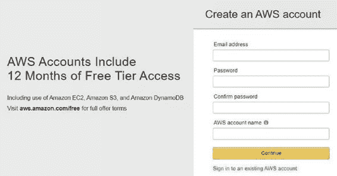

# 第 10 章 读取大数据

请注意，我们保留超级用户不动。这是为了对数据库进行最终修改所必需的。虽然在本例中，我们确实针对每个表上的每个用户专门执行了`REVOKE`（撤销）其被授予的权限（再次为了演示权限可以更动态），但我们也可以使用`ALL`来代替权限列表：

`dbGetQuery(conSuper, "REVOKE SELECT ON dailymetrics FROM gradstudentr;")`

```
## 包含 0 列和 0 行的数据框
```

`dbGetQuery(conSuper, "REVOKE INSERT ON address FROM gradstudenti;")`

```
## 包含 0 列和 0 行的数据框
```

`dbGetQuery(conSuper, "REVOKE SELECT, UPDATE ON address FROM gradstudentu;")`

```
## 包含 0 列和 0 行的数据框
```

现在我们的用户已经没有权限了，我们可以从数据库中`DROP USER`（删除用户）。此后，他们将不复存在，也无法再连接到服务器。他们的记录已被移除：

`dbGetQuery(conSuper, "DROP USER gradstudentr")`

```
## 包含 0 列和 0 行的数据框
```

`dbGetQuery(conSuper, "DROP USER gradstudenti")`

```
## 包含 0 列和 0 行的数据框
```

`dbGetQuery(conSuper, "DROP USER gradstudentu")`

```
## 包含 0 列和 0 行的数据框
```

为了证实这一点，我们展示一个示例：如果其中一位用户在被`DROP`（删除）后尝试重新连接到服务器，他们可能会看到如下情况：

`dbConnect(drv, dbname = "postgres", host = "localhost", port = 5432, user = "gradstudentr", password = "s3cur3")`

```
## 错误在于 postgresqlNewConnection(drv, ...): RS-DBI 驱动: (无法连接
## gradstudentr@localhost:
## 用户"gradstudentr"密码认证失败
## )
```

如你所见，一个数据库可以有多个用户，他们对数据库中任何表集拥有不同级别的访问权限。管理员或超级用户可以根据需要添加和删除用户，也可以更改他们的访问权限。

## 10.6 密码安全

值得注意的是，在我们之前的数据库连接示例中，我们采用了一种相当不安全的方式，即以明文编写密码。更糟的是，密码并非从我们电脑上的文件中读取，而是直接写在代码里。仅仅分享这段代码就会泄露我们的密码。

大多数操作系统，包括 Windows、Mac OS 和 Unix，都有一个更安全的区域来存储用户名和密码。数字安全技术变化迅速，很可能存在其他更简单或更安全的方法来存储密码和验证数据库访问。尽管如此，我们提供一种可能的解决方案，它至少可以防止你的代码中硬编码明文密码。

R 包`keyring`有一组函数，可以将特定服务和用户的密码存储在你的操作系统中更安全的区域。需要注意的是，这个密码在另一台机器的不同操作系统上将不可用。

为了演示，我们将断开超级用户的连接，将该密码存储在密钥库中，并展示如何使用密钥库进行连接，为你的数据库访问增加一层安全性：

`dbDisconnect(conSuper)`

```
## [1] 真值
```

`rm(conSuper)`

函数`key_set_with_value`接受四个参数。`service`（服务）可用于组织不同服务的不同用户。在我们的例子中，我们将其称为`advancedrBookSQLch10`数据库。`username`（用户名）将用于从密钥库中检索特定用户的密码。在本例中，我们使用超级用户的用户名`postgres`。最后，我们使用超级用户的密码`advancedr`。

值得注意的是，虽然这创建了初始记录，但如果用不同的密码运行相同的代码，则只会更新密码：

`key_set_with_value(service = "advancedrBookSQLch10", username = "postgres", password = "advancedr")`

设置好密码后，我们可以通过使用`key_list()`函数来确认已创建了一条新的密钥库记录。注意，我们的函数不会显示密码——它仅显示已存储了一条记录：

`key_list()`

```
##     service            username
## 1 advancedrBookSQLch10 postgres
```

请注意，上述代码确认了我们的操作系统现在正在为我们记住密码。通常，无需多次运行前两个代码块。只有在需要将密码添加到新的本地系统或更新密码时，才需要使用那段代码。

更常见的做法是，为了获取密码使用，通过`key_get()`函数将密码保存到一个局部变量中，例如`usrPassword`。服务名称和用户名必须与记录中的匹配。现在，重要的是要理解密码是以明文形式存储在你的全局 R 环境中的。有人从你身后偷看仍然可能看到你的密码！以下两个代码块是每个会话中为了连接数据库而最常运行一次的代码：

`usrPassword <- key_get(service = "advancedrBookSQLch10", username = "postgres")`

现在 R 可以访问你的密码，我们再次运行连接协议。唯一的不同之处在于，这次我们不再使用引号内的明文密码，而是使用变量名`password = usrPassword`。一旦连接建立，我们就从全局环境中删除该密码。但请注意，这并非安全删除；它只是防止旁观者目视到密码：

`conSuper <- dbConnect(drv, dbname = "postgres", host = "localhost", port = 5432, user = "postgres", password = usrPassword)`

`rm(usrPassword)`

连接已重新建立，我们已准备好进行任何所需的工作。以防你之后需要从操作系统中删除密码和记录，我们展示以下代码。同样，类似于添加密钥，这是一次性为每个系统执行的代码：

`key_delete("advancedrBookSQLch10", "postgres")`

`key_list()`

```
## [1] service username
## <0 行> (或 0 长度的行名)
```

## 10.7 用 R 执行 SQL

`DBI`包提供了一些函数，使我们无需直接使用 SQL 也能获得结果。我们之前已经介绍过`dbListTables()`函数，它可以显示数据库中的所有表。`dbListFields`函数类似于 R 的`colnames()`：

`dbListTables(conSuper)`

```
## [1] "demographics"         "thricedailymetrics"   "dailymetrics"
## [4] "address"
```

`dbListFields(conSuper, "thricedailymetrics")`

```
## [1] "row.names"          "userid"             "surveyinteger"
## [4] "surveystarttimec11" "stress"             "posaff"
## [7] "negaff"
```

这些函数的一个优点是它们名副其实。虽然我们之前展示了如何使用纯 SQL 获取表的输出，但还有一个用于读取表的函数`dbReadTable()`。决定使用多少 SQL，以及在服务端执行哪些操作与在 R 的内存端执行哪些操作，是一种权衡。如果这是你第一次使用第二种编程语言，你可能会在这两个世界之间慢慢摸索前进。

如果你经常使用 SQL 数据库，就像我们的一位作者几年前开始做的那样，你可能会发现，随着时间的推移，某些操作在服务端完成更有意义。

在大多数情况下，`dbGetQuery(conSuper, "SELECT * FROM thricedailymetrics")`和我们下面的函数之间没有显著区别：

`query <- dbReadTable(conSuper, "thricedailymetrics")`

`head(query)`

```
##   userid surveyinteger surveystarttimec11 stress posaff negaff
## 1      1             2              1.9e-01      5    1.5    1.7
## 2      1             3              4.9e-01      1    1.5    1.0
## 3      1             1              1.2e-05      1    1.6     NA
## 4      1             2              1.9e-01      2    1.6    1.4
## 5      1             3              4.1e-01      0    1.1    1.0
```

## 6.1.1. `1.6e-02` `0` `1.3` `1.7`

最后，虽然我们已经向数据库写入了几个表格，但我们再次提醒你注意`dbWriteTable()`函数。该函数接受`overwrite`和`append`两个选项，可设置为`FALSE`或`TRUE`。这类似于`UPDATE`与`INSERT`。在合适的情况下，两者都很方便。我们首先将`iris`数据集写入表格，展示这两个变量的*默认*选项。注意，如果我们第二次运行该函数，它会返回一个错误：

```
dbWriteTable(conn = conSuper, name = "iris", value = iris, overwrite =
FALSE, append = FALSE)
```

```
## [1] TRUE
```

```
dbWriteTable(conn = conSuper, name = "iris", value = iris, overwrite =
FALSE, append = FALSE)
```

```
## Warning in postgresqlWriteTable(conn, name, value, ...): table iris
exists in database: aborting assignTable
## [1] FALSE
```

如果你希望在数据框末尾追加（例如`INSERT`）数据，只需设置`append = TRUE`。另一方面，如果需要完全覆盖（例如`UPDATE`所有元素），则设置`overwrite = TRUE`。

回忆一下基本的 SQL 查询：`SELECT`特定列，`FROM`特定表。我们使用`dbGetQuery()`将查询发送到 PostgreSQL 并执行。通过这种方式，数据库中的表可以被导入到 R 中：

第 10 章 读取大数据

```
query <- dbGetQuery(conSuper,
statement = "SELECT *
FROM address")
query <- as.data.table(query)
head(query)
```

```
## row.names userid postalcode
## 1: 2 2 4132
## 2: 3 3 3880
## 3: 4 4 3781
## 4: 5 5 4058
## 5: 6 6 4627
## 6: 7 7 3996
```

记住，`*`是一个通配符。如果我们只需要一列数据，我们会`SELECT`该特定列，而不是使用通配符值：

```
query <- dbGetQuery(conSuper,
"SELECT postalcode
FROM address")
query <- as.data.table(query)
head(query)
```

```
## postalcode
## 1: 4132
## 2: 3880
## 3: 3781
## 4: 4058
## 5: 4627
## 6: 3996
```

回想一下，我们曾（在`UPDATE`命令时）在列值上使用了`WHERE`。请记住，这同样可以轻松地在 R 中使用`query[userid = 1]`来实现。

然而，也许在 SQL 而非 R 中使用它的一个原因是内存大小。某些表可能非常大，通过只选择特定行，可以减少对 RAM 的占用：

第 10 章 读取大数据

```
query <- dbGetQuery(conSuper,
"SELECT postalcode
FROM address
WHERE userid = 1")
query <- as.data.table(query)
head(query)
```

```
## postalcode
## 1: 1111
```

正如我们在分配权限时所见，在 SQL 中可以使用逗号一次处理多个项目。在此例中，我们使用更高级的`WHERE`子句从`thricedailymetrics`表中选择两列：

```
query <- dbGetQuery(conSuper,
"SELECT userid, stress
FROM thricedailymetrics
WHERE surveyinteger >= 2")
query <- as.data.table(query)
head(query)
```

```
## userid stress
## 1: 1 5
## 2: 1 1
## 3: 1 2
## 4: 1 0
## 5: 1 3
## 6: 1 1
```

PostgreSQL 的一个用途可能是处理超过物理 RAM 容量的大数据。它可以像我们演示的那样分块读取，或者我们可以将大量数据从 R 推送到数据库以释放内存。我们的下一个示例提供了一个选择。如果你的系统 RAM 和硬盘有足够的可用空间，请按原样进行 2 亿行的示例。否则，将`rnorm()`中的变量数量改为较小的值，也许是一个 7000 万行的较小示例。

第 10 章 读取大数据

以下代码创建了 2 亿个完全虚构的数据观测值，均值为 1，默认标准差为 1。如你所见，其大小约为 1.6 GB（将鼠标悬停在 RStudio 全局环境窗格中的值上即可查看）。当然，数据可能更大，但这作为测试案例来查看它在你系统上的表现已经足够了。运行可能需要几分钟，所以请稍作等待：

```
BiggerData <- rnorm(200000000, 1)
BiggerData <- as.data.table(BiggerData)
dbWriteTable(conSuper, "biggerdata", BiggerData)
```

```
## [1] TRUE
```

```
rm(BiggerData)
dbListTables(conSuper)
```

```
## [1] "demographics" "thricedailymetrics" "dailymetrics"
## [4] "address" "iris" "biggerdata"
```

同样，这可能需要几分钟在你的系统上运行。但是，如果成功了，你就能体会到有多少数据可以传输到数据库中。由于我们不需要这个`BiggerData`（除了作为系统的“压力测试”），我们使用`dbRemoveTable()`函数：

```
dbRemoveTable(conSuper, "biggerdata")
```

```
## [1] TRUE
```

```
dbListTables(conSuper)
```

```
## [1] "demographics" "thricedailymetrics" "dailymetrics"
## [4] "address" "iris"
```

虽然我们（至少拥有超级用户权限）能够删除一张表，但这并不一定会释放 PostgreSQL（以及硬盘）中的空间。现在，有了所有可用的额外空间，向数据库写入新数据不会占用更多磁盘空间。但是，如果我们需要强制清理“死”字节，SQL 有一个`VACUUM FULL`操作，可以将数据库缩减到仅包含活动数据。在我们的案例中，这不会花太长时间。我们的结构很简单。更复杂的数据库和服务器可能会发现此操作的代价较高。因此，这是一种数据库维护操作，可能仅定期或根据需要执行：

第 10 章 读取大数据

```
dbGetQuery(conSuper, "VACUUM FULL")
```

```
## data frame with 0 columns and 0 rows
```

至此，我们已经学习了很多关于在 R 中使用 SQL 数据库的知识。虽然 SQL 本身是一种语言，但这足以让高级 R 用户开始进行数据分析和数据维护了。

我们加入这倒数第二段代码仅为了完整性。通过从 SQL 数据库中删除这些表，你现在可以重新运行之前的所有代码并获得相同结果。否则，尝试写入一张表（就像我们在本章早期填充数据库时所做的那样）会导致错误：

```
dbRemoveTable(conSuper, "address")
```

```
## [1] TRUE
```

```
dbRemoveTable(conSuper, "demographics")
```

```
## [1] TRUE
```

```
dbRemoveTable(conSuper, "thricedailymetrics")
```

```
## [1] TRUE
```

```
dbRemoveTable(conSuper, "dailymetrics")
```

```
## [1] TRUE
```

```
dbRemoveTable(conSuper, "iris")
```

```
## [1] TRUE
```

```
dbGetQuery(conSuper, "VACUUM FULL")
```

```
## data frame with 0 columns and 0 rows
```

要关闭此连接，需要两步而不是一步，因为我们必须断开与 PostgreSQL 的连接并卸载允许 DBI 建立该连接的驱动程序。如果成功，两者都将返回`TRUE`：

第 10 章 读取大数据

```
dbDisconnect(conSuper)
```

```
## [1] TRUE
```

```
dbUnloadDriver(drv)
```

### 1. TRUE

`rm(conSuper, drv, query)`

至此，我们完成了 PostgreSQL 的演示。真正让您目前掌握的知识发挥更大作用的方法，是进一步深入 SQL 语法，在更复杂的查询中使用 `dbGetQuery()`。不过，就目前而言，一个足够小的数据量应该能够读入 R 中，以便进行一些分析。

## 10.8 小结

本章介绍了如何使用 R 直接访问 SQL 数据库。虽然许多功能并非为数据整理而设计，但 R 仍然提供了一种快速处理大数据的方法。这类数据集似乎变得越来越常见，虽然让研究人员熟悉每一个数据库可能不切实际，但这并非必需。

使用 R，完全有可能提取出包含所有感兴趣项目且足够小（能放入工作内存）的数据子集。熟练的 R 用户（例如本书的读者）可以进一步在 R 本身中精简数据，并据此执行所需的分析。

表 10-1 总结了本章的关键函数和短语。

第 10 章 读取大数据

*表 10-1. 本章所述关键函数及其功能摘要*

| 函数                   | 功能说明                                                     |
| ---------------------- | ------------------------------------------------------------ |
| `dbConnect()`          | 使用 `dBi` 包及驱动程序连接到 PostgreSQL 数据库。            |
| `dbDriver()`           | 连接 PostgreSQL（及其他数据库）所需的驱动程序。                    |
| `dbWriteTable()`       | 将数据从 R 写入 PostgreSQL（用户必须拥有写入权限）。         |
| `dbListTables()`       | 列出数据库中的所有表。                                       |
| `dbListFields()`       | 列出数据库中的所有字段（列名）。                             |
| `dbGetQuery()`         | 向 PostgreSQL 数据库发送一个 SQL 查询并在那里执行。             |
| `dbRemoveTable()`      | 从 PostgreSQL 中删除一个表（用户必须拥有权限）；不一定会执行 `VACUUM`。 |
| `dbDisconnect()`       | 关闭 `dBi` 包与 PostgreSQL 的连接。                          |
| `dbUnloadDriver()`     | 卸载 PostgreSQL 驱动程序。                                   |
| `key_set_with_value()` | 使用 `keyring` 包存储密码。                                |
| `key_list()`           | 列出存储在操作系统密钥库中的密钥。                           |
| `key_get()`            | 从操作系统密钥库中检索指定的密钥。                           |
| `CREATE`               | 用于创建用户的 SQL 语句。                                     |
| `DROP`                 | 用于删除用户的 SQL 语句（例如，删除）。                      |
| `GRANT`                | 用于授予用户特定权限的 SQL 语句。                            |
| `REVOKE`               | 用于撤销用户某些权限的 SQL 语句。                            |
| `SELECT`               | 用于从表中选择数据的 SQL 语句。                              |
| `UPDATE`               | 用于更新表内数据的 SQL 语句。                                |
| `INSERT`               | 用于向表追加数据的 SQL 语句。                                |

# 第 11 章 拥有你的云

## 概述
根据您对`R`的需求和用途，拥有适量的内存和处理能力可能会很方便。通常，这种能力只在某些时候是必需的，拥有自己的硬件可能并不划算。这就是将`R`托管在云上的用武之地。云实例提供按需资源，可以根据每种情况进行扩展或缩减。如今，有几家机构以非常合理的价格提供此类服务。我们面临的挑战有三个方面，我们将在接下来的三章中逐步讲解这些步骤。我们需要获得一个云，我们需要管理云的`操作系统`（在某些情况下），并且我们需要用`R`做一些有趣的事情。

本章重点介绍如何拥有你自己的云。为此，我们需要选择一个提供商，在我们从未*物理*访问过的位置启动`实例`（硬件/软件），并成功连接到我们的实例。自本书第一版出版以来，这个过程已经变得对用户越来越友好。

本指南在一定程度上基于您的本地系统是`Windows`计算机这一假设。我们假设您最熟悉`Windows`环境。我们不假设您拥有本地机器的管理权限，尽管它需要网络连接。您还需要能够使用信用卡。虽然您在本章中的工作预计（在撰写本文时）使用的是免费层服务，但这可能会根据所选选项或提供商的决策而改变。换句话说，在我们编写本文时，我们的意图是这个阶段的学习级使用不会涉及费用。最后，并致歉对于那些不符合此条件的人，我们假设您对云、网络或类似`Unix`的操作系统没有先验知识。因此，我们将相当缓慢地完成每一步。

此处的大多数步骤也应在本地`Apple`机器上有效。可能不奏效的步骤并非设置云访问所必需的。因此，如果您的主要本地设备是`Apple`的，您仍然完全可以将`R`放在云上。

## 版权信息
© Matt Wiley 和 Joshua F. Wiley 2020
M. Wiley 和 J. F. Wiley, *高级 R 4 数据编程与云*,
[`doi.org/10.1007/978-1-4842-5973-3_11`](https://doi.org/10.1007/978-1-4842-5973-3_11#DOI)

## 11.1 免责声明
在这一点上，我们需要做一些免责声明。我们不以任何方式认可亚马逊网络服务（`AWS`）[3]，就像我们不认可`Windows`一样。尽管如此，`AWS`很方便，很受欢迎，并且在撰写本文时，提供12个月的免费层服务 ([`aws.amazon.com/free/`](http://aws.amazon.com/free/))。请小心对待您放置在云中的数据；如果没有适当注意安全性，这些信息很容易落入不法分子之手。虽然我们提供了一些关于数字安全的简要建议，但这还不够。互联网安全这个话题可以并且确实填满了多本书籍；如果您有不应通过传真或电子邮件发送的数据，在云上处理这些数据之前，还需要学习更多知识。再次声明，虽然我们的本意不是编写需要花费的步骤，但我们无法控制`AWS`的业务模式。

幸运的是，我们希望这没有让您远离这种便捷且强大的方法，它为您的研究和数据带来恰到好处的资源。如果您是云新手，我们还建议您首先阅读本章和下一章，并专门留出一个下午或更多的时间来处理这个过程。我们还应该提到，本章中的许多屏幕截图在您的系统上可能略有不同（部分原因在于浏览器选择）。事实上，随着新功能的添加或旧功能的合并，`AWS`本身也会有半定期的布局更改。尽管如此，您所看到的应该与我们展示的非常接近。

## 11.2 开始使用亚马逊网络服务
不幸的是，仅仅熟悉`R`并不能保证迁移到云端会即刻完成。尽管如此，该系统设计得相当好，可以在完成一些准备工作后快速启动。我们的目标是帮助您访问一个弹性计算云（`EC2`）实例。`EC2`是一台虚拟计算机，可以定制为您想要的任何处理能力和内存组合。这是一个过于大胆的说法。然而，在撰写本文时，从1个2.5 GHz处理器和0.5 GiB内存到128个2.3 GHz处理器和3904 GiB内存都可以构成一个单一的计算机实例。当然，对于免费层来说，后者是不可选的。

我们采取的第一步是访问亚马逊网络服务网站 ([`aws.amazon.com/free/`](http://aws.amazon.com/free/)) 并注册一个新账户，如图11-1所示。按照步骤创建一个新账户，请务必生成一个安全的密码。此步骤需要310

