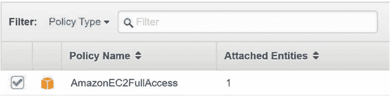
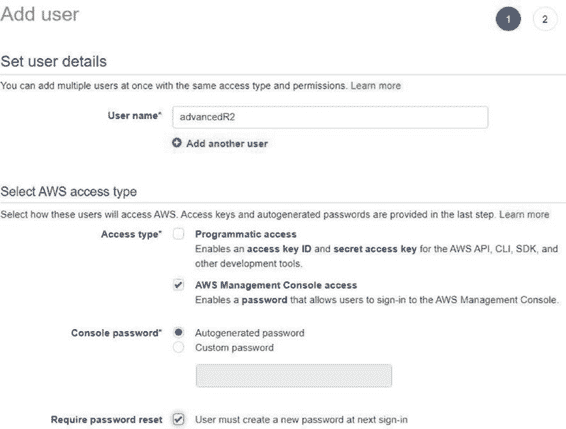
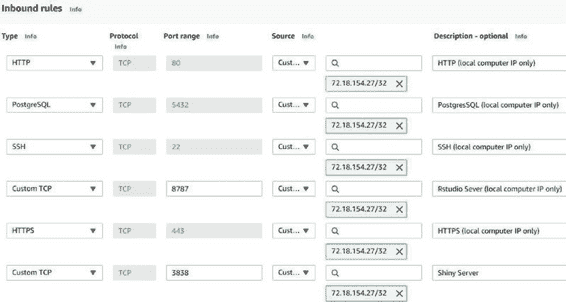
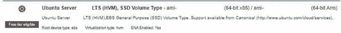
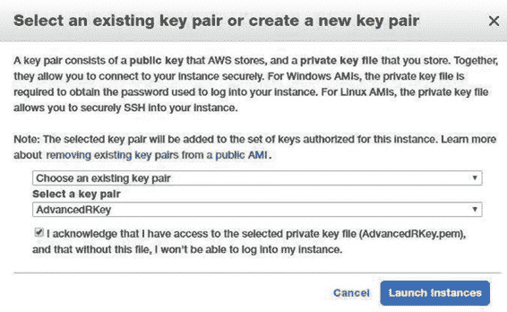
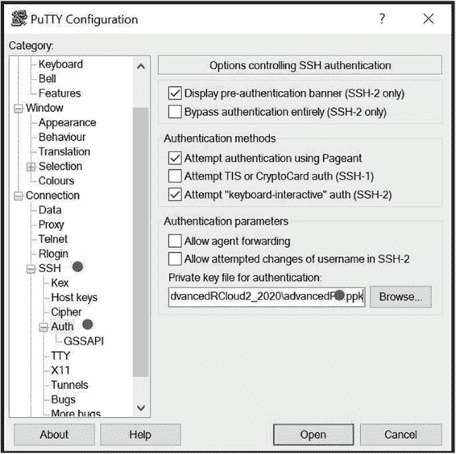
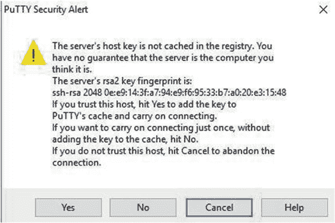
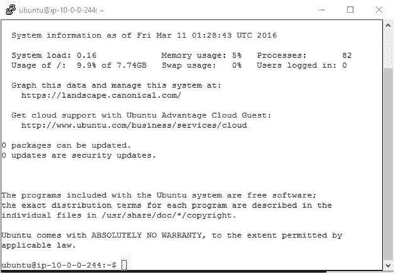

# AWS 账户与 EC2 实例启动指南

## 11.1 创建 AWS 账户

需要一个信用卡和电话号码。同样，我们对浏览器（`browser`）与您的浏览器（`your browser's view`）的偏好选择，偶尔可能会导致视觉效果上存在差异。

**图 11-1. 创建新 AWS 账户**

您刚刚创建的账户是您的顶级账户。建议创建一个没有完全权限的子账户。事实上，亚马逊（Amazon）不遗余力地建议您使用身份与访问管理（`IAM`）来创建二级账户。如果您只是单人用户，永远不需要其他人访问此账户，创建二级账户仍然是有益的。如果您将来会有其他用户，请务必为自己创建这个非根（`non-root`）的二级账户。无论是添加研究生、同事、员工还是顾问，不交出“城堡”的“万能钥匙”总是有好处的。不要被众多的选项吓到；只需滚动到 AWS 的安全、身份与合规（`Security, Identity, & Compliance`）部分，并从第三列末尾附近选择`IAM`，如图 11-2 所示。根据您的浏览器不同，`IAM`可能有一个钥匙图标，也可能没有图标。由于选项很多，按`CTRL+F`并在搜索框中输入`IAM`，可能有助于高亮显示`IAM`的文本。不要害怕通过搜索、点击和探索来找到它。您不会破坏任何东西，而且亚马逊会定期更新界面。


**第 11 章 开启您的云端之旅**

**图 11-2. AWS 管理控制台，高亮显示了本章使用的三个部分的方框和圆点**

## 11.2 配置 IAM 用户与组

在`IAM`内部，您需要创建一个新组和您的第一个用户。组（`Groups`）很方便，因为它们允许您创建多个只有特定权限的用户。在屏幕左侧，选择组（`Groups`）选项，然后在加载的屏幕顶部点击创建新组（`Create New Group`）。我们将其命名为`AdvancedR`，尽管您可能更合理地将它命名为`CloudAdmin`或类似名称。当询问要使用哪个策略时，我们推荐`AmazonEC2FullAccess`，如图 11-3 所示。



**第 11 章 开启您的云端之旅**

**图 11-3. IAM 组策略选择——您的视图可能不同**

接下来，我们创建一个用户并将其加入我们的组。请记住，作为“完全访问”组中的用户，此账户将拥有极大的控制权。在按照用户创建指引操作时，我们建议使用您的名字，这样您就能看到该账户是“您自己”，并使用与您 AWS 根账户不同的密码。首先，选择左侧的用户（`Users`）选项卡。然后，在加载的屏幕顶部选择添加用户（`Add user`）。进入后，创建您的用户名。虽然您可以一次创建多个用户（使用添加另一个用户（`Add another user`）功能），但最好将其留待以后——特别是如果这是您第一次使用 AWS。请确保设置如图 11-4 所示，包括启用控制台访问。当然，您也可以直接选择创建一个自定义密码。



**第 11 章 开启您的云端之旅**

**图 11-4. 在 AWS IAM 上创建用户**

当您最初创建账户时，AWS 会给您一个账户标识号。要再次查看此号码和链接，请点击左上角的 IAM 仪表盘（`Dashboard`）。

仪表盘上有一个 IAM 用户登录链接（`IAM users sign-in link`），以及一个可选的选项，可以将其自定义为人类友好的名称。现在，登出 AWS。进入遵循此模式的 AWS 地址：`https://YOUR_ID_HERE.signin.aws.amazon.com/console`。使用您的新用户名和密码登录。您可能已经注意到，在`IAM`内部，也有为您的根账户添加多因素安全（`multifactor security`）的选项。那很可能是一个明智之举。通过确保您的根账户安全，即使一个较低权限的账户被入侵或“被黑”，您至少能够在之后清理损失。操作步骤很容易遵循，尽管这超出了这个快速设置的讨论范围。

**第 11 章 开启您的云端之旅**

## 11.3 启动 EC2 实例

再看看图 11-2，请注意左上角计算（`Compute`）下的`EC2`链接。点击此链接；在右上角，您可以选择一个地区，如俄勒冈或悉尼。不同地区的成本往往有所不同，当然，您在地理上越接近某个地区，网络上传和下载速度就越有可能高效。通常情况下，需要权衡各种因素；我们建议选择离您最近的地区。一个警告是，在选择地区之后，我们做的某些操作是地区特定的。特别是，密钥对（用于访问您的云服务器）与特定地区绑定。

选择好地区后，就该创建一个密钥对（`key pair`）了。左侧有一个菜单列表，在网络与安全（`Network and Security`）下是密钥对（`Key Pairs`）链接。选择该链接，然后点击创建密钥对（`Create key pair`）按钮。为您的密钥对命名。如果您可能需要在不同地区使用云实例，亚马逊将地区名称添加到密钥对名称中的建议是合理的。请选择`ppk`版本以便与 PuTTY 一起使用。然后，最后一次，点击创建密钥对（`Create key pair`）。您的浏览器应该会自动下载密钥对文件。请记住保存位置并妥善保管；这是您下载此文件的唯一机会。我们将在下一节中使用它，但现在，我们继续创建虚拟私有云（`VPC`）。返回图 11-2 的主屏幕。

再次查看图 11-2 可以看到，在第一列末尾附近，在网络（`Networking`）下，有`VPC`。这里有几个选项；我们选择最简单的，即一个带有单一公共子网的 VPC。选择启动 VPC 向导（`Launch VPC Wizard`）并为您的 VPC 命名，例如`AdvancedR`。保留默认选项，然后点击创建 VPC（`Create VPC`）。从这些选项中可以看出，如果您有兴趣创建更高级的结构，那也很容易实现。

没有安全组（`security group`），您的云就不安全。我们对安全组非常谨慎。在 VPC 仪表盘（`VPC Dashboard`）的左侧，请注意安全（`Security`）选项卡和安全组（`Security Groups`）链接。点击该链接，然后点击创建安全组（`Create Security Group`）按钮。为组命名一个标签和一个名称，例如`AdvancedR`，并添加描述。请确保从末尾的下拉列表中选择您的 VPC，然后点击创建（`Create`）按钮。

现在，选择您的`AdvancedR`安全组，并注意浏览器屏幕底部显示的选项，如图 11-5 所示。我们要做的是配置哪些 IP 地址被允许访问您未来的云实例。虽然这不是一个牢不可破的安全层，但它能有所帮助。当然，这是良好的一步，因为它让不是您的人更难知道您的服务器存在。请务必选择入站规则（`Inbound Rules`）选项卡，选择编辑规则（`Edit rules`），并添加 SSH（22）协议（`TCP`）；您需要将您的 IP 地址作为源。现在，请继续使用我的 IP（`My IP`）。如果您以后需要添加另一个地址，您可以这样做。例如，为了编写本书，两位作者的



**第 11 章 开启您的云端之旅**

已添加 IP 地址。这些地址须采用有效的无类别域间路由（CIDR）表示法，这意味着如果你的本地计算机地址是 `72.18.154.27`，则需要在*源*字段中输入 `72.18.154.27/32`。趁现在，我们还要为端口 `80`、`443`、`3838`、`5432` 和 `8787` 创建规则——这些端口分别对应 HTTP、HTTPS、Shiny、PostgreSQL 和 RStudio Server。不过，我们也会将这些端口锁定为仅限你的 IP 地址访问。这样可以防止他人在你准备就绪之前访问你的服务器。离开此屏幕前，请务必保存规则。然后继续操作，将出站规则设置为允许所有流量发往目标 `0.0.0.0/0`（即全球范围——换句话说，你的机器可以*向*任何地方发起连接）。

**图 11-5.** 使用 CIDR 表示法的安全组入站规则

如果你的 IP 地址频繁变动，你可能需要放宽规则。我们建议尽可能谨慎地操作，并且最好在你完成下一章讨论的基本操作系统和安全更新之后再进行。另外请注意，到目前为止，如果你在云实例上托管一个网络服务器，该网站将只能从你的本地计算机或网络访问。之后，当我们安装好站点后，我们会回到此屏幕并进行一些修改，以允许服务器的某些部分能被更广泛的受众访问。



## 11.4 获取你的云服务器

虽然完整的 CIDR 课程超出了本书的范围，但在此掌握一点相关知识是很有必要的。在“现实生活”中，互联网并不使用像 `joshuawiley.com` 这样的文字地址。相反，它使用一系列 32 位数字。计算机使用二进制数字而非十进制；它们将我们的网站视为 `01001000.00010010.10011010.00011011`。该唯一地址将我们连接到一台特定的机器（恰好是 32 个字符长）。`/32` 告诉 AWS 只允许那台机器访问；所有 32 位都是固定的。

相比之下，对于出站规则，我们需要我们的实例能够自由浏览网络。因此，我们使用 `/0` 来告知其没有固定任何位。如果你处于公司或大学环境中，并希望一些同事能够访问你的实例，请咨询你的 IT 部门以了解你的地址空间大小。如果我们发现 IP 地址频繁变动，我们可以尝试 `72.18.154.0/24`，这将允许 `72.18.154.0` 到 `72.18.154.255` 范围内的地址（并且能很好地包含 `.27`）。

另一个选择是添加一些“重复的”入站规则。换句话说，如果你经常从家里和工作地访问网络，那么你可以添加两个版本的 SSH 端口规则，每个 IP 地址对应一个。

现在我们将注意力转向创建 EC2 实例。选择左上角的 VPC Dashboard 链接，然后点击 Launch EC2 Instances 按钮。选择符合免费套餐条件的 Ubuntu 服务器，如图 11-6 所示。你可能希望尽可能选择高版本的 Ubuntu。在本书中，我们使用的是 `18.04`。

**图 11-6.** 启动第一个 EC2 实例的 Ubuntu 服务器选择

接下来，选择 `t2.micro` 类型。在 Next: configure instance details 屏幕上，确保将你的 VPC 选为 Network 设置，并将 Auto-assign Public IP 设置为 Enable。

虽然你始终可以选择 Review and Launch，但我们暂时继续通过向导操作，选择 Next。截至撰写本文时，最多可免费使用 30 GiB。直接给自己分配 30 GiB。对于标签，一个好名字仍然是 `AdvancedR`（诚然，这个名字有点用得太频繁了，但它仍然有效）。另外，对于安全组，请务必在最终点击 Review and Launch 之前，选择一个现有的安全组以及你的 `AdvancedR` 组。然后，点击 Launch！



## 11.5 获取你的云服务器

最后一步是选择你的密钥对。记住，我们之前已经下载过了。请确保你有该文件，并确保设置中选择*该现有密钥对*以及选择你的密钥对（记住，我们称其为 `AdvancedR`）。

接下来，选中确认复选框。最后，点击 Launch Instances 按钮，如图 11-7 所示。

**图 11-7.** 实例密钥对设置与最终启动

从这里你可以查看你的实例，这将带你进入 EC2 仪表板。实例启动需要一些时间，所以在等待期间，我们继续，在下一节与你见面。

## 11.6 访问实例的命令行

你已在 AWS 上拥有一个实例，它正在启动并等待你的连接。在此之前，需要在 Windows 上执行一些步骤。

你需要下载 PuTTY [22]。从 [www.chiark.greenend.org.uk/˜sgtatham/putty/latest.html](http://www.chiark.greenend.org.uk/˜sgtatham/putty/latest.html) 下载适用于 Windows 的安装程序。完成后，运行安装程序。如果你的本地机器没有授予你安装权限，你可以在 Alternative binary files 选项卡中逐个下载这些文件。在安装程序进行过程中，我们选择在桌面上创建 PuTTY 的快捷方式。

使用 PuTTY，我们现在可以连接到我们的实例。在打开 PuTTY 之前，回到 AWS 上的 EC2 Dashboard。现在实例应该正在运行，我们需要从图 11-8 中获取一些信息。公有 IP 地址是必需的——当然还有它正在运行的事实。请务必复制你的实例的地址。

**图 11-8.** EC2 仪表板视图，显示我们的实例及其公有 IP 地址和 Actions 下拉菜单

现在我们终于首次连接到我们的服务器。启动 PuTTY。在左侧导航菜单中，选择 SSH 选项，然后选择 Auth 选项，并浏览找到你的 `.ppk` 密钥文件，如图 11-9 所示。



## 11.7 获取你的云服务器

**图 11-9.** PuTTY 配置 `.ppk` 密钥文件

回到 PuTTY 左侧导航菜单中的 Session，输入 `ubuntu@54.201.117.64`（如我们的示例）或更通用的 `ubuntu@你的_EC2_公有_IP_地址`。确保端口设置为 `22`，连接类型为 SSH。我们建议通过将 `AdvancedR` 写入 Saved Sessions 文本框并点击 Save 来保存你的会话，然后再继续。这使你将来可以轻松访问你的 `t2.micro` 实例。继续打开连接，PuTTY 会给出一个安全警告，如图 11-10 所示。虽然有一种方法可以将此指纹与你的 AWS 实例的日志文件进行比较，但该过程相当复杂。通过选择 Yes 确认接受。



## 11.8 获取你的云服务器

**图 11-10.** PuTTY 针对服务器指纹的安全警告

现在你已连接到你的云实例，并且进入了 Ubuntu 命令行！如图 11-11 所示，你可以访问命令行，如果愿意，现在就可以继续按照下一章的说明使用你的服务器了。



## 11.9 获取你的云服务器

**图 11-11.** 通过 PuTTY 的视角查看命令行

然而，我们在使用服务器之前稍等片刻（我们会在下一章指导你完成此操作）。

虽然我们还需要采取更多步骤来让 R 在云上正常运行，但在此我们再讨论一个小节，以便我们能够享受将文件上传到云服务器的便利。

在上传文件之前，我们应该教你一个命令。那就是 `exit` 命令，只需输入单词 `exit` 后按回车键即可。这会关闭你的 PuTTY 会话：

```
$ exit
```

## 11.10 将文件上传到你的实例