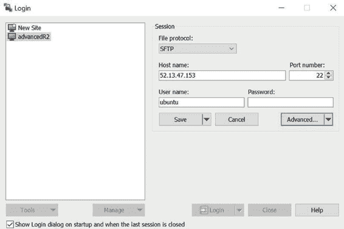
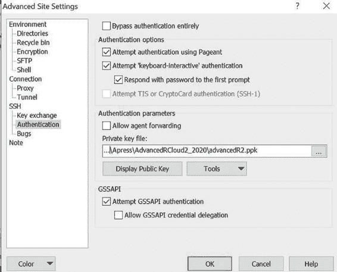

# 排版后的文档

我们使用 `WinSCP` [14] 将文件上传至云端。该程序可通过以下网址下载：

[`winscp.net/eng/download.php`](https://winscp.net/eng/download.php) （我们使用了“便携式可执行文件”链接）。如果您已配置好 `PuTTY`，系统会询问是否导入 `PuTTY` 的会话，届时可回*是*。如果您尚未配置 `PuTTY` 连接 Ubuntu 实例，这也没关系。之后

启动 `WinSCP`，打开初始窗口，我们按图 11-12 所示进行了填写。

具体来说，我们在主机名处输入了 IP 地址，确认连接端口为 22，并将用户名设为 `ubuntu`。

***图 11-12.** 正确配置的 WinSCP 启动画面*

关于密码，请选择“高级”，在弹出的新窗口中，进入 SSH 选项卡下的“认证”部分，导航至与 `PuTTY` 相同的 `.ppk` 文件。结果如图 11-13 所示。依次点击*确定*和*保存*后，即可准备登录。

***图 11-13.** WinSCP 高级密钥文件界面*

保存时，您可以选择创建桌面快捷方式。如果您经常需要传输文件，这将非常方便。首次登录时，您会看到服务器的密钥指纹（除非您已从 `PuTTY` 加载）。与 `PuTTY` 一样，请务必将其与图 11-8 中的指纹进行核对。我们继续操作，将之前名为 `ch02_link.txt` 的第 2 章文件上传至服务器的 `/home/ubuntu` 文件夹。为此，请在左侧导航至您存放从在线代码包下载的文件的位置，然后将该文本文件拖放至右侧。上传完成后，断开会话并关闭程序。

不过，请记住文件名，我们将在下一章用到它。

### 11.6 本章小结

`PuTTY` 和 `WinSCP` 均有无需安装即可使用的版本。因此，即使是在您没有管理员权限的电脑上，您仍可以访问实例并来回传输文件。这在企业或学术环境中尤其有用，因为技术部门通常会以极为谨慎的态度管控本地计算机权限。

说到谨慎，您应对云端服务器保持警惕。虽然我们在构建 EC2 实例时已考虑了一定的安全性，但这并非完全安全。我们的部分目标是让您能够在云端使用 R，而网络安全性并非我们的专长。因此，尽管我们在此展示的方法可能比电子邮件稍安全一些，但根据您的具体用途，您可能需要更高的安全措施。研究数据通常具有经济价值或隐私价值。在这种情况下，您无疑需要考虑阅读一些关于互联网安全的书籍。

请自行承担风险；本书并非关于如何确保云端安全！

表 11-1 总结了启动云端实例/数据库所需的新概念或命令，而非仅列出 R 函数。

***表 11-1.** 本章所述关键概念/命令及其功能说明*

| **概念/命令** | **功能** |
|---------------------|------------------|
| AWS | 亚马逊云服务 |
| `PuTTY` | Windows 上的本地终端，用于安全连接到我们的云端 |
| `WinSCP` | Windows 上的本地程序，用于在本地机器和云端 EC2 实例之间安全共享文件 |
| `exit` | Ubuntu 命令行指令，用于退出 Unix 终端 |

