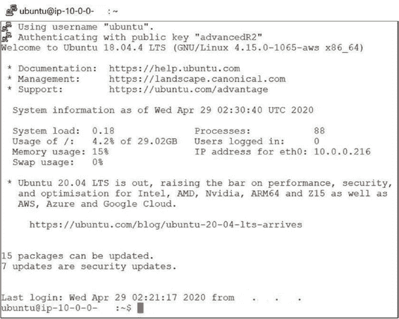
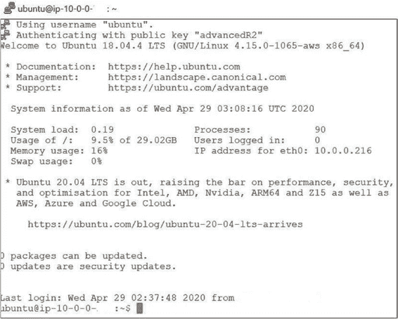

# 第 12 章

## 面向 Windows 用户的云 Ubuntu

如上一章所述，使用云端并不总意味着能用 Windows。这并非完全正确；Windows 当然也可以在云端使用。然而，在高性能环境中，这往往会导致成本增加，使其在某些情况下变得不切实际。此外，使用 Ubuntu 环境也并非不可能，高级 R 用户掌握的许多技能都可以轻松迁移。总而言之，只要稍加指导，使用 `Ubuntu` 作为服务器实例操作系统并不困难。

本章的目标包括：了解 `Ubuntu` 基本命令行、更新和安装所需的操作系统或软件包、安装 R 和 RStudio Server，以及通过命令行和服务器两种方式使用 R。特别是，您将学习如何让 R 进程在服务器上持续运行，无论您是否连接到该服务器。这样，我们可以根据需要随时使用 `PuTTY` 登录（配合 AWS 警报信号）来检查进程是否已完成。

## 12.1 开始使用

如果您已按上一章内容操作到最后，那么本地机器的桌面上应有 `PuTTY` 和 `WinSCP` 的快捷方式。此外，这两个程序都已保存您的会话信息。

首先，打开 `PuTTY`，使用保存的信息访问您的云端服务器。界面上有一个`已保存会话`框，您只需双击要启动的会话即可。如果成功，您应看到类似图 12-1 的画面。

© Matt Wiley 和 Joshua F. Wiley 2020  
M. Wiley 和 J. F. Wiley，《高级 R 4 数据编程与云端应用》，  
[`doi.org/10.1007/978-1-4842-5973-3_12`](https://doi.org/10.1007/978-1-4842-5973-3_12)

如果未能成功，通常有一个可能的原因。考虑到您上一章确实成功连接过，很可能是您的 IP 地址发生了变化。请在网页浏览器中访问 `AWS`，进入您的`安全组`，检查入站规则，并与您当前的 IP 地址进行比对。如果您在谷歌搜索“what is my ip”，谷歌会告诉您当前地址。如果规则中的 IP 地址与您当前的 IP 地址不同，请进行修改并保存。然后再次尝试使用 `PuTTY`。

如果仍不成功，我们能提供的最佳故障排除建议是：逐步重走上一章的流程。在某个环节一定发生了什么变化。大多数情况下，无需创建新的 `EC2` 实例——只需重新检查所有步骤即可。需要完全从头开始的唯一理由，是您的密钥对文件被意外删除。

### 12.2 常用命令

我们在 `Ubuntu` 中使用的一些命令在 R 中有对应的功能。另一些则更偏向操作系统层面，而非特定程序。我们在 R 中使用的许多文件管理技巧，都可以通过命令行更快、更自然地完成。

在本节中，我们将探索一些常见且实用的命令，帮助您了解和掌握它们。

您现在是在 `PuTTY` 中，界面看起来大致如图 12-1 所示，屏幕上堆满了文字。



*图 12-1.* 初始屏幕显示七项安全更新*

第一个有用的命令是 `clear`，相当于 R 中的 `Ctrl+L`。它可以清空您的当前屏幕，让您轻松查看当前命令及其结果。我们将此命令与 `ls` 配合使用，后者是列出目录内容的命令。上一章上传的文件 `ch02_link.txt` 会立即显示出来。

我们不会仅依赖截图，而是尝试以内联方式模拟控制台输出。在 `Ubuntu` 控制台中，与在 R 中一样，仅输入代码是不够的，必须按下 `ENTER` 或 `Return` 键。为减少干扰，我们将不显示`ENTER` 命令。此外，我们会在控制台输入的内容前添加 `$` 符号，但不会包含完整的用户名头部：

```
$ clear
$ ls
ch02_link.txt
```

现在我们可以看到目录中有哪些文件，以及这些文件的更多信息。`ls`命令可以通过几个字母进行修改。

`-l`修饰符是长格式，它提供文件权限（`-rw-rw-r--`）、用户和用户组（两者都是`ubuntu`，因为我们目前设置了一个简单的用户）、文件大小以及修改日期（注意，这保留了文件在上传之前的原始修改日期）等信息。特别需要注意的是文件权限的用法，这关系到文件的安全。在如 `Ubuntu` 这样的 `Unix` 系统中，所有对象都具有权限。其模式为`-ooogggppp-`，其中`o`指文件所有者，`g`指所有者所在的用户组，`p`指公共用户。此外，每个用户级别都可以对特定对象进行*读取*、*写入*或*执行*操作。这在后面当我们创建一些可从 Web 访问的面向公共的实用程序时变得非常重要。检查权限以确保公共用户可以读取文件，但不能写入或修改文件，这一点很重要。在下面的代码中，用户`ubuntu`以及`ubuntu`组的任何未来成员对我们的文本文件都具有读写权限。如果该目录将来变为公开，普通公众将只能读取我们的文件：

```
$ ls -l
total 4
-rw-rw-r-- 1 ubuntu ubuntu 31 Mar 05:16 ch02_link.txt
```

我们提到了“目录”这个词，所以不妨看看我们在系统中的位置。

文件夹或目录也具有相同的访问权限（它们也是对象），我们可以创建新目录和更改目录。要显示当前工作目录，我们使用`pwd`；要创建目录，我们使用`mkdir`；要更改目录，我们使用`cd`。我们在下面的代码中展示了这些命令及其结果。请注意，`..`命令会让我们返回目录结构中的上一级，回到我们最初的用户目录：

```
$ pwd
/home/ubuntu
$ mkdir MyFolder
$ cd MyFolder
~/MyFolder$ pwd
/home/ubuntu/MyFolder
~/MyFolder$ cd ..
```

讨论完创建和导航目录之后，我们把注意力转向删除文件。要删除文件，我们使用`rm`命令。我们继续对上传的文本文件执行此操作；除了作为示例文件外，它从来没有任何用处。我们在下面的代码中展示了删除过程，以及用户文件夹的完整视图。

通过完整视图显示我们的`ls`命令，我们可以看出在前后对比中，我们的文本文件已被删除：

```
$ ls -hl
total 8.0K
-rw-rw-r-- 1 ubuntu ubuntu 31 Mar 5 02:30 ch02_text.txt
drwxrwxr-x 2 ubuntu ubuntu 4.0K Apr 11 21:21 MyFolder
rm ch02_link.txt
ls -hl
total 4.0K
drwxrwxr-x 2 ubuntu ubuntu 4.0K Apr 11 21:21 MyFolder
```

这些访问权限的值是可以修改的。`chmod`命令在其后接受三个数字输入，模式为`chmod ogp`。我们创建一个文件，并为用户、用户组和公共用户授予三个级别的访问权限。执行权限由`1`表示，写入权限由`2`表示，读取权限由`4`表示。此外，数字可以相加以授予更多权限。请参见以下示例：`7 = 1 + 2 + 4`为用户提供完全访问权限，`6 = 2 + 4`为组提供仅读取和写入访问权限。最后，公共用户只有写入权限。

由于我们的数据库中没有文件（我们刚刚删除了文本文件），我们可以使用`touch`命令创建一个新文件。我们将新文件命名为`permissionsFile`：

```
$ touch permissionsFile
$ ls -hl
total 4.0K
drwxrwxr-x 2 ubuntu ubuntu 4.0K Apr 11 21:21 MyFolder
-rw-rw-r-- 1 ubuntu ubuntu 0 Apr 11 21:26 permissionsFile
$ chmod 762 permissionsFile
$ ls -hl
total 4.0K
drwxrwxr-x 2 ubuntu ubuntu 4.0K Apr 11 21:21 MyFolder
-rwxrw--w- 1 ubuntu ubuntu 0 Apr 11 21:26 permissionsFile
```

我们以讨论两个终端命令`sudo`和`whoami`来结束本节。在下一节中，我们将开始更新和维护我们的操作系统。

这需要根级别权限。为了安全起见，我们的 `Ubuntu` 实例并没有一个永久的根用户。相反，当我们需要提升权限时，我们通过在命令前加上`sudo`来将这些权限授予我们的`ubuntu`用户。此命令代表*超级用户执行（super user do）*，并且后面总是跟着另一个命令。系统会为随后的命令临时提升权限。

请注意，在第一部分中，系统认为我们是默认用户。但是，当使用`sudo`时，系统认为我们是根用户：

```
$ whoami
ubuntu
$ sudo whoami
root
```

现在我们能够以*根*用户身份运行各种命令，我们进入下一节，确保我们的云实例具有最新的补丁和软件包。

## 12.3 超级用户与安全

与任何操作系统和软件套件一样，经常需要进行更新。有些更新可能添加新的或改进的功能，而其他更新则可能更侧重于安全性。

虽然全面的云和服务器安全性远远超出了本文的讨论范围，但直接执行一些步骤是合理的。查看图 12-1，很明显我们有一些工作要做。

更新过程包括三个步骤。我们首先运行`sudo apt-get update`，其输出代码缩写如下（我们用`...`表示截断）：

```
$ sudo apt-get update
....
Fetched 3,451 kB in 3s (1,097 kB/s)
Reading package lists... Done
```

接下来，我们升级当前文件，以便在需要时准备好安装新文件。这需要一些时间，因为我们要下载很多文件！再次，我们缩写了一些输出。值得注意的是，当询问时，我们确实输入了`Y`同意继续。

几乎可以肯定，您的具体升级数量和软件包将与这里所示的不同。但是，用于更新云实例的命令将保持不变：

```
$ sudo apt-get upgrade
Reading package lists... Done
Building dependency tree
Reading state information... Done
Calculating upgrade... Done
....
62 upgraded, 0 newly installed, 0 to remove and 4 not upgraded.
Need to get 23.5 MB of archives.
After this operation, 209 kB of additional disk space will be used.
Do you want to continue? [Y/n] Y
...
```

现在文件已升级，我们可以安装新的软件包。我们在命令行运行`sudo apt-get dist-upgrade`命令，并在提示时同意。虽然不是必需的，但我们也会重启系统。这会让我们退出当前会话，并且我们必须通过 `PuTTY` 重新访问云。我们展示了执行这些命令的缩写代码以及图 12-2 的截图，表明没有更多可用的更新：

```
$ sudo apt-get dist-upgrade
...
$ sudo reboot
...
The system is going down for reboot NOW!
```



*图 12-2.* Ubuntu 启动画面，显示没有需要进行的更新或升级*

取决于您阅读此书的时间，`AWS` 可能已经或可能尚未将 `Ubuntu` 版本从 `18.04` 更新。不升级也是可以的。事实上，通常更便捷的做法是等到亚马逊在其初始实例设置中处理这些事情。

但是，如果您希望运行最新版本，请依次运行命令`sudo apt install update-manager-core`和`sudo do-release-upgrade`。截至撰写本文时，虽然 `Ubuntu 20.04` 已作为长期稳定版本发布，但它尚未完全准备好可在 `AWS` 上轻松安装。很可能在本书出版时，这种情况会有所改变。

我们还应注意，截至本书发布时，R 4.0.0*并非*完全支持 `Ubuntu 20.04`。虽然它很可能可以正常工作，但要使所有功能正常运行，还需要额外付出一些努力。