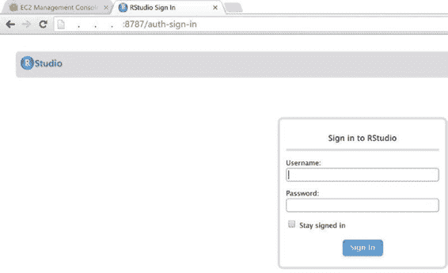
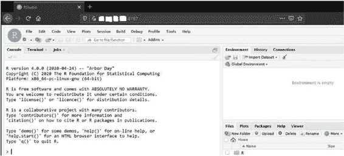
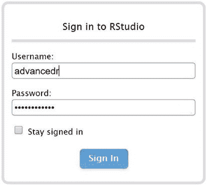

# 12 Cloud Ubuntu for Windows 用户使用指南

若您坚持升级，系统将警告不建议通过远程访问进行升级，并且会针对通常不对外开放的端口运行额外的 SSH 访问脚本。特别是，我们的安全设置会阻止对此备用访问端口的访问。由于您刚刚创建此实例，且可通过 AWS 网站随时终止，因此无需设置此类备用访问路径。通常，我们会在可用时运行此类更新，在系统询问时通过输入`y + ENTER`同意所有选项，按`ENTER`保留本地版本，最后重启。当然，所谓"可用时运行"意味着我们建议预留连续数日来应对可能需要的修复工作。虽然多数情况下无需修复，但在更新操作系统前预留时间是值得的。

如果您选择升级发行版，请务必在获取新操作系统版本后，最后一次执行前述命令中的`sudo update`和`upgrade`操作。

现在，我们的实例（或至少实例中的软件包）已更新完毕，并且我们对如何在 Ubuntu 文件系统中导航有了更好的理解，接下来可将注意力转向在云服务器上安装 R。

## 12.4 安装与使用 R

到目前为止，上一章和本章的主要目标是准备一台能为我们托管 R 的服务器。我们已接近目标，只需再完成几个步骤即可。第一步是修改软件包源列表，使 Ubuntu 操作系统知道在哪里找到 R。

首先查看您的 Ubuntu 版本会有所帮助。请注意，在编写本书时，我们使用的版本是 18.04，代码名为 "bionic"：

```
$ lsb_release –a
No LSB modules are available.
Distributor ID: Ubuntu
Description: Ubuntu 18.04.4 LTS
Release: 18.04
Codename: bionic
```

要允许系统找到 R，需要切换到 `/etc/apt/` 目录并编辑 `sources.list` 文件。与 PC 拥有文本编辑器或 Microsoft Word 类似，Unix 风格的操作系统也有文本编辑器。其中一种称为 "nano"。

由于 `sources.list` 列出了 Ubuntu 获取软件包和应用程序的源，因此它是一个需要保护的文件。因此，需要调用 `sudo` 来将您的权限从普通用户提升到管理员级别：

```
$ cd /etc/apt/
/etc/apt$ ls
apt.conf.d    sources.list    trusted.gpg
preferences.d sources.list.d  trusted.gpg.d
$ sudo nano sources.list
```

打开 `nano` 文本编辑器后，向下箭头键移动至文件末尾，按 `ENTER` 添加新行，然后输入**一行**下列代码。接着按 `Ctrl+O` 保存；您会看到文件名，然后按 `Enter`/`Return` 键。之后，按 `Ctrl+X` 退出到命令行。请注意，*bionic* 和 *xenial* 分别是 Ubuntu 18 版和 16 版的名称。

接下来这两个选项至关重要！您必须根据您的 Ubuntu 版本**仅选择一个**选项。此外，随着本书出版后 Ubuntu 新稳定版本的发布（这当然会发生），该配置可能会失效。您应访问 [`cran.r-project.org/bin/linux/ubuntu/`](https://cran.r-project.org/bin/linux/ubuntu/) 并检查 R 和 Ubuntu 最新版本对应的最新*代码名*，然后对以下文本进行相应修改以添加到您的源文件中。我们提供最近两个版本供您参考，以便您在未来需要根据软件版本进行修改时能够了解其模式：

**如果您升级到 Ubuntu 18.04（或从 AWS 直接创建该版本）：** 代码名：bionic-cran35

```
##添加 R 文件服务器
deb https://cloud.r-project.org/bin/linux/ubuntu bionic-cran40/
```

**如果您保留 Ubuntu 16.04：** 代码名：xenial-cran35

```
##添加 R 文件服务器
deb https://cloud.r-project.org/bin/linux/ubuntu xenial-cran40/
```

记得使用 `Ctrl+O` 和 `Enter` 保存，然后按 `Ctrl+X` 退出，我们返回主目录。下一步是为我们的软件包管理器添加 R 的签名密钥：

`E298A3A825C0D65DFD57CBB651716619E084DAB9`

这使我们能够确认下载的软件包是安全的，可以放心安装。请注意，此签名密钥也可能随 R 版本的变化而改变。检查更新或排查步骤的好去处是 [`cran.r-project.org/bin/linux/ubuntu/`](https://cran.r-project.org/bin/linux/ubuntu/)。如果您的安装出现任何错误，请优先检查此网站并核实源文件地址是否正确，务必仔细确认。

签名密钥应位于*一行*内。为了在书中排版，我们在 `--recv-keys` 后面的空格处进行了换行。下面展示您应输入的命令以及预期输出：

```
$ cd /home/ubuntu
$ sudo apt-key adv --keyserver keyserver.ubuntu.com --recv-keys
E298A3A825C0D65DFD57CBB651716619E084DAB9
Executing: /tmp/apt-key-gpghome.rOCEL7Je1U/gpg.1.sh --keyserver keyserver.
ubuntu.com --recv-keys
gpg: key 51716619E084DAB9: public key "Michael Rutter <marutter@gmail.com>"
imported
gpg: Total number processed: 1
gpg: imported: 1
```

至此，安装 R 通常很简单。实际上只需两条命令。我们更新软件包列表，然后安装基础版 R。在安装过程中，您需要同意一到两次选项。如果安装成功，您会看到一屏文本滚动而过。如果滚动停止，请检查是否被要求输入 `y + ENTER` 表示同意某项内容。否则，让安装继续完成：

```
$ sudo apt-get update
$ sudo apt-get install r-base
...
```

现在，我们已在云服务器上安装了 R，接下来运行 R 看看效果。我们使用命令 `R` 启动程序。然后运行第 1 章中的一个脚本来观察结果。以下代码展示了 R 的启动界面以及我们运行代码的熟悉结果：

```
$ R
R version 4.0.0 (2020-04-24) -- "Arbor Day"
Copyright (C) 2016 The R Foundation for Statistical Computing
Platform: x86_64-pc-linux-gnu (64-bit)
R is free software and comes with ABSOLUTELY NO WARRANTY.
You are welcome to redistribute it under certain conditions.
Type 'license()' or 'licence()' for distribution details.
R is a collaborative project with many contributors.
Type 'contributors()' for more information and
'citation()' on how to cite R or R packages in publications.
Type 'demo()' for some demos, 'help()' for on-line help, or
'help.start()' for an HTML browser interface to help.
Type 'q()' to quit R.
> x <- c("a", "b", "c")
> x[1]
[1] "a"
> is.vector(x)
[1] TRUE
> is.vector(x[1])
[1] TRUE
> is.character(x[1])
[1] TRUE
> q()
```

### 使用 R

在 R 环境中，我们常用的所有命令都能正常工作。我们可以安装软件包或运行代码。不过，我们希望在三个方面进行改进。第一，我们目前以普通用户（即 ubuntu 用户）身份运行 R。我们可能希望服务器上的其他用户无需 `sudo` 或 `root` 权限也能使用 R。在这种情况下，将软件包不仅安装给当前用户，而是安装到整个机器上会更有帮助。

第二，能够运行我们在本地机器上创建的文件中的代码会很方便。第三，我们与服务器的连接依赖于网络的稳定性。如果出现网络故障，我们的工作就会丢失。因此，如果能够实现从命令行运行 R 命令，即使我们断开连接，服务器仍能继续运算，那就非常方便了。如果您利用此设置来为并行处理器驱动的模型构建一个高性能计算环境，这一点尤其有用。

若要仅为特定用户安装包，可像往常一样在 R 控制台中使用 `install.packages("")` 函数。然而，若要为任何用户（包括将来可能邀请到云端的用户）安装包，请使用以下命令。你需要做的是从命令行向 R 传递一条命令。我们还必须以 root 身份运行此命令（以便为所有用户安装），并且需要 root 权限才能执行此操作，而 `sudo` 和 `su -` 可以提供这些权限。`-c` 选项会执行紧随其后的代码。最后，我们调用 R 并让它安装该包：

```
$ sudo su - -c "R -e \"install.packages('pscore')\""
```

假设你想在本地机器上编写一些代码，然后在云服务器上运行这些代码。回到本地机器，我们继续启动 RStudio：`options(width = 70, digits = 2)`

然后，我们可能会保存一个名为 `ch12_loopTest.R` 的新文件，其中仅包含以下这段代码：

```
x <- 1:1000

for(i in 1:length(x)){

x[i] <- x[i]ˆ3

}

head(x)
```

输出为：

```
### [1] 1 8 27 64 125 216
```

我们当然知道预期的结果；之前在章节中已经基本看到过。

接下来，我们进入 WinSCP，用它连接我们的 Ubuntu 服务器（保持 PuTTY 打开也没问题）。连接服务器后，在 WinSCP 左侧或*本地*区域，找到已保存的文件 `ch12_loopTest.R`，并将其拖拽到右侧或*云实例*区域。

现在，返回 PuTTY，输入 `ls`：

```
$ ls
```

输出包含：

`ch12_loopTest.R MyFolder permissionsFile`

我们的文件已经在那里了！要运行已创建的代码，我们使用 `R CMD BATCH` 命令。要运行并查看文件结果，只需使用这个新命令：

```
$ R CMD BATCH ch12_loopTest.R
```

再次列出文件：

```
$ ls
```

输出为：

`ch12_loopTest.R ch12_loopTest.Rout MyFolder permissionsFile`

我们可以在 `ch12_loopTest.Rout` 文件中看到输出，并使用本章前面用过的 `nano` 编辑器来查看。记住 `Ctrl+X` 可以退出该编辑器。下面同时展示了打开文件的命令和简化的输出，以证明代码成功运行：

```
$ nano ch12_loopTest.Rout
....
> head(x)
[1] 1 8 27 64 125 216
>
> proc.time()
   user  system elapsed
  0.156   0.038   0.201
```

现在，我们可以在实例上随意运行 R 命令了。这包括你想要的任何并行处理技术（请记住，免费套餐在这方面可能帮助不大）。只要我们的代码构建时不需要用户输入，就可以让它直接运行。我们通过 `screen` 命令来实现这一点。本质上，这会打开另一个终端，我们可以从中分离出来。这样，即使我们的 PuTTY 终端会话结束（无论是因为我们希望它结束，还是因为网络波动迫使如此），该终端也能继续运行。我们还可以查看进程何时运行完毕。我们在 `screen` 命令后加上修饰符运行的命令大家都很熟悉；如果你想要更多关于 `screen` 的细节，`man screen` 命令会提供大量信息：

```
$ screen -A -d -m R CMD BATCH ch12_loopTest.R
$ screen -ls
There is a screen on:
	ip-10-0-0-244 (03/17/2020 04:43:40 AM)	(Detached)
1 Socket in /var/run/screen/S-ubuntu.
$ screen -ls
No Sockets found in /var/run/screen/S-ubuntu.
```

从第二次列表可以看出，没有更多的进程在运行了。因此，可以安全地访问我们的输出文件来查看结果。值得注意的是，对于像这样较短的运行，你很*可能*不会看到第一个分离的屏幕。它只会结束得太快。对于一个需要更长时间运行的进程，与其输入 `screen -ls` 来检查，我们可能只需输入 `exit`，然后在现实世界中各忙各的。该进程会在云端继续运行。对于在较昂贵实例上运行的进程，可以设置 AWS，当处理器使用率低于某个阈值时，通过电子邮件发送警报。我们经常使用 10% 左右。一旦收到几封警报邮件，说明进程使用率持续低于 10%，你就知道值得登录检查了。

我们现在已经在服务器实例上安装了 R，可以设置所有用户都能访问的包，并且可以在不保持稳定网络连接的情况下运行文件。如果在一台机器上设计的代码运行时间过长，我们可以将这些文件上传到更强大的机器上运行。不过，我们仍然在使用命令行。在下一节中，我们将在实例上安装 RStudio，这样我们就可以在利用云实例强大功能的同时，使用熟悉的 RStudio 外观和感觉。

### 12.5 安装并使用 RStudio Server

虽然我们已经展示了将本地机器上运行过慢的文件上传到云实例的方法相对直接，但这种格式仍有改进空间。RStudio [20] 是一个极好的、直观的 R 编程环境，我们可以获得相同的图形界面。而且，这可以通过浏览器访问，而不是通过命令行。这非常方便，因为几乎任何带有浏览器的可上网设备都可以访问你的实例并使用 R。在紧急情况下，我们曾有一次通过智能手机来运行 R。

当然，风险在于一些安全问题。RStudio Server 仅由一个密码保护，而不是密钥文件。回想之前的章节，R 可以执行许多系统管理任务，比如文件移动和删除。访问 RStudio Server 可能会让一个有决心的攻击者获得比你预期更多的系统访问权限。当然，我们继续在 AWS 上设置安全组，只允许来自我们本机 IP 地址的连接，尽管这在一定程度上限制了从任何设备使用 R 的承诺。我们再次提醒你，数据安全值得比我们此处介绍的更深入的关注。在我们提到的使用智能手机的例子中，我们必须首先访问 AWS，更新安全组以允许来自手机 IP 地址的各种连接，然后才能让事情重新运行起来。如果没有其他安全措施，那并不是最安全的做法。另一方面，安全性与可用性往往是一种权衡。

由于我们已经安装了 R，只需要在通过 PuTTY 再次访问命令行后做一些工作。为了确保包的正确认证，进行更新会有所帮助，就像我们安装系统和安全更新时一样。在以下每个 `apt-get` 命令之后，控制台会打印大量文本，并且可能会提示你同意使用一些磁盘空间：

```
$ sudo apt-get update
...
$ sudo apt-get install gdebi-core
...
```

继续将 RStudio 的密钥添加到你的机器上。RStudio 随时可能更改他们的密钥。请访问 [`rstudio.com/code-signing/`](https://rstudio.com/code-signing/) 以验证 `3F32EE77E331692F` 是否仍然正确。此外，我们安装 `dpkg-sig` 来帮助我们验证安装：

```
$ gpg --keyserver keys.gnupg.net --recv-keys 3F32EE77E331692F
...
$ sudo apt install dpkg-sig
```

一旦你能够安装服务器，就需要从网络上下载它。运行以下命令，预计会下载一个大约 40 MB 的文件。我们在下面展示了代码和一些输出；请务必记下保存的文件名以及下载是否完整。另外，请确保为你的 Ubuntu 版本安装正确的版本。我们再次展示代号以帮助你了解模式，因为很可能在你阅读本文时，至少 Ubuntu 或 RStudio Server（可能两者）会有更新的版本。请访问 [`rstudio.com/products/rstudio/download-server/debian-ubuntu/`](https://rstudio.com/products/rstudio/download-server/debian-ubuntu/) 获取最新详情。

**如果你升级到了 Ubuntu 18.04（或者从 AWS 开始就使用这个版本）：** 代号：`bionic`
```
$ wget https://download2.rstudio.org/server/bionic/amd64/rstudio-server-1.2.5042-amd64.deb
...
$ dpkg-sig --verify rstudio-server-1.2.5042-amd64.deb
Processing rstudio-server-1.2.5042-amd64.deb...
GOODSIG _gpgbuilder FE8564CFF1AB93F1728645193F32EE77E331692F 1585759224
```

**如果你使用的是 Ubuntu 16.04：** 代号：`xenial` / (`trusty` 是一个更老的版本)
```
$ wget https://download2.rstudio.org/server/trusty/amd64/rstudio-server-1.2.5033-amd64.deb
...
$ dpkg-sig --verify rstudio-server-1.2.5033-amd64.deb
Processing rstudio-server-1.2.5033-amd64.deb...
GOODSIG _gpgbuilder FE8564CFF1AB93F1728645193F32EE77E331692F 1575443526
```

无论哪种情况，你都得到了 `GOODSIG`，因此你的下载更安全。

现在我们来安装服务器。在安装过程中，可能需要同意一次：

```
$ sudo gdebi rstudio-server-1.2.5042-amd64.deb
Reading package lists... Done
...
Do you want to install the software package? [y/N]: y
...
Active: active (running) since Sun 2020-04-26 18:07:02 UTC; 1s ago
Process: 26414 ExecStart=/usr/lib/rstudio-server/bin/rserver (code=exited, status=0/SUCCESS)
Main PID: 26420 (rserver)
Tasks: 3 (limit: 1152)
CGroup: /system.slice/rstudio-server.service
       |--26420 /usr/lib/rstudio-server/bin/rserver
Apr 26 18:07:02 ip-10-0-0- systemd[1]: Starting RStudio Server...
Apr 26 18:07:02 ip-10-0-0- systemd[1]: Started RStudio Server.
...
```



现在 RStudio Server 正在运行，我们想确认它是否工作正常。记得在上一章中，我们设置了安全组以允许访问端口 8787 上的 RStudio Server。在本地计算机上打开一个 web 浏览器，访问你的服务器在所需端口上的 web 地址，即 `54.201.117.64:8787`（或者对于你来说，是 `YOUR_INSTANCE_IP_HERE:8787`）。

正如你在图 12-3 中看到的，服务器在视觉上确实看起来是工作的。如果它似乎对你不起作用，请记得在 AWS 网站上检查你*当前*的 IP 地址是否与你安全组入站规则中的 IP 地址相同。详情在第 11 章中概述。

**图 12-3.** RStudio Server

我们需要一个用户名和密码来进一步访问。该用户也是你 Ubuntu 服务器的一个用户，并且有一个密码。明智的做法是默认禁用密码登录服务器，而我们的实例实际上已经这样做了。我们用来创建新用户的命令是 `adduser`，它会运行显示的脚本。我们需要在命令行中键入这些命令。除了用户名和密码，不必为新用户填写信息。你可以直接按 `ENTER` 跳到下一行。另外，请注意密码字段会抑制击键，因此那里不会显示任何内容。选择你喜欢的任何安全密码，尽管我们建议你以某种方式存储它。我们使用了*不*安全的密码：`secure`。不要这样做！请确保你的密码安全（我们觉得很安全，因为本书中使用的是一个玩具实例，很快就会被删除）。

我们回到 PuTTY 终端并输入 `adduser` 命令：

```
$ sudo adduser advancedr
Adding user 'advancedr' ...
Adding new group 'advancedr' (1001) ...
Adding new user 'advancedr' (1001) with group 'advancedr' ...
Creating home directory '/home/advancedr' ...
Copying files from '/etc/skel' ...
Enter new UNIX password:
Retype new UNIX password:
passwd: password updated successfully
Changing the user information for advancedr
Enter the new value, or press ENTER for the default
	Full Name []: Advanced R
	Room Number []: RStudio Server
	Work Phone []:
	Home Phone []:
	Other []:
Is the information correct? [Y/n] Y
```

回到浏览器，我们使用新的用户名和密码访问 RStudio Server。输入刚刚创建的用户名和密码，如图 12-4 所示，你应该就能进入网页版的 RStudio 了。



**图 12-4.** 登录 RStudio

这应该感觉就像我们一直在使用的 RStudio，如图 12-5 所示。

**图 12-5.** 云端上的 RStudio

RStudio 现在存在于你的云实例上。虽然这对于以更直观的方式使用 R 很有帮助，但能够更原生地使用和查看图形输出是我们作者非常欣赏的一点。这样的输出可以很容易地保存为 `.pdf` 文件，并通过 WinSCP 从 `/home/advancedr` 文件夹下载。更一般地，`/home/YOUR_USERNAME` 可以访问特定的 RStudio 用户文件夹。

这样就完成了我们的 RStudio Server 设置。还可以做更多，但这对于入门来说已经足够了。你现在已经可以使用一个功能强大的系统了，而且如果你愿意，实际上可以自由地拥有多个这样的系统副本。在 AWS 上，可以设置警告，当实例的 CPU 使用率低于某个阈值时通过电子邮件提醒你。因此，可以配置 R 进程运行，并且实例空间的付费不会超过实际使用时间太多。我们的最后建议是，如果你打算不止偶尔使用 RStudio Server，可以花些时间阅读它的文档。那里有一些有用的自定义设置、方便的功能和值得了解的注意事项。我们在本章的参考文献部分包含了链接。

### 12.6 安装 Java

接下来，我们安装 Java。这非常简单；只需在命令行中逐行运行以下三行代码。在需要时用 `y + ENTER` 同意相关操作：

```
$ sudo apt-get update
...
$ sudo apt-get install default-jre
...
$ sudo apt-get install default-jdk
...
```

### 12.7 在云上安装 Shiny

将统计信息带给信息消费者是 Shiny 的主要用途。因为我们现在处于安装模式，我们将继续在云实例上安装托管 Shiny 应用程序所需的资源。

要安装 Shiny，我们需要运行以下代码。需要同意确认安装，我们抑制了系统在命令行的输出。逐行运行每条命令。

这一行将 `shiny` 包 [6] 安装到 R 中。我们还安装了 `httpuv` [44] 和 `shinydashboard` [5]。你注意到，在内括号之间，有一些对 R 用户来说非常有意义的命令。然而，在这种情况下，我们特意从命令行运行 R，以便我们可以用管理权限执行该进程，从而使任何 Ubuntu 用户帐户（而不仅仅是主用户帐户）都能访问这些库。当 Shiny 服务器托管应用程序时，它会使用 `shiny` 这个用户名来托管。因此，以下几行代码为所有用户安装了这些包：

```
$ sudo su - -c "R -e \"install.packages('httpuv')\""
...
$ sudo su - -c "R -e \"install.packages('shiny')\""
...
$ sudo su - -c "R -e \"install.packages('shinydashboard')\""
...
```

一个警告说明：在 Ubuntu 微型实例上，这个最新版本的 R 似乎并不总能按预期安装包。你在尝试安装前述的某个包时，可能会发现系统死机了。如果是这种情况，可能需要在 AWS EC2 仪表盘中强制重启你的实例。在启动实例的位置附近，有一个 *Actions*（操作）下拉菜单。首先选中你的实例，然后选择 *Actions*（操作），接着是 *Instance State*（实例状态），最后选择 *Reboot*（重启），你的实例应该会重启。如果该方法无效，你可能需要 *Stop*（停止）然后再 *Start*（启动）你的实例。在这种情况下，请注意你的实例的 IP 地址会改变，因此 PuTTY 需要使用新的 IP 地址进行更新。

成功重启后，使用 PuTTY 回到命令行，你可能会发现某个或多个包上有一个*锁*。切换到你的 R 目录，使用 `ls` 查看是否列出了任何格式为 `00LOCK-rPackageHere` 的文件夹。下面展示了可能的情况：

```
$ cd /usr/local/lib/R/site-library/
$ ls
00LOCK-httpuv
```

如果你确实看到这样的文件锁，可以使用以下命令删除该文件：

```
$ sudo rm -r 00LOCK-httpuv/
```

使用此命令时要小心。你**必须**确保准确输入；递归删除命令很容易删除过多的文件。删除所有以 `00LOCK-` 为前缀的文件夹后，你就可以回到主目录并重试了。一个可以帮助你更好地重试的技巧是研究 CRAN 上的包依赖关系。例如，`httpuv` 是 `shiny` 依赖的一个包。因为我们发现该包在微型的 Ubuntu 实例上特别脆弱，所以我们提前让你单独安装了它：

```
cd /home/ubuntu/
```

从这里开始，既然 R 本身可以使用 Shiny，我们就安装服务器，这样我们的云实例就可以向互联网提供 Shiny 应用程序服务了。我们需要使用 `wget` 命令下载一个文件，然后安装下载的文件。我们用以下代码行来执行此操作，并且有一些安装声明。此外，我们还展示了一个 `dpkg-sig` 显示无签名的示例。即使是良好的安全努力，偶尔也会失败：

```
$ wget https://download3.rstudio.org/ubuntu-14.04/x86_64/shiny-server-1.5.13.944-amd64.deb
. . .
$ dpkg-sig --verify shiny-server-1.5.13.944-amd64.deb
$ sudo gdebi shiny-server-1.5.13.944-amd64.deb
...
Do you want to install the software package? [y/N]:y
...
. shiny-server.service - ShinyServer
   Loaded: loaded (/etc/systemd/system/shiny-server.service; enabled; vendor preset: enabled)
   Active: active (running) since Sun 2020-04-12 22:39:18 UTC; 67ms ago
 Main PID: 18780 (shiny-server)
   Tasks: 1 (limit: 1151)
   CGroup: /system.slice/shiny-server.service
       |--18780 /opt/shiny-server/ext/node/bin/shiny-server /opt/shiny-server/lib/main.js
Apr 12 22:39:18 ip-10-0-0- systemd[1]: Started ShinyServer.
```

Shiny Server 现在应该也在运行了。

### 12.8 PostgreSQL

之前，我们学习了如何在本地机器上安装和运行 PostgreSQL 数据库服务器。虽然这对于以有组织的方式从 R 存储大量数据来说可能足够有用，但这并没有充分利用数据库服务器的社区级应用。特别是，我们的例子中提到了创建几个研究生。运行以下命令（现在看起来应该相当熟悉了），并在询问你是否要继续时同意。这将把你的 EC2 实例上安装 PostgreSQL：

```
$ sudo apt update
$ sudo apt install postgresql postgresql-contrib
```

默认情况下，PostgreSQL 只在本地机器上运行。虽然这听起来有点老生常谈（我们保证在本章之后不再说这类话），但还是要重复一遍：让数据库通过互联网向世界开放是在自找麻烦。花时间探索保护云安全的方法绝对值得。我们已经并将采取一些初步措施，这些措施可能和通过电子邮件发送信息一样安全（甚至更安全一点）。因为每个用例都不同（也因为本书旨在聚焦于 R 并让你练习该软件），如果你的数据需要更高的敏感性，你的首要任务应该是探索数据库和云网络安全。

为了允许 PostgreSQL 连接到互联网，我们需要在配置文件中添加一行。使用`nano`打开配置文件，用箭头键向下滚动到`CONNECTIONS AND AUTHENTICATION`（连接和认证）部分。然后，添加`listen_addresses = '*'`。这是一个通配符，将监听*所有* web 地址。但是，这个数据库服务器位于你的 EC2 实例上，并受你的安全组入站过滤器设置保护，该设置（目前）只允许你的 IP 地址（或伪造/冒用该确切地址的人）访问信息。因此，这里的通配符、全开放选择并不像看起来那么危险。我们还在旁边添加了一条注释。同样，使用`Ctrl+O`保存，然后按`ENTER`。最后，使用`Ctrl+X`退出`nano`：

```
$ sudo nano /etc/postgresql/10/main/postgresql.conf
...
#-------------------------------------------------------------------------
```