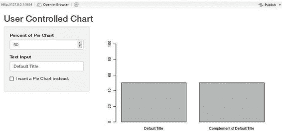
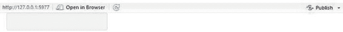
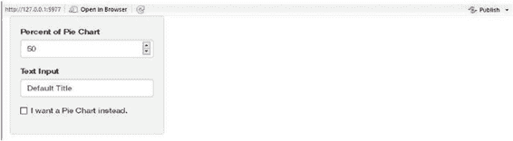

# 运行应用程序

运行 `shinyApp(ui = ui, server = server)` 启动应用。

现在，打开你精心输入代码的 `app.R` 文件，并运行该代码。

在代码区域右上角附近应该会有一个 `运行应用` 的播放按钮。无论哪种方式，都会出现类似图 13-1 的界面。

## 第 13 章 每朵云都有闪亮的内衬

尽管输入各种数字和文本值，试用 Shiny，看看它能做什么。在此过程中，你会认识到 Shiny 所做的是为你和 R 之间提供一个交互界面。现在，这个特定的运行实例由你本地机器上的 RStudio 托管。

注意控制台中显示了“正在监听”，并且你可能需要先点击 `停止` 按钮才能输入任何新代码。

那么发生了什么？假设你将“饼图百分比”的数字修改为 75。

`numericInput()` 是一个反应式值。当你更改它时，后台会发送一个信号，通知服务器 `input$pie` 已更改。服务器随后会通知所有使用 `input$pie` 的反应式函数，告知其内容已发生变化。在我们的例子中，`renderPlot()` 是一个反应式函数。它现在知道 `input$pie` 发生了变化，于是会查询该值，获取新值，并重新运行其所有代码。由于这是一个输出值，因此整个循环会通过 `output$piePlot` 反向重复，最终用户端的 `plotOutput()` 随之刷新。

关于这一切，有几点重要的地方需要注意。我们刚才描述的过程会重新运行 `renderPlot()` 内部的所有代码——全部代码。在同等条件下，我们无需再去查找 `input$pietext` 和 `input$pieChoice`。我们的反应式函数知道这些变量的值，因为它们是最新的，虽然它们被再次使用，但不会再次被调用。尽管如此，如果我们在 `renderPlot()` 内部有比减法和绘制图形更复杂的操作，那么任何更改都可能会导致相对较高的性能开销。虽然这段代码非常紧凑，但你仍然可以看到三个可能放置 R 代码的位置。一个是 `library(shiny)` 所在的位置。这位于我们的 `shinyServer()` 外部。这里放的代码（例如我们的库调用）在每个会话中**仅运行一次**。一个会话可以允许多个用户与之交互（尽管目前这有点深奥）。不过，每个新用户至少会执行 `shinyServer()` 内的所有代码一次。最后，正如我们刚才所见，`renderPlot()` 等反应式函数内部的代码，会在任何一个关联的反应式输入值更新时运行一次。这意味着，为了提高效率，应尽可能将代码放在反应式函数外部。此外，如果你预计用户流量很大，也应尽可能将代码放在服务器外部。



*图 13-1。 一个本地托管的 Shiny 应用，用来了解我们正在实现的功能*

### 第 13 章 每朵云都有闪亮的内衬

现在，我们来介绍一些新函数。请记住，有用户输入端、服务器端以及整个 Shiny 应用。深入来看，Shiny 实际上就由这三个部分组成。事实上，这里有一个非常基础的应用骨架：

```r
library(shiny)

# 定义用户界面
ui <- shinyUI(fluidPage())

# 定义服务器
server <- shinyServer(function(input, output) {})

# 运行应用程序
shinyApp(ui = ui, server = server)
```

运行这些代码，你会得到一张漂亮的空白页面。虽然这不如之前的代码那样令人振奋，但这能帮助你快速上手使用这个界面进行编码。在用户界面部分，我们看到的是 `fluidPage()` 函数调用，我们将所有面向用户的文本都放在其内部。这部分代码是 Shiny 中最不熟悉的部分，因为这段代码会生成用户看到的 HTML。在参考部分，我们提供了所有 Shiny UI 函数的链接。不过，本章我们将专注于一个基本布局，该布局位于一个能自动调整（即自适应）的页面内，具体取决于浏览器的显示区域。请注意，这是一个 R 函数，而 R 函数接受的参数用逗号分隔。我们不断扩展的应用的每一个方面都包含在这个包装函数中，它负责将一切转换为 web 就绪的标记语言。





*图 13-2。 一个几乎空白的 Shiny 应用，带有 `sidebarPanel()`*

*图 13-3。 用户界面基本完成，侧边栏中的输入部分确实已完成*

对于图 13-1 中的第一个应用，我们使用了侧边栏布局。这个函数需要两个参数：用于控制应用的侧边栏面板，以及用于展示内容的主面板。编辑我们的用户界面，可以得到如下代码：

```r
# 定义用户界面
ui <- shinyUI(fluidPage(
  sidebarLayout(
    sidebarPanel(),
    mainPanel()
  )
))
```

这段代码是数学上函数组合概念强大威力的一个极好示例。我们的目标最终是要让用户向我们的 R 代码输入一些内容，例如图 13-1 示例中的文本或复选框。

用户将这些值输入到尚未命名的函数中，这些函数会产生视觉输出。该输出又作为输入传递给 `sidebarPanel()` 函数，该函数提供 web 输出，该输出再作为输入传递给 `fluidPage()`，最终输出完整的 web 用户界面。

我们可以在图 13-2 中看到结果，虽然它们还是空白。

### 第 13 章 每朵云都有闪亮的内衬

从这一点出发，我们可以使用三个输入函数快速构建用户的输入项。每个输入函数都遵循特定的格式，即：`blank Input(输入标识, 面向用户的可读文本标签, 与 blank 特定输入类型相关的设置)`。形式上，我们的三个输入函数布局如下，请注意它们的相似之处！

`numericInput(inputId, label, value, min = NA, max = NA, step = NA, width = NULL)`
`textInput(inputId, label, value = "", width = NULL, placeholder = NULL)`
`checkboxInput(inputId, label, value = FALSE, width = NULL)`

接下来，为我们的代码填充一些具体内容，我们可以为每个输入项设置一个有用的标识变量，以便稍后在服务器代码中使用。既然我们计划构建一个饼图（亲爱的读者们，请不要因为我们这个选择而讨厌我们），那么将数字输入限制在 0 到 100 之间是合理的。由于服务器代码在启动时会运行一次，因此为数字输入甚至文本输入提供默认值也是合理的。在我们不断扩展的用户界面代码基础上，现在我们有如下代码：

```r
# 绘制饼图的用户界面
ui <- shinyUI(fluidPage(
```