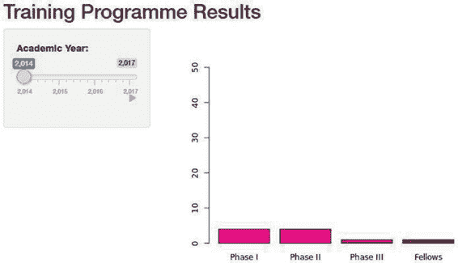

# 第 13 章 每一个云都有闪亮的衬里

## 13.2 Shiny 动态交互

既然我们对 Shiny 的功能有了更好的理解，那么考虑网页相比打印报告的动态潜力就显得尤为重要。用户可以亲自动手操作数据，使研究能够被更广泛的受众更直观地理解。

信息可以随时间“移动”和变化，并在动画中循环。有了合适的基础数据，用户可以通过变量选择生成自定义报告和“视图”。这可以减少数据科学方面的工作，并为信息消费者提供他们确切需要的内容。

我们之前提到 Shiny 的另一个特点是 R 代码适合放在三个不同的位置。第一个位置是在所有代码的开头，在编写用户界面或服务器端代码之前。放在此区域的代码每个实例运行一次。虽然在本地机器上这一点的价值可能不那么明显，但当您的代码托管在云端时，一个特定的 R 会话可能有多个用户与之交互。这就是我们在前一章安装的 Shiny 服务器的工作方式。这是读取任何静态数据或执行任何仅需一次计算的好地方，也是计算效率最高的。虽然我们在本例中没有这样做，但代码也可以放在服务器代码内部，但在任何响应式函数之外，这样每个用户连接到会话时会运行一次。最后，放在服务器函数内部的响应式函数中的代码，每次该函数引用的任何输入数据发生变化时都会执行。

我们来看一下如何随时间变化数据。从用户界面方面，有一个输入函数是数字滑块条。与所有输入函数一样，我们需要给它一个名称，以便我们的响应式函数知道在哪里寻找输入更新。与上一节中的`numericInput()`类似，我们给这个函数一些以年为单位的最小值和最大值。最后，我们将为`sliderInput()`函数添加动画效果。请看我们在用户界面中使用的代码。我们的代码使用了`animate`选项，其中包括以毫秒为单位的间隔，并且动画会持续循环：

```r
sliderInput("ayear", "学年:",
            min = 2014, max = 2017,
            value = 2014, step = 1,
            animate = animationOptions(interval = 600, loop = TRUE))
```

虽然这个应用也展示了如何对静态数据和用户输入执行 R 计算，但从 R 代码的角度来看，它其实非常简单。实际上，除了`titlePanel()`命令以及我们的滑块代码外，这个应用与我们的第一个 Shiny 应用非常相似。我们在图 13-4 中展示了代码和最终结果。

```r
library(shiny)

slider_data <- read.csv("slider_data.csv", header = TRUE, sep = ",")
Phase1 <- slider_data[, 2]
Phase2 <- slider_data[, 3]
Phase3 <- slider_data[, 4]
Phase4 <- slider_data[, 5]

# 定义绘制条形图的用户界面
ui <- shinyUI(fluidPage(
  # 应用标题
  titlePanel("培训项目成果"),
  # 带有输入条数的滑块条的侧边栏
  sidebarLayout(
    sidebarPanel(
      sliderInput("ayear", "学年:",
                  min = 2014, max = 2017,
                  value = 2014, step = 1,
                  animate = animationOptions(interval = 600, loop = TRUE))
    ),
    # 显示条形图
    mainPanel(plotOutput("barPlot"))
  )
))

# 定义绘制条形图所需的服务器端逻辑
server <- shinyServer(function(input, output) {
  output$barPlot <- renderPlot({
    # 计算每个阶段中匹配正确日期的值数量。
    cap <- input$ayear * 100
    x <- c(sum(Phase1 < cap), sum(Phase2 < cap), sum(Phase3 < cap), sum(Phase4 < cap))
    # 绘制对应年份的条形图。
    barplot(x,
            names.arg = c("第一阶段", "第二阶段", "第三阶段", "研究员"),
            col = c("deeppink1", "deeppink2", "deeppink3", "deeppink4"),
            ylim = c(0, 50))
  })
})
```

