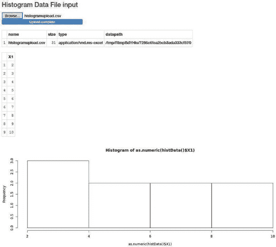
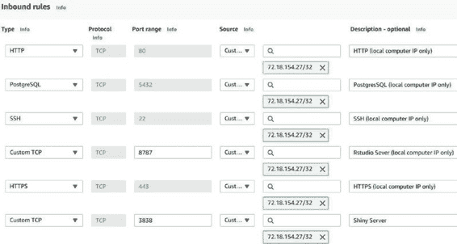

# 运行应用程序

`shinyApp(ui = ui, server = server)`

***图 13-4.** 一个带有“播放”按钮功能的滑块输入，展示数据动态变化*

## 13.3 将用户文件上传至 Shiny

本章的最后一个示例展示了用户如何通过 Shiny 上传文件，随后这些文件可以通过 R 进行处理。当然，与前两个示例不同，这种做法风险稍高，因为上传的文件不在我们的控制之下。这些数据可能是任何文件，未必能与我们的结果真正配合使用。我们可以在代码中构建各种错误检查功能；事实上，在讨论函数时，我们已经部分提到了此类技术。

然而，为了将代码严格聚焦于新功能，我们暂且假设自己生活在一个完美的世界中。本书附带的 Apress 网站上有一个示例文件，它只是一个以逗号分隔的值文件，包含数字 1 到 10。

第 13 章 每朵云都有 Shiny 的光彩

或许并不意外，要接收文件输入，Shiny 中的命令是

`fileInput()`。除了 `inputId`，最有趣的特性可能是它甚至可以接受多个文件上传，尽管在我们的示例中，我们将其保留为默认值 `FALSE`。并非所有浏览器都支持上传多个文件。同样在用户界面区域，我们使用了一个新的输出函数 `tableOutput()`，它与 `plotOutput()` 一起，使我们能够为用户提供图表和图形输出。在讨论使我们能够与用户文件交互的服务器端代码之前，我们先看看 CSV 文件上传会带来什么。图 13-5 是我们上传 CSV 文件后的视图，我们仅展示用户界面的代码：

```
ui <- shinyUI(fluidPage(
fileInput("file", label = h3("直方图数据文件 **输入**")),
tableOutput("tabledf"),
tableOutput("tabledf2"),
plotOutput("histPlot1")
))
```

首先，注意第一个表格。它包含四个变量，这些变量是直接访问 `input$file` 变量的结果。这可能会与我们的其他示例相悖，在其他示例中，用户输入可以通过其 `input$inputId` 直接访问。然而，这确实表明我们的用户输入实际上是一个数据框，并且临时数据路径可以像任何文件位置一样被访问。事先提醒：如果用户上传了另一个文件，由于我们在临时目录中，旧文件很可能会被覆盖。接着，请注意我们的文件实际数据在第二个表格中，并且如直方图所示，这些信息可用于我们可能选择编码的任何 R 计算。

接下来我们聚焦于服务器端，因为这并不像之前的示例那么简单。

有时，输入内容的管理比单个数值或文本值要复杂一些。由于该数据是输入数据，它需要一个反应式函数来在其发生变化时得到通知。不过，你可能更喜欢使用相当简洁的代码。幸运的是，Shiny 提供了一个基本的反应式函数，恰如其分地命名为 `reactive()`。在下面的代码中，我们创建了自己的反应式函数来应对一个新场景，即我们想要的场景。当文件上传时，Shiny 会通知我们的反应式函数 `reactive()`，`input$file` 已发生变化。该函数自然会在输入中查询当前输入的内容，并将该数据框存储到变量 `file1` 中。我们需要访问 CSV 文件内部的数据，因此需要对那个文件调用 `read.csv()`，这需要知道文件的位置。该位置存储在名为 `datapath` 的最后一列中。我们得到一个对象，可以在后续代码中将其视为数据框：



第 13 章 每朵云都有 Shiny 的光彩

```
histData<-reactive({
file1<-input$file
read.csv(file1$datapath,header=TRUE ,sep = ",")
})
```

***图 13-5.** 文件上传结果*

除此之外，我们现在可以在其他反应式函数（甚至是熟悉的函数）中使用我们的数据。我们将展示一个新的反应式函数 `renderTable()`，以及一个熟悉的函数 `renderPlot()`。你还应该注意 `histData()$X1`。

注意这里带有函数括号，但元素仍然通过熟悉的 $ 符号访问。

这是用反应式函数构建的，因此我们必须认识到，它既是一个从用户获取输入的函数，也是一个包含可访问数据的数据存储对象：

371

第 13 章 每朵云都有 Shiny 的光彩

```
output$tabledf2<-renderTable({
histData()
})
output$histPlot1<-renderPlot({
hist(as.numeric(histData()$X1))
})
```

至此，我们对代码的分析就结束了。为完整起见，我们以完整代码结束本节，但现在你已经掌握了在 Shiny 中启动并运行的技术。

新功能和特性会定期添加到这个界面中。然而，*框架*是一致的。因此，查看最新的小插图、寻找示例和模板，并根据需要将新的视觉效果引入你的应用程序是有帮助的。本章的下一部分将展示如何将这些应用程序文件上传到云端，并使其在云端实时运行。最后，请注意用户界面中 `fileInput()` 函数内部的 `h3()` 函数。有一整套函数可以复制各种常见的 HTML 功能，例如标题。我们将在下一章中使用这些函数，来探索如何使我们的用户界面变得——姑且称之为——漂亮：

```
library(shiny)
ui <- shinyUI(fluidPage(
# 复制下面一行以创建文件上传管理器
fileInput("file", label = h3("直方图数据文件 **输入**"), multiple =
FALSE),
tableOutput("tabledf"),
tableOutput("tabledf2"),
plotOutput("histPlot1")
))

# 定义绘制图表所需的服务器逻辑
server <- shinyServer(function(input, output) {
output$tabledf<-renderTable({
input$file
})
histData<-reactive({
file1<-input$file
read.csv(file1$datapath, header=TRUE ,sep = ",")
})
```




第 13 章 每朵云都有 Shiny 的光彩

```
output$tabledf2<-renderTable({
histData()
})
output$histPlot1<-renderPlot({
hist(as.numeric(histData()$X1))
})
```


