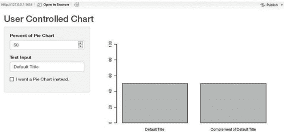
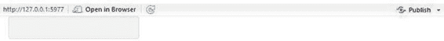
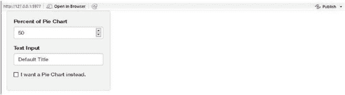
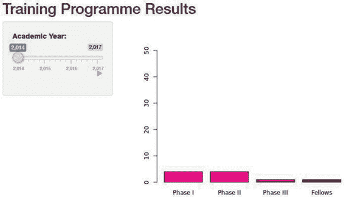
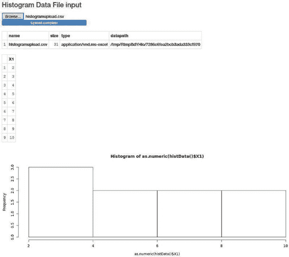
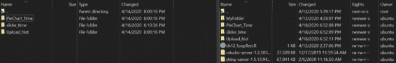
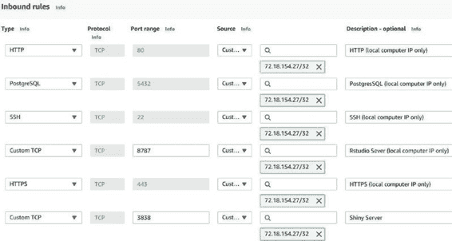

# 第 13 章：每朵云都有一层闪亮的内衬

当向公众提供数据时，便捷的访问和交互式信息能显著提升理解效果。在本章中，我们的目标是为一个较新的应用程序——`Shiny` [6]——提供访问途径和一些有趣的使用方法。

`Shiny` 是 R 的一个 Web 应用程序框架。它的作用是让信息消费者能够与 R 中的实时数据和分析进行交互。该框架不需要任何 Web 语言的知识。尽管如此，你仍可以发布异常复杂且交互式的数据模型给你的客户、决策者或消费者。

你是否有数据需要客户探索？是否有将静态指标转换为动态后能更好地辅助你向董事会或老板汇报的绩效指标？你的用户是否需要上传数据并更好地理解它们？你是否希望轻松地将下一季度的数据更新到一个通用的仪表板中？所有这些问题都可以通过 `Shiny` Server 得到解答。如果我们可以将 `Shiny` 部署到云端，那么任何人都能从 R 的强大功能中受益。

现在，为了简洁起见，本章我们几乎完全在 Windows 操作系统内的 RStudio 中进行操作。在最后，我们将一些独立的 `Shiny` 应用程序托管到我们的服务器上。在下一章中，我们将把本章中的所有构建块整合到一个由云端托管的仪表板中。

你需要确保本地计算机上安装了 `Shiny` [6]，如有需要可使用 `install.packages("shiny")` 命令：

```
options(width = 70, digits = 2)
library(knitr)
library(shiny)
```

© Matt Wiley 和 Joshua F. Wiley 2020
M. Wiley 和 J. F. Wiley, *Advanced R 4 Data Programming and the Cloud*,
<https://doi.org/10.1007/978-1-4842-5973-3_13>

## 13.1 Shiny 基础

可以把 `Shiny` 看作是 R 代码的一个 Web 界面。只要你能用 R 实现，`Shiny` 就能将这些结果推送到一个漂亮的、可以通过互联网浏览器查看的页面上。更酷的是，如果数据消费者想要与信息进行交互，他们的*输入*可以被整合到 R 代码中。

在 RStudio 中，选择 *文件*、*新建文件*、*Shiny Web 应用程序*。将文件命名为 `PieChart_Time`，并在“应用程序”下选择单个文件选项（`app.R`）。删除所有代码并输入以下代码（或者从本书的代码仓库/Apress 网站下载）。在输入代码时，你需要注意三点。第一，代码中有一个用户界面部分。第二，代码中有一个服务器端。最后，应用程序必须运行起来。

另一个需要注意的地方是（这也是我们建议手动输入所有代码的原因）用户端和服务器端的各个部分是如何衔接的。事实上，在我们的代码中，恰好有四个地方发生了这种衔接。从用户端来看，一个介于 0 到 100 之间的数字变量、一个文本字符串和一个复选框是*输入*。服务器接收这些值并创建图表。然后服务器将这些图表放入*输出*中。用户端在 `mainPanel()` 中获取该输出：

```r
library(shiny)

# 绘制饼图的用户界面
ui <- shinyUI(fluidPage(

# 页面标题
  titlePanel("用户控制图表"),

# 带有用户控制的数字、文本和复选框输入的侧边栏
  sidebarLayout(
    sidebarPanel(
      numericInput("pie",
                   "饼图百分比",
                   min = 0,
                   max = 100,
                   value = 50),
      textInput("pietext", "文本输入", value = "默认标题", placeholder = "在此输入您的标题"),
      checkboxInput("pieChoice",
                    " 我想要一个饼图。", value = FALSE)
    ),

# 显示图表
    mainPanel(
      plotOutput("piePlot")
    )
  )
))

# 创建饼图或条形图（对用户隐藏）的服务器端 R 代码
server <- shinyServer(function(input, output) {

output$piePlot <- renderPlot({

# 根据用户输入 input$pie 生成饼图比例
    y <- c(input$pie, 100 - input$pie)

# 绘制具有指定比例和标签的饼图或条形图
    if(input$pieChoice == FALSE){
      barplot(y, ylim = c(0, 100),
              names.arg = c(input$pietext, paste0(input$pietext, "的互补部分")))
    } else {
      pie(y, labels = c(input$pietext, paste0(input$pietext, "的互补部分")))
    }
  })
})
```

# 运行应用程序

运行 `shinyApp(ui = ui, server = server)` 启动应用。

现在，打开你精心输入代码的 `app.R` 文件，并运行该代码。

在代码区域右上角附近应该会有一个 `运行应用` 的播放按钮。无论哪种方式，都会出现类似图 13-1 的界面。

## 第 13 章 每朵云都有闪亮的内衬

尽管输入各种数字和文本值，试用 Shiny，看看它能做什么。在此过程中，你会认识到 Shiny 所做的是为你和 R 之间提供一个交互界面。现在，这个特定的运行实例由你本地机器上的 RStudio 托管。

注意控制台中显示了“正在监听”，并且你可能需要先点击 `停止` 按钮才能输入任何新代码。

那么发生了什么？假设你将“饼图百分比”的数字修改为 75。

`numericInput()` 是一个反应式值。当你更改它时，后台会发送一个信号，通知服务器 `input$pie` 已更改。服务器随后会通知所有使用 `input$pie` 的反应式函数，告知其内容已发生变化。在我们的例子中，`renderPlot()` 是一个反应式函数。它现在知道 `input$pie` 发生了变化，于是会查询该值，获取新值，并重新运行其所有代码。由于这是一个输出值，因此整个循环会通过 `output$piePlot` 反向重复，最终用户端的 `plotOutput()` 随之刷新。

关于这一切，有几点重要的地方需要注意。我们刚才描述的过程会重新运行 `renderPlot()` 内部的所有代码——全部代码。在同等条件下，我们无需再去查找 `input$pietext` 和 `input$pieChoice`。我们的反应式函数知道这些变量的值，因为它们是最新的，虽然它们被再次使用，但不会再次被调用。尽管如此，如果我们在 `renderPlot()` 内部有比减法和绘制图形更复杂的操作，那么任何更改都可能会导致相对较高的性能开销。虽然这段代码非常紧凑，但你仍然可以看到三个可能放置 R 代码的位置。一个是 `library(shiny)` 所在的位置。这位于我们的 `shinyServer()` 外部。这里放的代码（例如我们的库调用）在每个会话中**仅运行一次**。一个会话可以允许多个用户与之交互（尽管目前这有点深奥）。不过，每个新用户至少会执行 `shinyServer()` 内的所有代码一次。最后，正如我们刚才所见，`renderPlot()` 等反应式函数内部的代码，会在任何一个关联的反应式输入值更新时运行一次。这意味着，为了提高效率，应尽可能将代码放在反应式函数外部。此外，如果你预计用户流量很大，也应尽可能将代码放在服务器外部。



*图 13-1。 一个本地托管的 Shiny 应用，用来了解我们正在实现的功能*

### 第 13 章 每朵云都有闪亮的内衬

现在，我们来介绍一些新函数。请记住，有用户输入端、服务器端以及整个 Shiny 应用。深入来看，Shiny 实际上就由这三个部分组成。事实上，这里有一个非常基础的应用骨架：

```r
library(shiny)

# 定义用户界面
ui <- shinyUI(fluidPage())

# 定义服务器
server <- shinyServer(function(input, output) {})

# 运行应用程序
shinyApp(ui = ui, server = server)
```

运行这些代码，你会得到一张漂亮的空白页面。虽然这不如之前的代码那样令人振奋，但这能帮助你快速上手使用这个界面进行编码。在用户界面部分，我们看到的是 `fluidPage()` 函数调用，我们将所有面向用户的文本都放在其内部。这部分代码是 Shiny 中最不熟悉的部分，因为这段代码会生成用户看到的 HTML。在参考部分，我们提供了所有 Shiny UI 函数的链接。不过，本章我们将专注于一个基本布局，该布局位于一个能自动调整（即自适应）的页面内，具体取决于浏览器的显示区域。请注意，这是一个 R 函数，而 R 函数接受的参数用逗号分隔。我们不断扩展的应用的每一个方面都包含在这个包装函数中，它负责将一切转换为 web 就绪的标记语言。





*图 13-2。 一个几乎空白的 Shiny 应用，带有 `sidebarPanel()`*

*图 13-3。 用户界面基本完成，侧边栏中的输入部分确实已完成*

对于图 13-1 中的第一个应用，我们使用了侧边栏布局。这个函数需要两个参数：用于控制应用的侧边栏面板，以及用于展示内容的主面板。编辑我们的用户界面，可以得到如下代码：

```r
# 定义用户界面
ui <- shinyUI(fluidPage(
  sidebarLayout(
    sidebarPanel(),
    mainPanel()
  )
))
```

这段代码是数学上函数组合概念强大威力的一个极好示例。我们的目标最终是要让用户向我们的 R 代码输入一些内容，例如图 13-1 示例中的文本或复选框。

用户将这些值输入到尚未命名的函数中，这些函数会产生视觉输出。该输出又作为输入传递给 `sidebarPanel()` 函数，该函数提供 web 输出，该输出再作为输入传递给 `fluidPage()`，最终输出完整的 web 用户界面。

我们可以在图 13-2 中看到结果，虽然它们还是空白。

### 第 13 章 每朵云都有闪亮的内衬

从这一点出发，我们可以使用三个输入函数快速构建用户的输入项。每个输入函数都遵循特定的格式，即：`blank Input(输入标识, 面向用户的可读文本标签, 与 blank 特定输入类型相关的设置)`。形式上，我们的三个输入函数布局如下，请注意它们的相似之处！

`numericInput(inputId, label, value, min = NA, max = NA, step = NA, width = NULL)`
`textInput(inputId, label, value = "", width = NULL, placeholder = NULL)`
`checkboxInput(inputId, label, value = FALSE, width = NULL)`

接下来，为我们的代码填充一些具体内容，我们可以为每个输入项设置一个有用的标识变量，以便稍后在服务器代码中使用。既然我们计划构建一个饼图（亲爱的读者们，请不要因为我们这个选择而讨厌我们），那么将数字输入限制在 0 到 100 之间是合理的。由于服务器代码在启动时会运行一次，因此为数字输入甚至文本输入提供默认值也是合理的。在我们不断扩展的用户界面代码基础上，现在我们有如下代码：

```r
# 绘制饼图的用户界面
ui <- shinyUI(fluidPage(
```

# 包含数字、文本和复选框输入控件的侧边栏（由用户控制）

```r
sidebarLayout(
    sidebarPanel(
        numericInput("pie", "饼图百分比",
                     min = 0, max = 100, value = 50),
        textInput("pietext", "文本输入",
                  value = "默认标题", placeholder = "在此输入标题"),
        checkboxInput("pieChoice", " 我想要饼图替代", value = FALSE)
    ),
    mainPanel()
))
```

完成这些修改后，再次运行整个应用是合理的。我们会在图 13-3 中看到新结果。请注意，当前代码中的`mainPanel()`为空，因此，在图 13-3 w 中，我们确实没有在右侧看到任何内容。

## 第 13 章 每朵乌云都有闪亮的内衬

现在我们已经捕获了用户输入，可以准备在服务器端使用它了。

请记住，`shiny` 是一个 R 语言封装器，它接收输入，当输入发生变化时，会通知服务器端的响应式函数有内容发生了改变。在幕后，`shiny` 负责了解输入何时变化，并通知服务器上正确的响应式函数；我们无需操心这些事情。我们的服务器定义了一个新函数，它将 `input` 和 `output` 作为形式参数，并在函数体中使用它们。

如有需要，可以快速回顾一下第 4 章，以重温函数的具体概念。由于我们只想绘制条形图或饼图，大部分代码正是用非常普通的 R 语言来实现这一点。事实上，唯一不是标准 R 代码的部分就是我们的响应式函数 `renderPlot()`。由于我们希望输出图形，因此使用了该函数。

响应式函数总是在等待 `shiny` 通知它们用户界面端的输入有任何变化。当输入发生变化时，如果这些响应式函数的函数体中至少包含一个已改变的值，它们就会收到通知。如果确实如此，响应式函数就会重新运行其代码，这次会使用新的值。我们在以下代码中可以看到这一点。代码中唯一另外的部分是：`renderPlot()` 的输出存储在一个 `output` 变量中，我们将其命名为 `piePlot`（尽管它可能不会输出饼图，具体取决于复选框的选择——这完全是我们选择了一个不当名称的错）：

```r
# 服务器端 R 代码，创建饼图或条形图
server <- shinyServer(function(input, output) {

output$piePlot <- renderPlot({

# 基于用户输入的 input$pie 生成饼图比例
    y <- c(input$pie, 100-input$pie)
```

# 绘制指定比例和标签的饼图或条形图

```r
if (input$pieChoice == FALSE) {
  barplot(y, ylim = c(0, 100),
          names.arg = c(input$pietext, paste0("Complement of ", input$pietext)))
} else {
  pie(y, labels = c(input$pietext, paste0("Complement of ", input$pietext)))
}
```

# 第 13 章 每一个云都有闪亮的衬里

基本上就是这样。当我们的服务运行时，它会通知用户界面函数`plotOutput("piePlot")`更新图像。这个函数位于`mainPanel()`区域中。在这个简单的 Shiny 模型下，侧边栏用于接收用户输入，服务器端由 R 在后台处理输入，而主面板则是用户查看处理后的输出。仅此一次，我们展示了 Shiny 为我们创建的完整 HTML 代码，如图 13-1 所示。

```html
<!DOCTYPE html>
<html>
<head>
  <meta http-equiv="Content-Type" content="text/html; charset=utf-8"/>
  <script type="application/shiny-singletons"></script>
  <script type="application/html-dependencies">
    json2[2014.02.04];jquery[3.4.1];shiny[1.4.0.2];bootstrap[3.4.1]
  </script>
  <script src="shared/json2-min.js"></script>
  <script src="shared/jquery.min.js"></script>
  <link href="shared/shiny.css" rel="stylesheet" />
  <script src="shared/shiny.min.js"></script>
  <meta name="viewport" content="width=device-width, initial-scale=1" />
  <link href="shared/bootstrap/css/bootstrap.min.css" rel="stylesheet" />
  <script src="shared/bootstrap/js/bootstrap.min.js"></script>
  <script src="shared/bootstrap/shim/html5shiv.min.js"></script>
  <script src="shared/bootstrap/shim/respond.min.js"></script>
  <title>用户控制的图表</title>
</head>
<body>
  <div class="container-fluid">
    <h2>用户控制的图表</h2>
    <div class="row">
      <div class="col-sm-4">
        <form class="well">
          <div class="form-group shiny-input-container">
            <label class="control-label" for="pie">饼图百分比</label>
            <input id="pie" type="number" class="form-control" value="50" min="0" max="100"/>
          </div>
          <div class="form-group shiny-input-container">
            <label class="control-label" for="pietext">文本输入</label>
            <input id="pietext" type="text" class="form-control" value="默认标题" placeholder="在此输入您的标题"/>
          </div>
          <div class="form-group shiny-input-container">
            <div class="checkbox">
              <label>
                <input id="pieChoice" type="checkbox"/>
                <span>我想要一个饼图。</span>
              </label>
            </div>
          </div>
        </form>
      </div>
      <div class="col-sm-8">
        <div id="piePlot" class="shiny-plot-output" style="width: 100% ; height: 400px"></div>
      </div>
    </div>
  </div>
</body>
</html>
```

现在，请回去仔细查看我们在这部分展示的第一个完整 Shiny 应用的代码块，并意识到这些代码创建了上述所有 HTML 和 JavaScript。在这个例子中，我们的 R 代码虽然并不特别令人印象深刻，但原则仍然是重要的。用户现在可以与数据交互，想象更有趣的应用并非不可能。

在接下来的几节中，我们将介绍一些其他有趣且有用的 Shiny 输入函数以及一些基本的响应式函数。最后，我们将所有内容上传到云端，以便您可以在网络上实时分享它们。

# 第 13 章 每一个云都有闪亮的衬里

## 13.2 Shiny 动态交互

既然我们对 Shiny 的功能有了更好的理解，那么考虑网页相比打印报告的动态潜力就显得尤为重要。用户可以亲自动手操作数据，使研究能够被更广泛的受众更直观地理解。

信息可以随时间“移动”和变化，并在动画中循环。有了合适的基础数据，用户可以通过变量选择生成自定义报告和“视图”。这可以减少数据科学方面的工作，并为信息消费者提供他们确切需要的内容。

我们之前提到 Shiny 的另一个特点是 R 代码适合放在三个不同的位置。第一个位置是在所有代码的开头，在编写用户界面或服务器端代码之前。放在此区域的代码每个实例运行一次。虽然在本地机器上这一点的价值可能不那么明显，但当您的代码托管在云端时，一个特定的 R 会话可能有多个用户与之交互。这就是我们在前一章安装的 Shiny 服务器的工作方式。这是读取任何静态数据或执行任何仅需一次计算的好地方，也是计算效率最高的。虽然我们在本例中没有这样做，但代码也可以放在服务器代码内部，但在任何响应式函数之外，这样每个用户连接到会话时会运行一次。最后，放在服务器函数内部的响应式函数中的代码，每次该函数引用的任何输入数据发生变化时都会执行。

我们来看一下如何随时间变化数据。从用户界面方面，有一个输入函数是数字滑块条。与所有输入函数一样，我们需要给它一个名称，以便我们的响应式函数知道在哪里寻找输入更新。与上一节中的`numericInput()`类似，我们给这个函数一些以年为单位的最小值和最大值。最后，我们将为`sliderInput()`函数添加动画效果。请看我们在用户界面中使用的代码。我们的代码使用了`animate`选项，其中包括以毫秒为单位的间隔，并且动画会持续循环：

```r
sliderInput("ayear", "学年:",
            min = 2014, max = 2017,
            value = 2014, step = 1,
            animate = animationOptions(interval = 600, loop = TRUE))
```

虽然这个应用也展示了如何对静态数据和用户输入执行 R 计算，但从 R 代码的角度来看，它其实非常简单。实际上，除了`titlePanel()`命令以及我们的滑块代码外，这个应用与我们的第一个 Shiny 应用非常相似。我们在图 13-4 中展示了代码和最终结果。

```r
library(shiny)

slider_data <- read.csv("slider_data.csv", header = TRUE, sep = ",")
Phase1 <- slider_data[, 2]
Phase2 <- slider_data[, 3]
Phase3 <- slider_data[, 4]
Phase4 <- slider_data[, 5]

# 定义绘制条形图的用户界面
ui <- shinyUI(fluidPage(
  # 应用标题
  titlePanel("培训项目成果"),
  # 带有输入条数的滑块条的侧边栏
  sidebarLayout(
    sidebarPanel(
      sliderInput("ayear", "学年:",
                  min = 2014, max = 2017,
                  value = 2014, step = 1,
                  animate = animationOptions(interval = 600, loop = TRUE))
    ),
    # 显示条形图
    mainPanel(plotOutput("barPlot"))
  )
))

# 定义绘制条形图所需的服务器端逻辑
server <- shinyServer(function(input, output) {
  output$barPlot <- renderPlot({
    # 计算每个阶段中匹配正确日期的值数量。
    cap <- input$ayear * 100
    x <- c(sum(Phase1 < cap), sum(Phase2 < cap), sum(Phase3 < cap), sum(Phase4 < cap))
    # 绘制对应年份的条形图。
    barplot(x,
            names.arg = c("第一阶段", "第二阶段", "第三阶段", "研究员"),
            col = c("deeppink1", "deeppink2", "deeppink3", "deeppink4"),
            ylim = c(0, 50))
  })
})
```



# 第 13 章 每一个云都有闪亮的衬里

# 运行应用程序

运行 Shiny 应用程序的核心命令是`shinyApp(ui = ui, server = server)`。



## 13.3 将用户文件上传至 Shiny

本章的最后一个示例展示了用户如何通过 Shiny 上传文件，随后这些文件可以通过 R 进行处理。当然，与前两个示例不同，这种做法风险稍高，因为上传的文件不在我们的控制之下。这些数据可能是任何文件，未必能与我们的结果真正配合使用。我们可以在代码中构建各种错误检查功能；事实上，在讨论函数时，我们已经部分提到了此类技术。

然而，为了将代码严格聚焦于新功能，我们暂且假设自己生活在一个完美的世界中。本书附带的 Apress 网站上有一个示例文件，它只是一个以逗号分隔的值文件，包含数字 1 到 10。

或许并不意外，要接收文件输入，Shiny 中的命令是`fileInput()`。除了`inputId`，最有趣的特性可能是它甚至可以接受多个文件上传，尽管在我们的示例中，我们将其保留为默认值`FALSE`。并非所有浏览器都支持上传多个文件。同样在用户界面区域，我们使用了一个新的输出函数`tableOutput()`，它与`plotOutput()`一起，使我们能够为用户提供图表和图形输出。在讨论使我们能够与用户文件交互的服务器端代码之前，我们先看看 CSV 文件上传会带来什么。图 13-5 是我们上传 CSV 文件后的视图，我们仅展示用户界面的代码：

```r
ui <- shinyUI(fluidPage(
  fileInput("file", label = h3("直方图数据文件 **输入**")),
  tableOutput("tabledf"),
  tableOutput("tabledf2"),
  plotOutput("histPlot1")
))
```

首先，注意第一个表格。它包含四个变量，这些变量是直接访问`input$file`变量的结果。这可能会与我们的其他示例相悖，在其他示例中，用户输入可以通过其`input$inputId`直接访问。然而，这确实表明我们的用户输入实际上是一个数据框，并且临时数据路径可以像任何文件位置一样被访问。事先提醒：如果用户上传了另一个文件，由于我们在临时目录中，旧文件很可能会被覆盖。接着，请注意我们的文件实际数据在第二个表格中，并且如直方图所示，这些信息可用于我们可能选择编码的任何 R 计算。

接下来我们聚焦于服务器端，因为这并不像之前的示例那么简单。

有时，输入内容的管理比单个数值或文本值要复杂一些。由于该数据是输入数据，它需要一个反应式函数来在其发生变化时得到通知。不过，你可能更喜欢使用相当简洁的代码。幸运的是，Shiny 提供了一个基本的反应式函数，恰如其分地命名为`reactive()`。在下面的代码中，我们创建了自己的反应式函数来应对一个新场景，即我们想要的场景。当文件上传时，Shiny 会通知我们的反应式函数`reactive()`，`input$file`已发生变化。该函数自然会在输入中查询当前输入的内容，并将该数据框存储到变量`file1`中。我们需要访问 CSV 文件内部的数据，因此需要对那个文件调用`read.csv()`，这需要知道文件的位置。该位置存储在名为`datapath`的最后一列中。我们得到一个对象，可以在后续代码中将其视为数据框：

```r
histData<-reactive({
  file1<-input$file
  read.csv(file1$datapath,header=TRUE ,sep = ",")
})
```



除此之外，我们现在可以在其他反应式函数（甚至是熟悉的函数）中使用我们的数据。我们将展示一个新的反应式函数`renderTable()`，以及一个熟悉的函数`renderPlot()`。你还应该注意`histData()$X1`。

注意这里带有函数括号，但元素仍然通过熟悉的`$`符号访问。

这是用反应式函数构建的，因此我们必须认识到，它既是一个从用户获取输入的函数，也是一个包含可访问数据的数据存储对象：

```r
output$tabledf2<-renderTable({
  histData()
})
output$histPlot1<-renderPlot({
  hist(as.numeric(histData()$X1))
})
```

至此，我们对代码的分析就结束了。为完整起见，我们以完整代码结束本节，但现在你已经掌握了在 Shiny 中启动并运行的技术。

新功能和特性会定期添加到这个界面中。然而，*框架*是一致的。因此，查看最新的小插图、寻找示例和模板，并根据需要将新的视觉效果引入你的应用程序是有帮助的。本章的下一部分将展示如何将这些应用程序文件上传到云端，并使其在云端实时运行。最后，请注意用户界面中`fileInput()`函数内部的`h3()`函数。有一整套函数可以复制各种常见的 HTML 功能，例如标题。我们将在下一章中使用这些函数，来探索如何使我们的用户界面变得——姑且称之为——漂亮：

```r
library(shiny)
ui <- shinyUI(fluidPage(
  # 复制下面一行以创建文件上传管理器
  fileInput("file", label = h3("直方图数据文件 **输入**"), multiple =
  FALSE),
  tableOutput("tabledf"),
  tableOutput("tabledf2"),
  plotOutput("histPlot1")
))

# 定义绘制图表所需的服务器逻辑
server <- shinyServer(function(input, output) {
  output$tabledf<-renderTable({
    input$file
  })
  histData<-reactive({
    file1<-input$file
    read.csv(file1$datapath, header=TRUE ,sep = ",")
  })
  output$tabledf2<-renderTable({
    histData()
  })
  output$histPlot1<-renderPlot({
    hist(as.numeric(histData()$X1))
  })
})
```



# 运行应用程序

`shinyApp(ui = ui, server = server)`

**图 13-6.** 已上传 `PieChart_Time`、`slider_time` 和 `Upload_hist` 应用程序的 WinSCP 界面

**图 13-7.** 为单个本地 IP 地址开放 Shiny Server 端口 `3838` 的 AWS 入站规则表

## 第 13 章：每一朵云都有闪亮的一面

请注意，在这段代码中，我们没有关注侧面板或主面板之类的区分；相反，我们将用户界面侧（包括请求的输入和生成的输出）都混在了一起。值得注意的是，如果你有侧面板，则需要一个主面板来容纳侧面板未管理的任何输出。

### 13.4 在云端托管 Shiny

最后一项任务是将文件从本地机器传输到云实例。记住，在前面的章节中，我们不仅使用了 PuTTY 在云端安装 Shiny Server，还使用了 WinSCP 将文件上传到云端。我们启动 WinSCP，重新连接，并确保左侧本地目录位于 Shiny 应用程序文件夹中，而右侧云服务器目录位于 `/home/ubuntu` 下。该过程的结果如图 13-6 所示。

接下来，我们访问 PuTTY 并在命令行中依次运行以下代码：

```
$ sudo cp -R ~/PieChart_Time /srv/shiny-server/
$ sudo cp -R ~/slider_time /srv/shiny-server/
$ sudo cp -R ~/Upload_hist /srv/shiny-server/
```

这样就剩最后一步了。回想一下，当我们最初设置云实例时，我们小心翼翼地只允许少数端口为少数 IP 地址工作。那时我们为 Shiny 服务器添加了一个条目。你的本地机器 IP 地址可能已经改变。因此，如果前面的步骤不起作用，请记得进入 AWS `EC2 控制面板` 并更新你的 `安全组`（特别是你的 `AdvancedR 组`）。结果如图 13-7 所示。

现在，你可以通过在任意浏览器中输入以下 URL 来验证你的应用程序是否正常工作：

* `你的实例.IP.地址:3838/PieChart_Time/`
* `你的实例.IP.地址:3838/slider_time/`
* `你的实例.IP.地址:3838/Upload_hist/`

如果你希望允许其他人或整个世界访问你的应用程序，请将 `入站` 源 IP 地址更改为 `0.0.0.0/0`，仅针对端口 `3838`。出于安全考虑，**不要**允许外界访问你的 `SSH` 端口。当然，如果你现在托管了一个对全世界开放的 `3838` 端口，你的服务器位置是可见且已知的。因此，不难猜到该地址存在一个 `SSH` 端口。

如果你希望既能方便地托管面向公众的交互式仪表盘，又能使用 AWS 进行大型计算操作，一种可能的方案是使用两个位于不同安全组的云服务器。一个可以是价格相对较高、拥有众多处理器和大量 RAM 的实例。你可以对其安全设置进行严格限制，甚至在不进行运算时将其关闭以节省成本。

另一方面，对于仅向公众提供 Shiny 应用程序服务的需求，可以将其部署在一台始终运行且硬盘上不存储机密数据的低功耗机器上。

### 13.5 总结

使用 Shiny 生态系统，可以让对技术入门门槛较低的用户以互动方式共享 R 分析结果和可视化内容。只要你的用户和消费者熟悉网页浏览器，他们就有机会以超越静态 PDF 的方式探索你的 R 研究。Shiny 生态系统在不断改进，因此在线查看最近的 vignettes 可能会为你提供所需的新功能，以提升有效传达数据的能力。尽管如此，Shiny 的基础框架（如本章所示）自本书第一版以来基本保持稳定。因此，根据需要逐步添加和改进你的 Shiny 应用程序是很容易的。在表 13-1 中，我们列出了本章描述的一些关键函数。

**表 13-1.** 本章描述的关键函数及其功能总结

| 函数 | 功能 |
| --- | --- |
| `shinyApp.R` | Shiny 服务器的单文件模板 |
| `titlePanel()` | 设置 HTML 页面标题 |
| `sidebarLayout()` | 开始侧边栏布局 |
| `sidebarPanel` | 实际的侧边栏面板 |
| `mainPanel()` | 包含用户的主界面（通常用于显示可视化内容） |
| `shinyApp()` | 被调用时从 R 运行实际的 Shiny 应用程序 |
| `numericInput()` | 从用户处收集数字输入并传递给服务器端 |
| `textInput()` | 从用户处收集文本输入并传递给服务器端 |
| `checkboxInput()` | 从用户处收集复选框输入并传递给服务器端 |
| `sliderInput()` | 从用户处收集滑块刻度输入并传递给服务器端 |
| `fileInput()` | 从用户处收集上传的文件输入并传递给服务器端 |
| `plotOutput()` | 用户端用于显示图形 |
| `renderPlot` | 服务器端用于响应式创建图形 |
| `tableOutput` | 用户端用于显示表格 |
| `renderTable()` | 服务器端用于响应式创建表格 |
| `reactive()` | 服务器端用于通用操作的响应式创建器 |

