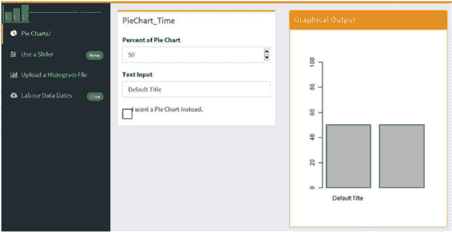
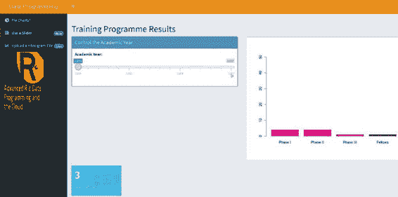
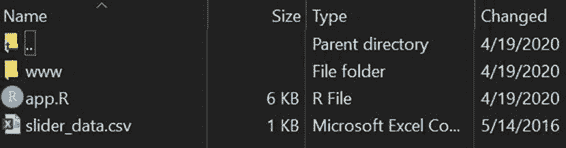
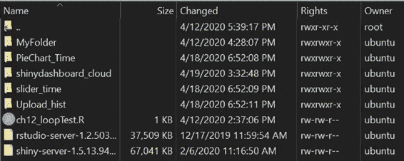

## 第 14 章：Shiny 仪表盘示例

理解本书其他章节并不需要本章内容。虽然我们介绍了一些新技术，但这里的主要内容是一个完整的仪表盘示例，可供修改以满足你的需求。

这个示例到底有什么作用？它将前一章中使用的应用程序以引人入胜的交互式格式呈现出来。需要记住的是，虽然我们通常以图形输出形式展示这些应用程序，但任何 R 处理过程都可以应用于这些数据。其目的是让信息消费者能够自然地与实时数据进行交互，无论这些消费者是研究评审员、更高层的总监还是董事会成员。

与前一章类似，我们在 Windows 系统的 RStudio [20] 中介绍这部分内容。我们提供了理解此仪表盘的框架以及一些专业提示。请将这个示例视作一种创意孵化器，而非权威指南。我们希望你能从中找到自己喜欢的内容，更重要的是，意识到如何以最佳方式展示你的数据。

我们从仪表盘的基本结构开始：

```r
options(width = 70, digits = 2)
library(knitr)
library(shiny)
library(shinydashboard)
```

### 14.1 仪表盘的基本框架

回顾一下前一章中我们最小的 Shiny [6] 应用程序：

```r
library(shiny)

# Define user interface
ui <- shinyUI(fluidPage())

# Define server
server <- shinyServer(function(input, output) {})
```

© Matt Wiley and Joshua F. Wiley 2020
M. Wiley and J. F. Wiley, *高级 R 4 数据编程与云端应用*，
[`doi.org/10.1007/978-1-4842-5973-3_14`](https://doi.org/10.1007/978-1-4842-5973-3_14)

# 运行应用

`shinyApp(ui = ui, server = server)` 这段代码从一开始就值得关注，因为它凸显了所有 Shiny 应用是如何由用户界面和服务器端（R 代码逻辑所在之处）组成的——而这两者本身都作为 R 进程运行（可能位于云端服务器上）。我们打算在这套结构上增加的，仅仅是用户界面端的一些代码。这很合理，因为仪表盘更侧重于用户界面，而非什么新的代码逻辑。其目标是让用户能够轻松获取分析和统计推断结果。为此需要安装一个新的程序库，但只有一个：`shinydashboard` [5]。在 RStudio 的命令行中，直接运行以下代码：

```
install.packages("shinydashboard")
```

安装好这个新程序包后，我们现在可以来看一个最简单的 Shiny 仪表盘应用。仪表盘包含一个标题栏、一个带有各种菜单项的侧边栏，以及承载应用中不同对象的主体区域。

请对比这个仪表盘代码布局与单文件应用代码。这两个版本几乎相同。在代码之后，看看它们在图 14-1 中生成了什么。

**图 14-1.** 最简单的 Shiny 仪表盘几乎是空的

```
library(shiny)
library(shinydashboard)

# 定义用户界面
ui <- dashboardPage(
  dashboardHeader(),
  dashboardSidebar(),
  dashboardBody()
)

# 定义服务器
server <- shinyServer(function(input, output) {})

# 运行应用
shinyApp(ui = ui, server = server)
```

正如你在上述代码中看到的，我们有三个函数：`dashboardHeader()`、`dashboardSidebar()` 和 `dashboardBody()`。它们为我们的仪表盘提供了一个很好的结构。这些函数都作为 `dashboardPage()` 的前三个形式参数（该页面函数共有五个形式参数）位于其中。最后两个形式参数包括 `title`（默认为 `NULL`）和 `skin`（可接受 `blue`、`black`、`purple`、`green`、`red` 或 `yellow` 颜色之一）。通过 `formals(dashboardPage)` 命令，你可以亲自看到这个页面函数确实非常简单。`title` 参数控制浏览器本身中的标题（或者，如果大多数流行浏览器中打开了多个标签页，则控制浏览器标签页上的标题）。

`skin` 颜色选项控制仪表盘的整体配色方案。现在，前三个形式参数本身就是函数，并且会变得相当复杂。尽管如此，我们还是逐一介绍这三个函数：

```
formals(dashboardPage)

## $header
##
##
## $sidebar
##
##
## $body
##
##
## $title
## NULL
##
## $skin
## c("blue", "black", "purple", "green", "red", "yellow")
```

## 仪表盘标题栏

`dashboardHeader()` 函数也接受一个 `title` 形式参数，用于将用户定义的文本添加到标题栏区域，以及一个 `titleWidth` 参数来控制该文本的宽度。

标题栏还接受其他几个 Shiny 用户界面风格的函数来控制页面导航，以及一些更专门的函数以实现更交互式的导航。在本章以及本书中，我们基本上忽略这些函数，以推崇使用 `shiny` 和 `shinydashboard` 作为向数据消费者提供已熟悉 R 代码的方式，而不是一次性学习太多新特性。事实上，我们为这个函数提到的最后一个形式参数是 `disable`，它默认为 `FALSE`，当设置为 `TRUE` 时会完全隐藏标题栏。在我们的示例中，我们保留了标题栏，但对其做了少量修改：

```
formals(dashboardHeader)

## $...
##
##
## $title
## NULL
##
## $titleWidth
## NULL
##
## $disable
## [1] FALSE
##
## $.list
## NULL
```

## 仪表盘侧边栏

来看 `dashboardSidebar()` 函数，其明确列出的形式参数再次是 `disable` 选项和 `width` 参数。然而，除了这些提到的参数之外，这里还可以有更多函数。通常，来自 Shiny 的*任何*用户界面函数都可以在侧边栏中工作。因此，如果需要在菜单中放置滑块或下拉输入函数，这也是可能的。不过，有一些仪表盘程序库特有的函数放在侧边栏区域中是合理的。

其中第一个是 `sidebarMenu()` 函数。与 `dashboardSidebar()` 本身非常类似，该函数主要接收其他输入，并以高效的方式组织它们。特别值得注意的是 `menuItem()` 函数，它从 `sidebarMenu()` 内部调用。在这个示例中，我们将前一章创建的每个应用都放在各自的 `menuItem()` 调用中。正如你在以下代码中看到的，这个函数有几个形式参数：

```
formals(menuItem)

## $text
##
##
## $...
##
##
## $icon
## NULL
##
## $badgeLabel
## NULL
##
## $badgeColor
## [1] "green"
##
## $tabName
## NULL
##
##
## $href
## NULL
##
## $newtab
## [1] TRUE
##
## $selected
## NULL
##
## $expandedName
## as.character(gsub("[[:space:]]", "", text))
##
## $startExpanded
## [1] FALSE
```

在上述函数和形式参数中，`text` 接受一个用引号括起来的文本字符串，提供该菜单项在菜单上的可见链接名称。`icon` 形式参数需要提供一个 *Font Awesome* 图标的名称。我们会在本章的总结部分提供一个指向其在线图标库的链接，其中包含所有可选的图标。还有其他图标库可用；这些探索留给您自己进行。`badgeLabel` 调用会在侧边栏最右侧放置一个内联徽章，并显示您选择的简短文本。徽章能很好地引起观众对特定菜单项及其底层应用的注意。这些形式参数中有许多是可选的；但是，必须提供与仪表盘主体中相关 `tabItem()` 关联的 `tabName`，或者必须为 `href` 命令提供一个 URL。如果提供的是 URL 而非 `tabName`，则可以将 `newtab` 从默认的 `TRUE` 改为 `FALSE`，这样如果您希望观众访问该页面时离开您的网站，就可以实现。最后，通过将 `selected` 设置为 `TRUE`，可以强制将默认选中项从第一个 `menuItem()` 更改为特定标签页。请确保在您的仪表盘中只执行此操作一次！

当我们把注意力转向仪表盘的主体时，我们提醒您，侧边栏也可以接收任何 Shiny 函数——例如 `img()` 函数，它指向一个必须包含在仪表盘应用文件夹内名为 `www` 的文件夹中的图像。我们在图 14-2 中展示了一个我们示例菜单的代码片段（目前不应运行）及其结果。前三个菜单项的名称应该从前一章就已经熟悉了：

```
sidebarMenu(
  menuItem(
    "饼图！",
    tabName = "PieChart_Time",
    icon = icon("pie-chart")
  ),
  menuItem(
    "使用滑块",
    tabName = "slider_time",
    icon = icon("sliders"),
    badgeLabel = "新增"
  ),
  menuItem(
    "上传直方图文件",
    tabName = "Upload_hist",
    icon = icon("bar-chart"),
    badgeLabel = "实时"
  )
)
```

**图 14-2.** 一些 `sidebarMenu()` 和 `menuItem()` 函数的运行结果

**图 14-3.** 一个侧边栏带有 `menuItem()` 且主体带有 `tabItem()` 的仪表盘。请注意匹配的 First

## 仪表盘主体

正如你在前面的代码中看到的，每个菜单项都有一个 `tabName`。我们现在讨论负责捕获 `tabName` 的 `dashboardBody()` 函数内部的代码。看看下面代码和图 14-3 中那个小（但也不是最小）的 Shiny 仪表盘，然后我们将逐行讲解新内容：

```
library(shiny)
library(shinydashboard)
```

# 定义用户界面

```r
ui <- dashboardPage(
  dashboardHeader(),
  dashboardSidebar(sidebarMenu(menuItem("演示链接", tabName = "First"))),
  dashboardBody(tabItems(tabItem(tabName = "First", "主体区域或'正文'**文本**。"))),
  skin = "yellow"
)
```

# 定义服务器

```r
server <- shinyServer(function(input, output) {})
```

# 运行应用

```r
shinyApp(ui = ui, server = server)
```

仪表盘的主体中可以放置许多项目。然而，如果我们想使用之前在侧边栏部分编码的选项卡，我们需要通过 `tabItems()` 进行全局调用。该函数不接受除单个 `tabItem()` 函数调用之外的任何参数；每个 `tabItem()` 都需要拥有一个唯一的 `tabName`，与 `sidebarMenu()` 中唯一的 `tabName` 匹配。

## 第 14 章 Shiny 仪表盘示例

每个 `tabItem()` 内部包含什么？与 Shiny 一样，将布局设计得足够灵活，以使仪表盘能够适应各种尺寸的浏览器窗口（例如，移动端与桌面端平台）是非常有益的。因此，常见的 `fluidRow()` 函数再次出现。回想一下，`fluidRow()` 的行宽最多被设置为 12 个单位。记住这一点，请密切关注我们将要讨论的用于填充这些行的三个盒子对象的默认宽度。当然，并非只有这三种对象；再次强调，我们的目标是让您能够快速上手，从而通过云将数据提供给您的用户或利益相关者。

行中最基本的输入元素是 `box()`。在这个函数内部，我们可以放置前一章中使用的任何应用代码，无论是用于向用户征求输入还是输出响应式内容。然而，`box()` 也接受九个特定的参数。

自然地，每个 `box()` 都可以包含一个 `title` 值，这是一个用户定义的文本字符串，用于简洁地描述盒子的内容或所需操作。在盒子的底部，有一个 `footer`，它也可以接受一个文本字符串。盒子还有一个 `status`，可以设置为 `primary`、`success`、`info`、`warning` 或 `danger`。每个状态值都有一个关联的颜色，这是默认层叠样式表结构的一部分，使 `shinydashboard` 看起来相当美观。这些颜色相当一致，尽管它们可能会因您为整个仪表盘选择的颜色而略有差异。`solidHeader` 的默认值是 `FALSE`，当然，这可以更改为 `TRUE`。选择该选项会增强状态的颜色，使其成为标题文本的窄横幅背景。如果您希望盒子的主体区域具有特定颜色，可以从大约 15 种有效的颜色选项中设置 `background`。顾名思义，输入和输出代码的显示视觉上会出现在该背景之上。盒子的默认 `width` 是 6，因此除非您采取措施缩小它们，否则两个盒子会填满一行。忘记保持 `fluidRow()` 总宽度为 12 可能会导致一些奇特的布局。盒子的 `height` 也可以设置为固定高度。如果您需要非常整齐的行，这可能会很有帮助。最后，盒子是 `collapsible`（可折叠）的，并且可能已经 `collapsed`（折叠），尽管这两个选项的默认值都是 `FALSE`。图 14-4 展示了这些不同设置的一些结果：

```r
formals(box)
```

```
## $...
##
##
## $title
## NULL
##
## $footer
## NULL
##
## $status
## NULL
##
## $solidHeader
## [1] FALSE
##
## $background
## NULL
##
## $width
## [1] 6
##
## $height
## NULL
##
## $collapsible
## [1] FALSE
##
## $collapsed
## [1] FALSE
```

另一种类型的盒子是 `valueBox()`，它接受六个形式参数。第一个是 `value`，通常是一个简短的文本字符串或数值，如图 14-5 所示。`valueBox()` 还接受一个 `subtitle` 参数，同样是一个文本字符串。您可以选择一个 `icon`（图标），尽管默认值是 `NULL`。这些盒子默认颜色为 `aqua`，并且相当短小，默认 `width` 仅为 4。最后，`valueBox()` 还接受一个 `href` 值，默认值为 `NULL`。以下是我们示例中的数值框所使用的代码：

```r
valueBox(
  endYear - startYear,
  subtitle = "数据年份数",
  icon = icon("band-aid"),
  width = 2
)
```

  


图 14-4. 一个带有各种选项的熟悉应用，显示在两个盒子中——详情参见“完整示例代码”部分

图 14-5. 示例 `valueBox()` 显示从网站实时拉取的数据天数



我们以一个与 `valueBox()` 类似的盒子——`infoBox()`——来结束关于 `dashboardBody()` 中盒子的讨论。这个盒子包含一个接受文本字符串的 `title`、一个用于突出显示并显示在盒子中的 `value`、可选的 `subtitle` 文本，以及一个默认为“条形图”的 `icon`。它还具有 `color = aqua`、`width = 4` 和 `href = NULL` 的默认值。不同之处在于图标更小，并且有一个 `fill` 选项，通常为 `FALSE`，可以改变背景颜色的显示方式。我们未展示此盒子，但它看起来与图 14-5 中的小盒子非常相似。根据我们的经验，这些盒子除了外观之外并无显著差异。

## 14.2 云中的仪表盘

我们确实想将这个仪表盘部署到我们的云实例中，而这组代码稍微复杂一些。同样，我们使用 RStudio 在一个标准的 Shiny 文件夹中创建了它，因此它有自己的文件。Windows 上的文件结构如图 14-6 所示。我们的 `shinydashboard_cloud` 文件夹中有三个文件。请注意 `www` 子文件夹，它存放了我们示例的图像，然后是 `app.R` 文件，其中包含了我们的整个 Shiny 应用程序以及我们的 CSV 文件。

图 14-6. `shinydashboard_cloud` 的文件结构

我们使用 WinSCP 将文件和文件夹上传到我们的 Ubuntu 云实例，如图 14-7 所示。请记住，虽然完整代码将在下一节中显示，但全套代码可在 Apress 网站和/或本书的 GitHub 存储库中在线获取。



图 14-7. WinSCP 上传文件夹视图

登录 PuTTY 后，我们需要运行一小段代码。我们需要将示例文件从用户文件夹移动到 Shiny 服务器期望它们存放的位置：

```bash
sudo cp -R ~/shinydashboard_cloud /srv/shiny-server/
```

至此，我们完成了 Shiny 和 Shiny 仪表盘的工作。您的仪表盘应已在 [`Your.Instance.IP.Address:3838/shinydashboard_cloud/`](http://your.instance.ip.address:3838/shinydashboard_cloud/) 上线，并且可以从您的网络浏览器查看。在结束本章之前，我们还有几点补充说明。

首先，我们再次建议您访问本教科书的 Apress 网站，并下载本章的代码包。它包含了图 14-6 所示并在图 14-7 中上传的完整、可工作的文件和文件夹。没有必要手动输入所有这些代码来看看仪表盘是否是您想要的东西。

其次，我们提醒您，如果您遵循了我们针对 AWS 服务器入站策略设置的安全建议，您可能需要更改这些设置，以便允许除您之外的更多人员查看您的最终仪表板项目。请记住，您需要在入站方面更改的设置是：允许端口 `3838` 从 `0.0.0.0/0`（即整个互联网）进行访问。请注意，这样一来，整个互联网都将能够访问您的仪表板。如果您有敏感数据，或者即便是那些无需公开的信息，请考虑与 IT 专业人士或至少是一位 IT 高级用户合作。

### 14.3 完整示例代码

在查看以下代码时，请记住将其与您在本章前面学到的内容进行对比和比较。观察各个小部分如何协同工作以构成一个整体。此外，虽然在本示例中我们将所有代码保留在单个 `app.R` 文件中，但 `shiny` 的全局、服务器和用户界面部分可以拆分为三个文件（事实上，在 RStudio 中创建新的 *Shiny web app* 时，这是可选项之一）。这对于分割更大的仪表板（例如您可能创建的仪表板）非常有帮助：

```r
library(shiny)
library(shinydashboard)

# 运行一次代码
slider_data <- read.csv("slider_data.csv", header = TRUE, sep = ",")
Phase1 <- slider_data[, 2]
Phase2 <- slider_data[, 3]
Phase3 <- slider_data[, 4]
Phase4 <- slider_data[, 5]
startYear <- 2013
endYear <- 2016

# 定义仪表板的 UI
ui <- dashboardPage(
  dashboardHeader(title = "数据编程与云端"),
  dashboardSidebar(
    sidebarMenu(
      menuItem(
        "饼图！",
        tabName = "PieChart_Time",
        icon = icon("pie-chart")
      ),
      menuItem(
        "使用滑块",
        tabName = "slider_time",
        icon = icon("sliders"),
        badgeLabel = "新"
      ),
      menuItem(
        "上传直方图文件",
        tabName = "Upload_hist",
        icon = icon("bar-chart"),
        badgeLabel = "上线"
      )
    ),
    img(
      src = "R4_DataProgandCloud.JPG",
      height = 200,
      width = 150
    )
  ),
  dashboardBody(tabItems(
    # PieChart_Time 内容
    tabItem(tabName = "PieChart_Time",
      fluidRow(
        box(
          title = "PieChart_Time",
          status = "warning",
          numericInput(
            "pie",
            "饼图百分比",
            min = 0,
            max = 100,
            value = 50
          ),
          textInput(
            "pietext",
            "文本输入",
            value = "默认标题",
            placeholder = "在此输入您的标题"
          ),
          checkboxInput("pieChoice",
            "我希望使用饼图。",
            value = FALSE)
        ),
        box(
          title = "图形输出",
          solidHeader = TRUE,
          status = "warning",
          plotOutput("piePlot")
        )
      )),
    # 滑块选项卡内容
    tabItem(
      tabName = "slider_time",
      h2("培训项目结果"),
      fluidRow(
        box(
          title = "控制学年",
          status = "primary",
          solidHeader = TRUE,
          sliderInput(
            "ayear",
            "学年：",
            min = 2014,
            max = 2017,
            value = 2014,
            step = 1,
            animate = animationOptions(interval = 600, loop = T)
          )
        ),
        box(plotOutput("barPlot"))
      ),
      fluidRow(
        valueBox(
          endYear - startYear,
          "数据年份数",
          icon = icon("band-aid"),
          width = 2
        )
      )
    ),
    # 根据上传的 CSV 生成直方图
    tabItem(tabName = "Upload_hist",
      fluidRow(
        box(title = "文件输入",
          # 复制下面一行以创建文件上传管理器
          fileInput(
            "file",
            label = h3("直方图数据文件输入"),
            multiple = FALSE
          )),
        box(
          title = "来自文件输入的数据",
          collapsible = TRUE,
          tableOutput("tabledf")
        )
      ),
      fluidRow(
        box(tableOutput("tabledf2")),
        box(background = "blue",
          plotOutput("histPlot1"))
      ))
  )),
  title = "仪表板示例",
  skin = "yellow"
)

#################### 定义绘制直方图所需的服务器逻辑
server <- shinyServer(function(input, output) {
  output$piePlot <- renderPlot({
    # 根据用户输入的 input$pie 生成饼图比例
    y <- c(input$pie, 100 - input$pie)
    # 使用指定的比例和标签绘制饼图或条形图
    if (input$pieChoice == FALSE) {
      barplot(y,
        ylim = c(0, 100),
        names.arg = c(input$pietext, paste0(input$pietext, "的补集")))
    } else{
      pie(y, labels = c(input$pietext, paste0(input$pietext, "的补集")))
    }
  })
  output$barPlot <- renderPlot({
    # 统计每个阶段中匹配正确日期的数量。
    cap <- input$ayear * 100
    x <- c(sum(Phase1 < cap),
      sum(Phase2 < cap),
      sum(Phase3 < cap),
      sum(Phase4 < cap))
    # 为正确的年份绘制条形图。
    barplot(
      x,
      names.arg = c("阶段 I", "阶段 II", "阶段 III", "研究员"),
      col = c("deeppink1", "deeppink2", "deeppink3", "deeppink4"),
      ylim = c(0, 50)
    )
  })
  ####这里是文件输入发生的地方
  output$tabledf <- renderTable({
    input$file
  })
  histData <- reactive({
    file1 <- input$file
    read.csv(file1$datapath, header = TRUE , sep = ",")
  })
  output$tabledf2 <- renderTable({
    histData()
  })
  output$histPlot1 <- renderPlot({
    hist(as.numeric(histData()$X1))
  })
  ##############服务器结束####################
})
```

# 第 14 章 Shiny 仪表盘示例

## 运行应用

`shinyApp(ui = ui, server = server)`

### 14.4 本章小结

参考文献及其他内容见表 14-1。

**表 14-1.** 本章所述关键函数及其功能摘要

| 函数 | 功能说明 |
| --- | --- |
| `menuItem()` | 仪表盘中的“链接”——`tabName = ""` 必须与 `tabItem()` 匹配。 |
| `tabName = ""` | 菜单项和标签项中通用的配对标识符。 |
| `icon = ""` | 使用以下图标链接之一，查找图标的文本名称。 |
| `badgeLabel = ""` | 接受你输入的文本字符串，并将其放置在“链接”旁边，空间较小。 |
| `tabItem()` | 仪表盘中的“页面”——`tabName = ""` 必须与 `menuItem()` 匹配。 |
| `fluidRow()` | 行由 12 个“单位”长度组成。单个 `tabItem()` 可包含多行。 |
| `box()` | 一个包含响应式代码（例如图表或用户输入区域）的容器。 |
| `valueBox()` | 一种突出显示特定信息的好方法——它可以是响应式的（也可以不是）。 |

- `shinydashboard` 主页：[`rstudio.github.io/shinydashboard/`](https://rstudio.github.io/shinydashboard/)
- 图标：[`fontawesome.io/icons/`](http://fontawesome.io/icons/)
- 其他图标：[`icons.getbootstrap.com/`](https://icons.getbootstrap.com/)
- `shiny` 函数列表：[`shiny.rstudio.com/reference/shiny/latest/`](http://shiny.rstudio.com/reference/shiny/latest/)
- Shiny 服务器指南：[`docs.rstudio.com/shiny-server/`](http://docs.rstudio.com/shiny-server/)
- Shiny 示例库：[`shiny.rstudio.com/gallery/`](http://shiny.rstudio.com/gallery/)
- `shiny` CRAN 包：[`cran.r-project.org/web/packages/shiny/shiny.pdf`](https://cran.r-project.org/web/packages/shiny/shiny.pdf)
- 文档

# 第 15 章

