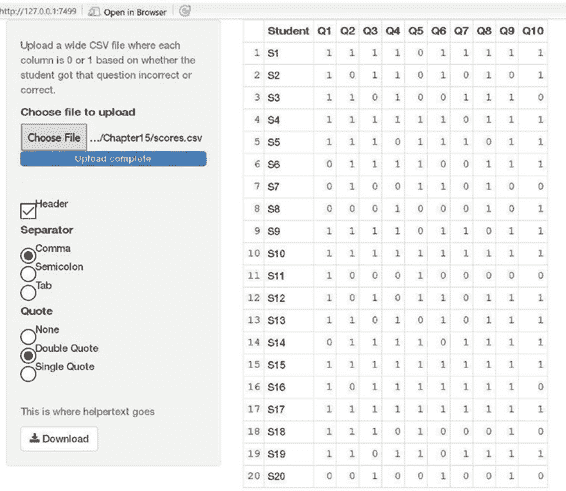
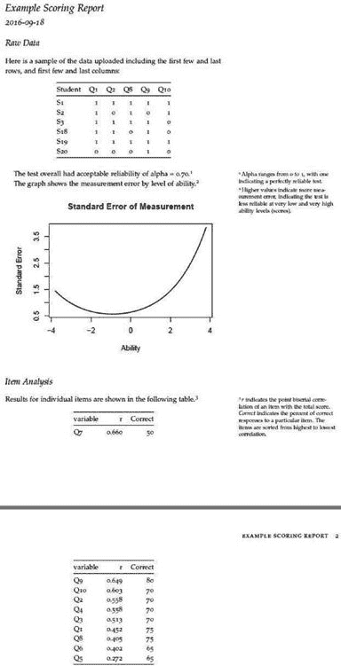

# 第 15 章 动态报告

在前面的章节中，你已经了解了 Shiny 如何基于动态数据提供交互式环境。动态报告与实时仪表盘有许多相似之处。另一方面，本章由于最终报告是 PDF 格式，因此交互性较弱。

在许多领域，报告是日常工作中不可或缺的一部分，利益相关者通常需要时间点的快照，而非完全交互式的环境。通过`knitr`和`rmarkdown`包，我们可以基于数据输入创建文档（例如 PDF、HTML 或 Microsoft Word）。对于基于持续变化的数据构建、但总体结构相同的定期报告，这能极大地节省时间。

`rmarkdown`包 [42] 增加了将 R 进程嵌入此类文档的能力，实现一键式分析，并使用多种样式进行精美排版。LaTeX 接口几乎可以实现任何所需的格式，当然除了 PDF 之外还有其他选项。无论是从学生信息系统数据库实时提取数据进行董事会的注册人数报告，还是根据关键绩效指标生成战略计划行动表，当可变输入需要被塑造成标准化输出时，动态报告效果最佳。`knitr` [38] 和`formatR` [39] 包也为此提供了便利。

此外，在本章中，我们还使用了`evaluate`包 [34] 和`tufte`包 [41]。这些包使我们能够更优雅地组织数据的布局和格式。我们还使用了`ltm`包 [19] 进行心理测量测试。

本章的目标是：增强我们在本地和云端机器上的软件环境，使动态文档能够编译；探索独立`rmarkdown`的结构；开发一个允许用户上传数据并下载 PDF 报告的 Shiny 页面；最后将所有内容推送至我们的云实例。我们从所需的软件开始：

```r
options(width = 70, digits = 2)
```

© Matt Wiley and Joshua F. Wiley 2020

M. Wiley and J. F. Wiley, *高级 R 4 数据编程与云端应用*，[`doi.org/10.1007/978-1-4842-5973-3_15`](https://doi.org/10.1007/978-1-4842-5973-3_15#DOI)

## 15.1 所需软件

我们已经拥有了大部分所需的软件，即 R、`Shiny`包 [6]、`PuTTY`以及基于 Ubuntu 的云实例。我们还需要安装一些新的包——无论是在本地机器上还是在云服务器上。

### 本地机器

首先，在你的 R 控制台中，独立于任何 R 文件运行以下代码很重要：

```r
install.packages("rmarkdown")
install.packages("tufte")
install.packages("knitr")
install.packages("evaluate")
install.packages("ltm")
install.packages("formatR")
library(knitr)
```

## LaTeX 产品

使用 R 生成 PDF 时，最好只让计算机上安装一个 LaTeX 引擎来完成工作。正如前一章所述，LaTeX 有很多选择，包括`tinytex`（来自 CRAN）和`MiKTeX` [21]。如果你已经安装了某个 LaTeX 产品，它应该能与 RStudio 配合使用（至少在 Windows 上如此，你可能需要确保你的 LaTeX 解决方案在全局或用户`environment PATH`中）。

如果你还没有这样的系统，`MiKTeX`是一个很好的选择，其默认设置和安装选项在大多数配置上通常“可以直接使用”。如果你确实遇到了无法生成 PDF 的情况，根据我们的经验，搜索输出的错误信息通常能找到一些可行的建议。

要安装`MiKTeX`来创建 PDF 文件，请访问`MiKTeX`网站（[`miktex.org/`](http://miktex.org/download)）获取推荐的基础安装程序（32 位）或其他基础安装程序（64 位）。我们在自己的系统上使用 64 位版本，尽管在本章中，不同版本之间可能不会有重大差异。下载后，在安装过程中接受所有默认设置。安装完成后，`MiKTeX`软件包可能会有更新。要执行这些更新，请进入你的开始菜单。

在名为`MiKTeX`的文件夹中，你会找到*MiKTeX 控制台*的选项。其中有一个名为*检查更新*的按钮，你应该点击并运行它。虽然可能不是必须的，但我们建议在此安装后重新启动电脑。

### 云实例

使用`PuTTY`，访问你的云实例控制台。我们需要在控制台中逐行运行以下代码。回想一下前一章的内容，这些代码是为该服务器的所有用户安装软件包，而不仅仅是你的用户。这是允许 Shiny 服务器访问正确软件包的关键：

```bash
sudo su - -c "R -e \"install.packages('knitr')\""
sudo su - -c "R -e \"install.packages('rmarkdown')\""
sudo su - -c "R -e \"install.packages('tufte')\""
sudo su - -c "R -e \"install.packages('ltm')\""
sudo su - -c "R -e \"install.packages('formatR')\""
sudo su - -c "R -e \"install.packages('data.table')\""
sudo su - -c "R -e \"install.packages('evaluate')\""
```

上述代码不会花很长时间。但是，安装`texlive`（Ubuntu 上用来替代`MiKTeX`的 LaTeX 解决方案）可能需要一些时间。它也需要相当大的磁盘空间，所以请确保你有足够的空间。在我们的试验中，需要安装完整版本。在云服务器上，就像在你的本地机器上一样，最好不要安装超过一个版本的 LaTeX。因此，如果你使用的云实例还用于其他用途，并且你已经安装了`tinytex`软件包，你可能需要试验一下是否可以不使用`texlive`：

```bash
sudo apt-get install texlive-full
sudo reboot
```

在此之后，我们建议执行`sudo reboot`来重启你的云实例。这是一个执行重启的好时机，然后暂时关闭`PuTTY`。在你的服务器重启期间，你可以使用本地机器来探索动态文档。

## 15.2 动态文档

动态文档不一定非要与互联网连接。实际上，大多数报告可能是内部使用的。在 RStudio 中，选择*文件*、*新建文件*、*R Markdown*会打开一个向导。注意，有用于文档（例如，HTML、PDF 或 Word）以及演示文稿（例如，HTML 或 PDF）的选项。通常需要填写标题和作者。当然，RStudio 并不是必需的；在 R 中创建一个后缀名为`.Rmd`的新文件就足够了。

我们打算采用一种混合方式来介绍动态文档。也就是说，我们首先给出一个直接且信息丰富的示例，展示这类代码的样子，然后对代码的每个部分进行更深入的分析。我们从一个名为`ch15_html.Rmd`的新文件开始，并用以下代码填充它：

```yaml
title: "ch15_html"
author: "Matt & Joshua Wiley"
date: "29 April 2020"
output: html_document
```

```r
#'{r echo=FALSE}
## 注意 'echo=FALSE'
## 这意味着下面的代码永远不会出现在我们编织生成的 html 中
library(data.table)
diris <- as.data.table(iris)
## 然而，代码仍然会被运行，因此我们仍然可以访问它。
```

# 这是一级标题；它不是注释。

这是普通的文本，不是代码。如果我们想要斜体或粗体，我们可以轻松地在这些文档中添加这些格式。当然，我们可能需要提到`rmarkdown`是所使用的软件包，而内联代码非常适合用于这种情况。如果需要数学公式，那么可能需要`x1² + x2² = 1`。

## 用二级标题调用数学公式

另一方面，我们可能需要明确地调用数学公式，在这种情况下，`$x^{2} + y^{2}= \pi$`是实现这一目标的方法。

### 我喜欢删除线；我对三级标题不太清楚。

我在写报告时经常发现，我想要说某事是~~绝对愚蠢的~~对关键利益相关者明显相关的。

###### 如果你曾经需要写六级标题

那么我相信，正如这个无序列表所建议的：

* 你需要从现在开始拥抱更少的秩序
- 你考虑过其他职业吗？

```r
#'{r echo=FALSE}
summary(diris)
```

然而，请注意，你可以同时包含代码和控制台输出：

```r
#'{r}
hist(diris$Sepal.Length)
```

编织上述代码的结果如图 15-1 所示。

正如你所想象的，这些汇总数据或图形可以根据任何输入轻松重新生成。事实上，其中一位作者使用动态文档为初级统计学课程的学生创建案例研究（以及案例研究答案）。使用不同种子的伪随机数据很容易生成，这使得每个学生都能拥有独特的数据集（以及几个主题）。这也允许快速创建用于快速评分的解答密钥。

现在你已经对`rmarkdown`有了一个概览，让我们按照合理的模块来探索之前的代码。第一个模块是 YAML，它代表*另一种标记语言*，或者可能是递归定义的*YAML 不是标记语言* [18] 头部。简单来说，它可能只包含标题、作者、日期和输出类型的信息。

在这里，对于本文档，我们选择了`html_document`。然而，如前所述，还有更多选项，例如`pdf_document`、`word_document`、`odt_document`、`rtf_document`和`beamer_presentation`（仅举几例——实际上还有更多）。这些类型分别创建 HTML 页面、PDF、Microsoft Word 文件、OpenDocument 或富文本以及 Beamer PDF 幻灯片。Beamer 和 PDF 都需要我们之前完成的 MiKTeX 安装。要更改编译后的文档类型，只需更改输出！

值得注意的是，第一次使用 MiKTeX 时，编译可能需要更长时间，因为后台可能需要安装一两个软件包。这不需要任何用户干预；只是需要时间。还值得注意的是，如果你使用 Beamer 演示文稿，则需要考虑一张幻灯片上能容纳什么和不能容纳什么。在这种情况下，一个回车符后跟`---`，再跟另一个回车符，表示你的幻灯片组中的新幻灯片。

**图 15-1.** 一个简单动态文档的 HTML 输出

标题（Headers）可能比这更复杂。R 代码可以采用`'r 代码在此'`的格式内联嵌入。因此，我们可以通过将代码中的日期 "2020 年 4 月 29 日" 替换为日期`'r Sys.Date()'`，使日期更具动态性。YAML 标题支持数十种渲染选项，比我们更高明的人已经创建了模板，这些模板不仅使用了上述标题的变体，还设置了一些不错的选项。与 Shiny 一样，它在精准控制文档输出和显示方式方面几乎有着无限的能力。

我们 Markdown 代码的下一个区域是一个代码块。代码块以`'{r }`开头，以`'`结束。在这两者之间就是你的代码。现在，在`{r }`内部有几个有用的选项。如果你的部分代码计算密集且基本保持不变，你可能希望将`cache`设置为`TRUE`而不是默认的`FALSE`。这会存储计算结果。在我们的工作中，我们经常使用`echo=FALSE`，这样可以防止代码本身显示，但不会阻止代码结果的显示。请注意，在后面的第一个代码块中，最终文档（图 15-1）里没有任何代码运行过的迹象——至少从向读者展示实际代码这一方面来说是如此。然而，第二个代码块仍然显示了`summary(diris)`的结果：

```
'{r echo=FALSE}

library(data.table)

diris <- as.data.table(iris)

'
```

```
'{r echo=FALSE}

summary(diris)

'
```

## 第 15 章 动态报告

对于涉及图表或图形的代码块，也有很多选项。`fig.align`选项可以设置为`right`、`center`或`left`。对于图表，还有使用`fig.height`或`fig.width`设置的高度和宽度设置，默认单位为英寸：

```
'{r fig.align="right"}

hist(diris$Sepal.Length)

'
```

最后，还有文本本身，我们在此不重复，因为其兴趣点不高。但我们注意到，代码不仅可以像在标题中一样内联编写，还可以像在标题中一样使用。

此选项在以后会变得非常有用，当我们想要根据计算结果提供不同的叙述性文本时。

### 15.3 动态文档与 Shiny

现在，我们将注意力转向不仅提供动态文档，而且提供一个其他人可以通过动态输入进行控制的文档。我们要构建的是一个简单的 Shiny 环境，允许用户上传一个包含学生测验分数数据的 CSV 文件。

数据编码如下：列代表测验中的具体问题；行代表每个学生；测验为多项选择，正确选项编码为 1，错误选项编码为 0。

与上一节类似，我们查看实现此功能所需的三个文件中每个文件的全部代码。然后，我们逐行分解这些代码。对于已经熟悉 Shiny 的读者，请随意跳到最后的章节。我们将这些代码构建在一个名为`15_DynamicReports`的文件夹中。之后，当我们将代码上传到 Ubuntu 服务器时，我们会上传整个文件夹。

## `server.R`

在 Shiny 服务器端，我们调用库，然后构建上传 CSV 文件所需的系统，为用户提供文件已上传的确认，将该文件读入 R，将所需信息传递给我们的标记文档，然后允许我们的用户将该文档下载为 PDF 格式。这只需要以下 55 行代码：
404

## 动态报告与云

```r
library(shiny)
library(ltm)
library(data.table)
library(rmarkdown)
library(tufte)
library(formatR)
library(knitr)
library(evaluate)

function(input, output) {
  output$contents <- renderTable({
    inFile <- input$file1
    if (is.null(inFile))
      return(NULL)
    read.csv(
      inFile$datapath,
      header = input$header,
      sep = input$sep,
      quote = input$quote
    )
  })

  scores <- reactive({
    inFile <- input$file1
    if (is.null(inFile))
      return(NULL)
    read.csv(
      inFile$datapath,
      header = input$header,
      sep = input$sep,
      quote = input$quote
    )
  })

  output$downloadReport <- downloadHandler(
    filename = function() {
      paste('测验报告', sep = '.', 'pdf')
    },
    content = function(file) {
```

`src <- normalizePath('report.Rmd')`

`owd <- setwd(tempdir())`

`on.exit(setwd(owd))`

`file.copy(src, 'report.Rmd', overwrite = TRUE)`

`knitr::opts_chunk$set(tidy = FALSE, cache.extra = packageVersion('tufte'))`

`options(htmltools.dir.version = FALSE)`

`out <- render('report.Rmd')`

`file.rename(out, file)`

前面的代码首先调用了所有我们所需的库，然后迅速进入了 `shiny` 的 `function(input, output) {}` 服务器端封装。之后，主要分为三个代码块。我们将逐一审视它们，首先从 `renderTable({})` 调用开始。这部分代码生成了用户界面端使用的输出，具体来说，它创建了一个表格。这是一个交互式函数，当用户在界面端上传文件时，`shiny` 会通知该函数其某个输入发生了变化，从而触发代码的运行。从输入端来看，`input$datapath` 是服务器上 `shiny` 存储上传文件的位置。如果确实有文件存在，`read.csv()` 可以访问该文件的数据路径，并获取数据是否包含表头、使用了何种分隔符以及用户设置的其他信息。实际上，还可以向用户询问更多信息，以实现更定制化的分析。这里，我们保持示例简洁而有效。读取的结果创建了一个表格，并将该表格存储到名为 `contents` 的输出变量中。这会产生一个效果，即 `shiny` 会通知用户界面端有可用的输出。我们将在本章后续部分看到该输出的去向：

```r
output$contents <- renderTable({
  inFile <- input$file1
  if (is.null(inFile))
    return(NULL)
  read.csv(inFile$datapath, header = input$header,
           sep = input$sep, quote = input$quote)
})
```

除了创建一个表格，以便用户能立即查看文件上传是否成功（我们设想在实际场景中，或许可以在用户界面添加注释，让用户发现上传失败的情况），我们还必须以某种格式读取数据，使我们的 markdown 文件能够使用这些数据。我们将数据读入一个名为 `scores` 的变量中。这是一个通用的、由我们创建的 `reactive({})` 函数，它会始终关注相关输入变量（此例中即文件的上传）的变化。

这是 `shiny` 高度可定制的原因之一。尽管你已经见过一些响应式函数，但它们都有特定的用途（并因此命名）。

而此函数则不同。它仅仅是响应式的，其全部行为完全由我们编写的代码决定：

```r
scores <- reactive({
  inFile <- input$file1
  if (is.null(inFile))
    return(NULL)
  read.csv(inFile$datapath, header = input$header,
           sep = input$sep, quote = input$quote)
})
```

服务器端的最后一部分是最复杂的。它控制着用户可下载的文件。该代码块的第一部分控制用户下载的报告名称。我们将其命名为 `quiz-report.pdf`，这看起来只是有些复杂。这段代码为未来可能调整报告的类型或性质提供了灵活性；修改文件类型或名称变得十分容易。请注意，如果使用 `RStudio` 的内部浏览器，下载的报告会使用不同的名称。接下来，我们在 markdown 文件上调用 `normalizePath()`，它会返回当前工作目录的文件路径，并在路径末尾追加参数中的文件名。具体来说，它根据代码所在的操作系统环境返回路径。这很重要，原因有二：首先，它使代码能够在 Windows 和 Ubuntu（或任何操作系统）之间移植。其次，我们即将更改当前工作目录。因此，直接调用 `report.Rmd` 将不再有效。

更改当前工作目录至关重要，因为我们即将生成一个新的 PDF 文件。

`file`。现在，在我们拥有并具有管理员权限的本地机器上，创建一个新文件完全没有问题。然而，我们的目标是上传到云端，而我们并不能保证所有服务器都有这样的权限。因此，我们将工作目录更改为服务器的临时目录。在 `R` 中，`setwd(tempdir())` 执行两个操作：它既复制并返回当前工作目录；然后，在此之后，它将目录更改为参数指定的目录。因此，`owd` 是旧的工作目录（*o*ld *w*orking *d*irectory）。我们设置了一个 `on.exit()` 参数，以便一旦 `downloadHandler` 完成，工作目录会返回到它应该所在的位置，从而确保我们的 `shiny` 网站不会出错。

现在，我们将 Markdown 文件从其原始位置（在旧的工作目录中）复制到我们的临时区域，从而允许它在临时目录中运行并生成 PDF。我们还为 `knitr`（它负责创建 Markdown PDF）设置了一些环境选项，使其能够使用 tufte 格式（以 Edward Tufte 命名，[`rmarkdown.rstudio.com/tufte_handout_format.html`](http://rmarkdown.rstudio.com/tufte_handout_format.html)）。剩下的就是 `render()` 我们的 Markdown 文档，并将文件重命名为我们想要的名字：

```r
output$downloadReport <- downloadHandler(
  filename = function() {
    paste('quiz-report', sep = '.', 'pdf')
  },
  content = function(file) {
    src <- normalizePath('report.Rmd')
    owd <- setwd(tempdir())
    on.exit(setwd(owd))
    file.copy(src, 'report.Rmd', overwrite = TRUE)

    knitr::opts_chunk$set(tidy = FALSE, cache.extra =
      packageVersion('tufte'))
    options(htmltools.dir.version = FALSE)
    out <- render('report.Rmd')
    file.rename(out, file)
  }
)
```

我们所看到的是，`shiny` 服务器端需要能够读取用户上传的文件，并附带适当的输入信息（例如是否存在标题行），然后负责启动 R Markdown 处理过程。诚然，要让这个过程（以及一个 `shiny` 服务器）在任何计算机上都能工作，需要更改工作目录，并对布局和格式选项进行一些调整。我们以指出一个简单的 PDF 会更容易设置（尽管我们承认我们更喜欢更简洁的 tufte 布局）来结束本节。现在，我们将注意力转向用户界面。

### `ui.R`

对于这个非常简单的 `shiny` 应用程序，用户拥有一个相当清晰的视图。仅用 40 行代码（实际上您可以删除几个选项），用户就可以上传 CSV 文件、查看该文件渲染出的表格，并下载对该文件的分析结果。和之前一样，我们首先给出完整的代码，然后依次描述每个代码块：

```r
# Dynamic Reports and the Cloud User Interface

shinyUI(fluidPage(title = 'Score Control Panel',
  sidebarLayout(
    sidebarPanel(
      helpText(
        "Upload a wide CSV file where
        each column is 0 or 1 based on whether the student
        got that question incorrect or correct."
      ),
      fileInput(
        'file1',
        'Choose file to upload',
        accept = c(
          'text/csv',
          'text/comma-separated-values',
          'text/tab-separated-values',
          'text/plain',
          '.csv',
          '.tsv'
        )
      ),
      tags$hr(),
      checkboxInput('header', 'Header', TRUE),
      radioButtons('sep', 'Separator',
        c(
          Comma = ',',
          Semicolon = ';',
          Tab = '\t'
        ),
        ','),
      radioButtons(
        'quote',
        'Quote',
        c(
          None = "",
          'Double Quote' = '"',
          'Single Quote' = "'"
        ),
        '"'
      ),
      tags$hr(),
      helpText("This is where helpertext goes"),
      downloadButton('downloadReport')
    ),
    mainPanel(tableOutput('contents'))
  ))
)
```

和用户界面通常的情况一样，我们使用了 `fluidPage()`，以及 `sidebarPanel()` 和 `mainPanel()`。主要事件发生在侧边栏内，我们先来看那里。

`fileInput()` 函数接收用户的输入文件。我们可以控制接受的文件类型，并将自己限制为逗号分隔值或制表符分隔值。我们将上传文件命名为 `file1`，回想在服务器端，我们使用 `input$file1` 来读取文件：

```r
fileInput('file1', 'Choose file to upload',
  accept = c(
    'text/csv',
    'text/comma-separated-values',
    'text/tab-separated-values',
    'text/plain',
    '.csv',
    '.tsv'
  )
),
```

另一个我们主要感兴趣的代码行是下载区域。理解起来并不特别复杂：

```r
downloadButton('downloadReport')
```

虽然有一些帮助文本块向用户解释，并且我们确实建议在实际使用中设置示例布局，以便您的用户理解可接受的输入，但我们选择了尽可能精简这个用户界面。在我们将注意力转向实际的报告文件之前，我们将在图 15-2 中展示上传了我们的 `scores.csv` 文件（该文件可在 `Apress` 网站和/或本书的 GitHub 上找到）后的 `shiny` 应用程序。



**Figure 15-2.** `shiny` user interface, live on a locally hosted website

### `report.Rmd`

这份报告是关于一次测验或其他测试中每个问题的学生得分。我们的目标是获取图 15-2 中显示的输入，并将其转换为关于问题和测试有效性的可操作的、概括性的信息。在阅读完所有代码的首次展示之前，花点时间将这段代码与一个独立的 Markdown 文件进行比较和对照。没有重大差异。事实上，要知道这个文件是从 `shiny` 应用程序渲染的，唯一方法就是这一行代码：

`scores <- scores()`。

```
---
title: "Example Scoring Report"
subtitle: "Item-Level Analysis"
date: "`r Sys.Date()`"
output:
  tufte::tufte_handout: default
---

# Raw Data

Here is a sample of the data uploaded including the first few and last
rows, and first few and last columns:

```{r echo=FALSE, include = FALSE}
scores <- scores()
scores <- as.data.table(scores)
setnames(scores, 1, "Student")
```

```{r, echo = FALSE, results = 'asis'}
if (nrow(scores) > 6) {
  row.index <- c(1:3, (nrow(scores)-2):nrow(scores))
}
if (ncol(scores) > 6) {
  col.index <- c(1:3, (ncol(scores)-2):ncol(scores))
}
kable(scores[row.index, col.index, with = FALSE])
```

```{r, include = FALSE}
items <- names(scores)[-1]
scores[, SUM := rowSums(scores[, items, with = FALSE])]

## now calculate biserial correlations

## first melt data to be long
scores.long <- melt(scores, id.vars = c("Student", "SUM"))

## calculate biserial correlation, by item

## order from high to low
biserial.results <- scores.long[, .(
  r = round(biserial.cor(SUM, value, level = 2), 3),
  Correct = round(mean(value) * 100, 1)
), by = variable][order(r, decreasing = TRUE)]

alpha.results <- cronbach.alpha(scores[, !c("Student", "SUM"), with=FALSE])
rasch.results <- rasch(scores[,!c("Student", "SUM"), with=FALSE])
```

The test overall had `r ifelse(alpha.results$alpha > .6, "acceptable reliability", "low reliability")` of
alpha = `r format(alpha.results$alpha, FALSE, 2, 2)`.^[Alpha ranges from 0 to 1, with one indicating a perfectly reliable test.]

The graph shows the measurement error by level of
ability.^[Higher values indicate more measurement error,
indicating the test is less reliable at very low and very high ability
levels (scores).]

```{r, echo = FALSE, fig.width = 5, fig.height = 4}
```

## The Standard Error of Measurement can be plotted by

```r
vals <- plot(rasch.results, type = "IIC", items = 0, plot = FALSE)
plot(vals[, "z"], 1 / sqrt(vals[, "info"]), type = "l", lwd = 2,
  xlab = "Ability", ylab = "Standard Error",
  main = "Standard Error of Measurement")
```

# 项目分析

各项目的结果如下表所示。`r` 表示项目与总分的点二列相关。`Correct` 表示某个项目的正确回答百分比。项目按相关度从高到低排序。

## 第 15 章 动态报告

```{r, echo = FALSE, results = 'asis'}
kable(biserial.results)
```

我们现在逐块解析这个 Markdown 文件的每一部分。这个标题比第一个稍微高级一些。请注意，我们使用内联 R 代码将日期设置为当前日期。此外，我们的输出不再仅仅是 `pdf_document`。相反，我们使用了默认的 `tufte_handout` 样式（这是一种带有样式信息的 PDF 格式）。我们通过其包来正式调用该样式（回想一下，`library(tufte)` 存在于服务端）：

- **title**: "示例评分报告"
- **subtitle**: "项目层面分析"
- **date**: `r Sys.Date()`
- **output**:
  - `tufte::tufte_handout`: default

接下来是将我们的评分数据读入 Markdown 文件。我们已熟悉 `echo=FALSE`，它用于阻止代码显示。然而，我们还设置了 `include=FALSE`，它用于阻止代码的任何输出显示。如前所述，我们使用来自 Shiny 服务端的变量 `scores()`，这是在服务端通过 `read.csv()` 读取评分数据的地方。

回想一下，在 Shiny 服务端，我们只是将变量命名为 `scores`。但在 rmarkdown 文件中，我们将其作为函数来调用（毕竟它会动态更新）。为了避免一直将变量作为函数调用，我们在此处使用一个同名的本地环境变量 `scores` 来重新命名它。这看起来有点奇怪，但完全与作用域和环境有关：

```{r echo=FALSE, include = FALSE}
scores <- scores()
scores <- as.data.table(scores)
setnames(scores, 1, "Student")
```

我们的下一个代码块包含了 `results='asis'`，以防止对我们的 kable 表格进行进一步处理。此外，这段代码将输出前 3 行和最后 2 行的部分行列数据，形成一个小示例的 kable 表格。只有当行数或列数超过 6 行或列时，才会执行此操作。

## 第 15 章 动态报告

虽然随意展示用户数据的 `head()` 和 `tail()` 看起来有些随机，但主要的观察点是，逻辑判断可以存在于 rmarkdown 文档内部。对于某些报告，我们甚至可以根据结果是否达到显著性水平（或任何其他标准）来扩展解释性文本：

```{r, echo = FALSE, results = 'asis'}
if (nrow(scores) > 6) {
  row.index <- c(1:3, (nrow(scores)-2):nrow(scores))
}
if (ncol(scores) > 6) {
  col.index <- c(1:3, (ncol(scores)-2):ncol(scores))
}
kable(scores[row.index, col.index, with = FALSE])
```

从这里开始，我们使用 `ltm` 包计算测试或问题的多个信度指标。点二列相关使用了更常见的皮尔逊相关，并根据测验问题为二元数据这一事实进行了调整。它能够比较学生在特定问题上的表现与他们在整个测验中的表现（因此我们将其与 `rowSums()` 进行比较）。通过将这些数据从高到低排序，我们可以找出得分最低的测验问题。这些问题可能没有衡量出我们测验的主旨（诚然，这是一个非常简化的说法——心理测量学是一门远超本文范围的科学）。此外，我们还计算了克隆巴赫 α 系数和 Rasch 模型，供后续使用。同样，我们目前并不打算将这些结果直接包含在动态文档中。但是，我们可以在需要时访问它们，以备后用：

```{r, include = FALSE}
items <- names(scores)[-1]
scores[, SUM := rowSums(scores[, items, with = FALSE])]

## 现在计算双列相关

## 首先将数据融为长格式
scores.long <- melt(scores, id.vars = c("Student", "SUM"))

## 按项目计算双列相关

## 从高到低排序
biserial.results <- scores.long[, .(
  r = round(biserial.cor(SUM, value, level = 2), 3),
  Correct = round(mean(value) * 100, 1)
), by = variable][order(r, decreasing = TRUE)]
alpha.results <- cronbach.alpha(scores[, !c("Student", "SUM"), with=FALSE])
rasch.results <- rasch(scores[,!c("Student", "SUM"), with=FALSE])
```

并非所有代码都必须放在正式的代码块中；代码也可以内联于文档的文本中。这很有用，因为我们可以设定分数线（本例中半随意地设为 0.6），并根据这些分数在最终报告中生成不同的文本。`tufte` 包允许通过 `^[]` 指定侧边栏注释：本次测验整体的 α 系数 = `r format(alpha.results$alpha, FALSE, 2, 2)`，表现为 `r ifelse(alpha.results$alpha > .6, "可接受的信度", "低信度")`。[α 系数取值范围为 0 到 1，1 表示测验完全可靠。]

该图显示了按能力水平划分的测量误差。[数值越高表示测量误差越大，说明测验在能力水平极低和极高（分数）时信度较低。]

回想一下我们之前的讨论，图形大小可以在代码块中控制。在此，我们绘制了 Rasch 模型，并看到高绩效和低绩效学生的测量精度较低：

```{r, echo = FALSE, fig.width = 5, fig.height = 4}
```

## 测量标准误可通过以下方式绘制

```r
vals <- plot(rasch.results, type = "IIC", items = 0, plot = FALSE)
plot(vals[, "z"], 1 / sqrt(vals[, "info"]), type = "l", lwd = 2, xlab = "能力值", ylab = "标准误", main = "测量标准误")
```

代码最后以一行 `kable` 结尾，但我们已经见过这个用法，无需赘述。图 15-3 展示的是下载后的最终结果。

# 第 15 章 动态报告

请注意，所有被隐藏的代码都不会显示。同时，注意数据的样本量，因为从图 15-2 可知，数据行数或列数远不止六行。最后，请注意自动编号的侧边注释，它们提供了更多细节。这些注释是通过在文档文本区域内使用 `^[]` 代码生成的。这种写法能非常方便地提供更详细、但非必需的信息。

## 15.4 上传至云端

最后一项任务是将文件从本地机器上传至云端实例。请记住，在前面的章节中，我们不仅使用 `PuTTY` 在云端安装了 Shiny Server，还使用 `WinSCP` 将文件上传至云端。我们启动 `WinSCP`，重新连接，并确保左侧本地路径位于 Shiny 应用程序文件夹，右侧云端服务器路径位于 `/home/ubuntu`。图 14-5 回顾了这一操作的结果。

接着，我们访问 `PuTTY`，并在命令行中运行以下代码：

```bash
sudo cp -R ~/15_DynamicReports /srv/shiny-server/
```

请记住，在前面的章节中，我们调整了实例配置，允许从特定地址访问特定端口。现在，你可以通过在浏览器中输入以下 URL 来验证应用程序是否正常工作：

`http://你的.实例.IP.地址:3838/15_DynamicReports/`

## 15.5 总结

在最后一章中，我们构建了一个动态文档，它可以根据新数据快速更新。这种更新甚至可以扩展到图形和行内 `if`/`else` 语句，从而使报告叙述本身也能根据新数据变化。此外，我们还构建了一个 Shiny 应用程序，允许有互联网连接的用户上传文件，为这类报告提供新数据。此类报告可以下载为多种格式，不过我们选择了 PDF。本节使用的关键函数列于表 15-1。

在全书内容中，我们提供了高级数据管理技术，包括如何连接各种数据库。这些技术与动态文档以及将数据仓库中的信息轻松转化为可执行情报的能力相得益彰。我们最后的观点是：随着数据日益庞大，成功筛选并呈现有用数据的能力，将成为任何领域中愈发重要的技能。

祝你编码愉快！



**第 15 章 动态报告**

***图 15-3.** 下载后的 PDF 文件*

**第 15 章 动态报告**

***表 15-1.** 本章描述的关键函数及其功能摘要*

| 操作 | 功能说明 |
|-----------|--------------|
| `#` | 在 Markdown 文档中表示一级标题。 |
| `##` | 在 Markdown 文档中表示二级标题。 |
| `###` | 在 Markdown 文档中表示三级标题。 |
| `####` | 在 Markdown 文档中表示四级标题。 |
| `#####` | 在 Markdown 文档中表示五级标题。 |
| `######` | 在 Markdown 文档中表示六级标题。 |
| `*word*` | 在 Markdown 文档中表示斜体文字。 |
| `**word**` | 在 Markdown 文档中表示粗体文字。 |
| `$公式区域$` | 在 Markdown 文档中表示数学格式。 |
| `~~删除线~~` | 在 Markdown 文档中表示删除线文字。 |
| ```{r} | 在 Markdown 文档中开始一段 R 代码块。 |
| ``` | 结束一段 R 代码块。 |
| ````{r echo=FALSE}` | 开始一段 R 代码块，且不打印代码本身，仅显示结果（例如图表）。 |
| `'r 行内代码'` | 用于在 Markdown 文档的文本区域中插入行内 R 代码。 |
| `output: xyz_document` | 在 YAML 头部设置，决定输出文档类型（如 PDF、Word、HTML 等）。 |
| `renderTable({})` | `reactive`，服务器端，`shiny` 命令，用于生成表格。 |

```r
reactive({})
```

- `reactive`，服务器端，`shiny` 命令，可完全自定义。

```r
downloadHandler()
```

可用于创建可从 `shiny` 服务器下载的输出内容。

- `downloadButton()`

用户界面端的 `shiny` 下载按钮生成器。

## 参考书目

[1] *综合 R 档案网络（CRAN）*。访问日期：2020 年 2 月 15 日。
[2] *德克萨斯州卫生服务部*。访问日期：2020 年 2 月 16 日。
[3] 亚马逊网络服务公司。亚马逊网络服务。2016 年 11 月。
[4] 安阿伯，密歇根州：政治与社会研究大学间联盟。*2003 年全国儿童健康调查*。2007 年 5 月。美国卫生与公众服务部。疾病控制与预防中心。国家卫生统计中心。
[5] Winston Chang 和 Barbara Borges Ribeiro。*shinydashboard：使用“Shiny”创建仪表板*，2018 年。R 包版本 0.7.1。
[6] Winston Chang，Joe Cheng，JJ Allaire，Yihui Xie 和 Jonathan McPherson。*shiny：R 的 Web 应用程序框架*，2020 年。R 包版本 1.4.0.2。
[7] Joe Conway，Dirk Eddelbuettel，Tomoaki Nishiyama，Sameer Kumar Prayaga 和 Neil Tiffin。*RPostgreSQL：R 与“PostgreSQL”数据库系统的接口*，2017 年。R 包版本 0.6-2。
[8] Gábor Csárdi。*keyring：从 R 访问系统凭据存储*，2018 年。R 包版本 1.1.0。
[9] Matt Dowle 和 Arun Srinivasan。*data.table：“data.frame”的扩展*，2019 年。R 包版本 1.12.8。
[10] Frank E. Harrell, Jr.，在 Charles Dupont 等多人的贡献下完成。*Hmisc：Harrell 杂项*，2020 年。R 包版本 4.4-0。
[11] Jim Hester。*covr：包的测试覆盖率*，2020 年。R 包版本 3.5.0。
[12] Kirill Müller 和 Hadley Wickham。*tibble：简单数据框*，2020 年。R 包版本 3.0.1。
[13] Jeroen Ooms。*writexl：将数据框导出为 Excel“xlsx”格式*，2019 年。R 包版本 1.2。
[14] Martin Prikryl。WinSCP 5.17 下载。2020 年 4 月。
[15] R 核心团队。*foreign：读取由“Minitab”、“S”、“SAS”、“SPSS”、“Stata”、“Systat”、“Weka”、“dBase”等存储的数据*，2020 年。R 包版本 0.8-78。

© Matt Wiley 和 Joshua F. Wiley 2020

M. Wiley 和 J. F. Wiley，*高级 R4 数据编程与云端应用*，[`doi.org/10.1007/978-1-4842-5973-3`](https://doi.org/10.1007/978-1-4842-5973-3#DOI)

## 参考书目

[16] R 核心团队。`R：统计计算的语言与环境`。奥地利维也纳，R 统计计算基金会，2020 年。

[17] 数据库 R 特别兴趣小组（R-SIG-DB），Hadley Wickham 和 Kirill Müller。`DBI：R 数据库接口`，2019 年。R 包版本 1.1.0。

[18] Ingy döt N ren Ben-Kiki，Clark Evans。`formatR：自动格式化 R 代码`，2009 年。YAML 1.2。

[19] Dimitris Rizopoulos。`ltm`：用于潜在变量建模与项目反应理论分析的 R 包。`统计软件杂志`，17(5)：1–25，2006 年。

[20] RStudio 团队。`RStudio：R 的集成开发环境`。RStudio 公司，马萨诸塞州波士顿，2019 年。

[21] Christian Schenk。`MiKTeX 手册`，2020 年。版本 2.9.7350。

[22] Simon Tatham，Owen Dunn，Ben Harris 和 Jacob Nevins。`PuTTY`：最新版本（0.73）。2020 年 4 月。

[23] M.P.J. van der Loo。用于近似字符串匹配的 `stringdist` 包。`R 期刊`，6：111–122，2014 年。

[24] Hadley Wickham。`testthat`：从测试开始。`R 期刊`，3：5–10，2011 年。

[25] Hadley Wickham。`ggplot2：数据分析的优雅图形`。Springer-Verlag 纽约，2016 年。

[26] Hadley Wickham，Mara Averick，Jennifer Bryan，Winston Chang，Lucy D’Agostino McGowan，Romain François，Garrett Grolemund，Alex Hayes，Lionel Henry，Jim Hester，Max Kuhn，Thomas Lin Pedersen，Evan Miller，Stephan Milton Bache，Kirill Müller，Jeroen Ooms，David Robinson，Dana Paige Seidel，Vitalie Spinu，Kohske Takahashi，Davis Vaughan，Claus Wilke，Kara Woo 和 Hiroaki Yutani。欢迎来到 `tidyverse`。`开放源码软件期刊`，4(43)：1686，2019 年。

[27] Hadley Wickham 和 Jennifer Bryan。`readxl: 读取 Excel 文件`，2019 年。R 包版本 1.3.1。

[28] Hadley Wickham、Peter Danenberg、Gábor Csárdi 和 Manuel Eugster。`roxygen2: R 的内联文档`，2020 年。R 包版本 7.1.0。

[29] Hadley Wickham、Romain François、Lionel Henry 和 Kirill Müller。`dplyr: 数据操作语法`，2020 年。R 包版本 0.8.5。

[30] Hadley Wickham 和 Lionel Henry。`tidyr: 整理杂乱数据`，2020 年。R 包版本 1.0.2。

[31] Hadley Wickham 和 Jay Hesselberth。`pkgdown: 为包生成静态 HTML 文档`，2020 年。R 包版本 1.5.1。


# 索引

## A

`args()` 函数，66

算术运算符，23

`adduser` 命令，345

`arrange()` 函数，253

`AdvancedRPkg` 仓库，131， 133

`as.data.frame(cov)`，149

`getwd()` 函数，139

`assignInNamespace()` 函数，89， 90

GitHub 桌面客户端，136

赋值运算符，8

GitHub 页面，133， 135

## 自动化

`plot_functions.R` 和 `textplot.R`，143

`apply` 系列函数，62–65

`setwd()` 函数，139

流程控制，53–55

`test-textplot.R`，146

循环 ( *参见* 循环)

`textplot.R` 文件，157

`use_data()` 函数，155

AdvancedR 安全组，315

## B

高级 R 技术栈，2

基础运算符，8–18

`all.equal()` 函数，219

`body()` 函数，66

亚马逊云服务 (AWS)

`boxplot()`，53

账户，创建，311

# 索引

- `括号运算符`，9，16
- `添加用户`，313
- `brows()`函数，82
- 免责声明，310
- `build()`函数，162
- EC2，310
- `groups`选项，312
- IAM 组策略选择，311，313

## C

- 管理控制台，312
- `cat()`函数，115，121
- 在组内创建用户，313
- 字符串，195
- `anti_join()`，277
- `check()`函数，162，168
- `any()`和`all()`函数，21
- `chmod`命令，331
- `anyDuplicated()`函数，187
- `class()`函数，94，183
- `any_of()`辅助函数，265
- 类
  - `apply()`函数，60
  - S3 系统，101–108
  - `*apply`函数，55，57–59，183，199
  - S4 系统，117–123
  - `apropos()`函数，146
  - 类继承，118–120
- © Matt Wiley and Joshua F. Wiley 2020
  - M. Wiley and J. F. Wiley，*高级 R 4 数据编程与云计算*，
  - [`doi.org/10.1007/978-1-4842-5973-3`](https://doi.org/10.1007/978-1-4842-5973-3#DOI)

## 无类别域间

- 数据库理念，286，287
- 路由（CIDR），316
- 数据计算，268–273
- 云实例，399
- `data.frame`，94，98，100
- 访问，命令行，318，320–323
- 数据框，6，15，33
- AWS（参见 Amazon Web Services）
- 数据管理包，182，221
- 文件上传，322，324
- 选择与子集化，256–266
- 适用于 Windows 用户的云端 Ubuntu
  - 排序，253–256
  - 命令，328–332
  - 变量重命名与排序，266，267
  - 安装
- Java，347
- 数据处理/清洗
  - PostgreSQL，350–353
  - 数据重编码，224–233
  - RStudio Server，341–346
  - 数值重编码，233–235
  - shiny，347–349
  - `str()`函数，222
  - 使用 R，341–347
- 数据表对象，7
  - 超级用户与安全性，332–335
- `data.table`包，36，38
- 代码注释，3
  - `anyDuplicated()`函数，187
- 代码流程控制，53–55
  - 优势，182
- `colnames()`函数，266
  - `diris`，184，186

## 命令

- 云实例，325
- `duplicated()`，187
- 模糊匹配，241–248

# 索引

## A

- `Cloud Ubuntu`, 328–332, 354, 355
- `haskey()`, 184
- `逗号分隔值（CSV）文件`
- `head()` 和 `tail()`, 182
- 38, 281
- `iris` 数据集, 182, 186
- `复数`, 3
- `键`, 183–185, 188
- `组件`, 函数, 66, 67
- `合并数据`, 205–214
- `cor()` 函数, 271
- `多个变量`, 186
- `cor.test()` 函数, 61
- `内存位置`, 181
- `covr` 包, 129, 148
- `重塑数据`, 214–219
- `create()`, 138, 142, 145
- `sapply()` 命令, 183
- `选择与子集数据`

## D

- `第一形式`, 188–192
- `第二形式`, 192, 193
- `dailymetrics` 表, 294
- `第三形式`, 194–197
- `dashboardBody()` 函数, 379, 384–389
- `setkey()`, 184
- `dashboardHeader()` 函数, 379, 380
- `setosa、versicolor 与 virginica`, 183
- `dashboardPage()`, 379
- `unique()` 函数, 188
- `dashboardSidebar()` 函数, 379, 381–383
- `变量重命名与排序`, 197–199
- `变量创建`, 199–205, 236–240
- `数据表`, 15
- `函数`, 152–154
- `数据类型`, 5
- `方法`, 158–160
- `数据类型检查函数`, 12
- `S4 类 textplot`, 161
- `dbDisconnect()`, 285, 297
- `downloadHandler`, 408
- `dbGetInfo()`, 284
- `dplyr`, 251
- `dbGetQuery()`, 290, 294, 295, 302, 307
- `droplevels()`, 229
- `dbListTables()`, 289
- `动态文档`
- `dbReadTable()`, 301
- `云上传`, 418
- `dbRemoveTable()`, 292, 305
- `fig.align` 选项, 404
- `dbUnloadDriver()`, 285
- `HTML 输出`, 402
- `dbWriteTable()`, 288, 302
- `混合方法`, 400, 401
- `dcast()` 命令, 217, 219
- `PDF 下载`, 419
- `debug()` 函数, 80, 81
- `rmarkdown`, 401
- `调试`
- `r Sys.Date()`, 403
- `assignInNamespace()` 函数, 89
- `Shiny` (*参见* Shiny 环境)
- `browser()` 函数, 82
- `Hmisc` 函数, 89

## E

- `Hmisc` 包, 84
- `meanPlot()`, 80, 82
- 弹性计算云（`EC2`）实例, 310
- 截图, 81
- `AdvancedR` 安全组, 315
- `tapply()`, 79
- 创建密钥对, 315
- `traceback()`, 83
- 仪表板视图, 319
- `wtd.quantile()`, 84, 90
- 入站规则选项卡, 315
- `wtd.table()` 函数, 85, 87, 89, 90
- 密钥对链接, 315
- 人口统计表, 286, 294
- 密钥对设置, 318
- `@describeIn` 参数, 159
- 启动 `EC2` 实例, 317
- `devtools` 函数, 148
- 启动 `VPC` 向导, 315
- `devtools` 包, 129, 148, 153
- 安全组的入站规则, 316
- 数字安全, 299
- Ubuntu 服务器选择, 317
- `dir.create()`, 35
- `environment()` 函数, 67, 68
- `dir.exists()`, 35
- `evaluate` 包, 397
- `diris` 数据表, 188
- `expand.grid()` 函数, 108, 110
- 数据集 `diris.long`, 216
- `expect_*()` 函数, 146
- `document()` 函数, 153, 156, 157, 160
- `expect_equal()`, 147
- 文档, `roxygen2`
- `expect_error()`, 147
- 类, 157, 158
- `expect_is()`, 147
- 数据, 155, 156
- `expect_warning()`, 147

## F

- `ggplot2` 包, 93, 158
- `ggplot.lm()` 方法, 110, 111, 168
- `factor()`, 107, 216
- `GitHub`, 2, 132
- `Factors` 对象, 4
- `GitHub` 桌面客户端, 150, 151
- `file.access()`, 32
- `GitHub` 仓库, 151
- `file.copy()`, 35
- `.gitignore` 文件, 133
- `file.create()`, 34
- `Git` 仓库, 132, 134
- `file.exists()`, 31
- `globalVariables()`, 168
- `fileInput()` 函数, 372, 411
- `gradstudentu`, 296
- 文件位置, 40
- 图形界面, 132
- `file.remove()`, 34
- `grep()` 函数, 224
- `filter()` 函数, 258
- `grepl()` 函数, 224
- `fluidPage()`, 411
- `groupedtextplot` 类, 118, 120, 122, 124

# 索引

## F
- `For` 循环，46，47，52
- `gsub()` 函数，231
- `formals()`，66
- 形式变量，69
- `fortify()` 函数，[108

## H
- `fread()`，36–38
- `head()` 函数，121，263，416
- 自由变量，69
- `help()`，28，30
- 函数，8–18，25，26
- 辅助函数，262
- 大数据，308
- `Hmisc` 函数，89
- 类别与方法，126
- 云 Ubuntu，354，355
- 数据输入与输出，42，43

## I, J
- `data.table` 包，220
- 身份与访问
- 调试，91，92
- 管理（IAM），311
- 动态报告，420
- `if` 和 `else if` 语句，122
- 编程自动化，63，64
- `img()` 函数，[382
- R 包，180
- `inherits()` 函数，17，100
- Shiny，375，376
- `inner_join()` 函数，277
- 模糊匹配，241–248
- 输入，36–40
- `install.packages()`，[27，339

## G
- 整数，3
- `invisible()` 函数，75
- `geom_line()`，[109
- 鸢尾花数据集，186
- `getwd()` 函数，[31，139
- `is.datatype()` 函数，16
- `ggplot()` 方法，108，109，168
- `is.na()` 函数，[16
- 索引

## K
- Markdown 标记语言，176
- `match.arg()` 函数，[71，72
- `key_get()` 函数，300
- `match.call()`，73，74
- `key_list()` 函数，[300
- 数学运算符与
- `key_set_with_value`，299
- 函数，18–25
- 矩阵运算，23

## L
- `meanPlot()` 函数，143，152，168
- `lapply`，[55
- `melt()` 方法，216
- LaTeX 产品，398
- `menuItem()` 函数，381
- `library()` 函数，27，28
- `merge()`，208
- `list.files()` 函数，138
- 合并数据，205–214
- 列表，14
- `message()`，77
- `lm()` 函数，181
- `methods()` 函数，104，120
- `load_all()` 函数，[144，145，148
- 方法
- 本地机器，398，399
- S3 系统，111–121
- 本地仓库，151
- S4 系统，124–129
- 局部变量，69
- MiKTeX，131，398，401
- 逻辑对象，3
- `missing()` 函数，73
- 逻辑测试，19，20
- 修改时间变量，34

## 循环
- `mtcars` 数据集，46
- `for()`，46
- `mutate()` 函数，268
- `hp` 值，46
- `length()`，47

## N
- `repeat()`，52
- 命名空间文件，153，159
- `seq()`，47
- `next()`，54，55
- `while()`，49，51
- `normalizePath()`，407
- `xCube` 属性，48
- `xCube` 变量，48
- `ls()` 函数，144
- `ltm` 包，397，416

## O
- `.` 运算符，15

## M
- 对象，类型，2–8
- `on.exit()` 函数，76
- `mainPanel()`，411
- 开源 Git，132
- 主版本.次版本.修订号.开发版本号，
- `:::` 运算符，106，142
- `options()` 函数，182
- `mapply()` 函数，61
- 输出，41
- 索引

## P, Q
- `read.csv()`，406，415
- `read_dta()`，38
- `package_coverage()` 函数，149
- `read.dta()`，222
- 包，27，28
- README 文件，176
- `par()` 函数，102
- README.md 文件，176
- `parent.env()` 函数，68
- `read.spss()` 函数，39
- `passingLetterGrades`，10
- 重新编码数据，224–233
- 密码安全，299–301
- 重新编码数值，233–235
- `paste()`，116
- 回收站，34
- `Petal.Length`，268
- `Reduce()` 函数，239
- `Petal.Width`，268
- 正则表达式，224，225，227，228
- `pivot_wider()`，279
- 关系型数据库，286
- `pkgdown` 包，129
- `rename()` 函数，266
- `plot()` 函数，53，59，67，68，102，103
- `renderPlot()`，360，364
- `plot_functions.R`，143，150，152
- `repeat()` 函数，55
- `plot.table()`，105
- `report.Rmd`，412–418
- `plot.textplot()`，102，103
- 重塑数据，214–219
- PostgreSQL
- `return()`函数，74
- 添加数据，287–289
- `REVOKE`语句，297
- Cloud Ubuntu，350–353
- `R help`函数，30
- 数据可靠性，282
- `right_join()`，276
- 安装，282, 283
- `rm()`函数，48
- 与 R 交互，283–285
- `rmarkdown`文件，415
- `print()`函数，46, 99
- `rmarkdown`包，397, 401
- `proc.time()`，47
- `.Rmd`后缀，400
- 伪随机数据，401
- `rnorm()`，50
- PuTTY
- `rowMeans()`函数，238, 239
- 命令行，322
- `rowSums()`，239
- 配置，320
- `roxygen2`风格的文档，158
- 连接到实例，319
- `roxygen2`包
- `ppk`版本，315
- 文档，129, 152
- 安全警报，服务器指纹，320, 321
- 类，157, 158
- 数据，155, 156
- 函数，152–154
- `R`
- 方法，158–160
- `R`包`keyring`，299
- `NAMESPACE`文件，152
- `R`包，1
- `sampleData`数据集，156
- `.Rbuildignore`文件，160, 162
- `roxygenize()`函数，153

# 索引

## R 包

- `setwd()`函数，139
- 添加 R 代码，143–145
- `setwd(tempdir())`，408
- 构建，162–168, 177–181

## Shiny

- `check()`函数，168, 169
- `app.R`文件，359
- `devtools`包，137–143
- 极简应用，361
- 目录结构，140
- Cloud Ubuntu，安装，347–349
- 文件，137, 138
- `fileInput()`，370
- 安装，162–168, 176
- `fluidPage()`函数，361, 362
- 子目录，141
- 函数，361
- 测试，145–151
- 托管，云端，374
- 网站，177–179
- HTML 代码，365, 366
- `library(shiny)`，360
- `mainPanel()`区域，358, 363, 365
- `S`
- 动态效果，367–369
- `piePlot`，364

## S3 系统

- `plotOutput()`，370
- 类，101–108
- `plotOutput("piePlot")`，365
- 方法，111–121
- R 包装器，364

## S4 系统

- `reactive()`，370

# 索引

- `classes`，117–123
- `renderPlot()`，360，364
- `class` 继承，120–122
- `shinyServer()`，360
- `methods`，124–129
- `sidebarPanel()`，362
- `sampledata.R`，155
- `sliderInput()` 函数，367
- `sapply()`，56，183，252
- `tableOutput()`，370
- `Scoping`，67–71
- 用户文件上传，369–373
- `scores.csv` 文件，411
- 用户界面，362，363
- `search()` 函数，68
- 用户输入，363
- `Security` 组，328
- Web 应用框架，357
- `select()` 函数，260，267
- Web 界面，358
- `SELECT` 权限，294

## Shiny 仪表盘

- `Sepal.Length`，191，218
- 应用程序，378
- `Sepal.Width`，202
- 主体，384–389
- `Seperator` 参数，36
- 云端，388–390
- `seq()` 函数，48
- `dashboardHeader()` 函数，380
- `server.R`，404，406–409
- `dashboardSidebar()` 函数，381–383
- `setClass()` 函数，112，116
- 函数，379
- `setcolorder()` 设置，198
- 采样器代码，390–395
- `set.seed(1234)` 函数，50
- `shinydashboard_cloud`，388

## Shiny 环境

- `suppressMessages()`，77
- `report.Rmd`，412–418
- `suppressWarnings()`，77
- `server.R`，404，406–409
- `Sys.getenv()` 函数，31
- `ui.R`，409，411，412
- `sys.setFileTime()` 函数，34
- `shinyServer()`，360
- 系统与文件，30–36
- Shiny 服务器，399
- Shiny 用户界面，412

## T

- `show()` 方法，121，159
- `showMethods()`，120
- `table()` 函数，95，223
- `sidebarMenu()` 函数，381
- `tables()` 命令，183
- `sidebarPanel()` 函数，362，411
- `tapply()`，60，79
- `sink()` 函数，41
- `test-textplot.R`，146，147
- `slice()` 函数，256，269
- `test_that()`，146
- `slot()`，122
- `testthat` 包，129，145，148
- `slotNames()`，122
- `text()` 函数，102
- `slots`，112，118

# 索引

- `textplot` 类，100， 102， 116， 118， 122， 124
- 社会安全号码 (SSN)，205
- `textplot.R`，150
- 软件环境
- `thricedailymetrics` 表，304
- 云实例，399
- Tibbles，252
- 本地机器，398， 399
- `tidyr` 函数，251， 278
- 排序，253–256
- Tidy 宇宙，251
- `sprintf()`，116
- `tidyverse`，252
- 从 R 运行 SQL，301， 302， 304–306
- `TIMEMETRICS` 表，286
- `sqrt()`，55
- `tinytex` 包，399
- `stop()` 函数，77
- `titlePanel()` 命令，368
- `stopifnot()` 函数，77， 100
- `tolower()`，242
- `str()` 函数，222
- `toupper()`，242
- `stringdist` 包，221
- `traceback()`，83
- `stringdistmatrix()` 函数，241， 243
- 三角函数，23
- `strsplit()`，243
- `tufte` 格式，408
- 子集选取，10
- `tufte` 包，397
- `sudo` 与 `whoami` 命令，332
- 类型变量，219
- `sudo apt-get dist-upgrade` 命令，333
- `sudo apt-get update`，332
- `sudo reboot`，399

## U

- `summarise()` 函数，269
- `ui.R`，409， 411， 412
- `summary()` 函数，57， 76
- `unique()` 函数，188， 201
- 超级用户，332–335
- `use_data()` 函数，155
- `UseMethod()`，104
- 开源 Git，132
- `use_package()` 函数，157， 158
- 设置，git
  - 仓库，132
- 用户创建，290–299
- 用户权限，290–299
- 虚拟私有云 (VPC)，315
- `use_test()` 函数，145
- `usethis` 包，129， 145， 155， 157， 158， 177

## V

- `validObject()`，122
- `valueBox()`，386
- `vapply()` 函数，57， 58
- 版本控制 (*参见* 版本控制)
- 变量重命名，197–199， 266， 267
- 编写 R 函数
  - 调试 (*参见* 调试)
  - 函数用于
  - 函数，71–79
  - 作用域，67–71
- `vector()` 函数，48
- 向量对象，5
- 版本控制
  - AdvancedRPkg 仓库，132， 133
  - 备份代码，132
  - `desktop.ini`，134
  - Git，132
  - GitHub，132
  - GitHub 页面，AdvancedRPkg 仓库，135

## W, X

- `warning()`，77
- `while()` 循环，49， 51， 54
- WinSCP，322， 324
- 编写包，*另请参阅* R 包
  - 作用域，144
- `wtd.quantile()` 函数，84， 89， 90
- `wtd.table()` 函数，85， 89， 90

## Y, Z

- 另一种标记语言 (`YAML`)，401

# 文档大纲

# 目录

## 第 1 章：编程基础
### 1.1 软件选择与可重复性
### 1.2 重现结果
### 1.3 对象类型
### 1.4 基本运算符与函数
### 1.5 数学运算符与函数
### 1.6 小结

## 第 2 章：编程实用工具
### 2.1 安装与使用包
### 2.2 帮助与文档
### 2.3 系统与文件
### 2.4 输入
### 2.5 输出
### 2.6 小结

## 第 3 章：编程自动化
### 3.1 循环
### 3.2 流程控制
### 3.3 apply 函数族
### 3.4 小结

## 第 4 章：编写函数
### 4.1 函数的组成部分
### 4.2 作用域
### 4.3 函数式函数
### 4.4 调试
### 4.5 小结

## 第 5 章：编写类与方法
### 5.1 S3 系统
- S3 类
- S3 方法
### 5.2 S4 系统
- S4 类
- S4 类继承
- S4 方法
### 5.3 小结

## 第 6 章：编写包
### 6.1 准备工作
- 版本控制
### 6.2 R 包基础
- 使用 DevTools 创建包
- 添加 R 代码
- 测试
### 6.3 使用 roxygen2 编写文档
- 函数
- 数据
- 类
- 方法
### 6.4 构建、安装与分发 R 包
### 6.5 R 包网站
### 6.6 小结

## 第 7 章：data.table 简介
### 7.1 data.table 简介
### 7.2 数据选择与子集
- 使用第一个形式参数
- 使用第二个形式参数
- 使用第二和第三个形式参数
### 7.3 变量重命名与排序
### 7.4 创建变量
### 7.5 数据合并与重构
- 合并数据
- 重构数据
### 7.6 小结

## 第 8 章：高级 data.table
### 8.1 数据清洗与整理
- 重编码数据
- 重编码数值
### 8.2 创建新变量
### 8.3 模糊匹配
### 8.4 小结

## 第 9 章：其他数据管理包
### 9.1 排序
### 9.2 选择与子集
### 9.3 变量重命名与排序
### 9.4 数据计算与变量创建
### 9.5 数据合并与重构
### 9.6 小结

## 第 10 章：读取大数据
### 10.1 在 Windows 上安装 PostgreSQL
### 10.2 R 与 PostgreSQL 的接口
### 10.3 数据库哲学
### 10.4 向 PostgreSQL 添加数据
### 10.5 创建具有特定权限的用户
### 10.6 密码安全
### 10.7 在 R 中使用 SQL
### 10.8 小结

## 第 11 章：获取你的云
### 11.1 免责声明
### 11.2 启动亚马逊云服务
### 11.3 启动 EC2 实例
### 11.4 访问实例的命令行
### 11.5 上传文件到实例
### 11.6 小结

## 第 12 章：Windows 用户的云 Ubuntu
### 12.1 入门
### 12.2 常用命令
### 12.3 超级用户与安全
### 12.4 安装与使用 R
- 使用 R
### 12.5 安装与使用 RStudio Server
### 12.6 安装 Java
### 12.7 在云上安装 Shiny
### 12.8 PostgreSQL
### 12.9 小结

## 第 13 章：每一朵云都有 Shiny 的内衬
### 13.1 Shiny 基础
### 13.2 动态 Shiny
### 13.3 在 Shiny 中上传用户文件
### 13.4 在云中托管 Shiny
### 13.5 小结

## 第 14 章：Shiny 仪表盘示例集
### 14.1 仪表盘的骨架
- 仪表盘头部
- 仪表盘侧边栏
- 仪表盘主体
### 14.2 云中的仪表盘
### 14.3 完整示例代码
### 14.4 小结

## 第 15 章：动态报告
### 15.1 所需软件
- 本地机器
  - LaTeX 产品
- 云实例
### 15.2 动态文档
### 15.3 动态文档与 Shiny
- server.R
- ui.R
- report.Rmd
### 15.4 上传到云
### 15.5 小结

## 参考文献
## 索引