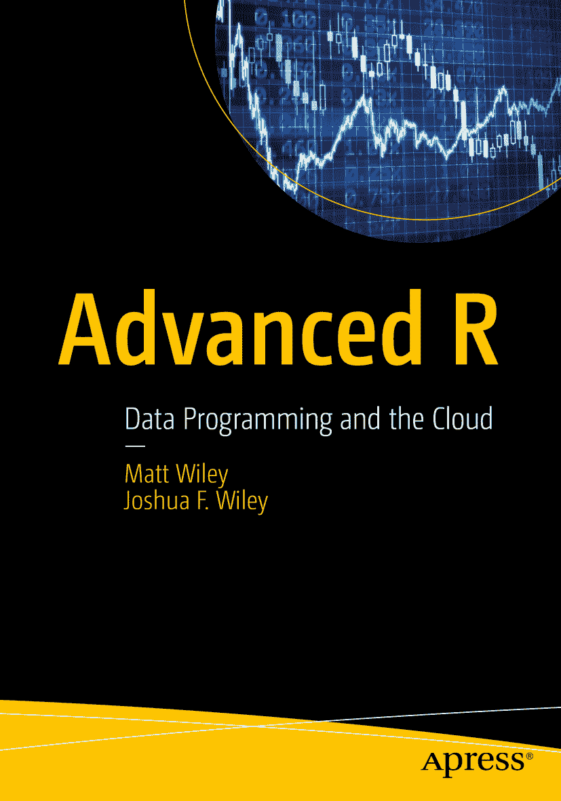

马特·威利和约书亚·F·威利 著 《R 语言高级数据编程与云计算》

本书中作者引用的所有源代码或其他补充材料，读者均可在 [`www.apress.com`](http://www.apress.com) 获取。关于如何查找本书源代码的详细信息，请访问 [`www.apress.com/source-code/`](http://www.apress.com/source-code/)。读者也可在 SpringerLink 的各章补充材料部分访问源代码。

ISBN 978-1-4842-2076-4 e-ISBN 978-1-4842-2077-1 DOI 10.1007/978-1-4842-2077-1

美国国会图书馆控制号: 2016959581 © 马特·威利和约书亚·F·威利 2016

本作品受版权保护。版权所有归出版者所有，无论涉及材料的全部或部分，特别是翻译、转载、重用插图、朗诵、广播、在微缩胶片上复制或以任何其他物理方式复制、传输或信息存储与检索、电子改编、计算机软件的权利，或现在已知或今后开发的类似或不同的方法。

本书中可能出现商标名称、标识和图像。我们并非在每次出现商标名称、标识或图像时都使用商标符号，而是仅以编辑方式使用这些名称、标识和图像，并旨在使商标所有者受益，无意侵犯商标权。

本出版物中使用商品名称、商标、服务标记和类似术语，即使未作特别标识，也不应视为表达其是否受专有权利保护的观点。

尽管本书中的建议和信息在出版之日被认为是真实准确的，但作者、编辑和出版商均不能为可能出现的任何错误或疏漏承担任何法律责任。出版商对本材料不作任何明示或暗示的保证。

使用无酸纸印刷

由施普林格科学+商业媒体纽约公司（地址：纽约州纽约市斯普林街 233 号 6 楼，邮编 10013）在全球图书贸易中发行。电话：1-800-SPRINGER，传真：(201) 348-4505，电子邮箱：orders-ny@springer-sbm.com，或访问 www.springeronline.com。

Apress Media, LLC 是一家加利福尼亚有限责任公司，其唯一成员（所有者）是施普林格科学+商业媒体金融公司（SSBM Finance Inc）。SSBM Finance Inc 是一家特拉华州公司。

献给家人。

