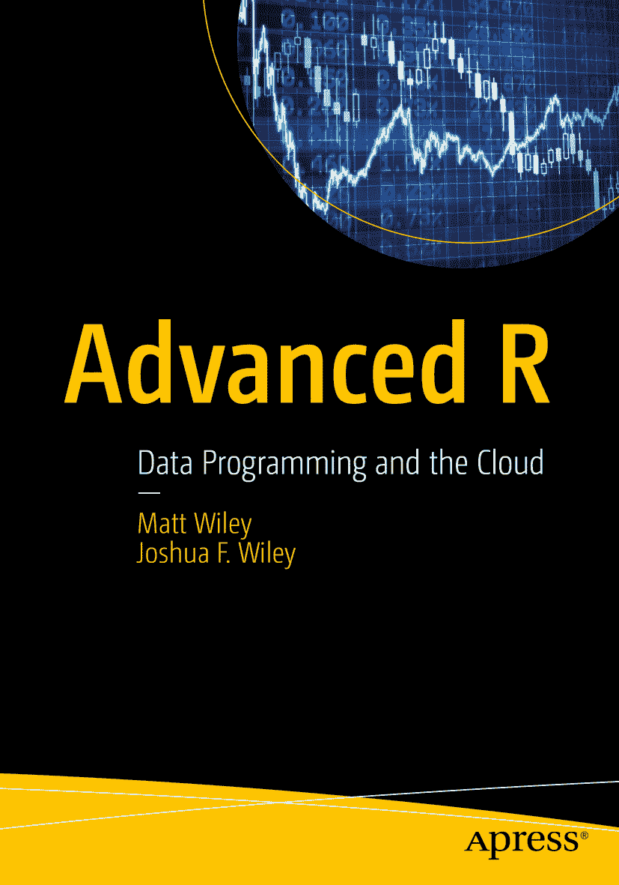

马特·威利（Matt Wiley）与约书亚·F·威利（Joshua F. Wiley）合著《高级 R 语言数据编程与云计算》

本文作者引用的任何源代码或其他补充材料，读者可在[`www.apress.com`](http://www.apress.com)获取。有关如何查找本书源代码的详细信息，请访问[`www.apress.com/source-code/`](http://www.apress.com/source-code/)。读者也可以在 SpringerLink 上访问每章补充材料部分的源代码。

ISBN 978-1-4842-2076-4 电子版 ISBN 978-1-4842-2077-1 DOI 10.1007/978-1-4842-2077-1 美国国会图书馆控制号：2016959581 © 马特·威利与约书亚·F·威利 2016 本作品受版权保护。出版商保留所有权利，包括翻译、重印、插图复用、朗诵、广播、微缩胶片或其他物理形式的复制、信息存储与检索的传输与电子化改编、计算机软件，以及现今已知或未来开发的各种相似或不同方法。

本书中可能出现商标名称、标识和图片。我们仅以编辑形式使用这些名称、标识和图片，并旨在维护商标所有者的权益，无意侵犯其商标权。本出版物中使用的商品名、商标、服务标志及类似术语，即使未明确标注，也不应被视为对其是否受专有权利保护的表达意见。

尽管本书中的建议和信息在出版时被认为是真实准确的，但作者、编辑和出版商均不对可能存在的任何错误或疏漏承担法律责任。出版商对本书所含内容不作任何明示或暗示的保证。本书采用无酸纸印刷。

由 Springer Science+Business Media New York 向全球图书贸易分销，地址：233 Spring Street, 6th Floor, New York, NY 10013。电话：1-800-SPRINGER，传真：(201) 348-4505，电子邮箱：orders-ny@springer-sbm.com，或访问 www.springeronline.com。

Apress Media, LLC 是一家加利福尼亚州有限责任公司，其唯一成员（所有者）为 Springer Science + Business Media Finance Inc (SSBM Finance Inc)。SSBM Finance Inc 是一家特拉华州公司。

献给家人。