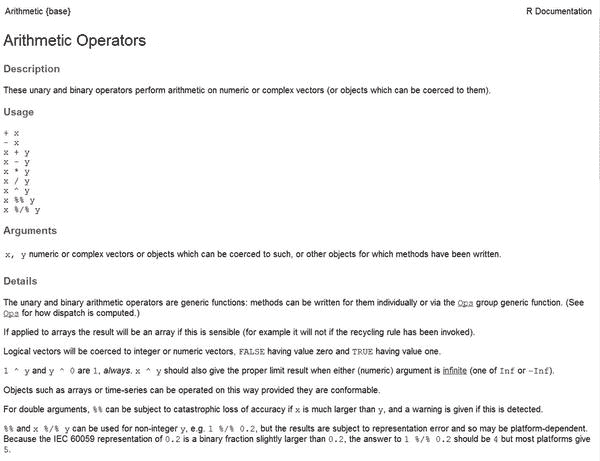
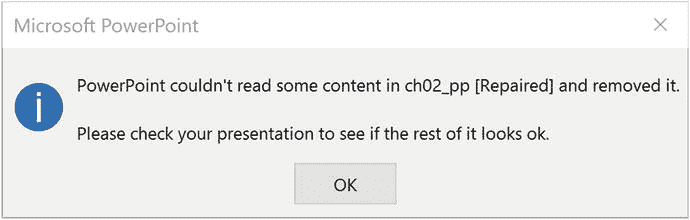
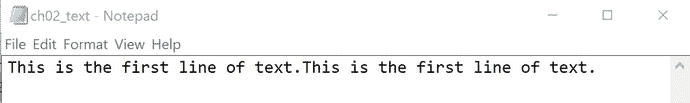
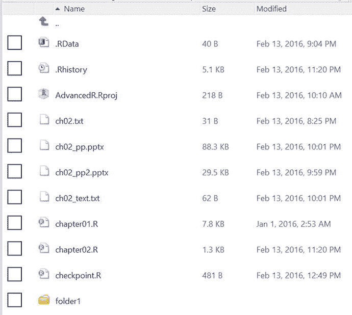
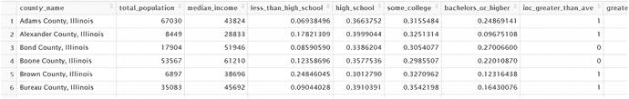
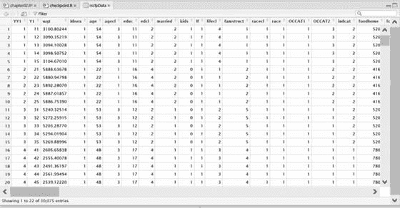
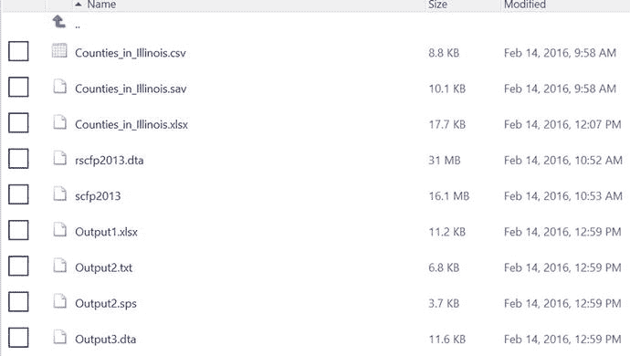
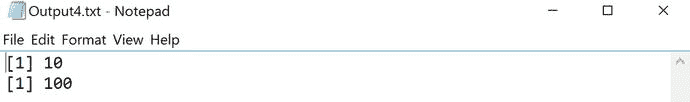

# 编程实用工具

使用 R 执行更高级的操作需要创建可能从未存在过的东西。要创造新事物，就需要细致地理解预构建函数的精确工作方式。本章讨论如何以及在哪里查找现有功能的帮助和文档，R 如何与你的计算机系统和文件交互，以及数据输入输出的细节。和之前一样，请根据你的需要自由选择本章的内容。我们从帮助文件和文档开始。

注意
本书中，**粗体** 代码意味着需要运行。非粗体代码表示命令行输出的结果，或者旨在提供信息但不一定需要运行的代码。


## 帮助与文档

R 语言社区提供了丰富的资源来帮助用户。从预置的函数到包中按主题收集的完整函数集，支持形式多种多样。`?` 和 `help` 都是获取对象或函数信息的有效方式。对于更常见的对象，R 不仅提供了详尽的文档说明具体细节（例如函数的输入），还对预期接受的输入内容进行了详细注释。此外，文档中通常还会展示详细的示例，以说明可以实现的功能。图 2-1 展示了使用这两个函数查询加法运算符时的输出：



**图 2-1. 算术运算符的帮助文档**

```
?'+'
help("+")
```

请注意图 2-1 底部，关于算术运算符的文档甚至贴心地提供了特定信息，指出输出结果可能因平台而异。值得注意的是，并非所有函数都有如此完整、随时可查的文档，但对于许多最常用的函数和包，可以获得极其详细的信息。编写能够独立于平台和环境、重现预期结果的代码，并非总是可行。稍后讨论调试时，这类对各种函数的高级认知会很有帮助。

当然，当你已经知道要使用的对象或函数，只是需要更多细节时，这类帮助更有用。若想实现全新的功能，查阅手册会有所帮助。[`https://cran.r-project.org/manuals.html`](https://cran.r-project.org/manuals.html) 就是这样一个由 R 核心开发团队维护的网站。

现在我们将注意力转向 R 访问系统文件的方式。

## 系统与文件

在 Windows 环境中，R 可能是实现文件操作自动化的非常有效的方式。大多数 IT 部门都愿意安装 R，并且它具有与您相同的文件权限。从创建文件到移动文件、检查日期，R 提供了多种函数，便于从系统获取信息和实现文件管理自动化。根据我们的观察，基于 Unix 的系统可能通过命令行有更优雅的方式来处理此类场景。

R 访问系统的一个有用特性是，它可以发现运行 R 的系统的当前日期、时间和时区。这有助于检测新文件，或用于在文件中添加时间戳（稍后详述）。需要注意的是，这些信息当然依赖于系统环境的准确性，因此在用于高风险项目之前，可能需要谨慎行事。

```
Sys.Date()
[1] "2016-02-13"
Sys.time()
[1] "2016-02-13 16:58:36 CST"
Sys.timezone()
[1] "America/Chicago"
```

这些命令的帮助文档提供了有用的建议，以提高输出的准确性，甚至可能达到毫秒或微秒的精度。

现在让我们关注各种文件管理函数。它们都遵循 `file.*` 的格式，并且第一个参数是一个字符向量，应该是当前工作目录下的文件名，或者是路径加文件名。我们从工作目录中的一个文本文件 `ch02_text.txt` 开始。

函数 `file.exists()` 只接受一个字符串输入，即文件名或路径加文件名。如果仅仅是文件名，它只检查工作目录。这个工作目录由 `getwd()` 函数确认。如果想检查另一个目录中的文件，可以通过在字符串中提供完整的文件路径来实现。此函数返回一个逻辑值 `TRUE` 或 `FALSE`。根据用户对特定文件的权限，您可能无法获得预期的结果。

```
getwd()
[1] "C:/Books/Apress_AdvancedR/RFiles"
file.exists("ch02_text.txt")
[1] TRUE
file.exists("NOSUCHFILE.FAKE")
[1] FALSE
file.exists("C:/Books/Apress_AdvancedR/Apress_AdvancedR_Proposal.docx")
[1] TRUE
```

前面的函数检查是否存在，而另一个函数则测试我们是否有权访问文件。函数 `file.access` 接受类似的输入，但它还需要第二个参数。要测试存在性，第二个参数是 `0`。要测试可执行权限，使用 `1`；要测试写入权限，使用 `2`。如果要测试读取文件的能力，使用 `4`。此函数返回一个整数向量，`0` 表示授予权限，`-1` 表示未授予权限。请注意，该函数的默认设置是测试简单的存在性。`file.access` 的示例如下：

```
file.access("ch02_text.txt")
ch02_text.txt

file.access("ch02_text.txt", mode = 0)
ch02_text.txt

file.access("ch02_text.txt", mode = 1)
ch02_text.txt

file.access("ch02_text.txt", mode = 2)
ch02_text.txt

file.access("ch02_text.txt", mode = 4)
ch02_text.txt
```

接下来，我们将注意力转向 `file.info` 函数，它可以获取关于文件何时被修改、更改或访问的更详细信息。该函数同样接受字符串作为输入。输出提供以下信息：文件大小；是否为目录；以读、写、执行顺序表示的文件权限整数；最后修改时间；最后更改时间；最后访问时间；最后，文件是否可执行：

```
file.info("ch02_text.txt", "chapter01.R")
size isdir mode               mtime               ctime               atime exe
ch02_text.txt   31 FALSE  666 2016-02-13 17:00:16 2016-02-13 16:59:57 2016-02-13 16:59:57  no
chapter01.R   7983 FALSE  666 2016-01-01 02:53:17 2016-01-05 12:26:39 2016-01-01 02:53:17  no
```


请注意，您可以通过`sys.setFileTime`函数修改文件的修改时间。这在某些情况下会很有帮助，尽管其精确度和准确性取决于环境。以下是一个示例：

```
newTime<-Sys.time()-20
newTime
[1] "2016-02-13 20:25:53 CST"
file.info("ch02_text.txt")
size isdir mode               mtime               ctime               atime exe
ch02_text.txt   31 FALSE  666 2016-02-13 17:00:16 2016-02-13 16:59:57 2016-02-13 16:59:57  no
Sys.setFileTime("ch02_text.txt", newTime)
file.info("ch02_text.txt")
size isdir mode               mtime               ctime               atime exe
ch02_text.txt   31 FALSE  666 2016-02-13 20:25:53 2016-02-13 16:59:57 2016-02-13 16:59:57  no
```

关于文件的创建和删除，函数`file.create`和`file.remove`的作用正如其名。它们会返回逻辑值`TRUE`或`FALSE`，甚至能提供更多详细信息：

```
file.create("ch02_created.docx", showWarnings = TRUE)
[1] TRUE
file.remove("ch02_created.docx")
[1] TRUE
file.remove("NOSUCHFILE.FAKE")
[1] FALSE
Warning message:
In file.remove("NOSUCHFILE.FAKE") :
cannot remove file 'NOSUCHFILE.FAKE', reason 'No such file or directory'
```

文件也可以被复制和重命名。函数`file.copy`可以设置覆盖权限，甚至可以使用`recursive=TRUE`选项来复制整个文件夹及其子文件夹。此外，它还有选项来复制模式或文件权限以及文件日期数据（或者，当然，让副本拥有新的修改日期）。以下代码示例展示了这可能如何运作：

```
Sys.time()
[1] "2016-02-13 21:05:29 CST"
file.copy("ch02_text.txt", "ch02_copy.txt", overwrite = TRUE, recursive = FALSE, copy.mode = TRUE, copy.date = TRUE)
[1] TRUE
file.info("ch02_copy.txt")
size isdir mode               mtime               ctime               atime exe
ch02_copy.txt   31 FALSE  666 2016-02-13 20:25:53 2016-02-13 21:05:30 2016-02-13 21:05:30  no
file.rename("ch02_copy.txt", "ch02.txt")
[1] TRUE
```

`file.append`函数将两个文件连接在一起。这对某些文件类型效果很好。如果使用不当，可能会产生不良后果。虽然执行此操作的代码如下，但请仔细注意图 2-2 和图 2-3。对于文本文件，该过程效果足够好。对于 Microsoft PowerPoint 文件，则不然。请记住，这些 PowerPoint 文件的例子更不是为了说明文件本身（两位作者都不认为会真正使用 R 来处理此类文件），而是为了说明文件操作的细节通常值得谨慎对待。请注意，R 认为两个操作都是成功的：



图 2-3. 第二个操作在 R 看来是成功的，但打开文件时并未起作用



图 2-2. 第一个操作在 R 看来是成功的，并且打开文件时确实起作用了

```
file.append("ch02_text.txt", "ch02.txt")
[1] TRUE
file.append("ch02_pp.pptx", "ch02_pp2.pptx")
[1] TRUE
```

您不仅可以用 R 操作文件，还可以创建目录或文件夹。函数是`dir.create`，其行为正如您所期望的那样。我们在此展示该函数的一个示例，以及图 2-4 中生成的结果目录：



图 2-4. 创建的 folder1 目录

```
dir.create("folder1")
```

这些命令对用户有权访问和操作的任何文件都有效。其中一位作者使用这些命令将来自不同部门拥有的各种共享驱动器的数据移动，最终将结果文件发布到网站上。一旦您了解了后续章节中的循环和函数，您将能够自动化大部分文件管理。

### 输入

接下来要面对的挑战是如何将新数据导入 R。数据集往往很大，但有效的技术也可以用于较小的数据集。以制表符或逗号分隔的文本文件是最容易导入 R 的。接下来，常见的数据文件类型包括 Microsoft Excel、SPSS、SAS 和 Stata。更普遍地说，可以相当肯定地说，很可能存在一个 R 包可以处理您想要导入的文件类型。即使需要，也可以输入 PDF 和 Microsoft Word 文件（文本分析，从词云到更具预测性的应用，可以想到这些情况）。对于这些记录中的大部分，输入过程是相似的，因此或许不需要详尽介绍，而更需要建立正确的原则。请务必访问本书的 Apress 网站下载本书的代码包。我们在接下来的示例中使用第[02](http://dx.doi.org/10.1007/978-1-4842-2077-1_02)章文件夹中的文件；使用了`Counties in Illinois`文件（All Counties in Illinois， 2016）和`rscfp2013`文件（DADS， 2016）。

我们从 R 中的一个函数`read.table()`开始，它可以接收几种更基本的文件类型，并将它们作为数据框读入。与大多数输入函数一样，它有几个选项，并非所有选项在任何特定情况下都是必需的。根据读入 R 的数据类型，可能需要多次尝试才能以便于使用和操作的方式成功读入数据。在这种情况下，`View`函数可能会有所帮助，其输出如图 2-5 所示。



图 2-5. `View()`函数的输出

```
countiesILCSV<-read.table("Ch02/Counties_in_Illinois.csv", header = TRUE, sep = ",")
View(countiesILCSV)
```

我们使用三个包——`Hmisc` (Harrell， 2016)、`xlsx` (Dragulescu， 2014)和`foreign` (R Core Team， 2015)——来展示从各种文件类型输入。一个观察是，文件类型实际上可能非常大。如图 2-6 所示，`read.dta`快速而方便地导入了具有超过 30，000 条记录的 Stata 文件。



图 2-6. 一个更大的 Stata .dta 文件成功导入 R，包含数千条记录

```
library(checkpoint)
checkpoint("2016-09-04", R.version = "3.3.1")
library(Hmisc)
library(foreign)
library(xlsx)
rscfpData <- read.dta("Ch02/rscfp2013.dta")
View(rscfpData)
```

我们也可以通过`spss.get`函数导入 SPSS 文件。即使有警告，数据通常也能成功导入。如果数据未成功导入，请搜索警告信息以获取具体细节。在本例中，从我们的标头视图来看，一切似乎都正常。为了简洁起见，我们截取了部分标头输出：


```
countiesILSPSS <- spss.get("Ch02/Counties_in_Illinois.sav")
Warning message:
In read.spss(file, use.value.labels = use.value.labels, to.data.frame = to.data.frame,  :
Ch02/Counties_in_Illinois.sav: Unrecognized record type 7, subtype 18 encountered in system file
head(countiesILSPSS)
county.name total.population median.income
1 Adams County, Illinois                  67030         43824
2 Alexander County, Illinois               8449         28833
3 Bond County, Illinois                   17904         51946
4 Boone County, Illinois                  53567         61210
5 Brown County, Illinois                   6897         38696
6 Bureau County, Illinois                 35083         45692
less.than.high.school high.school some.college bachelors.or.higher
1            0.06938496   0.3663752    0.3155484          0.24869141
2            0.17821309   0.3999044    0.3251314          0.09675108
3            0.08590590   0.3386204    0.3054077          0.27006600
4            0.12358696   0.3577536    0.2985507          0.22010870
5            0.24846045   0.3012790    0.3270962          0.12316438
6            0.09044028   0.3910391    0.3542198          0.16430076
```

我们将用 Excel 进行最后一个示例，这要用到我们的最后一个包 `xlsx`。这个包依赖于 `rJava`（Urbanek, 2016），这个依赖关系根据你使用的 R 版本有所不同。作者们通常尽可能坚持使用 64 位版本，这要求安装 64 位的 Java。如果没做到这一点，R 会毫不客气地报怨。请注意，可以专门指定工作表名称，这使得函数 `read.xlsx` 在提取特定数据片段时非常方便。

```
countiesILExcel <- read.xlsx("Ch02/Counties_in_Illinois.xlsx", sheetName = "Counties_in_Illinois")
```

这三个包，加上 R 本身固有的读取以各种分隔符存储于文本文件中的表格数据的能力，使得输入大部分可能已预排序或收集好的数据变得足够容易。让 R 直接在线查找文件也不困难，这样一位研究人员可以更新记录，而这些结果可以轻松地传播给其他人。稍后，作为其他示例的一部分，我们有一些文件是从互联网实时下载的。现在，我们将注意力转向输出。

### 输出

输出形式多种多样。或许因为需要与其他研究人员或合作伙伴协作，需要适配其他的软件系统。与前面的输入部分非常相似，R 可以轻松地输出为多种文件类型。更有趣的是设置 R 将特定的控制台输出发送到某些文件。这允许一台机器查看在另一台计算机上运行的分析结果。在本节中，我们将演示将数据输出到 SPSS、Stata 和 Excel 的几种方法。然后我们处理控制台输出。请你记住，还有很多其他的创建文件的方法和类型，并且作为更大示例的一部分，我们将演示包括各种文档文件和图形在内的多种类型。

要将文件输出到 Excel、SPSS 或 Stata，只需正确调用 `xlsx` 或 `foreign` 包。如图 2-7 所示，R 可以方便地创建输出。



图 2-7. 从 R 创建的 Excel、SPSS 和 Stata 文件格式的输出

```
write.xlsx(countiesILExcel, "Ch02/Output1.xlsx")
write.foreign(countiesILExcel, "Ch02/Output2.txt", "Ch02/Output2.sps",   package="SPSS")
Warning message:
In writeForeignSPSS(df = list(county_name = c(1L, 2L, 3L, 4L, 5L,  :
some variable names were abbreviated
write.dta(countiesILExcel, "Ch02/Output3.dta")
Warning message:
In write.dta(countiesILExcel, "Ch02/Output3.dta") :
abbreviating variable names
```

`sink` 函数获取控制台输出并将其定向到文件。因此，R 过程的运行结果可以被存储以供后续观察，或保存到共享驱动器供他人查阅。控制台仅将输出发送到文件，不包括输入。仔细比较下面的代码与图 2-8 所示的`Output4.txt`截图之间的差异：



图 2-8. `sink()` 函数输出到文本文件

```
sink("Ch02/Output4.txt", append = TRUE, split = TRUE)
x <- 10
xSquared <- x²
x
[1] 10
xSquared
[1] 100
unlink("Ch02/Output4.txt")
```

我们暂且将注意力从输出上移开，因为我们知道在后续几章中还会再次讨论这个话题。不同类型的输出是必要的，它们往往取决于目标与环境。

下一章将提供快速重复类似操作以及根据环境进行过程修正的工具。这些技术与本章的方法相结合，能够相当方便地在相对较大的规模上实现文件管理的自动化。

